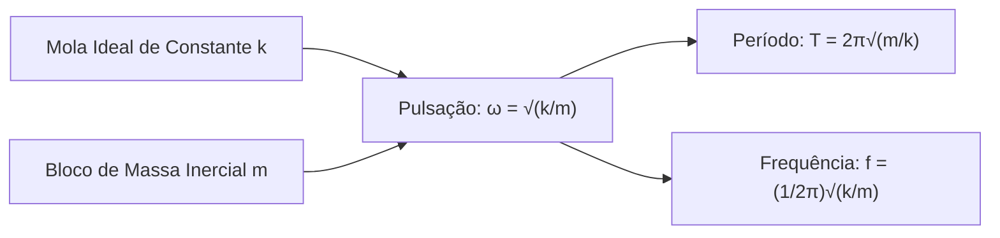
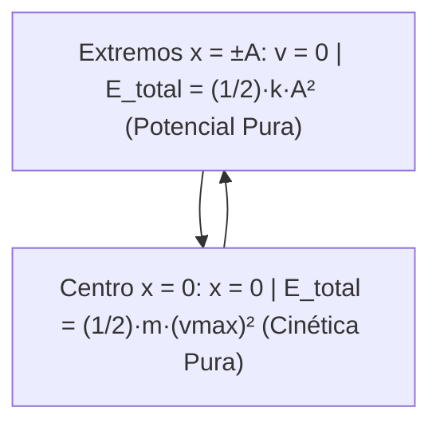
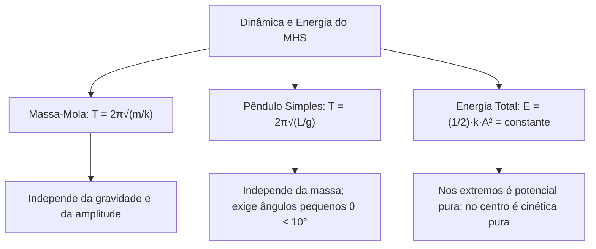

A dinâmica do Movimento Harmônico Simples investiga as forças das oscilações. Em operações de salvamento, forças elásticas em cabos e o amortecimento de impactos exigem a dinâmica newtoniana. A energia mecânica alterna-se continuamente entre as formas cinética e potencial. Este capítulo estuda as forças restauradoras e o balanço energético. Você aprenderá a calcular o período do sistema massa-mola e do pêndulo simples.

> [!objetivos]
> - Relacionar a segunda lei de Newton à força elástica para deduzir a pulsação.
> - Analisar a conservação da energia mecânica total entre cinética e potencial.
> - Calcular o período e a frequência do sistema massa-mola horizontal e vertical.
> - Aplicar a fórmula do pêndulo simples sob pequenas oscilações angulares.

## Dinâmica do MHS e o Sistema Massa-Mola (Dinâmica do MHS)

A dinâmica do MHS aplica a segunda lei de Newton (F = m · a) à força restauradora.

A aceleração do oscilador relaciona-se com a posição pela equação:

a = - ω² · x

Multiplicando essa aceleração pela massa inercial (m), temos a força resultante:

F_res = m · a = - m · ω² · x

Em uma mola horizontal ideal de constante k, a força restauradora obedece à lei de Hooke:

F_elástica = - k · x

Igualando a força elástica à força resultante:

- k · x = - m · ω² · x

k = m · ω²

Isolando a frequência angular (pulsação ω):

ω = √(k / m)

Como o período relaciona-se com a pulsação por T = 2π / ω, obtém-se:

T = 2π · √(m / k)

A frequência natural é o inverso do período:

f = (1 / 2π) · √(k / m)

Duas leis físicas decorrem dessa relação:
- Efeito da massa: o período cresce com a raiz quadrada da massa. Quadruplicar a massa dobra o período.
- Efeito da mola: o período diminui com a raiz de k. Molas mais rígidas oscilam com maior frequência.

## Conservação e Análise Energética do Oscilador (Análise energética do MHS)

Em um oscilador ideal, o atrito e a resistência do ar são desprezados. O sistema é estritamente conservativo.

A energia mecânica total (E_total) é a soma da energia cinética (E_c) com a potencial elástica (E_p):

E_total = E_c + E_p = (1/2) · m · v² + (1/2) · k · x²

O comportamento energético exibe dois pontos notáveis:

1. Nos extremos de retorno (x = +A e x = -A):
   O corpo para momentaneamente (v = 0). A energia cinética é nula (E_c = 0). A mola tem deformação máxima. Toda a energia é potencial elástica:
   E_total = (1/2) · k · A²

2. Na posição central de equilíbrio (x = 0):
   A mola está relaxada (x = 0). A energia potencial é nula (E_p = 0). A velocidade atinge o valor máximo vmax. Toda a energia converte-se em cinética:
   E_total = (1/2) · m · (vmax)²

Em qualquer ponto intermediário x, a soma das energias permanece constante:

(1/2) · k · A² = (1/2) · m · v² + (1/2) · k · x²

> [!resolvido]
> Um bloco de massa m = 0,50 kg está preso a uma mola de constante k = 200 N/m. O conjunto oscila com amplitude A = 0,10 m.
> Determine:
> a) a energia mecânica total;
> b) a velocidade máxima no centro de equilíbrio;
> c) a velocidade na posição x = 0,06 m.
>
> Resolução:
> a) Energia total pela amplitude:
> E_total = (1/2) · k · A² = (1/2) · 200 · (0,10)² = 100 · 0,01 = 1,0 J.
>
> b) No centro (x = 0), toda a energia é cinética:
> (1/2) · m · (vmax)² = 1,0
> 0,25 · (vmax)² = 1,0 => (vmax)² = 4,0 => vmax = 2,0 m/s.
>
> c) Na posição x = 0,06 m:
> E_p = (1/2) · 200 · (0,06)² = 100 · 0,0036 = 0,36 J.
> E_c = 1,0 - 0,36 = 0,64 J.
> 0,25 · v² = 0,64 => v² = 2,56 => v = 1,6 m/s.

## O Pêndulo Simples e as Pequenas Oscilações (Pêndulo Simples)

O pêndulo simples é formado por uma massa m suspensa por fio de comprimento L sob gravidade g.

Ao afastar o pêndulo por um ângulo θ, a componente tangencial do peso atua como restauradora:

F_t = - m · g · sen(θ)

Para pequenos ângulos (θ ≤ 10° em radianos), adota-se a aproximação:

sen(θ) ≈ θ

Com o arco de deslocamento x = L · θ, temos θ = x / L. A força tangencial resulta em:

F_t ≈ - (m · g / L) · x

A força restauradora é linearmente proporcional à elongação. A constante equivalente é k_eq = m · g / L.

Substituindo na fórmula do período:

T = 2π · √(m / k_eq) = 2π · √[m / (m · g / L)]

T = 2π · √(L / g)

A frequência natural vale:

f = (1 / 2π) · √(g / L)

> [!atencao]
> A massa (m) cancela-se na dedução. O período do pêndulo simples não depende da massa do corpo. Ele também não depende da amplitude para oscilações pequenas (isocronismo). O período depende unicamente do comprimento do fio (L) e da gravidade local (g).

## O Sistema Massa-Mola Vertical (Sistema Massa-Mola)

Na montagem vertical, a gravidade puxa o corpo para baixo com o peso (P = m · g).

No repouso estático, a mola deforma-se x₀ para equilibrar o peso:

k · x₀ = m · g => x₀ = m · g / k

Essa deformação inicial apenas desloca a posição de equilíbrio para baixo.

Ao afastar o bloco e soltá-lo, ele oscila em MHS em torno desse novo centro. Como o peso é uma força constante, ele não afeta a rigidez k.

Portanto, o período do oscilador vertical é idêntico ao do sistema horizontal:

T = 2π · √(m / k)

| Oscilador | Força Restauradora | Período de Oscilação | Dependência Física |
|---|---|---|---|
| Massa-Mola | Força Elástica: F = -k·x | T = 2π · √(m / k) | Massa m e constante elástica k |
| Pêndulo Simples | Componente Tangencial do Peso | T = 2π · √(L / g) | Comprimento L e gravidade g |

## Mapa do capítulo

### Para fixar

- A dinâmica do MHS iguala a força elástica F = -k·x à resultante F = -m·ω²·x, fornecendo ω = √(k/m).
- O período do sistema massa-mola obedece a T = 2π√(m/k), aumentando com a massa e diminuindo com a rigidez.
- No sistema massa-mola vertical, o peso apenas desloca o equilíbrio, preservando o período T = 2π√(m/k).
- A energia mecânica total em um oscilador ideal é conservada e vale E_total = (1/2)·k·A².
- Nos extremos de retorno (x = ±A), a energia é inteiramente potencial elástica e a velocidade é nula.
- Na posição de equilíbrio central (x = 0), a energia potencial é nula e a energia cinética é máxima.
- O pêndulo simples sob pequenas oscilações (θ ≤ 10°) tem período T = 2π√(L/g).
- O período do pêndulo simples independe da massa do corpo e depende unicamente de L e de g.
