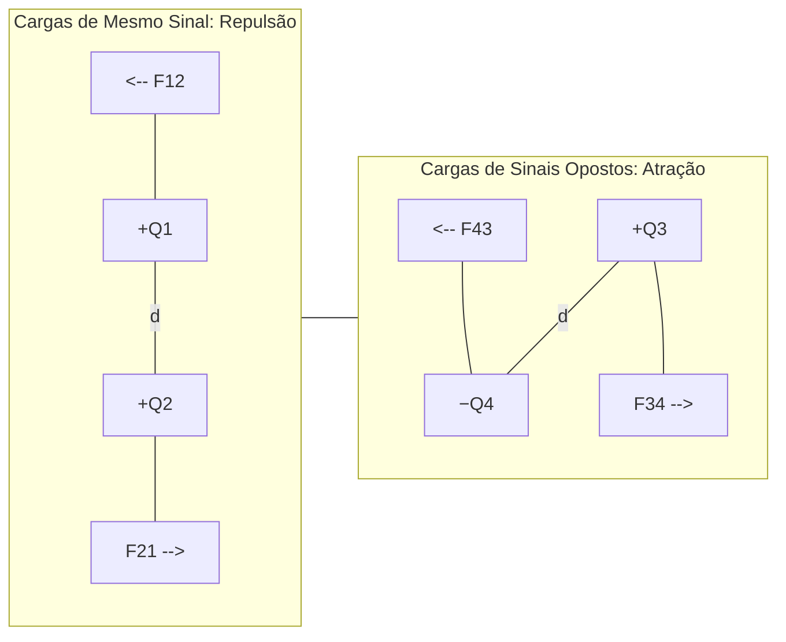
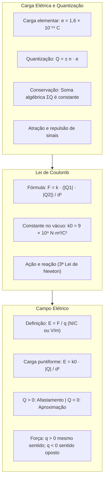

> [!objetivos]
> - Compreender a natureza discreta e a quantização da carga elétrica na matéria.
> - Aplicar os princípios da conservação e da atração e repulsão eletrostática.
> - Calcular a força eletrostática entre cargas puntiformes por meio da Lei de Coulomb.
> - Determinar o módulo, a direção e o sentido do vetor campo elétrico pontual e uniforme.

A eletrostática estuda o comportamento das cargas elétricas em repouso e as interações fundamentais que regem as forças e os campos no espaço. Nas atividades práticas do Corpo de Bombeiros Militar, o controle de cargas eletrostáticas é indispensável para prevenir descargas perigosas e faíscas em atmosferas potencialmente inflamáveis de postos de abastecimento, indústrias químicas e depósitos de gases combustíveis. A análise desses fenômenos tem início na estrutura atômica elementar e nas leis clássicas de Coulomb.

## Carga Elétrica e Quantização

A carga elétrica é uma propriedade intrínseca das partículas subatômicas fundamentais. O átomo é composto por um núcleo denso contendo prótons e nêutrons, circundado por uma eletrosfera com elétrons em movimento orbital.

O próton possui carga elétrica positiva (+e). O elétron possui carga elétrica negativa (−e). O nêutron não possui carga elétrica líquida (partícula neutra).

A magnitude fundamental compartilhada pelo próton e pelo elétron é a carga elementar e, cujo valor no Sistema Internacional (SI) é:

e = 1,6 × 10⁻¹⁹ C (Coulombs)

A carga elétrica de qualquer corpo material é quantizada. Isso significa que a quantidade líquida de carga Q é sempre um múltiplo inteiro da carga elementar:

Q = ± n · e

Nessa expressão, n representa a quantidade inteira de elétrons em excesso ou em falta no corpo (n ∈ ℕ). Se o corpo perdeu elétrons, ele adquire carga positiva (Q = + n · e). Se o corpo recebeu elétrons, ele adquire carga negativa (Q = − n · e).

Um corpo eletricamente neutro não é desprovido de cargas elétricas. Ele contém um número exatamente idêntico de prótons e elétrons, resultando em um saldo algébrico nulo de carga líquida.

## Princípios Fundamentais da Eletrostática

A interação entre corpos eletrizados obedece a dois postulados universais da física clássica:

O Princípio da Atração e Repulsão estabelece que cargas de mesmo sinal repelem-se. Cargas de sinais opostos atraem-se.

O Princípio da Conservação da Carga afirma que, em sistema isolado, a soma algébrica das cargas permanece constante. Cargas não são criadas nem destruídas, apenas transferidas entre corpos.

| Princípio Eletrostático | Enunciado Físico | Aplicação Operacional |
|---|---|---|
| Atração e Repulsão | Sinais iguais repelem-se; sinais opostos atraem-se | Eletrização e aterramento de carcaças |
| Conservação da Carga | A soma total ΣQ permanece rigorosamente constante | Equilíbrio após contato entre condutores |
| Quantização da Carga | Q = ± n · e (múltiplo inteiro da carga do elétron) | Balanço iônico e eletrodeposição |

> [!bizu] Eletrização por Contato entre Condutores Idênticos
> Quando dois condutores esféricos idênticos com cargas Q1 e Q2 entram em contato, a carga total divide-se em partes perfeitamente iguais. Ao final do contato, cada esfera assume uma carga final dada pela média aritmética simples: Q' = (Q1 + Q2) / 2. Se houver três condutores idênticos em contato simultâneo, a carga final de cada um é (Q1 + Q2 + Q3) / 3.

## A Lei de Coulomb

A Lei de Coulomb estabelece que a força eletrostática entre duas cargas puntiformes em repouso é proporcional ao produto de suas cargas e inversamente proporcional ao quadrado da distância:

F = k · (|Q1| · |Q2|) / d²

Nessa fórmula, F é a força eletrostática em Newtons (N). As grandezas |Q1| e |Q2| representam os módulos das cargas em Coulombs (C). O termo d representa a distância retilínea entre as cargas em metros (m). A constante k é a constante eletrostática do meio. No vácuo, ela assume o valor de referência:

k0 = 9 × 10⁹ N · m² / C²

A força é vetorial, formando um par de ação e reação (3ª Lei de Newton) com mesma intensidade e sentidos opostos. A relação é quadrática inversa: dobrar a distância reduz a força a 1/4; reduzir a distância à metade quadruplica a força.

## Campo Elétrico

Uma carga elétrica modifica as propriedades físicas do espaço ao seu redor, criando uma região de influência denominada campo elétrico. Qualquer outra carga inserida nessa região experimentará a ação de uma força de origem eletrostática.

O vetor campo elétrico E em um ponto do espaço é definido formalmente como a razão entre a força eletrostática F que atua sobre uma carga de prova positiva q colocada naquele ponto e o próprio valor dessa carga:

E = F / q

A unidade de intensidade do campo elétrico no Sistema Internacional é o Newton por Coulomb (N/C), equivalente ao Volt por metro (V/m).

Para uma carga puntiforme isolada Q no vácuo, o módulo do campo elétrico a uma distância d é dado por:

E = k0 · |Q| / d²

O campo independe da presença de carga de prova. A direção é radial. O sentido é de afastamento para carga fonte positiva (Q > 0) e de aproximação para negativa (Q < 0).

| Carga Geradora (Q) | Natureza do Vetor Campo Elétrico (E) | Configuração das Linhas de Campo |
|---|---|---|
| Q > 0 (Positiva) | Radial de afastamento | Nascem na carga e divergem para o infinito |
| Q < 0 (Negativa) | Radial de aproximação | Convergem do infinito e morrem na carga |

> [!pegadinha] Sentido da Força Elétrica sobre a Carga de Prova
> A relação vetorial fundamental é F = q · E. O sinal da carga de prova q define o sentido da força:
> Se q for positiva (q > 0), o vetor força F tem rigorosamente a mesma direção e o mesmo sentido do campo elétrico E.
> Se q for negativa (q < 0), o vetor força F tem a mesma direção, mas sentido OPOSTO ao do campo elétrico E.
> Um elétron livre solto em um campo elétrico sempre se move espontaneamente em sentido contrário ao vetor campo. Essa pegadinha é extremamente comum em questões de prova.

## Linhas de Campo e Campo Elétrico Uniforme

As linhas de campo elétrico, concebidas pioneiramente por Michael Faraday, constituem representações geométricas contínuas que permitem visualizar a distribuição espacial do vetor campo elétrico em qualquer ponto do espaço.

Essas linhas de força obedecem a quatro propriedades físicas invariáveis:

Primeiro, elas originam-se em cargas elétricas positivas e convergem para cargas negativas, podendo estender-se ao infinito. Segundo, o vetor campo elétrico E em cada ponto é estritamente tangente à linha de força, apontando no mesmo sentido de orientação da linha. Terceiro, duas linhas de campo elétrico jamais se cruzam no espaço físico, pois o vetor campo resultante em cada ponto é único e bem definido. Quarto, a densidade espacial das linhas é proporcional à intensidade do campo: regiões com linhas densamente agrupadas indicam campos elétricos intensos, enquanto regiões de linhas esparsas representam campos fracos.

No Campo Elétrico Uniforme (CEU), tipicamente estabelecido no interior de placas condutoras planas e paralelas submetidas a cargas elétricas opostas, o vetor E possui rigorosamente a mesma intensidade, a mesma direção e o mesmo sentido em todos os pontos internos. As linhas de força configuram-se como retas perfeitamente paralelas e igualmente espaçadas.

## Aplicações Práticas Resolvidas

Analise a resolução de um problema representativo das provas.

> [!resolvido] Força Eletrostática e Aceleração de Carga em Campo Uniforme
> Uma partícula de poeira eletrizada com carga negativa q = − 3,2 × 10⁻¹⁹ C e massa m = 2,0 × 10⁻¹⁵ kg encontra-se em repouso no interior de um campo elétrico uniforme de intensidade E = 5,0 × 10⁴ N/C, direcionado verticalmente para cima. Desprezando a gravidade:
> a) Qual o número de elétrons em excesso na partícula?
> b) Qual a intensidade, a direção e o sentido da força eletrostática que atua sobre ela?
> c) Qual a aceleração adquirida pela partícula?
>
> **Resolução passo a passo:**
> Para o item a: Como q = n · e, temos n = |q| / e = (3,2 × 10⁻¹⁹ C) / (1,6 × 10⁻¹⁹ C) = 2 elétrons em excesso.
> Para o item b: A intensidade da força é F = |q| · E = (3,2 × 10⁻¹⁹ C) · (5,0 × 10⁴ N/C) = 1,6 × 10⁻¹⁴ N.
> Como a carga de prova é negativa (q < 0), o sentido da força é contrário ao do campo. Sendo o campo vertical para cima, a força elétrica atua na direção vertical com sentido voltado para baixo.
> Para o item c: Pela Segunda Lei de Newton (F = m · a), a aceleração vale a = F / m = (1,6 × 10⁻¹⁴ N) / (2,0 × 10⁻¹⁵ kg) = 8,0 m/s², direcionada verticalmente para baixo.

## Mapa do capítulo

### Para fixar
- A carga elétrica na matéria é quantizada em múltiplos inteiros da carga elementar: Q = ± n · e, com e = 1,6 × 10⁻¹⁹ C.
- Um corpo neutro possui número perfeitamente igual de prótons e elétrons, com saldo líquido nulo de carga elétrica.
- Cargas elétricas de mesmo sinal repelem-se mutuamente; cargas de sinais contrários atraem-se mutuamente.
- Em um sistema eletricamente isolado, a soma total das cargas elétricas permanece rigorosamente constante.
- A força eletrostática entre duas cargas puntiformes é regida pela Lei de Coulomb: F = k · (|Q1| · |Q2|) / d².
- As forças eletrostáticas entre duas cargas constituem um par de ação e reação com mesma intensidade e sentidos opostos.
- O campo elétrico criado por uma carga positiva é radial de afastamento; o de uma carga negativa é radial de aproximação.
- Uma carga de prova positiva experimenta força no mesmo sentido do campo elétrico; uma carga negativa experimenta força em sentido oposto.
