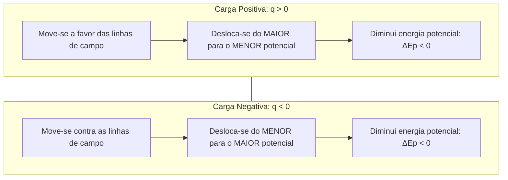
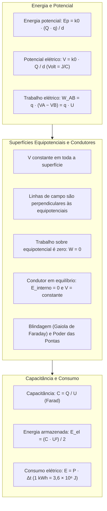

> [!objetivos]
> - Compreender os conceitos de energia potencial eletrostática e potencial elétrico.
> - Calcular o trabalho da força elétrica e a diferença de potencial em campos elétricos.
> - Analisar as propriedades das superfícies equipotenciais e dos condutores em equilíbrio eletrostático.
> - Dominar os fundamentos da capacitância, poder das pontas, blindagem e consumo energético em kWh.

A descrição dinâmica dos fenômenos elétricos complementa-se de forma elegante com a formulação energética. Em operações de resgate técnico do Corpo de Bombeiros, o oficial depara-se frequentemente com linhas de transmissão rompidas, risco de choque elétrico por tensão de passo e necessidade de desenergização de estruturas. O domínio das grandezas escalares da eletrostática — energia potencial, potencial elétrico e capacitância — permite quantificar a capacidade de realização de trabalho das cargas e projetar medidas de proteção coletiva.

## Energia Potencial Eletrostática e Potencial Elétrico

A força eletrostática é conservativa. O trabalho realizado sobre uma carga independe da trajetória percorrida. Ele depende apenas dos pontos inicial e final.

Associada a essa força conservativa, define-se a energia potencial eletrostática Ep. Para duas cargas puntiformes Q e q separadas por uma distância d no vácuo, adotando o nível de referência nulo no infinito (d → ∞), a energia potencial do sistema é:

Ep = k0 · (Q · q) / d

Os sinais das cargas entram no cálculo. Cargas de mesmo sinal geram energia potencial positiva (Ep > 0, repulsão). Cargas de sinais opostos geram energia potencial negativa (Ep < 0, atração).

O potencial elétrico V mede a energia por unidade de carga: V = Ep / q = k0 · Q / d. Sua unidade é o Volt (V = J/C). Cargas positivas geram potenciais positivos (V > 0). Cargas negativas geram potenciais negativos (V < 0).

| Grandeza Eletrostática | Natureza Matemática | Fórmula Pontual no Vácuo | Unidade no SI |
|---|---|---|---|
| Força Elétrica (F) | Vetorial | F = k0 · (Q · q) / d² | Newton (N) |
| Campo Elétrico (E) | Vetorial | E = k0 · Q / d² | N/C ou V/m |
| Energia Potencial (Ep) | Escalar | Ep = k0 · (Q · q) / d | Joule (J) |
| Potencial Elétrico (V) | Escalar | V = k0 · Q / d | Volt (V = J/C) |

## Trabalho da Força Elétrica e Movimento de Cargas

Quando uma carga de prova q é deslocada de um ponto inicial A até um ponto final B em um campo elétrico, o trabalho realizado pela força elétrica é igual à variação negativa da energia potencial eletrostática:

W_AB = Ep_A − Ep_B = q · VA − q · VB = q · (VA − VB)

A diferença de potencial elétrico entre os pontos A e B é denotada por U_AB = VA − VB. Portanto:

W_AB = q · U_AB

Em um Campo Elétrico Uniforme (CEU), a relação entre a intensidade do campo E, a diferença de potencial U e a distância d medida paralelamente às linhas de campo simplifica-se para:

U = E · d  =>  W_AB = q · E · d

Cargas abandonadas em repouso movem-se espontaneamente buscando menor energia potencial. Cargas positivas (q > 0) movem-se a favor do campo, do maior para o menor potencial. Cargas negativas (q < 0) movem-se contra o campo, do menor para o maior potencial. Em ambos os casos, a energia potencial elétrica diminui.

> [!pegadinha] Trabalho Nulo ao Longo de Superfícies Equipotenciais
> Se uma carga elétrica q for deslocada entre dois pontos quaisquer situados sobre a mesma superfície equipotencial (VA = VB), a diferença de potencial é nula: ΔV = VA − VB = 0. Por consequência direta, o trabalho da força elétrica ao longo dessa trajetória é rigorosamente ZERO:
> W = q · (VA − VB) = q · 0 = 0 J.
> Esse resultado independe do valor da carga e do trajeto percorrido sobre a superfície. A força elétrica é perpendicular ao deslocamento em cada ponto, não realizando trabalho.

## Superfícies Equipotenciais e Condutores em Equilíbrio

Superfície equipotencial é qualquer superfície geométrica formada por pontos que possuem rigorosamente o mesmo potencial elétrico (V = constante).

As superfícies equipotenciais apresentam propriedades estruturais essenciais:

Primeiro, as linhas de campo elétrico são sempre perpendiculares (ortogonais) às superfícies equipotenciais em todos os pontos de interseção.

Segundo, para uma carga pontual isolada, as superfícies equipotenciais são cascas esféricas concêntricas com centro na carga. Para um campo elétrico uniforme, são planos paralelos perpendiculares às linhas de força.

### Condutores em Equilíbrio Eletrostático

Um condutor metálico atinge o equilíbrio eletrostático quando cessam os movimentos ordenados de suas cargas livres. Nessa condição, o condutor apresenta características singulares:

O campo elétrico no interior do condutor é rigorosamente nulo (E_interno = 0).

Todo o excesso de carga elétrica localiza-se exclusivamente na superfície externa do condutor.

O potencial elétrico é rigorosamente constante e uniforme em todo o condutor. Os pontos internos e todos os pontos da superfície encontram-se no mesmo potencial: V_interno = V_superfície.

O campo elétrico imediatamente externo à superfície do condutor é perpendicular a ela em cada ponto, possuindo intensidade dada por E = σ / ε0, onde σ é a densidade superficial de carga.

| Propriedade no Equilíbrio | Descrição Física | Fenômeno Tecnológico Decorrente |
|---|---|---|
| Campo elétrico interno nulo | E_interno = 0 em qualquer ponto da massa | Blindagem Eletrostática (Gaiola de Faraday) |
| Excesso de carga na superfície | Elétrons repelem-se para o perímetro externo | Proteção em fuselagem de aeronaves e viaturas |
| Potencial elétrico constante | V_interno = V_superfície = constante | Ausência de diferença de potencial no interior |
| Poder das pontas | Maior densidade σ em regiões de menor raio | Para-raios prediais de Franklin |

Nas pontas de condutores, a densidade de carga é maior (poder das pontas). O campo externo ioniza o ar, facilitando descargas (para-raios). A blindagem eletrostática (Gaiola de Faraday) isola o interior oco contra campos externos, protegendo viaturas e equipamentos atingidos por raios.

## Capacitância e Consumo de Energia Elétrica

A capacidade eletrostática ou capacitância C de um condutor mede sua aptidão para armazenar carga elétrica sob uma determinada diferença de potencial U:

C = Q / U

No Sistema Internacional, a unidade de capacitância é o Farad (F = C/V). A capacitância depende unicamente da forma geométrica do condutor, de suas dimensões físicas e do meio dielétrico que o envolve.

A energia potencial elétrica armazenada no campo eletrostático de um capacitor carregado é dada por:

E_el = (Q · U) / 2 = (C · U²) / 2 = Q² / (2 · C)

No estudo de dispositivos e instalações de socorro, a potência elétrica P representa a taxa temporal de conversão energética: P = E / Δt, medida em Watts (W = J/s).

A energia elétrica consumida por aparelhos e motores elétricos é calculada pelo produto da potência de operação pelo tempo de funcionamento:

E = P · Δt

Nas medições de concessionárias de energia e nas provas, adota-se a unidade comercial quilowatt-hora (kWh):

1 kWh = 1.000 W · 3.600 s = 3,6 × 10⁶ Joules (3,6 MJ)

> [!bizu] Cálculo Rápido de Consumo em kWh
> Para calcular o consumo em kWh, converta a potência do aparelho para quilowatts (dividindo por 1.000) e multiplique diretamente pelas horas de funcionamento. Um motor elétrico de desencarcerador de 2.000 W (2 kW) operando por 3 horas consome exatamente E = 2 kW · 3 h = 6 kWh.

## Aplicações Práticas Resolvidas

Analise a resolução de um problema representativo.

> [!resolvido] Potencial Elétrico e Trabalho em Resgate com Linha Energizada
> Uma linha de distribuição de alta tensão caída ao solo cria um campo elétrico radial no solo úmido. Dois pontos A e B situam-se ao longo da mesma linha radial com potenciais VA = 10.000 V e VB = 4.000 V. Uma carga de prova q = + 2,0 × 10⁻⁵ C é transportada do ponto A até o ponto B.
> a) Qual a diferença de potencial U_AB entre os pontos?
> b) Qual o trabalho realizado pela força elétrica sobre a carga no trajeto de A para B?
> c) Se a carga for deslocada entre dois pontos sobre uma mesma circunferência concêntrica de raio rA, qual o trabalho realizado?
>
> **Resolução:**
> Item a: U_AB = VA − VB = 10.000 V − 4.000 V = 6.000 V (ou 6 kV).
> Item b: W_AB = q · U_AB = (2,0 × 10⁻⁵ C) · (6.000 V) = 0,12 J.
> Como a carga é positiva e deslocou-se do maior para o menor potencial, o trabalho é positivo (trabalho motor espontâneo).
> Item c: Como os pontos situam-se sobre a mesma circunferência concêntrica em torno da fonte radial, eles pertencem à mesma superfície equipotencial (VA1 = VA2). Logo, ΔV = 0 e o trabalho é nulo: W = q · 0 = 0 J.

## Mapa do capítulo

### Para fixar
- A energia potencial eletrostática entre duas cargas puntiformes é Ep = k0 · (Q · q) / d, sendo positiva para repulsão e negativa para atração.
- O potencial elétrico é grandeza escalar: V = k0 · Q / d, com unidade Volt (V = J/C).
- O trabalho da força elétrica para deslocar uma carga de A para B é W_AB = q · (VA − VB) = q · U_AB.
- Cargas positivas movem-se espontaneamente para potenciais menores; cargas negativas movem-se para potenciais maiores.
- As linhas de campo elétrico são sempre perpendiculares às superfícies equipotenciais.
- O trabalho da força elétrica ao longo de qualquer superfície equipotencial é rigorosamente nulo.
- Em condutores em equilíbrio eletrostático, o campo elétrico interno é zero e o potencial elétrico é uniforme em todo o volume.
- A blindagem eletrostática isola o interior de cavidades condutoras contra campos elétricos externos.
- 1 quilowatt-hora (kWh) corresponde ao produto de 1.000 W por 3.600 s, totalizando 3,6 × 10⁶ Joules.
