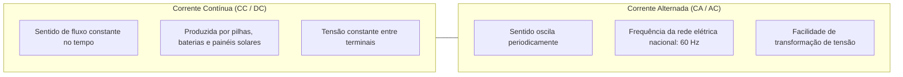
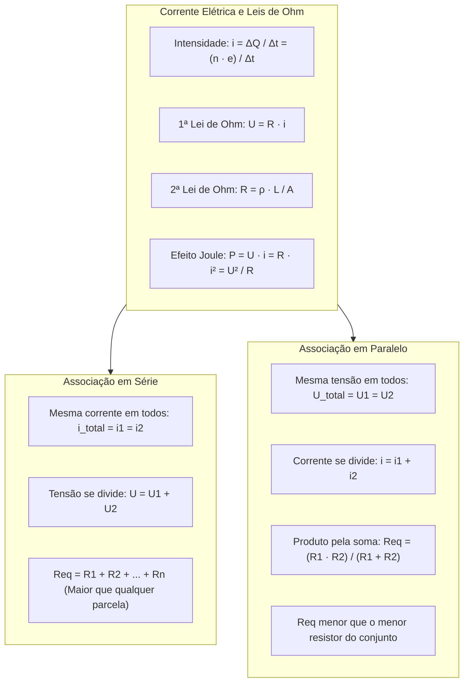

> [!objetivos]
> - Compreender a definição de corrente elétrica, seus sentidos real e convencional, e os regimes contínuo e alternado.
> - Aplicar a Primeira e a Segunda Leis de Ohm e analisar a dependência geométrica e térmica da resistência.
> - Calcular a potência elétrica dissipada por efeito Joule e o consumo energético em circuitos resistivos.
> - Dominar a associação de resistores em série, em paralelo e mista, calculando a resistência equivalente e a divisão de corrente.

A eletrodinâmica estuda o movimento ordenado de cargas elétricas e a transferência controlada de energia nos circuitos. Nas operações de combate a incêndios e vistorias técnicas do Corpo de Bombeiros Militar, o conhecimento das correntes elétricas e do efeito Joule é vital. Ele permite identificar causas de sobrecarga em fiações prediais, dimensionar condutores elétricos para motobombas e atuar com segurança em sinistros energizados.

## Corrente Elétrica e Sentidos de Movimento

A corrente elétrica é o movimento ordenado de portadores de carga elétrica através da seção transversal de um condutor submetido a uma diferença de potencial elétrico. Nos condutores metálicos sólidos, os portadores móveis de carga são os elétrons livres.

A intensidade média da corrente elétrica i mede a taxa de carga transportada por unidade de tempo:

i = ΔQ / Δt

A unidade de corrente elétrica no Sistema Internacional é o Ampère (A = C/s). Como a carga líquida é quantizada por ΔQ = n · e, a corrente pode ser expressa pelo número de elétrons que atravessam o fio condutor:

i = (n · e) / Δt

Em gráficos que relacionam a corrente elétrica i com o tempo t, a área sob a curva fornece numericamente a quantidade de carga elétrica ΔQ transportada no intervalo considerado.

Na análise física de circuitos, distinguem-se dois sentidos de orientação da corrente elétrica:

O sentido real descreve o movimento dos elétrons livres, do menor para o maior potencial elétrico. O sentido convencional adota cargas positivas fictícias, apontando do maior para o menor potencial. Todos os esquemas e leis de circuitos adotam o sentido convencional.

Quanto à invariabilidade temporal, a corrente classifica-se em dois tipos fundamentais:

A Corrente Contínua (CC) mantém seu sentido constante, sendo gerada por pilhas e baterias. A Corrente Alternada (CA) inverte periodicamente seu sentido, operando a 60 Hz na rede pública brasileira.



## Resistores e as Leis de Ohm

Resistor é qualquer dispositivo elétrico cuja finalidade exclusiva no circuito é oferecer oposição à passagem da corrente elétrica, convertendo energia elétrica integralmente em energia térmica. Esse processo térmico de conversão é denominado Efeito Joule.

A Primeira Lei de Ohm estabelece que, para determinados condutores mantidos a temperatura constante, a diferença de potencial elétrico U aplicada aos terminais é diretamente proporcional à intensidade da corrente i que o percorre:

U = R · i

A constante R é a resistência elétrica do condutor, medida em Ohms (Ω = V/A). Condutores que obedecem a essa regra são ôhmicos. Seu gráfico U × i é uma reta pela origem. A inclinação da reta representa a resistência R.

### A Segunda Lei de Ohm e a Resistividade

A Segunda Lei de Ohm descreve como a resistência elétrica depende da geometria física do condutor e da natureza do material constituinte:

R = ρ · L / A

Nessa fórmula, L é o comprimento do fio condutor em metros (m), A é a área de sua seção transversal em metros quadrados (m²), e ρ é a resistividade elétrica do material, medida em Ohm-metro (Ω · m).

A resistência é proporcional ao comprimento L. Ela é inversamente proporcional à área A da seção transversal.

A condutividade elétrica σ é o inverso da resistividade: σ = 1 / ρ, medida em Siemens por metro (S/m). Metais como cobre e alumínio possuem resistividades extremamente baixas (na ordem de 10⁻⁸ Ω·m), atuando como condutores de alta eficiência.

Para a maioria absoluta dos metais puros, a resistividade elétrica aumenta linearmente com a elevação da temperatura:

ρ(T) = ρ0 · [1 + α · (T − T0)]

O parâmetro α é o coeficiente térmico de resistividade. Quando a temperatura sobe, os átomos vibram mais. As colisões com os elétrons aumentam, elevando a resistência.


> [!bizu] Bitola de Fiação e Aquecimento de Circuitos
> A Segunda Lei de Ohm explica por que fiações de chuveiros e bombas de combate a incêndio exigem bitolas grossas. A resistência é inversamente proporcional à área (R = ρ·L/A). Dobrar o raio do condutor quadruplica a sua área transversal e divide a sua resistência por 4. Isso reduz drasticamente as perdas térmicas por efeito Joule (P = R·i²), impedindo o derretimento do isolamento plástico.

## Potência Elétrica e Efeito Joule

A potência elétrica P convertida em calor por um resistor ôhmico expressa a energia dissipada por unidade de tempo. A partir da definição P = U · i e aplicando a Primeira Lei de Ohm (U = R · i), obtemos três formulações equivalentes:

P = U · i = R · i² = U² / R

A expressão P = R · i² é particularmente útil para circuitos em série (onde a corrente i é constante). A expressão P = U² / R é útil para circuitos em paralelo (onde a tensão U é comum a todos os elementos).

A energia elétrica dissipada em calor por efeito Joule no intervalo Δt vale:

E = P · Δt = R · i² · Δt

O aquecimento excessivo por efeito Joule em fios finos é causa frequente de incêndios periciados pelos bombeiros.

## Associação de Resistores

Na prática da engenharia elétrica, associamos resistores para obter resistências equivalentes desejadas e repartir tensões e correntes operacionais.

### Associação em Série

Na associação em série, os resistores são conectados consecutivamente em uma única linha condutora:

A corrente elétrica é estritamente a mesma em todos os resistores: i_total = i1 = i2 = ... = in.

A tensão total do circuito é a soma das quedas de tensão em cada resistor: U_total = U1 + U2 + ... + Un.

A resistência equivalente Req é a soma direta de todas as resistências da associação:

Req = R1 + R2 + ... + Rn

A resistência equivalente em série é sempre estritamente maior do que o maior resistor presente no conjunto.

### Associação em Paralelo

Na associação em paralelo, todos os resistores são ligados aos mesmos dois nós elétricos comuns:

A diferença de potencial U é rigorosamente a mesma em todos os resistores: U_total = U1 = U2 = ... = Un.

A corrente total fornecida pela fonte divide-se nos nós: i_total = i1 + i2 + ... + in.

O inverso da resistência equivalente é a soma dos inversos das resistências individuais:

1 / Req = (1 / R1) + (1 / R2) + ... + (1 / Rn)

Para dois resistores em paralelo, aplica-se a fórmula consagrada do produto pela soma:

Req = (R1 · R2) / (R1 + R2)

Para n resistores idênticos de valor R associados em paralelo, a resistência equivalente reduz-se a:

Req = R / n

A resistência equivalente em paralelo é sempre estritamente menor do que o menor resistor participante do circuito.

```mermaid Divisão de Corrente em Resistores Paralelos
flowchart LR
    I["Corrente Total: i = 12 A"] --> No["Nó de Entrada"]
    No --> |R1 = 2 Ω (Menor R)| I1["Corrente i1 = 8 A (Maior i)"]
    No --> |R2 = 4 Ω (Maior R)| I2["Corrente i2 = 4 A (Menor i)"]
    I1 --> NoFim["Nó de Saída"]
    I2 --> NoFim
    NoFim --> IFim["Corrente Recomposta: 12 A"]
```

| Tipo de Associação | Corrente Elétrica | Diferença de Potencial | Resistência Equivalente (Req) | Efeito de Falha em um Item |
|---|---|---|---|---|
| **Série** | Idêntica em todos (i) | Soma das parcelas: U = ΣUi | Req = R1 + R2 + ... + Rn | Interrompe todo o circuito |
| **Paralelo** | Divide-se nos nós: i = Σii | Idêntica em todos (U) | Req = (R1 · R2) / (R1 + R2) | Demais ramos operam normalmente |

> [!pegadinha] Divisão Inversa da Corrente em Ramos Paralelos
> Em resistores associados em paralelo submetidos à mesma tensão U, a corrente elétrica reparte-se em proporção INVERSA às resistências de cada ramo: i1 · R1 = i2 · R2 = U. O ramo que possui a menor resistência elétrica conduz a maior parcela da corrente. Em um paralelo de 2 Ω e 4 Ω alimentado por 12 A, o resistor de 2 Ω conduz 8 A, enquanto o de 4 Ω conduz 4 A. Muitos candidatos confundem a proporção e invertem as correntes na prova.

## Aplicações Práticas Resolvidas

Analise a resolução de um circuito representativo.

> [!resolvido] Dimensionamento de Circuito Misto de Iluminação de Emergência
> Uma central de bombeiros alimenta um sistema de iluminação de emergência com tensão U = 24 V. O circuito é composto por um resistor R1 = 4 Ω ligado em série com a associação em paralelo de dois resistores idênticos R2 = 6 Ω e R3 = 6 Ω.
> a) Qual a resistência equivalente do circuito completo?
> b) Qual a corrente elétrica total fornecida pela fonte?
> c) Qual a potência total dissipada no circuito por efeito Joule?
>
> **Resolução passo a passo:**
> Item a: Calculamos inicialmente o trecho em paralelo entre R2 e R3:
> R_paralelo = (6 · 6) / (6 + 6) = 36 / 12 = 3 Ω (ou R/n = 6/2 = 3 Ω).
> Esse bloco de 3 Ω está em série com R1 = 4 Ω:
> Req = R1 + R_paralelo = 4 Ω + 3 Ω = 7 Ω.
> Item b: Pela Primeira Lei de Ohm no circuito equivalente:
> i_total = U / Req = 24 V / 7 Ω ≈ 3,43 A.
> Item c: A potência total dissipada é dada por:
> P = U · i_total = 24 V · (24/7 A) = 576 / 7 W ≈ 82,29 W.
> Pela fórmula alternativa P = U² / Req = 24² / 7 = 576 / 7 ≈ 82,29 W.

## Mapa do capítulo



### Para fixar
- A corrente elétrica mede a taxa temporal de transporte de carga: i = ΔQ / Δt, em Ampères (A = C/s).
- O sentido convencional da corrente elétrica é oposto ao sentido real do movimento dos elétrons livres no metal condutor.
- A Primeira Lei de Ohm estabelece a proporcionalidade linear entre tensão e corrente: U = R · i para condutores ôhmicos.
- A Segunda Lei de Ohm determina a resistência a partir da geometria e do material: R = ρ · L / A.
- O Efeito Joule consiste na transformação irreversível de energia elétrica em calor nos resistores: P = R · i².
- Na associação em série, a corrente é a mesma em todos os resistores e a resistência equivalente é a soma direta Req = ΣRi.
- Na associação em paralelo, a tensão é comum a todos os resistores e a resistência equivalente obedece a 1/Req = Σ(1/Ri).
- Dois resistores em paralelo possuem resistência equivalente dada por Req = (R1 · R2) / (R1 + R2).
