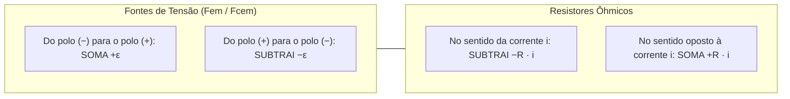
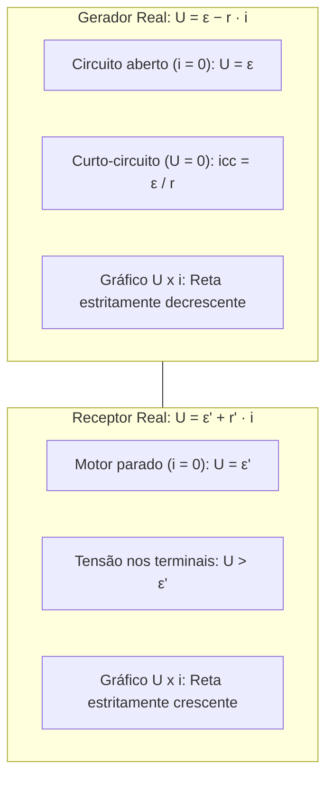
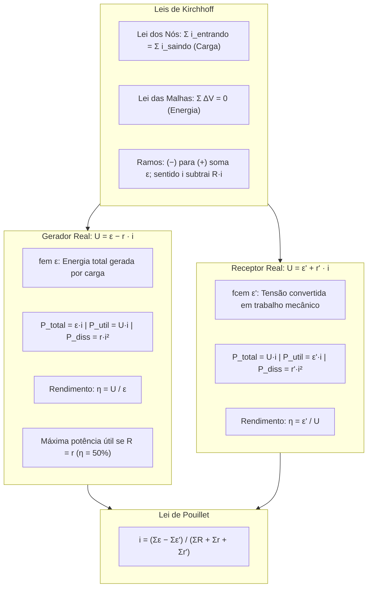

> [!objetivos]
> - Compreender a topologia de circuitos elétricos e calcular variações de potencial ao longo de ramos e malhas.
> - Dominar a equação característica, o balanço de potências e o rendimento de geradores reais.
> - Analisar a equação, o consumo de potência e o rendimento de receptores elétricos ativos.
> - Aplicar a Lei de Pouillet para o cálculo da corrente em circuitos fechados com geradores, receptores e resistores.

O funcionamento dos equipamentos de salvamento e socorro depende de circuitos elétricos reais. Nas viaturas operacionais do Corpo de Bombeiros Militar, geradores e baterias alimentam motobombas de combate a incêndio, desencarceradores e refletores de cena. Em perícias técnicas de incêndio, o oficial investiga sobrecargas, curtos-circuitos e falhas de isolamento. Compreender a geração, a transmissão e o consumo de energia em circuitos reais é indispensável para a segurança pública.

## Topologia de Circuitos e Variação de Potencial

Um circuito elétrico é uma rede fechada constituída por fontes de energia, condutores e elementos de carga. Para analisar qualquer rede elétrica, definem-se três conceitos topológicos básicos:

Nó é qualquer ponto de junção física onde três ou mais condutores encontram-se conectados.

Ramo é o trecho contínuo de circuito delimitado entre dois nós consecutivos, percorrido por uma única corrente elétrica invariável.

Malha é qualquer caminho condutor fechado que se inicia e termina no mesmo nó, sem passar mais de uma vez pelo mesmo ponto intermediário.

A Primeira Lei de Kirchhoff (Lei dos Nós) decorre da conservação da carga elétrica. Em regime estacionário, não há acúmulo de cargas nos pontos de junção. A soma das correntes que convergem para um nó é rigorosamente igual à soma das correntes que divergem dele:

Σ i_entrando = Σ i_saindo

### Regras para Determinação de Potencial em Ramos

Para calcular a diferença de potencial elétrico entre dois pontos quaisquer de um circuito ou percorrer uma malha fechada, aplicam-se regras de sinais padronizadas:

Em fontes de tensão, a variação de potencial depende apenas dos polos percorridos. Do polo (−) para o (+), somamos +ε. Do polo (+) para o (−), subtraímos −ε. Essa regra independe do sentido da corrente.

Em resistores, o sentido da corrente define o sinal. No sentido da corrente, há queda de potencial (−R · i). No sentido oposto, há elevação de potencial (+R · i).

A Segunda Lei de Kirchhoff (Lei das Malhas) estabelece que a soma algébrica de todas as variações de potencial elétrico ao longo de uma malha fechada é igual a zero: Σ ΔV = 0. Esse princípio expressa a conservação da energia mecânica no transporte de cargas em campos conservativos.

## Geradores Elétricos Reais

Gerador elétrico é qualquer dispositivo que transforma energia química, mecânica, térmica ou solar em energia elétrica utilizável.

A grandeza característica do gerador é a Força Eletromotriz (fem), indicada por ε e medida em Volts (V). A fem representa a energia não elétrica total que o gerador converte em energia elétrica para cada Coulomb de carga que o atravessa.

Em geradores reais, os condutores internos e os eletrólitos oferecem oposição à passagem da corrente. Essa oposição é modelada por uma resistência interna r, medida em Ohms (Ω). Quando o gerador fornece corrente i ao circuito externo, ocorre uma perda de potencial interna por efeito Joule dada por r · i.

A diferença de potencial útil U disponível nos terminais externos do gerador real é dada por sua equação característica:

U = ε − r · i

Nos geradores reais, a tensão fornecida U é sempre estritamente menor do que a fem ε quando o dispositivo está fornecendo corrente elétrica ao circuito.

Dois regimes extremos definem a curva característica do gerador:

Em circuito aberto, o gerador não se encontra conectado a nenhuma carga externa, de modo que a corrente é nula (i = 0). Substituindo na equação: U = ε − r · 0 = ε. A fem de um gerador é a diferença de potencial medida entre seus terminais em circuito aberto.

Em curto-circuito, os polos positivo e negativo do gerador são unidos diretamente por um fio de resistência nula, zerando a tensão terminal (U = 0). A corrente atinge o valor máximo suportado pelo dispositivo, denominado corrente de curto-circuito (icc):

0 = ε − r · icc  =>  icc = ε / r

### Balanço Energético e Rendimento do Gerador

Multiplicando todos os termos da equação do gerador (U = ε − r · i) pela corrente i, obtemos a equação de conservação da potência:

U · i = ε · i − r · i²  =>  ε · i = U · i + r · i²

Essa igualdade estabelece o balanço energético completo do gerador:

A Potência Total gerada internamente é P_total = ε · i.

A Potência Útil transferida para alimentar o circuito externo é P_util = U · i.

A Potência Dissipada em calor na resistência interna é P_diss = r · i².

Pela conservação da energia: P_total = P_util + P_diss.

O rendimento elétrico η do gerador mede a fração da energia total que é convertida em energia útil externa:

η = P_util / P_total = (U · i) / (ε · i) = U / ε = 1 − (r · i) / ε

O rendimento é adimensional e varia no intervalo 0 ≤ η ≤ 1 (ou de 0% a 100%).

> [!bizu] Teorema da Máxima Transferência de Potência
> Um gerador real de fem ε e resistência interna r transfere a máxima potência útil para uma carga externa resistiva R quando a resistência da carga iguala a resistência interna do gerador: R = r.
> Nessa condição de casamento de impedâncias, a corrente do circuito é i = ε / (2·r), a tensão nos terminais é U = ε / 2 e o rendimento elétrico do gerador é de exatamente 50% (η = 0,50). Metade da potência gerada é entregue à carga e a outra metade é inevitavelmente dissipada em calor dentro do próprio gerador.

## Receptores Elétricos Reais

Receptor elétrico é qualquer dispositivo que consome energia elétrica da rede e a converte em outra modalidade útil de energia que não seja exclusivamente térmica. Motores elétricos (que produzem energia mecânica) e baterias em processo de recarga química são exemplos clássicos. Dispositivos puramente térmicos (como chuveiros e ferros de passar) são apenas resistores.

A grandeza característica do receptor é a Força Contraeletromotriz (fcem), indicada por ε' e medida em Volts. A fcem representa a energia útil convertida por unidade de carga elétrica.

Assim como os geradores, os receptores possuem uma resistência interna r' associada às perdas ôhmicas em seus enrolamentos de cobre.

Para que a corrente atravesse o receptor vencendo sua fcem e sua oposição interna, a tensão U aplicada externamente aos seus terminais deve satisfazer a equação do receptor:

U = ε' + r' · i

No receptor elétrico, a tensão nos terminais U é sempre estritamente MAIOR do que a fcem ε'. O gráfico característico U × i do receptor é uma reta inclinada crescente.

Multiplicando a equação pela corrente i, estabelecemos o balanço de potências do receptor:

U · i = ε' · i + r' · i²

A Potência Total consumida da rede elétrica é P_total = U · i.

A Potência Útil transformada em trabalho mecânico é P_util = ε' · i.

A Potência Dissipada em calor interno é P_diss = r' · i².

O rendimento elétrico do receptor é a razão entre a potência útil mecânica e a potência total consumida:

η_rec = P_util / P_total = (ε' · i) / (U · i) = ε' / U = ε' / (ε' + r' · i)

| Dispositivo Elétrico | Equação Característica | Comportamento da Tensão Terminal | Potência Útil | Rendimento Elétrico (η) |
|---|---|---|---|---|
| **Gerador Real** | U = ε − r · i | U < ε (diminui com a corrente) | P_util = U · i | η = U / ε = 1 − (r·i)/ε |
| **Receptor Real** | U = ε' + r' · i | U > ε' (aumenta com a corrente) | P_util = ε' · i | η = ε' / U |
| **Resistor Puro** | U = R · i | Proporcional à corrente (Ohm) | Não tem (P_util = 0) | η = 0% (Dissipa 100% em calor) |

> [!pegadinha] Como Diferenciar Gerador de Receptor no Esquema
> Observe sempre a relação entre a corrente elétrica e a polaridade da fonte no circuito:
> No gerador, a corrente elétrica sai pelo polo positivo (+) e entra pelo polo negativo (−). O gerador eleva o potencial das cargas.
> No receptor, a corrente elétrica entra pelo polo positivo (+) e sai pelo polo negativo (−). O receptor consome potencial elétrico.
> Se em uma malha com duas fontes opostas você tiver dúvidas sobre quem é o gerador e quem é o receptor, a fonte de maior fem comanda o circuito e atua como gerador, forçando a fonte menor a atuar como receptor.

## A Lei de Pouillet para Circuitos Simples

A Lei de Pouillet é uma ferramenta analítica que sintetiza a aplicação direta da Lei das Malhas de Kirchhoff para circuitos fechados constituídos por uma única malha em série.

Considere uma malha contendo um ou mais geradores elétricos, um ou mais receptores ativos e resistores externos de carga. A corrente elétrica i que percorre todo o circuito em regime estacionário é determinada pelo quociente entre a força eletromotriz resultante e a resistência total equivalente da malha:

i = (Σε − Σε') / (ΣR + Σr + Σr')

Nessa formulação geral, Σε representa o somatório das forças eletromotrizes de todos os geradores que impulsionam a corrente. O termo Σε' representa o somatório das forças contraeletromotrizes de todos os receptores que se opõem ao movimento das cargas.

O denominador expressa a resistência ôhmica total do circuito. Ele é formado pela soma das resistências internas dos geradores (Σr), das resistências internas dos receptores (Σr') e das resistências de carga e fiação (ΣR).

Para que exista corrente elétrica com sentido definido no circuito, a força eletromotriz total deve superar a força contraeletromotriz total (Σε > Σε'). Se as forças forem iguais, o circuito permanece em repouso dinâmico sem circulação de corrente.

## Aplicações Práticas Resolvidas

Analise a resolução comentada de uma questão representativa.

> [!resolvido] Circuito Fechado de Alimentação de Bomba Hidráulica
> Um gerador a diesel de socorro possui fem ε = 120 V e resistência interna r = 2 Ω. Ele alimenta um motor elétrico de bomba de recalque (receptor) com fcem ε' = 80 V e resistência interna r' = 3 Ω. O circuito conta ainda com resistores de fiação somando R = 5 Ω.
> a) Qual a corrente elétrica que percorre o circuito em regime de operação?
> b) Qual a tensão U nos terminais do gerador e nos terminais do motor?
> c) Qual o rendimento elétrico do gerador e do motor?
>
> **Resolução passo a passo:**
> Item a: Aplicamos a Lei de Pouillet:
> i = (ε − ε') / (R + r + r') = (120 V − 80 V) / (5 Ω + 2 Ω + 3 Ω) = 40 V / 10 Ω = 4,0 A.
> Item b: Para o gerador real: U_ger = ε − r · i = 120 V − (2 Ω · 4 A) = 120 V − 8 V = 112 V.
> Para o motor receptor: U_rec = ε' + r' · i = 80 V + (3 Ω · 4 A) = 80 V + 12 V = 92 V.
> Observe que a diferença U_ger − U_rec = 112 V − 92 V = 20 V corresponde à queda de tensão na fiação: R · i = 5 Ω · 4 A = 20 V.
> Item c: Rendimento do gerador: η_ger = U_ger / ε = 112 / 120 ≈ 0,9333 (93,33%).
> Rendimento do motor: η_rec = ε' / U_rec = 80 / 92 ≈ 0,8696 (86,96%).

## Mapa do capítulo

### Para fixar
- A Lei dos Nós estabelece a conservação da carga elétrica: a corrente total que entra no nó iguala a corrente que sai.
- A Lei das Malhas expressa a conservação da energia: a soma das variações de potencial em uma malha fechada é nula.
- Ao percorrer uma fonte do polo negativo para o positivo, adiciona-se +ε; no sentido oposto, subtrai-se −ε.
- Ao percorrer um resistor no sentido da corrente elétrica, o potencial cai em −R · i.
- O gerador real possui equação característica U = ε − r · i, com tensão terminal menor que a fem em circuito fechado.
- A corrente de curto-circuito do gerador é icc = ε / r, ocorrendo quando a tensão nos terminais se anula (U = 0).
- O rendimento do gerador é dado por η = U / ε, atingindo a máxima transferência de potência quando R = r (com η = 50%).
- O receptor real possui equação característica U = ε' + r' · i, com tensão terminal sempre superior à fcem ε'.
- A corrente em circuito de malha simples é determinada pela Lei de Pouillet: i = (Σε − Σε') / (ΣR + Σr + Σr').
