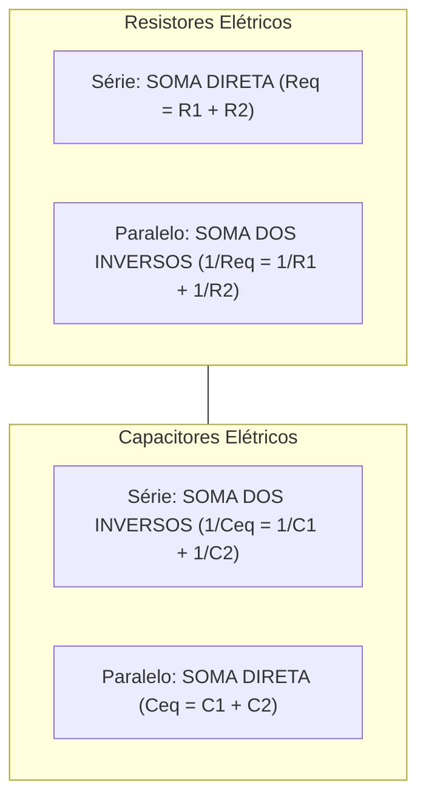
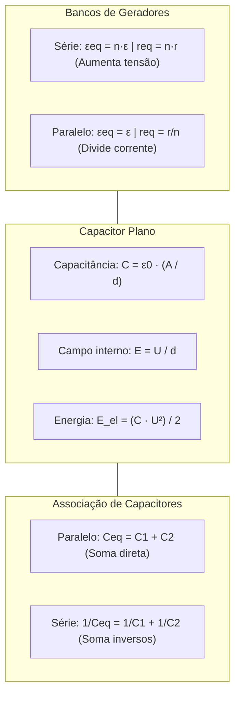

> [!objetivos]
> - Compreender o funcionamento das associações de geradores elétricos em série e em paralelo.
> - Calcular a força eletromotriz e a resistência interna equivalente de bancos de geradores.
> - Dominar a geometria e a capacitância de capacitores de placas planas paralelas.
> - Diferenciar as regras de associação de capacitores das regras clássicas de resistores.

O dimensionamento de fontes de energia e bancos de acumuladores é uma demanda frequente nas operações de defesa civil e socorro de emergência. Lanternas táticas de bombeiro, baterias de rádio comunicador e geradores móveis associam múltiplas células galvânicas para atingir a tensão ou a corrente necessária. De modo análogo, circuitos de desfibriladores cardíacos e flashes de sinalização utilizam capacitores para acumular cargas e liberá-las rapidamente.

## Associação de Geradores Elétricos

Quando um único gerador não atende às exigências de tensão ou corrente do circuito, agrupamos duas ou mais unidades em série ou em paralelo.

### Associação de Geradores em Série

Na associação em série, o polo negativo de cada gerador é conectado ao polo positivo do gerador subsequente.

A corrente elétrica é a mesma em todos os geradores da fila. A força eletromotriz equivalente é a soma direta das fems individuais:

εeq = ε1 + ε2 + ... + εn

A resistência interna equivalente também é a soma das resistências internas:

req = r1 + r2 + ... + rn

Para n geradores rigorosamente idênticos, cada um com fem ε e resistência interna r:

εeq = n · ε   e   req = n · r

A vantagem da ligação em série é elevar a tensão total fornecida ao circuito. A desvantagem é o aumento simultâneo da resistência interna do conjunto.

### Associação de Geradores em Paralelo

Na associação em paralelo, todos os polos positivos são conectados a um terminal comum, e todos os polos negativos ao outro terminal.

Para evitar correntes internas parasitas e perda de energia, os geradores associados em paralelo devem ser rigorosamente idênticos (mesma fem ε e mesma resistência interna r).

A força eletromotriz equivalente é igual à fem de um único gerador:

εeq = ε

A resistência interna equivalente é dividida pelo número n de geradores:

req = r / n

A vantagem da associação em paralelo é dividir a corrente total entre as fontes (cada gerador fornece i / n). Isso reduz perdas térmicas internas e amplia a durabilidade do banco de baterias.

| Parâmetro de Associação | Geradores em Série (n idênticos) | Geradores em Paralelo (n idênticos) |
|---|---|---|
| Força Eletromotriz (εeq) | Multiplica: εeq = n · ε | Inalterada: εeq = ε |
| Resistência Interna (req) | Soma: req = n · r | Reduz: req = r / n |
| Corrente em cada gerador | Igual à corrente total (i) | Divide-se: i_cada = i / n |
| Finalidade Operacional | Aumentar a tensão do circuito | Aumentar a capacidade de corrente |

## Capacitores e o Capacitor Plano

Capacitor é um dispositivo constituído por duas peças condutoras (armaduras) separadas por um meio isolante (dielétrico). Sua função básica é armazenar cargas elétricas e energia potencial eletrostática.

A capacitância C do capacitor de placas paralelas (capacitor plano) depende unicamente de sua geometria física e do meio dielétrico:

C = ε0 · (A / d)

Nessa equação, A é a área de cada placa condutora em metros quadrados (m²), d é a distância de separação entre as placas em metros (m), e ε0 é a permissividade elétrica do vácuo (ε0 ≈ 8,85 × 10⁻¹² F/m).

Se o espaço entre as placas for preenchido por um dielétrico com constante dielétrica κ > 1 (como papel, cerâmica ou óleo), a capacitância aumenta proporcionalmente: C = κ · ε0 · (A / d).

O campo elétrico interno entre as armaduras é uniforme e relaciona-se com a ddp U por:

E = U / d

## Representação Gráfica e Símbolos Convencionais

Na representação gráfica de circuitos segundo as normas técnicas, cada componente possui um símbolo padronizado. O gerador elétrico é representado por dois traços paralelos desiguais: o traço mais longo e fino representa o terminal positivo (+), enquanto o traço mais curto e espesso representa o terminal negativo (−).

O capacitor elétrico é desenhado por dois traços paralelos de comprimentos rigorosamente iguais, simbolizando as duas armaduras metálicas planas (ou modelo cilíndrico). Quando o capacitor é polarizado (eletrolítico), indica-se o polo positivo.

Durante o processo de carregamento, as conclusões principais acerca do comportamento dinâmico indicam que a corrente tende a zero conforme a tensão se iguala à da fonte. A finalidade precípua do capacitor é acumular energia eletrostática, gerando pulsos de alta potência fundamentais em equipamentos de socorro, onde a resistência equivalente (requivalente) controla o tempo característico do circuito.

## Associação de Capacitores

Assim como os resistores, os capacitores podem ser combinados em circuitos.

### Associação em Paralelo

Todos os capacitores são submetidos à mesma diferença de potencial U. A carga total acumulada é a soma das cargas de cada componente: Q = Q1 + Q2.

A capacitância equivalente é a soma direta das capacitâncias individuais:

Ceq = C1 + C2 + ... + Cn

### Associação em Série

Todos os capacitores armazenam rigorosamente a mesma carga elétrica Q. A tensão total divide-se entre eles: U = U1 + U2.

O inverso da capacitância equivalente é a soma dos inversos das capacitâncias:

1 / Ceq = (1 / C1) + (1 / C2) + ... + (1 / Cn)

Para dois capacitores em série: Ceq = (C1 · C2) / (C1 + C2).

> [!pegadinha] Não Confunda as Regras de Resistores e Capacitores
> A regra de associação de capacitores é o EXATO INVERSO da regra de resistores:
> Para resistores: série SOMA diretamente; paralelo usa o PRODUTO PELA SOMA.
> Para capacitores: paralelo SOMA diretamente; série usa o PRODUTO PELA SOMA.
> Essa inversão é cobrada recorrentemente pela banca para induzir o candidato desatento ao erro de cálculo.

## Aplicações Práticas Resolvidas

Analise a resolução de um problema representativo.

> [!resolvido] Dimensionamento de Banco de Baterias e Capacitor
> Uma viatura de resgate possui 4 baterias idênticas com fem ε = 12 V e resistência interna r = 0,4 Ω.
> a) Qual a fem e a resistência interna se associadas em série?
> b) Qual a fem e a resistência interna se associadas em paralelo?
> c) Dois capacitores de C1 = 3 μF e C2 = 6 μF são ligados em série sob U = 12 V. Qual a capacitância equivalente e a carga armazenada?
>
> **Resolução:**
> Item a (Série): εeq = 4 · 12 V = 48 V. req = 4 · 0,4 Ω = 1,6 Ω.
> Item b (Paralelo): εeq = 12 V. req = 0,4 Ω / 4 = 0,1 Ω.
> Item c (Capacitores em série): Ceq = (3 · 6) / (3 + 6) = 18 / 9 = 2 μF.
> A carga acumulada em série é comum: Q = Ceq · U = 2 μF · 12 V = 24 μC.

## Mapa do capítulo

### Para fixar
- Geradores em série somam suas forças eletromotrizes (εeq = Σε) e suas resistências internas (req = Σr).
- Geradores em paralelo idênticos mantêm a fem original (εeq = ε) e dividem a resistência interna (req = r/n).
- A capacitância de um capacitor plano é proporcional à área das placas e inversamente proporcional à distância: C = ε0 · A / d.
- A presença de dielétrico com constante κ > 1 multiplica a capacitância pelo fator κ.
- A associação de capacitores em paralelo soma diretamente as capacitâncias: Ceq = C1 + C2.
- A associação de capacitores em série soma os inversos: 1/Ceq = 1/C1 + 1/C2.
- A lógica de associação de capacitores é o oposto exato da lógica de resistores.
