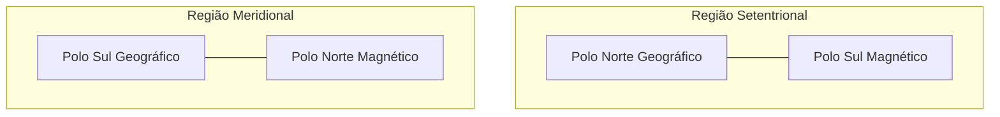
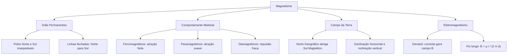

O magnetismo estuda as interações exercidas por corpos imantados e a conexão íntima entre eletricidade e magnetismo. Neste capítulo, examinamos as propriedades fundamentais dos ímãs naturais e artificiais, a interação polar, o comportamento magnético da matéria, o geomagnetismo e o experimento de Oersted, que comprovou que correntes elétricas originam campos magnéticos no espaço ao seu redor.

> [!objetivos]
> Ao concluir este capítulo, você será capaz de:
> - Caracterizar os polos magnéticos e aplicar o princípio da inseparabilidade dos polos.
> - Interpretar linhas de indução magnética e o espectro de dipolos.
> - Distinguir materiais ferromagnéticos, paramagnéticos e diamagnéticos.
> - Compreender a relação entre os polos geográficos e magnéticos da Terra.
> - Calcular o campo magnético gerado por corrente em fio condutor retilíneo longo.

## Propriedades dos Ímãs e Inseparabilidade dos Polos

A descoberta do magnetismo deu-se com a observação de pedras de magnetita (Fe3O4), minério que atrai ferro espontaneamente. Corpos que possuem essas propriedades recebem o nome de ímãs. Os ímãs dividem-se em naturais, encontrados na crosta terrestre, e artificiais, produzidos por processos industriais de imantação em ligas ferromagnéticas submetidas a campos intensos.

Todo ímã apresenta duas regiões extremas chamadas polos magnéticos, nas quais a força magnética atinge máxima intensidade: o polo norte (N) e o polo sul (S). A parte central do ímã é denominada região neutra, onde as ações magnéticas são praticamente nulas. Se suspendermos uma barra imantada livre para girar na horizontal, ela se orienta espontaneamente na direção norte-sul geográfica do planeta.

Polos de mesmo nome repelem-se mutuamente, e polos de nomes diferentes atraem-se com igual intensidade. Ao contrário das cargas elétricas, que existem de modo isolado, os polos magnéticos são inseparáveis. Se cortarmos um ímã reto ao meio, não obteremos um polo norte isolado e um polo sul isolado, mas sim dois ímãs novos e completos, cada qual com seus respectivos polos norte e sul.

*Figura 1: Representação esquemática da inseparabilidade dos polos magnéticos.*

Mesmo sucessivas divisões até a escala molecular continuam gerando novos dipolos. Não existem monopolos magnéticos isolados na física clássica. A capacidade de magnetização decorre do alinhamento ordenado de domínios atômicos; choques mecânicos violentos ou aquecimento acima da temperatura de Curie desorganizam esse arranjo e desmagnetizam o ímã.

> [!pegadinha]
> Cortar um ímã exatamente na sua linha neutra não isola o polo norte do polo sul. Cada metade se transforma imediatamente em um ímã completo com polo norte e polo sul funcionais.

## Linhas de Indução e Classificação das Substâncias

O campo magnético é uma grandeza vetorial B cuja unidade no Sistema Internacional é o tesla (T). As linhas de indução magnética mapeiam espacialmente esse campo:
1. Externamente ao ímã, as linhas de indução partem do polo norte e chegam ao polo sul.
2. Internamente ao ímã, as linhas continuam do polo sul em direção ao polo norte, formando curvas fechadas.
3. O vetor indução B é tangente à linha em cada ponto e aponta no mesmo sentido dela.
4. As linhas de indução nunca se cruzam.
5. Regiões com maior densidade de linhas indicam campo magnético mais intenso.

Sob campo externo, os materiais comportam-se de formas distintas conforme os spins e momentos magnéticos de seus elétrons:

| Classificação | Resposta ao campo externo | Permeabilidade relativa | Exemplos usuais |
| :--- | :--- | :--- | :--- |
| Ferromagnéticas | Fortemente atraídas; alinham domínios duradouros | Muito superior a 1 | Ferro, níquel, cobalto e ligas |
| Paramagnéticas | Fracamente atraídas no mesmo sentido do campo | Ligeiramente superior a 1 | Alumínio, magnésio, oxigênio |
| Diamagnéticas | Fracamente repelidas em oposição ao campo | Ligeiramente inferior a 1 | Cobre, ouro, prata, bismuto |
*Tabela 1: Classificação das substâncias conforme o comportamento sob ação magnética.*

Os materiais ferromagnéticos formam ímãs duradouros porque seus domínios magnéticos alinham-se fortemente e retêm a orientação. Materiais paramagnéticos alinham dipolos apenas temporariamente enquanto o campo externo está ativo. Já os diamagnéticos não contêm momentos permanentes; o campo externo induz dipolos em oposição, gerando fraca repulsão magnética.

> [!atencao]
> A atração magnética sobre ferro neutro ocorre tanto aproximando o polo norte quanto o polo sul do ímã, pois a indução microscópica sempre reorganiza os domínios no sentido de atração.

## O Campo Magnético da Terra e a Bússola

A Terra comporta-se como um gigantesco ímã esférico, cujo campo é gerado pela movimentação de ligas metálicas condutoras fluidas no núcleo externo (teoria do geodínamo). Esse campo forma a magnetosfera, escudo essencial que desvia partículas carregadas emitidas pelo Sol.

As bússolas operam pela atração de polos opostos. A extremidade da agulha que aponta para o norte geográfico da Terra foi historicamente batizada de polo norte. Portanto, na região do polo norte geográfico situa-se fisicamente um polo sul magnético. Da mesma forma, na proximidade do polo sul geográfico encontra-se o polo norte magnético terrestre.

*Figura 2: Alinhamento relativo entre eixos geográficos e eixos magnéticos terrestres.*

Os eixos geográfico e magnético da Terra não são coincidentes. O ângulo horizontal entre o norte geográfico verdadeiro e a direção apontada pelo polo norte da agulha magnética chama-se declinação magnética. Essa grandeza varia conforme a latitude, a longitude e a época. O ângulo vertical que as linhas formam com o solo tangente chama-se inclinação magnética: é nulo no equador magnético e atinge noventa graus nos polos magnéticos.

## Experiência de Oersted e Campo em Fios Retilíneos

Em 1820, Hans Christian Oersted descobriu que uma corrente elétrica contínua que percorre um fio metálico desvia uma agulha imantada colocada paralelamente ao condutor. Ao cessar a corrente, a agulha retornava à orientação norte-sul do campo geomagnético. Ao inverter o sentido da corrente, a agulha defletia para o lado oposto. Esse experimento provou que cargas elétricas em movimento geram campo magnético ao seu redor.

Em torno de um fio condutor retilíneo e longo percorrido por corrente contínua i, as linhas de indução magnética formam circunferências concêntricas perpendiculares ao fio. A intensidade do campo magnético a uma distância radial d do condutor é dada pela lei de Biot-Savart simplificada:

B = (μ · i) / (2 · π · d)

Em que:
- B é o módulo do campo magnético em tesla (T);
- μ é a permeabilidade magnética do meio, sendo μ0 = 4 · π · 10^-7 T · m / A no vácuo;
- i é a corrente elétrica em ampères (A);
- d é a distância radial do ponto ao fio em metros (m).

O sentido do vetor B é dado pela regra da mão direita: apontando o polegar direito no sentido da corrente elétrica i, os demais quatro dedos envolvem o fio e indicam o giro das linhas de campo. Na representação gráfica plana, um ponto (·) indica vetor perpendicular saindo da folha, enquanto uma cruz (x) indica vetor penetrando no plano da página.

> [!resolvido] Campo Magnético Gerado por Fio Retilíneo Longo
> Um condutor retilíneo muito longo, imerso no vácuo (μ0 = 4 · π · 10^-7 T · m / A), é percorrido por uma corrente elétrica constante de intensidade 15 A. Determine a intensidade do campo magnético gerado por esse fio em um ponto P situado a uma distância d = 5 cm do condutor.
>
> **Resolução passo a passo:**
> 1. Identificar os dados fornecidos:
>    - i = 15 A
>    - d = 5 cm = 0,05 m = 5 · 10^-2 m
>    - μ0 = 4 · π · 10^-7 T · m / A
> 2. Aplicar a fórmula do campo magnético para fio retilíneo longo:
>    B = (μ0 · i) / (2 · π · d)
> 3. Substituir os valores na expressão:
>    B = (4 · π · 10^-7 · 15) / (2 · π · 5 · 10^-2)
> 4. Simplificar os termos com π:
>    B = (2 · 10^-7 · 15) / (5 · 10^-2)
>    B = (30 · 10^-7) / (5 · 10^-2)
>    B = 6 · 10^-5 T
>
> Portanto, o módulo do campo magnético no ponto P vale 6 · 10^-5 T (ou 60 μT).

> [!bizu] Variação com Distância e Corrente
> O campo magnético B varia de forma diretamente proporcional à corrente elétrica i e inversamente proporcional à distância radial d. Se a corrente for duplicada e a distância for duplicada simultaneamente, a intensidade do campo magnético no ponto resultante não sofre qualquer alteração.

## Mapa do capítulo

*Figura 3: Estrutura integrada dos conceitos de magnetismo e indução por corrente.*

### Para fixar

1. **Inseparabilidade polar**: Se um ímã reto for quebrado ao meio, o que acontecerá com os polos?
   - Formam-se dois novos ímãs completos, cada um contendo necessariamente polo norte e polo sul funcionais.

2. **Sentido das linhas de indução**: Como as linhas de campo comportam-se no espaço?
   - Saem do polo norte e entram no polo sul na região externa, fechando o circuito do polo sul para o norte no interior do ímã.

3. **Polos geomagnéticos**: Qual tipo de polo magnético existe no polo norte geográfico terrestre?
   - Existe um polo sul magnético, o que atrai o polo norte das agulhas magnéticas das bússolas.

4. **Experimento de Oersted**: O que Oersted comprovou ao posicionar a agulha próxima ao fio?
   - Demonstrou que correntes elétricas produzem campos magnéticos perpendiculares à corrente.

5. **Cálculo de campo magnético**: Se a distância a um condutor retilíneo for reduzida à metade, o que acontece com a indução B?
   - O campo magnético duplica de valor, pois é inversamente proporcional à distância radial d.
