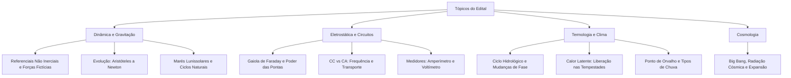

Este capítulo reúne tópicos complementares indispensáveis para uma compreensão abrangente da física exigida nos editais. Abordamos a distinção entre referenciais inerciais e não inerciais com a aplicação rigorosa do diagrama de corpo livre, a evolução histórica do conceito de força de Aristóteles a Newton, a influência gravitacional da Lua e do Sol nas marés oceânicas e variações climáticas, os fundamentos cosmológicos do modelo do Big Bang, o poder das pontas e a blindagem eletrostática da gaiola de Faraday, a comparação entre correntes contínua e alternada com instrumentos de medição elétrica e o papel central do calor latente nas manifestações climáticas do ciclo hidrológico.

> [!objetivos]
> Ao concluir este capítulo, você será capaz de:
> - Distinguir referenciais inerciais de acelerados e analisar forças fictícias.
> - Compreender a evolução do conceito de força e a mecânica newtoniana.
> - Explicar as marés lunissolares, o modelo do Big Bang e a blindagem de Faraday.
> - Analisar circuitos em CC e CA e o calor latente nos fenômenos climáticos.

## Referenciais Inerciais e Não Inerciais

### Conceito de Referencial e Inércia

**Referencial** é o corpo (ou sistema de eixos) em relação ao qual se descreve um movimento. O mesmo fenômeno parece diferente em referenciais diferentes.

- **Referencial inercial:** aquele em que vale a **lei da inércia** (1ª lei de Newton): um corpo livre de forças resultantes permanece em **repouso ou em MRU**. Todo referencial que se move com **velocidade constante** (MRU) em relação a um inercial também é inercial.
- **Referencial não inercial:** aquele que tem **aceleração** em relação a um inercial (acelera, freia, faz curva, gira). Nele a lei da inércia "parece falhar": corpos livres aparentam sofrer acelerações sem causa.

> [!atencao]
> **Atenção:** a Terra, por girar e orbitar o Sol, **não é rigorosamente inercial**; porém, para a maioria dos fenômenos do cotidiano, é uma **ótima aproximação** de referencial inercial (e é assim que as questões tratam). Já um carro que freia, acelera ou faz curva é claramente **não inercial**.

**Princípio da relatividade de Galileu:** as leis da Mecânica têm a **mesma forma** em todos os referenciais inerciais. Nenhum experimento mecânico feito dentro de um referencial em MRU permite saber se ele está "parado" ou em movimento: não existe repouso absoluto. É o argumento de Galileu do **navio** (uma bola cai no pé do mastro com o navio em MRU como cairia com ele parado).

### Forças Fictícias de Inércia

Para usar as leis de Newton **dentro** de um referencial não inercial, acrescenta-se uma força que **não é interação** com nenhum corpo (não tem par de ação e reação): a **força de inércia**, ou **força fictícia**.

- Se o referencial tem aceleração **a**, a força fictícia sobre um corpo de massa m é **F_fict = − m · a** (mesma direção da aceleração do referencial, **sentido oposto**).

Efeito sentido: no ônibus que **acelera** para frente, você é "jogado" para trás; se o ônibus **freia**, "para frente"; numa **curva**, "para fora".

| Situação (referencial) | Aceleração do referencial | Força fictícia sentida |
|---|---|---|
| Ônibus acelerando | para frente | para trás |
| Ônibus freando | para trás | para frente |
| Carro em curva | para o **centro** da curva | **centrífuga**, para fora |
| Elevador subindo acelerado | para cima | para baixo (peso aparente **maior**) |
| Elevador descendo acelerado | para baixo | para cima (peso aparente **menor**) |
*Tabela 1: Síntese comparativa dos parâmetros físicos analisados.*

**Força centrífuga.** Num referencial que **gira**, aparece a força fictícia centrífuga, de módulo **m·v²/R** (= m·ω²·R), apontando para fora. Para um observador **inercial** (na calçada), ela **não existe**: o que há é apenas a **força centrípeta** (real, de atrito, normal, tração...), que puxa o corpo para o centro. O corpo "quer" seguir em linha reta por inércia. Esta é uma das pegadinhas preferidas: **a centrífuga é fictícia, a centrípeta é a resultante real**.

> [!resolvido]
> **Exemplo 1 (curva).** Um carro faz uma curva de raio 100 m a 20 m/s. Aceleração centrípeta: a = v²/R = 400/100 = 4 m/s². Um passageiro de 70 kg sente, no referencial do carro, uma "força para fora" de m·a = 70 × 4 = **280 N**; para quem está na calçada, essa força não existe: o banco e o atrito é que aplicam 280 N **para dentro** da curva.

**Força de Coriolis** (qualitativa). Num referencial em rotação, corpos em movimento sofrem também um desvio lateral fictício, a força de Coriolis. Na Terra, ela desvia ventos e correntes marinhas para a **direita no Hemisfério Norte** e para a **esquerda no Hemisfério Sul**; é a razão de os ciclones girarem em **sentido anti-horário no Norte** e **horário no Sul**.

**Terra como referencial não inercial:** o efeito da rotação diminui o peso aparente, em especial no equador. A aceleração centrífuga no equador vale ω²·R ≈ (7,29 × 10⁻⁵)² × 6,37 × 10⁶ ≈ **0,034 m/s²**, cerca de **0,3 %** de g: pequena, e por isso desprezada na maioria das questões.

### Peso Aparente no Elevador

O **peso aparente** é o valor indicado pela balança (a força normal N que o apoio exerce). Em um elevador com aceleração **a** (adote g = 10 m/s²):

- **Sobe acelerando** ou **desce freando** (aceleração para **cima**): **N = m(g + a)** → peso aparente **maior**.
- **Desce acelerando** ou **sobe freando** (aceleração para **baixo**): **N = m(g − a)** → peso aparente **menor**.
- **MRU** (parado ou velocidade constante): **N = m·g** (igual ao peso real).
- **Queda livre** (a = g): **N = 0**, é a **ausência de peso aparente**. Astronautas em órbita estão em queda livre contínua em torno da Terra, e por isso "flutuam" (a gravidade neles está longe de ser zero, perto de 90 % do valor na superfície).

**Exemplo 2.** Uma pessoa de 70 kg está sobre uma balança num elevador cuja aceleração é 2 m/s². Quanto a balança marca, em N, se o elevador (a) sobe acelerando? (b) desce acelerando?
(a) N = 70 × (10 + 2) = **840 N**. (b) N = 70 × (10 − 2) = **560 N**.
> [!pegadinha]
> **Pegadinha:** "subindo" não significa "peso maior". O que conta é o **sentido da aceleração**, não o da velocidade.

> [!exemplo]
> **Exemplo 3 (pêndulo no vagão).** Um pêndulo preso ao teto de um vagão que acelera a 7,5 m/s² forma um ângulo θ com a vertical, com tg θ = a/g. Com g = 10: tg θ = 0,75 → θ ≈ **36,9°**, para trás (oposto ao sentido da aceleração). Para o observador no vagão, a força fictícia (−m·a) equilibra a componente da tração; para o observador na plataforma, é a resultante real que acelera a bola junto com o vagão.

### Diagrama de Corpo Livre

O **diagrama de corpo livre** (DCL) isola o corpo e desenha **só as forças que agem sobre ele** (nunca as que ele exerce sobre outros). Roteiro:

1. **Isole** o corpo de interesse.
2. Desenhe a **força peso** (vertical, para baixo, no centro de massa).
3. Para cada **contato** (apoio, fio, mola, outro corpo), desenhe a força correspondente: **normal** (perpendicular à superfície), **tração** (ao longo do fio, puxando), **atrito** (paralelo à superfície, contra o deslizamento ou sua tendência).
4. Acrescente forças aplicadas (empurrões, forças elétricas, empuxo...).
5. Escolha eixos (de preferência com um deles na direção do movimento) e **decomponha** as forças inclinadas.
6. Aplique a 2ª lei: **ΣF = m·a** em cada eixo (em equilíbrio, a = 0).

**Erros comuns:** desenhar "a força do movimento" (não existe: o movimento não é uma força); incluir a **reação** da normal no mesmo diagrama (ação e reação agem em corpos **diferentes**); incluir a força centrífuga num referencial inercial.

> [!exemplo]
> **Exemplo 4.** Bloco de 10 kg num plano inclinado de 30°, coeficiente de atrito μ = 0,2, g = 10 m/s². Desce o plano.
> Peso P = 100 N. Componente ao longo do plano: P·sen 30° = **50 N**. Normal: N = P·cos 30° ≈ **86,6 N**. Atrito: μ·N ≈ **17,3 N** (sobe o plano). Resultante: 50 − 17,3 = 32,7 N → a = 32,7/10 ≈ **3,27 m/s²**.

## Relação Histórica entre Força e Movimento

O item do edital pede a **evolução das ideias** sobre o que é preciso para mover um corpo. Resumo em três etapas.

### A Concepção Aristotélica

- O **estado natural** dos corpos terrestres é o **repouso**, no seu "lugar natural" (os pesados tendem para baixo, rumo ao centro do mundo).
- **Para manter um corpo em movimento é preciso uma força constante**: parou a força, para o movimento. A **velocidade** seria proporcional à força.
- Corpos **mais pesados caem mais depressa**, na proporção do seu peso.
- Não admitia o **vácuo** (em que, por esse raciocínio, a velocidade seria infinita).
- Separava o mundo terrestre (movimentos retilíneos, que terminam) do celeste (circular, eterno).

Faz sentido na experiência cotidiana (um carrinho empurrado para depois de soltar), mas **ignora o atrito**.

### A Teoria do Ímpeto

Pensadores como **João Filopono** (séc. VI) e **Jean Buridan** (séc. XIV) propuseram que o lançador transmite ao projétil um **ímpeto** que o mantém em movimento até se esgotar: era uma ideia que já corrigia parte de Aristóteles, preparando o caminho para a inércia.

### A Revolução de Galileu

- Com experimentos em **planos inclinados** e raciocínio idealizado, concluiu que, se **não houvesse atrito**, um corpo lançado numa superfície horizontal **manteria o movimento indefinidamente** em linha reta e com velocidade constante: é o **princípio da inércia**. O repouso e o MRU são **equivalentes** (relatividade de Galileu).
- A **queda** dos corpos independe da massa: no vácuo, corpos leves e pesados caem juntos, com **aceleração constante**.
- Para ele, a força não é necessária para **manter** a velocidade, só para **mudá-la** (o atrito é uma força que freia, não a "natureza" do movimento).
- Aplicou a Física à Astronomia (luneta, luas de Júpiter, fases de Vênus), reforçando o modelo heliocêntrico.

### A Formalização de Newton

- **Descartes** formulou a inércia como movimento **retilíneo** por si mesmo.
- **Newton** (1687, *Principia*) sintetizou: 1ª lei (**inércia**), 2ª lei (**F = m·a**: a força produz **aceleração**, não velocidade) e 3ª lei (**ação e reação**), além da **gravitação universal** (a mesma força que faz a maçã cair mantém a Lua em órbita). A Mecânica de Newton unificou a Física terrestre e a celeste.

| | Aristóteles | Galileu | Newton |
|---|---|---|---|
| O que a força faz | mantém a **velocidade** | **muda** o estado de movimento | produz **aceleração** (F = m·a) |
| Estado natural | repouso | repouso e MRU equivalentes | repouso ou MRU (sem força resultante) |
| Queda | pesados caem mais depressa | todos igual (sem ar) | a = g, independe da massa |
| Papel do atrito | ignorado | reconhecido como força que freia | força comum nas equações |
*Tabela 2: Síntese comparativa dos parâmetros físicos analisados.*

**Macete:** "Aristóteles: força → velocidade. Galileu e Newton: força → **variação** de velocidade". Se a alternativa disser que "é preciso uma força para manter um corpo em MRU", está com a visão **aristotélica** (errada na Física clássica).

Um passo além: no século XX, **Einstein** (relatividade restrita, 1905; geral, 1915) mostrou que a Mecânica newtoniana é uma excelente aproximação para velocidades muito menores que a da luz e campos gravitacionais fracos.

## Marés Oceânicas e Variações Climáticas

### Formação das Marés Lunissolares

**Marés** são elevações e abaixamentos periódicos do nível do mar, causados principalmente pela **atração gravitacional da Lua** e, em menor grau, do **Sol**.

A explicação está na **diferença** da atração ao longo da Terra: o lado voltado para a Lua é atraído **mais forte** que o centro da Terra, e o lado oposto, **mais fraco**. Essa diferença estica a água em dois "bulbos": um voltado para a Lua e outro no lado oposto. A **força de maré** varia com o **inverso do cubo** da distância:

- **F_maré ∝ M / d³**

Por isso, embora o Sol seja muito mais massivo, a **Lua** (muito mais próxima) tem efeito cerca de **2,2 vezes maior** que o do Sol sobre as marés.

**Conferindo:** (M_Lua/d_Lua³)/(M_Sol/d_Sol³) = (7,35 × 10²² / (3,84 × 10⁸)³) / (1,99 × 10³⁰ / (1,50 × 10¹¹)³) ≈ 2,2.

**Características das marés:**
- Há, em geral, **duas preamares** (maré alta) e **duas baixa-mares** por dia lunar, com intervalo médio de **≈ 12 h 25 min** entre preamares consecutivas, porque o dia lunar (24 h 50 min) é mais longo que o solar: a Lua "atrasa" cerca de 50 min por dia.
- **Marés de sizígia (vivas):** na **lua nova e na lua cheia**, Sol, Terra e Lua estão **alinhados**; os efeitos se somam e a diferença entre preamar e baixa-mar é a **maior**.
- **Marés de quadratura (mortas):** na **lua quarto crescente e quarto minguante**, Sol e Lua formam 90° vistos da Terra; os efeitos se compensam em parte e a amplitude é a **menor**.
- A **amplitude local** depende da forma da costa, da profundidade e da latitude: no Brasil é grande em partes do Maranhão, Pará e Amapá, e moderada no litoral pernambucano.
- A água dos oceanos, os rios e até a crosta terrestre sofrem marés (a crosta, de forma bem menor).

> [!pegadinha]
> **Pegadinhas sobre marés:**
> - **Marés não decorrem da inclinação do eixo da Terra** (essa inclinação explica as estações do ano).
> - A maré **não** é causada por força magnética nem por "ondas eletromagnéticas do Sol".
> - **Os efeitos são mais fortes na lua nova e na cheia**, não nos quartos.
> - **Lagos pequenos** quase não têm maré perceptível: a diferença de atração ao longo de poucos quilômetros é desprezível.

**Eclipses não são marés.** Os eclipses resultam do **alinhamento Sol-Terra-Lua**. No **eclipse solar**, a Lua passa entre o Sol e a Terra (ocorre na **lua nova**); no **eclipse lunar**, a Terra fica entre o Sol e a Lua, e a Lua entra na sombra da Terra (ocorre na **lua cheia**). Como a órbita da Lua é inclinada cerca de 5° em relação à órbita da Terra, o alinhamento perfeito não ocorre todo mês, daí eclipses serem relativamente raros.

### Variações Climáticas de Origem Astronômica

**Estações do ano.** Resultam da **inclinação do eixo da Terra (≈ 23,5°)** em relação ao plano da órbita, e **não** da distância ao Sol. Durante o ano, cada hemisfério recebe os raios solares mais ou menos inclinados, e por mais ou menos horas por dia.

| Evento | Data aproximada | O que acontece |
|---|---|---|
| Equinócio de março | 20–21 mar | dias e noites quase iguais; início do outono no Sul |
| Solstício de junho | 20–21 jun | noite mais longa no Sul; início do inverno no Sul |
| Equinócio de setembro | 22–23 set | dias e noites quase iguais; início da primavera no Sul |
| Solstício de dezembro | 21–22 dez | dia mais longo no Sul; início do verão no Sul |
*Tabela 3: Síntese comparativa dos parâmetros físicos analisados.*

- A Terra passa pelo **periélio** (mais próxima do Sol) por volta de **3 de janeiro**, em pleno verão no Hemisfério Sul, e pelo **afélio** por volta de **4 de julho**: o que prova que a **distância não é a causa** das estações. Ela é de ≈ 147 milhões de km no periélio e ≈ 152 milhões de km no afélio.
- Perto do **equador** (como o Recife) o Sol incide quase na vertical o ano todo e as estações térmicas são pouco marcadas; muda mais o **regime de chuvas** (estação chuvosa × seca).

**Ciclos de longo prazo (Milankovitch).** Pequenas variações periódicas da órbita e do eixo da Terra mudam a energia que cada região recebe e estão ligadas às **eras glaciais**:
- **excentricidade** da órbita (≈ 100 mil anos);
- **inclinação** do eixo (≈ 41 mil anos);
- **precessão** do eixo (≈ 23 mil anos).

**Outros fatores climáticos:**
- **Efeito estufa:** gases como vapor de água, CO₂, CH₄ e N₂O absorvem a radiação infravermelha emitida pela superfície e a reemitem em parte para baixo. O efeito estufa natural mantém a Terra habitável (≈ 15 °C de média em vez de ≈ −18 °C); o **aumento** da concentração desses gases pela queima de combustíveis fósseis e pelo desmatamento intensifica o aquecimento global.
- **Albedo:** fração da luz solar refletida. Gelo e neve têm albedo alto (refletem muito); oceanos e florestas, baixo. Derretimento de gelo reduz o albedo e **reforça** o aquecimento.
- **Correntes oceânicas e ventos:** transportam calor dos trópicos para as altas latitudes.
- **El Niño e La Niña:** variações irregulares da temperatura da água do Pacífico equatorial. O **El Niño** (aquecimento anômalo) tende a **reduzir** as chuvas no semiárido do Nordeste do Brasil e a favorecer chuvas no Sul; a **La Niña** (resfriamento) costuma ter o efeito inverso.
- **Erupções vulcânicas** (cinzas e aerossóis refletem luz e podem esfriar o planeta por um tempo).

## Origem e Evolução do Universo

### Concepções Históricas do Cosmos

| Época | Concepção |
|---|---|
| Antiguidade | universo **geocêntrico** e finito, esferas celestes (Aristóteles, Ptolomeu); alguns filósofos gregos (atomistas) imaginavam espaço infinito |
| Séc. XVI–XVII | **heliocêntrico** (Copérnico, Galileu, Kepler); universo ainda "fixo" |
| Newton | universo **infinito e estático**, regido pela gravitação |
| 1915–1917 | Einstein (relatividade geral) obtém equações que preveem universo **dinâmico**; ele introduz uma **constante cosmológica** para mantê-lo estático |
| 1922–1927 | **Friedmann** e **Lemaître** mostram que o universo pode **expandir**; Lemaître propõe a ideia do "átomo primordial" |
| 1929 | **Hubble** observa que as galáxias se afastam, e que a velocidade de afastamento é proporcional à distância |
| 1948–1950s | Teoria do **estado estacionário** (Hoyle, Bondi, Gold): universo em expansão com criação contínua de matéria; perdeu força |
| 1965 | **Penzias e Wilson** detectam a **radiação cósmica de fundo** (≈ 2,7 K), "eco" do Big Bang |
| 1998 | Observações de supernovas indicam **expansão acelerada** (energia escura) |
*Tabela 4: Síntese comparativa dos parâmetros físicos analisados.*

### O Modelo do Big Bang

O modelo cosmológico padrão diz que o universo começou há **≈ 13,8 bilhões de anos** a partir de um estado **extremamente quente e denso**, e vem **se expandindo e resfriando** desde então. Importante: o Big Bang **não** foi uma "explosão num ponto do espaço vazio", mas a **expansão do próprio espaço**.

Linha do tempo resumida:
1. **Primeiros instantes:** estado quente e denso; expansão muito rápida.
2. **Primeiros minutos:** formação dos núcleos leves (**hidrogênio, hélio**, traços de lítio): é a **nucleossíntese primordial**.
3. **≈ 380 mil anos:** o universo esfria o bastante para formar átomos neutros; a luz "se solta" e viaja livremente. Essa luz, esfriada pela expansão, é hoje a **radiação cósmica de fundo em micro-ondas** (≈ 2,7 K).
4. **Centenas de milhões de anos depois:** formam-se as primeiras **estrelas e galáxias**; as estrelas fabricam elementos mais pesados (carbono, oxigênio, ferro...) por fusão, e os espalham em supernovas.
5. **≈ 4,6 bilhões de anos atrás:** formação do **Sistema Solar**.

**Evidências do Big Bang:**
- **Afastamento das galáxias** (lei de Hubble, desvio para o vermelho);
- **Radiação cósmica de fundo** (previsão confirmada);
- **Abundância dos elementos leves** (≈ 75 % H e ≈ 25 % He em massa), compatível com a nucleossíntese primordial.

### Lei de Hubble e Expansão Cósmica

A luz de galáxias que se afastam chega com **comprimento de onda maior** (desvio para o vermelho, *redshift*), de forma análoga ao efeito Doppler. A **lei de Hubble** relaciona a velocidade de recessão à distância d:

- **v = H₀ · d**, com H₀ ≈ 70 km/s por megaparsec (Mpc) (1 Mpc ≈ 3,26 milhões de anos-luz).

**Exemplo 5.** Uma galáxia a 100 Mpc se afasta a v = 70 × 100 = **7.000 km/s**.
**Idade aproximada:** 1/H₀ ≈ 14 bilhões de anos (em unidades consistentes), valor próximo da idade aceita (≈ 13,8 bilhões de anos).

### Composição e Destino Cósmico

A matéria que enxergamos (estrelas, gás, planetas) é só **≈ 5 %** do conteúdo do universo; cerca de **27 % é matéria escura** (detectada só por seus efeitos gravitacionais) e **≈ 68 % é energia escura**, associada à expansão acelerada. Esses valores aproximados são os mais citados em textos de divulgação.

> [!pegadinha]
> **Pegadinhas:**
> - O universo **não** tem um "centro" a partir do qual tudo se afasta: todas as galáxias se afastam umas das outras (como pontos num balão sendo inflado).
> - O Big Bang é uma **teoria científica bem sustentada**, não "uma hipótese qualquer", porém continua sendo aprimorada (matéria escura, energia escura e o que veio "antes" são questões em aberto).
> - O que **se expande** é o espaço entre galáxias distantes; os átomos, o Sistema Solar e as galáxias em si **não** se expandem.

## Poder das Pontas e Blindagem Eletrostática

### Condutores em Equilíbrio Eletrostático

Em um condutor em equilíbrio:
- o **campo elétrico no interior** é **nulo**;
- o **potencial é constante** em todo o condutor (interior e superfície);
- as **cargas em excesso ficam na superfície**;
- o campo elétrico na superfície é **perpendicular** a ela e vale **E = σ/ε₀** (σ = densidade superficial de carga).

### O Poder das Pontas e Para-Raios

Em um condutor de forma irregular, a carga **se concentra nas regiões mais pontiagudas** (menor raio de curvatura): a **densidade de carga σ**, e portanto o **campo elétrico E = σ/ε₀**, são **maiores nas pontas**.

Para duas esferas condutoras, de raios R₁ e R₂, ligadas por um fio condutor (mesmo potencial V = k·Q/R):

- **Q₁/Q₂ = R₁/R₂** (a esfera maior fica com mais carga total),
- **σ₁/σ₂ = R₂/R₁** (a esfera **menor** tem maior **densidade** de carga e maior campo).

**Exemplo 6.** Duas esferas condutoras de raios 10 cm e 5 cm, muito afastadas, são ligadas por um fio fino. A carga total é 30 nC. Determine as cargas e a razão entre as densidades de carga.
Mesmo potencial: Q₁/R₁ = Q₂/R₂ → Q₁ = 2·Q₂. Q₁ + Q₂ = 30 → **Q₁ = 20 nC e Q₂ = 10 nC**. Densidades: σ₁/σ₂ = R₂/R₁ = 5/10 = **1/2**: a esfera menor tem densidade **o dobro**.

**Rigidez dielétrica do ar:** o ar suporta campos até **≈ 3 × 10⁶ V/m**; acima disso, ioniza-se e deixa de ser isolante (**descarga**, faísca).

Consequências do poder das pontas:
- **Para-raios** (Franklin): a haste pontiaguda no topo do prédio concentra carga e campo, **facilita a descarga** (efeito corona), e conduz a corrente do raio ao solo por cabos de baixa resistência. A haste **não "atrai" raios**; oferece caminho seguro e preferencial. O seu "raio de proteção" é uma região em torno dela.
- **Descargas indesejadas em pontas:** por isso equipamentos de alta tensão têm formas **arredondadas** (esferas e bordas lisas), e dobras ou pontas em fios provocam perdas por efeito corona.
- **Eletroscópios e máquinas eletrostáticas** funcionam por pontas que descarregam.
- **"Vento elétrico":** perto de uma ponta, o ar ionizado é repelido e cria um fluxo de ar.

**Ordem de grandeza.** Para uma esfera de raio r em que o ar rompe com E = 3 × 10⁶ V/m, o potencial máximo antes da descarga é V = E·r: **r = 10 cm** → 3 × 10⁵ V; **r = 1 cm** → 3 × 10⁴ V; **r = 1 mm** → 3 × 10³ V. Quanto menor o raio de curvatura, **mais cedo** a descarga ocorre.

### Blindagem Eletrostática e Gaiola de Faraday

Como o campo dentro de um condutor em equilíbrio é nulo, uma **região oca cercada por condutor** (cavidade) também fica protegida de campos elétricos **externos**: é a **blindagem eletrostática**. Se a cavidade **não contém cargas**, o campo nela é **nulo** e o potencial é **constante** em toda a cavidade.

A **gaiola de Faraday** é um envoltório condutor (maciço ou de **malha/tela**) que blinda o interior. Pontos importantes:
- A proteção funciona mesmo com a **malha**, desde que os furos sejam pequenos em relação ao comprimento de onda envolvido.
- O que está **dentro** não é afetado por descargas externas. Cargas na superfície externa se redistribuem, mas o campo no interior permanece nulo.
- Vale também para **campos elétricos variáveis** (ondas eletromagnéticas), com eficácia que depende do material e da frequência: por isso o sinal de celular e de rádio enfraquece dentro de elevadores metálicos e túneis.
- **Não** blinda campos magnéticos estáticos (para isso se usam materiais ferromagnéticos).

**Exemplos de blindagem:**
- **Carro (carroceria metálica) e avião durante uma tempestade:** os ocupantes ficam protegidos de descargas, porque a corrente do raio percorre a superfície externa metálica. Os pneus não protegem; é a carcaça metálica que faz a blindagem.
- **Cabo coaxial** e malhas em cabos de antenas (blindagem contra interferência).
- **Forno de micro-ondas:** a tela metálica na porta mantém as micro-ondas dentro, permitindo enxergar o alimento.
- **Laboratórios** e salas de medição sensíveis (câmaras blindadas), caixas de equipamentos eletrônicos.
- **Raios e pessoas:** em tempestade, abrigue-se **dentro de carro fechado** ou edifício com para-raios; evite árvores isoladas e campos abertos.

> [!pegadinha]
> **Pegadinhas:**
> - O que protege é o **condutor**, e não o fato de ser "isolante de borracha". O pneu não é o que livra os ocupantes do carro.
> - **Cuidado com o "interior" do condutor:** se você colocar uma carga **dentro** da cavidade, ela induz cargas nas paredes e o campo **externo** deixa de ser nulo (a blindagem protege o interior de fontes externas, mas não impede campos de cargas internas aparecerem fora, a menos que o condutor seja aterrado).
> - O potencial é igual dentro da cavidade e na superfície, mas **não é zero**, a menos que haja referência (terra).

## Corrente Contínua e Corrente Alternada

### Características da Corrente Contínua

Na **corrente contínua**, os portadores de carga se movem **sempre no mesmo sentido**. A intensidade pode ser **constante** (pilhas, baterias, células solares) ou variável, mas o sentido não se inverte. Fontes: pilhas, baterias, painéis fotovoltaicos, fontes retificadoras (carregadores de celular, que convertem a CA da tomada em CC). Aparelhos eletrônicos funcionam com CC.

### Características da Corrente Alternada

Na **corrente alternada**, o sentido da corrente **se inverte periodicamente**. No Brasil (e na maior parte do mundo), a rede residencial usa CA **senoidal** com **frequência de 60 Hz**: a corrente inverte o sentido 120 vezes por segundo.

- **Período:** T = 1/f = 1/60 s ≈ **16,7 ms**.
- **Valor de pico** (V₀ ou I₀): valor máximo da senoide.
- **Valor eficaz**: valor da tensão (ou corrente) **contínua** que dissipa a mesma potência média num resistor. Para uma senoide: **V_ef = V₀/√2 ≈ 0,707·V₀** (e analogamente para I).
- Os valores indicados na rede (127 V, 220 V) e nos voltímetros e amperímetros comuns de CA são **valores eficazes**.
- A potência média num resistor: **P = V_ef²/R = R·I_ef²**.

**Exemplo 7.** Qual o valor de pico de uma rede de 127 V e de 220 V?
V₀ = V_ef × √2: 127 × 1,414 ≈ **180 V**; 220 × 1,414 ≈ **311 V**.

> [!exemplo]
> **Exemplo 8.** Um chuveiro de 4.000 W / 127 V (resistência R = 127²/4000 ≈ 4,0 Ω) é ligado por engano a 220 V. Nova potência: P = 220²/4,03 ≈ **12 kW**, três vezes maior (a razão é (220/127)² = 3,0). A resistência queima.

**Principais comparações:**

| | Corrente contínua (CC) | Corrente alternada (CA) |
|---|---|---|
| Sentido | **constante** | **se inverte** periodicamente |
| Fontes | pilha, bateria, painel solar, retificador | geradores (usinas), alternadores, tomada |
| Gráfico i × t | reta (constante) | senoide (no caso residencial) |
| Transformador | **não funciona** (não há variação de fluxo) | **funciona** (usa a variação do fluxo magnético) |
| Uso típico | eletrônicos, veículos elétricos (bateria), transmissão em ultra-alta tensão | rede de distribuição, motores de indução |
*Tabela 5: Síntese comparativa dos parâmetros físicos analisados.*

**Por que a rede usa CA?**
1. O **transformador** (que opera por **indução eletromagnética** de Faraday) só funciona com tensão que varia no tempo. Ele eleva ou abaixa a tensão: **V_p/V_s = N_p/N_s** (razão entre tensões = razão entre números de espiras).
2. Elevando a tensão para a transmissão, a **corrente cai** (P = V·I para a mesma potência), e as **perdas por efeito Joule** na linha (P_perda = R·I²) diminuem muito.

**Exemplo 9 (transformador).** Um transformador abaixa de 220 V para 12 V. O primário tem 1.100 espiras. Quantas tem o secundário?
N_s = N_p · V_s/V_p = 1100 × 12/220 = **60 espiras**. (Transformador ideal: P_p = P_s; se a tensão cai, a corrente do secundário **aumenta**.)

**Exemplo 10 (por que transmitir em alta tensão).** Transmite-se 1 MW por uma linha de resistência total 10 Ω. A 10 kV: I = P/V = 100 A; perda = R·I² = 10 × 100² = **100 kW** (10 % da potência). A 100 kV: I = 10 A; perda = 10 × 10² = **1 kW** (0,1 %). Elevar a tensão 10× reduz as perdas **100×**.

**Retificação.** Para converter CA em CC usam-se **diodos** (conduzem num sentido só) e capacitores de filtro. Conversão inversa (CC → CA) é feita por **inversores**.

> [!pegadinha]
> **Pegadinhas:** (1) uma bateria **não** alimenta transformador. (2) O valor **eficaz** não é a média da corrente: a média de uma senoide em um ciclo é **zero**, mas a potência não. (3) Frequência de 60 Hz é padrão no Brasil; em boa parte da Europa, 50 Hz. (4) Tensão eficaz × tensão de pico: não confundir.

**Um pouco de história.** A "guerra das correntes" (final do séc. XIX) opôs **Edison** (defensor da CC) a **Tesla** e **Westinghouse** (CA). A CA venceu na distribuição por poder ser transformada e transmitida a longa distância com baixas perdas.

## Medidores Elétricos e Símbolos de Circuitos

### O Galvanômetro

O **galvanômetro** é o instrumento básico: um dispositivo que indica a **passagem de pequenas correntes** (a agulha, ou o indicador, se desloca em proporção à corrente), em geral baseado na força magnética sobre uma bobina. Amperímetros e voltímetros analógicos são galvanômetros com **resistores auxiliares**. O galvanômetro tem corrente máxima (fundo de escala) I_g e resistência interna R_g.

### O Amperímetro Ideal e Real

Mede a **intensidade de corrente** (em ampères).

- Liga-se **em série** com o trecho cuja corrente se quer medir, de modo que a **corrente a medir passe por ele**.
- Deve ter **resistência interna muito pequena**, para não alterar o circuito. O amperímetro **ideal** tem **R = 0** (queda de tensão nula; é um "fio").
- Para estender a escala, coloca-se um **resistor em paralelo** (*shunt*): R_sh = R_g · I_g/(I − I_g), em que I é a corrente máxima desejada.

### O Voltímetro Ideal e Real

Mede a **diferença de potencial** (tensão), em volts.

- Liga-se **em paralelo** com o elemento cuja tensão se quer medir.
- Deve ter **resistência interna muito grande**, para desviar o mínimo de corrente. O voltímetro **ideal** tem **R → ∞** (não passa corrente por ele; é um "circuito aberto").
- Para estender a escala, coloca-se um **resistor em série** (multiplicador): R_m = V/I_g − R_g, em que V é a tensão máxima desejada.

### Ohmímetro e Multímetro

- **Ohmímetro:** mede **resistência**. Tem pilha interna que faz passar uma corrente conhecida pelo componente, e a leitura vem da relação V/I. Deve ser usado com o componente **fora do circuito e desenergizado** (se o circuito estiver ligado, a medida é errada e o aparelho pode queimar).
- **Multímetro (ou "multiteste"):** instrumento único que combina **voltímetro (CC e CA), amperímetro e ohmímetro**, com chave seletora. Existem analógicos (ponteiro) e digitais (visor). Também mede continuidade (bipe).

| Medidor | Grandeza | Ligação | Resistência interna ideal |
|---|---|---|---|
| **Amperímetro** | corrente (A) | em **série** | **zero** |
| **Voltímetro** | tensão (V) | em **paralelo** | **infinita** |
| **Ohmímetro** | resistência (Ω) | componente **isolado** do circuito | (tem fonte interna) |
| **Wattímetro** | potência (W) | série (corrente) + paralelo (tensão) | – |
*Tabela 6: Síntese comparativa dos parâmetros físicos analisados.*

**Macete:** "**A**mperímetro **A**travessado (em série); **V**oltímetro **V**izinho (em paralelo, dos dois lados do elemento)". E "o amperímetro quer passar a corrente de graça (R baixo); o voltímetro quer ser ignorado pela corrente (R alto)".

**Ligações erradas (muito cobradas):**
- **Amperímetro em paralelo** com o elemento: como a resistência dele é quase nula, provoca **curto-circuito**; a corrente se desvia para o medidor, que pode queimar (e queimar o fusível).
- **Voltímetro em série** no circuito: como a resistência é enorme, a corrente fica **praticamente nula**; o aparelho marca quase a tensão total da fonte e o circuito deixa de funcionar.

**Exemplo 11 (leituras ideais).** Uma fonte de 12 V alimenta em série dois resistores, R₁ = 4 Ω e R₂ = 2 Ω. Um amperímetro ideal em série e um voltímetro ideal em paralelo com R₂ marcam:
R_total = 6 Ω → I = 12/6 = **2 A** (amperímetro). Tensão em R₂: U = 2 × 2 = **4 V** (voltímetro).

**Exemplo 12 (amperímetro real).** No circuito acima, coloca-se um amperímetro real de resistência 0,5 Ω em série. R_total = 6,5 Ω → I = 12/6,5 ≈ **1,85 A**. A medida (1,85 A) fica **menor** que a corrente que existiria sem o aparelho (2 A): o medidor real sempre perturba um pouco o circuito. Quanto menor sua resistência, menor o erro.

**Exemplo 13 (adaptar galvanômetro).** Galvanômetro com R_g = 50 Ω e I_g = 1 mA.
**Como amperímetro de 1 A:** R_sh = 50 × 0,001/(1 − 0,001) ≈ **0,05 Ω**, em paralelo (quase todo o 1 A passa pelo *shunt*, e o galvanômetro recebe 1 mA).
**Como voltímetro de 10 V:** R_m = 10/0,001 − 50 = **9.950 Ω**, em série (a resistência total fica 10.000 Ω; com 10 V circula 1 mA).

### Símbolos Convencionais em Circuitos

Um **diagrama de circuito** (esquema elétrico) representa os componentes por símbolos padronizados e as ligações por traços (fios ideais, sem resistência). Descrição dos principais:

| Componente | Símbolo (descrição) |
|---|---|
| **Fio / condutor** | linha reta |
| **Junção (nó) com conexão** | cruzamento com um **ponto** (•) |
| **Cruzamento sem conexão** | duas linhas que se cruzam **sem** ponto |
| **Resistor** | **zigue-zague** (ou retângulo, pela norma europeia) |
| **Reostato / resistor variável** | resistor com **seta** diagonal |
| **Pilha / bateria (fonte CC)** | traço **longo** (polo **+**) e traço **curto** (polo **−**) em paralelo |
| **Fonte CA / gerador de CA** | círculo com **~** (senoide) |
| **Lâmpada** | círculo com um **X** dentro |
| **Chave (interruptor)** | linha com um trecho **aberto** ou fechado |
| **Fusível** | pequeno retângulo atravessado por um traço |
| **Capacitor** | **dois traços paralelos** |
| **Indutor (bobina)** | linha com **espiras** (laços) |
| **Terra (aterramento)** | linha vertical terminando em **três traços** decrescentes |
| **Diodo** | triângulo apontando para uma barra |
| **Amperímetro** | círculo com **A** |
| **Voltímetro** | círculo com **V** |
| **Ohmímetro** | círculo com **Ω** |
| **Galvanômetro** | círculo com **G** |
| **Transformador** | duas bobinas lado a lado com traços entre elas |
*Tabela 7: Síntese comparativa dos parâmetros físicos analisados.*

**Convenções úteis:**
- **Sentido convencional da corrente:** do polo **positivo** para o **negativo** da fonte, no circuito externo (o sentido do movimento das cargas positivas); o movimento real dos elétrons é o **contrário**.
- Em **associação em série**, os componentes ficam **na mesma linha**, e a corrente é a mesma; em **paralelo**, ficam em **ramos** que partem de dois nós comuns, e a tensão é a mesma.
- Um **curto-circuito** é um fio (resistência quase nula) ligado diretamente entre dois pontos do circuito, desviando a corrente.

## Fenômenos Climáticos e o Ciclo da Água

### O Ciclo Hidrológico e Estados da Matéria

A água circula entre oceanos, atmosfera e continentes. Cada etapa é uma **mudança de estado** ou um **transporte**:

1. **Evaporação:** a água líquida passa a vapor, sobretudo nos oceanos, **absorvendo calor** (calor latente de vaporização).
2. **Transpiração/evapotranspiração:** a vegetação também lança vapor.
3. **Condensação:** o vapor, ao esfriar, vira gotículas, **liberando calor**, e forma **nuvens** e nevoeiro.
4. **Precipitação:** chuva, granizo ou neve.
5. **Escoamento e infiltração:** a água volta aos rios, lagos, mares e ao subsolo.

O **Sol** fornece a energia que move o ciclo.

### Evaporação, Ebulição e Calefação

| | Evaporação | Ebulição | Calefação |
|---|---|---|---|
| Onde ocorre | só na **superfície** | em todo o **volume** (bolhas) | quando o líquido toca uma superfície muito quente |
| Temperatura | **qualquer** (abaixo do ponto de ebulição) | **temperatura específica** (a 1 atm, 100 °C para a água) | muito acima do ponto de ebulição |
| Velocidade | **lenta** | **rápida** | muito rápida |
| Depende de | temperatura, área, **umidade do ar**, vento | **pressão** externa | – |
*Tabela 8: Síntese comparativa dos parâmetros físicos analisados.*

Fatores que **aceleram a evaporação**: temperatura maior, **área** maior, ar **mais seco** e **vento**. Evaporar **resfria** o líquido que fica (a energia é retirada dele): é o princípio do suor, do "pote de barro" e da sensação de frio ao sair da piscina.

**Pressão e ebulição:** a temperatura de ebulição aumenta com a pressão (**panela de pressão**: a água ferve acima de 100 °C) e diminui com a altitude (no alto de montanhas, a água ferve abaixo de 100 °C).

### Calor Latente em Fenômenos Atmosféricos

Quando há mudança de estado, o calor trocado é **Q = m · L** (sem mudar a temperatura). Para a água:

- **Calor latente de vaporização:** L_v ≈ **540 cal/g** (a 100 °C; à temperatura da pele e do ar é um pouco maior, ≈ 580 cal/g).
- **Calor latente de fusão:** L_f ≈ **80 cal/g**.

A **condensação** (vapor → líquido) **libera** o mesmo calor que a evaporação absorveu. Esse **calor latente liberado nas nuvens** é a grande fonte de energia das tempestades, dos furacões e das trovoadas.

> [!resolvido]
> **Exemplo 14 (suor).** Evaporar 100 g de suor retira da pele, aproximadamente, 100 × 540 = **54.000 cal** (54 kcal). Por isso suar resfria, e por isso em ar muito úmido (pouca evaporação) a sensação de calor é maior.

> [!resolvido]
> **Exemplo 15 (condensação aquece o ar).** Em cada quilograma de ar, 10 g de vapor condensam e liberam 10 × 540 = **5.400 cal**. Com o calor específico do ar c ≈ 0,24 cal/(g·°C), 1 kg (1.000 g) de ar se aquece cerca de ΔT = 5.400/(1.000 × 0,24) ≈ **22 °C**. Esse aquecimento torna o ar mais leve, e ele **sobe mais**, alimentando a nuvem de tempestade.

### Umidade Relativa e Ponto de Orvalho

- **Umidade absoluta:** massa de vapor por volume de ar.
- **Umidade relativa (UR):** razão entre a quantidade (ou pressão parcial) de vapor presente e a máxima que o ar suportaria na mesma temperatura (**saturação**):
 **UR = p_vapor / p_saturação**, geralmente em %.
- O ar **quente** suporta **mais** vapor que o ar frio. Por isso, resfriar uma massa de ar eleva sua UR.
- **Ponto de orvalho:** temperatura em que, ao resfriar o ar com a mesma quantidade de vapor, a UR chega a **100 %** e começa a **condensação**.

> [!exemplo]
> **Exemplo 16.** Pressão parcial de vapor = 1,6 kPa; pressão de saturação à mesma temperatura = 3,2 kPa → UR = 1,6/3,2 = **50 %**.

### Nuvens, Nevoeiro, Chuvas e Brisas

- **Orvalho:** vapor do ar encosta em superfície **fria** (folhas, vidro) e condensa. Quando a superfície está abaixo de 0 °C, o vapor passa direto a gelo (**geada**, por sublimação inversa/ressublimação).
- **Nevoeiro (neblina):** nuvem rente ao solo, formada quando o ar perto do chão esfria até o ponto de orvalho (em noites calmas, em vales, perto de rios e do mar).
- **Nuvens:** o ar úmido **sobe** (por aquecimento, relevo ou frente fria), **expande** em menor pressão e **esfria**; ao atingir o ponto de orvalho, o vapor condensa nos **núcleos de condensação** (poeira, sal), formando gotículas. O processo é chamado de **resfriamento adiabático** (sem trocas de calor com o meio, apenas por expansão).
- **Chuva:** gotículas crescem por colisão e coalescência até ficarem pesadas para se manter suspensas. **Granizo:** gotas congeladas que são levadas várias vezes para cima em nuvens de tempestade. **Neve:** cristais de gelo.
- **Tipos de chuva por causa da ascensão do ar:** **convectiva** (ar aquecido sobe; as "chuvas de verão" no fim da tarde), **orográfica** ou de relevo (ar úmido sobe uma serra) e **frontal** (encontro de massas de ar quente e fria). Em regiões litorâneas do Nordeste, as chuvas de outono e inverno estão ligadas a ventos úmidos do oceano e sistemas como os distúrbios ondulatórios de leste.
- **Brisas:** de dia, o continente aquece mais depressa que o mar (menor calor específico), o ar sobe e o vento sopra do mar para a terra (**brisa marítima**); à noite, ocorre o inverso (**brisa terrestre**). É o mesmo princípio da **convecção** estudada nos materiais de referência.
- **Inversão térmica:** camada de ar quente sobre ar frio, que impede a subida de poluentes (comum em dias frios e sem vento nas grandes cidades).

> [!pegadinha]
> **Pegadinhas do ciclo da água:**
> - A **evaporação** pode ocorrer em qualquer temperatura; a **ebulição**, não.
> - O **orvalho** não "cai do céu": é condensação do vapor do ar sobre superfícies frias.
> - O que vemos como "fumaça" saindo da panela ou da boca em dia frio é **vapor condensado** (gotículas de água líquida), e não vapor propriamente dito (que é invisível).
> - Nuvens são feitas de **gotículas de água líquida** ou cristais de gelo, não de vapor.
> - **Calor latente** é calor trocado **sem variação de temperatura** (mudança de estado). Calor **sensível** é o que varia a temperatura.

## Mapa do capítulo

*Figura 1: Visão integrada dos temas essenciais abordados no capítulo.*

### Para fixar

1. **Referenciais não inerciais**: Por que forças fictícias como a força centrífuga são introduzidas em sistemas acelerados?
   - Porque nesses referenciais a primeira lei de Newton não se aplica diretamente; as forças fictícias corrigem a descrição do movimento observada internamente.

2. **Relação força e movimento**: Qual o erro fundamental da física aristotélica superado por Galileu e Newton?
   - Aristóteles afirmava que uma força contínua era indispensável para manter a velocidade constante, ao passo que Galileu e Newton demonstraram que a força resultante nula mantém o corpo em movimento retilíneo uniforme por inércia.

3. **Marés oceânicas**: Em quais fases da Lua ocorrem as marés de sizígia (marés vivas)?
   - Nas fases de Lua Nova e Lua Cheia, quando as atrações gravitacionais da Lua e do Sol somam-se ao longo do mesmo eixo linear.

4. **Blindagem eletrostática**: Por que o interior de um automóvel ou de uma gaiola de malha metálica protege contra descargas atmosféricas?
   - Em equilíbrio eletrostático, o campo elétrico interno no condutor oco é rigorosamente nulo, acumulando-se o excesso de cargas exclusivamente na superfície externa.

5. **Ciclo da água e clima**: De onde provém a energia térmica motriz das grandes tempestades e furacões?
   - Do calor latente de vaporização (cerca de 540 cal/g) que é liberado na atmosfera durante a condensação de massas de vapor em gotículas de nuvem.
