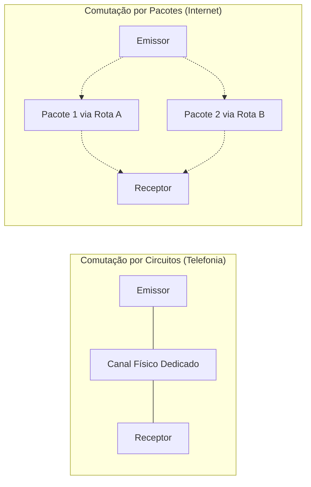
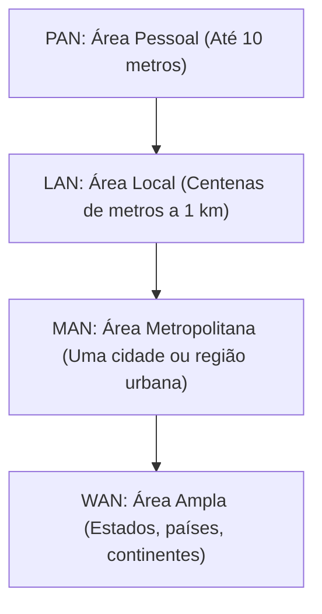
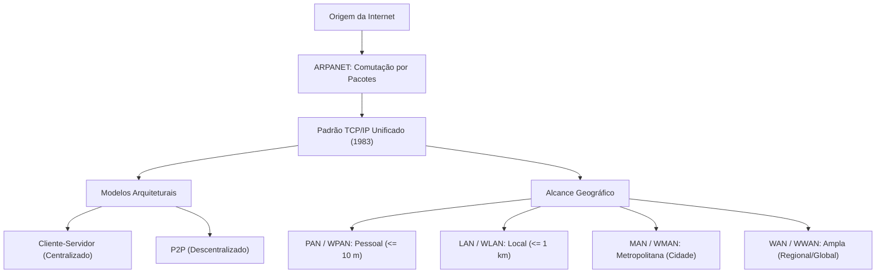

A compreensão das redes de computadores é indispensável para o desempenho de funções operacionais e administrativas na segurança pública. O tráfego de despachos de viaturas, a consulta a sistemas de inteligência policial e o acionamento de equipes de resgate dependem de infraestruturas de dados seguras e eficientes. Neste capítulo, você estudará a gênese da rede mundial, a ruptura tecnológica da comutação de pacotes e a classificação das redes segundo a sua extensão geográfica.

> [!objetivos]
> Ao concluir este capítulo, você será capaz de:
> - Compreender a evolução histórica da ARPANET até a consolidação da Internet moderna.
> - Diferenciar os mecanismos de comutação por circuitos e de comutação por pacotes.
> - Identificar os papéis dos nós finais, dispositivos intermediários e arquiteturas de rede.
> - Classificar redes de computadores pela abrangência geográfica em PAN, LAN, MAN e WAN.

## Contexto Histórico

A história das redes modernas começou durante o período da Guerra Fria. O Departamento de Defesa dos Estados Unidos, por meio de sua agência de projetos de pesquisa avançada, a DARPA, buscava um modelo de telecomunicação capaz de resistir a ataques severos ou colapsos generalizados de nós de transmissão.

Naquela época, a infraestrutura convencional de telecomunicações operava exclusivamente sob a comutação por circuitos. Nesse modelo telefônico clássico, estabelece-se um caminho físico exclusivo e temporário entre emissor e receptor. Se uma estação repetidora intermediária fosse destruída, a linha inteira caía e o canal de contato era completamente interrompido.



Para contornar essa vulnerabilidade, nasceu em 1969 a ARPANET. O projeto interligava quatro centros universitários norte-americanos: a Universidade da Califórnia em Los Angeles, a Universidade da Califórnia em Santa Bárbara, o Stanford Research Institute e a Universidade de Utah.

A ARPANET implementou uma inovação revolucionária: a comutação por pacotes. Nesse formato, a informação original não trafega por um duto ininterrupto. O dado é fragmentado em pequenas unidades chamadas pacotes. Cada pacote carrega cabeçalhos com o endereço de origem, o endereço de destino, o número sequencial e campos de controle. Os pacotes podem percorrer trajetos físicos totalmente distintos pela malha de roteadores. Caso uma rota caia, os nós remanescentes redirecionam as parcelas seguintes de forma autônoma. No nó de destino, os pacotes são conferidos, ordenados e remontados.

Em 1983, a ARPANET adotou oficialmente a pilha de protocolos TCP/IP como seu padrão unificado. Esse evento marcou o nascimento formal da Internet moderna. A partir da década de 1990, com a criação da World Wide Web no CERN e a abertura da rede para provedores comerciais, a Internet transformou-se na rede pública global de computadores.

> [!bizu]
> A comutação por pacotes não exige linha física dedicada durante toda a transmissão. Os pacotes disputam dinamicamente a largura de banda disponível nos links, garantindo excelente aproveitamento dos recursos e alta tolerância a falhas físicas.

## Conceitos Básicos de Redes

Uma rede de computadores consiste no conjunto de módulos de processamento interconectados por meios de transmissão guiados (cabos de cobre e fibras ópticas) ou não guiados (ondas de rádio, micro-ondas e sinais infravermelhos). O propósito fundamental da rede é permitir a comunicação rápida e o compartilhamento de recursos de hardware, sistemas de software e bancos de dados.

Para compreender o tráfego de dados, é necessário fixar as terminologias técnicas mais cobradas em provas:

1. **Hosts ou Nós Finais**: Dispositivos finais que produzem ou consomem dados na rede. Incluem computadores de mesa, estações de trabalho policiais, servidores centrais, notebooks, smartphones, câmeras de monitoramento e impressoras de rede.
2. **Enlaces de Comunicação**: Canais físicos ou eletromagnéticos pelos quais fluem os sinais binários entre dois nós.
3. **Dispositivos Intermediários de Rede**: Equipamentos responsáveis por encaminhar, regenerar e gerenciar o fluxo de pacotes. Os comutadores interligam nós na mesma rede local, enquanto os roteadores direcionam o tráfego entre redes lógicas distintas.


### Arquiteturas de Rede: Cliente-Servidor e P2P

Os serviços operam preponderantemente sob dois modelos arquiteturais:

- **Modelo Cliente-Servidor**: Caracteriza-se pela centralização funcional. O servidor é uma máquina dotada de recursos robustos que escuta e responde às solicitações de vários nós clientes. Exemplos típicos incluem o servidor de páginas web do Detran, o banco de dados de mandados de prisão da Polícia Civil e os servidores de correio eletrônico corporativo. O cliente inicia a requisição e o servidor devolve o serviço ou arquivo. A vantagem desse modelo reside na facilidade de governança, auditoria e controle de acesso, embora o servidor represente um ponto crítico de falha se não houver redundância.
- **Modelo Ponto a Ponto (P2P)**: Não existe divisão rígida entre emissor exclusivo e recebedor. Cada estação na rede atua simultaneamente como cliente e servidora de dados. Redes de compartilhamento de arquivos e sistemas de transações distribuídas adotam essa arquitetura descentralizada. Se um nó for desconectado, a rede permanece operacional.

| Parâmetro | Arquitetura Cliente-Servidor | Arquitetura Ponto a Ponto (P2P) |
|---|---|---|
| **Ponto Central** | Servidor dedicado centralizado | Inexistente (distribuído) |
| **Papel dos Nós** | Clientes solicitam; servidores respondem | Todos os nós compartilham e requisitam dados |
| **Escalabilidade** | Limitada pela capacidade do servidor | Cresce com a entrada de novos participantes |
| **Segurança e Auditoria** | Alta facilidade de controle e logs | Complexa governança distribuída |
| **Exemplo Operacional** | Banco de dados central da Polícia Civil | Rede BitTorrent e redes blockchain |
*Tabela 1: Confronto direto entre cliente-servidor e redes distribuídas.*

> [!atencao]
> A Internet é a infraestrutura física e lógica global de interconexão de redes. A Web é apenas um dos serviços que funcionam sobre a Internet. Serviços como correio eletrônico, chamadas telefônicas por voz sobre IP e conexões de terminal seguro utilizam a Internet sem depender de páginas web.

## Abrangência Geográfica das Redes

As redes de computadores são classificadas segundo a sua extensão física. Essa separação reflete as limitações de alcance dos meios de transmissão, a latência de tráfego, as tecnologias de controle de enlace e a titularidade dos links de dados.



### PAN (Personal Area Network)

A Rede de Área Pessoal conecta dispositivos situados na esfera individual de um único operador. O raio de alcance costuma variar de poucos centímetros a dez metros.

O objetivo principal da PAN é dispensar cabos físicos na conexão de periféricos ao computador ou smartphone do usuário. Na segurança pública, essa tecnologia viabiliza a sincronização de rádios comunicadores com fones de ouvido táticos, a descarga de dados de câmeras corporais acopladas ao uniforme e a leitura de identificadores biométricos portáteis.

Quando a tecnologia de transmissão utiliza radiofrequência de curto alcance, a rede recebe o nome específico de **WPAN (Wireless Personal Area Network)**. O padrão Bluetooth (norma IEEE 802.15.1) e o protocolo ZigBee são os exemplos mais cobrados em avaliações de concurso. A taxa de transmissão de uma WPAN é modesta em comparação a cabos Ethernet, mas seu consumo elétrico extremamente baixo é ideal para baterias de equipamentos portáteis.

### LAN (Local Area Network)

A Rede de Área Local abrange um espaço geográfico restrito e bem delineado. Seus limites físicos estendem-se de alguns metros a poucas centenas de metros, podendo cobrir uma sala de operações, uma residência, o edifício de uma delegacia ou as instalações integradas de um batalhão de bombeiros.

As principais características técnicas da LAN incluem:

1. **Altas Taxas de Transferência**: As redes locais cabeadas operam rotineiramente em velocidades de 1 Gbps (Gigabit Ethernet) e 10 Gbps (10 Gigabit Ethernet).
2. **Baixas Taxas de Erro e Latência Mínima**: Devido às curtas distâncias físicas e à utilização de cabos de par trançado blindados ou fibras ópticas em ambientes controlados, a perda de pacotes por ruído eletromagnético é quase nula.
3. **Propriedade Privada da Infraestrutura**: A instituição ou indivíduo possui o domínio direto de todos os equipamentos, cabos estruturados e switches, sem necessidade de alugar circuitos de concessionárias de telecomunicações.
4. **Topologia Dominante**: A topologia física padrão das redes locais modernas é a estrela. Nela, cada computador conecta-se individualmente a uma porta dedicada de um comutador central. Se um cabo romper, apenas aquela máquina perde contato, permanecendo a rede em pleno funcionamento.

Quando a interligação de dispositivos locais utiliza radiofrequência, a rede é denominada **WLAN (Wireless Local Area Network)**.

Existe também o conceito de **CAN (Campus Area Network)**, que representa uma expansão da LAN para interconectar múltiplos edifícios contíguos pertencentes à mesma organização, como a sede integrada do Quartel do Comando Geral e suas diretorias anexas. Para fins de prova, as bancas tratam a CAN como uma variante direta ou agregação de redes locais.

> [!bizu]
> Em redes locais cabeadas, o protocolo dominante na camada de enlace é o padrão IEEE 802.3 (Ethernet). No padrão sem fio (Wi-Fi), vigora a família IEEE 802.11, que emprega o método CSMA/CA para prevenir colisões eletromagnéticas no meio compartilhado.

> [!atencao]
> A topologia lógica de uma rede pode diferir da sua topologia física. Por exemplo, uma rede fisicamente em estrela conectada por um concentrador antigo (hub) funciona logicamente em barramento compartilhado. Com o uso de comutadores modernos (switches), a rede opera física e logicamente com circuitos dedicados por porta.

### MAN (Metropolitan Area Network)

A Rede de Área Metropolitana cobre o perímetro de uma cidade, município ou grande aglomeração urbana. Seu raio típico varia de alguns quilômetros a dezenas de quilômetros.

A MAN é empregada para interligar redes locais autônomas que pertencem à mesma corporação ou poder público, mas estão situadas em bairros distintos de um mesmo município. Um exemplo prático da administração pública é o sistema metropolitano de videomonitoramento de trânsito e segurança de Recife. As câmeras instaladas nos cruzamentos e as estações de monitoramento dos batalhões enviam imagens em alta definição para o Centro Integrado de Operações de Defesa Social por meio de um anel metropolitano de fibra óptica.

Aspectos cruciais da MAN:

- Utiliza enlaces de altíssima velocidade, normalmente baseados em cabos subterrâneos de fibra óptica monomodo e comutadores ópticos de alta capacidade.
- Pode ser implementada por meio de infraestrutura própria da administração ou contratada de operadoras de telefonia e telecomunicações locais.
- A versão sem fio recebe a sigla **WMAN (Wireless Metropolitan Area Network)**, cujo padrão histórico de referência teórica em editais é o WiMAX (norma IEEE 802.16).

```mermaid Exemplo de MAN em anel interligando unidades operacionais urbanas
flowchart TD
    CIODS["Centro Integrado (CIODS - Centro)"] --- B1["1º BPM (Zona Norte)"]
    B1 --- B2["19º BPM (Zona Sul)"]
    B2 --- DP["Delegacia Seccional (Zona Oeste)"]
    DP --- CIODS
```

### WAN (Wide Area Network)

A Rede de Longa Distância (ou Rede de Área Ampla) transcende os limites de uma única cidade. Ela interconecta redes através de estados, regiões geográficas, países inteiros e continentes.

A **Internet é a maior WAN existente no planeta**. Ela integra milhões de redes corporativas, acadêmicas, governamentais e domésticas em uma teia global autônoma. No âmbito estatal, a rede própria que interliga as delegacias do interior do Sertão pernambucano, do Agreste e do Litoral à capital Recife configura uma WAN corporativa.

Características determinantes da WAN:

1. **Utilização de Provedores de Telecomunicações**: Por razões financeiras e regulatórias, nenhuma entidade isolada lança cabos e antenas por milhares de quilômetros de rodovias e oceanos. As organizações contratam enlaces dedicados de operadoras de telecomunicações públicas e privadas.
2. **Meios de Transmissão Diversificados**: Empregam-se cabos submarinos de fibra óptica que cruzam oceanos, linhas de satélites geoestacionários e de baixa órbita, e circuitos de micro-ondas de longa distância.
3. **Latência e Taxa de Erro**: Como os pacotes viajam distâncias intercontinentais e passam por dezenas de roteadores de trânsito, a latência média é sensivelmente superior à observada em uma rede local.
4. **Variante Sem Fio**: A **WWAN (Wireless Wide Area Network)** engloba as tecnologias de telefonia celular de cobertura nacional, como as redes móveis de quarta e quinta geração, além de constelações de comunicações via satélite.


| Tipo | Sigla Sem Fio | Alcance Geográfico Típico | Meio e Padrão Típico | Exemplo de Aplicação Prática |
|---|---|---|---|---|
| **PAN** | WPAN | Até 10 metros | Bluetooth (IEEE 802.15.1) | Fone tático ligado ao rádio HT |
| **LAN** | WLAN | Até 1 quilômetro | Par trançado (Ethernet), Wi-Fi (802.11) | Rede interna da 1ª Seção de Bombeiros |
| **MAN** | WMAN | 5 a 50 quilômetros | Anel urbano de fibra, WiMAX (802.16) | Sistema de câmeras urbanas de Recife |
| **WAN** | WWAN | Centenas a milhares de km | Cabos submarinos, satélite, redes móveis | Conexão entre quartéis do interior e a Capital |
*Tabela 2: Síntese comparativa das categorias de redes por abrangência física.*

> [!pegadinha]
> A banca examinadora costuma afirmar que o critério de classificação entre LAN, MAN e WAN é a quantidade de computadores conectados ou a velocidade de transmissão da rede. Essa afirmação é falsa. O único critério formal que define se uma rede é LAN, MAN ou WAN é a sua **abrangência geográfica** (alcance físico dos enlaces). Uma LAN com vinte mil computadores dentro de um campus universitário continua sendo uma LAN, enquanto a conexão entre dois computadores situados em cidades diferentes separados por 400 km forma uma WAN.

## Outras Nomenclaturas Geográficas

Além das quatro categorias clássicas consolidadas na literatura técnica, algumas bancas examinadoras citam nomenclaturas complementares:

- **BAN (Body Area Network)**: Rede de dispositivos vestíveis instalados no próprio corpo humano. Opera em distâncias inferiores a um metro. É amplamente empregada no monitoramento biomédico de bombeiros militares em combate a incêndios estruturais, transmitindo frequência cardíaca, oxigenação sanguínea e temperatura corporal para a viatura de comando.
- **SAN (Storage Area Network)**: Ao contrário das classificações puramente geográficas, a SAN define uma rede de alta velocidade voltada exclusivamente a interligar servidores de aplicação a matrizes de armazenamento de massa (storages de discos e fitas). Utiliza tecnologias especializadas como Fibre Channel e iSCSI para prover acesso a blocos de dados com latência insignificante.

> [!exemplo]
> Considere uma operação integrada de resgate em um deslizamento de encosta. O bombeiro na área de busca utiliza um sensor de monóxido de carbono e um rádio no colete comunicando-se por Bluetooth com o seu terminal portátil: temos uma **PAN**. Na base móvel montada em um caminhão de comando, quatro computadores conectam-se a um roteador Wi-Fi local para cruzar dados das equipes: temos uma **LAN**. O caminhão de comando envia imagens aéreas de drones para a Prefeitura local por meio da rede óptica municipal de videomonitoramento: temos uma **MAN**. Por fim, a central do município transmite os relatórios estratégicos para o Ministério da Justiça em Brasília por cabos de fibra óptica de longa distância: temos uma **WAN**.

## Mapa do capítulo



### Para fixar

- A comutação por pacotes divide os dados em fragmentos autônomos com cabeçalhos de controle e roteamento dinâmico tolerante a falhas.
- A ARPANET nasceu em 1969 como rede militar e acadêmica, adotando a pilha TCP/IP como padrão unificado em 1983.
- No modelo cliente-servidor, clientes iniciam solicitações e servidores centralizados respondem com dados e serviços.
- No modelo ponto a ponto (P2P), todos os computadores compartilham recursos simultaneamente como clientes e servidores descentralizados.
- A abrangência geográfica é o critério exclusivo de classificação de redes em PAN, LAN, MAN e WAN, independentemente da velocidade ou do número de nós.
- Redes locais (LAN) possuem alta velocidade, baixa latência e administração privada em ambientes como residências, delegacias e quartéis.
- Redes de longa distância (WAN) interligam cidades, estados e países por meio de enlaces contratados de operadoras de telecomunicações.
