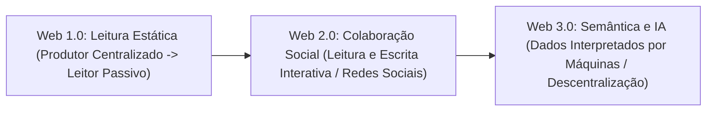
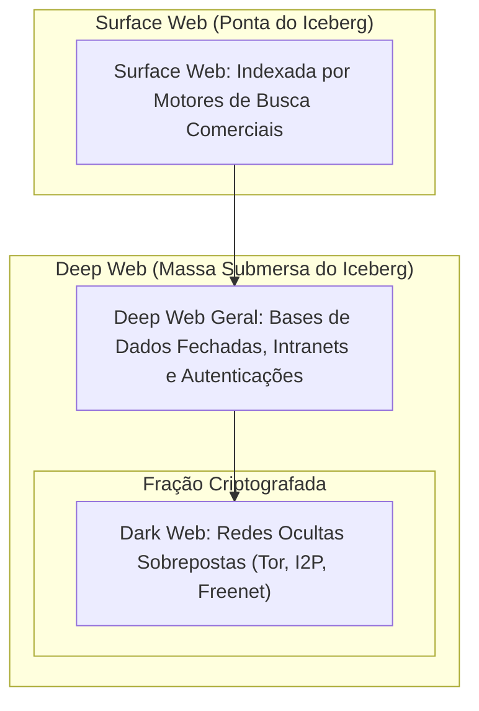
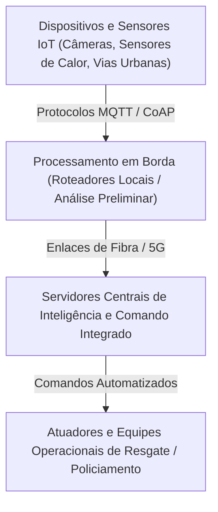
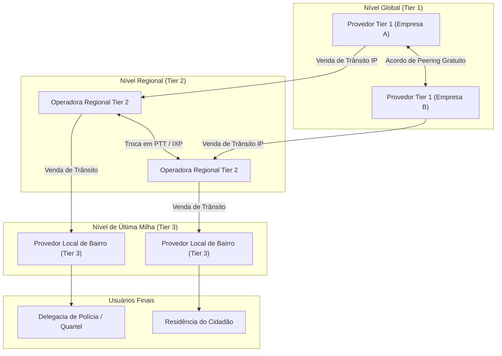
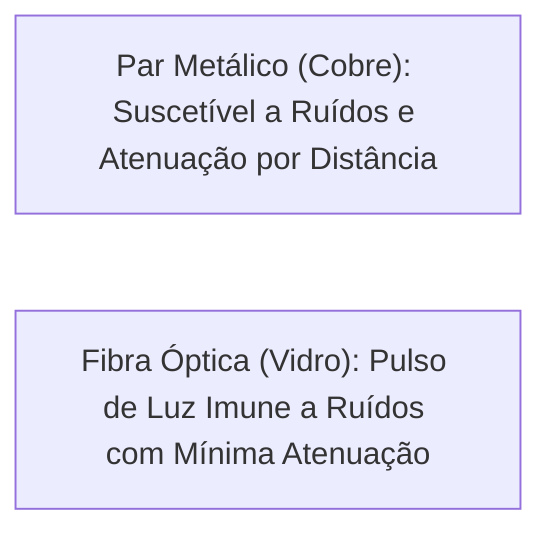

O domínio das camadas da rede mundial e das formas de acesso físico aos dados constitui exigência central para os profissionais de segurança pública. O trabalho de investigação cibernética, a coleta de evidências digitais e o gerenciamento de comunicações operacionais demandam a compreensão nítida da evolução da World Wide Web, da segregação estrutural entre Surface, Deep e Dark Web, e dos mecanismos físicos de transmissão de dados. Neste capítulo, você dominará esses conceitos sob a perspectiva técnica e prática exigida pelas bancas de concurso.

> [!objetivos]
> Ao concluir este capítulo, você será capaz de:
> - Distinguir com precisão técnica a infraestrutura da Internet do serviço da World Wide Web.
> - Compreender a evolução das fases da Web (Web 1.0, Web 2.0 e Web 3.0).
> - Diferenciar a Surface Web, a Deep Web e a Dark Web quanto à indexação e aos métodos de acesso.
> - Identificar o papel da Internet das Coisas (IoT) e sua relevância nas operações de segurança pública.
> - Analisar a hierarquia dos Provedores de Serviço de Internet (ISPs) e as tecnologias físicas de banda larga.

## A World Wide Web e Sua Evolução Histórica

O senso comum costuma tratar Internet e Web como termos sinônimos. Na ciência da computação e nos concursos públicos, todavia, eles definem entidades distintas.

A **Internet** é a infraestrutura física e lógica global de telecomunicações. Ela é formada por roteadores, cabos submarinos, satélites, fibras ópticas e a pilha de protocolos TCP/IP. A Internet conecta computadores e permite a troca bruta de dados em escala planetária.

A **World Wide Web (WWW)**, por sua vez, é um sistema de informação distribuído baseado em hipertexto que funciona sobre a Internet. Criada entre 1989 e 1991 pelo cientista britânico Tim Berners-Lee na Organização Europeia para a Pesquisa Nuclear (CERN), a Web viabilizou a exibição integrada de textos, imagens, vídeos e links interativos acessíveis por meio de programas navegadores (browsers).

```mermaid Relacao arquitetural entre a infraestrutura da Internet e os servicos suportados
flowchart TD
    Internet["Infraestrutura Global da Internet (TCP/IP, Roteadores e Enlaces)"]
    Internet --> Web["World Wide Web (HTTP/HTTPS e Navegadores)"]
    Internet --> Email["Correio Eletrônico (SMTP, IMAP, POP3)"]
    Internet --> VoIP["Telefonia e Voz sobre IP (SIP, RTP)"]
    Internet --> Terminais["Acesso Remoto Seguro (SSH)"]
    Internet --> Arquivos["Transferência Direta (FTP, P2P)"]
```

> [!bizu]
> A Web não é a Internet; ela é apenas uma das muitas aplicações que rodam sobre a Internet. Você pode trocar mensagens de correio eletrônico ou abrir uma sessão remota SSH sem carregar uma única página web.

### As Eras da Web: Web 1.0, 2.0 e 3.0

A evolução da World Wide Web é didaticamente segmentada em três grandes marcos históricos e conceituais:

1. **Web 1.0 (A Web Estática ou Somente Leitura)**: Dominou o início da rede nos anos 1990. Os sites eram formados por documentos HTML estáticos em servidores web. A comunicação era essencialmente unidirecional. Os donos das páginas produziam os conteúdos. Os usuários liam as informações de maneira passiva. Os portais funcionavam como catálogos virtuais sem caixas de comentários.
2. **Web 2.0 (A Web Social, Colaborativa e Interativa)**: Consolidada a partir de 2004, essa fase transferiu o poder editorial ao usuário. O avanço de tecnologias como o AJAX permitiu atualizar dados sem recarregar toda a tela. Surgiram as redes sociais, os blogs, os vídeos online e as enciclopédias coletivas. O usuário deixou de ser espectador passivo e tornou-se produtor ativo de conteúdo.
3. **Web 3.0 (A Web Semântica e Descentralizada)**: Representa o estágio atual de maturação da rede. Seu foco central é a capacidade das máquinas interpretarem o significado conceitual dos dados. Isso supera a simples leitura de caracteres isolados. Por meio de ontologias, metadados e inteligência artificial, os sistemas correlacionam contextos complexos. A Web 3.0 também agrega redes descentralizadas, contratos inteligentes e identidades autônomas.



| Critério | Web 1.0 | Web 2.0 | Web 3.0 |
|---|---|---|---|
| **Papel do Usuário** | Leitor passivo de páginas estáticas | Criador, editor e compartilhador de conteúdo | Participante em ecossistemas inteligentes integrados |
| **Arquitetura Base** | Servidores estáticos e HTML básico | Plataformas web dinâmicas, AJAX e APIs | Web semântica, metadados, IA e redes descentralizadas |
| **Interatividade** | Mínima ou inexistente | Elevada (comentários, curtidas e colaboração) | Preditiva, personalizada e orientada por agentes inteligentes |
| **Exemplos Marcantes** | Portais institucionais antigos da década de 90 | Redes sociais, wikis e blogs colaborativos | Motores de busca inteligentes, assistentes cognitivos e blockchain |
*Tabela 1: Confronto sintético entre as fases da Web.*

> [!exemplo]
> Um portal policial na era da Web 1.0 apenas publicava uma lista fixa de telefones das delegacias em formato de tabela simples. Na Web 2.0, o mesmo portal passou a permitir que os cidadãos registrassem boletins de ocorrência pela internet e acompanhassem o protocolo com mensagens interativas. Na Web 3.0, o sistema de inteligência policial processa termos semânticos em múltiplos bancos de dados públicos e privados, correlacionando automaticamente apelidos, placas clonadas e padrões temporais de crimes por meio de algoritmos de aprendizado de máquina.

## As Camadas da Web: Surface, Deep e Dark Web

A metáfora do iceberg é a representação mais consagrada para explicar a visibilidade e a acessibilidade dos dados na rede mundial. O universo da Web divide-se em três camadas estruturais distintas: Surface Web, Deep Web e Dark Web.



### Surface Web (Clearnet)

A Surface Web é também conhecida como Clearnet ou Web Superficial. Ela corresponde à camada visível e pública da rede mundial. Reúne páginas, documentos e arquivos indexados por robôs de motores de busca comerciais, como Google e Bing.

Para integrar a Surface Web, a página deve atender a dois requisitos centrais. Primeiro, não pode exigir autenticação prévia por senha ou biometria. Segundo, não deve conter bloqueios em seu arquivo robots.txt contra robôs de busca.

- Não exigir autenticação prévia (nome de usuário, senha ou biometria) para visualização.
- Não possuir bloqueios explícitos em seu arquivo de configuração `robots.txt` que impeçam a varredura dos robôs de busca.

Estudos de métricas de rede indicam que a Surface Web representa uma fração minoritária de todo o volume de informações disponível na Internet, estimada entre quatro e dez por cento do total de dados existentes.

### Deep Web (Web Invisível)

A Deep Web reúne qualquer página ou banco de dados não indexado por motores de busca convencionais. Ela representa a maior massa do iceberg digital. Abrange mais de noventa por cento de todo o volume de dados da Internet.

É preciso desmistificar a Deep Web. A grande maioria de seus conteúdos é lícita, legítima e essencial ao cotidiano. Suas páginas ficam ocultas dos buscadores por razões de privacidade, segurança institucional ou arquitetura de software.

Uma página pertence à Deep Web pelos seguintes fatores técnicos:

1. **Proteção por Credenciais de Acesso**: Exige login e senha. As telas do seu correio eletrônico individual, os extratos bancários em plataformas de internet banking, os processos administrativos eletrônicos de tribunais e as áreas restritas de prontuários médicos hospitalares não podem ser vasculhados pelo Google. Todos esses sistemas estão na Deep Web.
2. **Conteúdo Dinâmico Gerado sob Demanda**: Bancos de dados que exigem o preenchimento de formulários de consulta específicos, como o sistema de mandados de prisão do Conselho Nacional de Justiça ou a consulta de débitos do Detran. O robô de busca não preenche campos variáveis nem gera resultados sob consulta.
3. **Redes Privadas e Intranets**: Sistemas corporativos internos acessíveis apenas via redes restritas corporativas ou túneis criptografados.
4. **Instruções de Não Indexação**: Páginas que utilizam cabeçalhos HTTP ou diretivas `robots.txt` orientando os buscadores a ignorar seus diretórios internos.

> [!atencao]
> A Deep Web não é sinônimo de crime nem é inerentemente ilegal. Quando você acessa seu histórico escolar, visualiza uma foto em álbum privado ou consulta seu contracheque no portal do servidor estadual mediante login, você está operando legitimamente dentro da Deep Web.

### Dark Web (A Web Oculta e Anônima)

A Dark Web é uma subdivisão restrita e especializada contida na Deep Web. Diferente da Deep Web comum, ela não pode ser aberta por navegadores comuns sem configurações prévias. Suas páginas ficam em redes sobrepostas e criptografadas.

A Dark Web é composta por redes sobrepostas (overlay networks) que exigem softwares específicos de roteamento em camadas de cebola, autorizações de nós e configurações de criptografia ponta a ponta para garantir o anonimato radical tanto dos servidores quanto dos usuários navegantes.

As principais redes que compõem a Dark Web são:

- **Rede Tor (The Onion Router)**: É a rede oculta mais disseminada mundialmente. Foi criada por laboratórios de pesquisa naval dos Estados Unidos para resguardar comunicações estatais. O Tor encaminha o tráfego por múltiplos nós voluntários sucessivos. Em cada salto, uma camada criptográfica é removida, como as camadas de uma casca de cebola. Nenhum nó intermediário conhece a rota completa. Seus sites adotam o sufixo especial .onion.
- **I2P (Invisible Internet Project)**: Rede descentralizada baseada em roteamento em alho (garlic routing), projetada para criar um ambiente estritamente interno e anônimo de comunicação ponto a ponto e serviços ocultos, sem foco prioritário em acessar a internet aberta.
> [!atencao]
> No roteamento da rede Tor, o nó de saída descriptografa o pacote antes de entregá-lo ao servidor de destino na internet aberta. Se a conexão não utilizar HTTPS, o administrador do nó de saída pode interceptar credenciais e mensagens em texto claro.

- **Freenet**: Plataforma ponto a ponto desenhada com foco em armazenamento imutável e distribuído de arquivos criptografados, visando à resistência contra censura política.

```mermaid Roteamento em cebola da rede Tor
flowchart LR
    Cliente["Navegador Tor (Origem)"] -->|Camada 3 de Criptografia| NoEntrada["Nó de Entrada (Guarda)"]
    NoEntrada -->|Camada 2 de Criptografia| NoRelay["Nó Intermediário (Relay)"]
    NoRelay -->|Camada 1 de Criptografia| NoSaida["Nó de Saída"]
    NoSaida -->|Tráfego Aberto ou Oculto| Servidor["Servidor de Destino (.onion)"]
```



Na rotina das forças de segurança, o monitoramento técnico da Dark Web é relevante porque essa camada frequentemente abriga mercados ilegais (dark markets) de tráfico de armas, comercialização de drogas ilícitas, vazamento de credenciais de agentes públicos e fóruns de cibercriminosos. Todavia, a tecnologia de anonimização também é utilizada legalmente por jornalistas que atuam sob regimes autoritários violentos, ativistas de direitos humanos e investigadores em operações especiais sob autorização judicial.

| Parâmetro | Surface Web | Deep Web | Dark Web |
|---|---|---|---|
| **Indexação por Buscadores** | Totalmente indexada por motores convencionais | Não indexada por robôs de busca gerais | Não indexada por robôs e propositalmente oculta |
| **Acesso por Navegadores Comuns** | Acesso direto e nativo (Chrome, Edge, Firefox) | Acesso direto mediante credenciais e logins | Exige navegadores específicos (como Tor Browser) |
| **Tecnologia Predominante** | Protocolos abertos HTTP e HTTPS | Bancos de dados relacionais e formulários | Redes sobrepostas com criptografia em cebola |
| **Exemplos Típicos** | Portais de notícias, enciclopédias virtuais, blogs públicos | Internet banking, prontuários, contracheques | Sites de domínio com sufixo final `.onion` |
| **Finalidade Predominante** | Disseminação pública de informações | Proteção de dados privados e corporativos | Anonimato absoluto de emissores e receptores |
*Tabela 2: Confronto analítico das camadas da rede mundial.*

> [!pegadinha]
> As bancas examinadoras frequentemente invertem as definições para induzir o candidato ao erro. Grave a relação de continência: **Toda Dark Web faz parte da Deep Web, mas nem toda Deep Web é Dark Web**. A Deep Web é o gênero amplo que abriga todo conteúdo não indexado; a Dark Web é a espécie restrita que depende de softwares de anonimização e criptografia especial. Além disso, acessar a Deep Web não requer navegadores modificados; basta autenticar-se em um site comum.

## Internet das Coisas (IoT - Internet of Things)

A Internet das Coisas (IoT) conecta objetos físicos cotidianos e industriais à rede mundial. Esses aparelhos trazem sensores, chips, atuadores e placas de rede. Assim, coletam dados operacionais e realizam comandos remotos automatizados.

O desenvolvimento da IoT decorre da convergência de três fatores tecnológicos:

1. **Disponibilidade do Protocolo IPv6**: A exaustão dos endereços na versão IPv4 tornava inviável atribuir um identificador global para bilhões de novos equipamentos. O IPv6 oferece uma quantidade quase inesgotável de endereços (três vírgula quatro vezes dez elevado a trinta e oito endereços), permitindo a conexão direta de cada sensor ou eletrodoméstico à rede mundial.
2. **Miniaturização e Eficiência Energética**: O barateamento de semicondutores e o surgimento de protocolos sem fio de baixo consumo (Bluetooth Low Energy, ZigBee, LoRaWAN e redes móveis NB-IoT).
3. **Computação em Nuvem e Processamento em Borda (Edge Computing)**: A capacidade de processar volumes massivos de telemetria diretamente nas proximidades do sensor ou em servidores de dados escaláveis.



### Aplicações da IoT na Segurança Pública e Defesa Social

Na atuação diária das polícias e dos bombeiros militares, a IoT assume papel estratégico e salva vidas:

- **Câmeras de Reconhecimento Óptico de Caracteres (OCR)**: Equipamentos instalados em viaturas e postes que lêem instantaneamente as placas de veículos em trânsito e disparam alertas imediatos ao centro integrado quando detectam veículos com registro de furto ou roubo.
- **Sensores de Fumaça e Incêndio Conectados**: Dispositivos prediais que notificam diretamente as centrais de despacho do Corpo de Bombeiros em segundos, indicando com precisão milimétrica o foco inicial das chamas antes mesmo que vizinhos liguem para o telefone de emergência 193.
- **Câmeras Corporais e Veiculares Transmissoras**: Equipamentos com posicionamento global por satélite (GPS) que transmitem áudio e vídeo de operações críticas para a sala de comando em tempo real.
- **Monitores Fisiológicos em Bombeiros**: Sensores biométricos embutidos em equipamentos de proteção individual que acompanham estresse térmico e consumo do cilindro de ar respirável dos combatentes no interior de edifícios em chamas.

## Hierarquia de Provedores de Acesso à Internet (ISPs)

A Internet não possui um proprietário único centralizado nem uma empresa monopolista controladora. Trata-se de uma rede das redes, estruturada por meio de uma hierarquia comercial e cooperativa de Provedores de Serviço de Internet (Internet Service Providers - ISPs).

Essa hierarquia é classicamente dividida em três níveis (tiers):

- **Provedores Tier 1 (Backbone Global)**: Formam a espinha dorsal internacional da rede. São multinacionais de telecomunicações donas de cabos submarinos e fibras continentais. Elas trocam dados entre si sem custos de tráfego (peering livre). Não pagam trânsito a terceiros para cobrir o planeta.
- **Provedores Tier 2 (Operadoras Regionais)**: São operadoras de grande porte regional ou nacional. Para conectar seus clientes ao tráfego global, compram trânsito IP de provedores Tier 1. Trocam tráfego entre si em pontos de interconexão pública (PTTs ou IXPs).
- **Provedores Tier 3 (Última Milha)**: Ocupam a base da estrutura de distribuição. São os provedores locais que entregam o sinal final a residências, empresas e delegacias. Eles compram trânsito de operadoras Tier 2 para levar os assinantes à rede mundial.



## Tecnologias de Acesso e Transmissão Física

Para que um pacote de dados viaje de um computador doméstico ou delegacia até a espinha dorsal da rede, utilizam-se diferentes tecnologias de enlace na chamada última milha (last mile). A evolução dessas tecnologias determinou o salto da internet discada para as conexões em gigabits:

### Dial-up (Acesso Discado Analógico)

Foi a tecnologia precursora de acesso domiciliar. Empregava a rede de telefonia comutada analógica. Um modem convertia os dados digitais em frequências sonoras na linha telefônica de cobre.

Principais limitações do acesso discado:

- Taxa máxima teórica limitada a cinquenta e seis quilobits por segundo (56 kbps).
- Ocupava integralmente a linha de telefone durante a navegação, impedindo chamadas de voz simultâneas.
- Alta latência e instabilidade frequente.

### ADSL (Asymmetric Digital Subscriber Line)

A ADSL inaugurou a banda larga sobre pares de cobre telefônicos. Ela transmite dados em frequências inaudíveis ao ouvido humano. Desse modo, viabiliza o uso simultâneo de voz e dados mediante microfiltros.

O termo **assimétrico** decorre da divisão desigual da capacidade do canal: a taxa de download (recebimento de dados) é propositadamente muito maior do que a taxa de upload (envio de dados). Esse arranjo reflete o comportamento típico do usuário comum, que consome muito mais páginas e vídeos do que envia arquivos.

### Cabo Coaxial e Redes HFC (Hybrid Fiber-Coaxial)

Utilizada pelas empresas concessionárias de televisão a cabo sob o padrão técnico internacional DOCSIS. A infraestrutura combina cabos troncos de fibra óptica na distribuição de bairro com cabos coaxiais de cobre na descida até o modem do assinante. Oferece velocidades substancialmente superiores ao ADSL, mas o meio compartilhado no bairro pode sofrer atenuação de desempenho em horários de pico.

> [!bizu]
> Provedores locais utilizam a sigla GPON (Gigabit Passive Optical Network) para definir a tecnologia de rede óptica passiva compartilhada. Ela dispensa energia elétrica intermediária entre a central e os assinantes.

### Fibra Óptica (FTTH - Fiber to the Home)

A fibra óptica representa o padrão de excelência nas conexões fixas. Na modalidade FTTH, o fio de vidro chega diretamente ao interior do imóvel. Não ocorrem conversões para cabos metálicos no caminho.

Vantagens técnicas decisivas da fibra óptica:

1. **Imunidade a Interferências Eletromagnéticas**: O sinal viaja como pulsos de luz gerados por lasers ou diodos emissores de luz (LED), sendo imune a tempestades elétricas, motores ou linhas de alta tensão.
2. **Capacidade Gigantesca de Banda**: Acomoda taxas de transferência de centenas de megabits até gigabits por segundo, com facilidade para conexões simétricas (mesma velocidade para download e upload).
3. **Atenuação Mínima**: Permite a transmissão de dados por dezenas de quilômetros sem necessidade de repetidores elétricos no trajeto.



### Acesso Móvel e Tecnologias Sem Fio

Para mobilidade em viaturas e operações de campo, empregam-se tecnologias de acesso sem fio:

- **Redes Celulares (4G LTE e 5G)**: A tecnologia 4G trouxe a transição para pacotes puramente IP na telefonia móvel. A tecnologia 5G entrega baixíssima latência (em torno de um milissegundo), capacidade maciça de conexões simultâneas por quilômetro quadrado e altíssima largura de banda, sendo a espinha dorsal necessária para a proliferação da IoT e frotas policiais conectadas.
- **Comunicação por Satélite**: Indispensável para operações de bombeiros e policiamento florestal em regiões remotas onde não há cobertura de fibra ou antenas de celular. Pode operar via satélites geoestacionários clássicos (órbita a cerca de 36 mil quilômetros, com latência elevada) ou por meio de modernas constelações de satélites em órbita baixa da Terra (LEO, de baixa latência e banda larga).

| Tecnologia | Meio Físico Utilizado | Taxa Típica de Download | Taxa Típica de Upload | Sensibilidade a Interferências |
|---|---|---|---|---|
| **Dial-up** | Par trançado telefônico analógico | Até 56 kbps | Até 33,6 kbps | Elevada (ruídos na linha derrubam o link) |
| **ADSL** | Par trançado telefônico em frequências altas | 1 a 24 Mbps | 512 kbps a 2 Mbps | Média (sensível à distância física da central) |
| **Cabo HFC** | Fibra no tronco e cabo coaxial na ponta | 50 a 500 Mbps | 10 a 50 Mbps | Baixa (isolamento blindado de cobre) |
| **FTTH (Fibra)** | Filamento de fibra de vidro monomodo | 100 Mbps a 1 Gbps+ | 100 Mbps a 1 Gbps+ | Nula a ruídos eletromagnéticos |
| **4G / 5G** | Ondas de rádio terrestres | 20 Mbps a 1 Gbps | 10 a 100 Mbps | Sujeita a barreiras físicas e clima |
*Tabela 3: Síntese comparativa dos meios físicos de acesso de última milha.*

## Mapa do capítulo

```mermaid Sintese dos topicos fundamentais da Web e infraestrutura de conexao
flowchart TD
    Conceito["World Wide Web"] --> Fases["Evolução das Eras"]
    Fases --> W1["Web 1.0: Conteúdo Estático Unidirecional"]
    Fases --> W2["Web 2.0: Colaboração Social e Dinamismo"]
    Fases --> W3["Web 3.0: Semântica, IA e Descentralização"]
    
    Conceito --> Camadas["Camadas da Web"]
    Camadas --> Surf["Surface Web: Indexável por Motores de Busca"]
    Camadas --> Deep["Deep Web: Não Indexada / Acesso por Autenticação"]
    Deep --> Dark["Dark Web: Criptografada / Redes Sobrepostas (Tor)"]
    
    Conceito --> Conectividade["Infraestrutura e Acesso"]
    Conectividade --> ISPs["Hierarquia de ISPs (Tier 1, Tier 2 e Tier 3)"]
    Conectividade --> Meios["Meios Físicos: Discada, ADSL, Cabo, FTTH e Redes Móveis"]
    Conectividade --> IoT["Internet das Coisas: IPv6 e Sensores Inteligentes"]
```

### Para fixar

- A Internet é a infraestrutura física e lógica global de redes, enquanto a World Wide Web é uma aplicação multimídia de hipertexto que roda sobre ela.
- A Web 1.0 caracterizou-se pela leitura passiva de páginas estáticas; a Web 2.0 instituiu a colaboração ativa dos usuários em redes sociais; a Web 3.0 consolida a interpretação semântica e a inteligência de dados.
- A Surface Web abrange conteúdos públicos indexados por mecanismos de busca gerais; a Deep Web engloba bancos de dados e sistemas protegidos por senha não indexáveis.
- A Dark Web é uma subdivisão oculta da Deep Web construída sobre redes criptografadas (como a rede Tor), exigindo ferramentas específicas para navegação.
- O roteamento em cebola da rede Tor remove sucessivas camadas criptográficas em nós intermediários voluntários, ocultando a rota original de tráfego.
- A Internet das Coisas (IoT) interconecta objetos cotidianos e industriais com sensores e atuadores, tendo no IPv6 a base para seu endereçamento massivo.
- Provedores Tier 1 compõem o núcleo internacional da rede sem pagar trânsito a terceiros; Tier 2 cobrem âmbitos nacionais e regionais; Tier 3 fornecem a última milha aos assinantes finais.
- A fibra óptica na modalidade FTTH propicia altíssimas velocidades com imunidade absoluta a ruídos eletromagnéticos e baixíssima atenuação de sinal.
