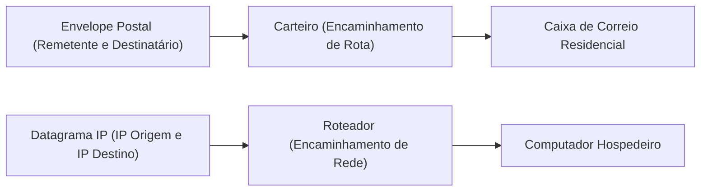
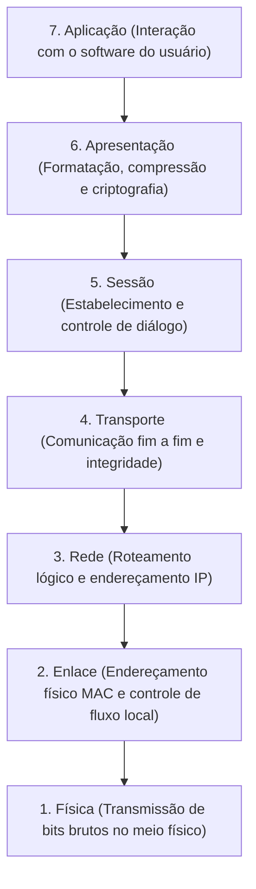
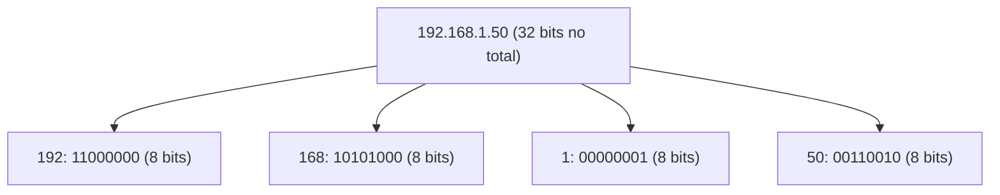
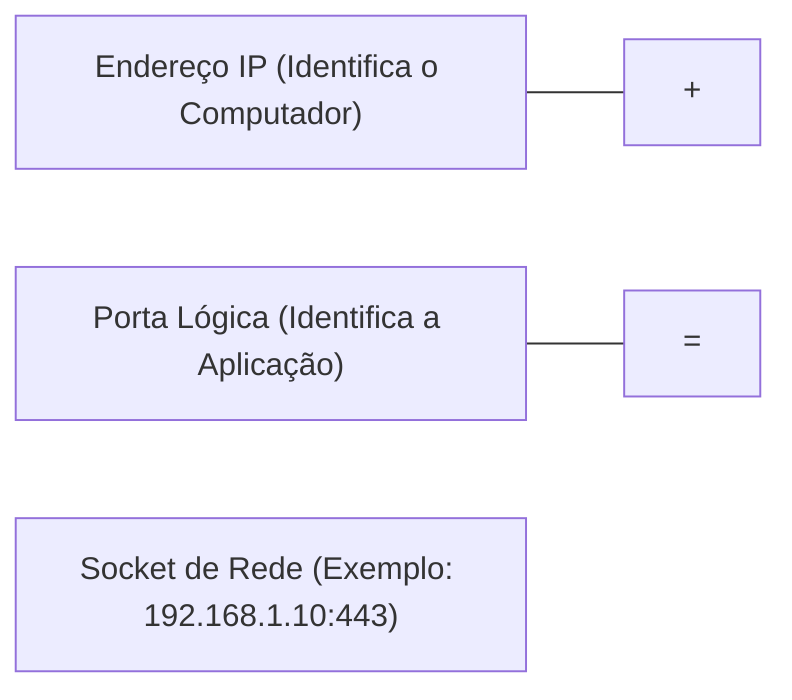
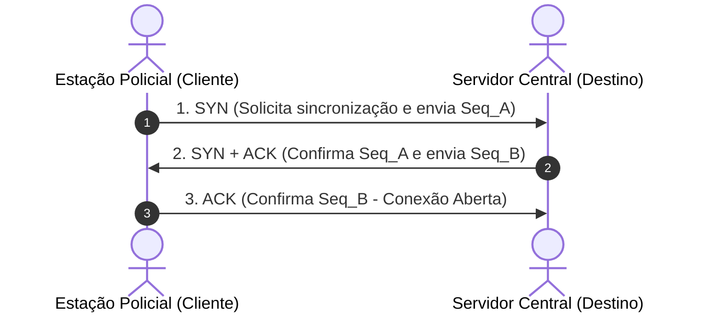
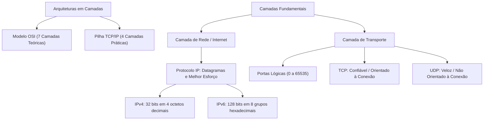

A comunicação entre computadores de fabricantes distintos exige regras rígidas de padronização. Para que viaturas policiais, helicópteros de resgate e centrais de despacho troquem dados sem incompatibilidades, foram criadas arquiteturas em camadas. Neste capítulo, estudaremos a estrutura conceitual do Modelo OSI e a organização prática da pilha TCP/IP. Também analisaremos o protocolo IP e o confronto entre TCP e UDP na camada de transporte.

> [!objetivos]
> Ao concluir este capítulo, você será capaz de:
> - Compreender os conceitos básicos de protocolos de rede e o processo de encapsulamento.
> - Diferenciar as sete camadas do Modelo OSI das quatro camadas da arquitetura TCP/IP.
> - Dominar as características operacionais do protocolo IP nas versões IPv4 e IPv6.
> - Aplicar as regras técnicas de abreviação e condensação de endereços IPv6.
> - Distinguir o funcionamento, as vantagens e os cenários de aplicação do TCP e do UDP.

## Conceitos Básicos

No universo da tecnologia da informação, os conceitos básicos de redes fundamentam toda a infraestrutura moderna. Um protocolo de rede é um conjunto formal de regras, padrões e convenções sintáticas. Ele define como os nós devem formatar, transmitir, receber e interpretar dados pela rede.

Os protocolos estabelecem três elementos cruciais:

1. **Sintaxe**: Estrutura dos blocos de dados e ordem dos campos nos cabeçalhos.
2. **Semântica**: Significado atribuído a cada conjunto de bits ou comandos de controle.
3. **Temporização**: Velocidade de envio e sincronismo de recepção entre os dispositivos.

Para ilustrar o funcionamento de um protocolo de rede elementar, a doutrina consagrou a clássica analogia do carteiro postal. O carteiro recebe uma carta lacrada contendo apenas o endereço do destinatário e o remetente no envelope externo. O carteiro não lê o teor interno da correspondência. Ele apenas cumpre as regras de encaminhamento postal para depositar o envelope na caixa de correio da residência. De maneira idêntica, os protocolos da camada de rede transportam cargas úteis de ponta a ponta na Internet sem inspecionar os arquivos das aplicações finais.



### O Processo de Encapsulamento e Unidades de Dados (PDUs)

A comunicação em camadas opera por meio do encapsulamento sucessivo. A camada superior gera os dados e os repassa para a camada inferior imediata. Essa camada inferior anexa seu próprio cabeçalho com informações de controle. O pacote resultante torna-se a carga útil (payload) do nível seguinte.

No receptor, ocorre o processo inverso: o desencapsulamento. Cada camada remove seu cabeçalho correspondente, processa os parâmetros e entrega os dados originais ao nível superior.

```mermaid Fluxo de encapsulamento e desencapsulamento entre camadas
flowchart LR
    subgraph Emissor["Dispositivo de Origem"]
        D1["Dados da Aplicação"] --> S1["Segmento (Transporte)"]
        S1 --> P1["Pacote / Datagrama (Rede)"]
        P1 --> Q1["Quadro / Frame (Enlace)"]
        Q1 --> B1["Sinais e Bits (Física)"]
    end
    subgraph Meio["Meio de Transmissão"]
        B1 -.-> B2["Bits"]
    end
    subgraph Receptor["Dispositivo de Destino"]
        B2 --> Q2["Quadro (Enlace)"]
        Q2 --> P2["Pacote (Rede)"]
        P2 --> S2["Segmento (Transporte)"]
        S2 --> D2["Dados Originais"]
    end
```



Cada nível da pilha atribui um nome técnico específico à sua Unidade de Dados de Protocolo (PDU - Protocol Data Unit):

- **Camada de Aplicação**: Mensagem ou Dados brutos.
- **Camada de Transporte**: Segmento (quando usa TCP) ou Datagrama de Usuário (quando usa UDP).
- **Camada de Rede (Internet)**: Pacote ou Datagrama IP.
- **Camada de Enlace**: Quadro ou Frame.
- **Camada Física**: Bits ou Sinais eletromagnéticos.

> [!bizu]
> Guarde a sequência de PDUs do topo até o cabo físico: **Dados -> Segmento -> Pacote -> Quadro -> Bits**. As questões de prova costumam perguntar qual camada manipula quadros (enlace), pacotes (rede) ou segmentos (transporte).

## O Modelo de Referência OSI/ISO

O Modelo de Interconexão de Sistemas Abertos (OSI - Open Systems Interconnection) foi formalizado pela Organização Internacional de Normalização (ISO) na década de 1980. Trata-se de um modelo teórico e didático composto por sete camadas funcionais independentes. A doutrina assinala com frequência que o Modelo OSI não é uma arquitetura de rede em sentido estrito de implementação de software, mas sim um padrão conceitual de referência para que diferentes fabricantes desenvolvam sistemas compatíveis.



Vejamos a finalidade de cada uma das sete camadas do Modelo OSI:

1. **Camada Física (Nível 1)**: Transmite o fluxo contínuo de bits brutos pelo meio de comunicação. Trata de tensões elétricas, conectores, pinagens de cabos e sinais de radiofrequência. Equipamentos típicos: cabos, conectores RJ-45, repetidores e concentradores (hubs).
2. **Camada de Enlace (Nível 2)**: Detecta erros de transmissão ocorridos no meio físico e estrutura os dados em quadros. É responsável pelo endereçamento físico via endereço MAC (Media Access Control). Equipamentos típicos: placas de rede e comutadores (switches).
3. **Camada de Rede (Nível 3)**: Determina a rota percorrida pelos pacotes desde a origem até o destino através de redes distintas. Realiza o roteamento e o endereçamento lógico por IP. Equipamento típico: roteador.
4. **Camada de Transporte (Nível 4)**: Garante a entrega de dados entre os processos finais das máquinas transmissora e receptora. Gerencia portas, multiplexação e confiabilidade.
5. **Camada de Sessão (Nível 5)**: Estabelece, gerencia e finaliza diálogos e sessões ativas entre dois computadores remotos. Controla pontos de checagem para recuperação de falhas.
6. **Camada de Apresentação (Nível 6)**: Atua como tradutora de dados. Cuida da conversão de formatos de caracteres (como ASCII e UTF-8), da compressão de imagens e documentos, e dos algoritmos de criptografia.
7. **Camada de Aplicação (Nível 7)**: Fornece interfaces para que os aplicativos de software dos usuários finais acessem os serviços da rede.

> [!pegadinha]
> A banca examinadora costuma questionar onde ocorrem a criptografia e a compressão de dados no Modelo OSI. Elas pertencem formalmente à **Camada de Apresentação (Camada 6)**, e não à Camada de Aplicação nem à Camada de Transporte.

## A Arquitetura Prática TCP/IP

Enquanto o Modelo OSI permaneceu como referência teórica, a arquitetura TCP/IP tornou-se o padrão prático soberano de implementação da Internet.

O modelo clássico TCP/IP é constituído por quatro camadas funcionais. Alguns manuais adotam uma divisão em cinco camadas ao desmembrar a camada inferior em enlace e física. Essa abordagem híbrida de cinco camadas facilita o ensino técnico sem contrariar a lógica do modelo original.

```mermaid Comparacao entre as camadas do Modelo OSI e da Arquitetura TCP IP
flowchart LR
    subgraph OSI["Modelo OSI (7 Camadas)"]
        O7["Aplicação"]
        O6["Apresentação"]
        O5["Sessão"]
        O4["Transporte"]
        O3["Rede"]
        O2["Enlace"]
        O1["Física"]
    end
    subgraph TCPIP["Arquitetura TCP/IP (4 Camadas)"]
        T4["Aplicação (HTTP, DNS, SMTP, FTP)"]
        T3["Transporte (TCP, UDP)"]
        T2["Internet (IP, ICMP, ARP)"]
        T1["Acesso à Rede (Ethernet, Wi-Fi)"]
    end
    O7 -.-> T4
    O6 -.-> T4
    O5 -.-> T4
    O4 -.-> T3
    O3 -.-> T2
    O2 -.-> T1
    O1 -.-> T1
```

| Camada OSI | Camada TCP/IP | Função Principal | Protocolos Típicos | PDU |
|---|---|---|---|---|
| **Aplicação, Apresentação e Sessão** | **Aplicação** | Serviços finais ao usuário, tradução e sessões | HTTP, HTTPS, DNS, DHCP, SMTP, SSH | Dados / Mensagem |
| **Transporte** | **Transporte** | Comunicação processo a processo e portas | TCP, UDP | Segmento / Datagrama |
| **Rede** | **Internet** | Roteamento de pacotes e endereçamento lógico | IP (IPv4, IPv6), ICMP, ARP | Pacote / Datagrama |
| **Enlace e Física** | **Acesso à Rede** | Transmissão de quadros físicos e sinais | Ethernet, Wi-Fi, PPP | Quadro e Bits |
*Tabela 1: Correspondência direta entre os modelos OSI e TCP/IP.*

## O Protocolo IP (Internet Protocol)

O protocolo IP opera na camada de Internet (ou camada de Rede). Ele constitui a base estrutural de endereçamento e roteamento de pacotes em todo o planeta.

Principais características técnicas do protocolo IP:

1. **Não Orientado à Conexão (Connectionless)**: O protocolo IP não estabelece um canal prévio de sincronização antes de disparar pacotes. Cada pacote é tratado de maneira isolada como um datagrama autônomo.
2. **Entrega de Melhor Esforço (Best-Effort)**: O IP não oferece garantia formal de entrega. Ele faz o melhor possível para encaminhar o dado. Contudo, o pacote pode sofrer atrasos, perdas ou duplicações no percurso.
3. **Não Confiável (Unreliable)**: O IP não realiza confirmação de recebimento nem solicita retransmissões automáticas. Caso uma aplicação exija entrega segura e íntegra, essa responsabilidade deve ser assumida pela camada de transporte (TCP).

### Endereçamento IPv4

O IPv4 emprega um formato numérico de trinta e dois bits. Esse total é segmentado em quatro blocos de oito bits (octetos), expressos em notação decimal e separados por pontos.

Exemplo clássico: `192.168.1.50`. Cada octeto varia de 0 a 255. O IPv4 gera um teto matemático de aproximadamente quatro vírgula três bilhões de endereços possíveis.



### Faixas de Endereços IPv4 Privados (RFC 1918)

Para mitigar a escassez de endereços IPv4, foram reservadas faixas exclusivas para uso interno em redes corporativas e residenciais. Esses endereços não são roteáveis na Internet pública. Os roteadores de borda descartam automaticamente pacotes com esses destinos se tentarem sair para a rede externa:

- **Classe A Privada**: `10.0.0.0` até `10.255.255.255` (máscara `/8`). Permite até dezesseis milhões de nós em grandes redes estatais.
- **Classe B Privada**: `172.16.0.0` até `172.31.255.255` (máscara `/12`). Reúne dezesseis blocos contíguos de redes privadas.
- **Classe C Privada**: `192.168.0.0` até `192.168.255.255` (máscara `/16`). É a faixa mais comum em pequenas redes locais, residências e delegacias de bairro.

Outros endereços especiais IPv4 comumente cobrados em provas:

- **Loopback (Reteste Local)**: Faixa `127.0.0.0/8`, com destaque para o endereço `127.0.0.1` (localhost). O pacote não sai para a placa de rede; ele retorna internamente no sistema operacional para testar a pilha de protocolos local.
- **APIPA (Automatic Private IP Addressing)**: Faixa `169.254.0.0/16`. Atribuída de forma autônoma pelo Windows quando o computador está configurado para obter IP dinâmico, mas o servidor DHCP não responde na rede local.

> [!atencao]
> A tecnologia NAT (Network Address Translation) permite que milhares de computadores de uma delegacia usem endereços IP privados internos e compartilhem um único endereço IP público válido na Internet.

### Endereçamento IPv6 e Regras de Abreviação

Para resolver definitivamente o esgotamento do IPv4, o IETF padronizou o protocolo IPv6. O IPv6 oferece um espaço fabuloso de endereçamento de aproximadamente 340 undecilhões de identificadores únicos.

O IPv6 utiliza endereços com extensão de **cento e vinte e oito bits**. A notação é dividida em oito grupos de quatro dígitos hexadecimais (dezesseis bits por grupo), separados pelo caractere de dois-pontos.

Exemplo de endereço IPv6 completo: `fdec:0000:0000:0000:b0ff:fff0:5400:1122`.

Para facilitar a leitura e a escrita, o protocolo admite duas regras oficiais de simplificação:

1. **Regra dos zeros à esquerda**: Em qualquer grupo de quatro dígitos hexadecimais, os zeros situados à esquerda de dígitos significativos podem ser eliminados. Por exemplo, o grupo `0042` torna-se `42`, e o grupo `0000` reduz-se a um único dígito `0`.
2. **Regra dos dois-pontos duplos (`::`)**: Uma sequência contígua de um ou mais grupos formados exclusivamente por zeros pode ser condensada e substituída por `::`. Essa substituição condensa múltiplos blocos em uma única notação abreviada.

Se existirem dois ou mais blocos distintos de zeros em posições não contíguas do endereço, a regra determina aplicar a abreviação `::` apenas na sequência mais extensa de zeros para evitar qualquer ambiguidade de interpretação. Caso existirem sequências de zeros de tamanho idêntico, condensa-se a primeira delas.

> [!exemplo]
> Observe a aplicação passo a passo das regras de abreviação no endereço IPv6 original:
> 
> Endereço original completo: `fdec:0000:0000:0000:b0ff:fff0:5400:1122`
> 
> Passo 1: Eliminação de zeros à esquerda nos grupos aplicáveis. Os três grupos centrais de quatro zeros tornam-se dígitos isolados: `fdec:0:0:0:b0ff:fff0:5400:1122`.
> 
> Passo 2: Condensação da sequência contígua de grupos nulos pelo símbolo de dois-pontos duplos (`::`). A forma final condensada resulta em: `fdec::b0ff:fff0:5400:1122`.
> 
> O endereço foi abreviado com sucesso, preservando com exatidão a integridade dos seus 128 bits.

> [!atencao]
> A substituição de blocos nulos por `::` só pode ser empregada **uma única vez** no endereço inteiro. Se o operador utilizasse os dois-pontos duplos em dois trechos distintos, seria impossível determinar com precisão quantos grupos nulos pertenciam a cada lado da representação.

## A Camada de Transporte e Portas Lógicas

A camada de rede (IP) entrega os pacotes entre duas máquinas hospedeiras. No entanto, em um mesmo computador da viatura, podem estar abertos simultaneamente o navegador web, a consulta de mandados, o rádio digital e o terminal de comando.

A Camada de Transporte realiza a entrega de dados entre os processos específicos das aplicações. Essa distinção é obtida por meio das portas lógicas.

O endereço da porta lógica é um identificador numérico de dezesseis bits, variando de 0 a 65535:

- **Portas Bem Conhecidas (Well-Known Ports, 0 a 1023)**: Reservadas para protocolos universais padronizados pela IANA (HTTP na 80, HTTPS na 443, SSH na 22, DNS na 53).
- **Portas Registradas (1024 a 49151)**: Associadas a serviços de empresas e aplicações de mercado cadastradas.
- **Portas Dinâmicas ou Privadas (49152 a 65535)**: Alocadas temporariamente pelo sistema operacional do cliente para iniciar conexões de saída.



## O Protocolo TCP (Transmission Control Protocol)

O TCP é o protocolo de transporte mais seguro e utilizado da Internet. Suas principais atribuições são:

1. **Orientado à Conexão**: Antes de transferir qualquer dado útil, o TCP realiza um procedimento rigoroso de abertura de sessão conhecido como aperto de mão em três vias (three-way handshake).
2. **Confiabilidade Absoluta**: Cada segmento enviado recebe um número de sequência. O destinatário confirma a chegada devolvendo mensagens de reconhecimento (ACK). Se um segmento for perdido ou danificado por ruído físico, o TCP dispara sua retransmissão automática.
3. **Controle de Fluxo e Janela Deslizante**: Ajusta a velocidade de envio para não sobrecarregar a memória do receptor.
4. **Controle de Congestionamento**: Detecta gargalos na malha de roteadores intermediários e reduz o ritmo de transmissão preventivamente.

### O Aperto de Mão em Três Vias (Three-Way Handshake)

A sincronização prévia do TCP ocorre em três passos obrigatórios:

1. **Passo 1 (SYN)**: O cliente envia uma mensagem inicial com a flag SYN ativada e informa seu número sequencial inicial de transmissão.
2. **Passo 2 (SYN-ACK)**: O servidor recebe o pedido, aceita a sincronização e responde com as flags SYN e ACK ativadas, confirmando o número do cliente e propondo o seu próprio número de sequência.
3. **Passo 3 (ACK)**: O cliente envia a confirmação final com a flag ACK ativada. A conexão está formalmente estabelecida e os dados passam a fluir.



## O Protocolo UDP (User Datagram Protocol)

O protocolo UDP é a contrapartida leve e veloz do TCP. Ele foi projetado para comunicações em que a velocidade de chegada é mais prioritária do que a confirmação estrita de cada bit individual.

Características marcantes do UDP:

- **Não Orientado à Conexão**: Não realiza qualquer aperto de mão prévio. A aplicação simplesmente envia os datagramas para a rede sem saber se o receptor está ligado ou acessível.
- **Não Confiável**: Não realiza controle de fluxo, não confirma entrega (não há mensagens ACK) e não faz retransmissão de pacotes perdidos.
- **Cabeçalho Extremamente Leve**: O cabeçalho do UDP tem apenas oito bytes de tamanho, enquanto o cabeçalho base do TCP tem vinte bytes. Essa economia poupa banda da rede.
- **Ordenação Inexistente**: Datagramas podem chegar fora de ordem e o UDP não os reorganiza. Cabe à aplicação cuidar de eventuais falhas.

O UDP é empregado em serviços de streaming de áudio e vídeo, transmissões ao vivo, chamadas de telefonia pela internet (VoIP), além de consultas rápidas de rede como requisições de DNS e DHCP. Em uma transmissão de rádio da polícia militar, é preferível que um pequeno ruído cause uma perda milimétrica de milissegundos de som do que a transmissão inteira travar aguardando retransmissão de dados antigos.

| Característica | Protocolo TCP | Protocolo UDP |
|---|---|---|
| **Conexão** | Orientado à conexão (Three-Way Handshake) | Não orientado à conexão (envio direto) |
| **Confiabilidade** | Garante entrega e retransmite perdas | Não garante entrega nem retransmite |
| **Ordenação** | Reordena pacotes recebidos fora de ordem | Não efetua ordenação de datagramas |
| **Tamanho do Cabeçalho** | Vinte bytes (podendo crescer com opções) | Oito bytes fixos |
| **Velocidade** | Mais lento (devido a confirmações e checagens) | Muito rápido e de baixíssima latência |
| **Controle de Fluxo e Congestionamento** | Sim (janela deslizante e algoritmos de alívio) | Não possui mecanismos nativos |
| **Exemplos de Protocolos Dependentes** | HTTP, HTTPS, SSH, FTP, SMTP, IMAP | DNS, DHCP, VoIP, streaming, SNMP, TFTP |
*Tabela 2: Confronto direto e exaustivo entre TCP e UDP.*

> [!bizu]
> Guarde esta associação direta para a prova: se a aplicação lida com transferências bancárias, navegação web ou e-mails em que nenhum byte pode sumir, usa-se **TCP**. Se a aplicação opera em tempo real, voz, vídeo contínuo ou consultas atômicas de milissegundos, usa-se **UDP**.

## Mapa do capítulo



### Para fixar

- O encapsulamento empacota os dados da aplicação anexando cabeçalhos sucessivos: dados viram segmentos, pacotes, quadros e bits.
- O Modelo OSI divide as redes em sete camadas: Física, Enlace, Rede, Transporte, Sessão, Apresentação e Aplicação.
- A pilha prática TCP/IP consolida a rede mundial em quatro camadas: Acesso à Rede, Internet, Transporte e Aplicação.
- O protocolo IP opera na camada de rede com entrega de melhor esforço, não orientada à conexão e sem confirmações nativas de recebimento.
- O IPv4 adota endereçamento de 32 bits em formato decimal, reservando faixas privadas como 10.0.0.0/8 e 192.168.0.0/16.
- O IPv6 implementa 128 bits em formato hexadecimal, admitindo o descarte de zeros à esquerda e o uso único de `::` para sequências de blocos nulos.
- As portas lógicas mapeiam os pacotes diretamente aos processos de software abertos no sistema operacional.
- O TCP executa o aperto de mão em três vias (SYN, SYN-ACK, ACK), garantindo integridade e reordenação de segmentos perdidos.
- O UDP atua sem conexões prévias e sem garantias de entrega, priorizando velocidade em chamadas de voz, vídeos e consultas rápidas.
