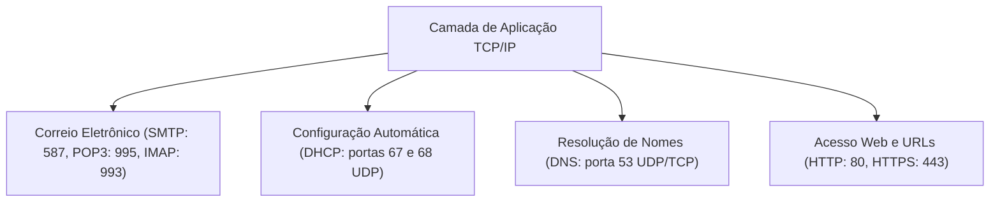
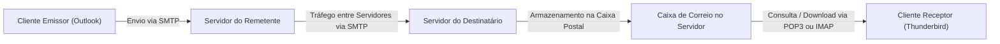
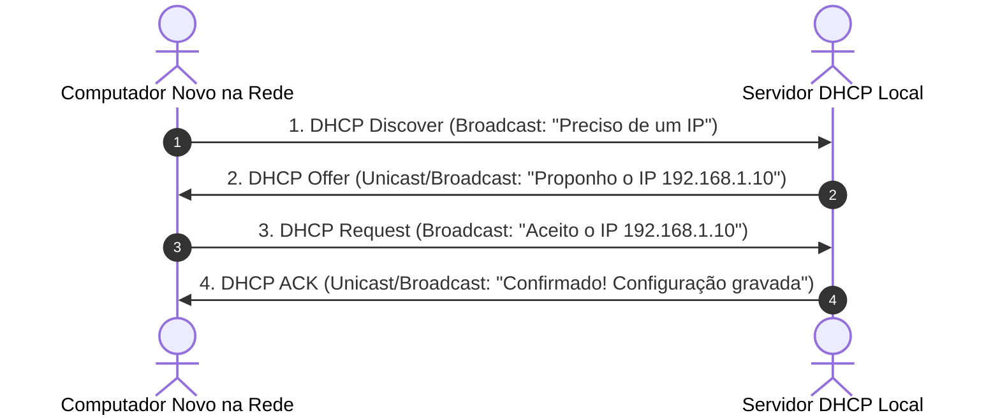
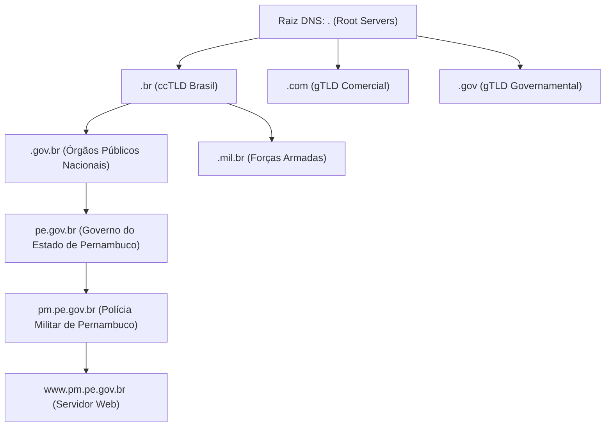
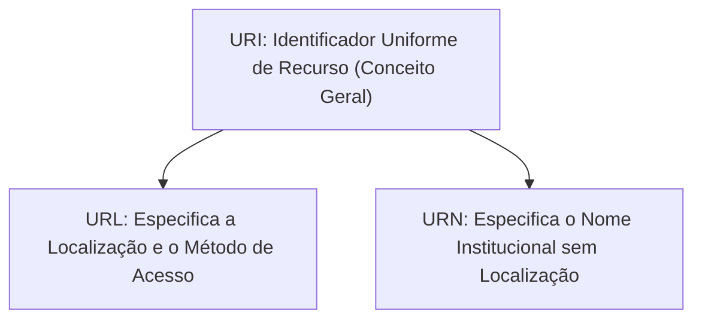
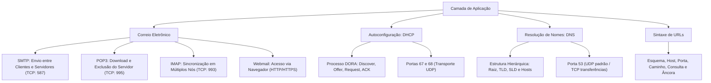

A camada de aplicação é o nível mais próximo do usuário final nas redes de computadores. Nela operam os serviços fundamentais que tornam a Internet uma ferramenta funcional para o serviço público e a segurança cidadã. Sem os protocolos de aplicação, a infraestrutura física de cabos e roteadores seria inerte. Neste capítulo, você estudará o ecossistema de correio eletrônico corporativo, a alocação dinâmica de endereços com o DHCP, a resolução hierárquica de nomes com o DNS e a anatomia estrutural das URLs.

> [!objetivos]
> Ao concluir este capítulo, você será capaz de:
> - Diferenciar a atuação dos protocolos de correio eletrônico SMTP, POP3 e IMAP.
> - Compreender a arquitetura de acesso a mensagens via Webmail.
> - Explicar as quatro etapas do processo DORA na atribuição de IPs pelo DHCP.
> - Analisar a estrutura da árvore hierárquica e o funcionamento do sistema DNS.
> - Decompor os elementos que formam a sintaxe abstrata de um localizador URL.

## Protocolos da Camada de Aplicação

A Camada de Aplicação da pilha TCP/IP fornece os protocolos que interagem diretamente com os softwares utilizados no cotidiano operacional das organizações. Enquanto as camadas inferiores cuidam do transporte físico e lógico dos pacotes, a camada de aplicação padroniza os comandos, a sintaxe e a semântica da troca de dados entre os processos dos sistemas emissores e receptores.

Esses protocolos não criam as interfaces gráficas dos programas. Na verdade, eles estabelecem os métodos e formatos padronizados que os aplicativos usam para requisitar e fornecer serviços pela rede. No ambiente corporativo das forças de segurança, diferentes serviços operam sobre essa camada para viabilizar o cumprimento de missões institucionais.

Entre as funções mais vitais da camada de aplicação, destacam-se a comunicação escrita assíncrona por correio eletrônico, a autoconfiguração de nós em redes corporativas com o DHCP, a tradução semântica de endereços numéricos em nomes inteligíveis pelo DNS e a navegação segura por hipertextos. Cada serviço possui regras de interação, portas padronizadas e formatos rígidos de controle que garantem a interoperabilidade global entre sistemas computacionais heterogêneos.



## O Ecossistema do Correio Eletrônico

O correio eletrônico é um dos serviços mais tradicionais e indispensáveis da Internet. No ambiente das forças de segurança, ofícios, laudos periciais e relatórios de inteligência circulam por meio de mensagens eletrônicas estruturadas.

Para que uma mensagem saia do computador do remetente e chegue com integridade à caixa postal do destinatário, atuam conjuntamente diferentes agentes de software e protocolos de transporte:

1. **MUA (Mail User Agent)**: É o programa cliente de e-mail operado pelo usuário. Exemplos consolidados incluem o Microsoft Outlook, o Mozilla Thunderbird e o aplicativo Mail em smartphones.
2. **MTA (Mail Transfer Agent)**: É o servidor de correio responsável por receber, rotear e entregar as mensagens através da rede mundial. Exemplos incluem o Postfix e o Microsoft Exchange.
3. **MDA (Mail Delivery Agent)**: Módulo encarregado de depositar as mensagens entregues na caixa de correio individual do destinatário no disco do servidor.



### Protocolo SMTP (Simple Mail Transfer Protocol)

O SMTP é o protocolo padrão para **envio e encaminhamento** de mensagens de correio eletrônico. Ele atua na saída do cliente para o seu servidor e na comunicação entre diferentes servidores de e-mail na rede mundial.

Características centrais do SMTP:

- Opera sobre o protocolo de transporte **TCP**, garantindo que nenhum e-mail seja corrompido em trânsito.
- A porta original do SMTP era a **porta 25**. No entanto, devido à disseminação massiva de lixo eletrônico (spam), os provedores de telecomunicações no Brasil e no mundo bloquearam a porta 25 para usuários finais.
- Atualmente, para submissão segura de mensagens de clientes aos servidores de e-mail, utiliza-se a **porta 587**, acompanhada obrigatoriamente do comando de segurança STARTTLS. Quando se utiliza SSL/TLS implícito desde a abertura da conexão, adota-se rotineiramente a **porta 465**.

> [!bizu]
> Guarde o mnemônico para a prova: **SMTP = "Sua Mensagem Tá Partindo"**. O SMTP serve estritamente para envio de e-mails. Ele nunca é utilizado pelo usuário final para ler ou descarregar mensagens recebidas na sua caixa de entrada.

### Protocolo POP3 (Post Office Protocol Versão 3)

O POP3 é um protocolo voltado exclusivamente para o **recebimento e descarga** de mensagens da caixa postal remota para a máquina local do usuário.

Funcionamento clássico do POP3:

1. O cliente de e-mail conecta-se ao servidor de correio.
2. O protocolo autentica o usuário e baixa todas as mensagens novas para o disco rígido local do computador.
3. Por padrão histórico do protocolo, após a conclusão do download, as mensagens originais são **apagadas do servidor**.
4. A conexão com o servidor é imediatamente encerrada. O usuário lê e organiza seus e-mails localmente no programa sem depender de conexão ativa à Internet.

O POP3 opera sobre **TCP**. Sua porta padrão tradicional em texto claro é a **porta 110**. Na modalidade criptografada com certificado SSL/TLS (POP3S), utiliza-se a **porta 995**.

A principal desvantagem do modelo POP3 reside na perda de sincronia: se o policial descarrega uma mensagem no computador do quartel, essa mensagem não estará visível quando ele abrir o aplicativo em seu celular particular, pois ela foi excluída do servidor remoto.

### Protocolo IMAP (Internet Message Access Protocol Versão 4)

O IMAP é o protocolo moderno e predominante para **acesso e sincronização contínua** de correio eletrônico.

Ao contrário do POP3, o IMAP mantém todas as mensagens armazenadas permanentemente no servidor de correio eletrônico. O programa cliente funciona como um espelho interativo do repositório remoto.

Vantagens decisivas do IMAP:

- **Sincronização Multidispositivo**: Se o agente lê um e-mail em seu smartphone, o status de "mensagem lida" é atualizado no servidor e refletido instantaneamente na estação de trabalho da delegacia.
- **Estrutura de Pastas Centralizada**: A criação de pastas, marcadores e etiquetas é gerenciada no próprio servidor remoto.
- **Economia de Armazenamento Local**: O usuário pode optar por baixar apenas os cabeçalhos das mensagens e solicitar o anexo somente quando desejar abri-lo.

O IMAP opera sobre o protocolo **TCP**. Sua porta convencional em texto claro é a **porta 143**. Na versão protegida por criptografia SSL/TLS (IMAPS), adota-se universalmente a **porta 993**.

```mermaid Comparativo operacional entre os protocolos de leitura POP3 e IMAP
flowchart TD
    subgraph POP3_Fluxo["Modelo POP3: Baixa e Apaga"]
        S_POP["Servidor de E-mail"] -->|Download Físico| Local_POP["Computador Local"]
        S_POP -.->|Mensagem Apagada do Servidor| Lixeira["Exclusão Remota"]
    end
    subgraph IMAP_Fluxo["Modelo IMAP: Sincronização em Nuvem"]
        S_IMAP["Servidor de E-mail"] <-->|Sincronia Bidirecional| PC["Computador da Unidade"]
        S_IMAP <-->|Sincronia Bidirecional| Celular["Smartphone da Viatura"]
        S_IMAP <-->|Sincronia Bidirecional| Tablet["Tablet Operacional"]
    end
```

### O Modelo Webmail

O Webmail não é um protocolo de rede próprio. Trata-se de uma aplicação web que viabiliza a gestão de correio eletrônico diretamente por meio de uma página acessada em um navegador de internet comum (como Google Chrome ou Microsoft Edge).

No modelo Webmail:

- A comunicação entre o computador do usuário e o servidor de correio da corporação utiliza os protocolos web padrão: **HTTP (porta 80)** ou **HTTPS (porta 443)** com proteção criptográfica TLS.
- O servidor web da instituição atua como intermediário: ele recebe as ações do usuário na página web e comunica-se internamente com o servidor de correio utilizando os protocolos IMAP e SMTP.
- O usuário não precisa instalar programas de correio em seu computador nem efetuar configurações de portas manuais.

| Protocolo | Função Principal | Camada de Transporte | Porta Padrão (Sem Cripto) | Porta Segura (SSL/TLS) | Comportamento no Servidor |
|---|---|---|---|---|---|
| **SMTP** | Envio e encaminhamento de mensagens | TCP | 25 (ou 587 STARTTLS) | 465 (ou 587) | Encaminha dados ao próximo salto |
| **POP3** | Recebimento com descarga local | TCP | 110 | 995 | Exclui mensagens do servidor por padrão |
| **IMAP** | Consulta com sincronização contínua | TCP | 143 | 993 | Mantém mensagens e pastas no servidor |
| **Webmail** | Interface web de leitura e envio | TCP | 80 (HTTP) | 443 (HTTPS) | Gerencia dados via navegador web |
*Tabela 1: Síntese detalhada dos protocolos e serviços de correio eletrônico.*

> [!pegadinha]
> Questões de concurso costumam afirmar que o protocolo SMTP pode ser utilizado para receber mensagens na caixa de entrada do usuário doméstico. Isso é falso. O SMTP é um protocolo exclusivo de envio (push protocol). O recebimento (pull protocol) na estação do usuário final exige obrigatoriamente POP3, IMAP ou interface Webmail.

## O Protocolo DHCP (Dynamic Host Configuration Protocol)

Para que um computador comunique-se em uma rede TCP/IP, ele necessita de quatro configurações mínimas de software:

1. Um endereço IP único e válido dentro da sub-rede local.
2. A máscara de sub-rede apropriada (que delimita a porção de rede e a porção de host).
3. O endereço IP do gateway padrão (o roteador que dá acesso a outras redes e à Internet).
4. O endereço IP de pelo menos um servidor de nomes (servidor DNS).

A inserção manual desses parâmetros em centenas de computadores seria inviável e causaria conflitos frequentes de endereçamento duplicado. Para automatizar essa tarefa, criou-se o protocolo DHCP.

O DHCP opera segundo o modelo cliente-servidor e executa a concessão temporária (lease time) de configurações de rede.

### O Processo de Atribuição DORA

Quando uma nova estação de trabalho é conectada à rede local, ela executa uma negociação padronizada de quatro etapas conhecida pela sigla mnemônica **DORA**:

1. **D - Discover (Descoberta)**: O computador cliente ainda não possui endereço IP nem conhece os servidores da rede. Ele envia uma mensagem em broadcast na rede local (endereço de destino `255.255.255.255`), anunciando que precisa de uma configuração IP.
2. **O - Offer (Oferta)**: Todos os servidores DHCP ativos que ouvirem o chamado reservam um endereço IP disponível em seu escopo de concessão e respondem com uma mensagem de oferta contendo o IP proposto, a máscara de rede e o tempo de validade.
3. **R - Request (Solicitação)**: O cliente escolhe uma das ofertas recebidas (geralmente a primeira que chegou) e envia uma nova mensagem em broadcast confirmando publicamente a aceitação daquela oferta específica e liberando as demais propostas.
4. **A - Acknowledge (Reconhecimento / Confirmação)**: O servidor DHCP escolhido grava a alocação em sua tabela interna de contratos e responde com uma mensagem final de confirmação, formalizando a posse do IP pelo cliente.



O DHCP utiliza a camada de transporte **UDP**. O servidor escuta na **porta 67** e o cliente aguarda respostas na **porta 68**.

> [!atencao]
> Se o servidor DHCP falhar ou estiver inacessível na rede local, os sistemas operacionais modernos (como o Microsoft Windows) utilizam o recurso APIPA. Nesse cenário, o próprio sistema autoatribui um endereço provisório na faixa `169.254.0.1` a `169.254.255.254`, permitindo que máquinas na mesma sala conversem entre si, mas sem qualquer acesso à Internet ou ao roteador externo.

## O Protocolo DNS (Domain Name System)

A mente humana guarda facilmente palavras e nomes conceituais, mas tem imensa dificuldade para memorizar sequências numéricas abstratas de trinta e dois ou cento e vinte e oito bits.

O **DNS (Domain Name System)** é o sistema de banco de dados hierárquico e distribuído responsável por traduzir nomes de domínio legíveis por pessoas (como `www.pm.pe.gov.br`) nos respectivos endereços numéricos IP (como `200.238.10.50`) exigidos pelos roteadores para efetivar a conexão.

### A Estrutura Hierárquica em Árvore Invertida

O espaço de nomes do DNS é organizado em uma estrutura hierárquica em forma de árvore invertida, cuja leitura técnica ocorre da direita para a esquerda:

1. **Raiz (Root Domain)**: Ocupa o topo absoluto da hierarquia e é representada simbolicamente por um ponto final (`.`). No mundo existem treze conjuntos lógicos de servidores de raiz (root servers), identificados pelas letras de A a M, replicados em milhares de nós pelo globo.
2. **Domínios de Primeiro Nível (TLD - Top-Level Domains)**: Situam-se imediatamente abaixo da raiz. Dividem-se em duas categorias:
   - **gTLDs (Genéricos)**: Representam finalidades de organizações globais (`.com`, `.org`, `.net`, `.edu`, `.gov`).
   - **ccTLDs (Código de País)**: Identificam jurisdições nacionais soberanas (`.br` para o Brasil, `.pt` para Portugal, `.us` para os Estados Unidos).
3. **Domínios de Segundo Nível (SLD)**: Identificam subcategorias institucionais ou corporativas, como `.gov.br` para o setor público brasileiro ou `.mil.br` para as forças armadas.
4. **Domínios e Subdomínios**: Identificam a entidade ou servidor específico na rede, como `pm` e o prefixo de serviço `www`.



### Funcionamento da Resolução DNS

A resolução de nomes ocorre por meio de consultas distribuídas:

- O usuário digita um endereço em seu navegador.
- O sistema operacional consulta inicialmente o arquivo local `hosts` e o cache de memória do computador.
- Se o endereço não estiver em cache, a máquina dispara uma consulta ao **servidor DNS recursivo** fornecido pelo provedor de Internet ou configurado na rede corporativa.
- O servidor recursivo consulta os servidores de raiz, que apontam para os servidores responsáveis pelo TLD `.br`, que por sua vez apontam para os servidores autoritativos do domínio de destino até obter o IP correspondente.

Na camada de transporte, o DNS opera com extrema flexibilidade:

- Emprega **UDP na porta 53** para a quase totalidade das consultas e respostas cotidianas de nomes, garantindo velocidade atômica e mínimo consumo de tráfego.
- Emprega **TCP na porta 53** quando o tamanho da resposta ultrapassa quinhentos e doze bytes ou em operações administrativas de transferência de zona (zone transfer) entre servidores de nomes primários e secundários.

> [!bizu]
> O arquivo de configuração local denominado `hosts` (localizado no Windows na pasta `C:\Windows\System32\drivers\etc\hosts`) possui precedência de leitura sobre qualquer consulta a servidores DNS externos. Se uma linha associar um nome falso a um IP malicioso no arquivo `hosts`, o navegador navegará para o endereço fraudulento sem consultar o servidor DNS da rede.

## URL - Sintaxe Abstrata

No vocabulário da arquitetura da informação na rede mundial, três siglas correlatas são comumente abordadas:

- **URI (Uniform Resource Identifier)**: É o identificador genérico universal de qualquer recurso físico ou lógico na rede. A URI é o gênero amplo.
- **URN (Uniform Resource Name)**: Identifica um recurso pelo seu nome em um namespace específico, sem indicar sua localização física ou método de acesso (exemplo: o número de ISBN de um livro técnico).
- **URL (Uniform Resource Locator)**: É uma espécie de URI que não apenas identifica o recurso, mas especifica expressamente o **mecanismo de localização** e o protocolo necessário para recuperá-lo na rede mundial.



### Anatomia de uma URL Abstrata

A sintaxe abstrata padronizada de uma URL é estruturada pelos seguintes blocos ordenados:

`esquema://[autoridade][caminho]?[consulta]#[fragmento]`

Examinemos os componentes fundamentais:

1. **Esquema (Protocolo)**: Define o protocolo de aplicação utilizado na comunicação. Exemplos clássicos: `https`, `http`, `ftp`, `mailto`. É sucedido obrigatoriamente pelos caracteres `://`.
2. **Autoridade (Host e Porta)**: Informa a máquina que hospeda o recurso na rede. Pode ser descrita por um nome de domínio resolvível (`www.defesasocial.pe.gov.br`) ou diretamente por um endereço IP. Caso utilize uma porta não convencional, a porta é declarada após dois-pontos (`:8080`).
3. **Caminho (Path)**: Sequência de diretórios que mapeia a localização lógica do recurso dentro da árvore de arquivos do servidor, separados por barras inclinadas para a frente (`/boletins/diarios/`).
4. **Recurso (Arquivo)**: O documento final requisitado, com sua respectiva extensão (`relatorio.pdf`, `index.html`).
5. **Consulta (Query String)**: Parâmetros enviados para processamento dinâmico no servidor. Inicia-se pelo símbolo de interrogação (`?`). Múltiplos parâmetros são separados pelo caractere `&` (exemplo: `?ano=2026&mes=10`).
6. **Fragmento ou Âncora**: Aponta diretamente para uma seção interna ou cabeçalho do documento carregado no navegador do usuário. Inicia-se pelo símbolo de cerquilha ou sustenido (`#`).

| Componente | Exemplo Prático de Campo | Descrição Técnica e Papel na Sintaxe |
|---|---|---|
| **Esquema / Protocolo** | `https://` | Indica o protocolo de aplicação e segurança da conexão |
| **Domínio / Host** | `www.bombeiros.pe.gov.br` | Identifica o servidor ou autoridade responsável pelo recurso |
| **Porta Lógica** | `:443` | Identifica a porta do processo (frequentemente omitida se padrão) |
| **Caminho de Diretório** | `/ocorrencias/resgate/` | Indica as pastas lógicas na estrutura de armazenamento do servidor |
| **Arquivo / Recurso** | `formulario.pdf` | O documento específico que será descarregado ou visualizado |
| **Cadeia de Consulta** | `?tipo=incendio&urgente=sim` | Parâmetros dinâmicos transmitidos ao script de processamento |
| **Fragmento / Âncora** | `#instrucoes` | Posiciona a tela do usuário em uma seção interna específica |
*Tabela 2: Estrutura anatômica dos campos de uma URL completa.*

> [!exemplo]
> Analise a seguinte URL utilizada em um sistema governamental:
> `https://sistemas.seguranca.pe.gov.br:8443/pericias/laudo.php?id=9872&formato=pdf#conclusao`
> - `https`: Esquema que adota conexão cifrada TLS.
> - `sistemas.seguranca.pe.gov.br`: Nome de domínio do servidor hospedeiro.
> - `:8443`: Porta lógica customizada de recepção.
> - `/pericias/`: Caminho de diretórios no servidor.
> - `laudo.php`: Recurso dinâmico solicitado.
> - `?id=9872&formato=pdf`: Query string com dois parâmetros dinâmicos.
> - `#conclusao`: Âncora que salta diretamente para o tópico de conclusão do laudo.

## Mapa do capítulo



### Para fixar

- O protocolo SMTP atua exclusivamente no envio e no encaminhamento de mensagens de e-mail, utilizando TCP nas portas 25 e 587.
- O POP3 baixa as mensagens para armazenamento local e as exclui do servidor por padrão, operando sobre TCP nas portas 110 e 995.
- O IMAP viabiliza o acesso sincronizado de mensagens mantidas permanentemente no servidor, operando sobre TCP nas portas 143 e 993.
- O Webmail permite o gerenciamento de e-mails em navegadores comuns por meio dos protocolos HTTP e HTTPS sem instalação de clientes dedicados.
- O protocolo DHCP automatiza a atribuição de endereços IP, máscaras, gateways e servidores DNS por meio das quatro fases do processo DORA.
- O DHCP opera sobre a camada de transporte UDP nas portas 67 (servidor) e 68 (cliente da rede).
- O sistema DNS traduz nomes de domínio lexicais em endereços IP roteáveis por meio de uma árvore hierárquica distribuída.
- O DNS utiliza prioritariamente UDP na porta 53 para consultas cotidianas rápidas e TCP na porta 53 para respostas longas e transferências de zona.
- A URL é um localizador estruturado composto por esquema, domínio, porta opcional, caminho, recurso, parâmetros de consulta e fragmento.
