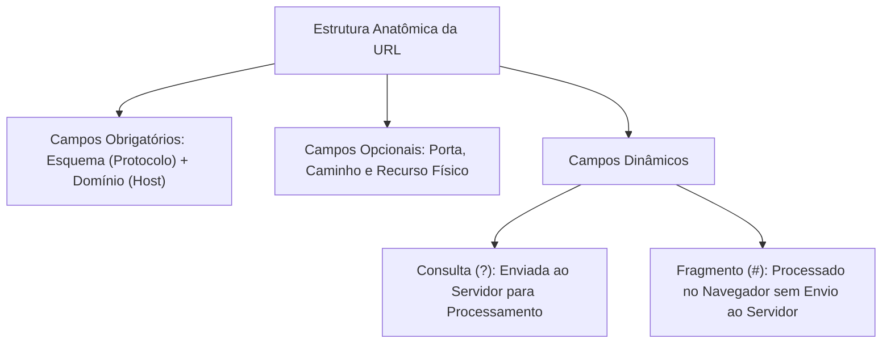
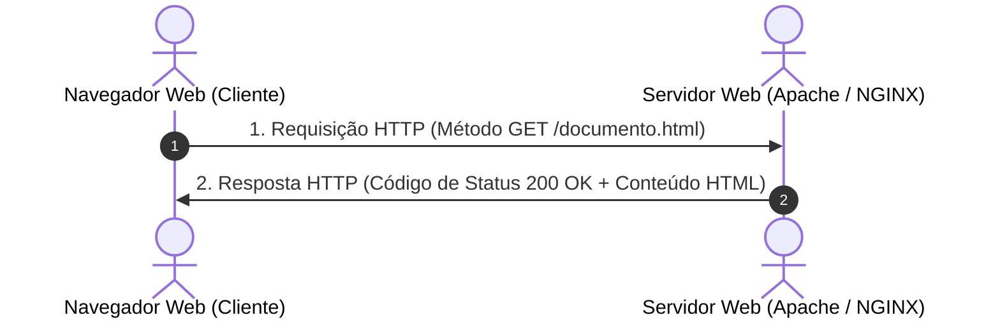
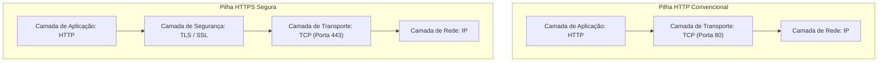
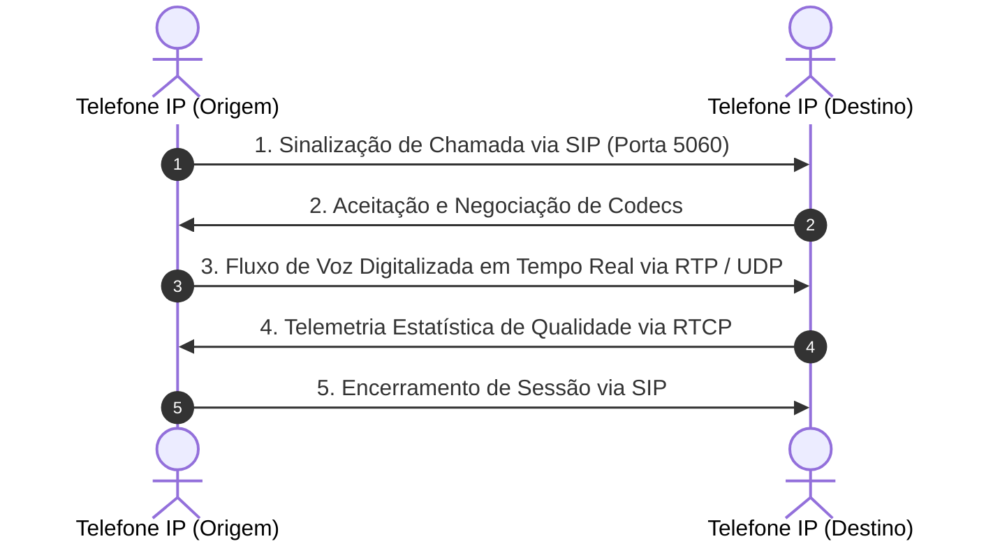
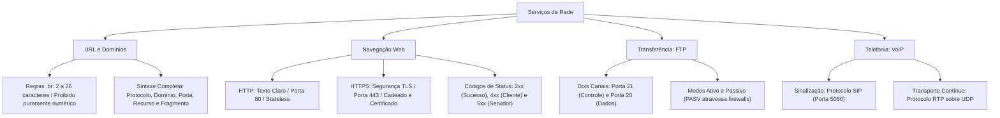

A circulação de informações nas forças de segurança exige serviços web confiáveis. O tráfego diário envolve o download de laudos periciais e a telefonia unificada. O conhecimento técnico desses protocolos é fundamental para a atividade policial. Neste capítulo, você analisará a sintaxe completa de URLs e as regras do domínio .br. Também estudará os protocolos HTTP e HTTPS com certificados digitais. Por fim, verá a arquitetura de canais do FTP e a telefonia por VoIP.

> [!objetivos]
> Ao concluir este capítulo, você será capaz de:
> - Dominar a sintaxe completa de uma URL e as regras de registro sob o domínio `.br`.
> - Diferenciar os protocolos HTTP e HTTPS e reconhecer os códigos de status mais comuns.
> - Compreender o papel dos certificados digitais e o significado técnico do cadeado de segurança.
> - Explicar a arquitetura de duas conexões (controle e dados) do protocolo FTP.
> - Identificar os protocolos de sinalização e transporte do serviço de Voz sobre IP (VoIP).

## URL – Sintaxe Completa e Registro de Domínios

A URL é o endereço padronizado que localiza recursos na rede mundial. Ela especifica também o método para recuperar os dados. Em sua forma completa, a sintaxe reúne campos obrigatórios e parâmetros facultativos.

A sintaxe completa de uma URL é estruturada da seguinte maneira:

`esquema://[usuario:senha@]dominio[:porta][/caminho/][recurso][?consulta][#fragmento]`

Examinemos as peculiaridades técnicas de cada campo:

1. **Esquema (Protocolo)**: Define a regra de comunicação a ser adotada pelo cliente. O preenchimento do esquema é obrigatório. Exemplos consolidados: `https`, `http`, `ftp`.
2. **Credenciais Opcionais (`usuario:senha@`)**: Historicamente permitia informar dados de autenticação diretamente na URL para servidores restritos. Por motivos de segurança, os navegadores modernos desativaram a exibição automática de credenciais em URLs para evitar golpes.
3. **Domínio ou Host**: Identifica a autoridade responsável pelo recurso. Pode ser representado por um nome de domínio resolvido pelo DNS ou diretamente por um endereço IP numérico. Ao lado do protocolo, o domínio é o único elemento indispensável para localizar a máquina.
4. **Porta Lógica**: Informa a porta de destino do serviço. Quando o serviço escuta na porta padrão do protocolo (porta 80 no HTTP ou 443 no HTTPS), a especificação da porta na URL é dispensável.
5. **Caminho e Recurso**: Mapeia os diretórios no sistema de arquivos do servidor e o documento específico. A substituição do arquivo solicitado altera a URL, mas mantém o mesmo domínio inalterado.
6. **Consulta (Query String)**: Inicia-se pelo símbolo de interrogação (`?`). Envia pares de chave e valor (`parametro=valor`) unidos pelo caractere `&`. É encaminhada diretamente ao servidor para processamento dinâmico.
7. **Fragmento ou Âncora**: Inicia-se pelo caractere sustenido (`#`). Ao contrário da consulta, o fragmento é interpretado **exclusivamente no lado do cliente** pelo navegador web. Ele orienta o navegador a rolar a página até uma marcação de texto ou subtítulo interno, nunca sendo enviado ao servidor web na requisição HTTP.



### Regras de Registro de Domínios sob o ccTLD `.br`

No Brasil, a coordenação de registros de domínios na Internet é exercida pelo Comitê Gestor da Internet no Brasil (CGI.br), por meio de seu braço executivo denominado Registro.br (integrante do Núcleo de Informação e Coordenação do Ponto BR - NIC.br).

Para o registro de nomes de domínio sob o código de país `.br` (ccTLD brasileiro), vigoram regras formais comumente exploradas por bancas examinadoras:

- **Tamanho do Nome**: O identificador deve conter no mínimo dois e no máximo vinte e seis caracteres.
- **Caracteres Permitidos**: Letras de `a` a `z`, algarismos de `0` a `9`, o caractere de hífen (`-`) e caracteres acentuados da língua portuguesa.
- **Proibições Estruturais**:
  - Não pode ser composto exclusivamente por números. Portanto, nomes como `123.com.br` ou `999.net.br` são terminantemente inválidos.
  - Não pode conter menos de dois caracteres. Por isso, domínios de letra única como `x.com.br` são rejeitados.
  - O caractere de hífen não pode constar no início nem no final do nome. Nomes como `-policia.com.br` ou `bombeiros-.com.br` são proibidos.

> [!pegadinha]
> A presença do sufixo `.br` em uma URL indica exclusivamente a jurisdição institucional na qual o domínio foi registrado perante a autoridade competente (Registro.br). Ela **não determina o local físico de hospedagem** do servidor web. Um site com domínio `.com.br` pode ter seus servidores físicos instalados nos Estados Unidos, na Alemanha ou no Japão.

## Os Protocolos Web: HTTP e HTTPS

A navegação em páginas web é sustentada pelo modelo cliente-servidor por meio de dois protocolos de aplicação: o HTTP e o HTTPS.



### Protocolo HTTP (HyperText Transfer Protocol)

O HTTP é o protocolo pioneiro da World Wide Web. Suas propriedades fundamentais são:

- **Modelo de Requisição e Resposta**: O cliente dispara uma solicitação formal e o servidor processa e retorna uma mensagem de resposta com cabeçalhos e conteúdo.
- **Protocolo sem Estado (Stateless)**: O HTTP não memoriza conexões passadas. Cada requisição é tratada como um evento inteiramente novo e independente das anteriores. Para viabilizar compras virtuais ou logins corporativos, criaram-se mecanismos auxiliares de retenção de estado: os cookies e as variáveis de sessão.
- **Transporte em Texto Claro**: O HTTP opera sobre o protocolo TCP na **porta padrão 80**. Todo o tráfego transita sem qualquer criptografia. Caso um agente mal-intencionado intercepte pacotes HTTP na rede local, poderá ler senhas e dados confidenciais diretamente.
- **Distinção entre HTTP e HTML**: O HTTP é o protocolo de transporte que entrega as mensagens. O HTML (HyperText Markup Language) é a linguagem de marcação que estrutura visualmente as páginas exibidas na tela.

### Códigos de Status HTTP

As respostas emitidas por um servidor web trazem códigos numéricos de três dígitos divididos em cinco classes conceituais:

1. **Classe 1xx (Informativos)**: Indicam que a requisição foi recebida e o processo continua em andamento (exemplo: `100 Continue`).
2. **Classe 2xx (Sucesso)**: Confirmam que a ação solicitada foi compreendida e executada com êxito. O código mais representativo é o `200 OK`.
3. **Classe 3xx (Redirecionamento)**: Informam que o navegador deve efetuar ações adicionais para concluir a consulta, pois o recurso mudou de local. O código mais comum é o `301 Moved Permanently` (redirecionamento definitivo).
4. **Classe 4xx (Erro do Cliente)**: Apontam falhas causadas pela solicitação encaminhada pelo navegador. Exemplos cruciais:
   - `400 Bad Request`: Sintaxe da requisição malformada.
   - `401 Unauthorized`: Exige autenticação de credenciais para visualização.
   - `403 Forbidden`: O servidor entendeu a requisição, mas recusa-se categoricamente a autorizar o acesso.
   - `404 Not Found`: O recurso ou arquivo solicitado não existe no servidor.
5. **Classe 5xx (Erro do Servidor)**: Indicam falhas internas no próprio sistema ou infraestrutura do servidor. Exemplos:
   - `500 Internal Server Error`: Erro genérico de execução no código do servidor.
   - `502 Bad Gateway`: Resposta inválida recebida de um servidor intermediário.
   - `503 Service Unavailable`: Servidor temporariamente sobrecarregado ou em manutenção.
   - `504 Gateway Timeout`: Servidor intermediário esgotou o tempo de espera de resposta.

| Código de Resposta | Nome Padronizado | Classe Funcional | Significado Prático |
|---|---|---|---|
| **200** | OK | Sucesso (2xx) | A solicitação foi concluída com êxito e o conteúdo retornado |
| **301** | Moved Permanently | Redirecionamento (3xx) | O recurso mudou de endereço permanentemente para outra URL |
| **401** | Unauthorized | Erro do Cliente (4xx) | O acesso exige autenticação prévia de usuário e senha |
| **403** | Forbidden | Erro do Cliente (4xx) | Acesso negado mesmo que o usuário forneça credenciais |
| **404** | Not Found | Erro do Cliente (4xx) | A página solicitada não foi encontrada no servidor |
| **500** | Internal Server Error | Erro do Servidor (5xx) | Falha crítica interna no processamento de scripts do servidor |
| **503** | Service Unavailable | Erro do Servidor (5xx) | Servidor indisponível por sobrecarga ou manutenção agendada |
*Tabela 1: Principais códigos de status HTTP cobrados em concursos.*

> [!exemplo]
> Em uma operação integrada, o comandante acessa um formulário interno no endereço https://cbm.pe.gov.br:8443/despacho.php?viatura=ABT01#localizacao. O protocolo é HTTPS. O host é o portal do CBMPE na porta 8443. O arquivo dinâmico recebe o parâmetro da viatura. O navegador rola a tela até a âncora da localização.

### Protocolo HTTPS e Certificação Digital

O HTTPS (HyperText Transfer Protocol Secure) combina a linguagem de requisições do HTTP clássico com uma camada inferior de criptografia robusta. Ele utiliza os protocolos criptográficos **SSL** (Secure Sockets Layer, historicamente pioneiro) e seu sucessor moderno padronizado, o **TLS** (Transport Layer Security).

O HTTPS opera sobre o protocolo TCP na **porta padrão 443**.



O HTTPS entrega três propriedades basilares da segurança da informação:

- **Confidencialidade**: Todos os dados trafegados entre o navegador e o servidor são cifrados. Provedores de Internet, operadores de rede e invasores interceptadores visualizam apenas blocos ininteligíveis de bytes cifrados.
- **Integridade**: Algoritmos de resumo criptográfico garantem que nenhum pacote seja alterado, inserido ou deletado em trânsito sem que o receptor perceba a adulteração.
- **Autenticação**: O servidor comprova formalmente sua identidade real perante o visitante por meio de um certificado digital no padrão X.509 emitido por uma Autoridade Certificadora (AC) confiável.

> [!bizu]
> O ícone de cadeado exibido na barra de endereços do navegador indica apenas que a conexão é criptografada e que a identidade do certificado digital é válida. O cadeado **não assegura a idoneidade moral do site**. Cibercriminosos podem obter certificados HTTPS legítimos gratuitos para hospedar páginas falsas de captura de senhas bancárias (phishing).

## O Protocolo FTP (File Transfer Protocol)

O FTP é o protocolo padronizado da camada de aplicação dedicado à **transferência bidirecional de arquivos** entre nós em uma arquitetura cliente-servidor. Ele permite realizar tanto o envio de arquivos do cliente para o servidor (upload) quanto a recuperação de arquivos do servidor para o disco local (download).

A característica mais singular do FTP reside na utilização de **duas conexões TCP paralelas e distintas** para operar:

1. **Conexão de Controle (Porta TCP 21)**: É estabelecida pelo cliente no momento da conexão e permanece aberta durante toda a sessão. Trafega exclusivamente comandos textuais de controle, envio de credenciais de login, criação de pastas e instruções de encerramento.
2. **Conexão de Dados (Porta TCP 20 ou porta dinâmica)**: É aberta exclusivamente quando há necessidade de transferir o fluxo bruto de bytes de um arquivo ou listar o conteúdo de uma pasta. Concluída a transferência do arquivo, essa conexão de dados é finalizada imediatamente.

```mermaid Arquitetura de canais paralelos do protocolo FTP
flowchart LR
    subgraph Cliente["Cliente FTP (FileZilla)"]
        C_Ctrl["Processo de Controle"]
        C_Data["Processo de Dados"]
    end
    subgraph Servidor["Servidor FTP"]
        S_Ctrl["Porta 21: Canal de Controle (Comandos)"]
        S_Data["Porta 20: Canal de Dados (Transferência)"]
    end
    C_Ctrl <-->|Conexão Permanente (Porta 21)| S_Ctrl
    C_Data <-->|Conexão Efêmera por Arquivo (Porta 20 / PASV)| S_Data
```

> [!bizu]
> No protocolo FTP, a porta 21 cuida apenas dos comandos e autenticação. A transferência efetiva de arquivos ocorre na porta 20 (modo ativo) ou em portas altas dinâmicas (modo passivo).

### Modos Operacionais do FTP: Ativo versus Passivo

A abertura do canal de dados pode ocorrer por dois modos de funcionamento:

- **Modo Ativo (Active Mode)**: O cliente conecta-se à porta 21 do servidor. Quando um arquivo precisa ser transferido, o próprio servidor FTP toma a iniciativa de abrir uma conexão a partir de sua porta 20 em direção a uma porta informada pelo cliente. O problema do modo ativo é que os firewalls modernos e roteadores com NAT das casas e delegacias bloqueiam conexões iniciadas de fora para dentro, derrubando a transferência.
- **Modo Passivo (Passive Mode - PASV)**: Criado para contornar bloqueios de firewalls. O cliente envia o comando `PASV` na conexão de controle. O servidor responde indicando uma porta alta aleatória não privilegiada. É o próprio cliente quem inicia a conexão de dados em direção à porta indicada pelo servidor, fluindo facilmente através de firewalls e roteadores NAT.

O FTP original transmite senhas e arquivos em texto claro sem qualquer criptografia. Para ambientes que exigem sigilo operacional, adotam-se alternativas seguras:

- **FTPS (FTP Secure)**: Protocolo FTP convencional encapsulado sob proteção TLS/SSL.
- **SFTP (SSH File Transfer Protocol)**: Protocolo inteiramente distinto que opera como extensão do terminal seguro SSH, trafegando tudo por uma única conexão criptografada na **porta TCP 22**.

> [!atencao]
> Fazer o download de um arquivo executável ou documento em uma página web comum ocorre via protocolo HTTP ou HTTPS. Anexar um arquivo a uma mensagem de correio eletrônico ocorre por SMTP apoiado pelo padrão MIME. Nenhuma dessas operações utiliza o protocolo FTP. O FTP exige programas clientes específicos de transferência (como FileZilla) ou comandos FTP dedicados.

## O Serviço de Voz sobre IP (VoIP)

A tecnologia de Voz sobre IP (VoIP - Voice over Internet Protocol) consiste na digitalização, compressão, empacotamento e transmissão de sinais de áudio e chamadas telefônicas em tempo real através da infraestrutura de redes baseadas na pilha TCP/IP.

O ecossistema VoIP divide sua operação em duas frentes tecnológicas complementares:

### Protocolos de Sinalização

Responsáveis por localizar os interlocutores, chamar o terminal de destino, negociar parâmetros de áudio, estabelecer a chamada, gerenciar ramais e encerrar a conversa.

Os principais padrões de sinalização são:

- **SIP (Session Initiation Protocol)**: Padrão aberto do IETF, predominante no mercado. Opera na **porta 5060** (ou 5061 com TLS).
- **H.323**: Padrão tradicional da União Internacional de Telecomunicações (ITU-T), comum em centrais telefônicas mais antigas.

### Protocolos de Transporte de Mídia

Após a abertura da sessão pelo SIP, o fluxo de voz contínuo é transmitido entre os dois aparelhos por protocolos especializados em tempo real:

- **RTP (Real-time Transport Protocol)**: Transporta os pacotes com amostras de voz digitalizada. O RTP opera quase exclusivamente sobre o protocolo **UDP**. A escolha do UDP é deliberada: caso ocorra a perda isolada de um pacote de voz, não há retransmissão, pois um som atrasado em meio segundo provocaria ruído insuportável no ouvido humano.
- **RTCP (RTP Control Protocol)**: Opera em conjunto com o RTP monitorando continuamente parâmetros de qualidade da conexão, como latência, perda de pacotes e jitter (variação do atraso de entrega).



### Vantagens e Limitações do VoIP no Setor Público

A migração das linhas analógicas para o VoIP nas secretarias de segurança traz vantagens incontestáveis:

- **Redução Significativa de Custos**: Integração de ramais entre quartéis de municípios distintos pela rede corporativa própria sem custos com tarifas telefônicas convencionais.
- **Mobilidade de Agentes**: O número do ramal funcional acompanha o policial em qualquer computador ou smartphone conectado à rede com software de softphone.
- **Integração de Mídias**: Facilidade para gravação digital automática de atendimentos de emergência nos centros integrados (CIODS).

Por outro lado, o VoIP apresenta vulnerabilidades técnicas que exigem mitigação:

- **Sensibilidade Extrema a Gargalos de Rede**: Sofre intensamente com jitter e perda de pacotes, exigindo mecanismos de Qualidade de Serviço (QoS) nos roteadores corporativos para priorizar pacotes de áudio sobre o tráfego web comum.
- **Dependência Elétrica**: Telefones analógicos tradicionais recebiam energia diretamente dos fios de cobre da central telefônica. Telefones IP dependem de energia local ou de switches PoE (Power over Ethernet) amparados por geradores e nobreaks.

## Mapa do capítulo



### Para fixar

- Em uma URL completa, apenas o esquema e o domínio são estritamente obrigatórios para localizar a máquina hospedeira.
- Os parâmetros de consulta (iniciados por `?`) são enviados ao servidor, enquanto os fragmentos (iniciados por `#`) são interpretados unicamente pelo navegador.
- Nomes sob o ccTLD `.br` exigem de 2 a 26 caracteres alfanuméricos, não podem ser puramente numéricos e não aceitam hífens nas extremidades.
- O sufixo de país `.br` comprova o registro formal perante a autoridade competente, não indicando obrigatoriamente a localização física do servidor web.
- O HTTP atua na porta 80 sobre TCP sem criptografia e sem estado, gerenciando sessões por meio de cookies e dados de formulário.
- Os códigos de status HTTP dividem-se em informativos (1xx), sucesso (2xx), redirecionamento (3xx), erro do cliente (4xx) e erro do servidor (5xx).
- O HTTPS emprega criptografia TLS na porta 443, provendo confidencialidade, integridade e autenticação garantida por certificados digitais X.509.
- O protocolo FTP adota duas conexões paralelas de transporte TCP: canal de controle na porta 21 e canal de dados na porta 20.
- O serviço VoIP realiza a sinalização de chamadas pelo protocolo SIP e transmite fluxos contínuos de áudio por meio do protocolo RTP sobre UDP.
