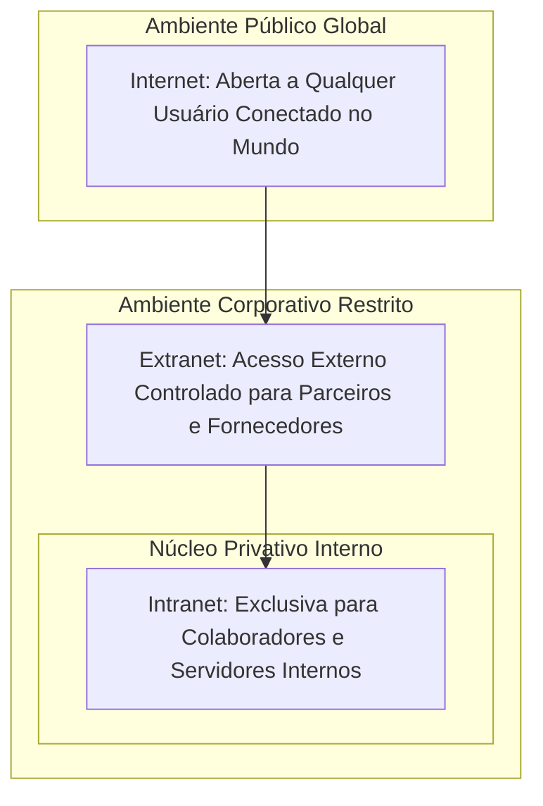
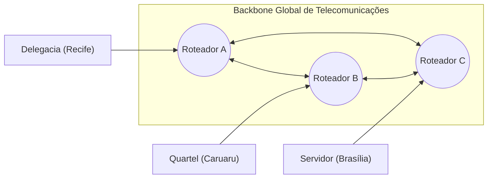
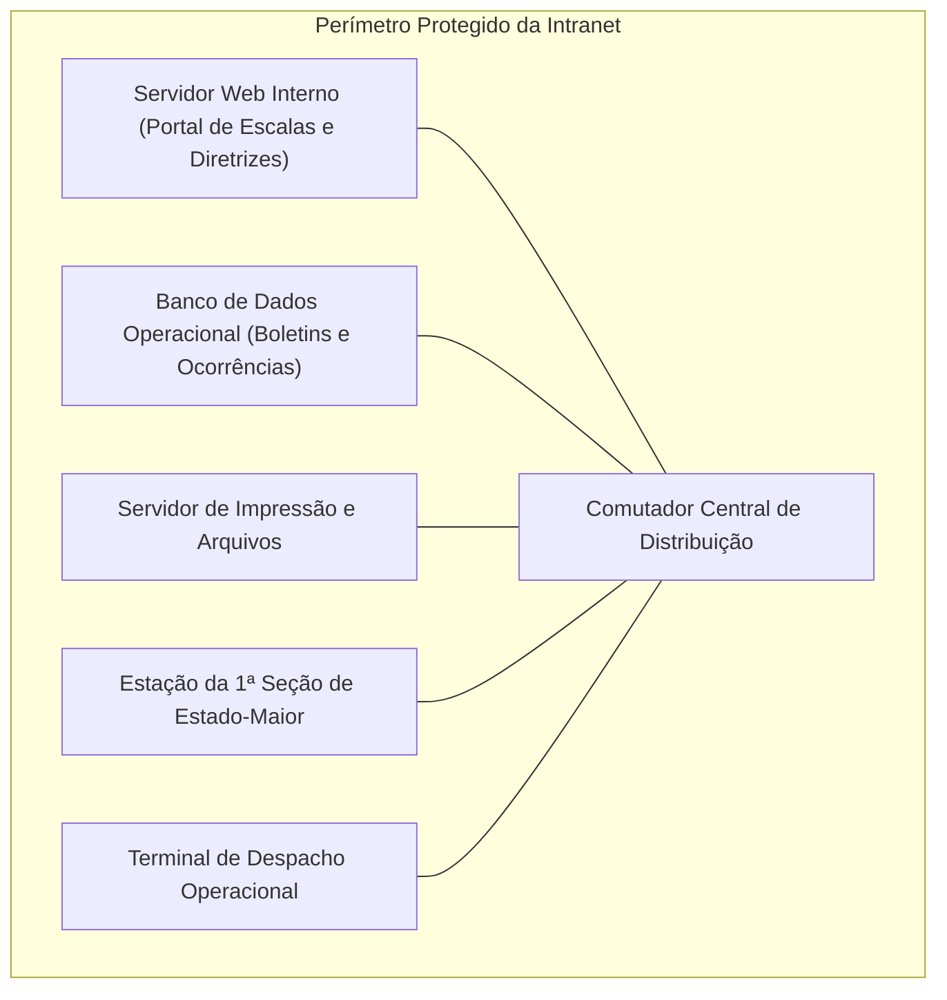
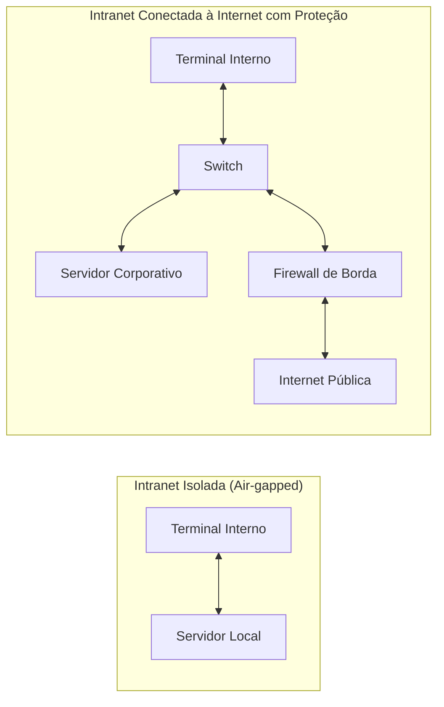
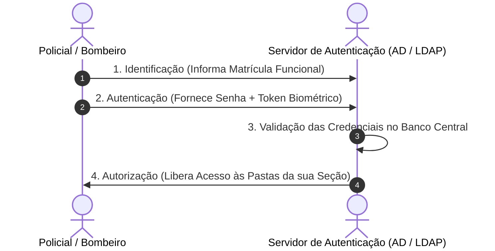
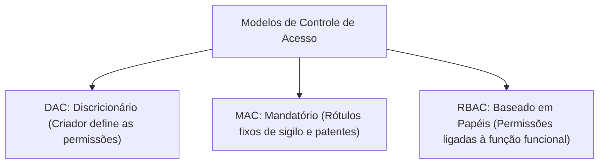
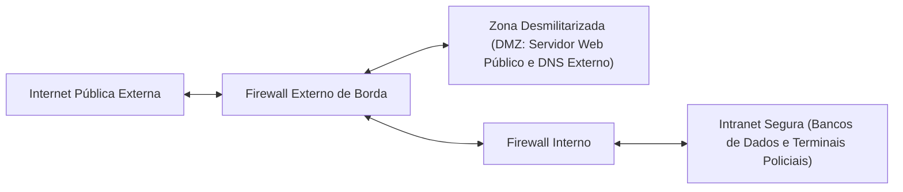

A modernização pública transformou a circulação interna de processos. Nas forças de segurança, as informações operacionais exigem proteção integral. A gestão eficiente demanda separar a rede pública das redes privativas estatais. Neste capítulo, você estudará as diferenças teóricas entre Internet e Intranet. Também analisará o compartilhamento de tecnologias e os mecanismos de segurança de borda.

> [!objetivos]
> Ao concluir este capítulo, você será capaz de:
> - Distinguir os conceitos de Internet, Intranet e Extranet sob a ótica funcional e de acesso.
> - Compreender a identidade tecnológica e a equivalência de protocolos entre Internet e Intranet.
> - Analisar os requisitos de governança, autenticação e controle de acesso corporativo.
> - Avaliar o papel do firewall de borda, dos servidores proxy e das zonas desmilitarizadas (DMZ).
> - Identificar as aplicações operacionais da Intranet na rotina das forças de segurança estaduais.

## Teoria Geral das Redes: Internet, Intranet e Extranet

Na ciência das redes de computadores, a classificação funcional divide os ecossistemas corporativos em três ambientes operacionais integrados: Internet, Intranet e Extranet. Historicamente, antes da consagração mundial da pilha TCP/IP, as grandes corporações utilizavam redes locais com protocolos proprietários fechados, como o SNA da IBM, o IPX/SPX da Novell e o AppleTalk. Essas arquiteturas geravam alto custo de licenciamento, exigiam equipamentos dedicados de um único fabricante e dificultavam imensamente a integração de novos sistemas.

Com o estrondoso sucesso da Internet pública na década de 1990, os administradores de redes perceberam as vantagens econômicas e técnicas de adotar os padrões abertos da Internet dentro dos limites da própria empresa. Surgiu assim o conceito formal de Intranet, que nada mais é do que a aplicação das tecnologias, ferramentas e protocolos da rede mundial no ambiente privativo de uma instituição. Pouco tempo depois, com a necessidade de conectar filiais distantes e fornecedores credenciados sem custos abusivos de linhas dedicadas, desenvolveu-se o modelo da Extranet.

Muitos candidatos a concursos supõem equivocadamente que esses ambientes operem com protocolos incompatíveis ou softwares restritos. Do ponto de vista da engenharia de software e da arquitetura de dados, Intranet e Extranet utilizam exatamente os mesmos padrões da Internet. A tecnologia de transmissão física e lógica não estabelece qualquer diferenciação entre elas. O critério definidor e exclusivo reside no escopo de acesso, no público autorizado e no modelo de governança administrativa da rede.



> [!bizu]
> Guarde esta premissa de ouro para qualquer prova de informática: **A tecnologia é idêntica; o que muda é quem pode acessar e de onde pode acessar**. Tanto a Internet quanto a Intranet utilizam a pilha TCP/IP, páginas HTML, servidores web HTTP/HTTPS e e-mails SMTP/IMAP.

## Conceito e Arquitetura da Internet

O vocábulo Internet deriva da aglutinação dos termos ingleses *inter-network*, que significa literalmente a interconexão de redes heterogêneas.

A Internet é a rede mundial pública de computadores. Trata-se de uma malha descentralizada de redes governamentais, acadêmicas e empresariais. Seus nós conectam-se por fibras ópticas, cabos submarinos e satélites.

Características centrais da Internet:

1. **Classificação Geográfica**: A Internet é a maior **WAN (Wide Area Network)** existente no planeta. Ela conecta nós separados por milhares de quilômetros e múltiplos oceanos.
2. **Padrão Universal TCP/IP**: Para viabilizar o diálogo entre computadores com sistemas operacionais diferentes, a Internet baseia-se universalmente na pilha de protocolos TCP/IP.
3. **Caráter Público**: O termo "pública" significa que ela está aberta e acessível para qualquer pessoa ou dispositivo que possua um meio de conexão contratado com um provedor de acesso. Isso não significa que a navegação seja gratuita. O acesso decorre da contratação de serviços de telecomunicações.
4. **Descentralização Absoluta**: Não existe um computador central soberano que comande a Internet. Se um roteador continental falhar em uma região geográfica, os protocolos de roteamento dinâmico recalculam novos caminhos para entregar os pacotes de dados aos nós de destino.



> [!atencao]
> A Internet não é controlada por um governo ou empresa singular. A gestão de padrões técnicos é conduzida de forma cooperativa por entidades internacionais sem fins lucrativos, como a Internet Society (ISOC), o Internet Engineering Task Force (IETF) e a Internet Corporation for Assigned Names and Numbers (ICANN).

### Serviços Mais Relevantes da Internet

A infraestrutura física da Internet viabiliza uma vasta gama de aplicações corporativas e sociais:

- **World Wide Web (WWW)**: Conjunto multimídia de páginas interconectadas por hiperlinks, permitindo a navegação não sequencial por meio de navegadores web.
- **Correio Eletrônico**: Troca estruturada de mensagens assíncronas e documentos anexos entre caixas postais identificadas por endereços eletrônicos.
- **Transferência de Arquivos**: Envio e recuperação de volumes expressivos de dados por meio de protocolos dedicados como o FTP e sistemas distribuídos P2P.
- **Serviços de Telefonia e Videoconferência**: Transmissão em tempo real de fluxos contínuos de áudio e vídeo sob a tecnologia VoIP.
- **Redes Sociais e Mensageria Instantânea**: Plataformas colaborativas de interação síncrona e assíncrona entre cidadãos e comunidades virtuais.

## Conceito e Estrutura da Intranet

A Intranet é uma rede de dados de uso privado e fechado, restrita exclusivamente aos integrantes e colaboradores de uma organização específica.

Na segurança pública de Pernambuco, a Intranet reúne estações policiais, viaturas e servidores. Ela consolida bancos de dados sob um domínio institucional fechado.

Propriedades fundamentais da Intranet:

- **Acesso Estritamente Restrito**: Apenas usuários expressamente cadastrados e autorizados (policiais, bombeiros e analistas) podem consultar suas páginas e sistemas.
- **Reaproveitamento Tecnológico Integral**: A Intranet adota as mesmas tecnologias, ferramentas e protocolos empregados na Internet. Os servidores internos rodam Apache ou IIS. Os computadores usam navegadores normais (Chrome, Edge) para abrir páginas desenvolvidas em HTML, CSS e JavaScript. Os e-mails institucionais trafegam por SMTP e IMAP.
- **Domínio Administrativo Único**: A infraestrutura, os parâmetros de segurança e os bancos de dados pertencem a uma entidade governamental ou empresarial soberana.



> [!pegadinha]
> Uma das questões mais recorrentes em concursos públicos traz a seguinte afirmativa falsa: *"Por razões de segurança institucional, a Intranet de uma corporação militar não pode utilizar a pilha de protocolos TCP/IP, exigindo protocolos proprietários de rede"*. Essa afirmativa está incorreta. A Intranet opera obrigatoriamente sob a pilha TCP/IP. Não há necessidade técnica de criar protocolos proprietários para manter a privacidade da rede interna.

### Relação de Conectividade entre Intranet e Internet

Uma dúvida frequente dos estudantes diz respeito à dependência física da Intranet em relação à rede mundial:

1. **A Intranet depende da Internet para existir?** Não. Uma Intranet pode funcionar de forma 100% autônoma e fisicamente isolada de qualquer conexão externa. Um quartel isolado em área remota pode montar uma rede local com servidor web interno e permitir que os militares consultem escalas e normas sem que haja nenhum cabo ligado à Internet. Esse formato isolado é chamado na segurança da informação de rede *air-gapped*.
2. **A Intranet pode estar conectada à Internet?** Sim, e essa é a configuração predominante na administração pública moderna. As delegacias e batalhões precisam acessar sistemas externos e, ao mesmo tempo, navegar na Intranet interna. Para isso, a rede interna conecta-se à rede externa por meio de equipamentos de segurança de borda (firewalls e roteadores de borda).



> [!atencao]
> O simples fato de interligar computadores em uma sala por meio de um cabo de rede não transforma essa rede em uma Intranet. Para que exista uma Intranet no sentido técnico da palavra, é necessário que essa rede local forneça serviços típicos do ecossistema de internet (servidores web internos, portais institucionais, compartilhamento de informações por hipertexto e sistemas sob autenticação).

## Governança, Autenticação e Gestão de Acessos

Para que a Intranet cumpra seu papel de salvaguarda institucional, a gestão de identidades e permissões deve ser rigorosa.

O controle de acesso em uma rede corporativa baseia-se na tríade conceitual de segurança:

- **Identificação**: O usuário declara quem ele é perante o sistema operacional da rede (exemplo: digitando sua matrícula funcional ou nome de login institucional).
- **Autenticação**: O usuário comprova documentalmente que ele é de fato a pessoa declarada. A autenticação pode ocorrer por algo que ele sabe (senha alfanumérica ou PIN), algo que ele tem (token criptográfico, cartão inteligente smartcard ou aplicativo autenticador) ou algo que ele é (biometria dactilar ou reconhecimento facial).
- **Autorização**: Uma vez autenticado com sucesso, o sistema concede acesso exclusivamente aos arquivos e pastas para os quais o operador possui credencial formal de visualização ou modificação.



> [!bizu]
> O uso de múltiplos fatores de autenticação (MFA - Multi-Factor Authentication) exige a combinação de pelo menos duas categorias distintas entre conhecimento, posse e inerência. Digitar duas senhas diferentes não é autenticação de dois fatores; é apenas autenticação de fator simples repetida duas vezes.

### Diretórios Centralizados e Controle de Domínio

Nas redes corporativas que utilizam o sistema Microsoft Windows Server, a gestão de usuários e máquinas da Intranet é realizada pelo serviço de diretório denominado **Active Directory (AD)**, apoiado pelo protocolo aberto LDAP (Lightweight Directory Access Protocol) e pelo protocolo de autenticação segura **Kerberos**.

Vantagens da gestão centralizada por diretórios:

- **Single Sign-On (SSO)**: O militar realiza um único login ao ligar seu computador pela manhã e passa a ter acesso liberado a todos os sistemas autorizados da Intranet sem precisar digitar senhas novamente a cada serviço.
- **Políticas de Grupo (GPO - Group Policy Objects)**: O administrador de segurança da corporação pode impor regras globais de uma só vez para milhares de computadores, como bloqueio de portas USB em viaturas, exigência de troca periódica de senhas e aplicação automática de atualizações do sistema.

> [!exemplo]
> Em uma unidade de resgate, o operador loga no terminal da viatura com sua credencial de bombeiro militar. O Active Directory reconhece seu perfil e libera imediatamente o acesso ao sistema de despacho de chamadas de emergência. Todavia, caso ele tente acessar a folha de pagamento do Comando Geral, o servidor rejeita a solicitação, pois seu grupo funcional não possui permissão de leitura sobre aquela pasta restrita.

### Modelos Formais de Controle de Acesso Corporativo

No gerenciamento da segurança da informação institucional, a atribuição de permissões a arquivos e diretórios da Intranet obedece a modelos teóricos formais consagrados na literatura técnica e frequentemente cobrados em concursos:

1. **Controle de Acesso Discricionário (DAC - Discretionary Access Control)**: O proprietário do arquivo tem autonomia discricionária para decidir quem pode ler, gravar ou executar o recurso. Se um oficial cria um relatório, ele pode conceder permissão individual a outros colegas de seção. Embora flexível, esse modelo apresenta vulnerabilidades em ambientes de alta segurança governamental.
2. **Controle de Acesso Mandatório (MAC - Mandatory Access Control)**: É o padrão supremo exigido em instituições militares e agências de inteligência estatal. O usuário comum não tem permissão para alterar regras de acesso. O sistema atribui rótulos de segurança fixos aos dados segundo a classificação formal de sigilo (Reservado, Secreto e Ultrassecreto). O operador só visualiza o documento se o seu nível de credencial de segurança for igual ou superior ao rótulo do dado.
3. **Controle de Acesso Baseado em Funções ou Papéis (RBAC - Role-Based Access Control)**: As permissões de acesso são associadas aos cargos, postos ou papéis exercidos na instituição, e não à pessoa física do operador. Ao ser transferido de setor, o servidor assume o papel do novo cargo e suas permissões são recalculadas de maneira automatizada pelo diretório central.



> [!bizu]
> As bancas costumam comparar o modelo MAC ao RBAC. No modelo militar rígido de inteligência com graus de sigilo, adota-se prioritariamente o **Controle de Acesso Mandatório (MAC)**. Nele, a política de segurança da corporação sobrepõe-se a qualquer desejo do criador do arquivo.

> [!exemplo]
> Em um quartel de bombeiros, o cargo de Oficial de Operações tem permissão de leitura sobre todos os planos de emergência contra incêndio da comarca. Quando o capitão titular entra em gozo de férias e passa a função a um primeiro-tenente, o sistema altera o perfil funcional do tenente no Active Directory. Automaticamente, o tenente passa a ter acesso aos mesmos planos operacionais. Isso é a aplicação clássica do modelo **RBAC**.

## Arquitetura de Segurança de Borda: Firewalls, DMZ e Proxies

Quando a Intranet corporativa é interligada à rede mundial, surgem portas potenciais de ataque e invasão. Para impedir a penetração de invasores externos e evitar vazamentos de dados operacionais, constrói-se uma barreira de segurança perimetral.



### O Papel do Firewall

O firewall é um dispositivo de hardware dedicado ou uma solução de software instalada na borda da rede. Sua missão primordial é filtrar pacotes de dados, decidindo quais fluxos têm permissão para entrar ou sair da rede corporativa com base em regras de segurança previamente estabelecidas.

Tipos e técnicas de filtragem em firewalls:

1. **Filtragem Simples de Pacotes (Stateless)**: Inspeciona apenas os cabeçalhos individuais dos pacotes (IP de origem, IP de destino, porta de origem, porta de destino e protocolo). Não memoriza conexões ativas.
2. **Inspeção de Estados (Stateful Inspection)**: Analisa o contexto completo da conexão. Ele sabe se um pacote que tenta entrar na rede é a resposta legítima a uma requisição disparada previamente por um computador interno ou se é uma tentativa não solicitada vinda do exterior.
3. **Firewalls de Nova Geração (NGFW)**: Inspecionam o conteúdo da camada de aplicação (Nível 7), identificam softwares específicos e integram antivírus de rede, prevenção contra intrusão (IPS) e filtragem de URLs maliciosas.

> [!atencao]
> O firewall não substitui o antivírus instalado nos computadores. Um firewall de borda bloqueia conexões não autorizadas em portas lógicas da rede. Se um operador descarregar conscientemente um anexo infectado via e-mail pela porta permitida, o firewall deixará o tráfego passar; caberá ao software antivírus detectar o código malicioso no computador.

### A Zona Desmilitarizada (DMZ - Demilitarized Zone)

A DMZ é uma sub-rede lógica intermediária isolada que fica posicionada entre a Internet pública e a Intranet interna privativa.

A finalidade da DMZ é hospedar servidores que precisam prestar serviços diretos ao público externo, tais como:

- O servidor do portal público de notícias da Polícia Militar.
- O servidor de recebimento de boletins de ocorrência pela internet do cidadão.
- O servidor de nomes (DNS) público e o servidor de correio (MTA).

Se um invasor externo conseguir comprometer ou invadir o servidor web localizado na DMZ, ele ficará confinado naquele perímetro intermediário. Um segundo firewall impedirá que o invasor alcance diretamente os bancos de dados confidenciais e os computadores da Intranet interna.

### Servidores Proxy

O servidor proxy atua como um intermediário mandatório entre os computadores da Intranet e os servidores da Internet externa.

Quando um usuário da delegacia deseja acessar uma página externa:

1. O navegador do usuário envia o pedido para o servidor proxy local.
2. O proxy avalia as políticas corporativas (bloqueando sites de jogos, apostas ou redes sociais incompatíveis com o serviço público).
3. O proxy efetua a requisição na Internet em seu próprio nome, ocultando o endereço IP interno da estação policial.
4. O proxy guarda uma cópia dos arquivos solicitados em sua memória cache. Se outro colega de trabalho solicitar a mesma página minutos depois, o proxy entrega o documento do cache instantaneamente, poupando a largura de banda do quartel.

```mermaid Intermediacao de trafego realizada por um servidor proxy corporativo
flowchart LR
    PC["Estação Policial (IP Privado)"] -->|1. Requisição Interna| Proxy["Servidor Proxy Corporativo (Filtro e Cache)"]
    Proxy -->|2. Avaliação de Regras e Bloqueios| Filtro{"Site Permitido?"}
    Filtro -- Não --> Bloqueio["Página de Bloqueio Institucional"]
    Filtro -- Sim --> Internet["3. Acesso à Internet Pública (IP do Proxy)"]
    Internet -->|4. Retorno dos Dados| Proxy
    Proxy -->|5. Entrega ao Policial + Gravação em Cache| PC
```

> [!atencao]
> O Marco Civil da Internet estabelece diretrizes rígidas sobre a guarda de registros de conexão e de acesso a aplicações. Nas redes governamentais, os administradores devem manter logs auditáveis de tráfego proxy e firewall. Esses arquivos viabilizam a apuração disciplinar e criminal de eventuais desvios de conduta funcionais.

> [!bizu]
> O servidor proxy opera tipicamente como proxy direto (forward proxy) para conexões de saída dos computadores da rede interna. Quando a instituição quer proteger seus próprios servidores web de ataques externos, utiliza-se o proxy reverso (reverse proxy), que atua na borda balanceando a carga e filtrando requisições dos visitantes.

## Vantagens Operacionais da Intranet no Setor Público

A implementação da Intranet nas forças de segurança estadual modernizou a doutrina de comando e controle:

- **Desmaterialização de Documentos e Economia Orçamentária**: Eliminação da impressão em papel de boletins internos, memorandos e folhas de pagamento, gerando expressiva economia de insumos materiais para o Estado.
- **Padronização Procedimental**: Disponibilização imediata dos Procedimentos Operacionais Padrão (POPs) atualizados, manuais de socorro de urgência e diretrizes táticas aprovadas pelo Comando Geral.
- **Agilidade no Fluxo de Decisões**: Notificação automática de escalas de plantão, despachos de promoções na carreira e transferências de efetivo em frações de segundo.
- **Segurança da Informação**: Garantia de que laudos de necropsia e relatórios de inteligência permaneçam restritos aos policiais designados para as respectivas investigações.

| Característica | Internet | Intranet | Extranet |
|---|---|---|---|
| **Público-Alvo** | Qualquer usuário conectado no mundo | Colaboradores e servidores da organização | Parceiros comerciais, fornecedores e clientes autorizados |
| **Acesso** | Público e aberto (mediante provedor) | Privado e restrito (autenticação obrigatória) | Privado e controlado (acesso externo via VPN ou portal) |
| **Tecnologias e Protocolos** | Pilha TCP/IP, HTTP, DNS, SMTP, FTP | Exatamente as mesmas da Internet (TCP/IP, HTTP) | Exatamente as mesmas da Internet (TCP/IP, HTTPS) |
| **Governança** | Descentralizada e sem proprietário único | Centralizada sob a diretoria da instituição | Compartilhada e regulada por acordos bilaterais |
| **Exemplo Típico** | Portal de notícias consultado no celular | Portal de escalas operacionais da PMPE | Sistema de entrega de fardamento por fornecedor externo |
*Tabela 1: Confronto sintético e comparativo dos três ambientes de rede.*

> [!bizu]
> Tenha em mente que tanto na Intranet quanto na Extranet a navegação ocorre por meio de navegadores web convencionais (como Google Chrome ou Firefox). Não é necessário criar um programa especial para ler páginas da Intranet. O que bloqueia os usuários não autorizados é a exigência de login, o controle de IP na rede interna e a filtragem de firewall.

## Mapa do capítulo

```mermaid Sintese dos conceitos de arquitetura corporativa e redes restritas
flowchart TD
    Redes["Conceitos de Redes"] --> Triade["Tríade Estrutural"]
    Triade --> Net["Internet: Pública, Global (WAN) e Descentralizada"]
    Triade --> Intra["Intranet: Privada, Corporativa e Interna"]
    Triade --> Extra["Extranet: Extensão Controlada para Parceiros Externos"]
    
    Tecnologia["Padrões Técnicos"] --> TCPIP["Pilha TCP/IP em Todos os Modelos"]
    Tecnologia --> Identidade["Mesmos Protocolos: HTTP, HTTPS, DNS, SMTP"]
    Tecnologia --> Diferenca["Diferença Única: Escopo de Acesso e Governança"]
    
    Seguranca["Segurança Perimetral"] --> FW["Firewalls: Filtragem de Pacotes e NGFW"]
    Seguranca --> DMZ["Zona Desmilitarizada (DMZ): Proteção Intermediária"]
    Seguranca --> Proxy["Servidores Proxy: Cache, Ocultação de IP e Filtro de URLs"]
    Seguranca --> Auth["Identificação, Autenticação (MFA) e Autorização"]
```

### Para fixar

- A Internet é a rede mundial pública baseada na pilha TCP/IP, classificada como uma grande rede de alcance geográfico WAN.
- A Intranet é uma rede de dados privativa e fechada, restrita exclusivamente aos membros autorizados de uma determinada corporação.
- A Intranet adota obrigatoriamente os mesmos protocolos, padrões de páginas e serviços empregados na Internet pública.
- A distinção entre Internet e Intranet não reside na tecnologia utilizada, mas sim no escopo de acesso, na governança e na privacidade.
- Uma Intranet pode operar em isolamento físico total da Internet (rede air-gapped) ou interconectar-se a ela por meio de firewalls de borda.
- A tríade de segurança corporativa exige a identificação do usuário, a autenticação de suas credenciais e a autorização formal dos seus privilégios.
- O firewall de borda atua filtrando conexões e inspecionando pacotes para impedir acessos não autorizados entre redes distintas.
- A Zona Desmilitarizada (DMZ) é um segmento intermediário isolado que hospeda servidores públicos sem expor a Intranet interna.
- O servidor proxy atua como intermediário das requisições corporativas, permitindo auditoria, filtragem de conteúdos e economia de banda por cache.
