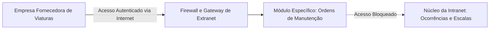
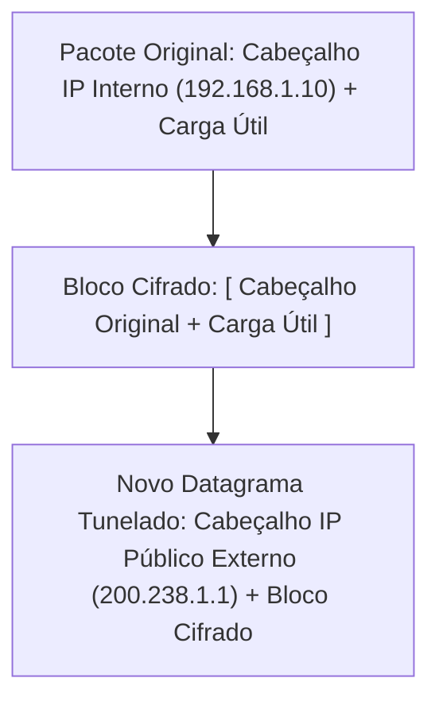
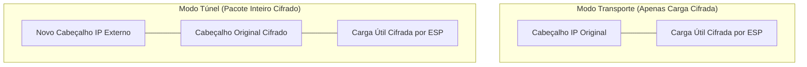
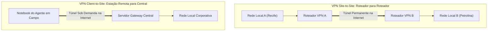
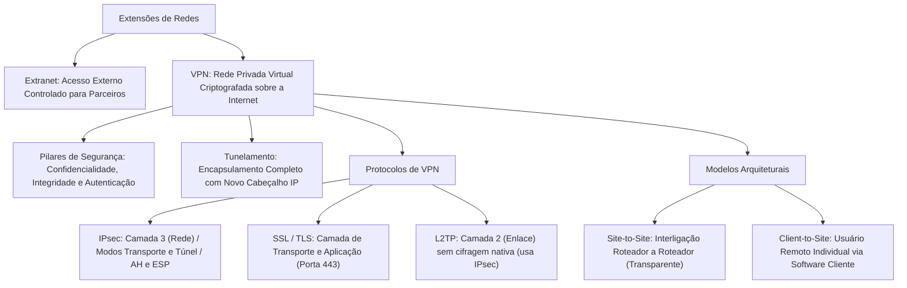

A cooperação interagências exige comunicação segura além dos muros físicos dos quartéis. Fornecedores de suprimentos e agentes em operações remotas precisam acessar sistemas corporativos. Essa troca de dados não pode comprometer o núcleo fechado da Intranet. Para atender a essa demanda, a engenharia de redes desenvolveu a Extranet. Também criou os túneis criptografados de VPN. Neste capítulo, você estudará a Extranet e os protocolos de tunelamento.

> [!objetivos]
> Ao concluir este capítulo, você será capaz de:
> - Definir o conceito de Extranet e identificar seu público-alvo e escopo de acesso.
> - Diferenciar os cenários operacionais de uso da Internet, Intranet e Extranet.
> - Compreender a arquitetura e os objetivos fundamentais de uma Rede Privada Virtual (VPN).
> - Explicar a técnica de tunelamento e o papel dos protocolos IPsec, SSL/TLS e L2TP.
> - Comparar os modelos de VPN Site-to-Site e Client-to-Site.

## Conceito e Aplicações da Extranet

A Extranet é uma extensão da Intranet corporativa. Ela é disponibilizada através da Internet para parceiros externos previamente cadastrados. Atua como uma ponte controlada entre a organização e entidades parceiras. Seus usuários típicos incluem oficinas autorizadas e empresas terceirizadas conveniadas.

Ela atua como uma ponte controlada entre o ambiente interno da organização e entidades parceiras, como fornecedores de equipamentos, oficinas autorizadas de manutenção, empresas prestadoras de serviços terceirizados e outros órgãos públicos conveniados.

Características determinantes da Extranet:

1. **Acesso Externo Restrito**: A Extranet não é aberta ao público geral. O parceiro externo precisa autenticar-se obrigatoriamente com credenciais nominais e certificados digitais válidos.
2. **Privilégios Segmentados**: O parceiro não enxerga a totalidade da Intranet. Ele visualiza estritamente os módulos e bancos de dados vinculados ao seu contrato ou termo de cooperação técnica.
3. **Meio Físico Compartilhado**: A conexão trafega pelos enlaces públicos da Internet, mas protegida por camadas de criptografia que garantem sigilo absoluto contra terceiros interceptadores.



> [!bizu]
> A Extranet é uma rede privada estendida. Dizer em prova que a Extranet é uma rede pública aberta ao cidadão comum é um erro gravíssimo. Apenas usuários externos credenciados acessam a Extranet.

### Cenários Práticos de Diferenciação de Acessos

Para eliminar qualquer margem de confusão nas provas de concurso, examine a tabela de cenários da segurança pública:

- **Cenário 1 (Intranet Local)**: O capitão de bombeiros está fisicamente dentro do quartel e abre o portal interno para lançar a escala de serviço dos soldados. Ele está utilizando a **Intranet**.
- **Cenário 2 (Intranet Remota via VPN)**: O delegado de polícia está em sua residência e precisa despachar um inquérito sigiloso no sistema interno da Polícia Civil. Ele estabelece uma conexão VPN criptografada e acessa o sistema como se estivesse no seu gabinete. Ele está utilizando a **Intranet por acesso remoto**.
- **Cenário 3 (Extranet Corporativa)**: O gerente da distribuidora privada de combustível acessa um portal corporativo do Estado para emitir a autorização de abastecimento das viaturas da PMPE. Ele não é militar, mas possui credencial de fornecedor contratado. Ele está utilizando a **Extranet**.
- **Cenário 4 (Internet Aberta)**: O cidadão comum acessa o site oficial da Secretaria de Defesa Social para consultar o endereço de uma delegacia ou registrar um boletim de ocorrência de extravio de documentos. Ele está utilizando a **Internet**.

| Usuário em Ação | Local Físico | Sistema Solicitado | Classificação Técnica do Ambiente |
|---|---|---|---|
| Servidor da Corporação | Dentro do Quartel | Folha de pagamento interna | **Intranet** |
| Servidor da Corporação | Em viagem ou domicílio | Sistema interno via túnel VPN | **Intranet Remota** |
| Fornecedor Credenciado | Sede da Empresa Parceira | Módulo de entrega de suprimentos | **Extranet** |
| Cidadão Comum | Em seu smartphone | Portal de notícias do Governo | **Internet Pública** |
*Tabela 1: Confronto de cenários de acesso a redes institucionais.*

> [!pegadinha]
> Se um servidor público conecta-se de sua casa ao sistema interno da delegacia por meio de uma VPN, ele não está acessando a Extranet. Ele continua acessando a **Intranet** da corporação, porém de maneira remota. A Extranet destina-se a parceiros, fornecedores e clientes externos autorizados, e não aos servidores do próprio órgão.

## Redes Privadas Virtuais (VPN)

A criação de enlaces físicos dedicados de longa distância possui custos orçamentários elevados. Para superar esse obstáculo financeiro, surgiu o conceito de VPN. Uma VPN é uma rede privada virtual construída sobre uma infraestrutura pública compartilhada. Ela adota técnicas avançadas de tunelamento e cifragem.

Uma VPN é uma rede de comunicação privada construída sobre uma infraestrutura pública de dados compartilhada, utilizando técnicas avançadas de tunelamento e criptografia.

```mermaid Tunelamento VPN seguro sobre a infraestrutura publica da Internet
flowchart LR
    A["Rede da Delegacia Seccional"] --> GW1["Roteador VPN (Origem)"]
    subgraph Publica["Internet Pública Insegura"]
        GW1 ==>|Túnel Criptografado e Protegido| GW2["Roteador VPN (Destino)"]
    end
    GW2 --> B["Rede do Quartel Central"]
```

Uma conexão VPN implementa três pilares obrigatórios da segurança cibernética:

1. **Confidencialidade**: Todos os pacotes de dados são cifrados antes de serem lançados na rede pública. Se um invasor capturar o tráfego na Internet, lerá apenas bytes inteligíveis.
2. **Integridade de Dados**: Códigos de autenticação de mensagens garantem que os pacotes não sofram alteração fraudulenta ou corrupção física durante o tráfego nos enlaces públicos.
3. **Autenticação Mútua de Pontas**: O cliente e o servidor comprovam suas identidades antes de liberar a transmissão dos dados, impedindo o ataque de intermediários não autorizados.

> [!bizu]
> Além de proteger o sigilo das comunicações corporativas, a VPN oculta o endereço IP real do dispositivo transmissor perante os servidores de destino na Internet, uma vez que o tráfego parece originar-se do próprio gateway da VPN.

### O Mecanismo de Tunelamento (Tunneling)

O tunelamento é o procedimento técnico pelo qual um pacote é totalmente envolvido dentro de outro. A criptografia clássica limita-se a tornar a mensagem ilegível. O tunelamento vai além. Ele pega o pacote inteiro com cabeçalhos originais e o cifra. Em seguida, anexa um novo cabeçalho externo de transporte com endereços públicos dos gateways.

Muitos estudantes confundem criptografia com tunelamento. A criptografia clássica limita-se a tornar a mensagem ilegível. O **tunelamento vai além**: ele pega o pacote inteiro (incluindo o cabeçalho original com os endereços IP privados internos de origem e destino), criptografa esse bloco completo e adiciona um novo cabeçalho externo de transporte com os endereços IP públicos roteáveis dos gateways da VPN.



No destino, o roteador receptor remove o cabeçalho externo, descriptografa o conteúdo interno e entrega o pacote original à máquina destinatária da rede local como se ele tivesse trafegado por um cabo de rede exclusivo.

> [!atencao]
> O cabeçalho externo do pacote tunelado é visível aos roteadores intermediários da Internet pública, pois eles precisam saber para qual gateway encaminhar o pacote. O conteúdo interno do pacote original e o IP privado da máquina de origem permanecem inteiramente invisíveis e inacessíveis.

## Principais Protocolos de Tunelamento VPN

Para estruturar os túneis seguros, utilizam-se diferentes protocolos de comunicação:

### Protocolo IPsec (IP Security)

O IPsec opera na **camada de rede (Camada 3)** da pilha TCP/IP. Por atuar no nível de rede, ele é transparente para todos os programas e aplicações do usuário. Qualquer serviço que use a rede passa automaticamente pelo túnel sem demandar ajustes nos navegadores ou sistemas operacionais.

O conjunto IPsec é formado por dois submódulos principais:

- **AH (Authentication Header)**: Garante a integridade e a autenticação do pacote, mas **não fornece criptografia** nem confidencialidade.
- **ESP (Encapsulating Security Payload)**: Fornece **confidencialidade total (criptografia)**, integridade e autenticação. É o submódulo mais utilizado em VPNs comerciais e policiais.

O IPsec opera em dois modos funcionais:

1. **Modo Transporte**: Criptografa apenas a carga útil (dados úteis) do pacote IP original, preservando o cabeçalho IP original intacto. É empregado tipicamente em comunicações diretas entre duas estações de trabalho finais.
2. **Modo Túnel**: Criptografa o pacote IP original por completo (cabeçalho e dados) e anexa um novo cabeçalho IP externo. É o modo padrão utilizado para interligar redes corporativas inteiras.



### Protocolos Baseados em SSL/TLS

As VPNs baseadas em SSL/TLS (como OpenVPN e WireGuard) operam na **camada de transporte e aplicação**. Elas oferecem tremenda facilidade operacional, pois utilizam as mesmas portas de navegação segura (como a **porta TCP 443**), conseguindo atravessar praticamente qualquer firewall comercial sem bloqueios de rede.

### Protocolo L2TP (Layer 2 Tunneling Protocol)

O L2TP opera na **camada de enlace (Camada 2)**, encapsulando quadros PPP. Como o L2TP nativo **não possui criptografia própria**, ele é rotineiramente associado ao IPsec (formando a combinação L2TP/IPsec), na qual o L2TP cria o túnel e o IPsec fornece a segurança e cifragem dos dados.

### Negociação de Chaves e Protocolo IKE

Para que duas pontas estabeleçam um túnel IPsec, é necessário autenticar mutuamente os dispositivos e negociar chaves simétricas de criptografia com segurança. Essa negociação inicial é gerenciada pelo protocolo **IKE (Internet Key Exchange)**.

O protocolo IKE opera em duas fases estruturadas:

1. **Fase 1 do IKE**: Cria um canal preliminar bidirecional seguro e autenticado entre os dois roteadores da VPN. Essa etapa utiliza o algoritmo Diffie-Hellman para estabelecer chaves criptográficas sem transmiti-las abertamente pela rede.
2. **Fase 2 do IKE**: Com o canal preliminar protegido, o protocolo negocia os parâmetros específicos dos túneis de dados (Security Associations - SAs), definindo se usará AH ou ESP, os algoritmos de cifra (como AES-256) e a frequência de rotação periódica das chaves.

O IKE utiliza a camada de transporte **UDP na porta 500**. Caso o enlace atravesse um roteador intermediário que utilize NAT (Network Address Translation), o tráfego IKE é automaticamente encapsulado e redirecionado para a **porta UDP 4500** através do recurso técnico de NAT-Traversal (NAT-T).

```mermaid Fluxo de negociacao em duas fases do protocolo IKE
flowchart LR
    GW1["Gateway VPN (Origem)"] <-->|Fase 1: Canal Seguro IKE (Porta 500 UDP)| GW2["Gateway VPN (Destino)"]
    GW1 <-->|Fase 2: Associação de Segurança (SAs) e Túneis ESP| GW2
```

> [!bizu]
> O recurso NAT-Traversal (NAT-T) foi criado para permitir que túneis IPsec atravessem roteadores residenciais comuns. Quando o roteador detecta a presença de NAT na rota, os pacotes IPsec ESP são encapsulados em datagramas UDP na **porta 4500**, impedindo que a tradução de endereços quebre a integridade criptográfica da conexão.

### A Nova Geração de VPNs: WireGuard e OpenVPN

No cenário das VPNs corporativas modernas, dois projetos de código aberto destacam-se nas instituições públicas:

- **OpenVPN**: Solução consagrada e amplamente estável. Utiliza a biblioteca OpenSSL para fornecer túneis em espaço de usuário (user space). Permite transitar tanto por UDP quanto por TCP (rotineiramente na porta 443), o que viabiliza contornar bloqueios rígidos de firewalls em aeroportos e redes de terceiros.
- **WireGuard**: Padrão moderno de altíssimo desempenho integrado diretamente ao núcleo (kernel) do sistema operacional Linux. O WireGuard utiliza uma base de código enxuta de cerca de quatro mil linhas (em comparação às centenas de milhares do OpenVPN). Ele emprega algoritmos de criptografia de ponta (como ChaCha20 e Curve25519), oferecendo conexão quase instantânea e consumo mínimo de bateria em dispositivos móveis das viaturas.

## Modalidades Estruturais de VPN: Site-to-Site e Client-to-Site

As conexões VPN estruturam-se preponderantemente em duas arquiteturas operacionais:

### VPN Site-to-Site (Gateway-to-Gateway)

Nessa modalidade, a VPN interliga duas redes locais inteiras distantes através da Internet.

Características da VPN Site-to-Site:

- O túnel é estabelecido permanentemente entre os roteadores de borda (gateways) de cada localidade (exemplo: entre o roteador da Diretoria Geral no Recife e o roteador do Batalhão Regional de Petrolina).
- Os computadores, impressoras e servidores locais de ambas as pontas comunicam-se entre si de maneira totalmente transparente. Os usuários não precisam instalar nenhum software cliente de VPN nem efetuar conexões manuais. O tráfego entra no túnel automaticamente ao ser despachado pelo roteador local.

### VPN Client-to-Site (Remote Access)

Nessa modalidade, um único dispositivo de usuário conecta-se individualmente à rede corporativa central através da Internet.

Características da VPN Client-to-Site:

- O policial instala um programa cliente de VPN em seu notebook ou smartphone funcional.
- Ao abrir o aplicativo, o operador digita suas credenciais de usuário, senha e token de autenticação de dois fatores.
- O software cria uma interface de rede virtual no sistema operacional e estabelece um túnel criptografado direto com o servidor de VPN da corporação.
- O dispositivo passa a comportar-se logicamente como se estivesse fisicamente conectado aos switches internos do quartel, recebendo um endereço IP privado da rede corporativa.



> [!exemplo]
> Em uma grande operação de socorro a inundações na Zona da Mata pernambucana, o posto de comando móvel da Defesa Civil instalado em um caminhão conecta-se à rede do Palácio do Governo por meio de uma VPN Site-to-Site via link de satélite. Simultaneamente, os peritos criminais que analisam áreas de risco em campo utilizam seus tablets funcionais para enviar fotos e relatórios preliminares conectados por uma VPN Client-to-Site através da rede móvel celular 4G/5G.

| Parâmetro | VPN Site-to-Site | VPN Client-to-Site |
|---|---|---|
| **Pontas da Conexão** | Roteador de borda conectado a Roteador de borda | Software cliente no dispositivo conectado ao Servidor central |
| **Instalação no Host** | Nenhuma instalação necessária nas máquinas finais | Exige software ou configuração de VPN no computador do usuário |
| **Transparência** | Totalmente transparente aos usuários locais | O usuário precisa iniciar a conexão e autenticar-se |
| **Aplicação Típica** | Interligação contínua entre matriz e filiais regionais | Trabalho remoto de policiais, viaturas e agentes em campo |
*Tabela 2: Síntese comparativa entre as arquiteturas de VPN.*

## Mapa do capítulo



### Para fixar

- A Extranet é uma extensão segura da Intranet disponibilizada na Internet exclusivamente para parceiros e fornecedores externos cadastrados.
- O acesso à Extranet é rigorosamente controlado por credenciais e restringe o usuário apenas aos sistemas autorizados contratualmente.
- Servidores que trabalham remotamente de suas residências acessam a Intranet institucional por meio de VPN, e não a Extranet.
- A VPN cria um canal de comunicação seguro e privativo sobre a infraestrutura pública da Internet por meio de tunelamento e criptografia.
- O tunelamento encapsula o pacote IP original inteiro dentro de um novo datagrama com cabeçalhos externos roteáveis na rede mundial.
- O protocolo IPsec opera na camada de rede (Camada 3) nos modos Transporte (apenas carga cifrada) e Túnel (pacote completo cifrado).
- O módulo ESP do IPsec garante confidencialidade, autenticidade e integridade, enquanto o módulo AH não realiza criptografia.
- A VPN Site-to-Site interliga redes locais inteiras de forma contínua e transparente por meio de roteadores de borda.
- A VPN Client-to-Site conecta dispositivos remotos individuais ao servidor central da corporação mediante autenticação em software cliente.
