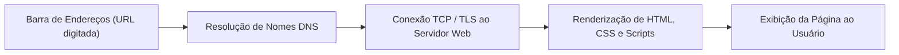
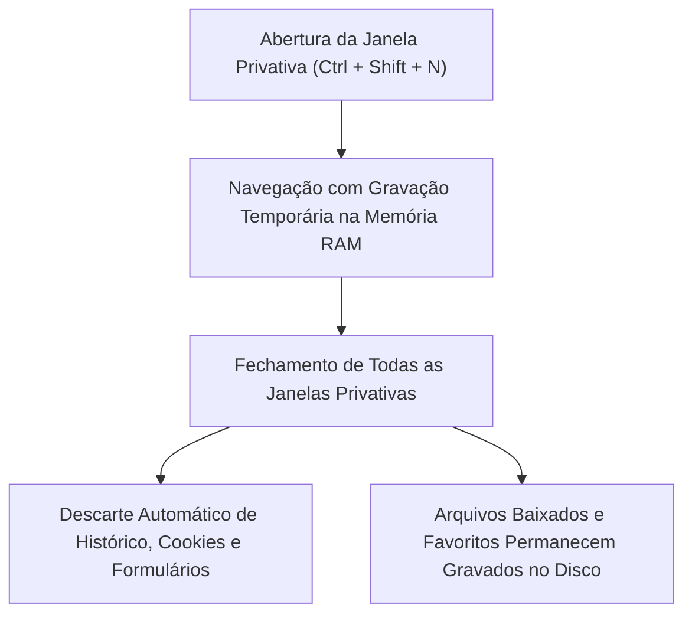
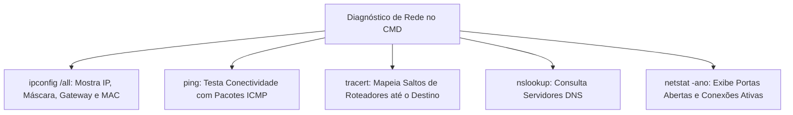
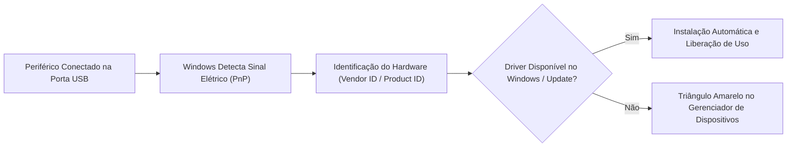

A rotina operacional e pericial nas instituições de segurança pública demanda agilidade no uso de programas navegadores, segurança na execução de comandos de rede via terminal e pleno entendimento da conexão de periféricos. Neste capítulo, você estudará o funcionamento detalhado dos navegadores modernos, dominará os comandos essenciais do Prompt de Comando do Windows 11 e compreenderá a gestão de hardware e controladores de dispositivos.

> [!objetivos]
> Ao concluir este capítulo, você será capaz de:
> - Dominar a navegação privativa, a gestão de cookies e os atalhos de teclado nos navegadores.
> - Aplicar operadores avançados de pesquisa em motores de busca na Internet.
> - Executar comandos do Prompt de Comando para manipulação de arquivos, diagnóstico de rede e gestão de processos.
> - Classificar periféricos em dispositivos de entrada, saída e mistos.
> - Compreender a instalação de drivers, a tecnologia Plug and Play e a administração no Gerenciador de Dispositivos.

## O que este material cobre (e por quê)

A atuação prática na segurança pública exige domínio de ferramentas operacionais essenciais do sistema operacional. Este capítulo aprofunda três competências essenciais cobradas pelas bancas examinadoras:

1. **Navegadores** (item 2 do edital): navegação privativa, cookies, cache, histórico, downloads, favoritos, segurança e **atalhos de teclado**; mais os **operadores de pesquisa** do Google;
2. **Prompt de Comando do Windows 11** (item 6): comandos de arquivos e pastas, rede, processos e sistema, com **parâmetros**, redirecionamento e curingas;
3. **Instalação e configuração de periféricos** (item 5): classificação, conexões, **drivers**, *Plug and Play*, **Gerenciador de Dispositivos** e impressoras.

> [!bizu] Relevância em Concursos
> (a) "qual atalho faz X?"; (b) "o que o modo de navegação privativa **não** impede?"; (c) "qual comando do Prompt faz Y?" (muitas vezes com um comando que **não existe** entre as alternativas); (d) "o que é um *driver*?" e "o que fazer quando o Windows não reconhece um dispositivo?".

## Navegadores: Uso Prático e Operações Diárias

### Estrutura e Interface do Navegador



**Navegador (*browser*)** é o programa que **solicita, recebe e exibe** páginas da web (HTML, CSS, JavaScript), usando principalmente o protocolo **HTTP/HTTPS**. Os mais cobrados são **Microsoft Edge** (o navegador padrão do Windows 11), **Google Chrome** e **Mozilla Firefox**.

Partes da janela (nomes variam um pouco, mas a ideia é a mesma):

- **Barra de endereços:** digita-se a **URL** ou um termo de busca (nos três navegadores modernos, a barra de endereços também **pesquisa**);
- **Guias (abas):** várias páginas na mesma janela;
- **Favoritos** (no Chrome e no Firefox: **Marcadores**): endereços salvos;
- **Histórico:** lista das páginas visitadas;
- **Downloads:** lista dos arquivos baixados;
- **Menu de configurações** (três pontos ou três linhas), **extensões**, **perfil e sincronização**.

> [!pegadinha] Nomenclatura entre Navegadores
> no **Edge** e no **Internet Explorer** falava-se em **Favoritos**; no **Chrome** e no **Firefox**, em **Marcadores**. O **Internet Explorer** foi aposentado em junho de 2022; o Edge possui um **modo Internet Explorer** (modo IE) para sites antigos.

### Cookies, cache e histórico: o que cada um é

*Tabela 1: Descrição operacional.*
| Item | O que é | Para que serve |
|---|---|---|
| **Cookies** | Pequenos **arquivos de texto** que os sites gravam no seu computador | Manter **login**, itens do carrinho, preferências. também **rastreamento** e publicidade |
| **Cache** | **Cópia local** de partes das páginas (imagens, scripts, estilos) | **Acelerar** o carregamento de páginas já visitadas |
| **Histórico de navegação** | **Lista** de endereços visitados (com data e hora) | Voltar a páginas visitadas |
| **Histórico de downloads** | Lista de arquivos baixados | Reabrir ou localizar arquivos |
| **Dados de formulário e senhas** | Informações salvas para **inserção automática** | Praticidade |

**Tipos de cookies:**

- **De sessão:** apagados quando o navegador é fechado. **persistentes:** ficam salvos até uma data de validade;
- **Primários (*first-party*):** criados pelo **site que você visita**. **de terceiros (*third-party*):** criados por **outro domínio** incorporado na página (anúncios, botões de redes sociais), usados para rastrear a navegação entre sites.

> [!pegadinha] Armadilhas Clássicas sobre Cookies e Cache
>
> - **Cookie não é vírus** nem programa executável: é um **arquivo de dados**. Mas pode ser usado para **monitorar hábitos** (privacidade).
> - **Limpar o cache** pode resolver páginas "desatualizadas" ou com erro de exibição; **apagar cookies** faz você **sair das contas** (*logout*).
> - O **cache** não guarda senhas; senhas ficam no **gerenciador de senhas** do navegador.

### Navegação Privativa e Proteção Local



*Tabela 2: Descrição operacional.*
| Navegador | Nome do modo | Atalho (Windows) |
|---|---|---|
| **Microsoft Edge** | **InPrivate** | **Ctrl + Shift + N** |
| **Google Chrome** | **Anônima** | **Ctrl + Shift + N** |
| **Mozilla Firefox** | **Janela privativa** | **Ctrl + Shift + P** |

**O que o modo privativo FAZ:** ao **fechar todas as janelas privativas**, o navegador **descarta** o **histórico de navegação**, os **cookies e dados de sites** e os **dados de formulário** daquela sessão.

**O que o modo privativo NÃO FAZ (cai muito):**

- **Não torna o usuário anônimo na internet:** o **provedor de internet (ISP)**, o **empregador/rede da instituição** e os **sites visitados** continuam podendo ver o acesso;
- **Não apaga** os **arquivos baixados** (continuam na pasta Downloads) nem os **favoritos/marcadores** criados na sessão;
- **Não protege** contra **vírus, *phishing*** ou *keyloggers* instalados no computador;
- As **extensões** ficam, por padrão, **desativadas** (o usuário pode permiti-las).

### Limpar dados de navegação

Atalho: **Ctrl + Shift + Delete** abre, nos três navegadores, a janela para **limpar dados de navegação** (histórico, cookies, cache, senhas, dados de formulário), com **intervalo de tempo** à escolha (última hora, 24 horas, todo o período). Os itens são marcados individualmente: limpar o **cache** não obriga a limpar as **senhas**.

### Segurança no navegador

- **HTTPS e cadeado:** o ícone ao lado do endereço indica conexão **criptografada** (TLS) entre navegador e site. **Atenção:** HTTPS garante que o tráfego é cifrado e que o site tem um certificado; **não garante** que o site seja honesto. Páginas de *phishing* também podem usar HTTPS.
- **Certificado digital** do site: ao clicar no cadeado, é possível ver quem o emitiu.
- **Bloqueador de pop-ups** e **permissões por site** (localização, câmera, microfone, notificações): configuráveis por site.
- **Proteção contra sites maliciosos:** no Edge, o **Microsoft Defender SmartScreen**; no Chrome, a **Navegação segura (*Safe Browsing*)**.
- **Prevenção de rastreamento do Edge:** níveis **Básico, Equilibrado e Estrito**. quanto mais rigoroso, mais rastreadores são bloqueados (e maior a chance de alguns sites **não funcionarem** bem).
- **Atualizações:** manter o navegador **atualizado** corrige falhas de segurança. **Extensões** só de fontes confiáveis.
- **Sincronização:** ao entrar com uma conta (Microsoft no Edge; Google no Chrome), favoritos, senhas, histórico e configurações podem ser **sincronizados** entre dispositivos.

### Atalhos de teclado essenciais (Edge, Chrome e, em sua maioria, Firefox)

*Tabela 3: Descrição operacional.*
| Ação | Atalho |
|---|---|
| Nova guia | **Ctrl + T** |
| Fechar guia | **Ctrl + W** (ou **Ctrl + F4**) |
| **Reabrir** a última guia fechada | **Ctrl + Shift + T** |
| Próxima guia / guia anterior | **Ctrl + Tab** / **Ctrl + Shift + Tab** |
| Ir para a guia nº 1 a 8 | **Ctrl + 1** … **Ctrl + 8** (a **Ctrl + 9** vai para a **última**) |
| Nova janela | **Ctrl + N** |
| Nova janela privativa | **Ctrl + Shift + N** (Edge e Chrome) · **Ctrl + Shift + P** (Firefox) |
| Selecionar a **barra de endereços** | **Ctrl + L**, **Alt + D** ou **F6** |
| Atualizar a página | **F5** ou **Ctrl + R** |
| Atualizar **ignorando o cache** | **Ctrl + F5** ou **Ctrl + Shift + R** |
| Interromper o carregamento | **Esc** |
| Voltar / avançar | **Alt + ←** / **Alt + →** |
| Página inicial | **Alt + Home** |
| **Histórico** | **Ctrl + H** |
| **Downloads** | **Ctrl + J** |
| **Adicionar aos favoritos** | **Ctrl + D** |
| Gerenciador de favoritos | **Ctrl + Shift + O** |
| Mostrar/ocultar barra de favoritos | **Ctrl + Shift + B** (Edge e Chrome) |
| **Limpar dados de navegação** | **Ctrl + Shift + Delete** |
| **Localizar** na página | **Ctrl + F** |
| Imprimir | **Ctrl + P** |
| Salvar a página | **Ctrl + S** |
| Aumentar / diminuir / restaurar o **zoom** | **Ctrl + +** / **Ctrl + −** / **Ctrl + 0** |
| **Tela cheia** | **F11** |
| Ferramentas do desenvolvedor | **F12** |
| Código-fonte da página | **Ctrl + U** |

> [!bizu] Mnemônicos de Atalhos
> *H* de **H**istórico (Ctrl + **H**). o *J* fica ao lado do H no teclado, e é o atalho dos **downloads** (Ctrl + **J**). *T* de **T**ab (guia): Ctrl + T abre; com **Shift**, Ctrl + **Shift** + T **reabre** a última fechada. *N* de **N**ova janela: Ctrl + N; com **Shift**, a janela **privativa**.

### Ferramentas de busca: operadores do Google

*Tabela 4: Descrição operacional.*
| Operador | Efeito | Exemplo |
|---|---|---|
| **" "** (aspas) | **Frase exata** | "lei orgânica nacional" |
| **−** (sinal de menos) | **Exclui** um termo | bombeiro −carnaval |
| **OR** (ou barra vertical) | Um termo **ou** outro | edital OR retificação |
| **\*** | Curinga para uma palavra desconhecida | "o melhor \* do mundo" |
| **site:** | Restringe a pesquisa a um **site** ou domínio | site:gov.br concurso |
| **filetype:** | Restringe ao **tipo de arquivo** | edital filetype:pdf |
| **intitle:** | Termo no **título** da página | intitle:edital |
| **inurl:** | Termo no **endereço** | inurl:concurso |
| **..** | **Intervalo numérico** | notebook 2000..3000 |
| **before: / after:** | Resultados **antes/depois** de uma data | edital after:2026 |

Sem operador, a pesquisa já une os termos com **E** (AND) implícito. O Google **ignora** maiúsculas/minúsculas e, na maioria dos casos, acentos; operadores antigos como **+** e **~** foram **descontinuados**.


> [!exemplo]
> Um perito criminal precisa buscar apenas editais em formato PDF publicados em portais governamentais após o ano de 2025. Ele utiliza a sintaxe avançada: `site:pe.gov.br filetype:pdf edital after:2025`. Essa consulta filtra exatamente os documentos pretendidos sem ruído de páginas de notícias.

### Resumo Rápido de Navegadores

- Navegador padrão do Windows 11: **Edge**. **Edge: Favoritos**; **Chrome/Firefox: Marcadores**.
- **Cookie** = arquivo de dados (não é vírus); **cache** = cópia local para acelerar; **histórico** = lista de visitas.
- **Privativa:** apaga histórico, cookies e formulários **ao fechar tudo**; **não** apaga downloads/favoritos e **não** torna anônimo.
- **Ctrl + Shift + N** (privativa no Edge/Chrome) · **Ctrl + Shift + P** (Firefox) · **Ctrl + Shift + T** (reabrir guia) · **Ctrl + H** (histórico) · **Ctrl + J** (downloads) · **Ctrl + D** (favorito) · **Ctrl + Shift + Del** (limpar dados) · **F5/Ctrl + F5**.
- Operadores: **" "**, **−**, **OR**, **site:**, **filetype:**.

## Prompt de Comando no Windows 11

### O que é e como abrir

O **Prompt de Comando** (`cmd.exe`) é o **interpretador de comandos** do Windows: o usuário digita instruções de texto e o sistema as executa. Para abrir: **Win + R**, digitar `cmd` e **Enter**; ou pesquisar "Prompt de Comando" no menu **Iniciar**. Para executar **como administrador**: botão direito > **Executar como administrador** (ou **Ctrl + Shift + Enter** ao abrir pela pesquisa do Iniciar).

No Windows 11 o Prompt de Comando costuma abrir dentro do **Terminal do Windows** (um aplicativo que reúne abas de Prompt de Comando, PowerShell etc.), mas o interpretador continua sendo o `cmd`.

**Regras gerais:**

- Os comandos **não diferenciam maiúsculas de minúsculas** (`DIR` = `dir`);
- Ajuda de qualquer comando: **`comando /?`** (ex.: `copy /?`) ou **`help`** para a lista geral;
- **Setas ↑ / ↓** repetem comandos digitados. **Tab** completa nomes de pastas e arquivos. **Ctrl + C** interrompe o comando em execução. **`cls`** limpa a tela. **`exit`** fecha o prompt;
- Caminhos com **espaços** vão entre **aspas**: `cd "C:\Meus Documentos"`.

### Arquivos e pastas

*Tabela 5: Descrição operacional.*
| Comando | Função | Parâmetros e exemplos |
|---|---|---|
| **`dir`** | **Lista** arquivos e pastas | `/a` (inclui ocultos) · `/s` (subpastas) · `/b` (só os nomes) · `/p` (pausa por página) · `/w` (várias colunas) · `/o:n` (ordena por nome) |
| **`cd`** (ou `chdir`) | **Muda** de pasta | `cd ..` (sobe um nível) · `cd \` (vai à raiz) · **`cd /d D:\pasta`** (muda também de **unidade**) |
| **`md`** (ou `mkdir`) | **Cria** pasta | `md Relatorios` |
| **`rd`** (ou `rmdir`) | **Remove** pasta | `rd pasta` (só se estiver **vazia**) · **`rd /s pasta`** remove a pasta **com todo o conteúdo** · `/q` não pede confirmação |
| **`copy`** | **Copia** arquivos | `copy a.txt D:\backup` · `/y` (sobrescreve sem perguntar) |
| **`xcopy`** | Copia **pastas e subpastas** | `xcopy origem destino /e /i /y` |
| **`robocopy`** | Cópia **robusta** (espelhamento, backup) | `robocopy origem destino /e` |
| **`move`** | **Move** arquivos ou pastas | `move a.txt D:\arquivo` |
| **`ren`** (ou `rename`) | **Renomeia** (não muda de pasta) | `ren velho.txt novo.txt` |
| **`del`** (ou `erase`) | **Exclui arquivos** (não remove pastas) | `/f` (força somente-leitura) · `/s` (subpastas) · `/q` (silencioso) |
| **`type`** | **Mostra** o conteúdo de um arquivo de texto | `type nota.txt` |
| **`tree`** | Mostra a **estrutura de pastas** em árvore | `tree /f` (inclui arquivos) |
| **`attrib`** | Exibe/altera **atributos** | `attrib +r arq.txt` (somente leitura) · `-r` · `+h` (oculto) · `+s` (sistema) |

> [!atencao] Comando Inexistente no Windows Moderno
> o **`DELTREE`** era do MS-DOS e do Windows 9x. **Não existe** no Windows 11 (nem desde o Windows NT/2000). Para apagar uma pasta com tudo dentro, use **`rd /s`** (ou `rmdir /s`). Se algum material de estudo listar `DELTREE` como comando atual, ele está **desatualizado**.

> [!atencao] Exclusão Permanente no Prompt
> `del` e `rd /s` **não enviam para a Lixeira**: a exclusão é definitiva. Em prova, "exclui permanentemente, sem passar pela Lixeira" é uma afirmação correta para esses comandos no Prompt.

**Curingas (*wildcards*)**: **`*`** substitui **vários** caracteres; **`?`** substitui **um** caractere.

- `dir *.txt` lista todos os arquivos terminados em `.txt`;
- `dir ?ota.txt` lista `nota.txt`, `rota.txt`, `mota.txt` etc. (uma letra qualquer no lugar do `?`), mas **não** `protota.txt`;
- `del rel*.docx` apaga todos os arquivos `.docx` cujo nome **começa** com `rel`.

### Redirecionamento e encadeamento

*Tabela 6: Descrição operacional.*
| Símbolo | Significado | Exemplo |
|---|---|---|
| **`>`** | Envia a saída para um arquivo (**sobrescreve**) | `dir > lista.txt` |
| **`>>`** | Envia a saída para um arquivo (**acrescenta** ao final) | `echo fim >> lista.txt` |
| **`<`** | Lê a **entrada** de um arquivo | `sort < nomes.txt` |
| **Barra vertical** (pipe) | Passa a saída de um comando como entrada do próximo | Encadear ipconfig e find |
| **`&`** | Executa um comando **e depois** o outro | `cd .. & dir` |
| **`&&`** | Executa o segundo **só se o primeiro der certo** | `md teste && cd teste` |

### Utilitários de Diagnóstico de Rede



*Tabela 7: Descrição operacional.*
| Comando | Função | Parâmetros |
|---|---|---|
| **`ipconfig`** | Mostra a **configuração de IP** | `/all` (detalhes: MAC, DNS, DHCP) · `/release` (libera o IP) · `/renew` (renova) · **`/flushdns`** (limpa o cache DNS) |
| **`ping`** | **Testa a conectividade** com um host (envia pacotes ICMP) | `ping 8.8.8.8` · **`-t`** (contínuo) · **`-n 10`** (10 pacotes) |
| **`tracert`** | Mostra a **rota** (saltos) até o destino | `tracert www.gov.br` |
| **`nslookup`** | **Consulta DNS** (nome → IP) | `nslookup www.gov.br` |
| **`netstat`** | **Conexões** de rede e portas em uso | `-a` (todas) · `-n` (numérico) · `-o` (mostra o PID) · `-b` (programa) |
| **`getmac`** | Mostra o endereço **MAC** | |
| **`hostname`** | Mostra o **nome** do computador | |

### Processos e sistema

*Tabela 8: Descrição operacional.*
| Comando | Função | Exemplo |
|---|---|---|
| **`tasklist`** | **Lista** os processos em execução | |
| **`taskkill`** | **Encerra** processos | `taskkill /pid 1234 /f` · `taskkill /im notepad.exe /f` (`/f` força. `/im` = nome da imagem) |
| **`chkdsk`** | **Verifica o disco** (precisa ser **administrador**) | `chkdsk C: /f` (corrige erros) · `/r` (procura setores defeituosos) |
| **`sfc /scannow`** | **Verifica e repara arquivos do sistema** protegidos | (administrador) |
| **`dism`** | Repara a **imagem** do Windows | `dism /online /cleanup-image /restorehealth` |
| **`shutdown`** | Desliga/reinicia | `/s` desliga · `/r` reinicia · `/t 60` espera 60 s · **`/a` cancela** · `/l` encerra a sessão |
| **`systeminfo`** | Informações do **sistema** (versão, memória, hotfixes) | |
| **`whoami`** | Mostra o **usuário** atual | |
| **`ver`** | Mostra a **versão** do Windows | |
| **`date`** / **`time`** | Mostram/alteram data e hora | |
| **`echo`** | Exibe texto | `echo Olá` |
| **`title`** / **`color`** | Mudam título e cores da janela | |
| **`format`** | **Formata** uma unidade (apaga tudo!) | `format D: /fs:ntfs` |
| **`diskpart`** | Gerencia **discos e partições** (interativo) | |

### Atalhos de "Executar" (Win + R) que abrem ferramentas

*Tabela 9: Descrição operacional.*
| Digite | Abre |
|---|---|
| `cmd` | Prompt de Comando |
| `control` | **Painel de Controle** |
| `appwiz.cpl` | Programas e Recursos (desinstalar programas) |
| `ncpa.cpl` | Conexões de Rede |
| `devmgmt.msc` | **Gerenciador de Dispositivos** |
| `diskmgmt.msc` | Gerenciamento de Disco |
| `services.msc` | Serviços |
| `taskmgr` | Gerenciador de Tarefas (também **Ctrl + Shift + Esc**) |
| `msinfo32` | Informações do Sistema |
| `regedit` | Editor do Registro |


> [!bizu]
> O utilitário `ping` envia pacotes de eco do protocolo ICMP (Internet Control Message Protocol). O parâmetro `-t` dispara requisições contínuas até ser interrompido manualmente pelo comando Ctrl + C.

### Resumo Rápido de Prompt de Comando

- `dir` lista · `cd` muda de pasta (`cd ..` sobe. `cd /d` troca de unidade) · `md` cria · **`rd /s`** remove pasta com conteúdo · `copy`/`xcopy`/`robocopy` copiam · `move` move · `ren` renomeia · `del` apaga arquivos.
- **`DELTREE` não existe** no Windows 11.
- `ipconfig /all`, `ping`, `tracert`, `nslookup`, `netstat` = rede. `tasklist`/`taskkill` = processos. `chkdsk`, `sfc /scannow` = verificação/reparo.
- `>` sobrescreve, `>>` acrescenta, `|` encadeia; `*` e `?` são curingas.
- Ajuda: `comando /?`.

## Instalação e Configuração de Periféricos

### O que é periférico e como se classifica

**Periférico** é todo dispositivo **externo à placa-mãe/CPU** que se comunica com o computador. Classificação clássica:

*Tabela 10: Descrição operacional.*
| Tipo | Função | Exemplos |
|---|---|---|
| **Entrada** | Enviam dados **para** o computador | Teclado, mouse, **scanner**, webcam, microfone, leitor de código de barras, leitor biométrico |
| **Saída** | Recebem dados **do** computador | **Monitor**, impressora, caixas de som, projetor, fone de ouvido |
| **Entrada e saída (mistos)** | Fazem os dois | **Tela sensível ao toque**, impressora **multifuncional**, **HD/SSD externo, pendrive** (armazenamento), placa de rede, *headset* (fone + microfone) |

> [!pegadinha] Classificação de Periféricos de Armazenamento
> Dispositivos de **armazenamento** (HD, SSD, pendrive) são periféricos de **entrada e saída**, porque o computador **lê e grava** neles. A **impressora** é só de **saída**; a **multifuncional** (imprime e digitaliza) é **mista**.

### Conexões mais comuns

*Tabela 11: Descrição operacional.*
| Conexão | Característica |
|---|---|
| **USB** | Padrão universal para teclado, mouse, impressora, pendrive, HD externo. Suporta ***hot plug*** (conectar com o computador ligado). Fornece **energia** e dados |
| **USB Type-C** | É o formato do **conector** (reversível), **não** uma velocidade. Pode transportar USB 3.x, USB4, vídeo e carga |
| **HDMI** | **Vídeo digital + áudio** em um só cabo (monitor, TV, projetor) |
| **DisplayPort** | **Vídeo digital + áudio**, comum em monitores de alto desempenho |
| **VGA** | Vídeo **analógico** (legado), sem áudio |
| **DVI** | Vídeo, digital (e/ou analógico, conforme o tipo), sem áudio |
| **Bluetooth** | Sem fio, curto alcance (fones, teclados, mouses). exige **pareamento** |
| **Wi-Fi / Ethernet (RJ-45)** | Redes sem fio e com cabo |
| **P2 (*jack* 3,5 mm)** | Áudio analógico (fone/microfone) |

**Velocidades de USB (taxa máxima teórica):**

*Tabela 12: Descrição operacional.*
| Padrão | Taxa |
|---|---|
| USB 2.0 | **480 Mbps** |
| USB 3.2 Gen 1 (antigo USB 3.0) | **5 Gbps** |
| USB 3.2 Gen 2 (antigo USB 3.1) | **10 Gbps** |
| USB 3.2 Gen 2×2 | **20 Gbps** |
| USB4 | até **40 Gbps** |

Os padrões são **compatíveis entre si** (um pendrive USB 3.0 funciona em porta USB 2.0), mas a velocidade fica limitada pelo **elo mais lento** (porta, cabo ou dispositivo).

### Controladores de Dispositivos e Plug and Play



- **Driver (controlador de dispositivo)** é o **software** que ensina o sistema operacional a **se comunicar com um hardware**. Sem o driver correto, o dispositivo pode não funcionar ou funcionar com recursos limitados.
- ***Plug and Play* (PnP)**: recurso que **detecta automaticamente** o dispositivo ao ser conectado e **instala/configura o driver** (da própria biblioteca do Windows ou via **Windows Update**), sem o usuário precisar configurar manualmente.
- **Driver genérico** funciona para o básico (ex.: mouse e teclado). Recursos especiais (teclas extras, alta resolução, impressora multifuncional) exigem o **driver do fabricante**.
- **Boas práticas:** baixar drivers **do site do fabricante** (evitar sites de terceiros: podem trazer *malware*); preferir drivers com **assinatura digital**.

### Gerenciador de Dispositivos

Ferramenta que **lista todo o hardware** e permite gerenciar drivers. Para abrir: clique com o botão direito no botão **Iniciar** (ou **Win + X**) > **Gerenciador de Dispositivos**; ou **Win + R** > `devmgmt.msc`.

*Tabela 13: Descrição operacional.*
| Sinal na lista | Significado |
|---|---|
| **Triângulo amarelo com "!"** | Dispositivo com **problema** (driver ausente ou com erro) |
| **Seta para baixo** no ícone | Dispositivo **desabilitado** |
| **"Outros dispositivos" / "Dispositivo desconhecido"** | Hardware **sem driver** instalado |

**Ações (botão direito no dispositivo > ou aba "Driver" em Propriedades):**

- **Atualizar driver:** busca automaticamente ou instala a partir de um arquivo;
- **Reverter driver:** volta para a **versão anterior** (útil quando uma atualização causou problema);
- **Desabilitar dispositivo:** desliga sem remover o driver;
- **Desinstalar dispositivo:** remove o driver. ao reiniciar, o PnP pode reinstalá-lo;
- **Verificar alterações de hardware:** força o sistema a procurar novos dispositivos.

### Configurações do Windows 11 para periféricos

*Tabela 14: Descrição operacional.*
| Periférico | Onde configurar (Configurações) |
|---|---|
| **Bluetooth e outros dispositivos** | **Bluetooth e dispositivos** > **Adicionar dispositivo** (pareamento) |
| **Impressoras e scanners** | **Bluetooth e dispositivos** > **Impressoras e scanners** |
| **Monitor** | **Sistema** > **Tela** (resolução, escala, orientação, vários monitores) |
| **Som** | **Sistema** > **Som** (dispositivo de saída/entrada padrão, volume) |
| **Mouse** | **Bluetooth e dispositivos** > **Mouse** (botão principal, velocidade do ponteiro) |
| **Teclado e idioma** | **Hora e idioma** > **Idioma e região** (layout, ex.: Português (Brasil) ABNT2) |
| **Solução de problemas** | **Sistema** > **Solução de problemas** |

**Vários monitores:** o atalho **Win + P** abre as opções de projeção: **Somente a tela do PC**, **Duplicar**, **Estender** (a área de trabalho ocupa as duas telas) e **Somente a segunda tela**.

### Impressoras

- **Instalar:** conectar por USB (o PnP instala) ou, em **rede**, adicionar pelo **nome/endereço IP** em Impressoras e scanners > **Adicionar dispositivo**.
- **Impressora padrão:** a que recebe os trabalhos quando o usuário **não escolhe** outra. O Windows 11 pode gerenciá-la automaticamente (usa a última impressora utilizada no local); essa opção pode ser desligada.
- **Fila de impressão:** lista os trabalhos aguardando. É possível **pausar, reiniciar e cancelar** trabalhos. Se a fila trava, reinicia-se o serviço **Spooler de Impressão** (`services.msc`).
- **Compartilhamento:** a impressora pode ser compartilhada para outros computadores da rede.
- **Imprimir em arquivo:** **Microsoft Print to PDF** é uma "impressora virtual" que gera um PDF.

### Remover dispositivos com segurança

Antes de retirar uma unidade externa, use **Remover Hardware com Segurança e Ejetar Mídia** (ícone na área de notificação) ou **Ejetar** no Explorador de Arquivos. No Windows moderno as unidades removíveis costumam usar a política de **Remoção rápida**, que reduz o risco de perda de dados. **mesmo assim**, ejetar corretamente é a prática correta e o que a banca considera certo, sobretudo se houver cópia em andamento.

### O dispositivo não funciona: roteiro de solução

1. Conferir **cabo e porta** (testar **outra porta USB** e outro cabo);
2. Conferir **energia** (ligado, pilhas, bateria);
3. **Reiniciar** o computador e o dispositivo;
4. No **Gerenciador de Dispositivos**, ver se há "!" e **atualizar** o driver (ou **reverter**, se o problema surgiu após uma atualização);
5. Rodar a **Solução de problemas** do Windows;
6. Verificar o **Windows Update** e o **site do fabricante**.

### Resumo rápido: periféricos

- **Entrada** (teclado, mouse, scanner) · **saída** (monitor, impressora) · **mistos** (touch, multifuncional, HD externo).
- **Driver** = software que permite ao SO usar o hardware · **Plug and Play** = detecção e instalação automáticas.
- **Gerenciador de Dispositivos** (`devmgmt.msc`): atualizar, **reverter**, desabilitar, desinstalar; "!" = problema.
- **USB 2.0** = 480 Mbps · **USB 3.x** = 5/10/20 Gbps · **USB4** = até 40 Gbps · **Type-C** = formato do conector.
- **HDMI/DisplayPort** = vídeo + áudio · **VGA** = analógico, sem áudio.
- **Win + P** = modos de projeção · Impressoras: **Configurações > Bluetooth e dispositivos > Impressoras e scanners**.

## Mapa do capítulo

```mermaid Sintese operacional de navegadores linha de comando e perifericos
flowchart TD
    Operacao["Operação no Sistema"] --> Nav["Navegadores: Edge, Chrome e Firefox"]
    Nav --> Priv["Modo Privativo: Apaga Rastros Locais / Não Anônimo"]
    Nav --> Atalhos["Atalhos: Ctrl+Shift+N, Ctrl+H, Ctrl+J, Ctrl+Shift+Del"]
    
    Operacao --> CMD["Prompt de Comando (cmd.exe)"]
    CMD --> Pastas["Arquivos e Pastas: dir, cd, md, rd /s, copy, del"]
    CMD --> RedeCMD["Diagnóstico de Rede: ipconfig, ping, tracert, nslookup"]
    CMD --> Reparo["Reparo: sfc /scannow, chkdsk, tasklist, taskkill"]
    
    Operacao --> Perif["Periféricos e Hardware"]
    Perif --> Tipos["Classificação: Entrada, Saída e Mistos (Armazenamento)"]
    Perif --> Conex["Conexões: USB (Hot Plug), HDMI, DisplayPort, Bluetooth"]
    Perif --> PnP["Driver e Plug and Play (Gerenciador devmgmt.msc)"]
```

### Para fixar

- O modo privativo descarta histórico, cookies e formulários ao fechar as janelas, mas não torna o usuário anônimo na Internet.
- O atalho Ctrl + Shift + N abre a navegação privativa no Edge e no Chrome, enquanto o Firefox adota Ctrl + Shift + P.
- O Prompt de Comando executa instruções sem diferenciar maiúsculas de minúsculas, utilizando rd /s para exclusão de pastas com conteúdo.
- O comando DELTREE não existe no Windows moderno, sendo uma armadilha frequente em provas desatualizadas.
- Os comandos ipconfig, ping, tracert e nslookup diagnosticam configurações de IP, conectividade, saltos de rota e resolução de nomes DNS.
- Dispositivos de armazenamento como pen drives e discos rígidos externos são classificados formalmente como periféricos mistos (entrada e saída).
- O padrão USB suporta conexão com o computador em funcionamento (hot plug), fornecendo simultaneamente energia elétrica e transmissão de dados.
- O driver é o software que permite a comunicação entre o sistema operacional e o hardware, sendo gerenciado pelo console devmgmt.msc.
