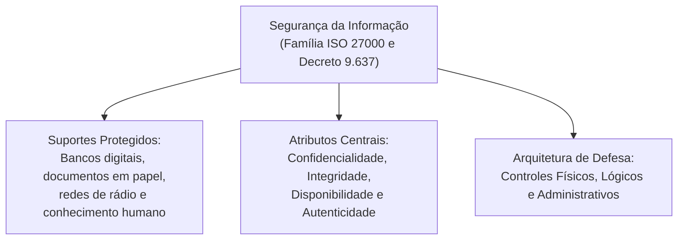
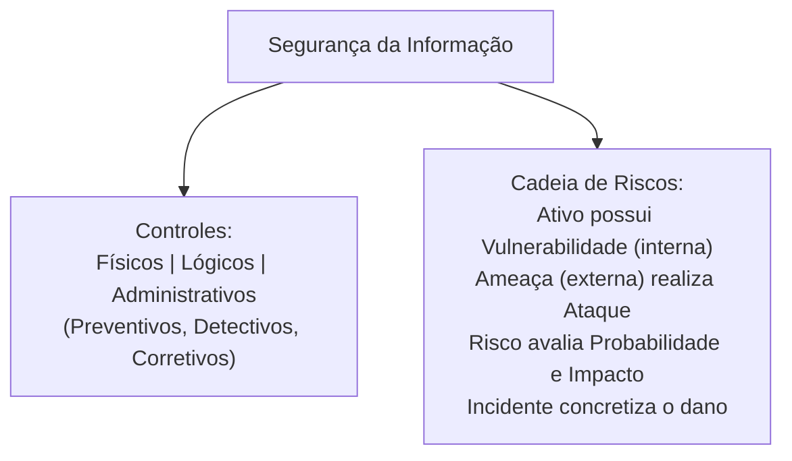

A segurança da informação compreende a preservação das propriedades nucleares de disponibilidade, integridade, confidencialidade e autenticidade dos dados institucionais contra acessos indevidos, interceptações ilícitas e desastres operacionais. No serviço policial e militar, a salvaguarda de prontuários, ordens de operações e redes táticas exige defesas físicas, lógicas e administrativas integradas contra ataques cibernéticos modernos.

> [!objetivos]
> - Compreender a definição normativa da segurança da informação segundo a família ISO/IEC 27000 e o Decreto nº 9.637.
> - Diferenciar controles físicos, lógicos e administrativos no ambiente corporativo.
> - Classificar os controles defensivos quanto à função em preventivos, detectivos e corretivos.
> - Dominar a cadeia conceitual formada por ativos, ameaças, vulnerabilidades, riscos e incidentes.
> - Analisar o mecanismo de exploração de vulnerabilidades por agentes agressores externos e internos.

## O Escopo Institucional da Segurança da Informação

A disciplina de Segurança da Informação, grafada em materiais de referência histórica e registros de digitalização como EGURANÇA DA NFORMAÇÃO, vai muito além da simples proteção de arquivos digitais em discos rígidos locais. Ela atua como um sistema integrado de governança corporativa. Sua meta primordial consiste em resguardar qualquer patrimônio informativo que possua valor estratégico para a corporação militar e órgãos públicos.

Essa salvaguarda metodológica engloba diferentes formas de suporte material e imaterial:

- Documentos impressos em papel custodiados em repartições públicas e arquivos mortos.
- Bancos de dados relacionais, prontuários eletrônicos e servidores corporativos em nuvem.
- Canais de comunicação de voz por rádio transceptor VHF e troncalizados.
- O conhecimento intelectual, a experiência tática e a memória técnica de servidores e militares.

No âmbito da administração pública federal e estadual, o Decreto nº 9.637 institui formalmente a Política Nacional de Segurança da Informação (PNSI). O diploma normativo estabelece que a segurança da informação abrange a segurança cibernética em redes abertas, a defesa cibernética das infraestruturas críticas, a segurança física de instalações operacionais e a proteção perene de dados organizacionais. O compromisso contínuo reside em assegurar a disponibilidade, a integridade, a confidencialidade e a autenticidade dos dados.



## Arquitetura de Controles e Mecanismos de Proteção

Para mitigar riscos e impedir violações, as instituições implementam conjuntos ordenados de salvaguardas. A doutrina de tecnologia classifica esses mecanismos em três grandes categorias fundamentais:

### Controles Físicos

São barreiras materiais tangíveis instaladas no ambiente. Elas limitam o acesso físico às instalações e protegem os equipamentos contra intempéries ambientais:

- Portas blindadas com trancas reforçadas e salas-cofre para servidores.
- Catracas eletrônicas e torniquetes de controle perimetral de pedestres.
- Câmeras de circuito fechado de televisão (CFTV) e sensores infravermelhos de presença.
- Sistemas de climatização controlada, geradores elétricos autônomos e extintores de incêndio.

### Controles Lógicos (Tecnológicos)

Consistem em barreiras computacionais baseadas em software e firmware. Elas limitam o acesso aos dados e sistemas em nível digital:

- Autenticação por senhas criptografadas, biometria e chaves digitais em sistemas operacionais.
- Firewalls de rede e listas de controle de acesso (ACLs) para filtragem de pacotes de dados.
- Mecanismos de criptografia simétrica e assimétrica para sigilo e integridade.
- Sistemas de prevenção e detecção de intrusão (IDS e IPS) e antivírus corporativos.

### Controles Administrativos (Organizacionais)

Compreendem regras institucionais formalizadas pela administração. Elas disciplinam a conduta humana e estabelecem diretrizes operacionais de governança:

- Elaboração e publicação formal da Política de Segurança da Informação (PSI).
- Assinatura obrigatória de termos de sigilo e não divulgação de dados reservados.
- Treinamentos regulares de capacitação de pessoal contra técnicas de engenharia social.
- Normas de descarte seguro de mídias magnéticas e auditorias periódicas de conformidade.

| Categoria do Controle | Natureza do Mecanismo | Exemplos Práticos de Aplicação | Recurso Primário Alvo |
|---|---|---|---|
| Físico | Barreira material e ambiental | Catracas, salas-cofre, trancas, CFTV e geradores | Prédios, hardware e infraestrutura |
| Lógico | Barreira digital por software | Firewalls, antivírus, senhas e criptografia | Redes, sistemas e arquivos digitais |
| Administrativo | Diretriz gerencial e comportamental | Política de segurança, termos de sigilo e treinamentos | Usuários, processos e governança |

> [!pegadinha]
> O enquadramento de um mecanismo como físico ou lógico depende exclusivamente do **recurso que está sendo protegido**, e não da tecnologia utilizada na autenticação. A biometria instalada na porta de entrada do centro de dados é um controle físico, pois restringe o acesso ao espaço material. A mesma biometria utilizada para fazer login no sistema operacional é um controle lógico, pois protege o acesso aos dados digitais.

```mermaid Classificação dos controles de segurança quanto à função temporal
flowchart LR
    P["Controles Preventivos\n(Antecipam e evitam a ocorrência)\nEx.: Firewalls, trancas e políticas"] --> D["Controles Detectivos\n(Alertam violações em andamento)\nEx.: Alarmes, CFTV e sensores IDS"]
    D --> C["Controles Corretivos\n(Restauram o ambiente após o dano)\nEx.: Backups, extintores e patches"]
```

Quanto à função temporal de atuação, os controles dividem-se em:

- **Preventivos**: atuam antes do fato para impedir a ocorrência de falhas ou ataques (senhas, políticas e catracas).
- **Detectivos**: identificam e alertam sobre anomalias ou invasões em tempo real (alarmes, câmeras e sistemas IDS).
- **Corretivos**: restabelecem as operações normais e reparam dados danificados após o sinistro (backups e planos de contingência).

## Terminologia Básica e Taxonomia de Riscos

A compreensão das dinâmicas de segurança da informação apoia-se em conceitos técnicos com significados rigorosamente definidos em normas internacionais:

- **Ativo**: qualquer elemento material, digital, humano ou operacional que possua valor intrínseco para a organização e exija investimento em proteção. Exemplos: servidores, bancos de dados, viaturas de resgate e a credibilidade institucional.
- **Vulnerabilidade**: fragilidade intrínseca, falha de projeto, brecha de configuração ou deficiência de controle existente em um ativo que reduz sua capacidade de resistir a agressões. A vulnerabilidade não causa dano por si só; ela precisa ser explorada.
- **Ameaça**: agente externo, evento ambiental ou circunstância probabilística capaz de explorar uma vulnerabilidade para violar a confidencialidade, integridade ou disponibilidade do ativo. A ameaça é um perigo potencial.
- **Agente da Ameaça**: indivíduo, grupo criminoso, processo malicioso ou força da natureza que personifica a ação da ameaça (hackers, espiões industriais, funcionários desleais ou descargas elétricas).
- **Ataque**: tentativa deliberada e ativa de exploração de uma vulnerabilidade por um agente hostil com o propósito de invadir, alterar, roubar ou indisponibilizar sistemas computacionais.
- **Risco**: probabilidade estatística de uma ameaça concretizar-se mediante a exploração de uma vulnerabilidade específica, combinada com a magnitude do impacto negativo gerado aos processos organizacionais.
- **Incidente de Segurança**: evento confirmado que compromete efetivamente as operações do sistema, quebra preceitos de proteção e produz prejuízos tangíveis ou intangíveis à instituição.

| Termo Técnico | Definição Doutrinária | Exemplo no Contexto Policial |
|---|---|---|
| Ativo | Patrimônio informativo ou material de valor | Banco de dados de mandados de prisão |
| Vulnerabilidade | Falha interna ou ausência de proteção | Servidor com sistema desatualizado sem correção |
| Ameaça | Potencial agente de dano externo | Invasores digitais buscando apagar registros |
| Ataque | Ação ofensiva de exploração da falha | Envio de código malicioso para explorar a brecha |
| Risco | Chance de ocorrência multiplicada pelo impacto | Probabilidade média com impacto operacional altíssimo |
| Incidente | Concretização do evento danoso | Vazamento público de dados confidenciais de inquérito |

> [!bizu]
> Grave com clareza a distinção cobrada em prova: a vulnerabilidade é uma fraqueza interna que a própria organização possui (uma porta destrancada ou um software desatualizado). A ameaça é um fator externo potencial (o assaltante ou o vírus) que aproveita essa brecha para causar o ataque. O risco é o cálculo de probabilidade e gravidade desse evento acontecer.

```mermaid Relação de causa e efeito entre os elementos da taxonomia de riscos
flowchart TD
    AME["Ameaça Externa\n(Perigo em potencial)"] --> EXPL["Explora"]
    VULN["Vulnerabilidade Interna\n(Falha ou fraqueza do ativo)"] --> EXPL
    EXPL --> ATQ["Ataque em Andamento"]
    ATQ --> ATIV["Ativo Organizacional em Risco"]
    ATIV --> INC["Incidente Concretizado\n(Prejuízo institucional e quebra da CID)"]
```

> [!exemplo]
> Em uma delegacia de polícia, o servidor central contém prontuários confidenciais (ativo). O equipamento opera com sistema operacional desatualizado há dois anos (vulnerabilidade). Hackers monitoram a rede buscando servidores obsoletos (ameaça). A probabilidade de esses criminosos invadirem a máquina e causarem prejuízo processual configura o risco. O envio de um exploit para roubar os arquivos é o ataque. Se o roubo for consumado, instala-se um incidente de segurança grave.


### A Metáfora Prática do Carro para Fixação da Terminologia

Para fixar a terminologia técnica de segurança da informação, a doutrina utiliza a célebre metáfora do automóvel:

- O **carro** novo adquirido é o ativo valioso que representa bens materiais a preservar.
- A decisão de estacionar o veículo na rua, longe de casa onde o proprietário mora, é uma conduta diante de um evento.
- A ausência de trancas e alarme sonoro configura a vulnerabilidade do veículo.
- A ação imprevisível de assaltantes desconhecidos que rondam o bairro representa a ameaça em potencial.
- A probabilidade de furto somada ao prejuízo financeiro decorrente da perda traduz o risco da situação.
- O assaltante que aborda o condutor para levar o automóvel executa o ataque.
- A consumação do roubo é o incidente de segurança consumado que viola o princípio da posse pacífica.

## Mapa do capítulo



### Para fixar

- Segurança da informação protege ativos físicos, eletrônicos e intelectuais contra acessos indevidos e interrupções ilícitas.
- O Decreto nº 9.637 institui a PNSI, abrangendo segurança cibernética, defesa cibernética e proteção física de dados.
- Controles físicos são obstáculos materiais como portas trancadas, cancelas, catracas, extintores e circuitos de CFTV.
- Controles lógicos operam por software ou hardware com senhas, firewalls, listas de acesso, antivírus e criptografia.
- O enquadramento em controle físico ou lógico depende exclusivamente do recurso que está sendo protegido na ocorrência.
- Ativo é o bem de valor a ser protegido; vulnerabilidade é a falha interna pré-existente no ativo ou no processo.
- Ameaça é o fator externo potencial que pode explorar vulnerabilidades para causar danos; risco é a probabilidade combinada com o impacto.
- Ataque é a tentativa executada de explorar a brecha; incidente de segurança é o resultado danoso consumado.
