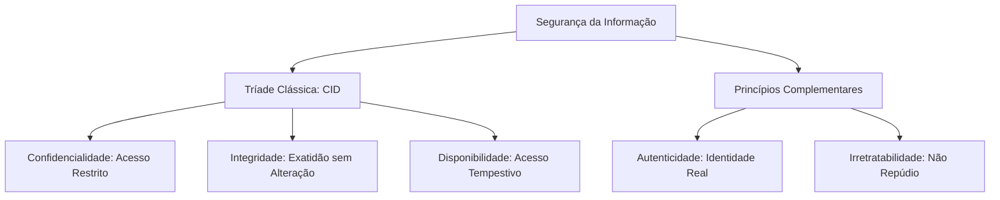
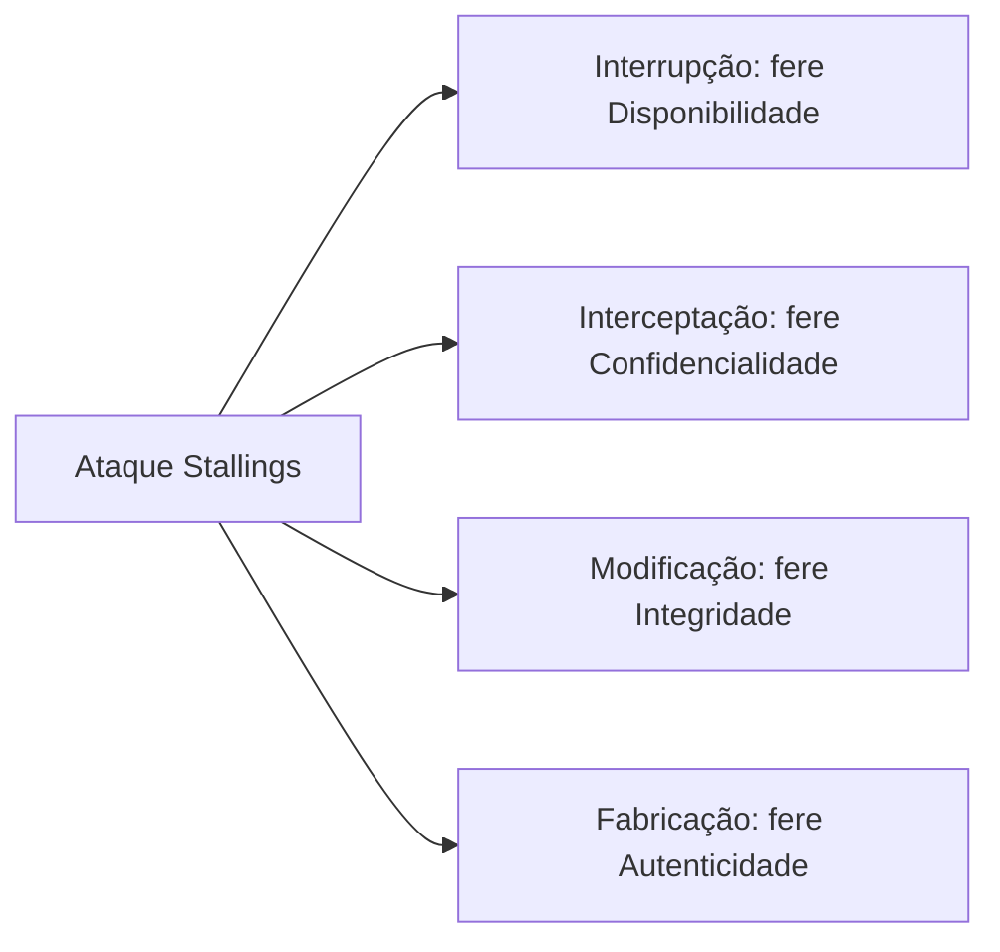

A segurança da informação apoia-se em princípios fundamentais que orientam as políticas de proteção em organizações públicas e privadas. No contexto da atividade policial e dos serviços de bombeiros, a preservação desses pilares assegura que relatórios de inteligência, despachos de viaturas e registros periciais mantenham sigilo legal, exatidão dos fatos apurados e acesso contínuo aos operadores da lei. Compreender cada pilar e suas relações com os vetores de ameaça é essencial para solucionar questões de prova e aplicar defesas eficazes.

> [!objetivos]
> - Dominar os pilares da tríade clássica: Confidencialidade, Integridade e Disponibilidade (CID).
> - Diferenciar confidencialidade de confiabilidade, evitando armadilhas recorrentes em bancas examinadoras.
> - Compreender os princípios complementares de autenticidade, irretratabilidade e o modelo do Hexagrama Parkeriano.
> - Mapear os tipos clássicos de ataques contra cada princípio de segurança violado.

## Princípios Fundamentais: A Tríade CID

A literatura técnica e normas internacionais como a ABNT NBR ISO/IEC 27001 consagram três propriedades essenciais da informação: confidencialidade, integridade e disponibilidade. Essa tríade, conhecida pelo acrônimo CID, constitui o alicerce indispensável de qualquer plano de proteção de dados corporativos.

### Confidencialidade

A confidencialidade é a garantia de que o acesso à informação seja restrito exclusivamente às pessoas, entidades, processos ou sistemas autorizados. Quando um terceiro não autorizado visualiza, copia ou extrai dados protegidos, ocorre a quebra desse princípio.

A analogia tradicional é a de uma correspondência oficial em envelope lacrado. O carteiro tem a custódia do pacote, mas não possui permissão para abrir e ler o teor da mensagem. Se o envelope for aberto e inspecionado, a confidencialidade foi violada, mesmo que nenhuma linha tenha sido alterada.

A confidencialidade vigora em todas as fases do ciclo de vida da informação:

1. **Criação e manipulação**: durante a redação de um inquérito no terminal de trabalho.
2. **Transmissão**: enquanto pacotes trafegam pelas redes locais e pela internet aberta.
3. **Armazenamento**: quando dados repousam em bancos de dados, servidores ou fitas de backup.
4. **Descarte**: no momento da exclusão definitiva ou destruição física do suporte de mídia.

O mecanismo técnico elementar destinado a assegurar a confidencialidade é a criptografia. Ao transformar texto legível em texto cifrado incompreensível, impede-se que terceiros bisbilhoteiros compreendam o conteúdo transmitido. Contudo, a criptografia isolada não assegura disponibilidade nem integridade, exigindo controles de acesso associados.

> [!pegadinha]
> Confidencialidade não se confunde com confiabilidade. A confiabilidade indica a regularidade operacional de um sistema, refletindo sua resistência a falhas técnicas ao longo do tempo. Um sistema de banco de dados pode ser muito confiável por nunca travar, mas desprovido de confidencialidade se exibir dados sigilosos a qualquer visitante anônimo.

| Atributo de Segurança | Foco Principal | Exemplo Prático | Falha Típica |
|---|---|---|---|
| Confidencialidade | Restrição de visualização aos usuários e processos autorizados | Prontuário médico de bombeiro visível apenas ao médico perito | Vazamento de senhas ou envio de relatório para destinatário errado |
| Confiabilidade | Funcionamento estável, contínuo e sem panes lógicas do sistema | Servidor de banco de dados que opera 365 dias sem reiniciar | Queda súbita de energia ou travamento de software por falha de memória |

### Integridade

A integridade é a propriedade que assegura que a informação permaneça exata, completa e protegida contra alterações não autorizadas, sejam elas dolosas ou decorrentes de falhas técnicas. O dado deve retratar com absoluta fidelidade o que foi gerado pelo emissor, preservando formato e contexto originais.

No exemplo da correspondência, a integridade garante que o documento chegue sem rasuras, acréscimos ou substituições. Se um interceptador alterar o valor de uma multa de trânsito de cem reais para mil reais, houve violação flagrante da integridade.

A integridade combate dois tipos de incidentes:

- **Modificações intencionais**: ações de invasores que adulteram registros financeiros ou logs de acesso para obter vantagens ilícitas.
- **Modificações acidentais**: falhas físicas em discos rígidos (bad blocks), ruídos em cabos de rede ou bugs que corrompam campos de um banco de dados.

Os mecanismos tecnológicos aplicados à integridade envolvem funções de dispersão criptográfica (hashes como SHA-256), assinaturas digitais, somas de verificação (checksums) e esquemas de paridade em arranjos de discos (RAID).

> [!bizu]
> Confidencialidade e integridade operam de forma independente. A quebra de um pilar não implica necessariamente a violação do outro. Se um invasor interceptar uma mensagem confidencial e apenas ler seu texto sem mexer em uma vírgula, violou a confidencialidade, mantendo a integridade intacta. Por outro lado, se um operador acidentalmente apagar linhas de uma planilha aberta ao público, violou a integridade sem afetar a confidencialidade.

### Disponibilidade

A disponibilidade assegura que a informação, os sistemas computacionais e os serviços correlatos estejam prontos e acessíveis para uso pelos usuários legítimos sempre que estes demandarem o acesso. Não tem valor prático possuir informações seguras e íntegras se os servidores estiverem fora do ar no momento em que a guarnição necessitar checar mandados de prisão.

O principal vetor de agressão contra a disponibilidade reside nos ataques de Negação de Serviço (DoS) e Negação de Serviço Distribuída (DDoS). Nesses ataques, computadores zumbis sobrecarregam os canais de rede ou os processadores da vítima, tornando as páginas inacessíveis ao público.

A sustentação da disponibilidade requer investimentos em infraestrutura física e lógica:

- **Redundância de hardware**: servidores espelhados em cluster e placas de rede em agregação de enlaces.
- **Fontes ininterruptas de energia**: conjuntos de nobreaks e geradores a diesel capazes de suprir centros de dados durante apagões.
- **Rotinas regulares de backup**: rotinas automatizadas com cópias armazenadas em locais geograficamente distantes, assegurando pronta recuperação após desastres ou ransomware.
- **Sistemas de prevenção**: firewalls com proteção contra enchentes de pacotes e redes de distribuição de conteúdo (CDN).

| Pilar | Definição Canônica | Vetor de Ameaça Típico | Mecanismo de Controle |
|---|---|---|---|
| Confidencialidade | Acesso restrito apenas a entidades e pessoas autorizadas | Espionagem, vazamento de senhas, sniffing de pacotes | Criptografia simétrica e assimétrica, listas de controle de acesso |
| Integridade | Salvaguarda da exatidão e completeza, sem alterações espúrias | Injeção de código, alteração de banco de dados, corrupção física | Funções hash criptográficas, assinaturas digitais, paridade RAID |
| Disponibilidade | Acesso garantido e tempestivo aos recursos pelos autorizados | Ataques de DoS/DDoS, quedas de energia elétrica, ransomware | Nobreaks, rotinas de backup, servidores redundantes, clusters |

## Princípios Adicionais e Extensões Modernas

Conforme as relações sociais e os negócios migraram para o meio virtual, a tríade CID mostrou-se insuficiente para resolver demandas jurídicas e contratuais complexas. Em virtude disso, a doutrina internacional e a legislação brasileira incorporaram atributos adicionais de segurança.

Entre os princípios complementares mais cobrados em provas destacam-se a autenticidade e a irretratabilidade. Além disso, o pesquisador Donn B. Parker formulou o modelo conceitual ampliado conhecido como Hexagrama Parkeriano.

### Autenticidade

A autenticidade é a propriedade que permite assegurar a verdadeira identidade de quem executa uma ação, transmite uma mensagem ou emite um documento eletrônico. O sistema precisa comprovar, sem dúvidas razoáveis, que o emissor é de fato quem afirma ser.

Na rotina administrativa clássica, a autenticidade era buscada pelo reconhecimento de firmas em cartórios de notas. No universo dos computadores, a autenticação baseia-se em fatores de conhecimento (senhas), posse (tokens com chip) e inerência biométrica (leitura de impressões digitais, reconhecimento facial).

A autenticação desdobra-se em duas modalidades fundamentais na comunicação em rede:

- **Autenticação de origem dos dados**: opera em comunicações não orientadas à conexão (sem conexão prévia). O receptor examina o pacote isolado e valida a fonte originária das informações, tipicamente por meio de assinatura digital.
- **Autenticação de entidade par**: ocorre em conexões ativas estabelecidas entre duas estações (com conexão). Os nós participantes do canal realizam um processo mútuo de validação de identidades, como ocorre em sessões protegidas por TLS ou túneis VPN IPsec.

### O Hexagrama Parkeriano

Em resposta às limitações da tríade clássica, Donn B. Parker propôs em 1991 um modelo composto por seis elementos atômicos da segurança da informação. O Hexagrama Parkeriano engloba os atributos clássicos da CID e da autenticidade, somando a eles dois novos pilares: posse ou controle e utilidade.

| Atributo Parkeriano | Significado Conceitual | Cenário Hipotético de Violação |
|---|---|---|
| Posse ou Controle | O domínio físico ou lógico de fato exercido sobre o dispositivo ou ativo | Furto de notebook institucional com disco criptografado. O ladrão não decifra os dados, mas o órgão perdeu a posse do ativo |
| Utilidade | O valor prático, aplicabilidade e compreensibilidade dos dados pelo titular | Um arquivo foi cifrado com chave extraviada ou gravado em formato obsoleto. O dado existe e está íntegro, mas é inútil |

> [!bizu]
> No Hexagrama de Parker, a violação de posse ou controle ocorre mesmo quando a confidencialidade permanece íntegra. Quando um pen drive criptografado com dados de inteligência é perdido em uma operação, o invasor não consegue ler as tabelas. Contudo, a corporação perdeu a posse do ativo, configurando incidente formal de segurança física e patrimonial.

## Irretratabilidade e Não Repúdio

O princípio da irretratabilidade, amplamente denominado como não repúdio ou irrefutabilidade, estabelece que uma entidade não pode negar a autoria de uma operação realizada ou a recepção de uma mensagem transmitida.

Enquanto a confidencialidade e a integridade tratam de salvaguardas técnicas sobre os bits transmitidos, a irretratabilidade possui natureza eminentemente jurídica. O objetivo é produzir provas técnicas inequívocas que sustentem a validade de uma transação perante o Poder Judiciário, impedindo que um usuário alegue fraude de terceiros para escapar de suas obrigações legais.

### A Relação entre Autenticidade, Integridade e Não Repúdio

Frequentemente as bancas indagam se a autenticidade isolada é suficiente para alcançar a irretratabilidade. A resposta técnica é negativa. Uma mensagem pode ter sido autenticada com sucesso no momento de envio, mas se o canal permitir que um intermediário altere o texto no trajeto, o autor poderá alegar com toda a razão que as palavras modificadas não saíram de seu computador.

Dessa constatação decorre a célebre equação doutrinária:

**AUTENTICIDADE + INTEGRIDADE = IRRETRATABILIDADE**

Para que o não repúdio seja alcançado, é indispensável aliar o método de confirmação do emitente à integridade absoluta do conteúdo. A assinatura digital baseada em certificados ICP-Brasil materializa essa simbiose ao assinar o resumo criptográfico do arquivo com a chave privada exclusiva do titular.

> [!atencao]
> As bancas costumam cobrar as duas vertentes do não repúdio:
> 1. **Não repúdio de origem**: o emitente do documento não pode negar ter sido o criador e transmissor do arquivo.
> 2. **Não repúdio de recepção**: o destinatário não pode alegar de má-fé que nunca recebeu a notificação enviada pelo sistema.

## Rastreabilidade, Auditoria e Logs de Segurança

A rastreabilidade, também tratada como auditabilidade, é a capacidade de registrar, auditar e reconstruir com fidelidade cronológica todas as ações executadas sobre ativos computacionais. A pergunta central respondida pela rastreabilidade é: quem realizou qual operação, em qual instante, a partir de qual estação de trabalho e com qual resultado?

Esse mecanismo viabiliza investigações forenses digitais em ocorrências policiais e processos disciplinares internos, possibilitando apontar a autoria de vazamentos ou fraudes em sistemas públicos.

Para que os registros de eventos (logs de auditoria) possuam valor probatório inquestionável perante auditores e juízes, a arquitetura de segurança contempla requisitos severos:

1. **Imutabilidade e integridade dos registros**: os arquivos de log devem operar sob a lógica append-only (somente inclusão). Não se admite edição nem exclusão de linhas históricas. A aplicação de hashes encadeados ou assinaturas em bloco previne manipulações posteriores.
2. **Sincronização temporal precisa**: todas as máquinas e roteadores devem sincronizar seus relógios internos com fontes confiáveis oficiais, utilizando o protocolo NTP (Network Time Protocol). No Brasil, o padrão legal decorre da Hora Legal Brasileira fornecida pelo Observatório Nacional.
3. **Armazenamento segregado e centralizado**: os logs não devem permanecer armazenados unicamente no disco do próprio computador monitorado. Devem ser enviados em tempo real para servidores de log dedicados ou plataformas de SIEM (Security Information and Event Management), acessíveis apenas por administradores de auditoria. Isso impede que um invasor com privilégios de administrador apague suas pegadas após invadir o sistema.
4. **Política de retenção controlada**: guarda segura dos arquivos de registro durante os prazos determinados por lei ou normas setoriais, como os prazos estabelecidos pelo Marco Civil da Internet.

| Requisito Técnico | Finalidade Operacional | Consequência da Ausência |
|---|---|---|
| Sincronização por NTP | Ordenar acontecimentos entre múltiplos equipamentos de rede | Impossibilidade de correlacionar logs de firewalls e servidores |
| Trilha Somente-Leitura (Append-only) | Proteger os arquivos contra alteração ou exclusão arbitrária | O invasor apaga as linhas de seu acesso ilícito |
| Servidor Central SIEM | Concentrar a inteligência de segurança e isolar privilégios operacionais | Perda total de evidências se o servidor violado for formatado |

## Ataques aos Princípios e Classificação de Ameaças: O Desafio Prático

A classificação taxonômica elaborada por William Stallings sintetiza a relação direta entre o fluxo normal de uma transmissão de dados e as quatro categorias fundamentais de ataque. Cada categoria fere de modo direto um dos princípios basilares estudados.

No fluxo regular, o remetente envia pacotes ao destinatário por meio do canal de transmissão, sem percalços. Quando surge uma ação hostil, ocorrem os seguintes cenários:

- **Interrupção**: o recurso do sistema ou o canal de dados é destruído, bloqueado ou tornado indisponível. O tráfego não alcança o destino. Fere frontalmente a **disponibilidade**. Exemplos: corte de cabos, destruição física de servidores ou saturação de rede via DoS.
- **Interceptação**: uma entidade não autorizada consegue acesso visual ou cópia do fluxo de comunicação, sem que o emissor ou o receptor percebam. Fere frontalmente a **confidencialidade**. Exemplos: escuta de pacotes de rede (sniffing), instalação de spyware ou grampo em linhas telefônicas.
- **Modificação**: a entidade não autorizada não apenas intercepta o dado, mas altera seu conteúdo, altera campos de cabeçalho ou reinsere registros corrompidos antes da entrega final. Fere frontalmente a **integridade**. Exemplos: ataque man-in-the-middle alterando dados bancários ou injeção de comandos SQL (SQL injection) que alteram dados em tabelas.
- **Fabricação**: a entidade invasora insere dados falsificados na rede, fingindo ser o emissor legítimo e ludibriando o receptor. Fere frontalmente a **autenticidade**. Exemplos: envio de e-mails com cabeçalhos forjados (spoofing), emissão de requisições web com endereços IP clonados ou propagação de certificados falsos.

| Modalidade de Ataque | Ação Executada pelo Agente Agressor | Princípio Primário Violado | Mecanismo Típico de Defesa |
|---|---|---|---|
| Interrupção | Destruição física, corte de conexão ou saturação de canais | Disponibilidade | Links redundantes, proteção anti-DDoS, nobreaks |
| Interceptação | Captura indevida de tráfego, leitura sem permissão | Confidencialidade | Criptografia ponta a ponta (VPN, TLS, SSH) |
| Modificação | Adulteração do teor do pacote de dados em trânsito | Integridade | Assinatura digital, códigos de autenticação de mensagem (HMAC) |
| Fabricação | Criação de mensagens forjadas atribuídas a terceiros | Autenticidade | Autenticação multifator, certificados ICP-Brasil, SPF/DKIM |

> [!exemplo]
> Durante uma operação de policiamento ostensivo, uma central de despacho recebe chamados falsos sobre acidentes inexistentes, com coordenadas manipuladas para desviar viaturas de áreas de patrulha. Esse incidente configura um ataque de fabricação que viola diretamente a autenticidade dos dados gerados. Se, concomitantemente, os canais de rádio sofrerem interferência contínua por ruído eletromagnético impedindo qualquer comunicação, ocorre um ataque de interrupção violando a disponibilidade.

### Desafio Prático de Análise

Para consolidar o aprendizado, considere as três situações práticas a seguir e identifique o princípio atingido:

1. **Situação 1**: Um operador descarrega um arquivo malicioso que criptografa todos os documentos da estação de trabalho e exige pagamento de resgate para fornecer a chave. O usuário sabe que os dados continuam no disco, mas não consegue abri-los. **Análise**: O incidente afeta a disponibilidade (e a utilidade no modelo Parkeriano), pois o titular está privado do acesso tempestivo às suas informações.
2. **Situação 2**: Um ex-funcionário revoltado acessa a planilha de escalas de serviço e inverte o plantão dos finais de semana entre colegas, salvando o arquivo sem registrar sua identificação. **Análise**: Trata-se de ofensa à integridade dos dados administrativos, acompanhada de prejuízo à rastreabilidade caso o sistema não grave logs detalhados.
3. **Situação 3**: Em uma negociação governamental, a empresa envia proposta assinada com token físico e certificado A3, mas depois sustenta perante o tribunal que nunca elaborou o documento. **Análise**: A contestação é barrada pelo não repúdio (irretratabilidade), decorrente da combinação indissociável entre a integridade do arquivo em PDF e a autenticidade fornecida pela assinatura digital qualificada.

## Mapa do capítulo

### Para fixar

- A tríade clássica da segurança da informação é composta por Confidencialidade, Integridade e Disponibilidade (CID).
- Confidencialidade garante sigilo contra acessos não autorizados; seu mecanismo tecnológico clássico é a criptografia.
- Confiabilidade diz respeito à robustez operacional e estabilidade temporal, conceito que não se confunde com confidencialidade.
- Integridade preserva a exatidão, completeza e fidelidade original das informações, utilizando funções hash e somas de verificação.
- Confidencialidade e integridade são atributos independentes: é plenamente possível violar um mantendo o outro ileso.
- Disponibilidade garante acesso contínuo e tempestivo aos usuários autorizados, exigindo nobreaks, clusters redundantes e rotinas de backup.
- Autenticidade comprova a verdadeira identidade do emissor; quando somada à integridade, produz o efeito jurídico do não repúdio (irretratabilidade).
- O Hexagrama Parkeriano acrescenta à tríade clássica os princípios de Posse ou Controle e Utilidade.
- A classificação de Stallings mapeia os ataques: Interrupção afeta Disponibilidade, Interceptação afeta Confidencialidade, Modificação afeta Integridade e Fabricação afeta Autenticidade.
