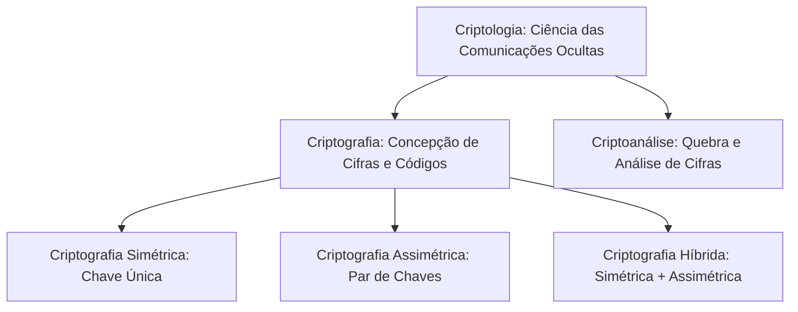
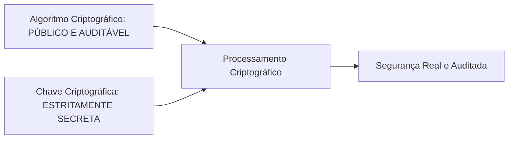
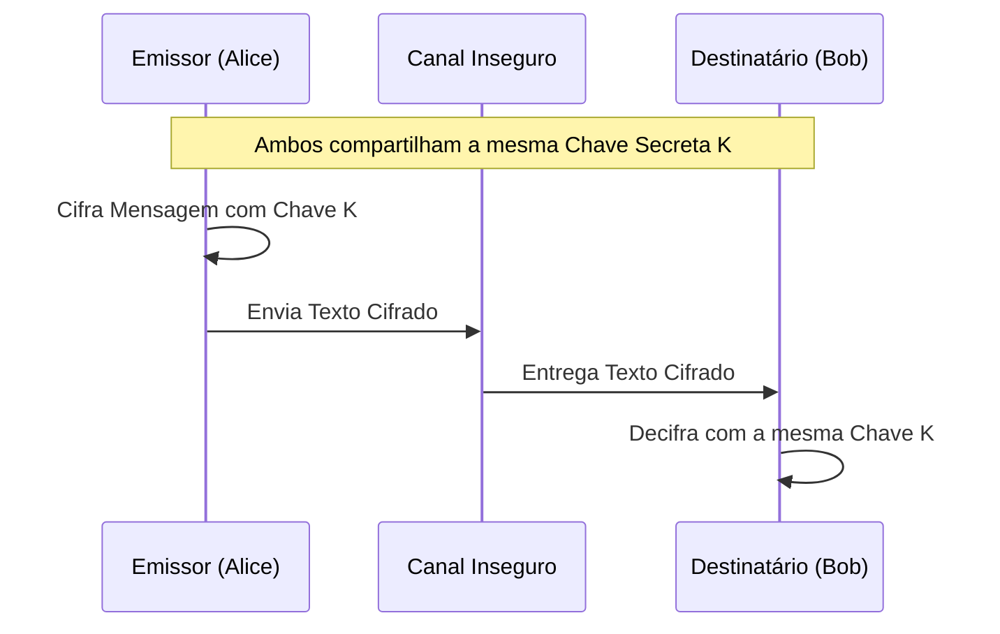
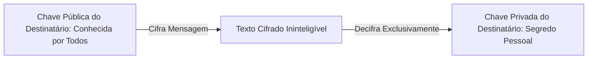
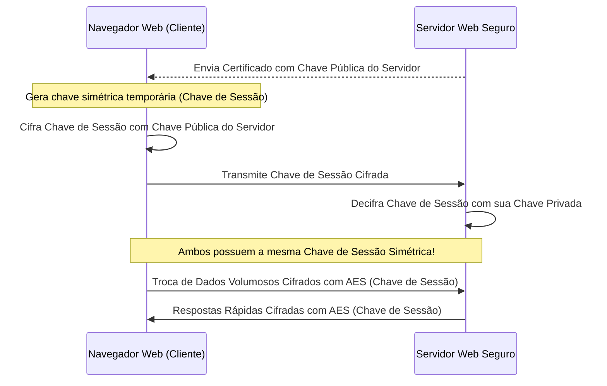
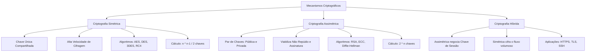

A proteção de dados sigilosos e a garantia de autenticidade documental nas instituições policiais e de emergência exigem o domínio das ciências criptográficas. Seja no envio de mandados de busca e apreensão pelas redes policiais, seja na preservação de laudos periciais eletrônicos, o sigilo das comunicações repousa sobre algoritmos matemáticos complexos. Este capítulo disseca os fundamentos da criptologia, contrastando as técnicas de ocultação de mensagens, o paradigma clássico de chave secreta compartilhada e a revolução matemática da criptografia assimétrica de chaves públicas.

> [!objetivos]
> - Diferenciar os conceitos fundamentais de criptologia, criptografia, criptoanálise e esteganografia.
> - Compreender os mecanismos clássicos de substituição e transposição, bem como o postulado de Kerckhoffs.
> - Dominar a criptografia simétrica: propriedades, desafios de distribuição, cálculo do número de chaves e principais algoritmos.
> - Compreender a criptografia assimétrica: dinâmica do par de chaves pública e privada, propriedades de sigilo e não repúdio.
> - Analisar a arquitetura da criptografia híbrida aplicada em protocolos como TLS e HTTPS.

## RIPTOLOGIA: Fundamentos da Ciência Criptológica

A Criptologia (frequentemente grafada nos manuais históricos e apostilas sob a rubrica RIPTOLOGIA devido à omissão da letra capitular em diagramações antigas) é a ciência abrangente dedicada ao estudo das comunicações secretas e à salvaguarda dos fluxos de dados contra acessos indevidos. O vocábulo tem origem grega: decorre da junção de kryptos (oculto, escondido) e logos (estudo, tratado). Ela subdivide-se em dois ramos teóricos e práticos complementares:

1. **Criptografia**: arte e técnica de transformar uma mensagem legível (texto claro ou texto puro) em uma mensagem cifrada e incompreensível (texto cifrado ou criptograma), de modo que somente os destinatários legítimos que possuam a chave de decifragem correspondente consigam ler o texto original. Codificar e encriptar dados constituem os objetivos centrais deste ramo.
2. **Criptoanálise**: estudo analítico e dedutivo de princípios e técnicas para recuperar o texto claro ou decifrar e decodificar mensagens sem o conhecimento legítimo prévio da chave secreta. Os criptoanalistas procuram vulnerabilidades matemáticas, padrões estatísticos ou falhas operacionais nos algoritmos implementados.

A segurança da informação resulta do confronto contínuo entre criptógrafos e criptoanalistas. Enquanto os criptógrafos concebem cifras para resistir a ataques, os criptoanalistas desenvolvem novas metodologias para quebrar essas defesas.

Um exemplo histórico marcante de criptoanálise ocorreu no século XVI, envolvendo a conspiração contra a rainha Elizabeth I. Conspiradores trocavam cartas cifradas com Maria Stuart, rainha deposta da Escócia mantida confinada sob vigilância na abadia. As cartas eram interceptadas pelos agentes reais de Thomas Phelippes, que conseguiam decodificar cada mensagem secreta. A decodificação dessas cartas comprovou a traição e levou Maria ao cadafalso. Esse fato histórico evidencia como a falha criptográfica pode gerar consequências fatais.

### Esteganografia

A esteganografia visa ocultar a própria existência da comunicação. O termo provém do grego steganos (coberto, protegido) e graphein (escrita). O emissor insere a mensagem secreta no interior de outro arquivo transportador inofensivo, como uma imagem digital, um arquivo de áudio, um vídeo ou textos com espaçamentos sutis. O observador externo que inspeciona o arquivo transportador não desconfia de que há uma mensagem oculta trafegando.

Historicamente, a esteganografia utilizava métodos físicos engenhosos:

- **Tintas invisíveis**: documentos redigidos com substâncias químicas como suco de limão ou leite. A folha parecia em branco; ao ser aquecida sobre uma chama suave, o suco de limão oxidava e a escrita tornava-se perfeitamente visível.
- **Tatuagens no couro cabeludo**: escravos tinham suas cabeças raspadas para receber mensagens confidenciais tatuadas na pele. Esperava-se o cabelo crescer para cobrir o texto; ao chegar ao destino, raspava-se a cabeça novamente para ler a ordem.

Na era digital, a técnica mais difundida é a manipulação dos bits menos significativos (LSB) de imagens digitais. Em um arquivo fotográfico ou ilustração, como em um arquivo gráfico da personagem Kitty (Hello Kitty), cada pixel é composto por canais de cores (vermelho, verde e azul) representados por bytes. O olho humano é incapaz de detectar alterações minúsculas no último bit de um canal de cor. Assim, o especialista substitui esse bit insignificante por um bit da mensagem sigilosa. O arquivo continua exibindo a imagem normal da Kitty, sem distorção visual perceptível, transportando o texto secreto camuflado.

> [!pegadinha]
> Criptografia e esteganografia são frequentemente confundidas em enunciados de concursos. Lembre-se: tornar o texto ininteligível e cifrado é papel da criptografia; camuflar a presença da mensagem dentro de outro suporte sem chamar atenção é prerrogativa da esteganografia. Ambas podem ser combinadas na prática: um agente policial pode criptografar um laudo confidencial e, em seguida, embutir o criptograma dentro de uma foto institucional para transmiti-lo por canal público.

| Critério de Comparação | Criptografia | Esteganografia |
|---|---|---|
| Visibilidade do Canal | A comunicação é visível; todos sabem que uma mensagem foi enviada | A comunicação é dissimulada; terceiros não desconfiam da mensagem |
| Proteção Principal | Conteúdo ininteligível mediante operações matemáticas | Ocultação física ou lógica da existência da mensagem |
| Arquivo Transportador | Dispensável; o texto cifrado é transmitido diretamente | Obrigatório; utiliza imagens, áudios, vídeos ou arquivos de texto |
| Padrão de Detecção | Detectável por análise de pacotes de rede e firewall | Requer perícia estegananalítica em laboratório forense |

> [!atencao]
> A esteganografia digital não altera o tamanho nem as propriedades primárias do arquivo transportador. Se um arquivo de imagem mantiver sua integridade visual, o perito forense precisa comparar distribuições estatísticas de frequência de bits para identificar padrões artificiais que denunciem o payload oculto.

## Criptografia e Criptoanálise: Técnicas Clássicas de Cifragem

A criptografia divide-se didaticamente em dois grandes grupos operacionais: códigos e cifras.

- **Códigos**: baseiam-se na substituição de palavras, termos ou frases inteiras por vocábulos ou símbolos arbitrários pré-definidos em um manual confidencial.
- **Cifras**: consistem em algoritmos sistemáticos que operam no nível de caracteres individuais, letras ou blocos de bits do texto original.

As cifras apoiam-se em duas operações matemáticas clássicas: a substituição e a transposição.

### Cifras de Substituição

Na cifra de substituição, cada caractere, letra ou bloco de bits do texto em claro é trocado por outro caractere, número ou símbolo diferente, respeitando uma regra pré-determinada.

O exemplo clássico é a Cifra de César, utilizada por Júlio César em correspondências militares. Nessa cifra, cada letra do alfabeto original é deslocada em um número fixo de posições adiante. No modelo romano tradicional com chave igual a 3:

- A letra A transforma-se na letra D.
- A letra B transforma-se na letra E.
- A letra C transforma-se na letra F.
- A palavra inglesa "hello" torna-se "khoor".
- A palavra em português "corresponde", ao ser cifrada sob deslocamento de 3 posições, gera exatamente o criptograma "fruuhvsrqgh" (c vira f, o vira r, r vira u, e assim sucessivamente).

Nesse esquema monoalfabético elementar, a chave de cifragem é o número de deslocamentos (chave k = 3). O ponto fraco reside na análise de frequência de caracteres: como a letra A sempre vira D e a letra E sempre vira H, um criptoanalista que examine o texto cifrado pode inferir o mapeamento observando as letras mais repetidas no idioma português.

### Cifras de Transposição

Na cifra de transposição (também denominada permutação), nenhum caractere é alterado ou substituído por outro símbolo. O conjunto de letras do texto original permanece rigorosamente o mesmo, mas a ordem espacial dos caracteres é reordenada de forma estruturada.

Um exemplo prático é a cifra de transposição por colunas. O texto claro é escrito linha por linha dentro de uma grade retangular com determinado número de colunas, e a mensagem cifrada é gerada pela leitura dos caracteres no sentido vertical, coluna por coluna, de acordo com uma ordem alfabética definida por uma palavra-chave.

> [!bizu]
> Em provas de concurso, memorize a regra de distinção:
> - Substituição: altera o valor do caractere, mantendo a sua posição na mensagem.
> - Transposição: altera a posição do caractere, mantendo inalterado o seu valor original.
> Os algoritmos modernos de computador, como o AES e o DES, realizam repetidas rodadas combinando substituição e transposição para garantir difusão e confusão matemáticas.

### O Princípio de Kerckhoffs e a Segurança Computacional

No final do século XIX, o criptógrafo militar holandês Auguste Kerckhoffs formulou regras basilares para sistemas criptográficos. O mais célebre princípio estabelece que a segurança de um sistema criptográfico não deve depender do segredo do algoritmo, mas unicamente do segredo da chave criptográfica.

Esse postulado determina que o projeto dos algoritmos deve ser inteiramente público e aberto ao escrutínio da comunidade científica internacional. O sistema deve continuar seguro mesmo que o adversário conheça todos os detalhes matemáticos, as fórmulas, os diagramas de blocos e o código-fonte do programa.

A premissa da segurança pelo obscurecimento é rejeitada na engenharia de segurança moderna. Algoritmos secretos frequentemente ocultam falhas estruturais grosseiras que são rapidamente exploradas quando o invasor obtém o executável por engenharia reversa.

A solidez de uma cifra pública assenta-se em três pilares:

1. **Força intrínseca do algoritmo**: robustez matemática testada exaustivamente contra ataques analíticos.
2. **Sigilo estrito da chave**: preservação da chave apenas em mãos autorizadas.
3. **Comprimento adequado da chave (em bits)**: tamanho de chave suficiente para inviabilizar ataques de força bruta computacional.

> [!exemplo]
> Durante a Segunda Guerra Mundial, o governo nazista confiava cegamente na máquina eletromecânica Enigma. Os operadores acreditavam que a complexidade do maquinário tornava as mensagens invioláveis. No entanto, os matemáticos aliados chefiados por Alan Turing na estação militar de Bletchley Park construíram a máquina decifradora Bombe. Ao desvendar os procedimentos e as chaves diárias, os aliados liam as ordens do alto-comando alemão com rapidez assombrosa.

Ao avaliar a robustez de uma cifra, a literatura técnica estabelece uma distinção rigorosa entre duas classes de proteção:

- **Segurança Incondicional**: o texto cifrado não contém pistas suficientes para que um criptoanalista recupere a mensagem clara, independentemente de quanto tempo, recursos financeiros ou poder de processamento disponha. O único algoritmo com segurança incondicional comprovada é o One-Time Pad (cifra de chave descartável de Vernam), no qual a chave deve ter o mesmo tamanho do texto, ser verdadeiramente aleatória e jamais reutilizada.
- **Segurança Computacional**: os algoritmos modernos empregados na internet e em sistemas operacionais não são incondicionalmente seguros. Eles são considerados computacionalmente seguros porque o custo financeiro para quebrar a chave por força bruta supera em muito o valor econômico da informação protegida, ou porque o tempo necessário para testar todas as combinações de chaves com os supercomputadores atuais levaria milhares de anos.

## Criptografia Simétrica (Chave Secreta ou Chave Privada)

A criptografia simétrica, também denominada criptografia de chave única, chave secreta, chave convencional ou chave compartilhada, caracteriza-se pela utilização de uma única e idêntica chave para realizar tanto a operação de cifragem quanto a operação de decifragem.

### Vantagens e Limitações da Criptografia Simétrica

A criptografia simétrica é amplamente adotada na proteção de grandes volumes de dados armazenados e em comunicações contínuas de alta velocidade.

**Principais Vantagens**:
- **Desempenho computacional excepcional**: as operações matemáticas de transposição e substituição de bits são extremamente rápidas e consomem pouca memória RAM e pouco ciclo de processador.
- **Eficiência de processamento**: permite cifrar terabytes de bancos de dados em tempo real sem degradar as operações corporativas.
- **Tamanho compacto de chaves**: chaves de 128 bits ou 256 bits no padrão AES oferecem resistência formidável contra ataques de força bruta.

**Principais Limitações e Desafios**:
- **Problema da distribuição de chaves**: como a chave precisa ser conhecida previamente pelo emissor e pelo destinatário, surge o desafio: como entregar a chave secreta ao destinatário sem que ela seja interceptada por criminosos no caminho? Se existisse um canal físico perfeitamente seguro para enviar a chave, não haveria necessidade de cifrar a mensagem original.
- **Escalabilidade e gerenciamento de chaves**: à medida que a organização cresce, o número de chaves secretas necessárias para permitir comunicações privativas ponto a ponto entre pares de colaboradores explode exponencialmente.
- **Ausência de Não Repúdio**: a chave simétrica é rigorosamente idêntica nos dois extremos. Se um documento for gerado com a chave compartilhada, o receptor poderá sustentar que foi o emissor quem produziu o arquivo, e o emissor poderá alegar que foi o próprio receptor quem o redigiu. Não há como distinguir tecnicamente perante um tribunal quem executou a operação de cifragem.

### O Cálculo do Número de Chaves Simétricas

Para que cada par de usuários em uma rede consiga trocar comunicações exclusivas sem que terceiros leiam o conteúdo, é necessário criar uma chave simétrica exclusiva para cada par de interlocutores. Em uma rede contendo n participantes, o número total de chaves secretas individuais distintas necessárias é calculado pela fórmula da combinação simples de n elementos tomados dois a dois:

Quantidade de chaves = n * (n - 1) / 2

| Número de Usuários na Rede (n) | Fórmula de Cálculo | Total de Chaves Simétricas Necessárias |
|---|---|---|
| 2 usuários | 2 * 1 / 2 | 1 chave secreta |
| 5 usuários | 5 * 4 / 2 | 10 chaves secretas |
| 10 usuários | 10 * 9 / 2 | 45 chaves secretas |
| 100 usuários | 100 * 99 / 2 | 4.950 chaves secretas |
| 1.000 usuários | 1.000 * 999 / 2 | 499.500 chaves secretas |

O gerenciamento de quinhentas mil chaves secretas em uma corporação com mil agentes policiais torna o modelo simétrico puro inviável em redes abertas.

### Principais Algoritmos Simétricos

Os algoritmos simétricos dividem-se em cifras de bloco (que processam a informação agrupada em pedaços de tamanho fixo, como blocos de 64 ou 128 bits) e cifras de fluxo (que cifram bit a bit ou caractere a caractere de modo contínuo):

- **DES (Data Encryption Standard)**: cifra de bloco desenvolvida pela IBM na década de 1970. Opera com blocos de 64 bits e utiliza chave nominal de 64 bits, dos quais 8 bits atuam apenas como verificação de paridade, resultando em chave efetiva de míseros 56 bits. Atualmente é considerada obsoleta e insegura, tendo sido quebrada por força bruta em poucas horas por equipamentos comerciais dedicados.
- **3DES (Triple DES)**: criado para prolongar a vida útil do DES sem mudar o hardware instalado. Aplica o algoritmo DES por três etapas sucessivas (cifrar com chave 1, decifrar com chave 2 e cifrar com chave 3), utilizando chaves efetivas de 112 ou 168 bits. Embora muito mais resistente que o DES original, seu processamento é lento e seus blocos pequenos de 64 bits o tornam desfavorável para aplicações modernas.
- **AES (Advanced Encryption Standard)**: padrão oficial de criptografia simétrica adotado pelo NIST em 2001 para substituir o DES. Baseia-se no algoritmo Rijndael, concebido pelos matemáticos Joan Daemen e Vincent Rijmen. Opera com blocos de tamanho fixo de 128 bits e suporta três tamanhos de chaves: 128 bits, 192 bits e 256 bits. É o padrão dominante em segurança governamental e militar no mundo, sem nenhuma vulnerabilidade estrutural conhecida.
- **RC4 (Rivest Cipher 4)**: cifra de fluxo desenhada por Ron Rivest em 1987. Célebre pela facilidade de implementação em software e por ter sido adotada em protocolos legados como o WEP e o WPA em redes Wi-Fi, e nas primeiras versões do SSL. Possui falhas no gerador pseudoaleatório e encontra-se banida e descontinuada em padrões modernos de rede.
- **Blowfish e Twofish**: cifras de bloco criadas por Bruce Schneier. O Blowfish opera com blocos de 64 bits e chaves flexíveis de 32 a 448 bits. O Twofish opera com blocos de 128 bits e chaves de até 256 bits, mantendo-se como alternativa de domínio público isenta de royalties.
- **IDEA (International Data Encryption Algorithm)**: cifra de bloco de 64 bits com chave de 128 bits, muito utilizada no software de correio eletrônico seguro PGP (Pretty Good Privacy).

## Criptografia Assimétrica (Chave Pública)

Em 1976, os pesquisadores Whitfield Diffie e Martin Hellman publicaram o estudo que revolucionou a disciplina, solucionando de forma definitiva o problema milenar da distribuição segura de chaves sem necessidade de canal físico prévio. Nascia o conceito de criptografia de chave pública ou criptografia assimétrica.

No paradigma assimétrico, não existe uma única chave compartilhada. Cada usuário possui um par de chaves complementares associadas matematicamente:

- **Chave Pública**: pode e deve ser amplamente divulgada, publicada na internet, gravada em diretórios públicos ou impressa em documentos. É utilizada por qualquer interlocutor para cifrar mensagens destinadas ao titular ou para validar a assinatura digital produzida por ele.
- **Chave Privada**: de uso exclusivo, personalíssimo e sigiloso de seu proprietário. Deve permanecer armazenada com extrema segurança em cartões inteligentes criptográficos, tokens de hardware ou cofres digitais. Jamais deve ser compartilhada ou transferida para terceiros.

A relação matemática entre as chaves é unidirecional: o que uma chave do par cifra, somente a outra chave correspondente do mesmo par consegue decifrar. Além disso, é computacionalmente inviável deduzir a chave privada a partir do conhecimento da chave pública correspondente.

> [!bizu]
> Uma analogia consagrada para entender o par de chaves assimétricas é a do cadeado aberto:
> Imagine que Bob fabrica centenas de cadeados idênticos e os distribui abertos para qualquer pessoa interessada. Qualquer pessoa pode pegar um cadeado de Bob, colocar uma carta secreta dentro de uma caixa de ferro e trancar a caixa com o cadeado de Bob simplesmente apertando a haste. O cadeado aberto representa a chave pública. Uma vez fechado o cadeado, ninguém mais consegue abri-lo, nem mesmo quem colocou a carta na caixa. Apenas Bob, que guardou no bolso a única chave metálica física correspondente àquele lote de cadeados (a chave privada), conseguirá abrir o cadeado e ler a mensagem.

### Propriedades da Criptografia Assimétrica: Quem Cifra e Quem Decifra?

A finalidade de segurança alcançada pela criptografia assimétrica varia conforme a chave empregada na fase de cifragem:

**Operação 1: Cifrar com a Chave Pública do Destinatário (Garante Confidencialidade)**

Quando Alice deseja enviar uma mensagem sigilosa para Bob:

1. Alice obtém a chave pública de Bob em um repositório institucional confiável.
2. Alice cifra o documento com a chave pública de Bob.
3. A mensagem cifrada viaja pela rede. Mesmo que invasores capturem os pacotes, não conseguirão ler o texto, pois nem mesmo Alice consegue decifrar o que acabou de criar.
4. Ao receber o criptograma, Bob utiliza a sua própria chave privada (que somente ele conhece) para decifrar a mensagem.
5. **Resultado obtido**: garantia de **confidencialidade (sigilo)**. Contudo, essa operação isolada não garante autenticidade, já que qualquer cidadão na posse da chave pública de Bob poderia ter produzido e enviado o arquivo.

**Operação 2: Cifrar com a Chave Privada do Emissor (Garante Autenticidade e Não Repúdio)**

Quando o comandante da operação precisa expedir uma ordem oficial para as guarnições policiais:

1. O emissor cifra o documento (ou o resumo criptográfico dele) utilizando a sua chave privada exclusiva.
2. As guarnições recebem o arquivo e utilizam a chave pública do emissor (que todos conhecem) para decifrar o conteúdo.
3. Se a decifragem for bem-sucedida, resta comprovado que a mensagem partiu de fato do titular da chave privada, pois nenhuma outra chave do mundo conseguiria fazer a chave pública dele funcionar.
4. **Resultado obtido**: garantia de **autenticidade** e, somada à verificação de integridade, garantia de **não repúdio (irretratabilidade)**. Ressalte-se que essa operação não proporciona sigilo (confidencialidade), uma vez que qualquer pessoa que disponha da chave pública do comandante poderá ler a ordem expedida.

> [!pegadinha]
> Esta regra é cobrada intensamente em bancas examinadoras:
> - Cifrar com a **chave pública do destinatário** = preserva a **CONFIDENCIALIDADE**.
> - Cifrar com a **chave privada do remetente** = preserva a **AUTENTICIDADE / NÃO REPÚDIO**.
> Se a questão afirmar que "o emitente cifrou o documento com a sua própria chave pública para manter sigilo", o item está incorreto!

| Ação Executada | Chave Empregada | Propriedade Assegurada | Propriedade Ausente |
|---|---|---|---|
| Proteger Segredo | Chave pública do destinatário | Confidencialidade | Autenticidade do remetente |
| Provar Autoria | Chave privada do emitente | Autenticidade e Não Repúdio | Confidencialidade (todos leem) |

### Gerenciamento de Chaves Assimétricas

Ao contrário do modelo simétrico, o paradigma de chave pública simplifica enormemente a gestão em redes corporativas. Em um ecossistema com n participantes, cada indivíduo gera apenas um par de chaves (uma pública e uma privada).

Quantidade de chaves = 2 * n

Em uma corporação policial com 1.000 oficiais:
- No modelo simétrico: seriam necessárias 499.500 chaves secretas compartilhadas.
- No modelo assimétrico: são necessárias apenas 2.000 chaves no total (1.000 públicas disponibilizadas no catálogo e 1.000 privadas guardadas pelos respectivos donos).

### Principais Algoritmos Assimétricos

- **RSA (Rivest, Shamir e Adleman)**: algoritmo assimétrico criado em 1977 no MIT. Baseia-se na dificuldade matemática da fatoração de números inteiros gigantescos resultantes do produto de dois primos enormes. É amplamente empregado na internet para cifragem de dados, negociação de chaves e assinaturas digitais, utilizando chaves de 2048 ou 4096 bits.
- **Diffie-Hellman (DH)**: primeiro protocolo prático de intercâmbio de chaves públicas, concebido em 1976. Não é voltado para cifragem direta de documentos nem para assinaturas digitais; sua finalidade específica é permitir que duas partes desconhecidas estabeleçam uma chave simétrica compartilhada segura sobre um canal desprotegido, apoiando-se no problema matemático do logaritmo discreto.
- **DSA (Digital Signature Algorithm)**: padrão federal de assinatura digital adotado pelo NIST em 1991. Projetado exclusivamente para prover assinaturas digitais, não sendo aplicado na cifragem de dados confidenciais.
- **ECC (Elliptic Curve Cryptography - Criptografia de Curvas Elípticas)**: fundamenta-se nas propriedades algébricas de curvas elípticas sobre corpos finitos. Proporciona o mesmo nível de blindagem criptográfica que o RSA utilizando tamanhos de chaves consideravelmente menores. Por exemplo, uma chave ECC de 256 bits confere proteção comparável a uma chave RSA de 3072 bits, consumindo muito menos processamento, tornando-se ideal para celulares, tokens e dispositivos portáteis.
- **ElGamal**: sistema assimétrico baseado no logaritmo discreto em corpos finitos, precursor conceitual do DSA.

| Categoria do Parâmetro | Criptografia Simétrica | Criptografia Assimétrica |
|---|---|---|
| Chaves Utilizadas | Uma única chave compartilhada (secreta) | Par de chaves correlacionadas (pública e privada) |
| Velocidade de Processamento | Extremamente rápida (alto desempenho) | Lenta computacionalmente (até 100x mais lenta) |
| Tamanho Típico de Chaves | 128, 192 ou 256 bits (AES) | 2048 ou 4096 bits (RSA) / 256 bits (ECC) |
| Escalabilidade de Chaves | n * (n - 1) / 2 chaves na rede | 2 * n chaves na rede |
| Não Repúdio (Irretratabilidade) | Não proporciona | Proporciona via assinatura digital com chave privada |
| Distribuição da Chave | Complexa; requer canal seguro inicial | Simples; chave pública pode circular abertamente |
| Principais Algoritmos | AES, DES, 3DES, RC4, Blowfish, IDEA | RSA, ECC, Diffie-Hellman, DSA, ElGamal |

## Criptografia Híbrida: A Solução de Alta Performance na Internet

Ao comparar os dois paradigmas, surge um dilema técnico evidente:
- A criptografia simétrica é muito rápida, mas sofre com o problema da troca segura da chave secreta.
- A criptografia assimétrica resolve perfeitamente a entrega da chave em canais abertos, mas é computacionalmente pesada e impraticável para cifrar grandes volumes de arquivos em tempo real.

A engenharia de redes resolveu esse conflito unindo o melhor de cada mundo em um arranjo engenhoso denominado **criptografia híbrida**.

A criptografia híbrida é a base arquitetural dos protocolos mais seguros da internet contemporânea, como o TLS/SSL (utilizado nas conexões HTTPS do navegador), o protocolo SSH (usado em conexões administrativas remotas) e as redes virtuais privadas IPsec VPN.

### O Funcionamento da Criptografia Híbrida

O procedimento divide-se em duas etapas consecutivas:

1. **Fase de Negociação Inicial (Assimétrica)**: o cliente conecta-se ao servidor web e recebe o certificado digital do sítio com a chave pública do servidor. O cliente gera aleatoriamente no seu navegador uma chave simétrica temporária e volátil, denominada **chave de sessão**. Em seguida, o cliente cifra essa chave de sessão com a chave pública do servidor e a transmite pela rede. Somente o servidor, detentor da respectiva chave privada, consegue decifrar e obter a chave de sessão.
2. **Fase de Tráfego de Dados (Simétrica)**: a partir do momento em que cliente e servidor compartilham a chave de sessão de forma segura, o algoritmo assimétrico é desligado. Todo o fluxo volumoso de navegação (páginas HTML, formulários, vídeos, transferências bancárias) passa a ser cifrado exclusivamente por um algoritmo simétrico ultrarrápido (como o AES-256) utilizando a chave de sessão acordada.

Ao término da navegação, a chave de sessão é descartada de forma definitiva da memória dos equipamentos, impedindo ataques retrospectivos.

> [!resolvido]
> Questão de Concurso: Em uma corporação com 20 delegados de polícia, planeja-se adotar criptografia para comunicações individuais seguras entre quaisquer pares de delegados. Quantas chaves devem ser gerenciadas se for adotado (I) um sistema puramente simétrico e (II) um sistema puramente assimétrico?
> **Resolução Passo a Passo**:
> 1. Para o sistema simétrico: aplica-se a fórmula de combinação simples n * (n - 1) / 2. Sendo n = 20, temos: 20 * 19 / 2 = 380 / 2 = 190 chaves secretas distintas.
> 2. Para o sistema assimétrico: aplica-se a regra de par de chaves por participante, ou seja, 2 * n chaves. Sendo n = 20, temos: 2 * 20 = 40 chaves no total (20 chaves públicas e 20 chaves privadas).
> **Conclusão**: O sistema simétrico demandaria 190 chaves, enquanto o sistema assimétrico exige apenas 40 chaves, evidenciando a superioridade da criptografia de chave pública no gerenciamento em redes corporativas.

## Mapa do capítulo

### Para fixar

- A criptologia reúne a criptografia (concepção de cifras) e a criptoanálise (estudo da quebra de textos cifrados).
- A esteganografia camufla a própria existência da mensagem em outro arquivo transportador; a criptografia torna o texto ininteligível.
- A cifra de substituição altera o valor do caractere; a cifra de transposição altera apenas a posição dos caracteres.
- O princípio de Kerckhoffs estabelece que a segurança reside unicamente no sigilo e comprimento da chave, devendo os algoritmos serem públicos.
- A criptografia simétrica utiliza uma única chave compartilhada, processa em altíssima velocidade (AES), mas exige n * (n - 1) / 2 chaves e não garante não repúdio.
- O padrão AES opera com blocos de 128 bits e suporta chaves de 128, 192 e 256 bits, superando o legado DES.
- A criptografia assimétrica utiliza um par de chaves matematicamente correlacionadas (pública e privada) e exige 2 * n chaves.
- Cifrar com a chave pública do destinatário assegura a confidencialidade da mensagem; cifrar com a chave privada do remetente assegura a autenticidade e o não repúdio.
- A criptografia híbrida combina os dois modelos: a criptografia assimétrica troca a chave de sessão temporária e a criptografia simétrica cifra todo o tráfego velozmente.
