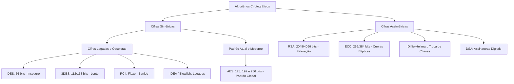
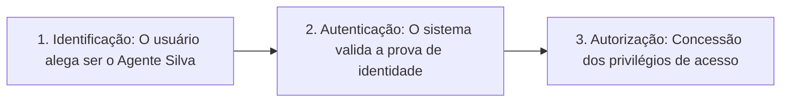
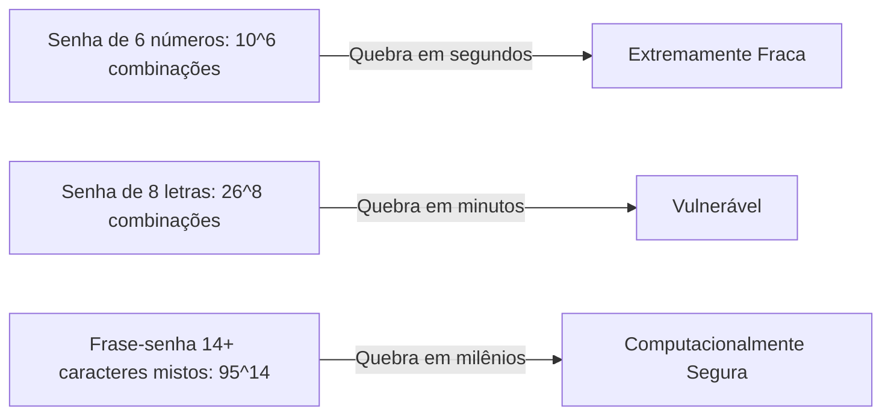
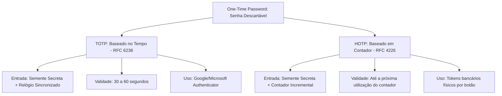
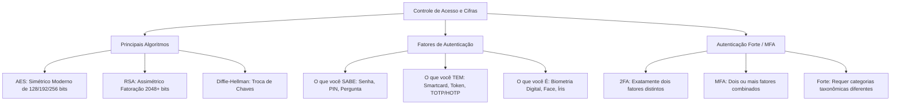

A consolidação de perímetros lógicos seguros nas corporações policiais e de bombeiros exige a escolha judiciosa de cifras robustas e mecanismos intransponíveis de identificação de usuários. O controle de acesso a bancos de dados de mandados de prisão, boletins de ocorrência e despachos operacionais depende da validação inequívoca de identidade. Este capítulo analisa os principais algoritmos simétricos e assimétricos consolidados na indústria, examina a taxonomia dos fatores de autenticação e detalha a arquitetura de autenticação forte e multifator (MFA).

> [!objetivos]
> - Comparar a robustez, tamanho de chaves e aplicabilidade dos principais algoritmos simétricos e assimétricos.
> - Compreender a autenticidade e dominar a tríade de fatores de autenticação: conhecimento intelectual memorizado, posse material do dispositivo e inerência biométrica corporal.
> - Analisar a anatomia dos ataques de força bruta contra senhas e as práticas recomendadas de higiene de credenciais.
> - Explorar os mecanismos de posse: smartcards, tokens físicos e protocolos de senhas descartáveis (TOTP e HOTP).
> - Diferenciar autenticação em dois fatores (2FA), autenticação multifator (MFA) e autenticação forte.

## Principais Algoritmos Criptográficos

O ecossistema de segurança da informação disponibiliza diversas cifras desenvolvidas ao longo de décadas de evolução matemática. A escolha do algoritmo adequado deve ponderar a sensibilidade da informação protegida, o tempo de vida útil do dado sigiloso e a capacidade computacional dos equipamentos envolvidos.

### O Legado Simétrico: Do DES ao Obsoleto RC4

Durante as décadas de 1970 a 1990, diversas cifras simétricas foram concebidas e padronizadas, mas a maioria sucumbiu ao avanço do poder de processamento computacional:

- **DES (Data Encryption Standard)**: desenvolvido pela IBM e oficializado pelo governo norte-americano em 1977. Opera com blocos de 64 bits e utiliza chaves de 64 bits, sendo 8 bits reservados para controle de paridade. Esse cenário resulta em chave efetiva de apenas 56 bits. Com o surgimento de processadores paralelos e placas de vídeo (GPUs), o espaço de busca de 2 elevado a 56 chaves tornou-se minúsculo. Em 1998, a organização EFF construiu uma máquina dedicada (Deep Crack) que quebrou uma mensagem DES em menos de 56 horas. Hoje, computadores comerciais realizam essa tarefa em poucos minutos, tornando o DES totalmente inseguro.
- **3DES (Triple DES)**: criado para aproveitar os equipamentos compatíveis com o DES sem substituição de hardware. Executa a sequência cifrar-decifrar-cifrar (EDE) utilizando duas ou três chaves independentes. Isso resulta em chaves efetivas de 112 ou 168 bits. Embora resistente à força bruta clássica, sofre com blocos de 64 bits (vulnerável a ataques de colisão em tráfego intenso) e possui lentidão excessiva de execução em software.
- **RC4 (Rivest Cipher 4)**: cifra de fluxo desenhada por Ron Rivest. Célebre por sua extrema simplicidade e velocidade em software, foi amplamente empregada nas primeiras versões do SSL e no algoritmo WEP de redes Wi-Fi. No entanto, criptoanalistas demonstraram vieses probabilísticos severos nos primeiros bytes do fluxo pseudoaleatório gerado pela cifra. Esse processo viabiliza a recuperação da chave. Por essa razão, o RC4 foi formalmente banido pelo RFC 7465 em conexões TLS e é considerado obsoleto.
- **IDEA e Blowfish**: cifras de bloco concebidas como alternativas ao DES. O IDEA opera com chave de 128 bits e blocos de 64 bits, famoso por sua adoção no pacote PGP original. O Blowfish, desenvolvido por Bruce Schneier, utiliza blocos de 64 bits e chaves flexíveis de 32 a 448 bits. Ambos mantêm solidez matemática contra ataques teóricos, mas perderam espaço para o padrão AES.

### O Padrão Contemporâneo: AES (Advanced Encryption Standard)

Em 2001, após concurso público internacional promovido pelo NIST ao longo de quatro anos, o algoritmo belga Rijndael foi selecionado para se tornar o padrão global AES (FIPS PUB 197). 

O AES destaca-se por atributos técnicos superiores:
- Opera sobre blocos de tamanho fixo de 128 bits, imunes a ataques baseados em blocos curtos de 64 bits.
- Suporta nativamente três tamanhos de chaves criptográficas: 128 bits (executando 10 rodadas de transformação), 192 bits (12 rodadas) e 256 bits (14 rodadas).
- Apresenta execução ultrarrápida tanto em software puro quanto em hardware dedicado. Os processadores modernos da Intel e AMD contam com instruções integradas de silício (AES-NI) que processam a cifra sem sobrecarregar a CPU.
- Até o momento presente, nenhum ataque analítico conseguiu quebrar o AES; a única forma conhecida de ataque é a busca por força bruta em todo o espaço de chaves. Esse cenário é impraticável perante as leis da física computacional moderna.

### O Universo Assimétrico: RSA, Curvas Elípticas e Diffie-Hellman

No domínio de chave pública, a distinção entre os algoritmos apoia-se no problema matemático adotado:

- **RSA**: fundamenta-se na dificuldade intrínseca de decompor em fatores primos um número inteiro composto de milhares de bits. O RSA presta-se tanto para encriptar pequenos volumes de dados quanto para produzir assinaturas digitais. Em virtude do crescimento computacional, as normas técnicas desaconselham chaves de 1024 bits, exigindo chaves mínimas de 2048 bits ou 4096 bits para conformidade governamental.
- **ECC (Criptografia de Curvas Elípticas)**: baseia-se na aritmética de curvas algébricas em corpos finitos. Representa a vanguarda da criptografia assimétrica moderna. Isso ocorre porque entrega resistência equivalente à do RSA com frações diminutas do tamanho da chave. Uma chave ECC de 256 bits confere a mesma margem protetiva que uma chave RSA de 3072 bits, consumindo muito menos memória e largura de banda, sendo indispensável em dispositivos móveis, cartões inteligentes e conexões de internet das coisas.
- **Diffie-Hellman (DH)**: criado em 1976, é um protocolo de intercâmbio de chaves baseado no logaritmo discreto. O Diffie-Hellman não cifra textos claros nem gera assinaturas digitais. Sua missão única é permitir que dois interlocutores gerem uma chave simétrica de sessão compartilhada através de uma rede desprotegida, sem que nenhum invasor que escute a conversa consiga calcular a chave resultante.

| Algoritmo Criptográfico | Categoria Operacional | Tamanho de Chave Típico | Estado de Segurança e Aplicação |
|---|---|---|---|
| DES | Simétrico (Bloco de 64 bits) | 56 bits efetivos | Obsoleto e inseguro; vulnerável a força bruta |
| 3DES | Simétrico (Bloco de 64 bits) | 112 ou 168 bits | Legado em fase de descontinuação; lento |
| AES | Simétrico (Bloco de 128 bits) | 128, 192 ou 256 bits | Padrão dominante global; seguro e veloz |
| RC4 | Simétrico (Fluxo de bits) | 40 a 2048 bits | Banido e obsoleto; falhas estruturais no fluxo |
| Blowfish | Simétrico (Bloco de 64 bits) | 32 a 448 bits | Seguro, mas superado pelo padrão AES |
| RSA | Assimétrico (Fatoração prima) | 2048 a 4096 bits | Padrão consolidado para certificados e assinaturas |
| ECC | Assimétrico (Curvas elípticas) | 256 a 384 bits | Moderno; altíssima segurança com chaves compactas |
| Diffie-Hellman | Assimétrico (Logaritmo discreto) | 2048+ bits (ou curvas) | Estabelecimento de chaves; não realiza cifragem direta |

> [!pegadinha]
> Fique alerta com afirmativas que atribuem funções incorretas ao protocolo Diffie-Hellman. O Diffie-Hellman **não** é utilizado para criptografar documentos nem para assinar contratos digitais! A sua finalidade exclusiva é o intercâmbio seguro de parâmetros matemáticos para derivar uma chave simétrica compartilhada sobre meio inseguro.

## UTENTICIDADE: Conceito e Princípios de Validação de Identidade

A autenticidade (termo frequentemente referenciado em catálogos e provas como UTENTICIDADE em decorrência de cortes tipográficos em títulos capitulares) é a propriedade de segurança que garante que uma entidade, mensagem ou transação procede de fato da origem declarada, correspondendo à identidade real afirmada.

Em qualquer sistema informatizado, o processo de controle de acesso divide-se em três etapas lógicas sucessivas e interdependentes:

1. **Identificação**: o usuário alega quem ele é perante o sistema, fornecendo um identificador público, como nome de usuário (username), CPF, matrícula funcional ou endereço de e-mail.
2. **Autenticação**: o sistema exige que o usuário apresente provas irrefutáveis de que ele realmente é o titular da identidade declarada.
3. **Autorização**: uma vez autenticado, o sistema consulta as matrizes de permissão para determinar quais pastas, bancos de dados e programas aquele usuário tem direito de acessar.

### A Taxonomia dos Fatores de Autenticação

Para comprovar a identidade perante o sistema, a ciência da computação agrupa os métodos de autenticação em três categorias canônicas fundamentais:

- **Fator de Conhecimento (O que você SABE)**: apoia-se em informações secretas armazenadas exclusivamente na memória mental do titular.
- **Fator de Posse (O que você TEM)**: baseia-se na posse física ou lógica de um objeto material, dispositivo eletrônico ou certificado sob custódia do titular.
- **Fator de Inerência (O que você É)**: baseia-se em características biológicas, físicas ou comportamentais intrínsecas e indissociáveis do corpo humano do titular.

| Categoria do Fator | Mecanismo Central | Exemplos Típicos de Aplicação | Vulnerabilidade Principal |
|---|---|---|---|
| O que você SABE | Informação mental memorizada | Senha alfanumérica, PIN numérico, pergunta secreta | Esquecimento, ataques de dicionário, phishing, força bruta |
| O que você TEM | Dispositivo sob posse física | Cartão com chip, token USB, celular, smartcard | Furto físico, roubo, perda do aparelho, clonagem de chip |
| O que você É | Medição biológica única | Impressão digital, leitura de íris, face, geometria da mão | Falhas de sensor, falsos positivos/negativos, cirurgias |

## Fator de Conhecimento: O que você sabe?

O fator de conhecimento é o método de validação de acesso mais disseminado no planeta desde os primórdios da computação, mas representa também o elo mais vulnerável da cadeia de segurança corporativa.

### Senhas e Ataques de Força Bruta

Uma senha consiste em uma sequência confidencial de caracteres que o usuário digita para comprovar sua identidade. A fragilidade das senhas decorre do comportamento humano: usuários tendem a escolher senhas curtas, previsíveis e associadas a datas de nascimento, nomes de familiares, placas de viaturas ou palavras do dicionário.

Os invasores exploram senhas por meio de três técnicas automatizadas principais:

- **Ataque de Força Bruta (Brute Force)**: o invasor testa exaustivamente todas as combinações matemáticas possíveis de caracteres até encontrar a chave correta. O tempo necessário para esgotar o espaço de combinações depende do conjunto de caracteres e do comprimento da senha:
  - Uma senha numérica de 6 dígitos (como um PIN bancário) possui apenas 1 milhão de combinações (10 elevado a 6), sendo testada em milissegundos por um programa básico.
  - Uma senha de 8 caracteres contendo apenas letras minúsculas (26 elevado a 8) possui cerca de 208 bilhões de combinações, que são quebradas em poucos segundos por placas gráficas modernas.
  - Uma senha complexa de 12 caracteres misturando letras maiúsculas, minúsculas, dígitos e símbolos especiais (95 elevado a 12) resulta em mais de 5,4 sextilhões de combinações, exigindo séculos de processamento computacional para quebra direta.
- **Ataque de Dicionário**: o software invasor testa palavras pré-compiladas de vocabulários formais, listas de gírias e bases de dados de bilhões de senhas vazadas em incidentes anteriores (como listas do tipo RockYou). É muito mais rápido que a força bruta pura. Isso ocorre porque humanos raramente escolhem combinações puramente aleatórias.
- **Phishing e Engenharia Social**: o criminoso ludibria o usuário por e-mails ou páginas falsas, induzindo-o a digitar voluntariamente sua senha corporativa em formulários controlados por terceiros.

### O Número de Identificação Pessoal (PIN)

O PIN (Personal Identification Number) é uma modalidade específica de senha composta exclusivamente por dígitos numéricos, concebida originalmente para facilitar a entrada de dados em teclados reduzidos de caixas eletrônicos (ATMs) e terminais de ponto de venda (POS).

Em virtude de seu reduzido espaço combinatório, o PIN jamais deve ser utilizado como controle único em redes abertas. Sua segurança viabiliza-se na prática por meio de dois controles protetivos rigorosos:
- Limite estrito de tentativas consecutivas com bloqueio automático do cartão ou terminal após três erros.
- Associação mandatória a um elemento físico de posse (como o chip do cartão de débito). Esse arranjo transforma a operação em validação combinada.

### Perguntas de Segurança

Muitos sistemas legados adotam perguntas de segurança ("qual o nome de solteira de sua mãe?", "qual o nome de seu primeiro animal de estimação?") como mecanismo de recuperação de credenciais esquecidas.

A doutrina de segurança contemporânea condena o uso isolado de perguntas secretas. Com a proliferação de redes sociais, as respostas a essas indagações tornaram-se públicas ou facilmente dedutíveis por engenharia social. Além disso, variações ortográficas e erros de acentuação frequentemente bloqueiam usuários legítimos. As perguntas secretas devem atuar apenas como verificação secundária e complementar, jamais como fator autônomo de login.

> [!atencao]
> As senhas de uso único geradas por aplicativos não dependem de sinal telefônico. O segredo inicial é transmitido via leitura de imagem codificada. A partir dessa etapa, a sincronização apoia-se unicamente no relógio interno do aparelho.

## Fator de Inerência: O que você é? (Biometria)

O termo biometria decorre do grego bio (vida) e metron (medida), significando a mensuração estatística e automatizada de características biológicas e comportamentais exclusivas de um indivíduo.

A biometria assegura o princípio da autenticidade com grande eficácia. As características biométricas são inerentes ao organismo humano. Elas não podem ser esquecidas como senhas nem extraviadas como crachás.

As modalidades biométricas dividem-se em dois ramos:

- **Biometria Fisiológica**: baseada em traços anatômicos e biológicos estáveis do organismo:
  - *Impressão Digital (Datiloscopia)*: análise dos pontos característicos (minúcias) das cristas papilares dos dedos. Apresenta excelente custo-benefício e ampla aceitação jurídica e operacional nas forças de segurança.
  - *Reconhecimento Facial*: mapeamento da distância entre olhos, largura do nariz e profundidade dos ossos da face. Muito utilizado em vigilância pública, mas suscetível a variações de iluminação, envelhecimento e disfarces físicos.
  - *Leitura de Íris*: exame da estrutura muscular e cromática do anel colorido da íris ocular. Trata-se de uma das biometrias mais precisas do mundo, mantendo estabilidade ao longo de toda a vida adulta.
  - *Escaneamento de Retina*: leitura do padrão dos vasos sanguíneos no fundo do globo ocular. Apresenta precisão extrema, mas exige proximidade física desconfortável do sensor com os olhos do usuário.
  - *Geometria da Mão e Vascular*: análise dimensional dos dedos ou leitura por infravermelho dos vasos sanguíneos subcutâneos na palma da mão.
- **Biometria Comportamental**: mensura ações executadas pelo indivíduo:
  - *Reconhecimento de Voz*: análise do timbre vocal e ressonância da laringe.
  - *Dinâmica de Digitação*: mensuração da velocidade, ritmo e pressão exercida sobre as teclas durante a digitação no teclado do computador.
  - *Assinatura Dinâmica*: monitoramento da velocidade, aceleração e pressão da caneta digital ao assinar na tela.

> [!bizu]
> Os sistemas biométricos não são infalíveis. Eles operam com taxas probabilísticas de erro:
> - **FRR (False Rejection Rate - Taxa de Falsa Rejeição)**: o sistema nega o acesso a um usuário legítimo (erro do Tipo I). Causa transtornos operacionais.
> - **FAR (False Acceptance Rate - Taxa de Falsa Aceitação)**: o sistema autoriza indevidamente a entrada de um impostor (erro do Tipo II). Representa brecha grave de segurança.
> O ponto de calibração em que a FRR e a FAR se igualam é denominado **EER (Equal Error Rate)**; quanto menor o valor do EER, mais preciso é o sensor biométrico.

## Método de Autenticação: O que você tem?

O fator de posse fundamenta-se no princípio de que o usuário possui um objeto material único ou um componente eletrônico sob sua custódia exclusiva. Caso um criminoso descubra a senha do policial por vazamento de banco de dados, o invasor ainda assim não conseguirá invadir a conta corporativa. Isso ocorre porque não detém a posse física do dispositivo de validação.

### Smartcards (Cartões Inteligentes)

O smartcard é um cartão plástico munido de um microchip embutido contendo microprocessador dedicado, memória criptográfica protegida e sistema operacional proprietário em escala microscópica.

Diferente dos antigos cartões de tarja magnética (que apenas gravavam dados estáticos em pistas magnéticas facilmente clonáveis por maquininhas adulteradas), o smartcard executa operações criptográficas dentro de seu próprio circuito integrado. As chaves privadas dos certificados digitais são geradas diretamente no chip e de lá jamais saem; o processador do cartão recebe o desafio, realiza a cifragem internamente e devolve apenas o resultado. Esse mecanismo inviabiliza a cópia da chave.

O uso do smartcard ilustra perfeitamente a segurança combinada: o usuário insere o cartão na leitora (o que ele tem) e digita o PIN de liberação no teclado (o que ele sabe).

### Tokens de Hardware e Chaves de Segurança

O token é um dispositivo eletrônico dedicado projetado com o propósito específico de autenticação:

- **Tokens com Visor Numérico (Keyfobs)**: pequenos chaveiros munidos de bateria interna, relógio de precisão e display de cristal líquido. A cada intervalo fixo de tempo (tipicamente 30 ou 60 segundos), o chip interno calcula e exibe um novo código numérico pseudoaleatório de 6 dígitos que deve ser digitado pelo operador no sistema.
- **Tokens USB e NFC (FIDO2 / U2F)**: chaves de segurança físicas de alta tecnologia (como as chaves YubiKey). O operador conecta a chave na porta USB do computador ou aproxima do sensor NFC do celular e pressiona um sensor de contato capacitivo. O dispositivo realiza um desafio de chave pública criptográfico diretamente com o navegador web. O processo elimina totalmente a necessidade de digitar códigos na tela e conferindo imunidade contra páginas de phishing.

### Senhas de Uso Único (OTP) e Aplicativos Autenticadores

A senha de uso único (OTP - One-Time Password) é um código de autenticação descartável válido para uma única sessão ou transação computacional. Uma vez utilizado pelo usuário, o código torna-se imprestável. Esse controle impede ataques de repetição (replay attacks) nos quais criminosos capturam pacotes de rede para reenviá-los posteriormente.

A distribuição de códigos OTP evoluiu expressivamente:

- **Envio por SMS ou E-mail (Baixa Segurança)**: método popular no comércio eletrônico, mas considerado inseguro por especialistas em segurança de redes. Mensagens SMS trafegam em texto claro pelas redes celulares e são vulneráveis a ataques de clonagem de chip telefônico (SIM Swap) nas operadoras de telefonia e a interceptações de torres falsas (IMSI-Catchers).
- **Aplicativos Autenticadores de Software (Alta Segurança)**: aplicativos dedicados instalados no smartphone (como Google Authenticator, Microsoft Authenticator e Authy). O aplicativo é configurado por meio da leitura inicial de um QR Code que transfere uma semente criptográfica secreta. A partir desse instante, o aplicativo passa a gerar os códigos OTP de forma totalmente autônoma, sem necessitar de conexão com a internet ou sinal de operadora móvel.

Os códigos OTP apoiam-se em dois algoritmos padronizados pela IETF:

- **TOTP (Time-Based One-Time Password - RFC 6238)**: o código gerado varia em função do tempo corrente. Utiliza como parâmetros a semente secreta e o relógio sincronizado do dispositivo. O código expira automaticamente após uma janela temporal fixa (geralmente 30 segundos). É o padrão adotado na maioria esmagadora dos aplicativos autenticadores modernos.
- **HOTP (HMAC-Based One-Time Password - RFC 4226)**: o código gerado baseia-se em um contador numérico incremental em vez de relógio. Cada vez que o usuário solicita um código, o contador avança uma unidade. O código permanece válido até ser consumido pelo servidor, exigindo sincronização de contadores entre as duas pontas.

> [!bizu]
> O padrão PCI-DSS do setor bancário proíbe expressamente o envio de códigos de autenticação por mensagens SMS desprotegidas em operações de alto valor. Os órgãos de segurança pública seguem a mesma diretriz, priorizando tokens de hardware e aplicativos corporativos seguros.

## Autenticação Forte, Multifator e em Dois Fatores

À medida que os ataques de roubo de credenciais se tornaram corriqueiros, a adoção de um único mecanismo de validação (autenticação unifator baseada unicamente em login e senha) tornou-se inaceitável para proteger ativos institucionais.

Nesse cenário, os conceitos de autenticação multifator, autenticação em dois fatores e autenticação forte consolidaram-se como exigências obrigatórias em normas de governança, como a LGPD, o padrão PCI-DSS do setor financeiro e as diretrizes do NIST SP 800-63B.

### Distinções Conceituais: 2FA, MFA e Autenticação Forte

Embora bancas examinadoras e usuários comuns frequentemente utilizem esses vocábulos de modo intercambiável, a literatura técnica estabelece distinções precisas entre eles:

- **2FA (Two-Factor Authentication - Autenticação em Dois Fatores)**: exige a apresentação de **exatamente dois** fatores de validação distintos para conceder o acesso ao sistema.
- **MFA (Multi-Factor Authentication - Autenticação Multifator)**: conceito amplo que exige a apresentação de **dois ou mais** fatores de validação. Toda autenticação em dois fatores é um tipo de MFA, mas a MFA pode englobar três, quatro ou mais fatores simultâneos.
- **Autenticação Forte**: no rigor acadêmico e das normas do NIST, a autenticação forte exige imperativamente a combinação de fatores pertencentes a **categorias conceituais distintas** (por exemplo: algo que você sabe associado a algo que você tem). A exigência de duas senhas sequenciais ou uma senha acrescida de uma pergunta secreta não constitui autenticação forte. Isso ocorre porque ambos os métodos pertencem à mesmíssima categoria (fator de conhecimento).

> [!pegadinha]
> Preste atenção redobrada: exigir duas credenciais da mesma natureza não configura autenticação em dois fatores nem autenticação forte!
> - Exemplo 1: Digitar uma senha de rede e, em seguida, digitar a resposta da pergunta secreta. **Não é 2FA**! Ambos pertencem à categoria "o que você sabe".
> - Exemplo 2: Digitar a senha de rede e, em seguida, aproximar o smartcard na leitora. **É 2FA e Autenticação Forte**! Houve a junção de "o que você sabe" com "o que você tem".
> - Exemplo 3: Fornecer a impressão digital no sensor e realizar leitura facial de conferência. **Não é 2FA legítimo**! Ambos os métodos pertencem à categoria de inerência ("o que você é").

| Arranjo de Validação | Fatores Envolvidos | Classificação Técnica | Avaliação de Segurança |
|---|---|---|---|
| Senha alfanumérica + PIN numérico | Sabe + Sabe | Unifator duplo (mesma categoria) | Fraco; vulnerável se a mente for comprometida |
| Senha corporativa + Token TOTP no app | Sabe + Tem | 2FA / MFA / Autenticação Forte | Elevadíssima proteção contra vazamentos |
| Cartão com chip inteligente + Biometria digital | Tem + É | 2FA / MFA / Autenticação Forte | Padrão militar; impede uso por terceiros |
| Senha + Cartão smartcard + Leitura de íris | Sabe + Tem + É | MFA de Três Fatores (Autenticação Forte) | Máxima blindagem para áreas de inteligência |

> [!resolvido]
> Questão de Concurso: Um analista de segurança recomendou a implantação de um mecanismo para proteger os servidores centrais de uma corporação militar. Ele propôs que os administradores digitem uma senha mestre de 16 caracteres e, logo após, digitem uma contrassenha numérica gerada a partir da data de admissão no órgão. O procedimento proposto implementa autenticação multifator (MFA)?
> **Resolução Passo a Passo**:
> 1. Analisa-se a primeira credencial: a senha mestre de 16 caracteres baseia-se em informação mentalmente memorizada, enquadrando-se como fator de conhecimento ("o que você sabe").
> 2. Analisa-se a segunda credencial: a contrassenha numérica derivada de uma data de admissão é igualmente uma informação intelectual memorizada ou dedutível, classificando-se também como fator de conhecimento ("o que você sabe").
> 3. Conclui-se que o procedimento emprega dois segredos pertencentes à mesma classe taxonômica.
> **Conclusão**: O procedimento não implementa autenticação multifator nem 2FA legítimo. Trata-se de autenticação em etapa dupla baseada exclusivamente em conhecimento, mantendo as vulnerabilidades típicas do fator senha.

## Mapa do capítulo

### Para fixar

- O DES é simétrico obsoleto com chave efetiva de 56 bits; o 3DES aplica três rodadas mas é lento; e o RC4 foi banido devido a falhas estatísticas no fluxo.
- O AES é o padrão global simétrico desde 2001, operando com blocos de 128 bits e chaves de 128, 192 e 256 bits sem falhas conhecidas.
- O RSA é o algoritmo assimétrico dominante para assinaturas e chaves de 2048 a 4096 bits; o ECC alcança a mesma proteção com chaves menores de 256 bits.
- O protocolo Diffie-Hellman atua exclusivamente no intercâmbio de chaves sobre canal inseguro, não realizando encriptação de mensagens nem assinaturas.
- A autenticação apoia-se em três fatores: conhecimento mental, posse de artefato e características biológicas inerentes.
- Senhas são vulneráveis a ataques de dicionário e força bruta; a proteção exige frases longas, caracteres mistos e bloqueio de tentativas.
- O fator de posse abrange smartcards com chip criptográfico, chaves físicas USB (FIDO2) e aplicativos geradores de senhas de uso único (OTP).
- O algoritmo TOTP gera códigos baseados no tempo expirando a cada 30 segundos, enquanto o HOTP avança mediante contador incremental.
- A autenticação multifator (MFA) exige dois ou mais fatores; e a autenticação forte exige expressamente fatores de categorias taxonômicas distintas.
