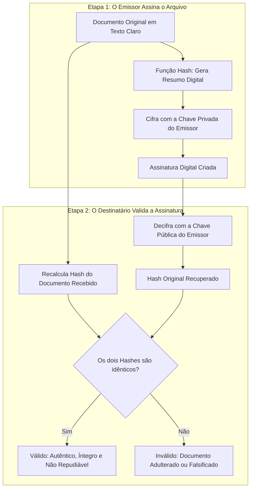
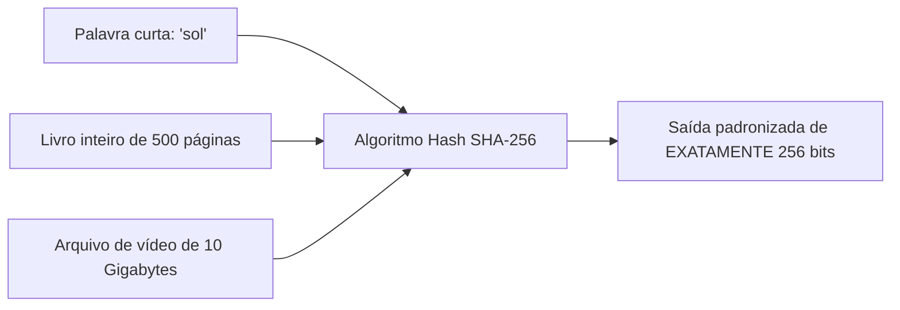
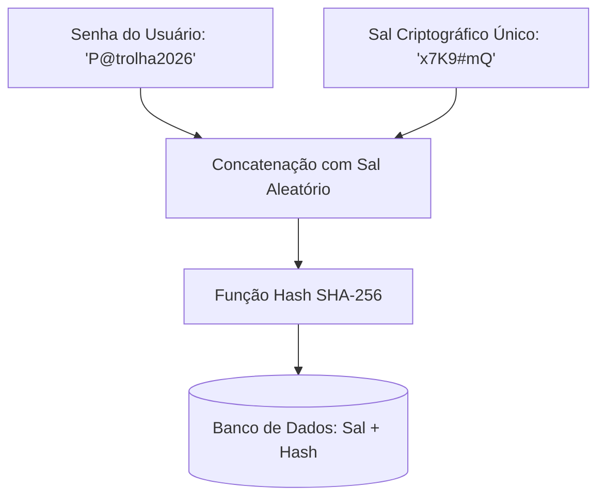
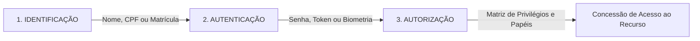
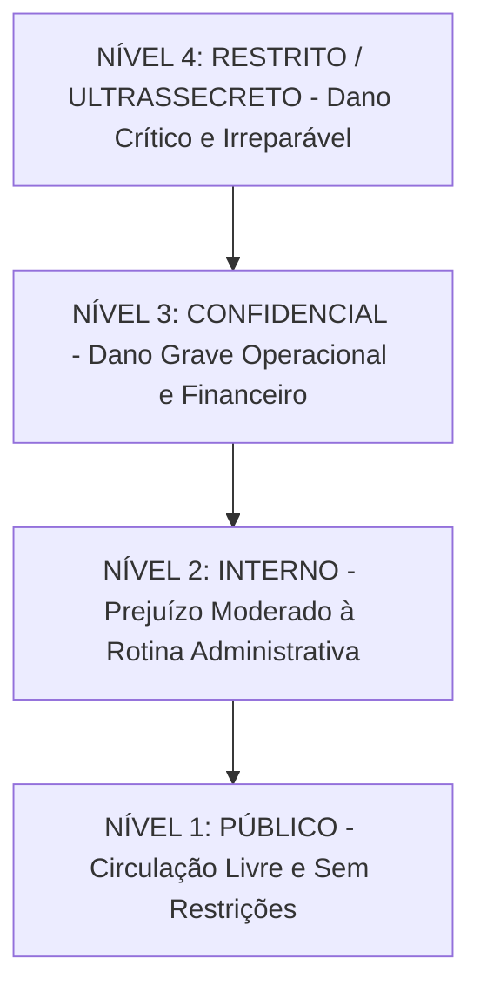

A formalização de atos administrativos eletrônicos e a preservação de provas digitais dependem diretamente de mecanismos criptográficos avançados. Nas corporações policiais e no corpo de bombeiros militar, laudos periciais e termos de depoimento demandam garantia inequívoca de autoria e integridade. Este capítulo analisa o funcionamento da assinatura digital, disseca as propriedades matemáticas das funções de dispersão (hash), diferencia as etapas do controle de acesso e apresenta a taxonomia corporativa da classificação de dados.

> [!objetivos]
> - Compreender a arquitetura técnica da assinatura digital e seus efeitos jurídicos.
> - Dominar as propriedades das funções hash criptográficas e comparar MD5, SHA-1 e SHA-256.
> - Compreender a aplicação do hash na cadeia de custódia da perícia forense digital.
> - Diferenciar rigorosamente as fases de identificação, autenticação e autorização no controle de acesso.
> - Categorizar os ativos de informação segundo a régua canônica de classificação de dados.

## Assinatura Digital e a Proteção Documental

A assinatura digital (referenciada historicamente em manuais sob a expressão ssinatura Digital por supressão de capitular) é um mecanismo criptográfico que associa uma entidade a um documento digital. Essa tecnologia confere aos arquivos eletrônicos a mesma validade jurídica e probatória de uma assinatura de próprio punho em papel físico.

Em termos práticos, a assinatura manual sobre o papel apresenta vulnerabilidades notórias. Ela pode ser imitada por falsários habilidosos e o papel pode sofrer raspagens ou extravios físicos. Já a assinatura digital apoia-se em relações matemáticas intransponíveis, tornando qualquer alteração posterior no documento imediatamente detectável.

A assinatura digital fundamenta-se na combinação indissociável de duas tecnologias distintas:
1. Uma **função hash criptográfica** (resumo da mensagem).
2. O algoritmo de **criptografia assimétrica** de chaves públicas.

### O que a Assinatura Digital Garante?

A aplicação da assinatura digital sobre um documento eletrônico assegura simultaneamente três propriedades basilares da segurança da informação:

- **Autenticidade**: comprova com certeza técnica quem gerou e assinou o arquivo. Como a assinatura foi concebida por meio da chave privada do signatário, somente o titular legítimo daquela chave exclusiva poderia tê-la produzido.
- **Integridade**: atesta que o arquivo não sofreu nenhuma modificação, supressão, acréscimo ou corrupção de dados desde o instante exato em que foi assinado. Se um invasor alterar um único espaço ou ponto no texto original, o cálculo do novo hash falhará.
- **Irretratabilidade (Não Repúdio)**: impede que o signatário negue judicialmente a autoria do documento perante tribunais ou órgãos fiscalizadores. A associação da chave privada exclusiva à integridade do conteúdo gera presunção jurídica plena de veracidade.

> [!pegadinha]
> A assinatura digital **NÃO garante confidencialidade**! O documento original continua trafegando em texto perfeitamente claro e legível para qualquer pessoa que abra o arquivo. Caso a organização deseje manter sigilo sobre o teor do documento, é mandatório aplicar uma camada adicional de cifragem simétrica ou assimétrica sobre o arquivo assinado.

| Propriedade de Segurança | Assegurada pela Assinatura Digital? | Justificativa Técnica |
|---|---|---|
| Autenticidade | Sim | Garantida pelo uso da chave privada exclusiva do signatário |
| Integridade | Sim | Garantida pela comparação rigorosa do resumo hash do arquivo |
| Irretratabilidade | Sim | Autenticidade aliada à integridade impede a negação do ato |
| Confidencialidade | **NÃO** | O arquivo original permanece legível; não é encriptado pela assinatura |

## Algoritmos de Hash (Funções de Resumo Criptográfico)

A função hash, frequentemente denominada na literatura técnica como função de resumo, função de dispersão criptográfica ou função módulo, é um algoritmo matemático puramente determinístico. Esse algoritmo recebe como entrada uma quantidade arbitrária de dados e a converte em uma sequência alfanumérica de comprimento fixo.

A analogia clássica para visualizar uma função de resumo reside na operação de resto de divisão inteira. Ao dividir qualquer número por 10, o resto será invariavelmente um único dígito decimal de 0 a 9. O número original pode ter cinco dígitos ou cem dígitos, mas o resto terá sempre o mesmo tamanho. As funções de dispersão modernas atuam como operadores matemáticos complexos que geram resumos digitais únicos para cada bloco de dados.

### Propriedades Matemáticas Essenciais das Funções Hash

Para que um algoritmo de hash seja qualificado como criptograficamente seguro, ele deve satisfazer a cinco propriedades mandatórias:

1. **Comprimento de Saída Fixo**: a saída gerada possui sempre a mesma quantidade exata de bits, independentemente do volume do arquivo de entrada. O algoritmo SHA-256 produzirá rigorosamente 256 bits (32 bytes em representação hexadecimal de 64 caracteres), seja para a palavra "sim", seja para o banco de dados completo do Instituto de Identificação.
2. **Unidirecionalidade (One-Way)**: é trivial e rápido calcular o hash a partir do dado original. No entanto, é computacionalmente impossível fazer o caminho inverso, isto é, reconstituir o texto original partindo exclusivamente do código hash conhecido.
3. **Determinismo Absoluto**: a mesma entrada fornecida ao mesmo algoritmo sempre gerará rigorosamente a mesma sequência de saída, em qualquer computador do planeta.
4. **Efeito Avalanche**: a alteração microscópica de um único bit ou caractere no arquivo original altera completamente a saída gerada. Uma vírgula removida em um processo criminal de 500 páginas modifica mais de 50% dos caracteres hexadecimais do código hash final.
5. **Resistência a Colisões**: deve ser computacionalmente inviável encontrar duas entradas diferentes que produzam exatamente o mesmo código de hash na saída.

> [!bizu]
> Guarde o conceito técnico de colisão: ocorre colisão criptográfica quando duas entradas distintas produzem a mesma saída hash. Como o conjunto de entradas possíveis é infinito e o conjunto de saídas é finito (por exemplo, 2 elevado a 256 combinações no SHA-256), colisões existem no plano teórico pelo Princípio da Casa dos Pombos. Contudo, em cifras modernas, o espaço combinatório é tão gigantesco que encontrar colisões por tentativa prática é impossível.

| Propriedade Técnica | Definição Operacional | Importância Prática |
|---|---|---|
| Comprimento Fixo | Saída com tamanho padronizado em bits | Viabiliza armazenamento padronizado de resumos |
| Unidirecionalidade | Sentido único: entrada gera hash, hash não volta | Permite guardar resumos de senhas sem expor texto puro |
| Determinismo | Mesma entrada gera rigorosamente o mesmo resultado | Permite conferir integridade em diferentes sistemas |
| Efeito Avalanche | Variação mínima na entrada altera a saída por completo | Denuncia qualquer adulteração sutil de documentos |
| Resistência Fraca | Dado x, é inviável achar y diferente tal que hash(x) = hash(y) | Protege contra substituição de documento assinado |
| Resistência Forte | É inviável achar qualquer par arbitrário x e y com hash igual | Protege contra forjamento prévio de arquivos pelo autor |

### Aplicação das Funções Hash no Armazenamento de Senhas

As diretrizes modernas de engenharia de software proíbem categoricamente o armazenamento de senhas em texto puro dentro de bancos de dados corporativos. Se o servidor for invadido, todas as senhas dos policiais seriam imediatamente expostas aos criminosos.

Para solucionar essa fragilidade, os sistemas operacionais armazenam apenas o hash criptográfico das senhas:

1. Durante o cadastro do usuário, o sistema calcula o hash da senha digitada e grava exclusivamente o resumo na tabela.
2. No momento do login, o usuário digita sua credencial. O sistema calcula o hash da senha fornecida na hora e compara o resultado com o resumo previamente guardado no banco.
3. Se os dois códigos coincidirem perfeitamente, o acesso é liberado com sucesso.

Para evitar que invasores utilizem tabelas pré-computadas de senhas comuns (as chamadas tabelas rainbow tables), os desenvolvedores combinam o hash com o mecanismo de salgamento (salt). O sal consiste em uma sequência aleatória de caracteres concatenada à senha antes do cálculo do resumo, tornando cada hash único mesmo entre usuários que tenham escolhido a mesma senha.

## Comparativo dos Principais Algoritmos de Hash

A evolução histórica dos algoritmos de dispersão reflete a constante superação de cifras perante o avanço da criptoanálise matemática.

### O Algoritmo MD5 (Message Digest 5)

Projetado por Ronald Rivest em 1991 para substituir o MD4, o MD5 opera gerando saídas de tamanho fixo de 128 bits (16 bytes, representados por 32 dígitos hexadecimais).

Durante muitos anos, o MD5 foi a cifra de resumo mais popular da indústria, sendo empregado em checagens de download e autenticação de mensagens. Contudo, em 2004, pesquisadores demonstraram falhas estruturais graves no algoritmo, viabilizando a geração prática de colisões completas em computadores convencionais em fração de segundos.

Em razão dessas vulnerabilidades cabais, o MD5 é classificado pelas normas internacionais como criptograficamente quebrado. Seu uso é expressamente proibido em assinaturas digitais, certificados eletrônicos e controle de senhas. Ele sobrevive apenas como soma de verificação simples (checksum) para detecção de corrupções acidentais em downloads de arquivos não críticos.

### A Família SHA (Secure Hash Algorithm)

Concebida pelo National Institute of Standards and Technology (NIST) em parceria com a National Security Agency (NSA), a família SHA engloba quatro gerações sucessivas de algoritmos:

- **SHA-0**: versão embrionária publicada em 1993, rapidamente recolhida pela NSA devido a uma falha primária de projeto.
- **SHA-1**: lançado em 1995 com saída de 160 bits (20 bytes, 40 caracteres hexadecimais). Tornou-se o padrão obrigatório na internet por mais de duas décadas. Contudo, fragilidades teóricas acumularam-se até que, em 2017, engenheiros do Google e do instituto CWI Amsterdam divulgaram o ataque SHAttered, gerando dois arquivos em formato PDF com teores visuais distintos que produziam exatamente o mesmo hash SHA-1. O SHA-1 é considerado obsoleto e encontra-se banido de navegadores modernos e sistemas de certificação digital.
- **SHA-2**: família de algoritmos modernos e altamente seguros lançada em 2001. Compreende variantes dimensionadas pelo tamanho de saída: SHA-224, SHA-256, SHA-384 e SHA-512 bits. O **SHA-256** é o algoritmo de maior relevância prática no mundo hoje. Ele opera sobre blocos de 512 bits e produz um resumo inexpugnável de 256 bits (64 dígitos hexadecimais). É o motor matemático da rede Bitcoin, dos certificados ICP-Brasil e das conexões bancárias HTTPS.
- **SHA-3**: padrão mais recente ratificado pelo NIST em 2015 (FIPS PUB 202), baseado no algoritmo Keccak. Diferente das famílias MD5, SHA-1 e SHA-2 (que utilizam a arquitetura estrutural de Merkle-Damgård), o SHA-3 apoia-se em uma construção matemática inovadora denominada construção esponja (sponge construction). Oferece saídas de 224, 256, 384 e 512 bits com altíssima resiliência contra ataques de extensão de comprimento.

| Algoritmo de Hash | Tamanho do Resumo | Caracteres Hexa | Ano de Criação | Status de Segurança Atual |
|---|---|---|---|---|
| MD5 | 128 bits (16 bytes) | 32 dígitos | 1991 | **Quebrado e Inseguro**; colisões práticas comprovadas |
| SHA-1 | 160 bits (20 bytes) | 40 dígitos | 1995 | **Obsoleto e Descontinuado**; vulnerável ao ataque SHAttered |
| SHA-256 (SHA-2) | 256 bits (32 bytes) | 64 dígitos | 2001 | **Altamente Seguro**; padrão mundial em produção ativa |
| SHA-512 (SHA-2) | 512 bits (64 bytes) | 128 dígitos | 2001 | **Altamente Seguro**; máxima solidez para sistemas críticos |
| SHA-3 (Keccak) | 256 a 512 bits | Variável | 2015 | **Altamente Seguro**; arquitetura esponja de vanguarda |

> [!atencao]
> As bancas examinadoras gostam de explorar o tamanho das saídas dos algoritmos em bits e bytes. Memorize a correspondência fundamental:
> - MD5: 128 bits = 16 bytes = 32 caracteres hexadecimais.
> - SHA-1: 160 bits = 20 bytes = 40 caracteres hexadecimais.
> - SHA-256: 256 bits = 32 bytes = 64 caracteres hexadecimais.
> - SHA-512: 512 bits = 64 bytes = 128 caracteres hexadecimais.

## O Papel do Hash na Perícia Forense Digital: A Cadeia de Custódia

A atuação das polícias judiciárias e dos órgãos de perícia oficial assenta-se no instituto processual da cadeia de custódia das provas materiais. A cadeia de custódia abrange a cronologia documentada de coleta, custódia, análise e apresentação dos elementos probatórios em juízo, garantindo que o vestígio periciado não foi adulterado, contaminado ou substituído.

No ambiente computacional, as evidências digitais são voláteis e suscetíveis a manipulações imperceptíveis. A simples inicialização de um computador apreendido altera registros de data e arquivos de paginação do sistema operacional, contaminando a prova.

Para conferir idoneidade incontestável à prova forense, o perito utiliza a função hash em três etapas cruciais:

1. **Geração do Hash da Evidência Bruta**: imediatamente após a apreensão e isolamento físico do dispositivo (disco rígido, pendrive ou aparelho celular), o perito conecta a mídia a um bloqueador de gravação de hardware e extrai o código hash SHA-256 de todo o disco físico. O código gerado é lavrado formalmente no termo de apreensão.
2. **Duplicação Forense (Cópia Bit a Bit)**: peritos jamais trabalham diretamente sobre a mídia original apreendida. Eles realizam uma clonagem espelhada exata de todos os setores do disco, gerando uma imagem forense bit a bit. Em seguida, calcula-se o hash da cópia produzida. Se o hash da imagem coincidir perfeitamente com o hash do dispositivo original, fica tecnicamente comprovado que a cópia é um clone exato do original.
3. **Validação Perante o Poder Judiciário**: durante o julgamento criminal, as defesas técnicas podem auditar a prova. Ao recalcularem o hash da imagem sob análise pericial, a confirmação do mesmo código afasta qualquer alegação de enxertia ou modificação fraudulenta de provas pelos peritos policiais.

> [!bizu]
> Em computação forense, lembre-se:
> - Hashes rigorosamente iguais provam a identidade e integridade de duas mídias distintas.
> - A alteração de um único bit no disco durante a manipulação altera o código hash final, anulando a validade jurídica da evidência periciada.

## Controle de Acesso: A Tríade Canônica

O controle de acesso é o conjunto estruturado de políticas, mecanismos e barreiras lógicas destinadas a assegurar que somente usuários identificados e autenticados acessem exclusivamente os recursos para os quais possuem permissão expressa.

A doutrina consagra a divisão do controle de acesso em três fases consecutivas: identificação, autenticação e autorização. Compreender a fronteira técnica entre esses três momentos é vital para solucionar questões de prova.

### A Fronteira entre Identificação, Autenticação e Autorização

- **Identificação**: é a fase inicial na qual a entidade declara formalmente quem ela afirma ser perante o sistema computacional. Trata-se de uma alegação unilateral de identidade pública, desprovida de comprovação de veracidade. Exemplos: digitar o login, digitar o CPF ou apresentar a matrícula funcional do agente.
- **Autenticação**: é a etapa probatória subsequente. O sistema desafia a entidade a comprovar que ela realmente é o titular da identidade declarada. Apoia-se na verificação de segredos compartilhados, dispositivos físicos de posse ou leituras biométricas. Exemplos: digitação da senha alfanumérica, aproximação do crachá com microchip ou validação de impressão digital.
- **Autorização**: ocorre exclusivamente após a homologação bem-sucedida da autenticação. Consiste na determinação dos privilégios, direitos e limites operacionais conferidos àquele usuário específico dentro do ambiente de rede. O sistema define quais diretórios o policial pode visualizar, quais planilhas ele pode editar e quais relatórios estão bloqueados.

| Dimensão Técnica | Identificação | Autenticação | Autorização |
|---|---|---|---|
| Pergunta Fundamental | "Quem é você?" | "Você prova que é você mesmo?" | "O que você tem permissão para fazer?" |
| Dado Fornecido | Nome de usuário, matrícula, e-mail | Senha, código OTP, leitura biométrica | Consulta a perfis de acesso e políticas |
| Momento Lógico | Primeiro estágio da sessão | Segundo estágio (validação) | Terceiro estágio (pós-login aprovado) |
| Atores Envolvidos | Usuário declarando identidade | Mecanismo checando credenciais | Sistema aplicando regras de privilégio |

> [!exemplo]
> Exemplo prático de autorização em segurança pública:
> Considere um policial civil plantonista que acessa a intranet institucional. Na primeira tela, ele digita sua matrícula funcional (Identificação). Em seguida, insere seu smartcard na leitora e digita o PIN secreto (Autenticação Forte). O sistema confirma a identidade do agente.
> A partir desse instante entra em ação a **Autorização**: a política institucional concede ao plantonista permissão para registrar novos boletins de ocorrência e consultar ordens de serviço da sua própria delegacia. Contudo, se o agente tentar acessar os relatórios confidenciais da Divisão de Homicídios ou tentar excluir registros periciais do Instituto de Criminalística, o sistema bloqueará a requisição por ausência de autorização formal, aplicando o princípio do menor privilégio.

## Modelos Fundamentais de Controle de Acesso

A literatura e as normas internacionais destacam três modelos estruturais clássicos para o gerenciamento de direitos de acesso em sistemas operacionais e bancos de dados:

1. **DAC (Discretionary Access Control - Controle de Acesso Discricionário)**: o proprietário do arquivo ou recurso detém autonomia absoluta para conceder ou revogar permissões a outros usuários. É o modelo padrão de sistemas operacionais desktop comuns (como Windows e Linux em ambiente de usuário doméstico), no qual quem cria uma pasta decide quem pode lê-la ou alterá-la. Apresenta alta flexibilidade, mas baixa governança corporativa.
2. **MAC (Mandatory Access Control - Controle de Acesso Obrigatório)**: o acesso é determinado rigidamente pelas políticas do sistema, sem qualquer discricionariedade do usuário comum. Cada recurso recebe um rótulo de segurança (por exemplo: Confidencial, Secreto) e cada operador recebe um nível de credenciamento (clearance). Um usuário só acessa o recurso se sua credencial for igual ou superior ao rótulo do dado. É o padrão utilizado em forças armadas e órgãos de inteligência (implementado em padrões como SELinux e modelos Bell-LaPadula).
3. **RBAC (Role-Based Access Control - Controle de Acesso Baseado em Papéis ou Funções)**: as permissões de acesso são associadas aos cargos funcionais ou papéis desempenhados pelos colaboradores dentro da organização, e não aos indivíduos isolados. Cria-se o papel de "Escrivão", o papel de "Perito Criminal" e o papel de "Delegado". Os usuários são alocados aos papéis conforme suas funções laborais. É o modelo mais adotado na administração pública moderna por simplificar a gestão de pessoal e a rotatividade de servidores.

## Classificação de Dados e Governança Corporativa

A classificação de dados é o procedimento metodológico de identificar, rotular e categorizar os ativos de informação de acordo com sua sensibilidade, relevância estratégica e potencial de dano em caso de vazamento ou destruição não autorizada.

Essa classificação é preconizada por normas internacionais de governança, como a ABNT NBR ISO/IEC 27001, e por leis de proteção de dados, como a Lei Geral de Proteção de Dados Pessoais (LGPD - Lei nº 13.709/2018).

O objetivo central da classificação é dosar de maneira proporcional e racional os investimentos em segurança: seria inviável aplicar barreiras caras e criptografia quântica em arquivos de circulação pública, assim como seria imprudente armazenar investigações sigilosas em pastas compartilhadas sem senhas.

### A Escala Canônica de Classificação de Dados

No contexto corporativo e governamental, a literatura padroniza quatro níveis sucessivos de classificação de dados:

- **Nível 1: Público**: informações cuja divulgação é livre e autorizada a qualquer cidadão ou colaborador externo, sem ocasionar nenhum prejuízo à instituição. A prioridade de segurança foca na preservação da integridade e disponibilidade das páginas. Exemplos: editais de concurso publicados no Diário Oficial, notícias no portal institucional e comunicados de utilidade pública do corpo de bombeiros.
- **Nível 2: Interno**: dados destinados exclusivamente ao corpo funcional e colaboradores da entidade. O vazamento acidental dessas informações gera impacto operacional moderado, sem acarretar danos patrimoniais severos nem quebra de sigilo legal. Exemplos: manuais de procedimentos internos, escalas de plantão ordinárias, listas de ramais telefônicos e atas de reuniões operacionais.
- **Nível 3: Confidencial**: ativos que abrigam dados pessoais sensíveis, registros comerciais ou documentos cuja divulgação indevida causaria prejuízos financeiros substanciais, litígios judiciais ou arranhões severos à reputação institucional. O acesso requer autenticação rigorosa e políticas de necessidade de conhecer (need-to-know). Exemplos: prontuários médicos de policiais acidentados, dados contábeis de compras governamentais e depoimentos colhidos em inquéritos policiais.
- **Nível 4: Restrito (ou Ultrassecreto)**: o nível mais elevado de proteção na hierarquia institucional. Engloba dados críticos cuja quebra de sigilo causaria prejuízos irreparáveis, perigo iminente à segurança nacional ou risco concreto à integridade física de agentes infiltrados e informantes da lei. Demanda segregação física de servidores, chaves criptográficas em módulos HSM (Hardware Security Module) e auditoria contínua de acessos. Exemplos: planos de operações táticas especiais contra o crime organizado, códigos-fonte de sistemas de interceptação telefônica e identidades de testemunhas protegidas.

> [!exemplo]
> Exemplo prático de classificação de dados em órgãos de segurança:
> Em um comando regional da polícia militar, uma equipe lida com diferentes documentos em uma mesma manhã:
> 1. O cardápio semanal do refeitório do batalhão: classificado como **Interno**, pois não interessa ao público externo, mas sua visualização inadvertida não traz prejuízos operacionais.
> 2. O balanço de ocorrências atendidas no último feriado: classificado como **Público**, encaminhado à assessoria de imprensa para divulgação social.
> 3. Os laudos toxicológicos de suspeitos sob custódia: classificados como **Confidencial**, guardados em pastas protegidas por senhas para atender às normas da LGPD.
> 4. As rotas de deslocamento e pontos de parada de comboio transportando armamento pesado: classificadas como **Restrito / Secreto**, pois qualquer vazamento coloca em risco a vida das guarnições e o patrimônio militar.

| Nível de Classificação | Severidade do Dano em Vazamento | Exemplos Típicos na Segurança | Controles de Segurança Recomendados |
|---|---|---|---|
| Público | Inexistente; o dado é aberto | Editais, notícias e notas à imprensa | Integridade de publicação e servidores anti-DDoS |
| Interno | Baixo ou moderado; atrito operacional | Escalas de serviço, circulares internas | Login e senha corporativos, antivírus local |
| Confidencial | Elevado; multas legais e processos | Dados pessoais sensíveis e inquéritos | Criptografia em repouso, MFA e trilhas de log |
| Restrito / Secreto | Catastrófico ou irreversível | Operações de inteligência e informantes | HSM criptográfico, salas-cofre e credenciamento MAC |

> [!resolvido]
> Questão de Concurso: Um perito digital apreendeu um disco rígido durante diligência policial. Ele gerou o hash SHA-256 da mídia e arquivou o código. Posteriormente, produziu uma cópia bit a bit e calculou novo hash, constatando códigos divergentes. Qual o impacto técnico e jurídico desse evento para o processo criminal?
> **Resolução Passo a Passo**:
> 1. O algoritmo SHA-256 é estritamente determinístico: a mesma entrada gera invariavelmente a mesma sequência de 64 dígitos hexadecimais na saída.
> 2. A divergência entre o hash do disco apreendido e o hash da cópia clonada demonstra que houve alteração de bits em algum momento da extração (seja por falha do software forense, leitura corrompida por defeito físico ou manipulação indevida).
> 3. Pelo efeito avalanche, mesmo a alteração de um único byte modifica o código hash final.
> **Conclusão**: O evento comprova a quebra da integridade na cadeia de custódia da evidência digital. A cópia produzida perde sua idoneidade probatória perante a justiça, impossibilitando que seja utilizada como elemento de prova contra o réu.

## Mapa do capítulo

```mermaid Síntese de assinaturas, hashes e controles
flowchart TD
    SEG[Proteção Documental e Acesso] --> ASSIN[Assinatura Digital]
    SEG --> HASH[Funções Hash]
    SEG --> ACESSO[Controle de Acesso]
    SEG --> CLASSD[Classificação de Dados]
    
    ASSIN --> A1[Hash cifrado com Chave Privada do Emissor]
    ASSIN --> A2[Garante Autenticidade, Integridade e Não Repúdio]
    ASSIN --> A3[NÃO garante confidencialidade]
    
    HASH --> H1[Tamanho Fixo e Unidirecional]
    HASH --> H2[Efeito Avalanche e Resistência a Colisões]
    HASH --> H3[Algoritmos: MD5/SHA-1 Quebrados; SHA-256 Seguro]
    HASH --> H4[Uso em Senhas com Sal e Cadeia de Custódia Forense]
    
    ACESSO --> C1[Identificação: Declara quem é]
    ACESSO --> C2[Autenticação: Prova quem é]
    ACESSO --> C3[Autorização: Delimita permissões]
    ACESSO --> C4[Modelos: DAC, MAC e RBAC Baseado em Papéis]
    
    CLASSD --> D1[Níveis: Público, Interno, Confidencial e Restrito]
    CLASSD --> D2[Proporcionalidade de controles ao risco]
```

### Para fixar

- A assinatura digital é obtida pela cifragem do resumo hash do arquivo com a chave privada exclusiva do emissor.
- A assinatura digital garante autenticidade, integridade e irretratabilidade (não repúdio), mas não garante confidencialidade.
- A verificação da assinatura utiliza a chave pública do emissor e compara o hash recebido com o hash recalculado.
- As funções hash convertem entradas de qualquer tamanho em saídas de comprimento fixo, sendo determinísticas e unidirecionais.
- O efeito avalanche garante que a alteração de um único bit na entrada modifique completamente o resumo de saída.
- Os algoritmos MD5 (128 bits) e SHA-1 (160 bits) são obsoletos e vulneráveis a colisões; o SHA-256 (família SHA-2) é o padrão seguro em produção.
- O armazenamento seguro de senhas utiliza hash combinado com sal aleatório para neutralizar ataques de tabelas pré-computadas.
- Na perícia forense, o hash atesta a idoneidade da cadeia de custódia e prova que a imagem espelhada é clone idêntico da mídia bruta.
- O controle de acesso compõe-se de identificação (declaração), autenticação (comprovação) e autorização (delimitação de privilégios).
- A classificação de dados organiza as informações em Público, Interno, Confidencial e Restrito, dosando os controles ao risco.
