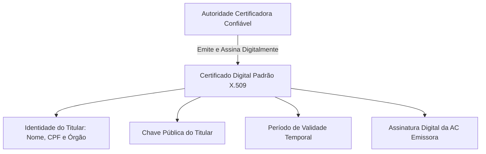
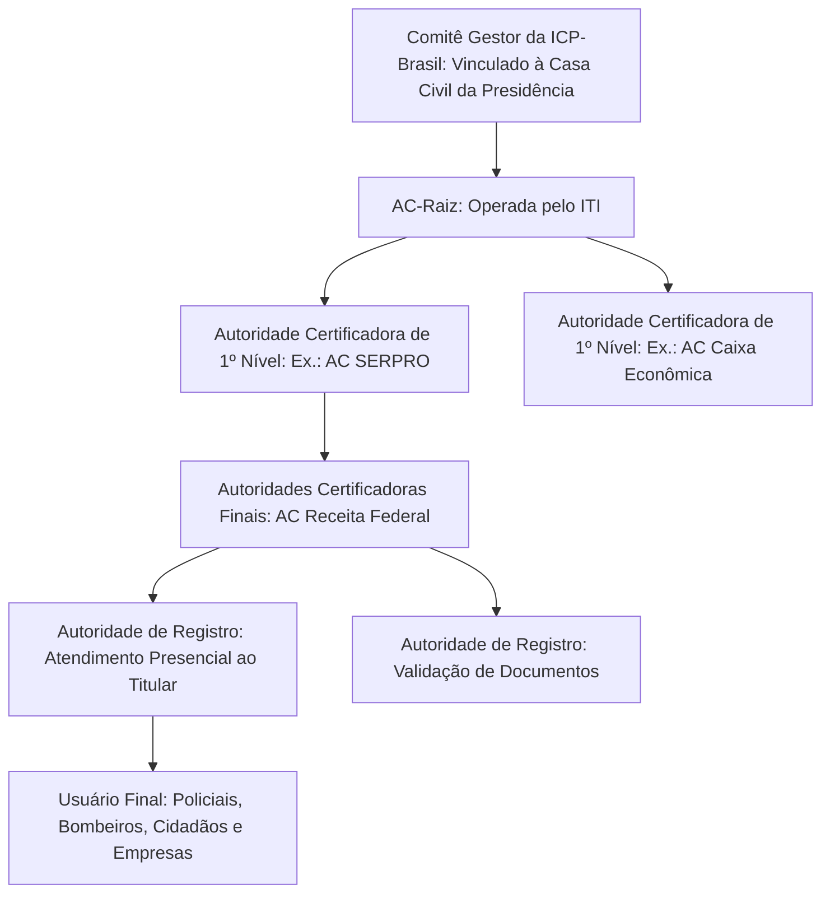
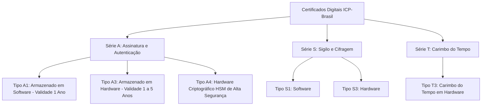
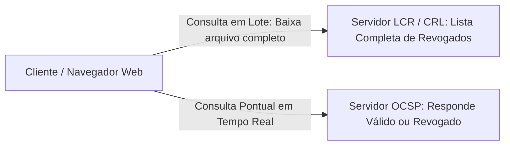

A concretização da cidadania digital e a tramitação desmaterializada de processos judiciais e inquéritos policiais apoiam-se na confiança proporcionada pelos certificados digitais. Sem um método seguro de vinculação de identidade, qualquer indivíduo poderia publicar uma chave pública forjada em nome de uma autoridade policial. Este capítulo disseca a arquitetura técnica dos certificados digitais, a estrutura hierárquica da Infraestrutura de Chaves Públicas Brasileira (ICP-Brasil), as categorias funcionais de certificados e os mecanismos de revogação de credenciais.

> [!objetivos]
> - Compreender a função do certificado digital no padrão internacional ITU-T X.509.
> - Dominar a hierarquia da ICP-Brasil: ITI, AC-Raiz, Autoridades Certificadoras (AC) e Autoridades de Registro (AR).
> - Comparar os certificados das séries A, S e T, distinguindo os tipos A1 e A3.
> - Compreender o ciclo de vida do certificado digital e os mecanismos de revogação: LCR e protocolo OCSP.

## Certificado Digital: O Documento de Identidade Eletrônico

O certificado digital é um arquivo eletrônico assinado digitalmente por uma entidade terceira de confiança, denominada Autoridade Certificadora (AC). Sua finalidade elementar é associar, de modo público e juridicamente incontestável, uma entidade (pessoa física, pessoa jurídica, equipamento de rede ou servidor web) à sua respectiva chave pública.

Na vida civil presencial, o cidadão comprova sua identidade perante bancos e cartórios apresentando a Carteira de Identidade (RG) ou a Carteira Nacional de Habilitação (CNH). Esses documentos possuem validade porque foram expedidos por órgãos oficiais do Estado dotados de fé pública. No universo das redes de computadores, o certificado digital desempenha exatamente esse papel de carteira de identidade virtual.

Sem a existência de um certificado digital confiável, a criptografia assimétrica sofreria com o ataque do homem no meio (man-in-the-middle). Um invasor posicionado na rede poderia interceptar o canal e entregar sua própria chave pública para as partes, fazendo-se passar pelo comandante da corporação. Ao assinar a chave pública do cidadão com sua própria chave privada, a Autoridade Certificadora atesta que aquela chave pertence legitimamente àquele titular.

### Estrutura Canônica do Padrão ITU-T X.509

A comunidade internacional padronizou a formatação de certificados digitais por meio da recomendação ITU-T X.509. A versão mais disseminada atualmente é a versão 3 (X.509 v3), adotada expressamente pelas normas da ICP-Brasil e pelos navegadores de internet.

Um certificado digital compatível com o padrão X.509 v3 contém os seguintes campos mandatórios:

- **Versão do Padrão**: indica a edição da norma técnica (geralmente Versão 3).
- **Número de Série**: identificador numérico único e exclusivo atribuído pela Autoridade Certificadora para distinguir cada certificado emitido.
- **Identificação do Algoritmo de Assinatura**: especifica a combinação criptográfica utilizada pela AC para assinar o documento (por exemplo: SHA-256 com RSA).
- **Emissor (Issuer)**: nome oficial e dados cadastrais da Autoridade Certificadora que emitiu e assinou o certificado.
- **Período de Validade**: indica as datas e horários exatos de início (válido a partir de) e término (válido até) da vigência do documento.
- **Sujeito ou Titular (Subject)**: dados completos do dono do certificado (nome civil da pessoa física, razão social da empresa, CPF, CNPJ, matrícula funcional ou endereço web do servidor no padrão DNS).
- **Informações da Chave Pública do Sujeito**: o valor matemático da chave pública do titular e o algoritmo assimétrico correspondente (como RSA de 2048 bits ou curvas elípticas ECC).
- **Identificador Único do Emissor e do Sujeito**: campos opcionais para desambiguação cadastral.
- **Extensões (X.509 v3)**: campos flexíveis que informam as políticas de uso do certificado (se serve para assinatura de documentos, autenticação web TLS, proteção de e-mails, ou se o titular tem autoridade para emitir outros certificados).
- **Assinatura Digital da AC**: o resumo hash de todos os campos anteriores, cifrado com a chave privada exclusiva da Autoridade Certificadora emissora.

> [!pegadinha]
> Preste atenção máxima em questões de prova sobre o conteúdo do certificado digital:
> - O certificado digital contém a **chave pública** do titular.
> - O certificado digital **JAMAIS contém a chave privada** do titular nem a chave privada da Autoridade Certificadora!
> A chave privada deve permanecer sob segredo absoluto e guarda exclusiva de seu dono, nunca circulando em documentos públicos.

| Campo Estrutural X.509 | Finalidade Operacional | Exemplo Típico |
|---|---|---|
| Versão | Especificar a versão da norma técnica | Versão 3 (v3) |
| Número de Série | Distinguir univocamente o certificado na AC | 7A:4F:9C:12:88:B3 |
| Emissor (Issuer) | Declarar quem atesta a veracidade do documento | AC Secretaria da Receita Federal do Brasil |
| Período de Validade | Delimitar a janela temporal de vigência jurídica | De 01/01/2026 até 01/01/2029 |
| Titular (Subject) | Identificar a pessoa física ou jurídica proprietária | João da Silva (CPF: 123.456.789-00) |
| Chave Pública do Titular | Disponibilizar a chave aberta para o público | RSA de 2048 bits |
| Assinatura da AC | Provar que o certificado não foi forjado | Hash SHA-256 cifrado com chave privada da AC |

## Infraestrutura de Chaves Públicas Brasileira (ICP-Brasil)

A base legal e técnica da certificação digital no Brasil foi instituída pela Medida Provisória nº 2.200-2, de 24 de agosto de 2001. Esse diploma criou a Infraestrutura de Chaves Públicas Brasileira, consagrada nacionalmente pela sigla ICP-Brasil.

A ICP-Brasil foi desenhada como um modelo de confiança hierárquico estrito em formato piramidal (em árvore de certificação). No topo dessa pirâmide repousa uma autoridade única dotada de soberania técnica nacional, da qual irradiam os ramos de certificação intermediários até alcançar o cidadão comum.

### O Comitê Gestor da ICP-Brasil

O Comitê Gestor da ICP-Brasil é um órgão colegiado vinculado à Casa Civil da Presidência da República. Sua composição congrega representantes do Poder Executivo Federal, de outros poderes da República e de entidades da sociedade civil organizada e da academia.

Suas atribuições institucionais compreendem:
- Estabelecer a política nacional de certificação digital e as diretrizes regulatórias da ICP-Brasil.
- Deliberar sobre padrões criptográficos, algoritmos permitidos e tamanhos mínimos de chaves.
- Aprovar os regulamentos técnicos operacionais e manuais de conduta de auditoria.

### A Autoridade Certificadora Raiz (AC-Raiz) e o Papel do ITI

A Autoridade Certificadora Raiz é o vértice superior e único de toda a hierarquia de chaves públicas do território nacional. A operacionalização e a gestão executiva da AC-Raiz competem por lei ao **Instituto Nacional de Tecnologia da Informação (ITI)**, autarquia federal com sede em Brasília.

As competências institucionais da AC-Raiz compreendem:
- Emitir, expedir, distribuir, renovar e revogar exclusivamente os certificados digitais das Autoridades Certificadoras de primeiro nível imediatamente subordinadas a ela.
- Fiscalizar o cumprimento das normas do Comitê Gestor por todas as entidades credenciadas na ICP-Brasil.
- Executar auditorias periódicas nas instalações físicas e lógicas das ACs e ARs.
- Gerenciar a Lista de Certificados Revogados da própria raiz.

> [!pegadinha]
> É questão obrigatória de concurso: a AC-Raiz (operada pelo ITI) **NÃO emite certificados digitais diretamente para usuários finais, cidadãos comuns ou empresas comerciais**! Ela emite certificados exclusivamente para as Autoridades Certificadoras subordinadas credenciadas na cadeia nacional. Além disso, o certificado digital da AC-Raiz é **autoassinado**, significando que ela assina seu próprio certificado com sua própria chave privada.

### As Autoridades Certificadoras (ACs)

As Autoridades Certificadoras são entidades de direito público (como o SERPRO, a Caixa Econômica Federal e a Imprensa Oficial) ou de direito privado credenciadas perante o ITI. Elas compõem a camada intermediária e final da árvore hierárquica.

Suas atribuições consistem em:
- Emitir, distribuir, renovar e revogar certificados digitais para pessoas físicas, pessoas jurídicas e servidores da internet.
- Vincular a chave pública ao respectivo titular com base nas comprovações documentais recebidas.
- Manter e publicar a Lista de Certificados Revogados (LCR) em servidores públicos de alta disponibilidade.
- Guardar os registros de auditoria e logs de emissão pelos prazos determinados pela legislação.

### As Autoridades de Registro (ARs)

As Autoridades de Registro atuam como o braço físico, presencial e operacional de contato direto com o cidadão e as empresas. Elas operam sempre vinculadas a uma Autoridade Certificadora formal.

Suas funções práticas compreendem:
- Receber a solicitação de emissão do certificado digital feita pelo interessado.
- Exigir o comparecimento físico ou realizar a videoconferência assistida com validação de biometria facial e datiloscópica.
- Conferir a autenticidade dos documentos civis apresentados (RG, CPF, certidões e atos constitutivos empresariais).
- Encaminhar a solicitação homologada para que a Autoridade Certificadora execute a emissão do certificado.

> [!bizu]
> Guarde a distinção nítida de competências para a prova:
> - A Autoridade Certificadora (AC) **emite e assina** o certificado digital.
> - A Autoridade de Registro (AR) **solicita e valida** a documentação presencialmente, mas **NÃO assina nem emite** o certificado digital por conta própria!

| Entidade da ICP-Brasil | Nível Hierárquico | Responsabilidade Central | Emite para Cidadão Comum? |
|---|---|---|---|
| Comitê Gestor | Normativo / Político | Fixa diretrizes regulatórias e padrões criptográficos | Não |
| AC-Raiz (ITI) | Topo da Cadeia Técnica | Credencia ACs e fiscaliza entidades da rede | **NÃO** (só emite para ACs) |
| Autoridade Certificadora (AC) | Intermediário / Emissor | Gera, emite, renova e revoga certificados | **SIM** (emite para pessoas e empresas) |
| Autoridade de Registro (AR) | Operacional / Cadastral | Identifica solicitantes e confere documentos | **NÃO** (apenas valida solicitações) |

## Tipos e Categorias de Certificados na ICP-Brasil

A normatização da ICP-Brasil classifica os certificados digitais em séries funcionais e classes de segurança, estruturadas de acordo com o propósito técnico de uso e a mídia de armazenamento da chave privada.

### Séries Funcionais de Certificados

A nomenclatura brasileira adota letras para designar a destinação funcional do certificado:

- **Série A (Assinatura e Autenticação)**: destinada à confirmação de autoria, geração de assinaturas digitais com valor jurídico pleno em documentos eletrônicos e autenticação forte de usuários em sistemas informatizados. É a série mais utilizada por cidadãos, advogados, magistrados, policiais e empresários (e-CPF e e-CNPJ).
- **Série S (Sigilo e Confidencialidade)**: voltada especificamente para a cifragem de documentos sensíveis, transações corporativas e mensagens eletrônicas sigilosas. A chave pública do certificado S é utilizada para encriptar os dados, assegurando que apenas o destinatário na posse da chave privada consiga decodificar a informação.
- **Série T (Carimbo do Tempo ou Time Stamping)**: utilizada por Autoridades Certificadoras de Tempo (ACT) credenciadas. Serve para atestar publicamente e com base na Hora Legal Brasileira a data e hora exatas em que um documento digital foi formalmente assinado ou protocolado.

### Certificados do Tipo A1 e do Tipo A3

A distinção entre os certificados do Tipo A1 e do Tipo A3 representa um dos temas mais repetidos em provas de concurso. A diferença central assenta-se na mídia utilizada para guardar a chave privada e no prazo temporal de validade.

**Certificados do Tipo A1**:
- **Geração e Armazenamento**: a chave privada é gerada diretamente por software e armazenada na memória ou no disco rígido do computador ou navegador do usuário (em arquivo criptografado com extensão `.pfx` ou `.p12`).
- **Validade Máxima**: possui validade estrita de até **1 ano**.
- **Portabilidade**: permite fácil exportação do arquivo mediante digitação de senha simples de backup. Pode ser instalado simultaneamente em múltiplos computadores, notebooks ou servidores da mesma corporação.
- **Segurança**: apresenta menor nível de proteção patrimonial, visto que o arquivo pode ser copiado inadvertidamente por malwares, spywares ou cópias indevidas por pen drives.

**Certificados do Tipo A3**:
- **Geração e Armazenamento**: a chave privada é gerada obrigatoriamente dentro de um dispositivo físico de hardware criptográfico seguro (smartcard com chip inteligente ou token USB com microcontrolador criptográfico) ou em um módulo de segurança em nuvem (HSM corporativo).
- **Inexportabilidade**: a chave privada jamais sai do interior do chip. Quando um arquivo precisa ser assinado, o sistema operacional envia o hash do documento para dentro do token; o processador do cartão calcula a assinatura digital internamente e devolve apenas o resultado assinado. É tecnicamente impossível extrair ou clonar a chave privada do dispositivo.
- **Validade Temporal**: possui validade de **1 a 5 anos** (sendo comum a expedição para prazos de 3 anos).
- **Mecanismos de Bloqueio**: o acesso ao dispositivo é protegido por duas senhas numéricas: o PIN (senha de uso cotidiano) e o PUK (código de desbloqueio de emergência). Caso o usuário erre o PIN por três vezes consecutivas, o token bloqueia. Se o PUK for digitado incorretamente por três vezes consecutivas, o chip autodestrói as chaves criptográficas em seu silício interno, tornando o cartão imprestável.

> [!exemplo]
> Em uma delegacia de polícia, os escrivães utilizam certificados Tipo A1 instalados nos navegadores das estações de trabalho para assinar intimações rotineiras com rapidez. Por outro lado, os delegados titulares e peritos criminais utilizam tokens físicos USB com certificados Tipo A3 para assinar relatórios finais de inquérito e laudos de DNA. Esse arranjo garante a inexportabilidade da chave privada dos atos de maior relevância penal.

| Característica Comparativa | Certificado Tipo A1 | Certificado Tipo A3 |
|---|---|---|
| Suporte de Armazenamento | Software (arquivo no disco do computador: .pfx ou .p12) | Hardware dedicado (smartcard, token USB ou HSM) |
| Prazo de Validade Máxima | Até 1 ano | De 1 até 5 anos (comumente 3 anos) |
| Segurança da Chave Privada | Menor; o arquivo pode ser copiado do computador | Máxima; a chave é inexportável do circuito integrado |
| Execução Criptográfica | Processador principal do computador (CPU da máquina) | Coprocessador criptográfico interno do próprio chip |
| Proteção de Acesso | Senha comum de software definida no arquivo | Senhas físicas PIN e PUK com bloqueio por tentativas |
| Instalação em Várias Máquinas | Sim; permite cópia simultânea do arquivo em vários PCs | Não; exige conectar fisicamente o token na porta USB |

> [!atencao]
> As bancas adoram inverter prazos e mídias em pegadinhas. Lembre-se:
> - A1 = 1 ano = 1 arquivo em software.
> - A3 = até 3 (ou 5) anos = hardware com chip inexportável.

## Revogação de Certificados Digitais: LCR e Protocolo OCSP

Um certificado digital possui vigência temporal definida no campo de validade do padrão X.509. Ao atingir a data de expiração, o certificado perde automaticamente sua eficácia jurídica e técnica.

Contudo, diversas circunstâncias excepcionais exigem o cancelamento do certificado antes do término regular de seu prazo de validade:
- Suspeita fundada ou comprovação de comprometimento da chave privada (perda, furto ou roubo do token criptográfico).
- Esquecimento definitivo da senha PUK com bloqueio irreversível do dispositivo.
- Alteração cadastral relevante do titular (mudança de nome civil por casamento ou divórcio, exclusão do quadro societário de empresa).
- Demissão, exoneração ou perda de cargo público de autoridade com competência funcional específica.
- Encerramento definitivo das atividades de uma pessoa jurídica.

Nesses casos, a Autoridade Certificadora executa o ato formal de revogação do certificado digital. A partir do momento da revogação, o certificado torna-se nulo, e qualquer assinatura produzida após essa data carece de validade jurídica.

### Lista de Certificados Revogados (LCR / CRL)

A Lista de Certificados Revogados (em inglês, Certificate Revocation List - CRL) é um documento eletrônico padronizado publicado periodicamente pelas Autoridades Certificadoras em repositórios abertos na internet.

A LCR contém a relação de todos os números de série dos certificados emitidos por aquela AC que foram revogados antes do prazo de expiração, acompanhados da data e horário exatos da revogação e do motivo do cancelamento. A própria AC assina digitalmente a LCR com sua chave privada para impedir adulterações.

**Limitações da LCR**:
- O arquivo da LCR cresce continuamente conforme novos certificados são revogados, exigindo downloads volumosos que sobrecarregam a conexão do usuário.
- Apresenta atraso de atualização temporal (latência): a LCR é republicada em intervalos fixos (por exemplo, a cada 24 horas). Se um certificado for revogado às 10 horas da manhã e a próxima lista sair apenas às 18 horas, existirá uma janela de vulnerabilidade durante a qual o certificado cancelado continuará sendo aceito por sistemas offline.

### O Protocolo OCSP (Online Certificate Status Protocol)

Para sanar as deficiências de desempenho e latência da LCR, a IETF padronizou o protocolo OCSP (RFC 6960). O OCSP permite consultas em tempo real sobre a situação de um certificado individual específico.

O funcionamento do OCSP é dinâmico e cirúrgico:
1. O navegador ou sistema conecta-se ao servidor validador da AC (denominado OCSP Responder) e envia apenas o número de série do certificado sob inspeção.
2. O servidor consulta sua base de dados atualizada imediatamente e devolve uma resposta compacta e assinada contendo um dos três estados possíveis:
   - **Good (Válido)**: o certificado está em situação regular e ativa.
   - **Revoked (Revogado)**: o certificado foi cancelado formalmente.
   - **Unknown (Desconhecido)**: o servidor não possui registros sobre aquele número de série.

O protocolo OCSP dispensa o download de listas pesadas, acelera a navegação e reflete instantaneamente as revogações cadastradas na autoridade emissora.

| Critério de Comparação | Lista de Certificados Revogados (LCR) | Protocolo Online OCSP |
|---|---|---|
| Natureza Técnica | Arquivo estático assinado periodicamente | Serviço de consulta interativa em tempo real |
| Consumo de Banda | Elevado; baixa o arquivo completo da AC | Reduzidíssimo; consulta pontual de poucos bytes |
| Atualização dos Dados | Periódica em janelas de tempo (latência) | Instantânea no momento exato da consulta |
| Operação Offline | Funciona offline com cache da lista baixada | Exige conexão online ativa com o OCSP Responder |

> [!resolvido]
> Questão de Concurso: Durante uma auditoria em um tribunal de justiça, um perito constatou que um documento eletrônico fora assinado por um magistrado utilizando um certificado digital ICP-Brasil que havia sido formalmente revogado três dias antes em virtude de furto de seu token USB. A assinatura digital deve ser considerada válida?
> **Resolução Passo a Passo**:
> 1. A revogação formal de um certificado digital extingue a validade técnica e jurídica da credencial perante a ICP-Brasil.
> 2. O número de série do certificado revogado foi inserido na Lista de Certificados Revogados (LCR) e no banco de dados do protocolo OCSP da respectiva Autoridade Certificadora.
> 3. Como o ato de assinatura ocorreu posteriormente à revogação (três dias após o fato), o signatário não detinha mais presunção de legitimidade conferida pela AC emissora.
> **Conclusão**: A assinatura digital é integralmente inválida. Os sistemas eletrônicos que consultarem a LCR ou o servidor OCSP rejeitarão o documento por ausência de cadeia de confiança válida na data da operação.

## Mapa do capítulo

```mermaid Síntese de certificados digitais e ICP-Brasil
flowchart TD
    CERT[Certificados Digitais e ICP-Brasil] --> X509[Padrão ITU-T X.509 v3]
    CERT --> HIERARQUIA[Hierarquia ICP-Brasil]
    CERT --> SERIES[Séries e Tipos]
    CERT --> REVOG[Processos de Revogação]
    
    X509 --> X1[Chave Pública do Titular + Dados Civis]
    X509 --> X2[Validade + Assinatura da AC Emissora]
    X509 --> X3[Chave Privada NUNCA consta no certificado]
    
    HIERARQUIA --> H1[Comitê Gestor: Diretrizes Políticas]
    HIERARQUIA --> H2[AC-Raiz / ITI: Topo Soberano Autoassinado]
    HIERARQUIA --> H3[Autoridade Certificadora: Emite e Assina]
    HIERARQUIA --> H4[Autoridade de Registro: Identifica e Valida]
    
    SERIES --> S1[Série A: Assinatura e Autenticação]
    SERIES --> S2[Série S: Sigilo e Cifragem]
    SERIES --> S3[Série T: Carimbo do Tempo]
    SERIES --> SA1[Tipo A1: Software - Validade 1 Ano]
    SERIES --> SA3[Tipo A3: Hardware Token/Smartcard - 1 a 5 Anos]
    
    REVOG --> R1[LCR / CRL: Arquivo periódico de cancelamentos]
    REVOG --> R2[OCSP: Consulta online pontual em tempo real]
```

### Para fixar

- O certificado digital vincula com fé pública a chave pública à identidade do titular, seguindo o padrão internacional ITU-T X.509 v3.
- O certificado contém a chave pública do titular, seus dados cadastrais e a assinatura da AC; jamais contém a chave privada.
- A ICP-Brasil foi instituída pela MP 2.200-2/2001 sob arquitetura hierárquica estrita de cadeia de confiança.
- O Instituto Nacional de Tecnologia da Informação (ITI) opera a AC-Raiz, possuindo certificado autoassinado e não emitindo para cidadãos comuns.
- A Autoridade Certificadora (AC) emite e assina os certificados; a Autoridade de Registro (AR) confere presencialmente os documentos.
- Os certificados dividem-se em Série A (assinatura/autenticação), Série S (sigilo/criptografia) e Série T (carimbo de tempo).
- O certificado Tipo A1 armazena a chave em software no computador, com prazo de validade estrito de até 1 ano.
- O certificado Tipo A3 armazena a chave em hardware seguro inexportável (token USB ou smartcard), com validade de 1 a 5 anos.
- A revogação cancela o certificado antes do prazo; ela é verificada pela Lista de Certificados Revogados (LCR) ou pelo protocolo online OCSP.
- O protocolo OCSP possibilita consultas em tempo real sobre a validade do certificado sem exigir o download completo da LCR.
