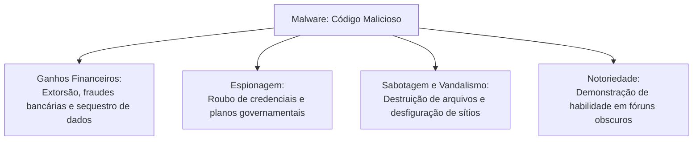
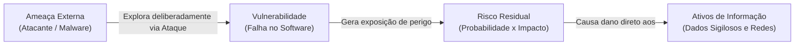
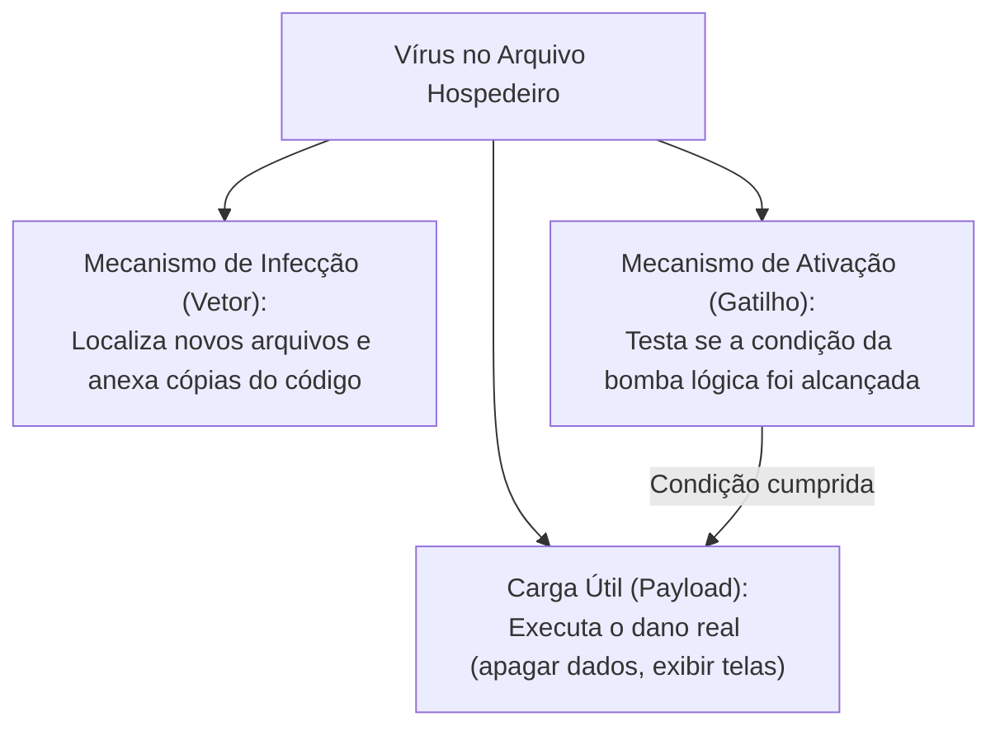
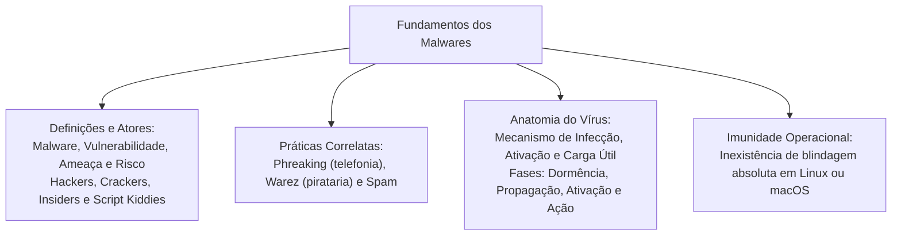

O ambiente cibernético contemporâneo abriga ameaças sofisticadas que colocam em risco dados sensíveis de corporações militares e órgãos policiais. Na atuação diária da Polícia Civil e do Corpo de Bombeiros, o manuseio de ocorrências sigilosas, boletins de ocorrência e despacho de viaturas exige proteção digital contínua. Códigos maliciosos exploram vulnerabilidades em sistemas para espionar, roubar ativos financeiros ou interromper serviços essenciais. Compreender a terminologia técnica da segurança da informação e a taxonomia geral das ameaças virtuais é indispensável para a aprovação em concursos.

> [!objetivos]
> - Definir malware e reconhecer suas principais motivações econômicas, operacionais e destrutivas.
> - Diferenciar formalmente os conceitos de vulnerabilidade, ameaça, ataque e risco na segurança corporativa.
> - Caracterizar o perfil de atuação dos diversos atores cibernéticos, como hackers, crackers, script kiddies e insiders.
> - Compreender a anatomia estrutural de um vírus de computador dividida em mecanismo de infecção, ativação e carga útil.
> - Desmistificar a suposta imunidade de sistemas operacionais alternativos, como Linux e macOS.

## ALWARES: Conceito de Malware e Motivações Criminosas

A palavra malware origina-se da aglutinação dos termos em inglês malicious software (software malicioso). Na definição oficial do CERT.br, malware é qualquer programa, script ou código desenvolvido especificamente para executar ações danosas e atividades não autorizadas em um computador, dispositivo móvel ou infraestrutura de rede. Ele compromete os princípios fundamentais da segurança da informação: confidencialidade, integridade e disponibilidade.

Uma vez instalado no equipamento alvo, o malware herda os mesmos privilégios de acesso do usuário logado na sessão do sistema operacional. Ele pode acessar arquivos sigilosos, gravar teclas digitadas, capturar telas e alterar configurações de segurança.

As principais motivações para o desenvolvimento e disseminação de softwares maliciosos dividem-se em quatro eixos:
1. Ganhos financeiros ilícitos: extorsão mediante sequestro de dados (ransomware), fraude bancária e furto de credenciais de cartões de crédito.
2. Roubo de informações estratégicas: espionagem industrial, furto de planos operacionais militares e vazamento de bancos de dados policiais.
3. Notoriedade e autopromoção: busca de reconhecimento técnico dentro de comunidades clandestinas de desenvolvedores de vírus.
4. Vandalismo e sabotagem cibernética: destruição de registros públicos, paralisação de servidores governamentais e desfiguração de páginas web institucionais.

> [!exemplo]
> Em uma corporação militar, um soldado recebe um e-mail com anexo intitulado contracheque.exe. O arquivo aparenta ser um documento legítimo de remuneração. Trata-se de um malware. Se o usuário der duplo clique no anexo, o código executa com as permissões do militar. Ele passa a monitorar teclas digitadas no computador da seção administrativa.

## Vetores de Infecção e Práticas Defensivas do CERT.br

A principal via de penetração de pragas virtuais na atualidade é a Internet. Códigos maliciosos utilizam múltiplos canais de propagação:
- Anexos executáveis em mensagens eletrônicas enganosas de e-mail e aplicativos de mensagens instantâneas.
- Links direcionados para páginas falsas ou comprometidas por atacantes na web.
- Mídias removíveis infectadas, como pen drives e discos rígidos externos que utilizam autoexecução.
- Compartilhamento de arquivos em redes peer-to-peer (P2P) e sítios de distribuição de softwares piratas (warez).
- Exploração direta de falhas em navegadores web e sistemas operacionais desatualizados.

O CERT.br (Centro de resposta a incidentes de segurança cibernética mantido pelo NIC.br) preconiza diretrizes básicas de defesa:
- Manter o sistema operacional e todos os programas aplicativos rigorosamente atualizados com os últimos pacotes de segurança.
- Utilizar exclusivamente softwares originais adquiridos de fontes confiáveis.
- Manter mecanismos de proteção ativos e atualizados, combinando antivírus, antimalware e firewall pessoal.
- Implementar rotinas regulares de cópias de segurança (backup) armazenadas em dispositivos desconectados da rede.
- Tratar com cautela redobrada arquivos recebidos de remetentes desconhecidos ou links suspeitos em redes sociais.

| Vetor de Infecção | Mecanismo de Entrada | Medida Preventiva Recomendada |
|---|---|---|
| E-mail fraudulento | Anexos executáveis e hiperlinks falsos | Bloqueio de anexos suspeitos e treinamento de usuários |
| Mídia removível | Autoexecução de scripts maliciosos em pen drives | Desativação de autorun e escaneamento prévio de mídias |
| Páginas web comprometidas | Download oculto (drive-by download) via navegador | Atualização contínua de navegadores e bloqueadores de scripts |
| Redes peer-to-peer (P2P) | Softwares piratas contendo trojans embutidos | Uso estrito de softwares originais e homologados |

> [!bizu]
> Grave a recomendação de ouro do CERT.br: o antivírus é ferramenta indispensável de segurança, mas não é infalível. A proteção eficaz decorre do princípio da defesa em profundidade. Essa metodologia de segurança combina firewall, controle de privilégios de usuário, atualizações constantes e prudência no comportamento do operador.

> [!atencao]
> A engenharia social é o principal catalisador para infecção por malwares. O atacante não precisa explorar falhas criptográficas complexas se puder enganar o usuário para que ele execute o arquivo malicioso por vontade própria. O elo humano é historicamente apontado como a vulnerabilidade mais explorada nos golpes cibernéticos.

## Terminologia Essencial: Vulnerabilidade, Ameaça, Ataque e Risco

A doutrina de segurança da informação estabelece distinções fundamentais entre quatro conceitos frequentemente confundidos em provas:

A vulnerabilidade é uma fraqueza, falha ou brecha existente no projeto, na implementação ou na configuração de um sistema de software ou hardware. Se explorada, essa brecha permite violar a segurança do ambiente. Uma falha de programação em um aplicativo que permite o transbordamento de memória (buffer overflow) constitui uma vulnerabilidade clássica.

A ameaça é qualquer agente externo, entidade ou circunstância potencial capaz de explorar uma vulnerabilidade existente e causar dano ou perda à organização. Ameaças englobam cibercriminosos, softwares maliciosos, desastres naturais e operadores internos negligentes.

O ataque é a ação deliberada e concreta de tentar ou efetivamente explorar uma vulnerabilidade de segurança. O ataque materializa a ameaça contra o ativo protegido.

O risco representa a probabilidade estimada de uma ameaça específica explorar com sucesso uma vulnerabilidade real, combinada com a magnitude do impacto negativo causado ao negócio.

> [!atencao]
> Tenha em mente a distinção para a prova: a vulnerabilidade é uma característica intrínseca do próprio sistema (falha interna). A ameaça é um fator externo em potencial. Sem vulnerabilidade, a ameaça não se concretiza; sem ameaça ativa, a vulnerabilidade permanece inerte.

## Atores do Cenário Cibernético

A tipologia dos agentes que interagem com a segurança da informação classifica-se conforme o conhecimento técnico e a motivação ética:

- Hacker (white hat ou ético): especialista técnico com profundo domínio de computação e redes. O hacker estuda vulnerabilidades para aprimorar a defesa, identificar falhas e alertar desenvolvedores sem causar prejuízo ou dolo.
- Cracker (black hat): indivíduo que emprega seus conhecimentos de informática de forma criminosa e mal-intencionada. O cracker quebra travas de proteção de programas, invade redes alheias, furta dados e dissemina vírus.
- Grey hat (chapéu cinza): agente que atua na fronteira ética. Ele pode invadir sistemas sem autorização prévia para testar vulnerabilidades, mas sem intuito destrutivo, exigindo recompensas financeiras posteriores.
- Script kiddie (novato): usuário com conhecimento técnico rudimentar que executa ferramentas prontas e scripts automatizados desenvolvidos por terceiros. Ele busca chamar a atenção ou desfigurar páginas web sem compreender o funcionamento íntimo do ataque.
- Insider (ameaça interna): funcionário, prestador de serviço ou colaborador autorizado que abusa de seus privilégios de acesso interno para vazar dados, sabotar instalações ou furtar propriedade intelectual.

| Categoria de Agente | Nível de Conhecimento | Motivação Primária | Legalidade e Ética |
|---|---|---|---|
| Hacker (White Hat) | Extremamente elevado | Pesquisa, aprendizado e aprimoramento de defesas | Atuação ética e autorizada |
| Cracker (Black Hat) | Elevado | Lucro ilícito, espionagem, vingança ou destruição | Atuação criminosa e ilícita |
| Grey Hat | Médio a elevado | Desafio técnico e eventual cobrança de resgate | Atuação irregular sem permissão prévia |
| Script Kiddie | Básico e superficial | Exibicionismo e notoriedade em redes sociais | Utiliza códigos de terceiros |
| Insider | Variável (possui acessos) | Vingança, ganância financeira ou coação externa | Abuso de credenciais legítimas |

## Fenômenos e Práticas Correlatas: Phreaking, Warez e Spam

O ecossistema dos ataques engloba atividades especializadas descritas em manuais policiais:

O phreaking representa a exploração não autorizada e invasão de sistemas de telecomunicações e telefonia pública. O agente, denominado phreaker, emprega sinais de áudio e frequências acústicas especiais para burlar centrais de comutação. Ele realiza ligações de longa distância gratuitas, efetua escutas clandestinas e clona linhas celulares.

A prática de warez consiste na distribuição, troca ou comercialização ilegal de softwares comerciais cujas travas de proteção contra cópia foram quebradas por crackers. O download de programas piratas em sítios de warez constitui um dos principais meios de infecção de viaturas e computadores por cavalos de Troia.

O spam define-se como o envio em massa de mensagens eletrônicas não solicitadas para múltiplos destinatários simultâneos. Embora a maioria dos spams possua natureza estritamente comercial (propaganda de medicamentos ou empréstimos), o spam é frequentemente empregado como veículo de propagação em massa de anexos maliciosos e golpes de phishing.

> [!pegadinha]
> Cuidado com a diferença entre phreaking e cracking. O cracking foca na violação de sistemas computacionais e quebra de softwares. O phreaking é historicamente restrito à invasão e manipulação indevida de redes e centrais telefônicas. Bancas costumam trocar essas palavras em questões objetivas.

## Estrutura Canônica de um Vírus de Computador

O vírus de computador é um tipo clássico de código malicioso que se caracteriza por dois atributos obrigatórios: necessita de um arquivo hospedeiro para se alojar e depende de ação explícita do usuário para ser executado e iniciar sua propagação.

Ao contrário de programas autônomos, o vírus não existe de maneira isolada. Ele anexa seu código a executáveis legítimos (.exe, .com), bibliotecas dinâmicas (.dll) ou documentos de escritório (.docx, .xlsx).

A arquitetura interna de um vírus tradicional compõe-se de três módulos funcionais:
1. Mecanismo de infecção (vetor de propagação): módulo de código responsável por buscar novos arquivos executáveis no disco rígido e inserir cópias do vírus neles, perpetuando sua disseminação.
2. Mecanismo de ativação (bomba lógica): rotina de controle encarregada de verificar se uma condição ou data pré-fixada foi atingida (como uma data comemorativa ou número de reinicializações do sistema) para liberar a ação maliciosa.
3. Carga útil (payload): rotina de código que executa o dano efetivo contra o alvo, como exclusão de documentos, criptografia de arquivos ou exibição de mensagens intimidadoras na tela.

> [!bizu]
> Guarde a distinção mecânica: o que propaga o vírus é o seu mecanismo de infecção. O que dispara o dano é o mecanismo de ativação (gatilho). A ação destrutiva é realizada exclusivamente pela carga útil (payload). A banca costuma afirmar falsamente que o vírus dispara sua carga pelo mecanismo de infecção.

## Ciclo de Vida do Vírus: As Quatro Fases

A dinâmica de atuação de um vírus tradicional desdobra-se em quatro fases sucessivas no sistema hospedeiro:

1. Fase de dormência: o vírus encontra-se instalado e alojado na máquina alvo, porém permanece inativo e em silêncio. Nem todos os vírus possuem essa fase; alguns passam diretamente à propagação.
2. Fase de propagação: o vírus gera cópias idênticas ou modificadas de si mesmo e as anexa em outros programas, setores de inicialização ou documentos do sistema.
3. Fase de ativação: a condição pré-programada no mecanismo de ativação (data calendária, horário ou comando do atacante) é cumprida, despertando a rotina danosa.
4. Fase de ação (execução da carga útil): o vírus executa o dano para o qual foi projetado, manifestando plenamente sua carga útil no sistema comprometido.

## O Mito da Imunidade Operacional: Linux e macOS

Um mito recorrente no meio dos concursos afirma que sistemas baseados em Linux e computadores com macOS são imunes a ataques de malwares. Essa afirmação é tecnicamente incorreta.

Nenhum sistema operacional é imune a códigos maliciosos. Qualquer plataforma que execute instruções computacionais e processe entradas de usuários e redes está sujeita a exploração de vulnerabilidades.

A incidência maciça de vírus no ecossistema Microsoft Windows decorre da sua ampla predominância no mercado corporativo e doméstico (fator de escala de ataque) e de razões históricas de privilégios de execução padrão. Ambientes corporativos de servidores Linux e terminais macOS são alvos constantes de worms, trojans bancários, rootkits e mineradores clandestinos de criptomoedas. A disciplina de segurança e o uso de ferramentas de proteção aplicam-se a todos os sistemas operacionais modernos.

## Mapa do capítulo

### Para fixar

- Malware é o termo genérico para softwares criados com o objetivo explícito de causar dano, espionar ou obter acesso indevido.
- A vulnerabilidade é uma falha interna do sistema; a ameaça é o agente potencial externo; o ataque é a exploração prática da falha.
- Hackers éticos buscam falhas para aprimorar as defesas; crackers invadem sistemas com propósito ilícito e criminoso.
- Script kiddies são amadores que operam ferramentas alheias prontas; insiders abusam de autorizações funcionais legítimas.
- Phreaking consiste na invasão e manipulação fraudulenta de redes e centrais telefônicas.
- O vírus tradicional requer arquivo hospedeiro e execução explícita do usuário para se propagar.
- O vírus é constituído por mecanismo de infecção, mecanismo de ativação e carga útil (payload).
- O ciclo de vida do vírus pode abranger as fases de dormência, propagação, ativação e ação.
- Nenhum sistema operacional, incluindo distribuições Linux e o macOS, é dotado de imunidade absoluta contra pragas virtuais.
