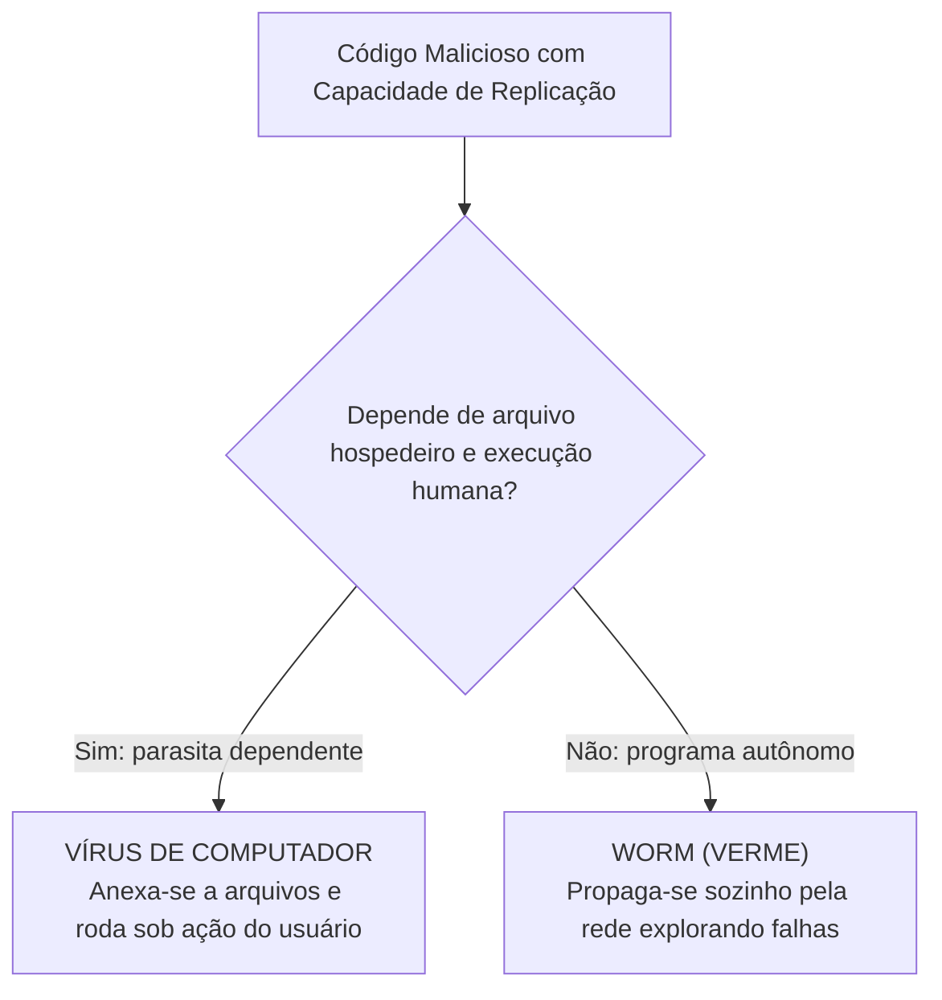
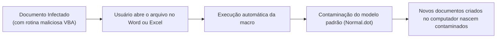
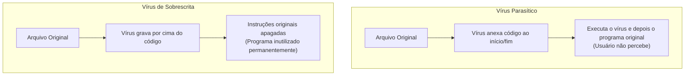
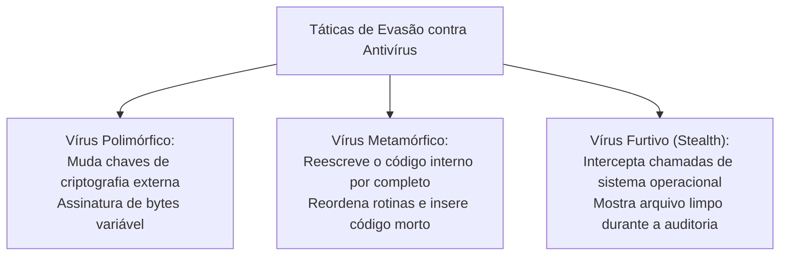
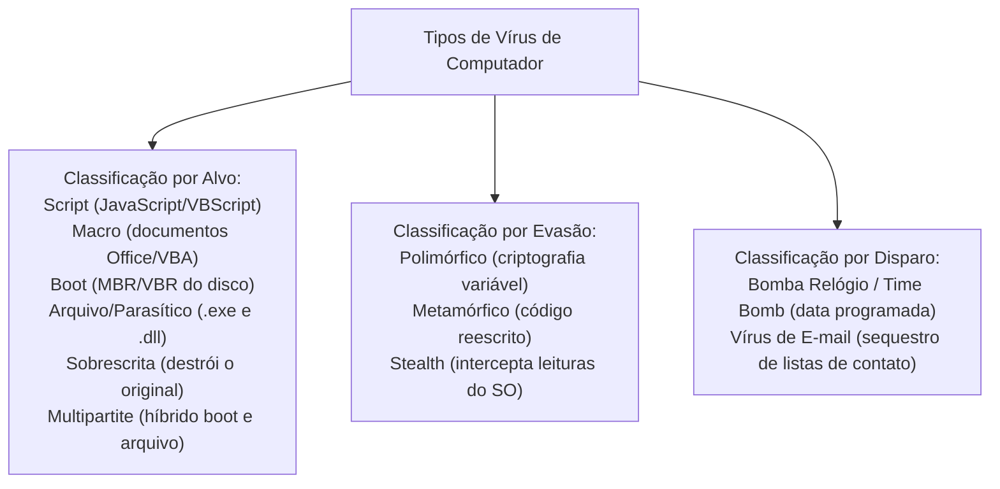

A compreensão das linhagens de vírus de computador é tema recorrente e decisivo nas provas de segurança da informação. Os vírus não se comportam de maneira homogênea no ambiente computacional. Suas táticas variam radicalmente conforme o alvo primário de contaminação, os métodos de evasão empregados contra scanners antivírus e o gatilho temporal de ativação da carga destrutiva. Nas operações de inteligência da Polícia Civil e no controle logístico de quartéis do Corpo de Bombeiros, saber neutralizar e identificar essas pragas virtuais protege sistemas contra espionagem e corrupção de dados.

> [!objetivos]
> - Diferenciar a natureza dependente dos vírus de computador em face do comportamento autônomo dos worms.
> - Compreender a mecânica dos vírus de script e a contaminação de documentos por vírus de macro.
> - Analisar a infecção do setor de inicialização da mídia física por vírus de boot e vírus multipartite.
> - Comparar vírus parasíticos com vírus de sobrescrita e dominar as técnicas de evasão polimórfica, metamórfica e stealth.
> - Identificar o mecanismo de ativação de bombas relógio e os vetores de disseminação por correio eletrônico.

## Natureza Dependente do Vírus de Computador

O vírus de computador é uma entidade parasitária por definição. Ele não possui capacidade de existência autônoma ou execução isolada no sistema operacional. Para existir e operar, o código malicioso requer compulsoriamente a presença de um arquivo hospedeiro legítimo ao qual se anexa.

Além do hospedeiro, o vírus depende de uma ação direta do usuário humano para ser ativado. Ele só inicia sua rotina de replicação quando o arquivo infectado é aberto, carregado ou executado na memória do computador.

Essa dependência constitui a fronteira taxonômica fundamental que separa o vírus do worm:
- O vírus infecta outros arquivos e necessita da intervenção do usuário para ser executado.
- O worm é um programa independente e completo. Ele se replica de forma autônoma pela rede explorando vulnerabilidades sem precisar de hospedeiro ou ação do usuário.

> [!bizu]
> Grave este binômio conceitual cobrado pelas bancas:
> - Vírus: depende de hospedeiro e depende de execução do usuário.
> - Worm: não depende de hospedeiro e não depende de execução do usuário.

## Vírus de Script

O script é uma sequência estruturada de comandos interpretados que instrui navegadores e utilitários a realizarem tarefas automatizadas. Tecnologias como JavaScript, VBScript e PowerShell são amplamente utilizadas na web moderna para viabilizar interações dinâmicas.

O vírus de script é um código malicioso escrito nessas linguagens interpretadas. Seus principais vetores de disseminação incluem:
- Páginas web maliciosas que executam scripts ocultos no navegador desatualizado do visitante (drive-by download).
- Mensagens de correio eletrônico formatadas em padrão HTML. Conforme as configurações do cliente de e-mail, o código malicioso pode ser processado e executado automaticamente no instante em que a mensagem é visualizada, sem necessidade de clique em links externos.
- Arquivos de scripts com extensões .js, .vbs ou .ps1 anexados a comunicações eletrônicas.

> [!atencao]
> Mensagens recebidas de remetentes conhecidos (colegas de batalhão ou chefias imediatas) não devem receber confiança cega. Se o equipamento do remetente estiver previamente infectado por um vírus de script, a praga virtual utilizará a conta legítima da vítima para disparar e-mails contaminados para toda a agenda de contatos sem o conhecimento do titular.

## Vírus de Macro

O vírus de macro constitui uma variação especializada de vírus de script com elevada frequência em questões de concursos. Esse código malicioso infecta documentos gerados por pacotes de produtividade de escritório, como Microsoft Word, Excel, PowerPoint e Access.

As suítes de escritório modernas contam com a linguagem Visual Basic for Applications (VBA) para automatizar cálculos e relatórios repetitivos. O vírus de macro insere instruções maliciosas dentro desses módulos de automação.

As características operacionais dos vírus de macro englobam:
1. Alvo de contaminação: infectam documentos (.doc, .docx com macro ativada, .xls) e modelos globais (como o arquivo normal.dot do Word), e não programas executáveis tradicionais (.exe).
2. Propagação facilitada: como documentos de texto e planilhas orçamentárias circulam intensamente entre servidores públicos, o vírus de macro dissemina-se rapidamente via anexos de e-mail e unidades compartilhadas.
3. Transposição de controles de acesso: filtros de perímetro que barram arquivos executáveis frequentemente autorizam a passagem de documentos de escritório, facilitando a penetração do vírus.
4. Momento da infecção: o vírus é executado no instante exato em que o usuário abre o documento contaminado no aplicativo correspondente.

> [!pegadinha]
> O vírus de macro não ataca o sistema operacional diretamente nem contamina executáveis do Windows. Ele infecta estritamente documentos e planilhas de suítes de escritório. A defesa primária consiste em desativar a execução automática de macros nas configurações da central de confiabilidade do programa.

## Vírus de Boot: Ataque ao Registro Mestre de Inicialização

O vírus de boot é uma das pragas virtuais mais destrutivas e antigas da computação. O seu alvo de ataque primário não são arquivos executáveis comuns do sistema de arquivos, mas sim os setores físicos de inicialização da mídia de armazenamento.

Quando o computador é ligado, o circuito básico de entrada e saída (BIOS ou UEFI) localiza a mídia de boot e executa o código gravado no Master Boot Record (MBR) ou no Volume Boot Record (VBR). O vírus de boot substitui ou modifica esse registro de inicialização, gravando o código original do sistema em outro setor físico oculto do disco.

Consequências críticas do vírus de boot:
- Carregamento prioritário: o vírus de boot é carregado na memória RAM do computador antes mesmo de o sistema operacional iniciar suas rotinas de defesa.
- Controle antecipado: instalado antes do Windows ou Linux, o vírus assume o controle dos registradores do processador e pode ocultar sua presença contra softwares antivírus convencionais.
- Vetor de contaminação física: a disseminação ocorre pelo esquecimento de pen drives ou discos externos infectados conectados na máquina durante a reinicialização.
- Dificuldade de remoção: a formatação rápida do disco rígido não elimina o vírus de boot, pois ela recria apenas as tabelas lógicas de arquivos, preservando intacto o setor físico MBR. A limpeza exige a reconstrução formal do registro MBR ou formatação física de baixo nível.

| Atributo Técnico | Vírus de Arquivo (.exe) | Vírus de Boot (MBR) |
|---|---|---|
| Alvo da infecção | Programas executáveis e bibliotecas de sistema | Setores físicos de inicialização do disco e pen drives |
| Momento de ativação | Quando o usuário abre o executável hospedeiro | No instante da inicialização física da máquina (boot) |
| Relação com o SO | Executa dentro da sessão do sistema operacional | Carrega na memória RAM antes do sistema operacional |
| Resistência à limpeza | Removível por antivírus ou exclusão do executável | Resiste à formatação rápida; exige reparo do MBR |

> [!bizu]
> Lembre-se: o vírus de boot pode infectar pen drives e discos removíveis mesmo que eles contenham apenas documentos comuns. O vírus se aloja no setor físico de partição da mídia, aguardando que o computador seja ligado com a unidade conectada.

## Vírus de Arquivo (Parasítico) e Vírus de Sobrescrita

A contaminação de arquivos executáveis desdobra-se em duas abordagens técnicas distintas conforme a preservação do programa original:

O vírus de arquivo tradicional, também chamado de parasítico, localiza arquivos executáveis (com extensões .exe, .com, .dll ou .sys) e anexa seu código malicioso ao arquivo. Ele altera o endereço do ponto de entrada inicial do programa. Quando o usuário executa o software, o código do vírus é acionado em primeiro lugar na memória. Em seguida, o vírus transfere o fluxo de controle de volta para as instruções do programa original. Dessa forma, o usuário utiliza o software normalmente sem desconfiar da presença da praga.

O vírus de sobrescrita (ou de substituição) adota uma postura abertamente destrutiva. Ao infectar o programa hospedeiro, o vírus grava seu código diretamente por cima do código original do aplicativo, apagando parte substancial ou a totalidade das instruções legítimas. Quando o usuário tenta abrir o programa, este apresenta falha fatal de execução ou mensagens de erro.

> [!atencao]
> A distinção entre vírus parasítico e de sobrescrita possui impacto pericial direto:
> - No vírus parasítico, o programa original permanece íntegro dentro do arquivo; o antivírus consegue remover o código malicioso e restaurar o aplicativo.
> - No vírus de sobrescrita, as instruções originais foram irremediavelmente destruídas; o software não pode ser desinfectado, exigindo reinstalação ou recuperação por cópia de segurança (backup).

## Vírus Multipartite (Multicomponente)

O vírus multipartite combina múltiplos vetores de ataque em uma única estrutura biológica virtual. Ele contamina simultaneamente arquivos executáveis de programas e os setores físicos de inicialização de boot do disco.

O caráter híbrido confere extrema virulência e dificuldade de contenção ao vírus multipartite:
- Se o administrador do sistema utilizar uma ferramenta antivírus para limpar todos os arquivos executáveis do disco rígido, mas não desinfectar o setor de inicialização MBR, o computador será reinfectado no próximo ciclo de inicialização.
- Se o técnico reparar o setor de boot, mas deixar um único arquivo executável contaminado no sistema de arquivos, a execução desse programa reinfectará o registro de boot imediatamente.

> [!pegadinha]
> Todo vírus multipartite possui um componente de boot em seu plano de infecção. Contudo, nem todo vírus de boot é multipartite. O vírus de boot puro ataca exclusivamente o setor de inicialização, enquanto o multipartite ataca setores de boot e arquivos de programa ao mesmo tempo.

## Técnicas de Evasão: Polimórficos, Metamórficos e Furtivos

Os antivírus baseiam sua detecção clássica na assinatura digital. A assinatura é uma sequência única e fixa de bytes que identifica com precisão o código do vírus. Para burlar essa checagem estática, os criadores de malwares desenvolveram três mecanismos avançados de evasão:

O vírus polimórfico altera sua assinatura visual a cada nova replicação, mantendo rigorosamente inalterada a sua rotina algorítmica fundamental. O vírus utiliza um gerador de mutação que combina o corpo do código com rotinas variáveis de criptografia. Cada nova cópia do vírus é cifrada com uma chave criptográfica inédita. Para o scanner de antivírus baseado em assinaturas, cada arquivo apresenta uma sequência de bytes totalmente diferente, dificultando o reconhecimento padrão.

O vírus metamórfico atua com sofisticação superior. Ele não se limita a trocar a chave de criptografia externa; ele reescreve integralmente a sua própria estrutura algorítmica a cada nova geração. O vírus metamórfico possui um mecanismo interno de mutação e recompilação que reordena sub-rotinas, insere instruções mortas (instruções NOP que não realizam ação), substitui instruções por comandos equivalentes e troca registradores de memória. A cada nova máquina infectada, o vírus apresenta código-fonte e comportamento sintático renovados.

O vírus furtivo (stealth) adota técnicas de ocultação ativa em tempo de execução. O vírus monitora e intercepta as chamadas de sistema (system calls, interrupções e APIs do sistema operacional) emitidas por softwares de segurança. Quando um programa antivírus solicita a leitura de um arquivo infectado para checar seu tamanho em bytes ou examina o setor de boot MBR, o vírus stealth intercepta a consulta e devolve os dados originais do arquivo limpo ou a imagem do setor de boot não contaminado. O vírus esconde sua presença inclusive descarregando-se temporariamente da memória durante inspeções profundas.

| Categoria de Evasão | Mecanismo de Ocultação | Impacto na Detecção por Antivírus |
|---|---|---|
| Polimórfico | Criptografa o corpo do vírus com chaves alternadas a cada cópia | Muda a assinatura de bytes externa; requer análise heurística |
| Metamórfico | Reescreve completamente a estrutura do código e instruções | Altera sintaxe e semântica; exige emulação em sandbox |
| Furtivo (Stealth) | Intercepta chamadas de sistema e devolve dados do arquivo limpo | Engana a leitura direta do antivírus mascarando tamanhos |

> [!bizu]
> Distinção essencial para a prova:
> - Polimórfico: muda a casca criptográfica externa e a assinatura, mas a lógica interna é preservada.
> - Metamórfico: reescreve a lógica interna e todo o corpo do programa, sendo muito mais difícil de detectar.
> - Stealth: mente para o sistema operacional interceptando consultas de leitura de disco.

## Vírus de Tempo (Bomba Relógio) e Vírus de E-mail

> [!exemplo]
> O vírus Chernobyl (CIH) notabilizou-se como uma das bombas relógio mais agressivas da história da segurança computacional. O código malicioso permanecia dormente em arquivos executáveis comuns sem exibir qualquer sintoma perceptível de lentidão. Ao alcançar o dia 26 de abril, data que marcava o aniversário do desastre nuclear ucraniano, o mecanismo de ativação disparava a carga destrutiva. O vírus gravava dados nulos diretamente no chip Flash BIOS da placa-mãe do computador, impedindo a inicialização física do equipamento e destruindo simultaneamente todas as tabelas de partição do disco rígido.

Duas linhagens históricas ilustram a temporização e a propagação orientada:

A bomba relógio (time bomb) é um vírus dotado de mecanismo de ativação programado para detonar sua carga útil em uma data calendária específica, horário predeterminado ou após a ocorrência de um evento sistêmico (como a inicialização número cem do computador). Durante o período anterior à data crítica, o vírus permanece em fase de dormência absoluta, multiplicando suas cópias sem manifestar qualquer comportamento hostil perceptível. Casos célebres como o vírus Sexta-Feira 13, o Michelangelo e o Chernobyl (CIH) destruíram BIOS e dados corporativos mundiais ao alcançarem suas datas programadas.

O vírus de e-mail é especializado na exploração de catálogos de endereços eletrônicos. Quando executado pelo usuário ao abrir um anexo contaminado, o vírus aciona as bibliotecas de correio eletrônico locais, sequestra a lista de contatos do programa (como Microsoft Outlook ou Mozilla Thunderbird) e remete mensagens enganosas contendo cópias de si mesmo para todos os destinatários cadastrados. Ele explora a confiança estabelecida entre colegas de trabalho para alavancar sua taxa de infecção.

> [!exemplo]
> Em um departamento de polícia, um escrivão abre o anexo fatura_atualizada.zip enviado supostamente pela companhia telefônica. O arquivo abriga um vírus executável com mecanismo de bomba relógio. O código anexa-se aos programas da delegacia e permanece latente durante meses. Ao atingir o dia trinta e um de dezembro, a rotina de ativação dispara a carga útil, apagando as partições de disco das estações de trabalho.

> [!atencao]
> A mitigação contra vírus de e-mail e bombas relógio exige medidas complementares:
> - Bloquear extensões potencialmente perigosas nos servidores de correio (.exe, .scr, .vbs, .bat).
> - Desativar a abertura automática de anexos no leitor de correio eletrônico.
> - Realizar análises heurísticas e de reputação em nuvem antes da entrega da mensagem à caixa postal.

## Mapa do capítulo

### Para fixar

- O vírus de computador é uma praga dependente que requer arquivo hospedeiro e execução explícita pelo usuário.
- O vírus de macro ataca documentos do pacote Office e opera na linguagem de automação VBA.
- O vírus de boot infecta o setor MBR do disco rígido e carrega na memória antes do sistema operacional.
- A formatação rápida de um disco não elimina o vírus de boot, pois o registro MBR físico permanece preservado.
- O vírus parasítico anexa seu código sem destruir o programa hospedeiro, permitindo a desinfecção posterior.
- O vírus de sobrescrita apaga as instruções originais do programa, tornando a recuperação viável apenas por backup.
- O vírus multipartite ataca concomitantemente setores de inicialização física e arquivos executáveis de programas.
- O vírus polimórfico altera a chave criptográfica externa para mudar a assinatura; o metamórfico reescreve todo o seu código interno.
- O vírus stealth intercepta chamadas do sistema operacional para mentir sobre o tamanho e estado de arquivos inspecionados.
- A bomba relógio permanece dormente até que uma data pré-fixada ative a execução da sua carga útil.
