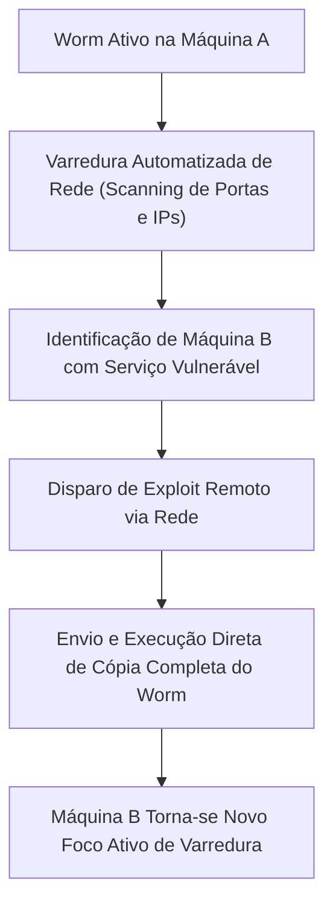
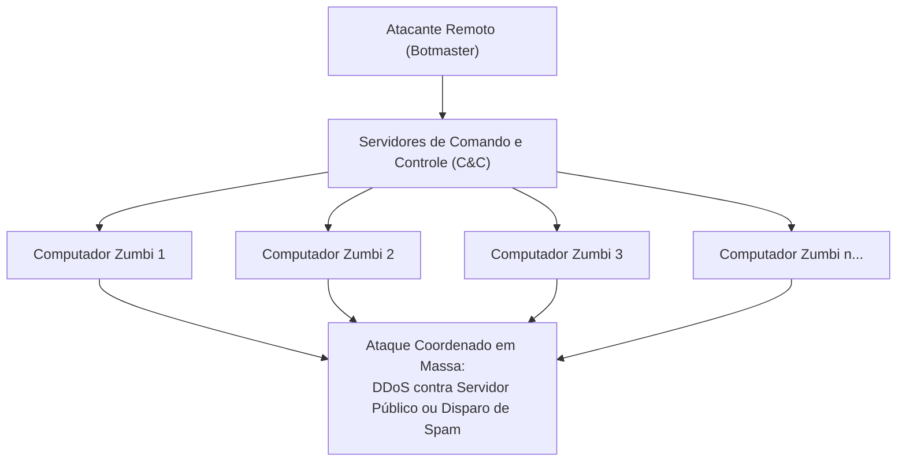
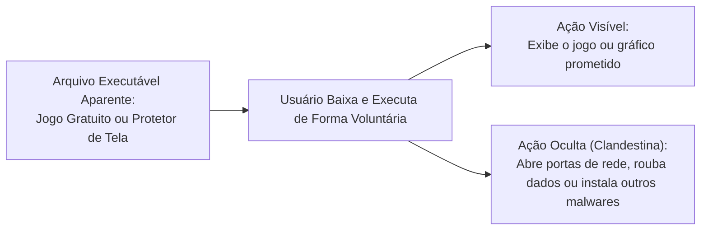
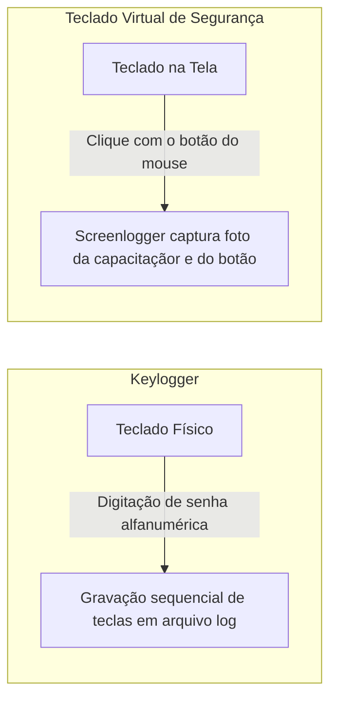
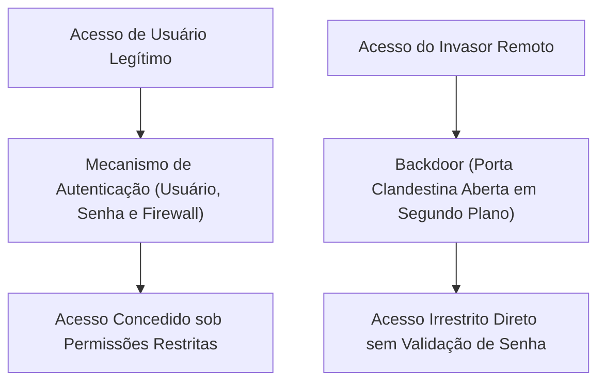
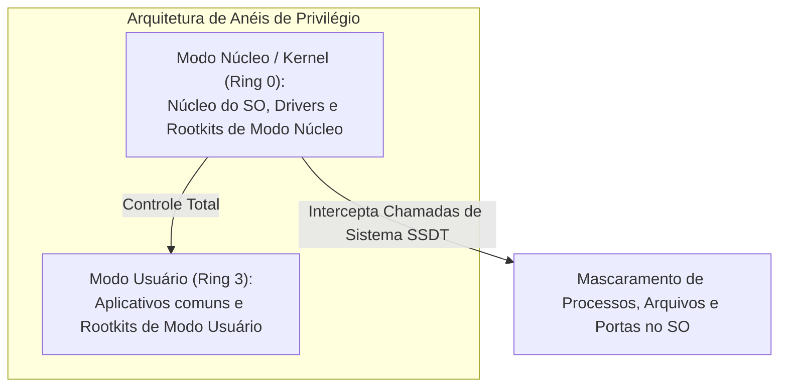
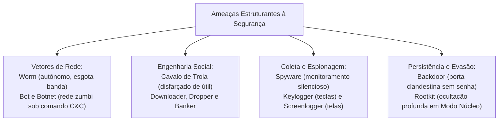

As operações de inteligência cibernética e a repressão a crimes informáticos exigem o domínio aprofundado das categorias estruturantes de códigos maliciosos. No contexto da segurança pública, invasões a bancos de dados policiais, interceptações clandestinas e indisponibilidade de serviços de emergência 190 e 193 decorrem da ação integrada de ameaças sofisticadas. Cada modalidade de malware desempenha função técnica especializada na cadeia do ataque cibernético. Enquanto vermes digitais saturam enlaces de comunicação e redes zumbis executam ataques distribuídos, cavalos de Troia viabilizam acessos ilegítimos e rootkits camuflam o comprometimento do sistema em níveis profundos de privilégio.

> [!objetivos]
> - Diferenciar detalhadamente o mecanismo de propagação autônomo dos worms em face dos vírus tradicionais.
> - Compreender a arquitetura das redes botnets e o controle remoto de computadores zumbis por canais C&C.
> - Analisar o conceito e as múltiplas variações de cavalos de Troia, incluindo downloader, dropper e backdoor.
> - Caracterizar os tipos de spyware, aprofundando o funcionamento de keyloggers e screenloggers.
> - Compreender a ação furtiva dos rootkits na camuflagem profunda de malwares em nível de núcleo (kernel).

## O Worm: O Verme Autônomo da Internet

O worm (verme de computador) é um programa malicioso completo, autônomo e independente. Ele diferencia-se ontologicamente dos vírus por não necessitar de um arquivo hospedeiro para se propagar e por não depender de intervenção ou clique do usuário humano.

O mecanismo de ação do worm opera em escala automatizada por meio de redes de comunicação de dados:
1. Varredura de alvos (scanning): o código ativo na máquina contaminada dispara requisições sistemáticas para encontrar outros computadores ativos na rede local ou na Internet.
2. Identificação de vulnerabilidades: o worm sonda portas abertas em busca de softwares desatualizados, serviços de rede mal configurados ou falhas de programação documentadas.
3. Exploração e replicação direta: ao localizar um alvo vulnerável, o worm explora a brecha de segurança por meio de um exploit, envia uma cópia integral de si mesmo e executa o código na máquina remota sem intervenção humana.

O impacto primário da infecção por worms reside na saturação da infraestrutura de comunicação. O tráfego maciço gerado pela proliferação contínua de milhões de cópias consome a largura de banda dos roteadores e sobrecarrega a memória e os processadores dos servidores de rede.

> [!bizu]
> Guarde as três características inegociáveis do worm para as provas:
> - É autônomo: não precisa de hospedeiro.
> - É autorreplicável: propaga-se sozinho pela rede sem clique do usuário.
> - É predador de recursos: consome banda de rede e processamento, gerando lentidão generalizada.

| Critério de Comparação | Vírus de Computador | Worm (Verme) |
|---|---|---|
| Independência | Parasítico (depende de arquivo hospedeiro) | Programa completo e autônomo |
| Dependência humana | Requer execução explícita pelo usuário | Propaga-se sozinho pela rede sem clique |
| Mecanismo de difusão | Compartilhamento e abertura de arquivos | Exploração automatizada de falhas de rede |
| Impacto primário | Corrupção de dados e destruição de arquivos | Degradação de desempenho e saturação de banda |

## Estudos de Casos Históricos de Worms e Infraestrutura Crítica

A trajetória histórica dos vermes computacionais revela a rápida escalada de complexidade técnica das pragas de rede. O primeiro caso de grande repercussão mundial foi o Morris Worm, lançado em 1988 por Robert Tappan Morris. Criado originalmente para mensurar a dimensão da Internet, o código continha uma falha de projeto que reinfectava repetidamente as mesmas máquinas UNIX. Esse comportamento descontrolado gerou colapso operacional e lentidão massiva nos servidores acadêmicos e militares conectados à rede precursora ARPANET.

Nas décadas seguintes, surgiram linhagens com poder de disseminação avassalador:
- Code Red (2001): explorou uma vulnerabilidade de estouro de memória (buffer overflow) no servidor web Microsoft IIS. O verme contaminou centenas de milhares de servidores em poucas horas e programou um ataque de negação de serviço contra o sítio oficial da Casa Branca.
- SQL Slammer (2003): tornou-se célebre por sua velocidade de propagação supersônica. Compactado em um único pacote de rede UDP de 376 bytes, o verme explorou falhas em servidores de banco de dados Microsoft SQL Server. Ele infectou mais de 75 mil servidores em menos de dez minutos, derrubando caixas eletrônicos bancários e sistemas de despacho aéreo nos Estados Unidos.
- Conficker (2008): utilizou múltiplos vetores simultâneos de infecção, explorando vulnerabilidades no serviço de compartilhamento de arquivos do Windows (porta SMB 445), senhas fracas de rede e mídias removíveis via autorun. O Conficker ergueu uma botnet global com milhões de nós ativos.
- Stuxnet (2010): considerado a primeira ciberarma de nível estatal da história. O Stuxnet foi concebido especificamente para sabotar centrífugas de enriquecimento de urânio na usina nuclear de Natanz, no Irã. Ele utilizou quatro vulnerabilidades desconhecidas de dia zero (zero-day exploits), infectou computadores industriais SCADA da Siemens e alterou as rotações mecânicas dos motores sem que os operadores percebessem anomalias nos mostradores.

> [!exemplo]
> O caso do Stuxnet ilustra o perigo cibernético moderno contra instalações militares e de defesa civil. O malware penetrou em uma rede completamente isolada da Internet (ambiente com separação física air-gapped) por meio de um pen drive contaminado inserido por um prestador de serviço. Uma vez dentro, o verme propagou-se de máquina em máquina até atingir os controladores lógicos programáveis (CLPs) da planta industrial.

## Bot e Botnet: O Exército de Computadores Zumbis

O termo bot deriva da palavra robot (robô) e designa um código malicioso dotado de rotinas de controle remoto e comunicação bidirecional contínua com um atacante externo.

Quando um equipamento é infectado por um bot, ele passa a ser denominado computador zumbi. O usuário legítimo opera sua máquina normalmente sem desconfiar de que o dispositivo recebe e cumpre instruções clandestinas geradas por um servidor externo de Comando e Controle (C&C).

A agregação de milhares ou milhões de computadores zumbis sob o controle unificado de um mesmo criminoso cibernético (denominado botmaster ou bot herder) constitui uma botnet (rede zumbi).

A arquitetura das botnets opera por meio de canais de comunicação estruturados:
- Modelo centralizado: os nós zumbis conectam-se a servidores centrais via protocolo IRC (Internet Relay Chat) ou conexões HTTP/HTTPS protegidas para recolher tarefas agendadas.
- Modelo descentralizado (Peer-to-Peer - P2P): as instruções distribuem-se entre os próprios nós zumbis da rede, conferindo resiliência estrutural que impede a derrubada da rede caso um servidor seja apreendido pela polícia.

As principais ações destrutivas executadas por botnets englobam:
1. Ataques de Negação de Serviço Distribuída (DDoS): milhões de computadores disparam requisições simultâneas contra servidores governamentais ou bancários, provocando colapso de atendimento.
2. Disseminação de spam em massa: envio coordenado de bilhões de e-mails fraudulentos e links maliciosos.
3. Mineração clandestina de criptomoedas: exploração oculta do poder de processamento da CPU e da placa gráfica das vítimas para geração de moedas digitais.
4. Hospedagem distribuída de conteúdos ilegais: armazenamento fracionado de arquivos ilícitos em múltiplos terminais zumbis.

> [!atencao]
> A diferença conceitual entre worm e bot é sutil e muito cobrada:
> - O worm foca prioritariamente na replicação descontrolada para contaminar o maior número de máquinas e consumir recursos de rede.
> - O bot instala-se na máquina para aguardar instruções remotas do botmaster e agir sob comando unificado. Muitos malwares contemporâneos utilizam rotinas de worm para disseminar bots velozmente.

## A Indústria do Cibercrime: Botnets e o Modelo CaaS

A operação de botnets deixou de ser uma atividade amadora de exibicionismo para se transformar em um mercado ilícito altamente lucrativo. Essa dinâmica é classificada por analistas como Crime as a Service (CaaS - Cibercrime como Serviço).

Grupos especializados desenvolvem malwares para recrutar novos computadores zumbis diariamente. Em fóruns clandestinos da dark web, essas redes zumbis são alugadas por horas ou semanas para clientes que desejam executar ataques específicos:
- Contratação de ataques de DDoS sob encomenda: concorrentes desleais ou chantagistas alugam o poder de disparo da botnet para tirar do ar lojas virtuais, provedores de Internet ou portais de notícias durante períodos de grande movimento comercial.
- Campanhas de spam e phishing direcionado: empresas criminosas alugam a capacidade de envio de e-mails da botnet para disparar milhões de mensagens de cobrança falsa ou golpes de loteria sem usar seus próprios endereços IP.
- Mineração distribuída de Monero e Bitcoin: os nós zumbis são instruídos a rodar rotinas silenciosas de cálculo criptográfico em segundo plano, consumindo eletricidade e desgastando o hardware da vítima para enriquecer os criminosos.

> [!bizu]
> Observe para a prova a relação entre botnet e endereço IP: quando um ataque parte de uma botnet, os pacotes que inundam o alvo trazem os endereços IP legítimos dos computadores zumbis das vítimas. Bloquear esses IPs é ineficaz, pois há milhares de máquinas contaminadas espalhadas por operadoras residenciais de todo o planeta.

## Cavalo de Troia (Trojan Horse)

O Cavalo de Troia (Trojan Horse) recebe essa designação em alusão histórica ao estratagema da Grécia Antiga narrado na Ilíada. Trata-se de um software malicioso que se disfarça de programa útil, atraente, legítimo ou inofensivo para induzir a própria vítima a realizar o download e a execução do arquivo.

O trojan explora a engenharia social como vetor de entrega. Ele apresenta-se sob o formato de jogos eletrônicos gratuitos, cartões virtuais comemorativos, protetores de tela animados, planilhas orçamentárias ou ativadores piratas de softwares comerciais.

No instante em que o usuário executa o programa hospedeiro disfarçado:
- O trojan pode executar a tarefa inofensiva prometida na interface visual para não despertar suspeitas do operador.
- Simultaneamente, nos bastidores do sistema operacional e de forma invisível, o trojan executa uma rotina maliciosa pré-programada, violando a integridade da máquina.

Diferentemente dos vírus e worms, o trojan tradicional não possui rotinas de autorreplicação. Ele não anexa cópias de si mesmo a outros programas nem se espalha sozinho pelas redes de dados. A sua proliferação depende estritamente do engano da vítima em baixar e executar o arquivo contaminado.

## Categorias e Especializações de Cavalos de Troia

A diversificação das técnicas criminosas deu origem a famílias especializadas de trojans, catalogadas conforme a função desempenhada na máquina comprometida:

- Trojan Downloader: programa enxuto cuja única finalidade consiste em conectar-se silenciosamente à Internet, baixar arquivos maliciosos adicionais de um servidor remoto e executá-los na máquina da vítima.
- Trojan Dropper: código malicioso que carrega outros malwares embutidos e compactados no interior de seu próprio executável. Ao ser iniciado, o dropper descompacta esses arquivos e os instala no sistema de arquivos local sem precisar de conexão de rede.
- Trojan Backdoor: abre portas de comunicação clandestinas no firewall e no sistema operacional, permitindo que invasores remotos controlem o computador à distância.
- Trojan Banker (Banker): malware especializado na interceptação de transações bancárias. Ele monitora a abertura de navegadores em portais de instituições financeiras, redireciona o tráfego ou sobrepõe telas falsas para furtar credenciais, senhas e códigos de autenticação em dois fatores.
- Trojan Spy: atua como ferramenta de espionagem furtiva, coletando arquivos pessoais, credenciais corporativas e dados de configuração para envio a servidores clandestinos.
- Trojan Destrutivo: apaga partições de disco, corrompe o setor MBR e inutiliza arquivos vitais do sistema operacional.
- Trojan Ransom: executa rotinas de criptografia hostil contra os documentos da vítima, bloqueando o acesso e exigindo pagamento de resgate financeiro.

| Modalidade de Trojan | Finalidade Operacional | Mecanismo de Ação no Sistema |
|---|---|---|
| Downloader | Baixar malwares externos | Conecta à rede e descarrega códigos complementares |
| Dropper | Extrair malwares internos | Descompacta códigos maliciosos gravados em seu corpo |
| Backdoor | Abrir portas de invasão | Configura canais de acesso remoto para retorno do atacante |
| Banker | Fraude bancária | Injeta telas falsas e captura credenciais financeiras |
| Spy | Espionagem geral | Coleta documentos sigilosos e hábitos operacionais |
| Ransom | Extorsão por resgate | Criptografa arquivos locais e exibe instrução de pagamento |

> [!pegadinha]
> A banca costuma explorar a diferença mecânica entre Downloader e Dropper:
> - O Trojan Downloader não traz os malwares consigo; ele conecta à Internet para baixá-los externamente.
> - O Trojan Dropper já traz os malwares embutidos dentro de seu próprio arquivo executável, extraindo-os para o disco mesmo que a máquina esteja desconectada da rede.

## Mecânica dos Trojans Bancários no Cenário Brasileiro

O Brasil é internacionalmente reconhecido como um dos maiores desenvolvedores e exportadores de cavalos de Troia bancários (bankers). A engenharia desses malwares evoluiu para contornar as sofisticadas camadas de proteção desenvolvidas pelo setor financeiro nacional.

As técnicas usuais empregadas por bankers englobam:
1. Injeção de código em navegadores (Man-in-the-Browser): o trojan monitora o processo do navegador web (Chrome, Edge ou Firefox). Ao detectar que o usuário acessou o domínio de um banco, o malware altera o código HTML da página em tempo de execução, inserindo campos adicionais que exigem senhas de cartão, letras de segurança ou códigos de aplicativos móveis.
2. Telas sobrepostas (Overlay Attacks): o trojan projeta uma janela gráfica falsa com a mesma identidade visual do banco exatamente por cima da janela legítima do navegador. A vítima acredita que está interagindo com o portal oficial, mas digita suas credenciais diretamente na interface controlada pelo malware.
3. Bloqueio visual e movimentação automática de valores: alguns bankers avançados congelam a tela do computador com uma falsa mensagem de atualização de sistema. Enquanto o operador aguarda a suposta conclusão do procedimento, o código malicioso executa transferências financeiras (PIX ou TED) em segundo plano através da sessão bancária que já estava autenticada.

> [!atencao]
> A neutralização de trojans bancários exige hábitos operacionais cautelosos:
> - Nunca realizar transações financeiras em computadores de uso compartilhado ou corporativo destinados ao atendimento público de ocorrências.
> - Conferir rigorosamente o certificado digital HTTPS na barra de endereços do navegador (cadeado de segurança).
> - Desconfiar de solicitações inusitadas de digitação de senhas completas ou recadastramento de chaves de segurança durante a navegação regular.

## Spyware: A Espionagem de Dados e Comportamento

O spyware é uma categoria de software malicioso projetada especificamente para monitorar, registrar e transmitir informações e atividades dos usuários a terceiros não autorizados.

O spyware age em silêncio absoluto. Ele não busca danificar arquivos ou inutilizar o sistema operacional, pois a destruição evidente da máquina denunciaria sua presença e interromperia a coleta de dados sigilosos.

As principais vertentes de softwares espiões englobam:
- Keylogger: código que intercepta e registra a sequência exata de teclas físicas digitadas no teclado mecânico da estação de trabalho. O arquivo de registros (log) é remetido periodicamente ao invasor, revelando senhas de bancos de dados, números de cartão e diálogos confidenciais.
- Screenlogger: código que captura fotografias instantâneas da tela do computador, registrando a região ao redor da capacitaçãor sempre que o botão do mouse é pressionado. O screenlogger foi criado especificamente para burlar os teclados virtuais desenvolvidos por instituições financeiras contra keyloggers.
- Adware (Advertising Software): programa que projeta anúncios e propagandas não autorizadas na tela do usuário. Quando o adware rastreia secretamente os padrões e termos de busca do internauta para comercializar perfis publicitários sem consentimento, ele classifica-se formalmente como spyware invasivo.
- Sniffer (Analisador de Tráfego / Farejador): ferramenta de software ou hardware que coloca a placa de rede em modo promíscuo, capturando e examinando todos os pacotes de dados que trafegam no enlace local sem criptografia.

> [!bizu]
> Grave a evolução tecnológica: o teclado virtual foi concebido para derrotar o keylogger físico. Para derrotar o teclado virtual, os criminosos criaram o screenlogger fotográfico. Para conter ambos, utilizam-se canais criptografados ponta a ponta e autenticação biométrica e multifatorial.

## Backdoor: A Porta dos Fundos para Retorno Permanente

O backdoor (porta dos fundos ou alçapão) é uma rotina de código malicioso implantada no sistema para assegurar o retorno furtivo e irrestrito do atacante a um computador previamente comprometido.

A finalidade central do backdoor consiste em facultar o acesso remoto do invasor contornando os procedimentos convencionais de autenticação e logon do sistema operacional. O invasor não precisa redigitar senhas ou passar por filtros de auditoria; o backdoor abre portas lógicas (portas TCP ou UDP) e atua como um serviço clandestino em segundo plano.

O backdoor pode ser introduzido no sistema de diversas formas:
- Como carga útil entregue por um cavalo de Troia (Trojan Backdoor) ou worm.
- Inserido intencionalmente por programadores desonestos durante o desenvolvimento do software para fins de manutenção clandestina.
- Configurado por atacantes após explorarem uma vulnerabilidade crítica de rede que concedeu privilégios de administrador.

## Rootkit: A Ocultação Profunda em Nível de Núcleo (Kernel)

O rootkit representa o ápice da engenharia de ocultação em segurança da informação. A palavra origina-se da junção de root (o usuário administrador com privilégios máximos em ambientes Unix/Linux) e kit (conjunto de ferramentas).

O rootkit não é primariamente o código que infecta ou rouba os dados; ele é o conjunto avançado de utilitários projetado para manter a presença de um invasor e camuflar integralmente outros códigos maliciosos no sistema operacional.

O funcionamento do rootkit baseia-se na interceptação e adulteração das estruturas lógicas do próprio sistema:
- Ocultação de arquivos e diretórios: se o usuário abrir o Explorador de Arquivos ou digitar comandos de listagem no terminal (dir ou ls), o rootkit intercepta a resposta do sistema e remove seus próprios arquivos da exibição.
- Ocultação de processos ativos: se o administrador abrir o Gerenciador de Tarefas do Windows ou consultar o utilitário top no Linux, os processos do malware não aparecem na listagem de memória.
- Ocultação de conexões de rede: o rootkit mascara portas abertas em utilitários como o netstat, escondendo as comunicações com o servidor de comando e controle.
- Ocultação de chaves do registro: no Windows, chaves de inicialização automática no Registro são invisibilizadas contra inspeção pericial.

A taxonomia técnica divide os rootkits em duas camadas operacionais:
1. Rootkits em Modo Usuário (User Mode - Ring 3): operam na camada de aplicativos, alterando bibliotecas compartilhadas (.dll no Windows ou bibliotecas libc no Linux). São detectáveis com relativa facilidade por ferramentas de integridade.
2. Rootkits em Modo Núcleo (Kernel Mode - Ring 0): operam no nível mais profundo do sistema operacional, adulterando diretamente o núcleo (kernel), drivers de dispositivos e tabelas de despacho de chamadas de sistema (como a System Service Descriptor Table - SSDT). Possuem privilégios idênticos ou superiores aos próprios programas antivírus, podendo desativá-los ou enganá-los por completo.

> [!atencao]
> A remoção de um rootkit de modo núcleo é uma das tarefas mais complexas da computação forense. Como o rootkit pode subverter os mecanismos de checagem do próprio sistema operacional, softwares antivírus comuns em execução não conseguem identificar sua presença. A descontaminação segura frequentemente exige a inicialização por mídias externas confiáveis (Live CDs de resgate), análise estática forense ou formatação limpa e reinstalação total do sistema operacional.

## Síntese Comparativa das Ameaças Estruturantes

Para consolidar as distinções cobradas nas provas, a tabela a seguir resume as características operacionais essenciais das ameaças abordadas:

| Categoria do Malware | Necessita de Hospedeiro? | Propagação Autônoma? | Função Primária de Destaque |
|---|---|---|---|
| Vírus de Computador | Sim (parasita executáveis ou docs) | Não (depende de clique do usuário) | Corromper arquivos e replicar localmente |
| Worm (Verme) | Não (programa independente) | Sim (propaga-se sozinho via rede) | Consumir largura de banda e explorar falhas |
| Bot (Rede Zumbi) | Não (programa independente) | Variável (utiliza vetores de rede) | Obedecer comandos remotos de botmaster |
| Cavalo de Troia (Trojan) | Não (disfarçado de programa útil) | Não (depende de execução da vítima) | Abrir brechas e induzir o usuário ao engano |
| Spyware | Variável (frequentemente com trojans) | Não (atua no terminal infectado) | Espionar teclas, telas e hábitos do usuário |
| Backdoor | Variável (serviço clandestino) | Não (implantado após invasão) | Garantir retorno contornando autenticação |
| Rootkit | Não (conjunto de ferramentas) | Não (implantado para camuflagem) | Ocultar processos, arquivos e conexões no SO |

## Mapa do capítulo

### Para fixar

- O worm é autônomo, não precisa de arquivo hospedeiro e propaga-se sozinho pela rede explorando vulnerabilidades.
- O impacto clássico do worm consiste no esgotamento da largura de banda e lentidão generalizada dos enlaces.
- O bot transforma o computador em zumbi subordinado a comandos remotos emitidos por servidores C&C.
- Uma botnet é uma malha de milhares de computadores zumbis empregada em ataques maciços de DDoS e disparo de spam.
- O cavalo de Troia disfarça-se de programa útil ou atraente para induzir a vítima a executá-lo voluntariamente.
- O trojan não possui rotinas de autorreplicação e divide-se em downloader, dropper, banker e backdoor.
- O spyware atua silenciosamente na coleta e transmissão clandestina de dados e hábitos do usuário.
- O keylogger grava teclas físicas digitadas; o screenlogger fotografa cliques ao redor da capacitaçãor do mouse.
- O backdoor abre portas clandestinas para assegurar o retorno permanente do atacante contornando autenticações.
- O rootkit é o conjunto de ferramentas que opera em nível de núcleo (kernel) para ocultar processos, arquivos e conexões.
