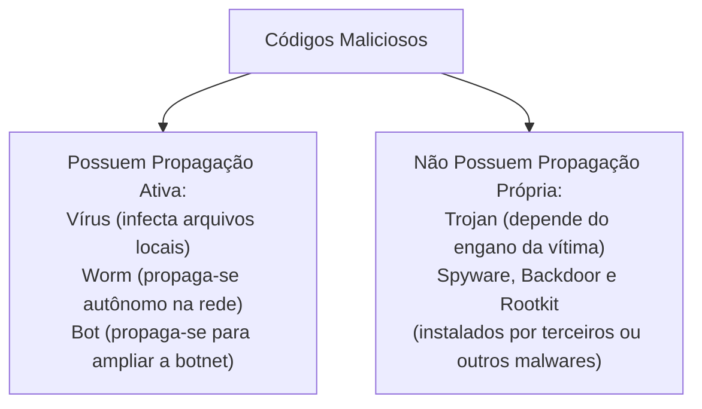
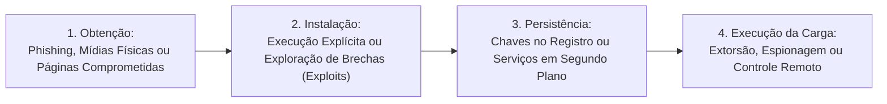
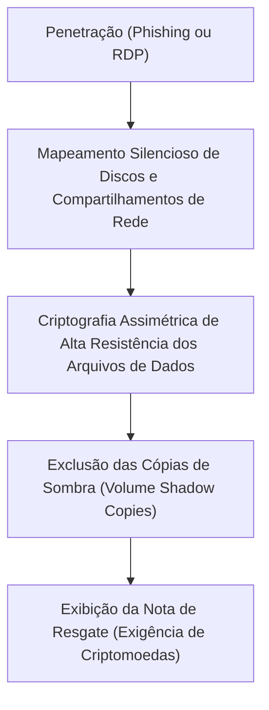
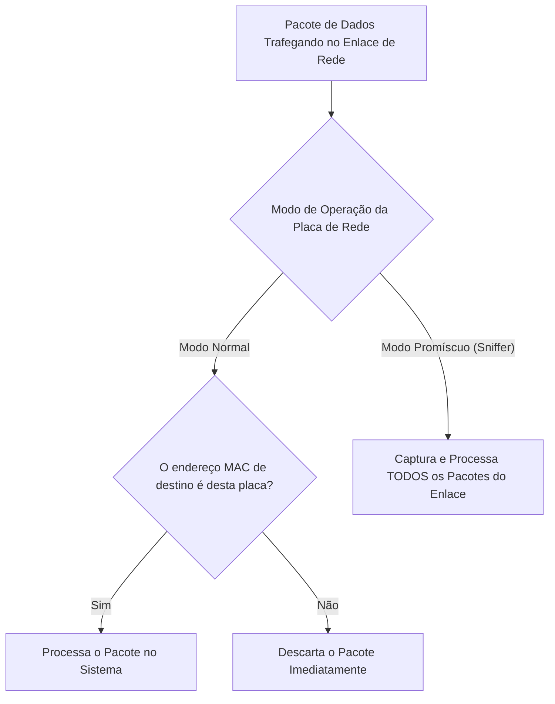
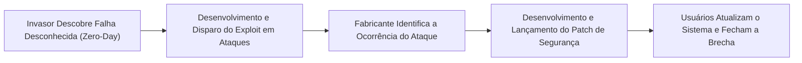
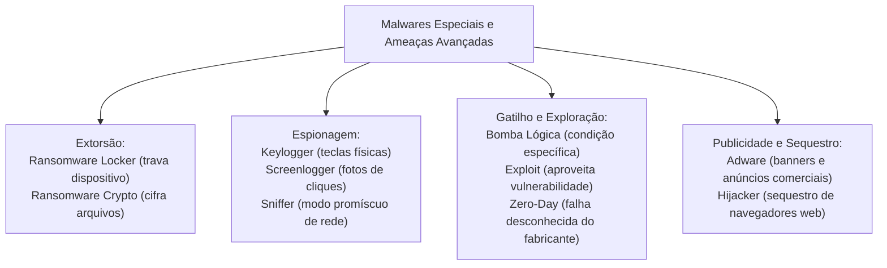

A sofisticação do cibercrime contemporâneo ampliou o leque de pragas virtuais para além dos vírus e vermes convencionais. Instituições de segurança pública enfrentam ataques destrutivos de extorsão digital e monitoramento clandestino de tráfego. O sequestro de dados corporativos por ransomware paralisa delegacias e serviços de emergência. A espionagem pontual por keyloggers, screenloggers e farejadores de rede compromete investigações policiais de alta sensibilidade. Compreender as formas de obtenção, as ações maliciosas mais comuns e o funcionamento de bombas lógicas e hijackers é requisito indispensável para o certame.

> [!objetivos]
> - Mapear as formas de obtenção e os mecanismos de propagação dos principais códigos maliciosos.
> - Compreender a dinâmica operacional do ransomware, diferenciando modalidades locker e crypto.
> - Analisar a mecânica de interceptação de dados por keyloggers e a captura de telas por screenloggers.
> - Distinguir adwares legítimos de versões maliciosas e identificar o uso de sniffers em modo promíscuo.
> - Caracterizar o funcionamento de bombas lógicas, exploits de dia zero e hijackers de navegadores.

## Formas de Obtenção e Ações Maliciosas mais Comuns

O CERT.br (órgão do Comitê Gestor da Internet no Brasil) classifica as ameaças virtuais conforme a forma de obtenção, o método de instalação e o comportamento de propagação.

A infecção ocorre por múltiplos canais de rede:
- Acesso a sítios web comprometidos ou links maliciosos em redes sociais.
- Execução de anexos em mensagens de correio eletrônico fraudulentas.
- Conexão de mídias físicas removíveis infectadas (pen drives).
- Compartilhamento de arquivos em redes peer-to-peer (P2P).
- Exploração direta de vulnerabilidades em serviços expostos à Internet.
- Inserção física ou remota deliberada por atacantes ou códigos maliciosos pré-instalados.

| Código Malicioso | Forma Principal de Obtenção | Método de Instalação | Propagação Autônoma? | Ação Primária |
|---|---|---|---|---|
| Vírus | Arquivos executáveis ou documentos | Abertura ou execução pelo usuário | Sim (em arquivos) | Corromper arquivos e programas |
| Worm | Redes de dados e e-mails | Exploração direta de falhas | Sim (pela rede) | Esgotar largura de banda e recursos |
| Bot | Sites, redes e anexos | Execução de dropper ou exploit | Sim (pela rede) | Cumprir ordens remotas de botnet |
| Trojan | Programas gratuitos e ativadores | Execução voluntária pela vítima | Não se propaga | Instalar outros malwares e abrir portas |
| Spyware | Trojans e pacotes de softwares | Instalado junto com programas | Não se propaga | Coletar dados e hábitos em silêncio |
| Backdoor | Trojans e invasões prévias | Implantado por código ou invasor | Não se propaga | Assegurar retorno sem autenticação |
| Rootkit | Trojans e exploits com privilégios | Substituição de rotinas do sistema | Não se propaga | Camuflar malwares em modo núcleo |

> [!bizu]
> Memorize para a prova a regra dos que não se propagam sozinhos: cavalos de Troia (trojans), spywares, backdoors e rootkits dependem de vetores externos para alcançar uma máquina. Eles não possuem rotinas internas de envio autônomo pela rede.

## Ações Maliciosas mais Comuns: Vetores de Instalação

A dinâmica de infecção organiza-se em três etapas bem definidas: obtenção, instalação e execução da carga maliciosa. Compreender a cronologia do ataque auxilia a equipe de segurança da informação no bloqueio tempestivo dos vetores de penetração.

> [!exemplo]
> Em um ataque de ransomware corporativo, os criminosos não executam a criptografia no primeiro minuto da invasão. O malware penetra por meio de uma credencial de acesso remoto (RDP) vazada. Ele passa semanas coletando dados silenciosamente com ferramentas de espionagem e localizando onde residem os servidores de backup. Somente após desativar ou corromper as cópias de segurança é que o ransomware crypto dispara sua rotina de cifragem em massa durante a madrugada de um feriado.

> [!bizu]
> Memorize para a prova: a forma mais eficaz de mitigar o risco de sequestro de dados por ransomware não é a instalação de antivírus isolados, mas a manutenção de backups frios e imutáveis. O backup imutável impede que mesmo usuários com privilégios de administrador possam sobrescrever ou apagar as versões salvas durante um ataque.

## Ransomware: O Sequestro Digital de Ativos

O ransomware constitui uma das ameaças cibernéticas mais devastadoras do cenário contemporâneo. Trata-se de um código malicioso desenvolvido para tornar inacessíveis os dados armazenados em um equipamento ou rede corporativa, exigindo o pagamento de um resgate financeiro (ransom) para restabelecer o acesso legítimo da vítima.

O ransomware opera como uma extorsão virtual e divide-se em duas vertentes operacionais:
1. Ransomware Locker: bloqueia o acesso físico e lógico ao dispositivo contaminado. Ele impede o uso do teclado e do mouse e trava a tela inicial do sistema operacional com uma mensagem intimidadora de falso bloqueio judicial ou policial, exigindo pagamento para liberar o equipamento.
2. Ransomware Crypto: permite o uso normal do computador, mas criptografa silenciosamente todos os arquivos de documentos, planilhas, fotos, vídeos e bancos de dados (.docx, .xlsx, .pdf, .sql). O invasor emprega algoritmos criptográficos robustos de padrão militar (como AES e RSA). Ele apaga as cópias de sombra do sistema e deixa arquivos com instruções de pagamento em carteiras anônimas de criptomoedas.

> [!atencao]
> As autoridades de segurança pública e o CERT.br recomendam veementemente: NUNCA pague o resgate exigido por cibercriminosos. O pagamento financia organizações criminosas e não oferece qualquer garantia de que a chave de decodificação será entregue ou de que os dados não serão vazados na Internet.

> [!bizu]
> A única defesa verdadeiramente conclusiva contra ataques de ransomware é a rotina rigorosa de cópias de segurança (backup). A doutrina técnica recomenda a regra 3-2-1: manter 3 cópias de cada dado importante, armazenadas em 2 mídias físicas diferentes, sendo ao menos 1 cópia mantida externamente e desconectada da rede (backup frio ou offline).

A remediação técnica após um incidente de sequestro por ransomware exige um protocolo operacional estrito. A primeira providência imediata consiste em isolar fisicamente todas as máquinas afetadas da rede local, desconectando cabos Ethernet e desativando conexões Wi-Fi para conter a propagação lateral da praga. Em seguida, a equipe pericial preserva amostras da memória RAM e dos discos para investigação criminal de inteligência antes de iniciar a formatação das estações e a restauração dos dados a partir de backups verificados.

## Keyloggers: A Interceptação de Teclas Físicas

O keylogger é uma linhagem clássica de spyware especializada na captura de dados digitados no teclado mecânico da estação de trabalho.

A operação do keylogger estrutura-se em rotinas silenciosas:
- Interceptação de interrupções: o código malicioso monitora as chamadas de API do sistema operacional (como as funções GetAsyncKeyState no Windows) para registrar cada tecla pressionada.
- Registro sequencial: ele grava sequências alfanuméricas completas, incluindo senhas, números de cartão de crédito e conversas particulares.
- Gatilho direcionado: muitos keyloggers modernos permanecem em modo de espera e ativam a gravação apenas quando o usuário abre determinados sítios de comércio eletrônico ou portais de bancos.
- Transmissão remota: periodicamente, o arquivo de texto com os registros é remetido ao invasor via correio eletrônico, conexões FTP ou requisições web cifradas.

> [!exemplo]
> Em uma investigação da Polícia Civil sobre fraude financeira, o perito localizou um software keylogger instalado clandestinamente em um computador de tesouraria. O programa aguardava a abertura do navegador na página do banco público e gravava todas as credenciais bancárias e códigos de operador digitados pelo servidor responsável.

## Keyloggers de Hardware versus Keyloggers de Software

A doutrina pericial classifica os interceptadores de teclas em duas naturezas físicas distintas:

1. Keyloggers de Software: programas ou drivers espiões executados na memória RAM do computador hospedeiro. Eles utilizam ganchos de sistema (hooks) para capturar o fluxo de dados do teclado lógico. São detectáveis por ferramentas antivírus atualizadas e análises de integridade de processos.
2. Keyloggers de Hardware: dispositivos físicos intermediários miniaturizados conectados fisicamente entre o cabo do teclado USB ou PS/2 e a porta da placa-mãe do gabinete do computador. O hardware keylogger opera de forma totalmente independente do sistema operacional e não consome memória RAM nem ciclos de CPU. Ele intercepta os sinais elétricos dos cabos e armazena as digitações em uma memória flash interna própria.

Por operarem em camada puramente física sem gerar processos de software, os keyloggers de hardware são totalmente invisíveis para antivírus, antimalwares e firewalls. A sua detecção exige inspeção visual física periódica nas conexões dos computadores corporativos.

| Modalidade de Keylogger | Mecanismo de Interceptação | Consome Recursos do SO? | Detecção por Antivírus |
|---|---|---|---|
| Keylogger de Software | Rotinas de API e ganchos de memória | Sim (processo ativo na RAM) | Detectável por antivírus e heurística |
| Keylogger de Hardware | Dispositivo físico em linha no cabo | Não (independente do sistema) | Impossível via software; exige vistoria física |

## Screenloggers: A Resposta Fotográfica aos Teclados Virtuais

Para neutralizar a ação dos keyloggers mecânicos, as instituições financeiras desenvolveram os teclados virtuais exibidos na tela dos navegadores. Como a senha é digitada por meio de cliques do mouse em teclas gráficas flutuantes, o keylogger tradicional nada conseguia registrar além de cliques genéricos.

Em resposta a essa medida defensiva, os cibercriminosos criaram o screenlogger.

O screenlogger funciona como um capturador visual de eventos:
- Monitoramento do mouse: o código espião detecta o instante em que o usuário clica com o botão do mouse.
- Captura de imagem instantânea: ele tira uma fotografia rápida (print screen) da tela inteira ou de uma pequena área retangular ao redor do ponteiro do mouse.
- Reconstituição de senhas: ao analisar a sequência temporal das fotos capturadas a cada clique, o invasor identifica com facilidade quais teclas virtuais foram selecionadas pela vítima.

| Ferramenta Espiã | Alvo de Captura | Vetor Principal de Ação | Medida Defensiva Tradicional |
|---|---|---|---|
| Keylogger | Teclas físicas digitadas no teclado | Gravação de eventos de teclas de hardware | Teclados virtuais na tela |
| Screenlogger | Telas e cliques do mouse | Fotografias instantâneas da região do ponteiro | Teclados dinâmicos e duplo fator |
| Hardware Keylogger | Sinais elétricos do cabo do teclado | Dispositivo físico conectado entre teclado e CPU | Inspeção física do gabinete |

> [!pegadinha]
> Fique atento às armadilhas da banca: o teclado virtual em tela protege contra o keylogger convencional, mas é completamente vulnerável ao screenlogger. A proteção robusta contra o screenlogger requer o uso de teclados virtuais dinâmicos com embaralhamento contínuo de posições, autenticação multifatorial e biometria.

## Adwares e Programas Potencialmente Indesejados (PUPs)

O termo adware decorre da contração de advertising software (software de publicidade). Trata-se de um programa desenvolvido especificamente para exibir propagandas e anúncios comerciais no computador da vítima.

A doutrina divide os adwares em duas categorias ontológicas:
- Adware legítimo: programas de utilidade que exibem banners publicitários com autorização e ciência expressa do usuário como forma de subsidiar a gratuidade do software (modelo freeware patrocinado por anúncios).
- Adware malicioso: programas que instalam barras de ferramentas não solicitadas no navegador, abrem janelas pop-up repetitivas que degradam o desempenho do sistema e monitoram secretamente o histórico de navegação e os termos de busca para traçar perfis de consumo comercial sem autorização.

Quando o adware executa monitoramento clandestino de tráfego sem o consentimento da vítima, ele passa a ser classificado formalmente como uma modalidade invasiva de spyware.

> [!bizu]
> Os adwares maliciosos costumam penetrar no sistema embutidos em instaladores de programas utilitários baixados de sítios de downloads populares. O usuário desatento clica repetidamente no botão Avançar sem desmarcar as opções de programas adicionais patrocinados, autorizando inadvertidamente a instalação do adware.

## Sniffers: Os Farejadores de Pacotes de Rede

O sniffer (farejador de pacotes ou analisador de tráfego) é um programa ou dispositivo de hardware projetado para interceptar, capturar e registrar pacotes de dados que trafegam em um enlace de comunicação de rede.

A dualidade de aplicação do sniffer é marcante:
- Uso legítimo e administrativo: analistas de infraestrutura utilizam sniffers (como o software Wireshark) para diagnosticar gargalos de rede, monitorar o desempenho de servidores e auditar a segurança do tráfego corporativo.
- Uso malicioso e clandestino: invasores instalam sniffers em computadores de uma rede local para capturar credenciais de acesso, e-mails e arquivos transmitidos em texto claro sem proteção criptográfica.

O sniffer opera colocando a placa de rede em modo promíscuo. Em condições normais, uma interface de rede Ethernet descarta qualquer pacote cujo endereço físico de destino (endereço MAC) não corresponda ao seu próprio endereço. No modo promíscuo, a placa de rede desativa essa filtragem e encaminha todos os pacotes que trafegam pelo cabo ou sinal sem fio diretamente para o processamento do sniffer.

> [!atencao]
> A mitigação definitiva contra ataques de sniffing baseia-se na aplicação rigorosa de criptografia ponta a ponta. O uso de protocolos seguros (como HTTPS, SSH, SFTP e VPNs) assegura que, mesmo se o tráfego for capturado por um sniffer clandestino em modo promíscuo, os pacotes exibirão apenas sequências incompreensíveis de caracteres cifrados, preservando a confidencialidade das comunicações policiais.

## Bombas Lógicas (Logic Bombs)

A bomba lógica (logic bomb) é um módulo de código malicioso inserido deliberadamente no interior de um programa legítimo que permanece em estado de dormência absoluta até que uma condição lógica específica seja satisfeita.

Ao contrário de outros malwares que agem logo após a infecção, a bomba lógica aguarda pacientemente o gatilho pré-programado:
- Condição temporal: chegada de uma data ou horário determinado (atuando como uma bomba relógio ou time bomb).
- Condição operacional: número específico de execuções de um processo, alteração de parâmetros no banco de dados ou digitação de um comando especial.
- Condição negativa: ausência de uma ação específica. Uma bomba lógica pode ser configurada para detonar caso o administrador não insira uma senha de confirmação a cada trinta dias. Se o servidor for demitido da organização e não puder desativar o mecanismo, a rotina dispara automaticamente, apagando arquivos relevantes.

As bombas lógicas são associadas historicamente a ataques internos perpetrados por funcionários descontentes (insiders), que abusam de seus privilégios de desenvolvimento para plantar armadilhas no sistema corporativo.

> [!exemplo]
> Em um caso de sabotagem em órgão governamental, um programador terceirizado inseriu uma bomba lógica na rotina de folha de pagamento. O código checava a cada mês se o número de matrícula do funcionário constava na relação de colaboradores ativos. Quando o profissional foi desligado da instituição e sua matrícula foi excluída do sistema, a bomba lógica disparou, corrompendo a base de dados contábil da instituição.

## Exploits e Vulnerabilidades de Dia Zero (Zero-Day)

O exploit é um programa, rotina de script ou sequência de comandos desenvolvida especificamente para explorar uma vulnerabilidade de segurança conhecida em um sistema operacional ou aplicativo.

O exploit não é necessariamente o código que causa o dano final; ele é a chave de entrada que aproveita uma falha técnica (como uma brecha de transbordamento de buffer ou falha de validação de entrada) para burlar as defesas do sistema e permitir a instalação de malwares como worms, trojans e backdoors.

No ciclo de vida das vulnerabilidades, destaca-se o conceito de Zero-Day (Dia Zero):
- Vulnerabilidade de Dia Zero: falha de segurança que é de conhecimento dos invasores, mas que é desconhecida do fabricante do software e da comunidade de defesa. Não existe vacina, correção ou atualização de segurança disponível para o problema.
- Ataque de Dia Zero: exploração ativa da brecha de segurança antes que o fabricante tome conhecimento do fato e lance um patch oficial de correção.

> [!atencao]
> Os ataques baseados em exploits de dia zero são os mais perigosos para a segurança pública e instalações militares. Como não existe atualização de segurança disponível no momento da exploração, a defesa depende da análise heurística avançada, isolamento de rede, firewalls de aplicação e monitoramento de comportamentos anômalos.

## Hijackers de Navegador

O termo hijacker provém do verbo em inglês to hijack (sequestrar). O hijacker é uma categoria de código malicioso especializada em sequestrar e alterar à força as configurações do navegador de Internet do usuário sem o seu consentimento.

As principais manifestações de um hijacker incluem:
- Alteração da página inicial: o malware substitui a página de abertura configurada pelo usuário por um portal desconhecido repleto de anúncios publicitários e links suspeitos.
- Modificação do mecanismo de pesquisa padrão: redireciona todas as buscas realizadas na barra de endereços para motores de busca falsos que priorizam resultados patrocinados ou sites de phishing.
- Instalação de barras de ferramentas (toolbars) e extensões invasivas que não podem ser desinstaladas pelos menus convencionais do navegador.
- Bloqueio de navegação defensiva: impede o usuário de acessar sítios oficiais de empresas de antivírus e portais de atualização de segurança, redirecionando as tentativas de acesso para telas em branco ou mensagens de erro falsas.

A motivação dos operadores de hijackers é eminentemente financeira. A cada redirecionamento forçado de navegação ou clique em banners exibidos nas páginas sequestradas, o criminoso aufere receitas por meio de programas de afiliados da web.

> [!bizu]
> Identificou um computador cujo navegador abre páginas sozinho, trocou a página inicial sem permissão e recusa o acesso a páginas de suporte técnico? Trata-se de um hijacker de navegador. A correção requer a limpeza profunda de extensões, remoção de arquivos temporários e redefinição das configurações de fábrica do navegador.

## Mapa do capítulo

### Para fixar

- O ransomware bloqueia o acesso aos dados ou ao dispositivo para extorquir resgate financeiro da vítima.
- O ransomware locker trava a interface do equipamento; o ransomware crypto cifra arquivos com algoritmos matemáticos robustos.
- Pagar o resgate de ransomware é contraindicado pelas forças de segurança por incentivar o crime sem garantia de devolução dos dados.
- A salvaguarda primordial contra ransomware é o backup offline periódico conforme a regra 3-2-1.
- O keylogger grava teclas digitadas no teclado físico; o screenlogger tira fotos da tela ao redor dos cliques do mouse.
- O sniffer opera a placa de rede em modo promíscuo para capturar todo o tráfego que trafega no enlace local.
- A criptografia de ponta a ponta (HTTPS, SSH) anula a utilidade das capturas não autorizadas efetuadas por sniffers.
- A bomba lógica permanece dormente até que uma condição pré-programada ative a sua carga lesiva.
- O exploit explora falhas de programação; o zero-day aproveita vulnerabilidades desconhecidas pelos desenvolvedores.
- O hijacker sequestra configurações de navegadores de Internet para auferir lucros publicitários ilegítimos.
