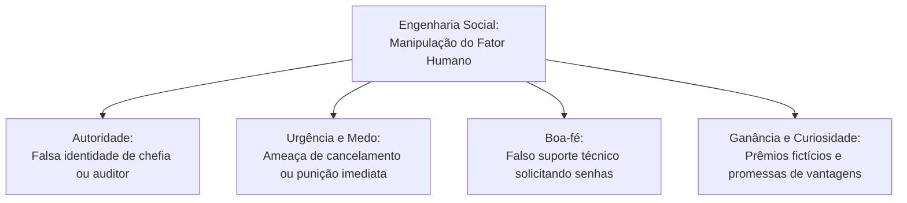
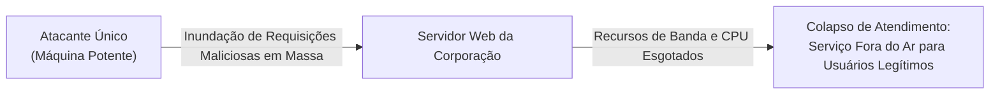
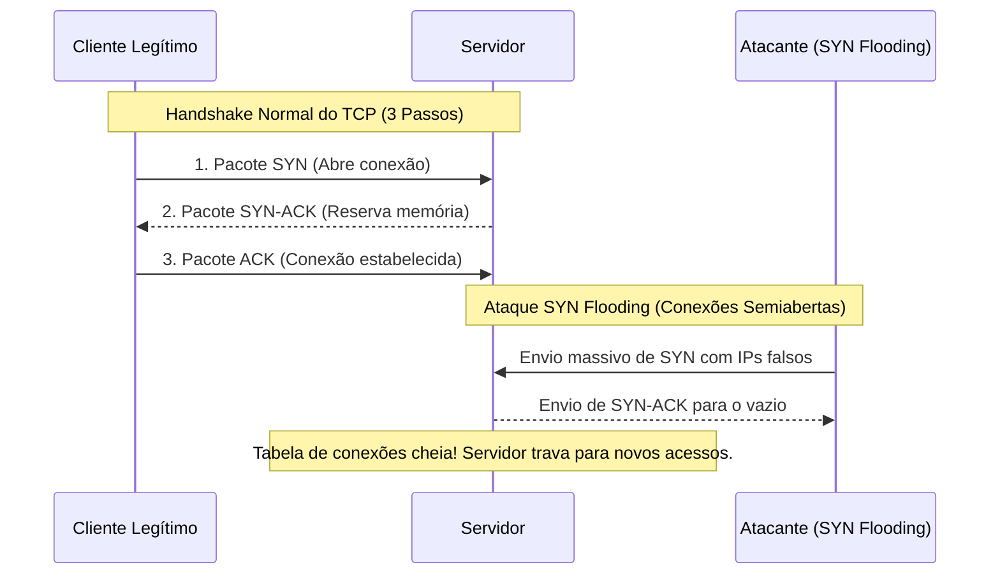
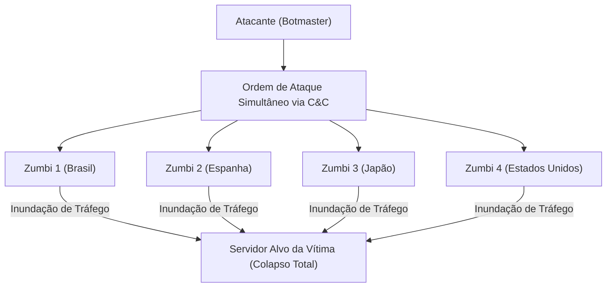
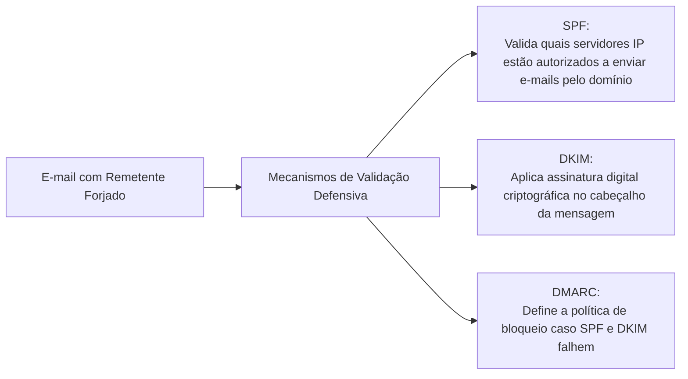
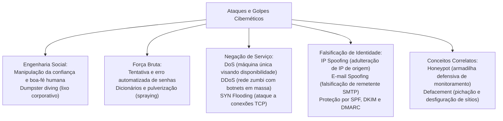

A segurança dos sistemas informatizados nas forças policiais e corpos de bombeiros militares enfrenta investidas cibernéticas que combinam exploração de falhas técnicas com manipulação psicológica. Servidores governamentais que coordenam despachos operacionais, bancos de dados de mandados de prisão e canais de comunicação de emergência constituem alvos preferenciais de ataques de indisponibilidade e tentativas de invasão por quebra de senhas. O conhecimento das táticas de força bruta, dos ataques de negação de serviço (DoS/DDoS), da falsificação de cabeçalhos por spoofing e dos ardis de engenharia social é basilar para a atividade policial e para a prova.

> [!objetivos]
> - Compreender a dinâmica da engenharia social e os mecanismos de exploração da psicologia humana.
> - Analisar o funcionamento dos ataques de força bruta, ataques por dicionário e suas respectivas contramedidas.
> - Diferenciar ataques de Negação de Serviço (DoS) de Negação de Serviço Distribuída (DDoS).
> - Compreender a mecânica do ataque SYN Flooding sobre o aperto de mão de três vias do protocolo TCP.
> - Caracterizar as técnicas de falsificação de identidade por IP Spoofing e E-mail Spoofing.

## Engenharia Social: A Manipulação da Fraqueza Humana

A engenharia social é o conjunto de métodos e artifícios pelos quais um indivíduo persuade outro, agindo de má-fé, a executar ações inadvertidas ou a revelar informações confidenciais e sigilosas.

Ao contrário dos ataques cibernéticos tradicionais, que concentram seus esforços na quebra de algoritmos criptográficos ou na exploração de falhas de código em softwares, a engenharia social ataca o fator humano. O renomado consultor de segurança Kevin Mitnick sintetizava esse princípio observando que a maneira mais simples e eficaz de obter uma senha de acesso é simplesmente perguntar à vítima com o pretexto correto.

Os criminosos exploram sentimentos e traços psicológicos universais:
1. Senso de autoridade: o invasor liga para um policial novato simulando ser um oficial superior ou delegado regional, exigindo acesso imediato a determinado sistema sob pretexto de urgência funcional.
2. Boa-fé e presteza no atendimento: o atacante finge ser um funcionário do suporte técnico de informática que tenta resolver uma lentidão na rede, solicitando que a vítima confirme seu login e senha.
3. Medo e intimidação: mensagens alarmistas ameaçam a suspensão de pagamentos, cancelamento de contas bancárias ou instauração de inquéritos caso a vítima não clique imediatamente em links fornecidos.
4. Ganância e oportunidade: ofertas de vantagens financeiras surreais, heranças fictícias ou prêmios de loterias em que a vítima sequer concorreu.
5. Curiosidade e vaidade: convites para visualizar fotos exclusivas ou falsas denúncias de traição envolvendo o nome do usuário.



> [!atencao]
> A prática de vasculhar o lixo corporativo ou doméstico de uma organização atrás de relatórios descartados, organogramas internos, agendas telefônicas e papéis com anotações de senhas recebe a designação técnica de dumpster diving. A proteção exige a fragmentação física prévia de todos os documentos sigilosos antes do descarte.

> [!bizu]
> Regra básica de defesa contra engenharia social: duvide sempre de solicitações não programadas de credenciais de acesso. Nunca forneça senhas por telefone ou e-mail. Para verificar uma solicitação suspeita de chefia ou suporte, desligue a chamada e ligue ativamente para o número oficial do setor.

> [!exemplo]
> Em uma simulação de auditoria de segurança da informação, um consultor aplicou engenharia social simulando uma entrevista de recrutamento profissional. Ele abordou um colaborador corporativo, o senhor José, fingindo oferecer uma oportunidade salarial de destaque no mercado. Explorando a ingenuidade e a boa-fé do profissional, o entrevistador solicitou detalhes sobre os modelos de servidores e versões de sistemas operacionais empregados na repartição pública. Em menos de vinte minutos de conversa informal, o senhor José revelou dados estruturais que permitiram o mapeamento completo da rede interna.

## Ataques de Força Bruta (Brute Force)

O ataque de força bruta (brute force attack) consiste em um método exaustivo de tentativa e erro automatizado para adivinhar nomes de usuários, senhas de acesso, números de identificação pessoal (PIN) ou chaves criptográficas.

O invasor utiliza softwares especializados que disparam milhares de requisições de autenticação por segundo contra a tela de logon de um sistema operacional, banco de dados ou serviço de correio eletrônico. Ao descobrir a combinação exata, o invasor assume a sessão com os mesmos privilégios do usuário legítimo.

As principais modalidades de força bruta compreendem:
- Força bruta simples ou exaustiva: testa todas as combinações matemáticas possíveis de caracteres (letras maiúsculas, minúsculas, dígitos e símbolos) a partir de determinado comprimento. É altamente demorada para senhas longas.
- Ataque por dicionário: testa palavras reais constantes em vocabulários e listas predefinidas de termos comuns (wordlists), nomes próprios, gírias e datas calendárias conhecidas da vítima.
- Força bruta híbrida: combina palavras de dicionários com substituições de caracteres comuns (como trocar a letra a pelo número 4 ou a letra e pelo número 3 - padrão leet speak) e acréscimo de números ao final da palavra.
- Pulverização de senhas (password spraying): o invasor testa uma única senha comum (como Senha123) contra centenas de nomes de usuários diferentes na corporação, evitando acionar o bloqueio de conta por tentativas repetidas no mesmo usuário.

```mermaid Comparativo de métodos de quebra de senhas
flowchart LR
    subgraph Força Bruta Exaustiva
    A1["Testa todas as combinações matemáticas de caracteres possíveis"]
    end
    subgraph Ataque por Dicionário
    B1["Testa listas de palavras reais e termos frequentes"]
    end
    subgraph Pulverização (Spraying)
    C1["Testa uma única senha comum contra milhares de usuários"]
    end
```

| Efeito do Ataque de Força Bruta | Consequência no Sistema | Contramedida Técnica Recomendada |
|---|---|---|
| Sucesso na adivinhação | Invasão do sistema com privilégios do usuário | Política de senhas complexas e longas |
| Múltiplas falhas consecutivas | Bloqueio temporário da conta legítima | Bloqueio progressivo e alertas automáticos |
| Tráfego maciço de tentativas | Sobrecarga do servidor de autenticação | Limitação de taxa de requisições (rate limiting) |
| Automatização por scripts | Esgotamento de conexões ativas | Uso de desafios interativos (CAPTCHA) |

> [!pegadinha]
> O ataque de força bruta pode produzir um efeito colateral inesperado: a negação de serviço. Quando milhares de robôs testam senhas em massa contra um servidor corporativo, a fila de processamento fica congestionada, impedindo o logon dos servidores legítimos. Além disso, se a política corporativa determinar o bloqueio após três erros, as contas de toda a corporação podem amanhecer bloqueadas.

> [!bizu]
> As defesas essenciais contra força bruta são quatro: políticas de senhas fortes com tamanho mínimo de doze caracteres, bloqueio temporário após poucas tentativas incorretas, implementação de CAPTCHA e adoção obrigatória de autenticação multifatorial (MFA).

## Ferramentas Automatizadas e Técnicas de Dicionário

No submundo cibernético e em livros clássicos de perícia forense, documentam-se ferramentas especializadas no disparo de ataques de força bruta contra serviços de rede e redes sem fio. Softwares como John the Ripper, Hydra e Wepattack automatizam a testagem maciça de dicionários contra senhas criptografadas em arquivos de hash ou em trânsito de rede.

Essas aplicações exploram listas pré-compiladas de senhas vazadas em grandes invasões históricas, como as listas geradas pelo grupo criminoso DarkSide. Ao interceptar hashes de senhas transmitidos sem proteção adequada em redes locais por meio de sniffing, o atacante submete esses valores a ataques de dicionário offline. Como o processo ocorre fora da rede da vítima, as tentativas ilimitadas não acionam os mecanismos de bloqueio de contas corporativas.

## Ataques de Negação de Serviço (Denial of Service - DoS)

O ataque de Negação de Serviço (Denial of Service - DoS) visa explicitamente tornar um computador, servidor web ou recurso de rede indisponível para os seus usuários legítimos.

Um ponto conceitual fundamental para concursos públicos: o ataque DoS tradicional não tem como objetivo invadir a máquina, roubar dados sigilosos ou violar a confidencialidade das comunicações. O seu alvo exclusivo é a Disponibilidade da informação.

O atacante busca esgotar os recursos vitais do alvo até que ele colapse:
- Esgotamento de largura de banda: envio de fluxos maciços de pacotes de dados que saturam a capacidade física do enlace de comunicação, impedindo o tráfego regular.
- Esgotamento de recursos de hardware: consumo forçado de 100% da memória RAM ou dos ciclos de processamento da CPU por meio de requisições computacionalmente pesadas.
- Esgotamento de tabelas de conexões: abertura de conexões simultâneas até atingir o limite máximo suportado pelo sistema operacional.
- Exploração de bugs de sistema: envio de pacotes especialmente adulterados que travam o serviço ou forçam a reinicialização imediata do servidor (como o clássico Ping da Morte).



## O Ataque SYN Flooding e o Aperto de Mão do TCP

Uma das variantes mais cobradas em concursos é o ataque SYN Flooding (Inundação de SYN), que explora a mecânica do protocolo de controle de transmissão (TCP).

O protocolo TCP é orientado à conexão e estabelece sessões por meio de um aperto de mão de três vias (three-way handshake):
1. Passo 1: o cliente envia um pacote inicial com a bandeira SYN (synchronize) solicitando a abertura da conexão.
2. Passo 2: o servidor recebe a solicitação, reserva um espaço de memória na sua tabela de conexões e responde com um pacote SYN-ACK (synchronize-acknowledgment).
3. Passo 3: o cliente recebe o SYN-ACK e finaliza a abertura enviando um pacote ACK (acknowledgment). A conexão passa ao estado estabelecido.

No ataque SYN Flooding, o invasor subverte esse processo:
- O atacante envia uma tempestade contínua de milhares de pacotes SYN por segundo.
- Cada pacote SYN traz um endereço IP de origem falso (forjado por IP spoofing).
- O servidor reserva recursos e envia o pacote SYN-ACK para os endereços falsos.
- Como os endereços não existem ou não solicitaram a conexão, a resposta final ACK jamais chega ao servidor.
- A tabela de conexões semiabertas do servidor atinge sua capacidade máxima. O sistema passa a rejeitar qualquer nova tentativa de conexão legítima, caindo em estado de negação de serviço.



> [!atencao]
> A mitigação do SYN Flooding no ambiente de servidores corporativos baseia-se na implementação de SYN Cookies (que evitam a reserva antecipada de memória antes da confirmação final), redução do tempo limite de expiração de conexões semiabertas e uso de firewalls de borda inteligentes.

## Negação de Serviço Distribuída (DDoS)

O ataque de Negação de Serviço Distribuída (Distributed Denial of Service - DDoS) representa a evolução em larga escala do ataque DoS convencional.

Enquanto o DoS parte de um único computador contra a vítima (sendo facilmente neutralizado pelo bloqueio do endereço IP do atacante), o DDoS parte simultaneamente de centenas de milhares ou milhões de computadores espalhados pelo mundo.

O atacante remoto (botmaster) utiliza sua rede de computadores zumbis (botnet) para desferir a ofensiva:
- Ação coordenada: ao receber o comando de disparo, todas as máquinas zumbis começam a emitir requisições simultâneas para o mesmo endereço IP ou domínio da corporação vítima.
- Impossibilidade de filtragem simples: como o ataque provém de milhares de fontes geográficas distintas com endereços IP legítimos de usuários domésticos, firewalls tradicionais não conseguem distinguir o tráfego legítimo do tráfego do ataque.
- Volume descomunal: ataques DDoS modernos alcançam taxas de tráfego de múltiplos terabits por segundo (Tbps), ultrapassando a capacidade de links de telecomunicações de governos e grandes operadoras.

| Modalidade de Ataque | Origem dos Disparos | Vetor Operacional | Dificuldade de Mitigação |
|---|---|---|---|
| DoS (Simples) | Uma única máquina de origem | Sobrecarga local ou bugs de pacotes | Baixa (basta bloquear o IP do agressor) |
| DDoS (Distribuído) | Múltiplas máquinas (botnet global) | Tempestade coordenada de dados | Elevada (requer serviços em nuvem e mitigadores) |
| SYN Flooding | Pode ser DoS ou DDoS | Esgotamento da tabela TCP | Média (exige SYN Cookies e firewalls) |



> [!bizu]
> Nas provas, atente para o termo botnet: se a questão mencionar que computadores infectados foram coordenados sem o conhecimento de seus proprietários para derrubar um portal governamental, o ataque é classificado taxativamente como DDoS (Negação de Serviço Distribuída).

> [!bizu]
> O mascaramento de endereços de rede opera em diversas camadas da arquitetura de protocolos:
> - Na camada de enlace: MAC Spoofing (mascarar o endereço físico da placa de rede para contornar filtros de switches).
> - Na camada de rede: IP Spoofing (mascarar o endereço IP nos pacotes em trânsito).
> - Na camada de aplicação: E-mail Spoofing (falsificar o remetente de correio eletrônico).
> Compreender a camada do protocolo em que ocorre o mascaramento é questão clássica nas provas.

## Falsificação de Endereço IP (IP Spoofing)

O termo spoofing significa falsificação, camuflagem ou personificação indevida. No contexto da camada de rede da Internet, o IP Spoofing consiste na adulteração do cabeçalho dos pacotes IP para inserir um endereço de origem falso.

O protocolo IP (Internet Protocol) não possui mecanismos nativos de autenticação de remetente nos seus pacotes básicos. Um invasor munido de privilégios de administrador em sua estação pode forjar qualquer sequência numérica no campo de endereço IP de origem do pacote transmitido.

As principais finalidades do IP Spoofing englobam:
1. Ocultação do verdadeiro atacante: ao forjar o IP de origem, os registros de log da vítima apontam para um computador inocente ou inexistente, dificultando a investigação pericial policial.
2. Violação de controle de acesso baseado em IP: alguns servidores autorizam conexões privilegiadas baseando-se unicamente no IP de origem (como confiar em pacotes oriundos da rede local interna). O atacante forja o IP confiável para obter acesso indevido.
3. Potencialização de ataques DoS de reflexão: o invasor envia requisições a servidores públicos (como servidores DNS abertos) com o IP de origem forjado da vítima. As respostas multiplicadas são direcionadas para a vítima, inundando sua conexão.

> [!pegadinha]
> O IP Spoofing sozinho não permite manter uma conversa bidirecional normal sob o protocolo TCP. Como o pacote de resposta (SYN-ACK) será enviado pelo servidor para o endereço falso que constava no cabeçalho, o atacante não recebe as respostas, a menos que esteja no mesmo enlace de rede para interceptá-las (técnica conhecida como blind spoofing).

## Falsificação de E-mail (E-mail Spoofing)

O E-mail Spoofing é a técnica pela qual um remetente forja o cabeçalho de uma mensagem eletrônica para fazê-la parecer originária de uma fonte legítima e confiável.

Essa fragilidade estrutural decorre do desenho histórico do protocolo SMTP (Simple Mail Transfer Protocol), responsável pelo envio de correio na Internet. O protocolo SMTP foi concebido originalmente em ambientes acadêmicos de mútua confiança e não exigia autenticação prévia de remetente. O campo De (From) pode ser preenchido com qualquer endereço que o remetente desejar.

O E-mail Spoofing é amplamente empregado em:
- Golpes de phishing bancário: mensagens com falso remetente oficial de instituições bancárias exigindo recadastramento de senhas.
- Disseminação de códigos maliciosos: e-mails fraudulentos que aparentam partir da chefia do departamento policial ou de tribunais de justiça com anexos contaminados.
- Fraude do presidente (CEO Fraud): mensagens que simulam a identidade de diretores corporativos para ordenar transferências financeiras urgentes ao setor financeiro.

> [!exemplo]
> Um indício pericial clássico de que o seu endereço institucional de e-mail foi utilizado em uma campanha de e-mail spoofing é o recebimento repentino de centenas de mensagens de erro de devolução (mailer-daemon ou bounce messages) relativas a e-mails que você nunca enviou. Os criminosos enviaram spam em massa forjando o seu endereço como remetente; os servidores de destino que rejeitaram as mensagens enviaram as notificações de erro de volta para a sua caixa postal legítima.



> [!atencao]
> A mitigação definitiva contra o E-mail Spoofing depende da configuração e adoção universal de três protocolos de segurança nos servidores de correio eletrônico:
> - SPF (Sender Policy Framework): registra no servidor DNS quais endereços IP têm autorização formal para enviar e-mails em nome daquele domínio.
> - DKIM (DomainKeys Identified Mail): adiciona uma assinatura digital criptográfica às mensagens para garantir a integridade do remetente.
> - DMARC (Domain-based Message Authentication, Reporting and Conformance): estabelece políticas automáticas para descartar mensagens que falharem na validação do SPF e DKIM.

## Termos Vizinhos: Honeypot e Defacement

Nas provas de informática, a banca frequentemente introduz conceitos vizinhos nas alternativas incorretas:

O honeypot (pote de mel) é um mecanismo defensivo de segurança. Trata-se de um sistema, servidor ou rede propositadamente vulnerável e desprovido de dados operacionais reais, colocado na rede como uma armadilha para atrair atacantes. A finalidade do honeypot é desviar o invasor dos sistemas de produção verdadeiros, registrar suas técnicas de intrusão e analisar novos tipos de malwares em ambiente controlado. Uma malha interligada de honeypots recebe o nome de honeynet.

O defacement (desfiguração de página web ou pichação virtual) consiste na alteração não autorizada e hostil do conteúdo visual da página principal de um sítio web. Invasores aproveitam vulnerabilidades em servidores web ou sistemas de gerenciamento de conteúdo para substituir a página oficial do órgão público por imagens de protesto político, símbolos de facções virtuais ou mensagens de deboche. O defacement afeta a integridade da página e causa severo dano reputacional à instituição.

## Mapa do capítulo



### Para fixar

- A engenharia social ataca o fator humano mediante persuasão psicológica por má-fé para obter dados sigilosos.
- O ataque de força bruta visa adivinhar senhas por tentativa e erro contínuo e pode produzir negação de serviço.
- O ataque de negação de serviço (DoS) afeta exclusivamente a disponibilidade de um serviço ou servidor.
- O SYN Flooding explora o aperto de mão do TCP enviando tempestades de pacotes SYN com IPs forjados.
- O DDoS coordena milhões de computadores zumbis organizados em botnets para desferir ataques massivos de saturação.
- O IP Spoofing altera o endereço IP de origem nos pacotes de dados para ocultar o atacante ou burlar filtros de acesso.
- O E-mail Spoofing forja o remetente no protocolo SMTP, gerando notificações de erro de e-mails não enviados.
- Os protocolos SPF, DKIM e DMARC operam em conjunto para validar e proteger os domínios contra e-mail spoofing.
- O honeypot é uma armadilha tecnológica propositadamente vulnerável empregada para estudar táticas de criminosos.
- O defacement consiste na modificação visual hostil e desautorizada da página principal de um sítio na Internet.
