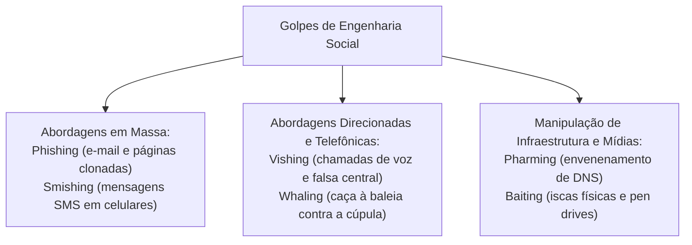
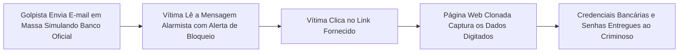
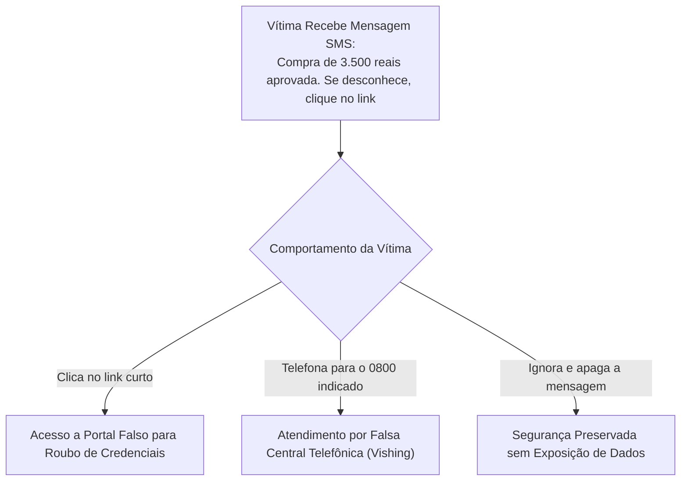
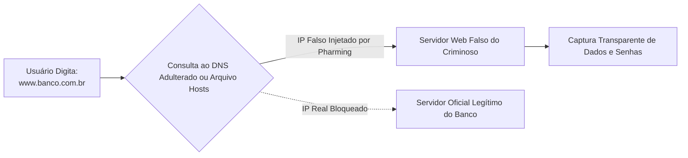
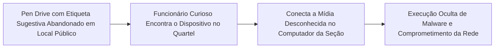
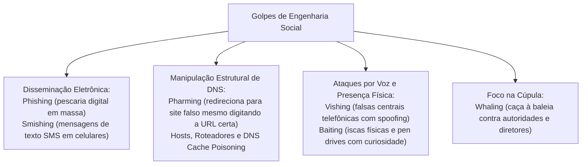

As fraudes baseadas em engenharia social causam a maioria dos incidentes de segurança. Elas afetam corporações policiais e unidades militares. O atacante não gasta tempo quebrando firewalls complexos. Ele prefere manipular o discernimento da vítima com artifícios psicológicos. O servidor público é induzido a entregar dados voluntariamente. Ele repassa credenciais de acesso, números de documentos operacionais e senhas. O domínio dos mecanismos de phishing, smishing, pharming, vishing, baiting e whaling é matéria prioritária nas provas.

> [!objetivos]
> - Definir phishing scam e reconhecer suas características técnicas de disfarce e indução ao erro.
> - Compreender o funcionamento do smishing via mensagens de texto SMS em dispositivos móveis.
> - Analisar a mecânica do pharming por envenenamento de cache DNS e adulteração de arquivos locais.
> - Caracterizar os golpes telefônicos de vishing e as iscas físicas e virtuais de baiting.
> - Identificar o ataque de whaling direcionado a executivos e autoridades de alto escalão governamental.

## Panorama Geral dos Golpes de Engenharia Social

A engenharia social engloba uma família diversificada de ardis criminosos estruturados conforme o canal de comunicação empregado e o perfil da vítima visada.

A premissa metodológica comum a todos esses golpes reside na exploração sistemática da vulnerabilidade comportamental humana: medo de penalidades, confiança institucional, urgência forçada, curiosidade ou ganância.

| Modalidade de Golpe | Canal de Comunicação | Mecanismo Central do Ataque | Alvo Preferencial |
|---|---|---|---|
| Phishing Scam | Correio eletrônico e mensagens web | Isca em massa com links falsos ou anexos | Público geral e funcionários corporativos |
| Smishing | Mensagens de texto SMS no celular | Mensagens curtas com links fraudulentos | Usuários de telefonia móvel e bancários |
| Pharming | Sistema de Nomes de Domínio (DNS) | Redirecionamento forçado para sites clonados | Internautas que digitam a URL legítima |
| Vishing | Chamadas de voz (telefone/VoIP) | Falsa central bancária pedindo senhas | Clientes bancários e idosos vulneráveis |
| Baiting | Pen drives físicos ou downloads | Iscas atraentes que exploram a curiosidade | Funcionários de repartições e empresas |
| Whaling | E-mails executivos altamente personalizados | Fraude do presidente focada em transações | Diretores, comandantes e ordenadores de despesas |

> [!bizu]
> Guarde uma distinção ontológica cobrada em provas: phishing não é malware. Phishing é um método de fraude, um golpe de engenharia social. Já vírus, worms, keyloggers e rootkits são softwares maliciosos. O phishing pode ser utilizado como veículo para entregar um malware, mas o golpe em si é uma artimanha de persuasão e engodo.

## Phishing Scam: A Pescaria Digital de Credenciais

O phishing scam (ou simplesmente phishing, termo derivado de fishing, pescaria) é uma modalidade de fraude eletrônica na qual o criminoso lança uma isca digital em massa para enganar usuários e capturar dados confidenciais, financeiros e pessoais.

O ataque combina técnicas de falsificação visual com engenharia social:
1. Mensagem fraudulenta: o criminoso dispara milhões de mensagens eletrônicas simulando comunicações oficiais de instituições bancárias, órgãos públicos (Receita Federal, Polícia Federal, Tribunais de Justiça), provedores de comércio eletrônico ou operadoras de telefonia.
2. Argumento de urgência ou ameaça: a mensagem alega pendências cadastrais graves, cancelamento iminente de contas, falsos mandados de intimação policial ou bloqueio do CPF da vítima caso não tome providências imediatas.
3. Link malicioso para página clonada: o e-mail traz um botão ou hiperlink que direciona o internauta para um sítio web falso idêntico à página verdadeira da instituição (página clonada). Ao digitar agência, conta corrente e senhas no formulário forjado, os dados são transmitidos em tempo real para o servidor do estelionatário.

> [!atencao]
> Diretrizes oficiais do CERT.br para não cair em golpes de phishing:
> - Nunca clique em links contidos em mensagens eletrônicas não solicitadas, mesmo que o remetente aparente ser conhecido.
> - Digite manualmente o endereço eletrônico oficial da instituição diretamente na barra de navegação do seu browser.
> - Observe o protocolo HTTPS e o cadeado de segurança na barra de endereços, conferindo a quem o certificado digital foi formalmente emitido.
> - Desconfie de mensagens com erros ortográficos, saudações genéricas (Prezado Cliente) ou cobranças de urgência dramática.

## Smishing: O Phishing por Mensagens SMS

O smishing representa a adaptação direta da mecânica do phishing para a telefonia móvel celular, combinando o protocolo SMS (Short Message Service) com o phishing tradicional.

O criminoso aproveita a alta abertura de mensagens SMS em smartphones. Ele dispara mensagens fraudulentas em massa:
- Notificações de falsas compras: mensagens afirmam que uma compra de elevado valor foi aprovada em determinado cartão de crédito, instruindo o usuário a clicar em um link curto para cancelamento ou a ligar para um número 0800 fictício.
- Avisos de bloqueio bancário: textos comunicam que o aplicativo bancário do militar ou civil expirou e exige atualização imediata por meio de um hiperlink fornecido.
- Encurtadores de links: os golpistas utilizam serviços de encurtamento de URL para ocultar o endereço real da página falsa, impedindo a visualização prévia do domínio malicioso na tela do aparelho celular.

> [!pegadinha]
> O smishing não é um vírus de smartphone. Ele não instala códigos no aparelho pelo simples recebimento do SMS. O smishing é um golpe de engenharia social que requer que a vítima clique voluntariamente no link recebido ou disque para o falso número de atendimento indicado na mensagem.

## Pharming: O Envenenamento de Resolução de Nomes (DNS)

O pharming é uma das modalidades de fraude eletrônica mais perigosas e invisíveis para o internauta comum. No phishing tradicional, a vítima clica em um link falso. No pharming, o usuário digita a URL correta do banco no navegador. Mesmo assim, ele é redirecionado para um servidor falso controlado por criminosos.

Essa manipulação corrompe o processo de resolução de nomes. O golpe ataca o Sistema de Nomes de Domínio (DNS). O DNS traduz nomes amigáveis em endereços IP numéricos. Ele converte termos como www.banco.com.br no respectivo IP da máquina.

O pharming pode ser executado por quatro mecanismos técnicos distintos:
1. Adulteração do arquivo hosts local: o computador da vítima é previamente contaminado por um cavalo de Troia que reescreve o arquivo hosts do sistema operacional (localizado em C:/Windows/System32/drivers/etc/hosts no Windows ou em /etc/hosts no Linux). O malware vincula o nome do banco ao endereço IP do servidor clandestino do criminoso.
2. Alteração das configurações de DNS da placa de rede: o malware altera as propriedades TCP/IP do computador, substituindo os servidores DNS legítimos da operadora por servidores DNS piratas mantidos por hackers.
3. Invasão do roteador doméstico (modem Wi-Fi): invasores exploram senhas fracas de fábrica (como admin/admin) em roteadores de banda larga para alterar remotamente os servidores DNS do dispositivo. Todas as máquinas conectadas àquela rede Wi-Fi passam a ser vítimas automáticas de pharming.
4. Envenenamento de cache do servidor DNS (DNS Cache Poisoning / DNS Spoofing): o invasor ataca diretamente o servidor DNS corporativo ou do provedor de acesso à Internet (ISP). Ele injeta respostas falsas nas tabelas de cache do servidor, redirecionando milhares de usuários simultâneos para o site fraudulento sem que nenhuma máquina individual precise estar infectada.

| Vetor de Ataque de Pharming | Local da Adulteração | Alcance do Golpe | Complexidade Técnica |
|---|---|---|---|
| Arquivo Hosts Local | Sistema operacional do computador local | Restrito àquela máquina individual | Baixa (executada por trojan simples) |
| Roteador / Modem Wi-Fi | Firmware do roteador de banda larga | Todos os aparelhos daquela rede local | Média (exploração de senhas padrão) |
| DNS do Computador | Configurações TCP/IP da placa de rede | Restrito ao dispositivo configurado | Baixa a média (executada por scripts) |
| DNS Cache Poisoning | Servidores DNS do provedor de Internet | Milhares de usuários simultâneos | Elevada (ataque avançado de rede) |

> [!atencao]
> Como identificar e neutralizar um ataque de pharming se o endereço digitado no navegador é rigorosamente correto?
> A checagem visual do protocolo HTTPS e do Certificado Digital SSL/TLS é a salvaguarda definitiva. O criminoso consegue redirecionar o tráfego de rede para o seu servidor clandestino, mas não consegue emitir um certificado digital oficial válido para o domínio do banco. O navegador web emitirá um alerta visual enfático de certificado inválido, não confiável ou incompatível com a identidade da instituição.

## A Arquitetura DNS e a Proteção Criptográfica pelo DNSSEC

A vulnerabilidade estrutural que viabiliza o ataque de pharming por envenenamento de cache (DNS cache poisoning) reside no projeto original do protocolo DNS. Concebido nos primeiros anos da Internet sob a norma RFC 1035, o protocolo DNS tradicional emprega datagramas UDP sem mecanismos de autenticação ou criptografia.

Quando um servidor DNS recursivo solicita a resolução de um domínio a um servidor autoritativo, qualquer atacante capaz de inundar o servidor com respostas falsas e adivinhar o número da porta de origem e a identificação da transação (ID de 16 bits) consegue injetar registros forjados no cache local.

Para neutralizar essa falha crítica de segurança em escala planetária, a comunidade de engenharia da Internet desenvolveu as Extensões de Segurança do Sistema de Nomes de Domínio (DNSSEC - Domain Name System Security Extensions):
- Assinatura digital criptográfica: cada zona do DNS recebe chaves criptográficas públicas e privadas. Todas as respostas e registros (como registros de tipo A, AAAA e MX) são assinados digitalmente com o registro RRSIG.
- Cadeia de confiança hierárquica: a validação estende-se desde os servidores-raiz da Internet (root servers) até o domínio de topo (como o .br gerido pelo Registro.br) e o domínio institucional específico.
- Integridade inquebrável: se um atacante tentar injetar um endereço IP fraudulento em um servidor DNS compatível com DNSSEC, a assinatura criptográfica falhará imediatamente. O servidor recursivo descarta a resposta falsa e impede a conclusão do ataque de pharming.

## Vishing: A Fraude por Voz e Falsas Centrais Telefônicas

O vishing decorre de voice phishing (phishing de voz). É o golpe aplicado por chamadas telefônicas vocais. Ele utiliza telefonia convencional ou sistemas de Voz sobre IP (VoIP).

O golpista telefona diretamente para a vítima e simula pertencer ao departamento de prevenção a fraudes de um banco público, operadora de cartão de crédito ou setor de recursos humanos:
1. Simulação de autoridade e acolhimento: o fraudador adota postura formal e vocabulário técnico idêntico ao das centrais de atendimento oficiais. Ele alerta a vítima sobre supostas compras anômalas realizadas no cartão em locais distantes.
2. Falsificação do identificador de chamadas (Caller ID Spoofing): por meio de servidores VoIP desprovidos de checagem de origem, o criminoso mascara a ligação para que o visor do telefone da vítima exiba o número oficial e conhecido do banco (como o número de atendimento impresso no verso do cartão).
3. Coleta de dados e credenciais: com a confiança estabelecida, o golpista solicita que o usuário confirme senhas pelo teclado do aparelho, repasse códigos de confirmação temporários recebidos via SMS (tokens) ou realize procedimentos fictícios de contestação que na realidade efetivam transferências bancárias ilegítimas.

> [!bizu]
> Regra de ouro da segurança bancária contra vishing: NENHUMA instituição bancária ou autoridade policial telefona para o cliente solicitando que ele dite senhas alfanuméricas, repasse códigos de autenticação em dois fatores ou realize transferências de emergência. Diante de qualquer ligação suspeita, desligue o telefone, aguarde alguns minutos e entre em contato ativamente pelo número oficial da instituição.

> [!exemplo]
> O golpe da falsa central telefônica ilustra com precisão o vishing profissionalizado. O estelionatário utiliza um sistema de discagem automática que emite uma gravação eletrônica idêntica à dos grandes bancos: "Banco Alerta: identificamos uma compra suspeita no valor de dois mil reais nas Lojas Virtuais. Se você reconhece esta transação, digite 1; se não reconhece, digite 2 para falar com um especialista de segurança". Ao digitar 2, a ligação é transferida para um falso atendente com música de espera característica. O criminoso confirma os quatro primeiros dígitos do CPF da vítima e solicita que ela digite a senha no teclado do aparelho para efetuar o suposto cancelamento.

## Baiting: A Curiosidade e a Isca Clandestina

O baiting explora a curiosidade, o descuido ou a ganância da vítima. O criminoso oferece uma isca concreta, tangível ou virtual.

O golpe manifesta-se em duas vertentes operacionais:
- Vertente física: o atacante grava códigos maliciosos (como trojans, keyloggers ou backdoors) em pen drives comuns e abandona propositadamente essas mídias em locais de circulação interna da organização alvo (estacionamentos de quartéis, refeitórios de delegacias, mesas de recepção ou banheiros). Para aguçar a curiosidade do funcionário, o pen drive recebe etiquetas sugestivas, como Confidencial - Promoções de Oficiais, Folha Salarial 2026 ou Fotos Pessoais. Ao encontrar o dispositivo, o servidor conecta o pen drive ao computador corporativo para verificar seu conteúdo, acionando a execução automática do código malicioso que contamina a rede interna.
- Vertente digital: anúncios sedutores na Internet oferecem downloads gratuitos de livros técnicos caros, filmes recém-lançados ou softwares corporativos crackeados. O usuário baixa o arquivo atraente, que atua como cavalo de Troia para infectar a estação de trabalho.

> [!atencao]
> Medidas preventivas indispensáveis contra baiting no serviço público:
> - Proibição formal de conectar mídias de armazenamento externas desconhecidas em computadores corporativos.
> - Desativação definitiva do recurso de autoexecução automática (autorun/autoplay) do sistema operacional por meio de políticas de grupo (GPO).
> - Bloqueio por software de portas USB em terminais de trabalho que não necessitem de periféricos de armazenamento.

## O Phishing em Aplicativos de Mensagens e Clonagem de Contas

A migração das comunicações corporativas para aplicativos de mensagens instantâneas (como WhatsApp e Telegram) expandiu o raio de alcance da engenharia social. Os golpistas desenvolveram variações táticas altamente predatórias:

1. Sequestro de conta por código de autenticação: o criminoso cadastra o número de telefone da vítima em um novo smartphone. O aplicativo envia um código de verificação de seis dígitos por SMS para o telefone real do usuário. Simultaneamente, o fraudador entra em contato com a vítima alegando ser funcionário de um sítio de anúncios de vendas ou organizador de um evento institucional. Ele afirma que enviou um protocolo de confirmação por SMS e solicita que a vítima dite os números. Ao repassar os dígitos, o criminoso assume a conta e passa a extorquir contatos da agenda.
2. Golpe do perfil falso (novo número): o estelionatário obtém a fotografia pública da vítima e cria uma conta com número telefônico diferente. Em seguida, envia mensagens aos familiares e subordinados alegando que trocou de número temporariamente devido a problemas no aparelho antigo. Com o pretexto de urgência bancária e impossibilidade de acessar o aplicativo financeiro no momento, o criminoso solicita transferências imediatas via PIX para contas de laranjas.

| Modalidade em Mensageiros | Mecanismo de Engodo | Vetor de Proteção Recomendado |
|---|---|---|
| Sequestro de Sessão | Induz a vítima a ditar o código SMS de 6 dígitos | Ativação da Confirmação em Duas Etapas com PIN |
| Golpe do Perfil Falso | Cria conta nova com foto da vítima e pede dinheiro | Chamada telefônica de voz direta para o número antigo |
| Links de Promoções Falsas | Distribuição de cupons em grupos comunitários | Conferência em canais oficiais e desconfiança de ofertas |

## Whaling: A Caça à Baleia e a Fraude do CEO

O whaling (pesca da baleia) é uma variação hiperdirecionada, requintada e sofisticada de phishing direcionada com exclusividade para executivos de alto escalão, autoridades públicas, secretários de governo, generais, comandantes de forças armadas e ordenadores de despesas corporativas.

Diferentemente do phishing comum, que dispara mensagens genéricas em massa para milhões de internautas, o whaling elabora mensagens exclusivas sob medida:
- Coleta prévia de inteligência (reconhecimento): os criminosos estudam minuciosamente as redes sociais, publicações oficiais e rotinas de viagens da cúpula da instituição para identificar nomes de assessores diretos e projetos em andamento.
- Linguagem altamente formal e plausível: o e-mail fraudulento mimetiza a forma de redação da instituição, utiliza logotipos oficiais e adota termos técnicos idênticos aos dos expedientes militares.
- Fraude do presidente (CEO Fraud): o criminoso simula a identidade de um secretário de segurança ou comandante-geral durante uma viagem oficial e envia um e-mail urgente e sigiloso para o diretor administrativo-financeiro, ordenando uma transferência bancária imediata para uma conta de fornecedor fictício sob pretexto de evitar sanções contratuais.

> [!bizu]
> Memorize a hierarquia do phishing para concursos públicos:
> - Phishing tradicional: genérico, disparado em massa sem personalização.
> - Spear Phishing: direcionado a um grupo específico ou funcionários de uma empresa determinada.
> - Whaling: direcionado estritamente à alta cúpula decisória (as baleias da organização).

| Modalidade de Phishing | Amplitude do Ataque | Nível de Customização | Perfil do Destinatário |
|---|---|---|---|
| Phishing Comum | Milhões de usuários | Nenhuma (mensagem padrão genérica) | Qualquer internauta |
| Spear Phishing | Dezenas ou centenas | Médio a elevado (dados da empresa) | Funcionários de setores específicos |
| Whaling | Indivíduos selecionados | Máximo (pesquisa profunda de inteligência) | Diretores, comandantes e executivos |

## Recomendações Institucionais e Conscientização Contínua

A proteção efetiva contra a engenharia social nas corporações públicas demanda programas permanentes de capacitação. Testes controlados de simulação de phishing avaliam periodicamente a maturidade dos servidores. A instrução técnica orienta o policial a desconfiar de qualquer abordagem que exija sigilo absoluto ou urgência injustificada.

O procedimento padrão determina que todas as tentativas de contato suspeito sejam notificadas ao setor de segurança da informação. Essa notificação rápida permite bloquear domínios maliciosos no firewall e alertar os demais integrantes da instituição antes da concretização do golpe.

Além disso, a governança de tecnologia deve estabelecer processos claros de verificação em dois canais para qualquer movimentação bancária atípica. Nenhuma autorização de pagamento ou transferência deve ser realizada com base exclusiva em mensagens de texto ou e-mails. A confirmação por contato telefônico seguro ou comunicação pessoal direta anula as chances de sucesso de golpes refinados de whaling e engenharia social direcionada.

## Mapa do capítulo

### Para fixar

- O phishing scam utiliza mensagens fraudulentas com páginas clonadas para roubar credenciais confidenciais.
- Phishing não é uma linhagem de malware, mas sim uma técnica de fraude baseada em engenharia social.
- O smishing é a aplicação do phishing por meio de mensagens de texto SMS em dispositivos móveis.
- O pharming corrompe o serviço de resolução de nomes DNS, redirecionando o internauta mesmo com a URL correta digitada.
- O pharming pode ocorrer por adulteração do arquivo hosts, invasão de modens Wi-Fi ou envenenamento de cache DNS.
- O vishing emprega chamadas telefônicas de voz e falsificação de chamador para subtrair senhas bancárias.
- O baiting explora a curiosidade e ganância abandonando mídias contaminadas com etiquetas sugestivas.
- O whaling é a modalidade refinada de phishing focada exclusivamente na alta cúpula diretiva e ordenadores de despesas.
- A conferência de certificados digitais SSL/TLS e a autenticação multifatorial são barreiras fundamentais contra golpes.
