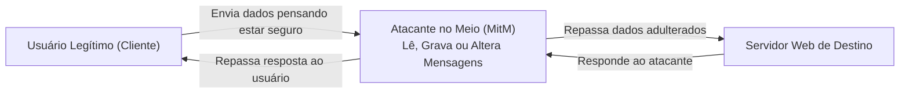
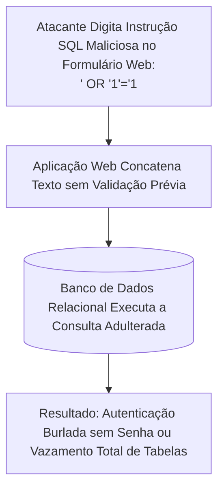
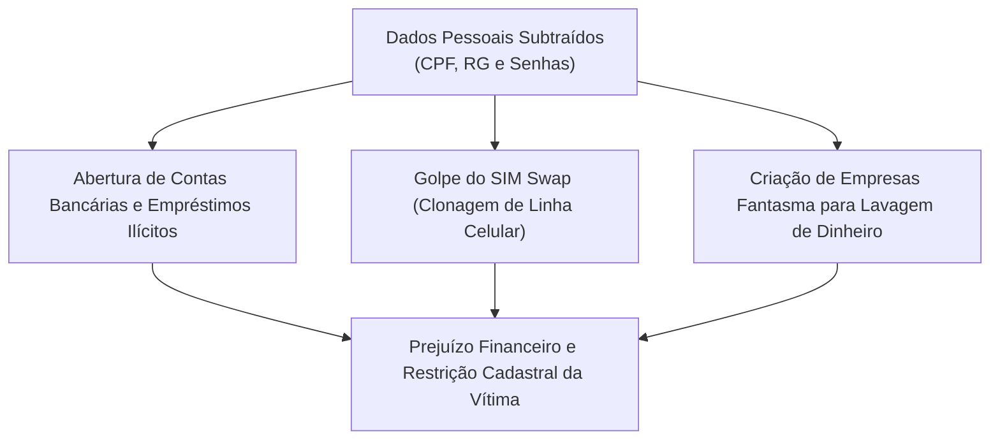
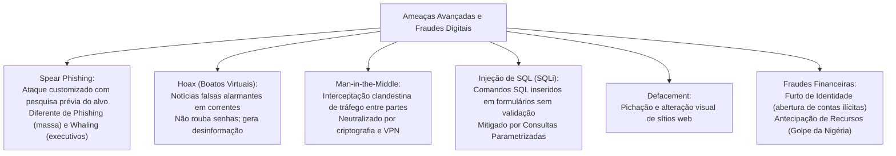

A investigação de crimes cibernéticos exige o domínio de ataques direcionados. Ela também requer o conhecimento de fraudes eletrônicas especializadas. O ambiente digital moderno combina engenharia social com falhas técnicas. Os criminosos exploram brechas em aplicações web e redes de dados. Golpistas operam em múltiplas frentes de ataque. Eles manipulam bancos por injeção de SQL, interceptam tráfego e praticam furtos de identidade. O conhecimento aprofundado dessas táticas consolida a pontuação nas provas.

> [!objetivos]
> - Diferenciar o spear phishing das campanhas convencionais de phishing em massa.
> - Compreender a natureza dos boatos virtuais (hoax) e seus impactos na segurança corporativa.
> - Analisar a dinâmica do ataque do Homem no Meio (Man-in-the-Middle) e as defesas criptográficas.
> - Caracterizar a técnica de desfiguração de sítios web (defacement) e a exploração por SQL Injection.
> - Reconhecer as manifestações do furto de identidade e as variantes da fraude de antecipação de recursos.

## Spear Phishing: A Pesca com Arpão Altamente Customizada

O spear phishing (pesca com arpão) é uma modalidade hiperdirecionada e especializada de phishing. O atacante não dispara milhões de mensagens genéricas. Ele seleciona uma vítima específica ou um grupo restrito de colaboradores da mesma organização.

O procedimento operacional do spear phishing apoia-se em inteligência prévia:
1. Coleta e reconhecimento: o criminoso pesquisa o alvo em redes sociais profissionais (como LinkedIn), portais de transparência de órgãos públicos e notícias institucionais. Ele descobre o nome do gestor direto, projetos em desenvolvimento, fornecedores habituais e a rotina da repartição.
2. Construção da mensagem convincente: o e-mail fraudulento utiliza o logotipo oficial, termos técnicos próprios do setor e simula partir de um colega de trabalho ou departamento interno de tecnologia. A mensagem faz referência direta a expedientes reais da repartição.
3. Penetração e evasão de filtros: como o texto é exclusivo e não segue padrões repetitivos de spam massivo, o spear phishing passa facilmente pelos filtros antispam tradicionais dos servidores de correio.

O objetivo do spear phishing é obter credenciais administrativas de acesso ou introduzir um cavalo de Troia para viabilizar ataques avançados e persistentes (APT) na rede policial ou militar.

```mermaid Comparativo entre Phishing e Spear Phishing
flowchart TD
    subgraph Phishing Tradicional (Rede de Arrasto)
    P1["Disparo em Massa para Milhões de Destinatários Desconhecidos"] --> P2["Mensagens Genéricas com Iscas Comuns (Banco ou Cartão)"]
    end
    subgraph Spear Phishing (Pesca com Arpão)
    S1["Pesquisa Prévia de Inteligência sobre o Alvo Específico"] --> S2["E-mail Customizado Citando Projetos e Colegas Reais da Vítima"]
    end
```

| Critério de Comparação | Phishing Convencional | Spear Phishing | Whaling (Caça à Baleia) |
|---|---|---|---|
| Quantidade de alvos | Milhões de internautas | Dezenas ou indivíduos específicos | Cúpula diretiva e autoridades |
| Personalização | Nula (mensagem padrão genérica) | Alta (dados reais da organização) | Máxima (foco executivo e financeiro) |
| Vetor de entrega | E-mails em massa e redes sociais | E-mails institucionais dirigidos | E-mails diretos ou mensagens sigilosas |
| Barreira de detecção | Bloqueado por filtros antispam comuns | Contorna filtros antispam facilmente | Exige validação humana multicanal |

> [!bizu]
> Guarde a distinção para a prova: o phishing genérico é uma rede de arrasto lançada no oceano; o spear phishing é o arpão disparado contra um peixe específico previamente escolhido; o whaling é o arpão pesado voltado exclusivamente para a baleia da organização (a chefia máxima).

## Hoax: O Boato Virtual e a Desinformação em Massa

O hoax define-se como um boato ou trote virtual. Trata-se de uma mensagem falsa ou sensacionalista que circula intensamente na Internet.

O hoax caracteriza-se por três atributos marcantes:
- Autoridade forjada: a mensagem costuma citar falsamente órgãos respeitados, corporações militares, centros de pesquisa renomados ou empresas de tecnologia (como Polícia Federal, Instituto Butantan, Microsoft ou OMS) para conferir credibilidade ao boato.
- Apelo emocional dramático: o texto apela para a caridade com crianças doentes inexistentes, alertas sobre novos vírus mortais que supostamente destroem o computador ou teorias conspiratórias.
- Pedido explícito de repasse: a mensagem conclui com pedidos imperativos para que o leitor compartilhe o conteúdo com todos os seus contatos da agenda, prometendo sorte ou ameaçando desgraças caso a corrente seja interrompida.

Impactos concretos do hoax na segurança:
- Esgotamento de largura de banda e espaço de caixas postais corporativas devido ao tráfego inútil de mensagens em corrente.
- Disseminação de pânico social e prejuízo à reputação de instituições públicas citadas indevidamente.
- Veículo para outros golpes: alguns boatos trazem hiperlinks maliciosos embutidos sob o pretexto de confirmar a notícia.

> [!pegadinha]
> O hoax por si só NÃO é um programa malicioso e NÃO rouba senhas bancárias. O hoax é simplesmente um boato textual enganoso. Quem tenta subtrair credenciais mediante páginas falsas é o phishing. Distinguir o boato (hoax) do golpe financeiro (phishing) é armadilha clássica de concurso.

## Ataque do Homem no Meio (Man-in-the-Middle - MitM)

O ataque Man-in-the-Middle (MitM) intercepta a comunicação entre duas partes. Os interlocutores acreditam conversar diretamente em canal privado.

No modelo tradicional cliente-servidor:
- O usuário acredita que seus pacotes de dados chegam de forma direta e exclusiva ao servidor web da corporação policial.
- O servidor corporativo acredita que está respondendo de forma direta ao navegador do policial.
- Na realidade, o invasor posiciona-se fisicamente ou logicamente entre as duas pontas do canal de comunicação. O atacante intercepta todos os pacotes transmitidos, podendo ler os dados em trânsito, alterá-los de forma arbitrária ou bloquear a mensagem antes de retransmiti-la ao destinatário final.



Os principais vetores operacionais de ataques MitM incluem:
1. Redes Wi-Fi públicas e abertas desprovidas de senha: o atacante instala um ponto de acesso falso com o mesmo nome da rede oficial (técnica Evil Twin) e intercepta todo o tráfego gerado pelos clientes conectados.
2. Envenenamento de tabela ARP (ARP Poisoning): na rede local Ethernet, o invasor envia respostas ARP forjadas para associar seu próprio endereço físico MAC ao endereço IP do gateway da rede, desviando todo o tráfego para seu terminal.
3. Rebaixamento de criptografia (SSL Stripping): o atacante intercepta a requisição HTTPS do navegador e força a comunicação com a vítima em protocolo HTTP em texto claro desprotegido.

> [!atencao]
> A defesa robusta contra ataques Man-in-the-Middle exige o uso universal de criptografia de ponta a ponta mediante protocolos modernos (HTTPS com TLS 1.3), uso obrigatório de Redes Privadas Virtuais (VPNs) em conexões externas e verificação estrita de alertas de certificados digitais nos navegadores.

## Defacement: A Desfiguração de Sítios na Web

O defacement consiste na desfiguração de sítios eletrônicos. O invasor altera o conteúdo visual da página de forma hostil e não autorizada.

O defacer (agente que executa o defacement) não busca atuar em silêncio. O seu objetivo é exatamente o oposto: atrair atenção pública máxima, demonstrar fraqueza na segurança do órgão governamental e promover causas ideológicas, ativistas (hacktivismo) ou autopromoção em rankings de invasores.

O comprometimento que viabiliza o defacement decorre de:
- Vulnerabilidades conhecidas e não corrigidas em sistemas gerenciadores de conteúdo (CMS, como WordPress e Joomla).
- Falhas de segurança nos servidores web (Apache, Nginx ou Microsoft IIS).
- Exploração de injeções de código (como SQL Injection ou Cross-Site Scripting - XSS) que permitem gravação no banco de dados.
- Furto de credenciais administrativas de acesso por força bruta ou vazamentos.

> [!bizu]
> Em termos de segurança da informação, o defacement fere mortalmente o princípio da Integridade (o conteúdo original foi modificado sem autorização) e acarreta severos danos à imagem institucional e à confiabilidade da organização pública.

> [!exemplo]
> Em uma investigação de polícia judiciária, um perito examinou o servidor web de um portal governamental desfigurado por defacement. Os invasores exploraram uma vulnerabilidade conhecida em um plugin de galeria de imagens que não recebia atualizações havia três anos. Por meio do plugin vulnerável, os criminosos realizaram o upload de uma página maliciosa em PHP (chamada de web shell). Essa página clandestina permitiu executar comandos no sistema operacional do servidor e substituir a página inicial do órgão por mensagens políticas.

## Injeção de SQL (SQL Injection - SQLi)

A Injeção de SQL (SQL Injection) é uma das vulnerabilidades mais críticas e persistentes da história das aplicações web, figurando com destaque permanente nas listas da comunidade OWASP (Open Web Application Security Project).

A técnica insere comandos da linguagem SQL em campos de formulários web. O atacante injeta código em telas de login, caixas de busca e URLs.

A vulnerabilidade manifesta-se quando a aplicação web concatena diretamente o texto digitado pelo usuário na consulta enviada ao banco de dados relacional, sem prévia validação, filtragem ou sanitização.

Mecanismo clássico de quebra de autenticação:
Considere um sistema de consulta com a seguinte instrução interna:
SELECT * FROM usuarios WHERE login = 'USER' AND senha = 'SENHA';

Se o atacante inserir no campo de login a sequência maliciosa:
admin' OR '1'='1' --

A consulta processada pelo banco de dados transforma-se em:
SELECT * FROM usuarios WHERE login = 'admin' OR '1'='1' -- AND senha = '...';

Como a condição lógica '1'='1' é eternamente verdadeira e os dois hifens (--) instruem o banco de dados a ignorar o restante da linha como mero comentário, a consulta retorna o registro do administrador sem que o atacante precise saber a senha real.



| Impacto da Injeção de SQL | Descrição Técnica do Dano | Medida Defensiva Obrigatória |
|---|---|---|
| Burlar autenticações | Acesso com privilégios de administrador sem senha | Uso de Consultas Parametrizadas (Prepared Statements) |
| Vazamento massivo | Extração de tabelas inteiras de CPFs e mandados | Sanitização rigorosa de caracteres especiais (' e --) |
| Adulteração de dados | Modificação de registros penais e valores | Princípio do menor privilégio na conta de conexão do banco |
| Destruição de bases | Exclusão de tabelas com comandos DROP TABLE | Bloqueio de múltiplas instruções encadeadas |

> [!atencao]
> A mitigação definitiva contra a Injeção de SQL não é o bloqueio manual de palavras no formulário. A técnica recomendada pela engenharia de software é o uso mandatório de Consultas Parametrizadas (Prepared Statements). Com consultas preparadas, o banco de dados trata a entrada do usuário estritamente como dado literal e nunca como comando executável da linguagem SQL.

## Ferramentas Automatizadas de Injeção de SQL e Blind SQLi

Na computação forense e em auditorias de segurança ofensiva (pentest), a exploração de vulnerabilidades de SQL Injection raramente ocorre por digitação manual de comandos. Os criminosos cibernéticos empregam scanners e ferramentas automatizadas de varredura profunda, como o consagrado software sqlmap.

Essas ferramentas especializadas realizam testes sistemáticos em todas as variáveis de formulários web:
- Injeção baseada em tempo (Time-Based Blind SQLi): quando o sistema não exibe mensagens de erro na tela, o atacante injeta instruções que forçam o banco de dados a pausar por dez segundos (como o comando WAITFOR DELAY ou pg_sleep). Se a resposta demorar dez segundos para carregar, a vulnerabilidade fica comprovada.
- Injeção baseada em erro (Error-Based SQLi): explora mensagens detalhadas de falha do banco de dados na tela do navegador para enumerar a versão do software e nomes de tabelas restritas.
- Injeção cega booleana (Boolean-Based Blind SQLi): avalia se a página web altera sutilmente seu layout diante de condições verdadeiras ou falsas inseridas na consulta.

A identificação pericial de tentativas de injeção de SQL e interceptação em redes corporativas baseia-se na auditoria de logs de servidores web e bancos de dados. Firewalls de aplicação web (WAF - Web Application Firewall) analisam em tempo real todas as requisições HTTP e HTTPS recebidas. O WAF bloqueia automaticamente padrões sintáticos suspeitos que contenham operadores lógicos clássicos de injeção, como comandos OR seguidos de igualdades booleanas. Essa blindagem de perímetro impede que consultas maliciosas alcancem os motores de banco de dados da instituição.

## Furto de Identidade (Identity Theft)

O furto de identidade (identity theft) consiste na apropriação indevida e utilização não autorizada dos dados pessoais, credenciais funcionais ou documentos de uma pessoa legítima para cometer fraudes, auferir vantagens econômicas ilícitas ou atribuir a ela a autoria de ilícitos penais.

O criminoso coleta dados cadastrais (nome completo, número do CPF, RG, filiação, data de nascimento e endereço) por meio de vazamentos em bancos de dados, ataques de phishing ou engenharia social:
- Abertura de contas bancárias fraudulentas para movimentação de recursos de origem criminosa.
- Contratação de empréstimos consignados e financiamentos em nome da vítima.
- Criação de empresas de fachada (laranjas) para sonegação fiscal e lavagem de capitais.
- Emissão de novos chips de telefonia celular (SIM Swap) para sequestrar aplicativos financeiros e de mensagens.

Sinais de alerta de furto de identidade apontados pelo CERT.br:
- Recebimento de faturas e cobranças de cartões de crédito que o titular nunca solicitou.
- Inclusão indevida do nome em cadastros de proteção ao crédito (SPC e Serasa).
- Tentativas de acesso não reconhecidas a contas de redes sociais com notificações de redefinição de senha.
- Retenção indevida da declaração de Imposto de Renda na Receita Federal por duplicidade de declaração apresentada por terceiros.



> [!atencao]
> A prática de conectar equipamentos de trabalho da segurança pública a redes Wi-Fi públicas e gratuitas de aeroportos ou praças de alimentação é veementemente contraindicada. Criminosos operam rotineiramente falsos pontos de acesso Wi-Fi com o mesmo identificador (SSID) da rede oficial do local (técnica Evil Twin). Todos os dados transmitidos pelo policial ou bombeiro passam pelo computador do criminoso, viabilizando ataques de Man-in-the-Middle com captura de senhas funcionais.

## Fraude de Antecipação de Recursos (Advance Fee Fraud)

O esquema de estelionato eletrônico denominado internacionalmente como advance fee fraud baseia-se na exploração da ganância da vítima. O golpe fundamenta-se na promessa sedutora de um ganho financeiro futuro vultoso ou benefício extraordinário, condicionada ao pagamento antecipado de uma pequena quantia em dinheiro pela vítima sob o pretexto de custear despesas operacionais ou taxas alfandegárias.

A manifestação mais célebre dessa fraude é o Golpe da Nigéria (também conhecido como Carta Nigeriana ou Golpe do Artigo 419 do Código Penal Nigeriano). Na narrativa clássica, o estelionatário envia uma carta ou e-mail afirmando ser um alto dignitário, advogado de um príncipe falecido ou diplomata estrangeiro que possui dezenas de milhões de dólares bloqueados em um banco no exterior. O criminoso solicita a cooperação da vítima para transferir o dinheiro para a sua conta bancária no Brasil, prometendo como recompensa uma fatia de trinta por cento do montante total.

No entanto, para viabilizar a suposta liberação internacional dos fundos, o golpista solicita pagamentos sucessivos de taxas cartorárias, subornos administrativos e tributos governamentais. A cada valor depositado pela vítima, novas exigências financeiras são criadas, e o dinheiro prometido jamais existe.

Variações contemporâneas da fraude de antecipação de recursos:
1. Loteria internacional ou sorteio premiado: mensagem informa que a vítima foi contemplada com milhões de euros em uma loteria estrangeira, exigindo o pagamento prévio de taxas de câmbio para liberação da remessa.
2. Oferta irreal de emprego no exterior: proposta de salário extraordinário em outro país condicionada ao pagamento adiantado de custos de emissão de visto de trabalho e taxas de agenciamento.
3. Empréstimo financeiro fácil para negativados: promessa de crédito imediato sem consulta ao SPC, mediante a cobrança prévia de um falso seguro de fiança contratual.
4. Doação de animais de raça ou veículos de luxo: doação gratuita de animais raros exigindo apenas o pagamento antecipado das passagens aéreas e despesas veterinárias fictícias.

| Modalidade de Fraude | História Fictícia Contada | Pré-requisito Exigido da Vítima |
|---|---|---|
| Golpe da Nigéria | Herança de príncipe milionário bloqueada no exterior | Depósito adiantado para pagar taxas cartorárias |
| Falsa Loteria Internacional | Contemplação em sorteio eletrônico de outro país | Pagamento prévio de impostos e tarifas bancárias |
| Empréstimo sem Consulta | Crédito facilitado para cidadãos negativados | Adiantamento de taxa de avalista ou seguro fictício |
| Emprego Internacional | Vaga executiva com salário em moeda estrangeira | Pagamento antecipado de taxas de visto e exames |

> [!bizu]
> Sinais inequívocos para identificar a fraude de antecipação de recursos:
> - Promessas de valores exorbitantes sem justificativa plausível.
> - Exigência de sigilo absoluto sob alegação de restrições diplomáticas.
> - Necessidade imperativa de realizar pagamentos adiantados por transferências irreversíveis.
> A orientação das autoridades policiais é enfática: nunca responda a essas mensagens e jamais envie valores financeiros para desconhecidos.

## Mapa do capítulo



### Para fixar

- O spear phishing é a modalidade de phishing hiperdirecionada a um indivíduo ou organização com base em pesquisa prévia.
- O hoax consiste em um boato alarmante em corrente que não instala vírus nem rouba senhas bancárias diretamente.
- O ataque Man-in-the-Middle intercepta a comunicação entre duas pontas sem o conhecimento dos interlocutores legítimos.
- O defacement é a alteração hostil e desautorizada do conteúdo visual da página principal de um portal web.
- A Injeção de SQL aproveita a falta de validação de entradas para manipular diretamente o banco de dados da aplicação.
- A defesa primária e indispensável contra SQL Injection reside na implementação de Consultas Parametrizadas.
- O furto de identidade compreende a apropriação de dados cadastrais alheios para abertura de contas e obtenção de crédito.
- A fraude de antecipação de recursos promete premiação ou herança vultosa futura mediante adiantamento imediato de taxas.
- O Golpe da Nigéria é o arquétipo clássico da fraude de antecipação de recursos em ambiente de correio eletrônico.
