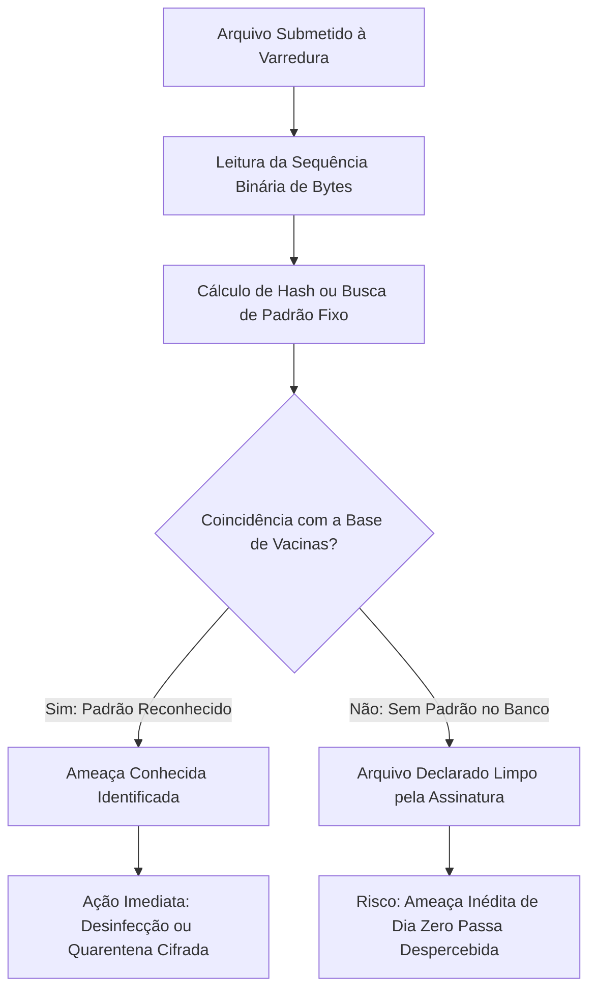
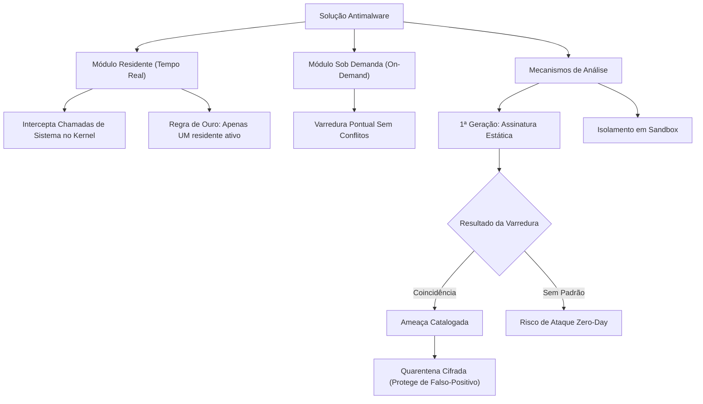

A proteção de sistemas computacionais contra ameaças digitais exige ferramentas especializadas capazes de identificar, conter e erradicar softwares hostis. No ambiente operacional das forças de segurança pública e defesa civil, estações de trabalho e servidores processam informações de alto valor estratégico. Qualquer invasão ou contaminação pode paralisar serviços essenciais de despacho de viaturas e atendimento de emergência.

As ferramentas antimalware constituem a primeira linha de defesa lógica nos computadores dos usuários. Elas reúnem módulos de prevenção contínua, varredura sob demanda e quarentena isolada. Este capítulo examina a arquitetura dos antivírus modernos e aprofunda os fundamentos da primeira geração de detecção, baseada em assinaturas digitais estáticas.

> [!objetivos]
> - Compreender a conceituação, o escopo operacional e a arquitetura das soluções antimalware.
> - Dominar o funcionamento da quarentena, diferenciando o isolamento cifrado da exclusão em lixeira.
> - Conhecer as boas práticas de instalação e os riscos operacionais do uso concomitante de antivírus residentes.
> - Compreender o mecanismo da primeira geração de antivírus baseada em assinaturas estáticas de bytes e hashes.
> - Analisar as vantagens e vulnerabilidades da detecção por assinatura diante de ameaças inéditas e vírus polimórficos.

## Conceitos Básicos de Ferramentas Antimalware

O ecossistema contemporâneo de ameaças digitais não se restringe aos vírus convencionais. Ele abrange uma multiplicidade de programas maliciosos conhecidos genericamente como **malwares** (*malicious software*).

Para combater esse espectro abrangente de códigos danosos, as soluções de segurança evoluíram de simples programas de varredura pontual para sofisticadas suítes integradas de defesa.

### Escopo Funcional Primário do Antivírus

A atuação de um software antimalware moderno estrutura-se sobre uma tríade funcional bem delineada:

1. **Prevenção Proativa**:
   O programa monitora continuamente as portas de entrada de dados no sistema operacional. Ele analisa arquivos baixados da internet, mídias removíveis (pen drives e discos externos), anexos de correio eletrônico e scripts de páginas web antes que ocorra a execução no ambiente local.
2. **Detecção e Identificação**:
   Ao localizar um código hostil, o sistema identifica a família e a variante exata do invasor. Esse diagnóstico apoia-se em catálogos globais de vacinas mantidos por laboratórios de inteligência cibernética.
3. **Erradicação ou Contenção**:
   Identificada a contaminação, a ferramenta tenta expurgar o código malicioso do arquivo hospedeiro, restaurando-o ao seu estado íntegro original. Caso o arquivo seja irrecuperável ou inteiramente composto por código hostil, a solução realiza o bloqueio imediato e o encaminhamento para a quarentena.

| Função Operacional | Mecanismo de Ação | Momento da Intervenção | Objetivo de Segurança |
|---|---|---|---|
| **Prevenção** | Varredura de fluxos em tempo real | Antes da gravação em disco | Impedir a entrada do código hostil |
| **Detecção** | Comparação com bases de conhecimento | Durante o acesso ou em varredura agendada | Localizar a ameaça residente |
| **Identificação** | Cruzamento de padrões binários | Imediatamente após a detecção | Rotular variante e periculosidade |
| **Erradicação** | Desinfecção cirúrgica do hospedeiro | Fase pós-identificação | Restaurar o programa original limpo |
| **Quarentena** | Isolamento cifrado e bloqueio de execução | Quando a limpeza direta falha | Conter o risco sem apagar dados vitais |

### O Papel Crítico da Quarentena

Nas provas de concurso, as bancas frequentemente confundem os candidatos sobre o destino dos arquivos interceptados pelas soluções de segurança.

A **quarentena** é uma pasta especial mantida pelo programa antivírus, submetida a rígidos controles de acesso:
- O arquivo contaminado ou suspeito é retirado do seu diretório original.
- O software criptografa e renomeia o arquivo, neutralizando qualquer extensão executável (.exe, .bat, .vbs).
- O arquivo é mantido em ambiente hermético. Ele fica impedido de ser carregado na memória RAM ou lido por outros processos do sistema operacional.

O objetivo primordial da quarentena é resguardar a integridade dos dados do usuário contra **falsos-positivos**. Um falso-positivo ocorre quando um arquivo legítimo do sistema é incorretamente classificado como praga digital por similaridade de código. Se o antivírus simplesmente excluísse o arquivo de forma irreversível, módulos vitais do sistema operacional poderiam ser danificados. Na quarentena, o arquivo permanece inofensivo e pode ser restaurado caso o usuário confirme sua legitimidade.

> [!atencao]
> A quarentena não possui nenhuma relação técnica com a lixeira do sistema operacional.
> - Arquivos depositados na lixeira comum continuam íntegros no disco rígido e podem ser executados ou lidos por outros malwares.
> - Arquivos em quarentena sofrem encapsulamento cifrado, alteração de cabeçalhos e bloqueio total de privilégios de execução no sistema de arquivos.

## Conflitos de Software Residente e Boas Práticas

Uma das regras mais cobradas em provas de segurança da informação diz respeito à coexistência de ferramentas de proteção instaladas no mesmo sistema operacional.

A diretriz técnica oficial é categórica: **nunca se deve instalar dois programas antivírus com proteção residente ativos simultaneamente na mesma máquina**.

### O que é a Proteção Residente

A proteção residente (ou proteção em segundo plano / em tempo real) é o módulo do antimalware que permanece permanentemente carregado na memória principal do computador.

Esse módulo intercepta em nível de núcleo (*kernel driver*) todas as chamadas de sistema relacionadas a arquivos e processos:
- Ao abrir um documento, o módulo residente assume o controle e realiza a leitura prévia;
- Ao salvar um arquivo, o antivírus checa sua integridade antes da gravação física em disco;
- Ao iniciar um executável, a memória é verificada contra injeção de processos.

### Riscos da Coexistência de Antivírus Residentes

Quando dois softwares antivírus diferentes operam em tempo real no mesmo computador, ocorrem graves falhas de estabilidade e segurança:

1. **Disputa por Bloqueio de Arquivos (Deadlock)**:
   Ambos os programas tentam interceptar e travar o mesmo arquivo de forma exclusiva para varredura. Isso gera travamento do sistema operacional e congelamento de aplicativos.
2. **Degradação Crítica de Desempenho**:
   O consumo de ciclos de processador (CPU), memória RAM e taxa de leitura de disco é duplicado desnecessariamente, tornando o computador excessivamente lento.
3. **Falsos Alertas Mútuos**:
   Os mecanismos heurísticos de um antivírus passam a monitorar as atividades profundas do outro, classificando suas vacinas ou rotinas de interceptação como comportamentos suspeitos de malware.
4. **Anulação da Proteção Efetiva**:
   Os conflitos internos entre os dois motores de verificação podem criar brechas onde arquivos maliciosos passam despercebidos enquanto os programas disputam recursos.

> [!esquema]
> **As três fases operacionais do antivírus diante da infecção:**
> 1. **Detecção**: O motor de varredura localiza o arquivo contaminado no disco ou na memória;
> 2. **Identificação**: O sistema cruza os padrões e descobre a assinatura e o nome exato da variante;
> 3. **Remoção ou Contenção**: O software extirpa o código malicioso, restaura o executável original ou envia o arquivo para a quarentena criptografada.

> [!atencao]
> Caso seja necessária uma segunda opinião técnica sobre a integridade de um arquivo ou sistema, o usuário deve recorrer a **ferramentas sob demanda (*on-demand*)** ou verificadores online.
> Os utilitários sob demanda realizam a varredura manual pontual e não mantêm serviços residentes disputando chamadas de sistema com o antimalware principal.

| Característica | Antivírus Residente (Tempo Real) | Utilitário Sob Demanda (*On-Demand*) | Verificador Online (Nuvem) |
|---|---|---|---|
| **Carga na Memória** | Permanente em segundo plano | Apenas durante a execução manual | Não consome memória local persistente |
| **Momento da Ação** | Intercepta aberturas e gravações | Acionado exclusivamente pelo usuário | Exige envio do arquivo via navegador |
| **Conflito de Kernel** | Alto risco com outro residente | Sem conflito com proteção ativa | Totalmente isolado do sistema local |
| **Finalidade Central** | Prevenção contínua e bloqueio | Segunda opinião e varredura profunda | Checagem pontual de arquivos isolados |

## Antivírus de Primeira Geração: Detecção Baseada em Assinatura

Historicamente, o desenvolvimento das soluções antimalware costuma ser classificado pela literatura especializada em quatro grandes gerações tecnológicas.

A **Primeira Geração de Antivírus**, surgida no final da década de 1980, baseia seus mecanismos de identificação no método determinístico de **assinaturas estáticas de malware**.

### O Conceito de Assinatura Digital de Malware

No jargão da segurança computacional, uma assinatura não se confunde com certificados digitais de identidade. Trata-se de uma marca registrada binária característica do código invasor:

- Uma assinatura consiste em uma sequência de bytes invariante, padrão de instruções de máquina ou valor criptográfico de resumo (*hash*, como MD5, SHA-1 ou SHA-256) que identifica de maneira exclusiva e inequívoca um malware já catalogado.
- Os centros de inteligência e laboratórios antivírus capturam espécimes de vírus, isolam suas porções essenciais de código e extraem fragmentos binários únicos que não ocorrem em programas legítimos.
- Esses padrões são compactados e inseridos nos arquivos de atualização distribuídos aos clientes, conhecidos popularmente como arquivos de definição de vírus ou **vacinas**.

> [!exemplo]
> Imagine que um laboratório identifica um novo trojan bancário cujo cabeçalho binário possui o resumo hash SHA-256 fixo `a1b2c3...`.
> 1. O laboratório gera a vacina contendo essa sequência exata e a distribui aos clientes na atualização diária;
> 2. O antivírus local localiza um executável suspeito baixado por um usuário e calcula seu hash;
> 3. Como os caracteres coincidem perfeitamente, o malware é bloqueado antes da abertura.
> No entanto, se o criador do trojan alterar um único bit inútil no final do arquivo, o hash SHA-256 mudará por completo. O antivírus baseado unicamente em assinatura estática deixará o arquivo passar ileso.

### Dinâmica da Varredura por Assinatura

Ao examinar um arquivo armazenado no sistema de arquivos, o motor de varredura executa os seguintes passos:
1. Abre o arquivo em formato binário bruto;
2. Lê as sequências de bytes e cabeçalhos do executável;
3. Calcula o valor hash dos blocos de dados ou compara as sequências com o catálogo local de assinaturas;
4. Se houver correspondência exata com um registro da base, a ferramenta declara o arquivo infectado e aplica a ação correspondente (desinfecção, quarentena ou bloqueio).

## Vantagens e Limitações da Primeira Geração

O método de detecção por assinatura permanece como um dos pilares mais rápidos e estáveis de qualquer solução de segurança moderna. Entretanto, ele apresenta limitações estruturais intransponíveis quando empregado de forma isolada.

### Principais Vantagens

1. **Altíssima Precisão Diagnóstica**:
   Para ameaças conhecidas já devidamente catalogadas nos laboratórios, a taxa de acerto é praticamente absoluta. O índice de falsos-positivos em códigos bem mapeados é extremamente baixo.
2. **Velocidade de Processamento**:
   A comparação de padrões binários estruturados ou índices de tabelas hash exige baixo custo computacional. A varredura é rápida e pouco onera o processamento do computador.
3. **Identificação Exata da Variante**:
   Ao localizar o padrão, o sistema informa exatamente qual é a praga digital envolvida, permitindo aplicar rotinas específicas de limpeza cirúrgica.

### Vulnerabilidades Estruturais Críticas

Apesar de sua eficiência contra pragas antigas e comuns, o modelo de primeira geração falha diante do dinamismo cibernético atual:

- **Ineficácia Contra Ataques de Dia Zero (*Zero-Day*)**:
  Uma ameaça de dia zero consiste em um ataque que explora vulnerabilidades desconhecidas ou utiliza um código malicioso recém-lançado na internet. Como o laboratório de segurança ainda não analisou a praga, inexiste assinatura cadastrada na base. O antivírus de primeira geração é completamente cego contra ameaças inéditas.
- **Dependência Vital de Atualizações Contínuas**:
  A eficácia do sistema depende diretamente do download ininterrupto de novas definições de vírus. Uma máquina com base de vacinas desatualizada há algumas semanas torna-se vulnerável a milhares de novas variantes produzidas diariamente.
- **Vulnerabilidade Diante de Malwares Polimórficos e Metamórficos**:
  Vírus polimórficos utilizam rotinas de criptografia variáveis. A cada ciclo de infecção em um novo hospedeiro, o vírus altera sua chave criptográfica e seu corpo binário, preservando apenas uma pequena rotina de decodificação mutável.
  Vírus metamórficos vão além: eles reescrevem o próprio código-fonte binário a cada replicação, alterando a ordem das instruções, inserindo comandos nulos (*NOPs*) e trocando registradores. Com isso, nenhuma assinatura estática consegue capturar as gerações subsequentes da praga.

| Parâmetro Avaliado | Detecção por Assinatura (1ª Geração) | Limitação Técnica Associada |
|---|---|---|
| **Ameaças Catalogadas** | Eficiência próxima de 100% | Requer atualização diária das vacinas |
| **Ameaças Inéditas (Zero-Day)** | Totalmente ineficaz (0% de detecção) | Não há assinatura cadastrada previamente |
| **Malware Polimórfico** | Facilmente burlada | O padrão binário muda a cada replicação |
| **Custo de Processamento** | Muito baixo e de alta velocidade | Limita-se à checagem estática de dados |
| **Análise Comportamental** | Inexistente na primeira geração | Não observa as ações do programa na RAM |

> [!bizu]
> **A tríade temporal da atualização:**
> As bancas adoram afirmar que um antivírus potente dispensa atualizações periódicas. Isso é totalmente incorreto.
> Na detecção de primeira geração, o software antivírus é tão eficiente quanto a idade de sua base de assinaturas. Atualizações diárias ou em tempo real são obrigatórias para que novos padrões de malware sejam baixados e integrados ao mecanismo local de varredura.

## O Papel do Ambiente de Isolamento (Sandbox)

Para analisar arquivos suspeitos que não exibem assinaturas conhecidas sem comprometer a máquina hospedeira, os sistemas evoluídos introduziram o conceito de **Sandbox** (caixa de areia).

A sandbox é um ambiente de execução virtualizado, isolado e controlado dentro do sistema:
- O arquivo duvidoso é executado em um compartimento estanque com privilégios restritos.
- O programa em teste não consegue modificar chaves do Registro do Windows, não grava dados nas pastas de sistema e não acessa a rede externa livremente.
- O módulo de segurança monitora o comportamento do arquivo: se ele tentar injetar processos, criptografar documentos ou instalar rotinas de backdoor, o antivírus encerra o processo e classifica a ameaça como maliciosa.

Esse mecanismo permite observar com segurança a atuação de programas suspeitos antes de autorizar sua execução no ambiente real do usuário.

> [!pegadinha]
> **Pegadinha frequente de concurso:**
> Muitas questões afirmam que a função primária do antivírus é exclusivamente a *remoção* de pragas já instaladas, sustentando que a *prevenção* cabe apenas a firewalls.
> Isso é um erro conceitual grave. Os antivírus contemporâneos são ferramentas híbridas de **prevenção e erradicação**. Seus módulos residentes interceptam ativamente dados antes da escrita em disco, impedindo que o malware se instale no computador.

## Exercício Prático Resolvido

A análise de uma questão típica de concurso consolida os conceitos estudados.

> [!resolvido]
> **Questão Adaptada**
> Um agente de polícia instalou dois programas antivírus comerciais com proteção residente ativa em sua estação de trabalho, acreditando que a medida duplicaria o nível de proteção do órgão contra pragas cibernéticas. Além disso, ao detectar um arquivo com indício de contaminação, o agente estranhou o fato de a ferramenta ter encaminhado o documento para a quarentena em vez de excluí-lo diretamente.
> 
> Considerando as normas de segurança computacional:
> 1. Avalie a conduta do agente quanto à instalação de dois antivírus residentes simultâneos.
> 2. Justifique a função da quarentena diante do risco de falsos-positivos.
> 
> **Resolução Analítica Passo a Passo:**
> 
> 1. **Avaliação dos antivírus residentes simultâneos:**
>    - A conduta do agente é tecnicamente incorreta e desaconselhada pelas boas práticas corporativas.
>    - A execução concomitante de dois antivírus em tempo real provoca disputa direta por recursos e bloqueios de arquivos no núcleo do sistema operacional (deadlock).
>    - A concorrência gera travamentos frequentes, consumo excessivo de memória RAM e processamento, além de falsos alertas mútuos, diminuindo a segurança geral do equipamento.
> 
> 2. **Justificativa da quarentena:**
>    - A quarentena isola o arquivo suspeito de forma cifrada, impedindo sua execução, sem apagá-lo de imediato.
>    - Esse isolamento temporário resguarda o usuário e a corporação contra danos decorrentes de falsos-positivos, permitindo restaurar arquivos essenciais do sistema operacional caso a ameaça não se confirme.

## Mapa do capítulo

| Tópico Estruturante | Conceito Essencial para a Prova |
|---|---|
| **Antivírus Residente** | Opera continuamente em segundo plano; nunca deve ser duplicado na mesma máquina |
| **Quarentena** | Isolamento criptografado do arquivo suspeito para evitar danos por falsos-positivos |
| **Assinatura de Malware** | Sequência de bytes ou hash fixo que identifica ameaça conhecida e catalogada |
| **Atualização de Vacinas** | Procedimento diário indispensável para a eficácia da detecção por assinatura |
| **Ataque de Dia Zero (*Zero-Day*)** | Código hostil inédito e sem assinatura prévia, invisível à primeira geração |
| **Malware Polimórfico** | Vírus que altera seu corpo e criptografia a cada infecção para burlar assinaturas |
| **Ambiente Sandbox** | Caixa de areia virtual e isolada usada para testar o comportamento de arquivos suspeitos |

### Para fixar

- As ferramentas antimalware atuam na prevenção em tempo real, na identificação precisa e na desinfecção ou isolamento de ameaças.
- A quarentena encapsula e cifra o arquivo suspeito para impedir sua execução, protegendo o sistema contra exclusões indevidas geradas por falsos-positivos.
- A instalação de dois antivírus com proteção residente simultânea gera conflito de kernel, congelamento do sistema operacional e perda de segurança.
- A verificação de segunda opinião deve ser realizada com utilitários de varredura sob demanda (*on-demand*) ou ferramentas baseadas em nuvem.
- Os antivírus de primeira geração operam por detecção de assinaturas estáticas de bytes ou tabelas de resumo criptográfico (*hash*).
- A detecção por assinatura oferece grande velocidade e elevada precisão para pragas já conhecidas e catalogadas nas bases de vacinas.
- A assinatura é ineficaz contra ataques de dia zero (*zero-day*) e códigos polimórficos ou metamórficos que alteram sua estrutura binária.
- As soluções de segurança modernas complementam a assinatura estática com ambientes virtuais de sandbox e monitoramento comportamental.
