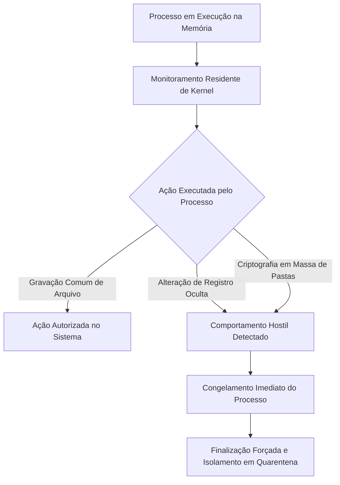
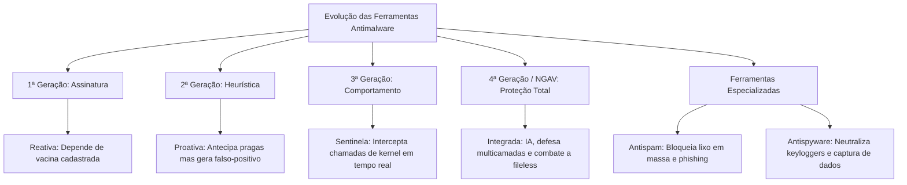

A insuficiência da detecção estática por assinaturas diante da proliferação de malwares polimórficos forçou uma profunda transformação nas ferramentas de segurança. Os criadores de pragas virtuais passaram a modificar rotineiramente códigos binários para evadir a identificação baseada em bancos de vacinas. Em resposta, a indústria de segurança da informação desenvolveu técnicas dinâmicas orientadas a padrões morfológicos, monitoramento comportamental e inteligência artificial.

Paralelamente à evolução das suítes centrais de antivírus, consolidaram-se módulos de proteção especializada voltados a vetores específicos de contaminação e espionagem. Este capítulo aborda as características estruturais da segunda, terceira e quarta gerações de antivírus, detalha os sistemas NGAV de última geração e analisa o funcionamento operacional dos filtros antispam e das ferramentas antispyware.

> [!objetivos]
> - Diferenciar as abordagens de detecção heurística estática e heurística dinâmica da segunda geração.
> - Compreender a interceptação comportamental de atividades da terceira geração de ferramentas antimalware.
> - Analisar a quarta geração de proteção completa e os antivírus de próxima geração baseados em nuvem (NGAV).
> - Compreender os critérios de filtragem, o bloqueio de phishing e os limites funcionais dos sistemas antispam.
> - Identificar as características operacionais dos softwares antispyware na contenção de espiões virtuais.

## Antivírus de Segunda Geração: Detecção Baseada em Heurística

A primeira geração de antivírus operava de forma puramente reativa. Ela identificava apenas ameaças que possuíssem uma cópia idêntica registrada previamente no banco de vacinas.

A **Segunda Geração de Antivírus** introduziu o conceito de **análise heurística**. Essa metodologia avalia o código e a morfologia de um arquivo para determinar se ele exibe propriedades comumente encontradas em softwares maliciosos.

### Heurística Estática versus Heurística Dinâmica

O mecanismo heurístico subdivide-se em duas abordagens complementares de verificação técnica:

1. **Heurística Estática (Passiva)**:
   O antivírus inspeciona as instruções do programa sem executá-lo. Ele descompila o cabeçalho executável e procura chamadas a bibliotecas sensíveis, padrões de escrita em setores de inicialização ou trechos de descompressão incomuns.
2. **Heurística Dinâmica (Ativa em Emulação)**:
   O antivírus cria uma máquina virtual simplificada na memória RAM (*sandbox* interna). O programa é executado temporariamente nesse ambiente confinado por frações de segundo. Se o código tentar realizar alterações danosas virtuais, a ferramenta deduz que se trata de uma praga.

| Modalidade Heurística | Execução do Código | Local da Inspeção | Ponto Forte Principal |
|---|---|---|---|
| **Heurística Estática** | Não executa o arquivo | Varredura no código binário gravado | Alta velocidade de processamento |
| **Heurística Dinâmica** | Executa em ambiente emulado | Sandbox virtual isolada na memória | Detecta códigos cifrados e empacotados |

### A Vulnerabilidade dos Falsos-Positivos

A grande vantagem da heurística é a capacidade proativa de detectar ameaças inéditas de dia zero (*zero-day*) e variantes polimórficas de vírus. Como não depende de uma assinatura idêntica prévia, o mecanismo antecipa ataques desconhecidos.

Entretanto, essa flexibilidade diagnóstica gera uma desvantagem operacional clássica: a ocorrência de **falsos-positivos**.
- Um falso-positivo ocorre quando um software legítimo, recém-compilado ou desenvolvido de forma atípica é incorretamente rotulado como malware pelo antivírus.
- Em ambientes corporativos de segurança pública, falsos-positivos podem bloquear sistemas institucionais essenciais, exigindo a inclusão de exceções manuais pelos administradores de rede.

> [!atencao]
> As bancas examinadoras cobram frequentemente a relação de compensação entre precisão e alcance:
> - Detecção por Assinatura (1ª Geração): alta precisão para ameaças conhecidas, taxa quase nula de falsos-positivos, mas zero detecção para pragas inéditas.
> - Detecção Heurística (2ª Geração): excelente capacidade de antecipar vírus desconhecidos e variantes polimórficas, mas sujeita a taxas expressivas de falsos-positivos.

## Antivírus de Terceira Geração: Interceptação de Atividades

A **Terceira Geração de Antivírus** promoveu uma mudança conceitual na defesa digital. Em vez de examinar apenas o corpo físico ou a anatomia estática do arquivo, o foco deslocou-se para a **ação em tempo real**.

Essa abordagem é conhecida pela literatura especializada como **análise comportamental** (*behavioral blocking*) ou interceptação de atividades.

### Como Opera a Interceptação em Tempo Real

O antivírus de terceira geração instala ganchos de monitoramento contínuo no núcleo do sistema operacional (*kernel hooks*). Ele vigia as ações de cada processo em execução, analisando suas intenções dinâmicas.

A ferramenta não impede preventivamente a abertura de programas desconhecidos. No entanto, ela suspende instantaneamente qualquer processo que tente executar ações agressivas ou atípicas, tais como:
1. Modificação ou exclusão em lote de documentos do usuário (comportamento característico de ataques de ransomware);
2. Gravação de chaves de inicialização automática no Registro do Windows sem solicitação explícita do usuário;
3. Tentativas de injeção de código na memória de processos legítimos de sistema (técnica de mascaramento *process hollowing*);
4. Tentativa de elevação não autorizada de privilégios de administrador local;
5. Abertura clandestina de conexões de rede em portas ocultas em comunicação com servidores de Comando e Controle (C2).

A principal vantagem da interceptação comportamental reside em sua imunidade aos disfarces criptográficos. Mesmo que o autor do malware aplique camadas sofisticadas de ofuscação binária, o programa precisará revelar seu intento danoso no momento da execução prática.

A desvantagem dessa geração concentra-se no elevado consumo de recursos de memória e CPU, além do risco de agir tardiamente caso o bloqueio não ocorra antes da primeira ação destrutiva.

## Antivírus de Quarta Geração e a Era do NGAV

A **Quarta Geração de Antivírus** consolidou o conceito de **Proteção Completa** ou defesa em profundidade (*defense-in-depth*).

Nessa geração, o software de proteção abandona a atuação isolada e integra em um único ecossistema coordenado todas as tecnologias concebidas pelas gerações anteriores:
- Mecanismo determinístico de assinaturas estáticas;
- Motores avançados de análise heurística passiva e ativa;
- Módulos residentes de interceptação comportamental em tempo real;
- Ambientes automatizados de sandbox em nuvem;
- Filtros de tráfego web, proteção contra phishing e módulos integrados de firewall pessoal.

### O Modelo NGAV (Next-Generation Antivirus)

O estágio contemporâneo mais avançado da quarta geração é representado pelas plataformas de **Antivírus de Próxima Geração (NGAV)**.

Os sistemas NGAV foram concebidos para combater ataques avançados e persistentes que burlam os antivírus tradicionais:
- **Combate a Malwares sem Arquivo (*Fileless Malware*)**:
  Muitas invasões modernas não gravam nenhum arquivo executável em disco rígido. Elas operam diretamente na memória RAM, utilizando scripts legítimos do sistema operacional (como PowerShell e WMI). O NGAV identifica essa manipulação por meio de inteligência contextual de processos.
- **Aprendizado de Máquina (*Machine Learning*) e Inteligência Artificial**:
  Algoritmos preditivos treinados em milhões de amostras globais analisam padrões matemáticos de ataque em frações de segundo, sem necessidade de assinaturas locais volumosas.
- **Integração com Soluções de EDR (*Endpoint Detection and Response*)**:
  Em redes corporativas de segurança pública, o NGAV opera integrado ao EDR. Ao detectar uma máquina contaminada, a ferramenta isola o computador da rede e fornece uma linha do tempo completa da invasão para perícia forense.

| Geração Tecnológica | Paradigma de Identificação | Ponto Forte Central | Limitação Principal |
|---|---|---|---|
| **1ª Geração** | Assinaturas estáticas binárias | Altíssima precisão em pragas conhecidas | Cego para variantes inéditas e polimorfismo |
| **2ª Geração** | Análise heurística morfológica | Antecipa malwares desconhecidos e variantes | Propensão clássica a falsos-positivos |
| **3ª Geração** | Interceptação de atividades em execução | Bloqueia ações destrutivas em tempo real | Exige alto poder de processamento |
| **4ª Geração / NGAV** | Defesa multicamadas e inteligência artificial | Protege contra ataques fileless e zero-day | Maior complexidade de implantação |

> [!bizu]
> **Resumo mnemônico das 4 gerações:**
> - 1ª Geração: **Assinatura** (olha o passado já catalogado);
> - 2ª Geração: **Heurística** (olha a estrutura em busca de semelhanças);
> - 3ª Geração: **Comportamento** (olha a ação prática na memória);
> - 4ª Geração / NGAV: **Proteção Total com IA** (integra tudo com nuvem e inteligência de dados).

## Ferramentas Especializadas: Filtros Antispam

Ao lado das suítes de antivírus, os órgãos governamentais utilizam soluções complementares voltadas ao saneamento do tráfego de comunicação eletrônica.

O **Spam** consiste no envio massivo, repetitivo e não solicitado de mensagens eletrônicas para uma quantidade indeterminada de destinatários. Embora frequentemente veicule propagandas abusivas, o spam é o principal vetor disseminador de ataques de engenharia social, fraudes financeiras e mensagens de *phishing*.

### Funcionamento Operacional do Antispam

O software antispam atua como um filtro no servidor de e-mail corporativo (*gateway*) ou diretamente no cliente de mensagens do usuário. Ele submete cada mensagem recebida a múltiplos critérios de pontuação:

1. **Listas Negras (*Blacklists*) e Listas Brancas (*Whitelists*)**:
   - As listas negras bloqueiam e-mails originados de servidores ou endereços IP historicamente reconhecidos pelo envio abusivo de lixo eletrônico.
   - As listas brancas autorizam previamente remetentes confiáveis e institucionais.
2. **Análise de Cabeçalho e Protocolos de Autenticação**:
   O sistema valida se a mensagem cumpre padrões internacionais contra falsificação de identidade de remetente (como SPF, DKIM e DMARC).
3. **Filtros Bayesianos e Análise de Conteúdo**:
   Algoritmos estatísticos avaliam a probabilidade de um e-mail ser ilegítimo com base em palavras-chave frequentes no assunto e no corpo do texto (como "urgente", "recadastramento", "clique aqui", "herança").
4. **Inspeção de Links e Anexos**:
   O antispam verifica se as URLs presentes na mensagem apontam para servidores maliciosos cadastrados em bases globais de proteção.

### Destino das Mensagens Interceptadas

Dependendo da pontuação de risco atribuída ao e-mail, o sistema antispam pode adotar três condutas:
- **Entrega Normal na Caixa de Entrada**: quando a mensagem atinge critérios plenos de autenticidade;
- **Segregação na Pasta de Lixo Eletrônico / Spam**: quando a mensagem exibe características suspeitas, permitindo ao usuário conferir o conteúdo caso se trate de falso-positivo;
- **Descarte Imediato no Gateway**: quando a mensagem provém de IPs notórios de ataque ou contém anexos executáveis maliciosos flagrantes.

> [!pegadinha]
> **Pegadinha clássica de prova de concurso:**
> Muitas bancas examinadoras tentam confundir os candidatos atribuindo funções criptográficas aos softwares antispam.
> Grave com clareza: **o antispam não criptografa mensagens nem gerencia chaves de segurança**.
> A finalidade do antispam é exclusivamente filtrar, triar, bloquear ou segregar comunicações não solicitadas e mensagens maliciosas.

## Ferramentas Especializadas: Softwares Antispyware

O **Spyware** é uma categoria insidiosa de software malicioso projetada para monitorar, registrar e transmitir informações confidenciais do usuário para terceiros sem autorização prévia.

Diferentemente de vírus e worms que costumam causar danos operacionais visíveis ou lentidão severa, o spyware opera de modo furtivo. O seu sucesso depende de permanecer imperceptível na máquina infectada.

### Principais Espécies de Espiões Virtuais Combatidos

1. **Keyloggers**:
   Módulos espiões que capturam silenciosamente todas as teclas digitadas pelo usuário no teclado físico. São amplamente utilizados para furtar senhas de acesso, credenciais bancárias e dados confidenciais de inquéritos.
2. **Screenloggers**:
   Programas que registram capturas de tela (*prints*) periódicas da área de trabalho ou das regiões circunvizinhas ao clique do mouse. Essa técnica foi criada especificamente para burlar teclados virtuais disponibilizados em sítios bancários.
3. **Adwares Invasivos**:
   Softwares que exibem anúncios publicitários abusivos e rastreiam o histórico de navegação na web para traçar perfis comerciais sem consentimento.
4. **Sniffers Não Autorizados**:
   Utilitários que interceptam pacotes de dados transmitidos na rede local em busca de tráfego que trafegue sem criptografia.

### A Ação do Software Antispyware

O programa **antispyware** dedica-se a identificar e desmantelar a infraestrutura de vigilância clandestina:
- Ele monitora áreas sensíveis do sistema onde espiões costumam se alojar, como objetos auxiliares do navegador (BHOs), extensões ocultas e chaves de inicialização em segundo plano.
- Realiza varreduras no Registro do sistema operacional para identificar rotinas de rastreamento de atividade.
- Disponibiliza opções para a desinfecção imediata ou envio dos módulos suspeitos para a **quarentena segura**. Na quarentena, o spyware tem suas conexões cortadas e seus arquivos encapsulados sem execução.

> [!exemplo]
> Em um posto avançado de atendimento ao cidadão, um usuário conectou um pen drive infectado contendo um *screenlogger*. O malware tentava monitorar as coordenadas do ponteiro do mouse para fotografar cliques em teclados virtuais bancários.
> O software antispyware detectou a tentativa de interceptação de tela em segundo plano pela chamada de API e bloqueou a gravação do arquivo de log. Em seguida, a ferramenta removeu as chaves de inicialização clandestinas do Registro e moveu o binário para a quarentena isolada.

| Ameaça Digital | Objetivo Principal do Invasor | Ferramenta Especializada Primária |
|---|---|---|
| **Vírus e Worms** | Disrupção, contaminação e replicação em massa | Antivírus Convencional / NGAV |
| **Spam e Phishing** | Envio massivo e roubo de dados por engenharia social | Filtros Antispam e Antiphishing |
| **Keyloggers e Spywares** | Espionagem furtiva de senhas e hábitos de navegação | Softwares Antispyware dedicados |
| **Ransomware Moderno** | Criptografia hostil para extorsão financeira | NGAV com análise comportamental e EDR |

## Exercício Prático Resolvido

A análise de uma questão típica de concurso permite consolidar o aprendizado das gerações e ferramentas de segurança.

> [!resolvido]
> **Questão Adaptada**
> Em uma investigação de crimes cibernéticos, os peritos analisaram as defesas de uma rede corporativa que foi alvo de uma variante inédita de código malicioso. Constatou-se que a solução de primeira geração falhou completamente na identificação do arquivo, enquanto um módulo heurístico de segunda geração conseguiu emitir um alerta prévio. Além disso, a administração implementou novos filtros de correio eletrônico para conter campanhas de engenharia social.
> 
> Com base nos conceitos de segurança da informação:
> 1. Explique por que a primeira geração de antivírus não conseguiu detectar a ameaça inédita, enquanto a heurística foi eficaz.
> 2. Qual é a principal desvantagem técnica introduzida pela análise heurística?
> 3. É correto afirmar que o filtro antispam é a ferramenta encarregada de criptografar as mensagens trocadas entre servidores?
> 
> **Resolução Analítica Passo a Passo:**
> 
> 1. **Falha da 1ª geração versus sucesso da heurística:**
>    - A primeira geração depende da correspondência binária exata com uma assinatura previamente catalogada no banco de vacinas. Como a ameaça era inédita (dia zero), não existia registro cadastrado na base.
>    - A heurística da segunda geração obteve êxito porque avalia a morfologia, a estrutura e instruções suspeitas comuns a malwares, permitindo antecipar variantes desconhecidas sem depender de assinatura prévia.
> 
> 2. **Desvantagem clássica da heurística:**
>    - A principal desvantagem técnica é a ocorrência de **falsos-positivos**. Arquivos legítimos com estruturas atípicas podem ser erroneamente classificados como maliciosos.
> 
> 3. **Julgamento sobre o filtro antispam:**
>    - A afirmação é **incorreta**. O filtro antispam atua exclusivamente na triagem, segregação e bloqueio de mensagens indesejadas e campanhas de phishing. Ele não possui atribuição de criptografia nem gerencia chaves de segurança.

## Mapa do capítulo

| Mecanismo de Defesa | Função Operacional Primária | Ponto de Atenção em Concursos |
|---|---|---|
| **Heurística Estática** | Disseca código e cabeçalhos sem executar | Rápida, mas falha com empacotadores densos |
| **Heurística Dinâmica** | Executa previamente em sandbox virtual | Observa o comportamento em ambiente controlado |
| **Falsos-Positivos** | Erro de classificação de arquivos legítimos | Consequência direta da flexibilidade heurística |
| **Interceptação de Atividades** | Monitoramento de ações em tempo de execução | Bloqueia alterações no Registro e ransomwares |
| **Plataforma NGAV** | Antivírus de última geração com IA e nuvem | Projetado contra ataques sem arquivos (*fileless*) |
| **Filtro Antispam** | Triagem de e-mails em massa e combate a phishing | Jamais criptografa mensagens de correio |
| **Software Antispyware** | Localização e remoção de espiões de teclado/tela | Protege o sigilo e a privacidade do usuário |

### Para fixar

- A 2ª geração de antivírus baseia-se em análise heurística estática e dinâmica para identificar ameaças sem assinatura prévia.
- A heurística estática analisa o código sem executá-lo, enquanto a heurística dinâmica executa o arquivo em ambiente de emulação virtual.
- A principal desvantagem da heurística é a possibilidade de gerar falsos-positivos em arquivos legítimos.
- A 3ª geração de antivírus atua por interceptação comportamental, vigiando chamadas de kernel e modificações críticas no sistema em tempo real.
- A 4ª geração sintetiza assinaturas, heurística, análise comportamental, sandboxing e módulos de firewall em uma proteção multicamadas.
- O NGAV utiliza inteligência artificial e aprendizado de máquina para conter malwares sofisticados que operam sem arquivos em disco (*fileless*).
- O filtro antispam classifica mensagens por reputação de IP, listas negras, protocolos de autenticação e filtros bayesianos.
- O antispam não realiza criptografia de mensagens nem opera chaves de segurança digital.
- O software antispyware é especializado na neutralização de espiões virtuais, incluindo keyloggers, screenloggers e adwares invasivos.
- Arquivos sob suspeita em qualquer geração podem ser enviados para a quarentena, onde permanecem criptografados e sem poder de execução.
