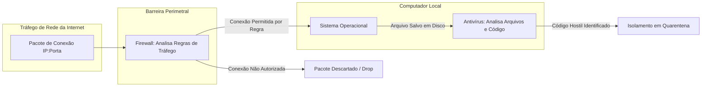
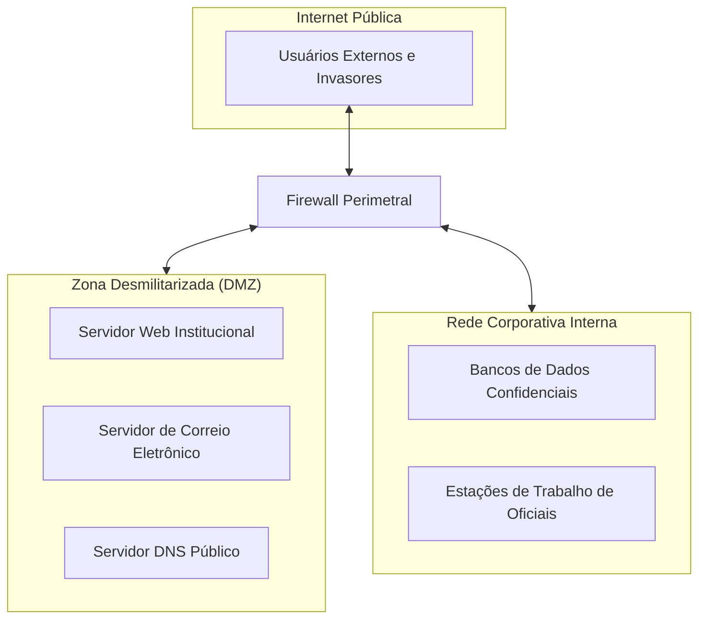
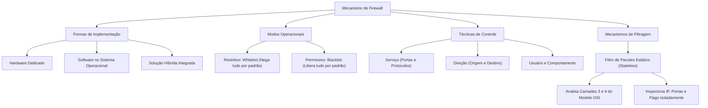

A interconexão de redes corporativas à Internet expõe ativos computacionais a sondagens e tentativas contínuas de invasão. No âmbito da segurança pública e da defesa civil, sistemas integrados de ocorrências policiais e despacho de bombeiros não podem sofrer interrupções operacionais. Proteger o perímetro de rede contra acessos não autorizados é um requisito imperativo de segurança da informação.

O **Firewall** constitui a barreira central de controle perimetral entre domínios com níveis distintos de confiança. Ele atua como um sentinela avançado, regulando e monitorando o fluxo de dados que ingressa ou sai do ambiente protegido. Este capítulo examina a natureza técnica dos firewalls, suas modalidades de operação permissiva e restritiva, seus recursos auxiliares de rede e o funcionamento da filtragem de pacotes estática.

> [!objetivos]
> - Compreender a definição, os objetivos e as formas de implementação de firewalls em hardware, software e soluções híbridas.
> - Diferenciar a atuação preventiva de um firewall da ação corretiva e desinfectante de um antivírus.
> - Dominar os modos de operação restritivo (lista branca) e permissivo (lista negra), compreendendo a estrutura das listas de controle de acesso (ACL).
> - Identificar as quatro técnicas de controle aplicadas por firewalls: controle de serviço, de direção, de usuário e de comportamento.
> - Analisar o funcionamento do firewall de host individual e da filtragem de pacotes estática nos níveis de rede e transporte.

## Conceito Fundamental e Natureza do Firewall

O termo **firewall** tem origem na engenharia civil, onde designa paredes corta-fogo construídas para confinar incêndios e impedir sua propagação entre edifícios adjacentes. Na arquitetura de redes, o firewall desempenha função análoga no plano lógico.

Ele estabelece um ponto de inspeção e bloqueio posicionado entre redes computacionais que possuem políticas de segurança e graus de confiança distintos.

### Definição Técnica e Formas de Implementação

Um firewall é um mecanismo de segurança composto por software, hardware ou pela combinação integrada de ambos. Sua atribuição primordial consiste em controlar, registrar, policiar e filtrar o tráfego de dados que transita entre redes distintas, autorizando ou barrando comunicações de acordo com uma política de segurança preestabelecida.

O dispositivo pode ser materializado em três formatos principais:

1. **Firewall em Hardware (Aparelho Dedicado / *Appliance*)**:
   Consiste em um equipamento físico especializado com arquitetura de processamento própria e sistema operacional otimizado para filtragem de altíssima velocidade. É instalado nas bordas de grandes redes corporativas para suportar volumes massivos de tráfego sem gerar gargalos de latência.
2. **Firewall em Software**:
   Consiste em uma aplicação instalada diretamente sobre o sistema operacional de um computador convencional ou servidor. Exemplos notórios incluem o *Windows Defender Firewall*, o *iptables/netfilter* em distribuições Linux e o *Packet Filter (PF)* em sistemas BSD.
3. **Soluções Híbridas Integradas**:
   Combinam módulos físicos de aceleração criptográfica com softwares avançados de gerenciamento em nuvem, oferecendo flexibilidade de configuração e alta capacidade de vazão.

| Forma de Implementação | Plataforma Operacional | Cenário Típico de Uso | Vantagem Central |
|---|---|---|---|
| **Hardware (*Appliance*)** | Equipamento físico proprietário dedicado | Borda perimetral de grandes redes corporativas | Altíssimo rendimento e independência do host |
| **Software Corporativo** | Instalado em servidores dedicados | Segmentação interna entre departamentos | Custo acessível e fácil adaptação lógica |
| **Software Pessoal (Host)** | Módulo integrado ao sistema operacional | Proteção individual de estações e computadores | Controle fino sobre aplicativos locais |

> [!pegadinha]
> **Pegadinha clássica de concurso:**
> As bancas adoram afirmar que firewalls existem *exclusivamente* como equipamentos físicos de hardware ou *exclusivamente* como programas de software.
> A afirmação é categoricamente incorreta. O firewall pode ser implementado exclusivamente em software, exclusivamente em hardware ou na forma híbrida de ambos os componentes operando conjuntamente.

### Distinção Essencial: Firewall versus Antivírus

Uma das confusões mais frequentes entre candidatos envolve as atribuições de firewalls e antivírus:

- **O que faz o Firewall**:
  O firewall atua como um porteiro da rede. Ele analisa o tráfego em trânsito e decide se uma conexão entre dois computadores deve ser autorizada ou descartada. Ele avalia parâmetros de rede (endereços IP, portas lógicas e protocolos) com base em regras de acesso. O firewall age de forma predominantemente **preventiva**.
- **O que faz o Antivírus**:
  O antivírus inspeciona arquivos e a memória do sistema procurando códigos maliciosos específicos (vírus, worms, trojans e spywares). Ele analisa o conteúdo de executáveis e documentos aplicando assinaturas e heurística. O antivírus atua na prevenção residente e na **desinfecção ativa**.

> [!atencao]
> Um firewall convencional não substitui o antivírus, assim como um antivírus não substitui o firewall.
> Se um usuário baixar um arquivo infectado com vírus por meio de uma conexão web autorizada (porta 443 com protocolo HTTPS), o firewall permitirá a passagem dos pacotes normalmente, pois a conexão atende às regras de navegação. Caberá exclusivamente ao software antivírus interceptar o arquivo baixado e impedir sua execução.

### Firewall de Borda versus Firewall Interno

A posição física e lógica do firewall define o seu escopo de proteção operacional:

1. **Firewall de Borda Perimetral**:
   Fica instalado na fronteira de transição entre a rede interna privada da organização e a Internet pública. Sua missão é barrar ataques externos, varreduras automatizadas de portas e tentativas de conexão direta a computadores internos.
2. **Firewall Interno (Compartimentação)**:
   Fica posicionado entre diferentes departamentos ou sub-redes da própria organização (por exemplo, isolando a rede de servidores do banco de dados corporativo da rede de estações de atendimento ao público). Ele impede que um invasor ou um computador contaminado por malware na recepção consiga propagar-se livremente pela intranet corporativa.

## Modos Operacionais e Listas de Controle de Acesso (ACL)

A eficácia de um firewall decorre da clareza e da lógica de sua **Política de Segurança da Informação**. As regras são codificadas sob a forma de uma **Lista de Controle de Acesso (ACL - *Access Control List*)**.

A tabela de regras é processada sequencialmente, de cima para baixo. Ao receber um pacote de dados, o firewall compara seus parâmetros com a primeira regra da lista:
- Se houver coincidência, a ação correspondente (*Allow/Permit* ou *Deny/Drop*) é aplicada de imediato, e o processamento é encerrado para aquele pacote;
- Se não houver coincidência, o dispositivo avança para a regra seguinte;
- Se nenhuma regra coincidir até o final da tabela, o firewall aplica a **regra padrão implícita** (*default rule*).

| Ordem | Ação | Protocolo | IP de Origem | Porta Origem | IP de Destino | Porta Destino | Justificativa Operacional |
|---|---|---|---|---|---|---|---|
| **1** | Permite | TCP | Rede Interna | Qualquer | Servidor Web | 443 | Autoriza navegação HTTPS segura |
| **2** | Permite | UDP | Rede Interna | Qualquer | Servidor DNS | 53 | Autoriza resolução de nomes |
| **3** | Bloqueia | TCP | Qualquer | Qualquer | Servidor BD | 3306 | Veda acesso externo ao banco de dados |
| **4** | Bloqueia | Qualquer | Qualquer | Qualquer | Qualquer | Qualquer | **Regra Padrão Implícita (Nega Tudo)** |

### Modo Restritivo (Lista Branca / Whitelist)

O **Modo Restritivo** é a abordagem recomendada pelas melhores práticas internacionais de segurança da informação:
- **Lógica Fundamental**: **Tudo o que não for expressamente permitido é bloqueado por padrão**.
- **Comportamento Operacional**: O firewall inicia sua configuração com todas as portas lógicas e protocolos rigorosamente fechados. O administrador libera pontualmente apenas os serviços vitais ao funcionamento da instituição.
- **Paralelo Jurídico**: Essa postura assemelha-se ao princípio da legalidade estrita que rege a Administração Pública, segundo o qual o gestor só pode fazer aquilo que a lei autoriza de forma expressa.

O modo restritivo é considerado tecnicamente superior em termos de segurança porque reduz a superfície de exposição a ataques. Portas desconhecidas ou serviços desnecessários permanecem bloqueados automaticamente.

### Modo Permissivo (Lista Negra / Blacklist)

O **Modo Permissivo** adota uma abordagem inversa:
- **Lógica Fundamental**: **Tudo o que não for expressamente proibido é permitido por padrão**.
- **Comportamento Operacional**: O firewall mantém todas as portas abertas por padrão, e o administrador cadastra regras específicas apenas para bloquear serviços reconhecidamente perigosos.
- **Paralelo Jurídico**: Assemelha-se à esfera das relações privadas dos cidadãos comuns, onde tudo o que a lei não proíbe é tacitamente permitido.

Essa postura oferece menor segurança operacional. Qualquer novo protocolo, serviço desconhecido ou variante de malware que utilize portas não listadas conseguirá transpor o dispositivo sem restrições.

> [!bizu]
> **Regra de ouro para a prova:**
> - Modo Restritivo = Lista Branca (*Whitelist*) = Bloqueia tudo por padrão e libera o essencial = **Mais seguro**;
> - Modo Permissivo = Lista Negra (*Blacklist*) = Libera tudo por padrão e bloqueia o conhecido = **Menos seguro**.
> As organizações corporativas e órgãos militares operam prioritariamente em modo restritivo.

## Técnicas de Controle Aplicadas por Firewalls

Para policiar o tráfego de maneira granular, a teoria de segurança de redes categoriza as intervenções do firewall em quatro técnicas principais de controle:

### Controle de Serviço

O **Controle de Serviço** determina quais aplicações e serviços de rede têm permissão para transitar pelo perímetro. Ele avalia o tipo de serviço por meio de endereços IP e números de portas lógicas (como liberar tráfego HTTP na porta 80 e HTTPS na porta 443, mas bloquear transferências de arquivos via FTP nas portas 20 e 21).

### Controle de Direção

O **Controle de Direção** estabelece o sentido no qual conexões de rede podem ser iniciadas. O firewall pode autorizar que computadores da rede interna iniciem conexões com servidores da Internet, mas bloquear sumariamente solicitações de conexão iniciadas de fora para dentro da rede corporativa.

### Controle de Usuário

O **Controle de Usuário** condiciona a liberação do tráfego à identidade do usuário que solicita o acesso. Para usuários externos que operam remotamente, o firewall exige autenticação segura prévia (como certificados digitais, senhas fortes e duplo fator de autenticação) antes de abrir a comunicação com sistemas sensíveis.

### Controle de Comportamento

O **Controle de Comportamento** regula a forma como um serviço autorizado é efetivamente utilizado pelos computadores. Por exemplo, o firewall pode permitir conexões a servidores web, mas barrar requisições que contenham scripts suspeitos ou comandos de ataque voltados a explorar falhas de injeção de banco de dados.

| Técnica de Controle | Critério Central de Decisão | Exemplo Prático de Aplicação |
|---|---|---|
| **Controle de Serviço** | Protocolo e porta lógica utilizada | Liberar tráfego DNS (porta 53 UDP) e barrar Telnet (porta 23) |
| **Controle de Direção** | Origem e sentido da inicialização do fluxo | Permitir navegação interna para a web e bloquear entrada externa |
| **Controle de Usuário** | Credenciais e privilégios de acesso | Autorizar acesso remoto à intranet apenas para Oficiais autenticados |
| **Controle de Comportamento** | Conteúdo e ações no serviço aceito | Bloquear comandos de alteração estrutural em formulários web |

## Recursos e Funções Auxiliares dos Firewalls

Com a complexidade crescente das infraestruturas de telecomunicações, os dispositivos de firewall incorporaram diversas funções auxiliares de rede:

1. **NAT (Network Address Translation)**:
   Mecanismo que traduz endereços IP privados internos não roteáveis (como a faixa 192.168.x.x ou 10.x.x.x) em um único endereço IP público válido para navegação na Internet. Além de economizar blocos de endereçamento IPv4, o NAT oculta a topologia e a numeração interna da rede corporativa contra sondagens de invasores.
2. **DMZ (Zona Desmilitarizada / *Demilitarized Zone*)**:
   Sub-rede perimetral intermediária que hospeda servidores corporativos de acesso público externo (como servidores de correio eletrônico, servidores web de portal institucional e servidores DNS). A DMZ fica isolada tanto da Internet quanto da rede interna confidencial. Se um servidor da DMZ for comprometido por invasores, o firewall impede o acesso direto à rede interna da instituição.
3. **VPN (Virtual Private Network) e Criptografia**:
   Módulos de conectividade segura que estabelecem túneis virtuais autenticados e criptografados sobre a infraestrutura da Internet. Permitem que viaturas em patrulhamento ou policiais em trabalho de campo acessem bases centrais de dados com total sigilo.
4. **Balanceamento de Carga e Alta Disponibilidade**:
   Distribui o volume de tráfego de entrada e saída entre múltiplos links de telecomunicações ou servidores concorrentes, evitando gargalos e assegurando redundância operacional contínua.
5. **Mecanismos Antispoofing**:
   Bloqueiam pacotes que contenham endereços IP de origem forjados (*IP spoofing*). O firewall descarta pacotes que chegam pela interface externa alegando falsamente pertencer à rede interna da corporação.

> [!exemplo]
> Em um quartel militar com dezenas de computadores, todos os nós da rede interna utilizam a faixa de IP privado `192.168.1.0/24`.
> Ao acessar um portal de notícias externo, o firewall com NAT substitui o endereço IP privado de origem do computador pelo endereço IP público institucional fornecido pela operadora.
> A resposta da página chega ao IP público, e o firewall encaminha os dados ao terminal interno que gerou a solicitação, mantendo oculta a numeração real das máquinas da corporação.

## O Firewall de Host (Firewall Pessoal)

O **Firewall de Host** (também denominado comercialmente como firewall pessoal) é uma solução de software instalada diretamente no computador do usuário final. O exemplo mais difundido em órgãos públicos é o *Windows Defender Firewall*, integrado nativamente ao sistema operacional Windows.

### Atribuições e Benefícios do Firewall de Host

Enquanto o firewall de borda protege a rede corporativa como um todo, o firewall de host protege o nó individual:
- **Monitoramento de Portas Locais**: Fecha portas de comunicação que não estão sendo utilizadas por serviços legítimos, impedindo que invasores na rede local explorem vulnerabilidades de software.
- **Bloqueio de Comunicação Clandestina de Backdoors**: Se um cavalo de Troia for instalado na máquina por meio de engenharia social, ele tentará abrir uma conexão reversa para receber comandos externos. O firewall de host intercepta a tentativa do executável de comunicar-se com a rede e notifica o usuário ou bloqueia a saída.
- **Contenção da Propagação de Worms**: Os worms caracterizam-se pela replicação automática pela rede local explorando falhas em serviços ativos. O firewall de host bloqueia essas tentativas de conexão entre computadores vizinhos, confinando a infecção e protegendo estações adjacentes.

> [!esquema]
> **O que o firewall de host faz e não faz:**
> - **O que ele FAZ**:
>   1. Bloqueia conexões de entrada não solicitadas;
>   2. Controla quais programas locais podem enviar ou receber dados na rede;
>   3. Registra tentativas de invasão e endereços de origem;
>   4. Isola portas vulneráveis contra propagação de worms.
> - **O que ele NÃO FAZ**:
>   1. Não remove vírus ou trojans já instalados no disco rígido;
>   2. Não filtra mensagens de spam na caixa de e-mail;
>   3. Não detecta programas espiões em arquivos inativos;
>   4. Não alerta sobre páginas web falsas de phishing.

## Filtragem de Pacotes Estática (Stateless)

A primeira geração de firewalls operava pelo mecanismo de **Filtragem de Pacotes Estática** (*Stateless Packet Filtering*).

Essa tecnologia atua nas camadas de Rede (camada 3) e Transporte (camada 4) do Modelo de Referência OSI e da arquitetura TCP/IP.

### Princípio da Filtragem Stateless

O filtro de pacotes estático examina cada pacote de dados que trafega pela interface de rede de forma **isolada e independente**:
- O dispositivo analisa exclusivamente os campos presentes no cabeçalho do pacote atual.
- Ele não mantém histórico de comunicações anteriores e não tem consciência de contexto. Ele não sabe se aquele pacote faz parte de uma conversa já autorizada ou se é um pacote isolado de sondagem.

Os parâmetros inspecionados em cada pacote incluem:
1. **Endereço IP de Origem e de Destino** (Camada de Rede);
2. **Número da Porta Lógica de Origem e de Destino** (Camada de Transporte, indicando serviços como HTTP 80, HTTPS 443, SSH 22);
3. **Tipo de Protocolo de Transporte** (TCP, UDP ou ICMP);
4. **Sinalizadores de Controle do TCP (*TCP Flags*)**, como os bits SYN, ACK, FIN e RST que indicam etapas de início e encerramento de sessão.

| Parâmetro no Cabeçalho | Camada do Modelo OSI | Exemplo de Valor Analisado | Utilidade na Regra |
|---|---|---|---|
| **Endereço IP Origem** | Camada 3 (Rede) | 200.180.10.5 | Identificar quem envia o pacote |
| **Endereço IP Destino** | Camada 3 (Rede) | 10.0.1.15 | Identificar o servidor interno alvo |
| **Porta de Destino** | Camada 4 (Transporte) | 443 (HTTPS) | Identificar o serviço solicitado |
| **Protocolo de Transporte** | Camada 4 (Transporte) | TCP / UDP / ICMP | Definir o método de tráfego |
| **Flags TCP** | Camada 4 (Transporte) | Bit ACK ativado / SYN desativado | Verificar pacotes de resposta |

### Vantagens e Limitações da Filtragem Estática

- **Vantagens**:
  A filtragem estática é extremamente veloz e consome pouca memória do equipamento, pois o dispositivo apenas lê alguns bytes de cabeçalho e aplica regras tabulares sem armazenar estados de conexão na RAM.
- **Limitações**:
  Como não memoriza o fluxo, o filtro estático precisa abrir portas aleatórias de forma permanente para permitir o retorno de dados solicitados por usuários internos. Isso cria brechas exploráveis por invasores mediante falsificação de pacotes (*spoofing*) com a flag ACK ligada. Essa fraqueza motivou a criação dos filtros de estado de sessão (*stateful*).

## Exercício Prático Resolvido

A resolução estruturada de questões típicas consolida as distinções exigidas nos concursos da área de segurança.

> [!resolvido]
> **Questão Adaptada**
> Em uma corporação militar, a equipe técnica avaliou a segurança perimetral da rede interna. Constatou-se que a política de segurança adotada bloqueia todas as portas lógicas e serviços por padrão, liberando apenas portas expressamente justificadas pelos setores operacionais. Além disso, um servidor questionou se a presença do firewall tornaria desnecessária a instalação de antivírus nas estações de trabalho.
> 
> Com base na doutrina de segurança da informação:
> 1. Classifique a política operacional adotada pelo órgão (restritiva ou permissiva) e justifique sua escolha.
> 2. Explique por que a afirmação do servidor sobre a dispensa de antivírus é tecnicamente equivocada.
> 
> **Resolução Analítica Passo a Passo:**
> 
> 1. **Classificação da política operacional:**
>    - A corporação adotou o **Modo Restritivo** (baseado em Lista Branca ou *Whitelist*).
>    - Essa postura bloqueia todo o tráfego por padrão e autoriza apenas serviços expressamente permitidos pela administração. É considerada a mais segura por reduzir a superfície de ataque da rede institucional.
> 
> 2. **Equívoco sobre a dispensa de antivírus:**
>    - A afirmação é tecnicamente incorreta. O firewall atua na filtragem de conexões e pacotes entre redes segundo regras de portas e endereços IP, impedindo invasões não autorizadas.
>    - No entanto, o firewall não analisa o conteúdo binário profundo de arquivos recebidos por canais permitidos (como downloads autorizados via web ou e-mail).
>    - Se um usuário baixar um arquivo infectado por uma porta liberada, o firewall autorizará a passagem. Caberá exclusivamente ao software antivírus interceptar o arquivo malicioso e neutralizá-lo. As duas ferramentas são complementares.

## Mapa do capítulo

| Componente Estruturante | Conceito Chave para a Prova |
|---|---|
| **Definição de Firewall** | Dispositivo em hardware ou software que regula tráfego entre redes distintas |
| **Modo Restritivo (*Whitelist*)** | Bloqueia tudo por padrão e autoriza apenas o explícito; postura mais segura |
| **Modo Permissivo (*Blacklist*)** | Permite tudo por padrão e bloqueia apenas o proibido; menor segurança |
| **Lista de Controle de Acesso (ACL)** | Tabela sequencial de regras processadas de cima para baixo com regra final padrão |
| **Zona Desmilitarizada (DMZ)** | Sub-rede intermediária isolada que abriga servidores corporativos de acesso externo |
| **NAT (*Address Translation*)** | Converte endereços IP privados em IP público, ocultando a estrutura interna |
| **Firewall de Host** | Protege o computador individual, bloqueando portas e contendo worms e backdoors |
| **Filtro Stateless** | Inspeciona pacotes isoladamente nas camadas 3 e 4 sem manter histórico da sessão |

### Para fixar

- O firewall pode ser construído em hardware dedicado, em software aplicativo ou em arquitetura híbrida de ambos.
- O firewall inspeciona tráfego de rede e gerencia portas preventivamente; ele não substitui a ação desinfectante do antivírus.
- O modo restritivo utiliza lista branca: veda todo o tráfego por padrão e libera pontualmente apenas serviços autorizados.
- O modo permissivo adota lista negra: aceita qualquer comunicação por padrão e barra apenas conexões expressamente proibidas.
- A tabela de regras (ACL) é processada sequencialmente; havendo coincidência de regra, o pacote é imediatamente processado.
- Os firewalls executam quatro controles: controle de serviço, controle de direção, controle de usuário e de comportamento.
- A DMZ é uma sub-rede intermediária que isola servidores públicos (Web, DNS, E-mail) da rede corporativa confidencial.
- O NAT converte endereços privados em endereços públicos válidos e mascara a numeração interna da corporação.
- O firewall de host protege o nó individual contra sondagens e impede que cavalos de Troia estabeleçam canais de comunicação com invasores.
- O filtro de pacotes estático (*stateless*) atua nas camadas de Rede e Transporte examinando IPs, portas e flags sem reter o estado da conexão.
