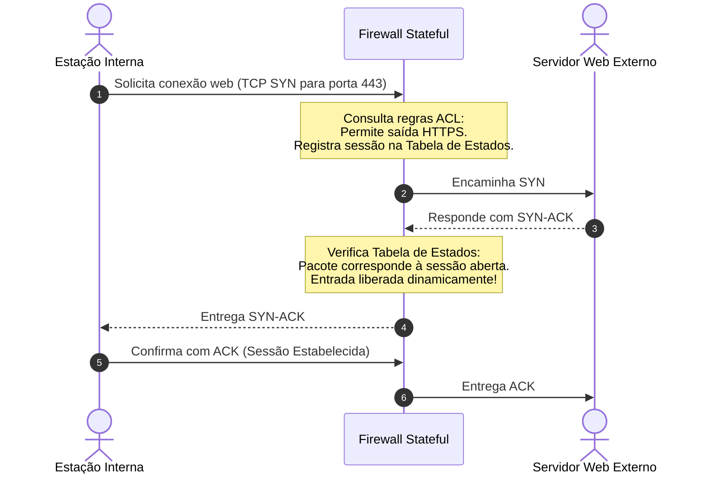
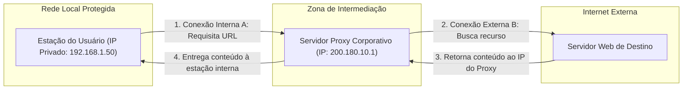
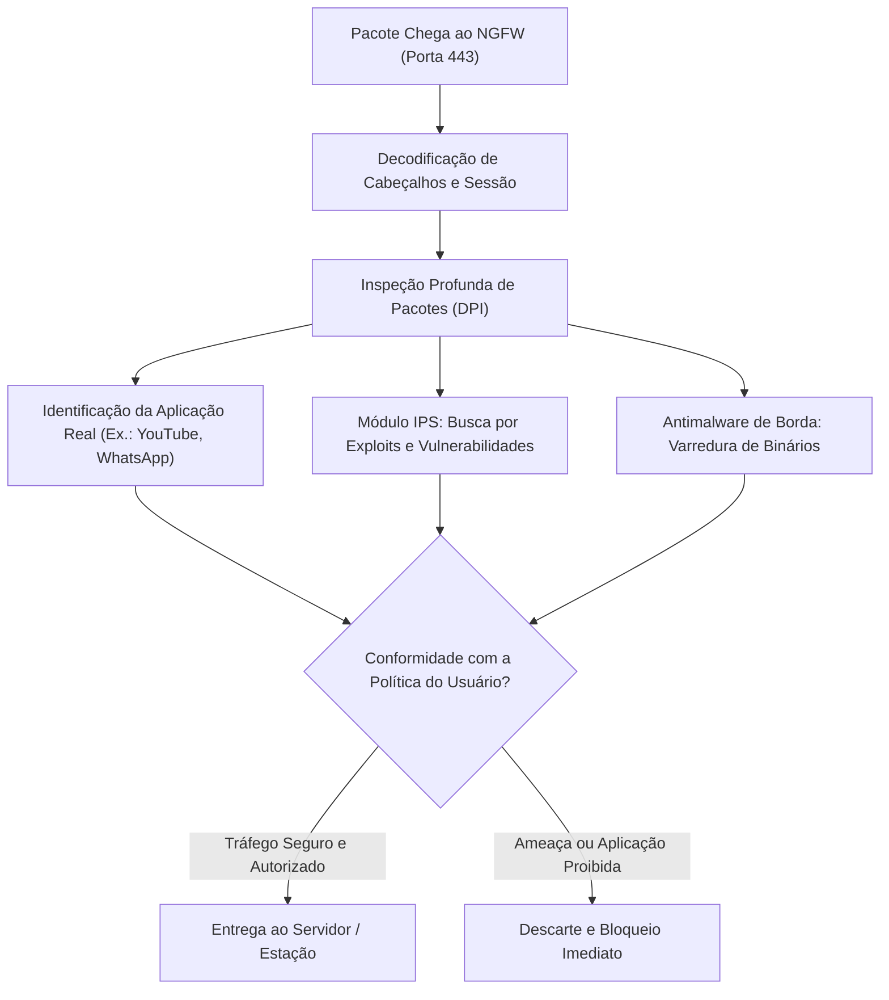
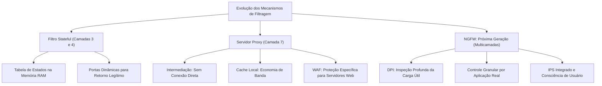

A evolução das ameaças cibernéticas evidenciou as limitações dos filtros de pacotes estáticos convencionais. Analisar apenas portas lógicas e endereços IP de forma isolada mostrou-se insuficiente para conter ataques modernos que exploram protocolos legítimos. As organizações necessitam de ferramentas capazes de rastrear o contexto de cada conexão, intermediar requisições em nível de aplicação e inspecionar profundamente a carga útil dos dados.

A segurança perimetral contemporânea apoia-se em três pilares tecnológicos avançados: os filtros de estado de sessão (*stateful*), os servidores intermediários do tipo proxy e os Firewalls de Próxima Geração (NGFW). Este capítulo disseca os mecanismos de inspeção dinâmica de sessões ativas, analisa o papel do proxy na filtragem e armazenamento em cache, e detalha os recursos de inspeção profunda de pacotes e controle de aplicações dos NGFWs.

> [!objetivos]
> - Compreender a arquitetura e a operação dinâmica do Filtro de Estado de Sessão (*Stateful Packet Inspection*).
> - Analisar o funcionamento de servidores proxy na camada de aplicação, diferenciando suas atribuições de controle e cache das redes VPN.
> - Conhecer o papel dos Web Application Firewalls (WAF) na proteção de portais e sistemas corporativos web.
> - Dominar os conceitos fundamentais dos Firewalls de Próxima Geração (NGFW), incluindo inspeção profunda de pacotes (DPI) e controle de aplicações.
> - Contrastar as soluções corporativas NGFW com os dispositivos unificados do tipo UTM (*Unified Threat Management*).

## Filtro de Estado de Sessão (Stateful Inspection)

A filtragem estática (*stateless*) avalia cada pacote de maneira cega e individual, sem considerar o histórico das comunicações pregressas.

Em contraposição a essa limitação, o **Filtro de Estado de Sessão** (*Stateful Packet Inspection* - SPI) representa a segunda geração de arquitetura de firewalls. Ele introduz o conceito fundamental de **estado de conexão**.

### O Conceito de Sessão e a Tabela de Estados

Uma sessão de rede consiste em uma sequência estruturada e contínua de troca de mensagens bidirecionais entre dois computadores. No protocolo TCP, essa comunicação tem início formal por meio do aperto de mãos em três vias (*three-way handshake*): envio do pacote SYN pelo cliente, resposta SYN-ACK pelo servidor e confirmação final ACK pelo cliente.

O firewall stateful mantém na memória RAM uma estrutura dinâmica denominada **Tabela de Estados de Conexões** (*State Table*):
- Ao receber qualquer pacote de dados, o dispositivo não se limita a consultar a tabela de regras estáticas (ACL).
- Ele verifica simultaneamente se aquele pacote pertence a uma conexão legítima já iniciada e registrada na tabela de estados.
- Se o pacote fizer parte de uma conversa ativa autorizada, ele é liberado instantaneamente pelo processador, sem necessidade de reprocessar todas as regras da ACL.

### Vantagem Operacional sobre o Filtro Estático

A grande superioridade do firewall stateful reside no tratamento do tráfego de retorno:
- No filtro estático clássico, para permitir que um usuário interno receba a resposta de uma página web, o administrador precisava criar uma regra permanente abrindo portas aleatórias para tráfego externo. Essa abertura criava uma brecha permanente explorável por invasores.
- No firewall stateful, **portas de retorno são abertas dinamicamente apenas durante a vigência daquela sessão específica**.
- Quando a conexão é encerrada (por pacotes FIN ou RST) ou por tempo limite de inatividade (*timeout*), o firewall remove o registro da memória e fecha o canal.

> [!atencao]
> O firewall de inspeção de estado bloqueia sumariamente pacotes forjados que chegam da Internet com sinalizadores de resposta (como bits ACK ativados) se não houver um registro de solicitação correspondente na Tabela de Estados.
> Isso neutraliza ataques de varredura furtiva e invasões que tentam burlar o perímetro simulando pacotes de resposta.

> [!exemplo]
> Em um posto policial, um operador acessa o portal de boletins de ocorrência. O navegador abre a porta de origem efêmera 49152 para o servidor remoto na porta 443.
> O firewall stateful insere uma linha temporária em sua memória RAM contendo os endereços IP, as portas e a contagem de pacotes.
> Enquanto o militar consulta os registros, os pacotes vindos do servidor externo ingressam sem impedimentos.
> Ao fechar o navegador, o envio de pacotes de término (TCP FIN) encerra a sessão. O firewall apaga a entrada da tabela e veda a porta imediatamente.

| Critério de Comparação | Filtro de Pacotes Estático (*Stateless*) | Filtro com Estado de Sessão (*Stateful*) |
|---|---|---|
| **Critério de Decisão** | Analisa apenas o cabeçalho do pacote atual | Analisa cabeçalho e histórico na Tabela de Estados |
| **Tráfego de Retorno** | Exige portas permanentemente abertas | Abre portas de retorno temporária e dinamicamente |
| **Resistência a Spoofing** | Baixa resistência contra pacotes forjados | Alta resistência contra respostas forjadas |
| **Consumo de Memória** | Mínimo (não retém dados em memória) | Moderado (mantém tabela dinâmica de sessões na RAM) |
| **Camadas do Modelo OSI** | Atua nas camadas 3 (Rede) e 4 (Transporte) | Atua nas camadas 3 e 4 com consciência de fluxo |

## Servidores Intermediários: O Modelo Proxy

Enquanto os dispositivos de filtragem básica examinam segmentos nos níveis de rede e de transporte, o **Servidor Proxy** opera na **Camada de Aplicação (Camada 7 do Modelo OSI)**.

Também chamado de *Application-Level Gateway* (Gateway em Nível de Aplicação), o proxy funciona como um representante ou procurador posicionado entre os clientes internos e os servidores externos da Internet.

### Princípio da Intermediação Completa

Em uma rede com proxy, **não existe comunicação direta** entre a estação de trabalho do usuário e o servidor de destino na Internet:
1. O computador do usuário envia a requisição de página web ou arquivo diretamente para o servidor proxy local;
2. O proxy recebe o pedido, interrompe o circuito e analisa detalhadamente a solicitação segundo as políticas corporativas do órgão;
3. Se a requisição for permitida, o próprio proxy estabelece uma **segunda conexão de rede totalmente independente** com o servidor externo na Internet;
4. O servidor externo enxerga apenas o endereço IP do proxy, desconhecendo por completo o endereço IP da estação interna que gerou a demanda;
5. Ao receber a resposta externa, o proxy examina os dados e os repassa ao cliente solicitante.

### Funções Primordiais do Servidor Proxy

O servidor proxy corporativo cumpre três atribuições técnicas de alta relevância:

1. **Filtragem de Conteúdo e Controle de Acesso**:
   Como opera na camada de aplicação, o proxy consegue decodificar requisições HTTP e HTTPS. Ele bloqueia o acesso a sites proibidos com base em categorias temáticas (como redes sociais, jogos ou serviços de compartilhamento), analisa palavras-chave no corpo da URL e restringe tipos de arquivos baixados (como bloquear executáveis .exe e scripts maliciosos).
2. **Armazenamento em Memória Cache**:
   O proxy salva cópias locais de páginas web, imagens e arquivos frequentemente baixados pelos funcionários da instituição. Quando outro colaborador tenta acessar o mesmo conteúdo, o proxy entrega a cópia armazenada no cache local, sem precisar requisitar o dado novamente à Internet. Isso gera economia expressiva de largura de banda e reduz o tempo de carregamento das páginas.
3. **Auditoria, Relatórios e Mascaramento de IP**:
   O proxy mantém registros minuciosos (*logs*) de cada transação realizada, identificando quem acessou, qual página foi visitada, horário e volume de dados transferidos. Além disso, ao atuar como intermediário, mascara a estrutura interna da rede perante os servidores web visitados.

### Diferenciação Vital: Proxy versus VPN

Uma confusão muito recorrente em provas de concurso consiste em equiparar servidores proxy a redes privadas virtuais (VPN):

- **Servidor Proxy**:
  Tem como propósito central a intermediação de protocolos específicos (como navegação web via HTTP/HTTPS ou transferências FTP), o controle de acessos da organização e o ganho de desempenho via cache local. O proxy **não aplica criptografia ponta a ponta nativa** aos dados que trafegam pelo sistema.
- **VPN (Virtual Private Network)**:
  Tem como objetivo primordial criar um **túnel de comunicação seguro e integralmente criptografado** entre dois pontos através de uma rede pública. A VPN encapsula todo o tráfego de rede do dispositivo (camada 3), blindando dados confidenciais contra interceptação clandestina.

> [!pegadinha]
> **Pegadinha frequente de prova:**
> A banca examinadora costuma afirmar que o servidor proxy fornece criptografia integral e substitui a VPN na interligação de filiais.
> Isso é incorreto. O proxy atua no nível de aplicação para filtragem e cache. Para garantir o sigilo e a inviolabilidade criptográfica de comunicações remotas em trânsito, a ferramenta adequada e indispensável é a VPN.

### Web Application Firewall (WAF)

O **Web Application Firewall (WAF)** é uma categoria altamente especializada de firewall de aplicação projetada especificamente para resguardar **servidores web corporativos**:
- Enquanto o firewall perimetral tradicional analisa portas e o proxy filtra acessos de saída dos clientes, o WAF fica posicionado à frente dos servidores web institucionais para monitorar o tráfego de entrada HTTP/HTTPS.
- O WAF inspeciona o conteúdo das conversações em busca de ataques sofisticados contra aplicações web, tais como injeção de comandos SQL (*SQL Injection*), ataques de scripts entre sites (*Cross-Site Scripting* - XSS), inclusão remota de arquivos (*Remote File Inclusion*) e violações do protocolo HTTP.

| Ferramenta | Camada de Atuação | Sentido Típico do Tráfego | Função Primária de Segurança |
|---|---|---|---|
| **Firewall Stateful** | Camadas 3 e 4 (Rede e Transporte) | Entrada e Saída Perimetral | Controlar portas, IPs e fluxo de sessões ativas |
| **Servidor Proxy** | Camada 7 (Aplicação) | Saída (Clientes para Internet) | Filtrar navegação web, mascarar IPs e manter cache |
| **WAF** | Camada 7 (Aplicação HTTP/HTTPS) | Entrada (Internet para Servidor Web) | Proteger aplicações web contra SQL Injection e XSS |
| **VPN** | Camada 3 (Rede / Tunelamento) | Comunicação Ponto a Ponto | Criptografar todo o canal de dados em trânsito |

## Firewalls de Próxima Geração (NGFW)

O avanço dos ataques cibernéticos modernos superou as defesas perimetrais tradicionais. O tráfego de rede contemporâneo utiliza quase universalmente criptografia TLS/HTTPS na porta 443. Dessa forma, invasores conseguem encapsular arquivos maliciosos, vazamento de dados e comandos de controle dentro de túneis web comuns, tornando-os invisíveis para firewalls que inspecionam apenas números de portas lógicas.

Para responder a esse cenário de ameaças complexas, surgiram os **Firewalls de Próxima Geração (NGFW - *Next-Generation Firewall*)**.

### Pilares Tecnológicos do NGFW

O NGFW integra de forma coesa e nativa múltiplos motores de segurança em uma única plataforma de hardware de altíssimo desempenho:

1. **Inspeção Profunda de Pacotes (DPI - *Deep Packet Inspection*)**:
   Diferentemente dos firewalls anteriores que examinavam apenas os cabeçalhos, o NGFW analisa a **carga útil (*payload*)** de cada pacote de dados. Ele descompacta o tráfego, decodifica streams criptografados (inspeção SSL/TLS com terminação de certificados) e busca assinaturas de vírus, exploits e arquivos corrompidos em tempo real durante a transmissão.
2. **Controle Granular de Aplicações (*Application Visibility and Control*)**:
   O NGFW não se baseia em portas para deduzir qual serviço está operando. Ele identifica a **aplicação real** em execução independentemente da porta utilizada.
   Isso permite que o administrador de segurança configure regras sofisticadas: é possível autorizar o uso de uma aplicação corporativa específica e ao mesmo tempo bloquear recursos de transferência de arquivos ou bate-papo dentro dessa mesma aplicação.
3. **Integração Nativa de IPS (*Intrusion Prevention System*)**:
   O sistema traz embutido um motor de prevenção de intrusões capaz de correlacionar pacotes e neutralizar ataques cibernéticos em tempo real antes que eles atinjam os servidores internos.
4. **Consciência de Identidade e Contexto de Usuário (*User-ID*)**:
   As regras do NGFW não são vinculadas apenas a endereços IP voláteis. Elas associam o tráfego diretamente à identidade do usuário autenticado no serviço de diretório corporativo (como Microsoft Active Directory ou LDAP), considerando horário, dispositivo e postura de segurança do equipamento.
5. **Integração com Inteligência em Nuvem e Sandbox**:
   Ao interceptar um executável desconhecido, o NGFW encaminha uma cópia do arquivo para uma sandbox automatizada em nuvem. O arquivo é detonado em ambiente virtual isolado e, caso revele comportamento malicioso, uma nova assinatura é gerada e distribuída globalmente em minutos.

### Inspeção SSL/TLS e Descriptografia de Borda

Mais de oitenta por cento do tráfego corporativo moderno trafega sob cifras criptográficas SSL e TLS. Essa proteção assegura a privacidade dos usuários perante a rede pública. No entanto, ela também cria um ponto cego perigoso para as defesas institucionais. Os invasores utilizam canais HTTPS cifrados para ocultar vírus e comandos de ataque.

Para eliminar essa vulnerabilidade oculta, o NGFW implementa a **Inspeção SSL/TLS de Borda** (*SSL Offloading / SSL Decryption*):
- O dispositivo atua como uma autoridade certificadora intermediária de confiança instalada nas estações locais.
- Ao interceptar o aperto de mãos seguro, o firewall encerra a conexão com o servidor externo e abre outra conexão com o cliente interno.
- Os pacotes são descriptografados temporariamente na memória do firewall.
- Os motores de DPI e IPS realizam a leitura minuciosa da carga útil.
- Se o conteúdo estiver limpo, o firewall criptografa novamente os dados e os envia ao destinatário legítimo.

> [!esquema]
> **Fluxo de inspeção profunda de tráfego cifrado no NGFW:**
> 1. **Interceptação**: O firewall interrompe a sessão TLS na porta 443;
> 2. **Descriptografia**: O motor decodifica os pacotes em texto claro na memória protegida;
> 3. **Varredura DPI**: O módulo antivírus e o IPS examinam a carga útil em busca de códigos hostis;
> 4. **Identificação de Aplicação**: O sistema categoriza o serviço real independentemente da porta utilizada;
> 5. **Recriptografia**: O conteúdo é cifrado com o certificado corporativo e entregue ao usuário com total segurança.

### NGFW versus UTM (Unified Threat Management)

As bancas examinadoras cobram frequentemente a distinção conceitual entre plataformas NGFW e sistemas UTM (*Gerenciamento Unificado de Ameaças*):

- **Plataformas UTM**:
  Surgiram como uma compilação de múltiplos softwares de segurança distintos (firewall, antivírus, antispam e filtro de conteúdo) empacotados em um único dispositivo para pequenas e médias empresas. Como executam múltiplos motores em série sobre hardware genérico, sofrem degradação severa de desempenho quando todos os filtros são ativados simultaneamente.
- **Plataformas NGFW**:
  Foram desenvolvidas do zero para grandes corporações e órgãos governamentais de grande escala. Possuem arquitetura de processamento em paralelo com processadores dedicados (chips ASIC e processadores de rede multicore), garantindo que a inspeção profunda de pacotes, a prevenção de intrusões e a descriptografia SSL ocorram em velocidade de cabo (*wire-speed*), sem lentidão na rede institucional.

> [!bizu]
> **Síntese das 3 grandes famílias de firewalls perimetrais:**
> - **1ª Geração (Stateless)**: Olha apenas cabeçalhos isolados (camadas 3 e 4) sem guardar estado. Muito rápida, mas vulnerável a pacotes forjados.
> - **2ª Geração (Stateful)**: Mantém Tabela de Estados na memória RAM. Abre portas dinamicamente para retornos legítimos.
> - **3ª Geração / NGFW**: Examina a carga útil inteira (DPI), identifica aplicações reais na camada 7, integra IPS e correlaciona com a identidade do usuário.

## Exercício Prático Resolvido

A análise de uma questão prática consolida os conceitos sobre proxies, firewalls stateful e NGFWs.

> [!resolvido]
> **Questão Adaptada - Analista de Tecnologia / Segurança Pública**
> Um órgão de segurança pública implementou um novo firewall de borda para substituir seu antigo filtro estático de pacotes. A nova solução mantém o registro de conexões ativas na memória RAM para gerenciar dinamicamente as respostas a solicitações internas. Além disso, a administração instalou um servidor proxy para os computadores administrativos e adotou recursos de NGFW para controlar aplicações web.
> 
> Com base na arquitetura de segurança descrita:
> 1. Qual é o nome técnico do mecanismo que utiliza o registro dinâmico de conexões na memória para autorizar retornos de tráfego?
> 2. Explique como o cache de um servidor proxy contribui para a otimização do uso da rede corporativa.
> 3. Como o recurso de inspeção profunda de pacotes (DPI) de um NGFW difere da filtragem de portas de um firewall tradicional?
> 
> **Resolução Analítica Passo a Passo:**
> 
> 1. **Mecanismo de registro dinâmico de conexões:**
>    - Trata-se do **Filtro de Estado de Sessão (*Stateful Packet Inspection* - SPI)**.
>    - Ele armazena as conversações ativas em uma Tabela de Estados na memória RAM. Quando pacotes de retorno chegam da Internet, o firewall verifica que pertencem a uma sessão já autorizada e permite sua entrada dinâmica, sem precisar manter portas estáticas abertas.
> 
> 2. **Contribuição do cache do proxy:**
>    - O servidor proxy armazena cópias locais de conteúdos web e arquivos frequentemente requisitados pelos usuários internos.
>    - Quando outro usuário solicita o mesmo recurso, o proxy atende a requisição diretamente a partir de sua memória cache local.
>    - Isso evita transferências redundantes pela Internet, liberando largura de banda para serviços operacionais críticos e acelerando o tempo de resposta das consultas.
> 
> 3. **DPI no NGFW versus filtragem tradicional por portas:**
>    - O firewall tradicional examina apenas cabeçalhos das camadas 3 e 4 (endereços IP e portas lógicas). Se a porta estiver autorizada (como a porta 443), o pacote passa sem que o firewall saiba qual conteúdo está dentro dele.
>    - O NGFW realiza a **Inspeção Profunda de Pacotes (DPI)**. Ele analisa a carga útil (*payload*) dos dados, decodifica tráfego criptografado e identifica a aplicação real em execução, bloqueando arquivos contaminados por malwares e comportamentos anômalos mesmo que trafeguem em portas comuns liberadas.

## Mapa do capítulo

| Tecnologia de Segurança | Camada OSI Predominante | Mecanismo Central de Proteção |
|---|---|---|
| **Filtro Stateful** | Camadas 3 e 4 (Rede / Transporte) | Tabela de estados de sessão ativa na memória RAM |
| **Servidor Proxy** | Camada 7 (Aplicação) | Intermediação de conexões, filtragem de URLs e cache local |
| **Web Application Firewall (WAF)** | Camada 7 (Aplicação HTTP/HTTPS) | Proteção de servidores web contra injeção SQL e XSS |
| **Firewall NGFW** | Multicamadas (Camadas 2 a 7 com DPI) | Inspeção profunda da carga útil, controle de apps e IPS nativo |
| **Plataforma UTM** | Multicamadas simplificada | Solução multifuncional serial para redes de menor porte |

### Para fixar

- O filtro de estado de sessão (*stateful*) combina dados de cabeçalho com uma Tabela de Estados de conexões ativas na RAM.
- No firewall stateful, respostas a solicitações legítimas iniciadas internamente são autorizadas dinamicamente.
- O filtro stateful descarta pacotes forjados externos que tentam simular respostas sem registro prévio de sessão.
- O servidor proxy atua na camada de aplicação como intermediário obrigatório, quebrando a comunicação direta entre nós.
- A função de cache do proxy entrega cópias locais de arquivos requisitados, poupando largura de banda da organização.
- O servidor proxy mascara o endereço IP do cliente, mas não implementa criptografia ponta a ponta nativa.
- O Web Application Firewall (WAF) protege aplicações web contra ataques sofisticados de injeção SQL e cross-site scripting (XSS).
- O NGFW realiza inspeção profunda de pacotes (DPI), analisando a carga útil e detectando malwares durante a transmissão.
- O NGFW identifica a aplicação real em execução independentemente da porta lógica utilizada na conexão.
- O NGFW integra prevenção de intrusões (IPS), controle baseado na identidade do usuário e correlação de ameaças em nuvem.
