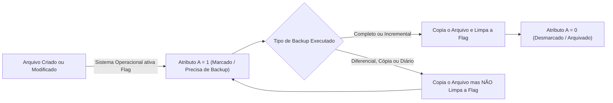
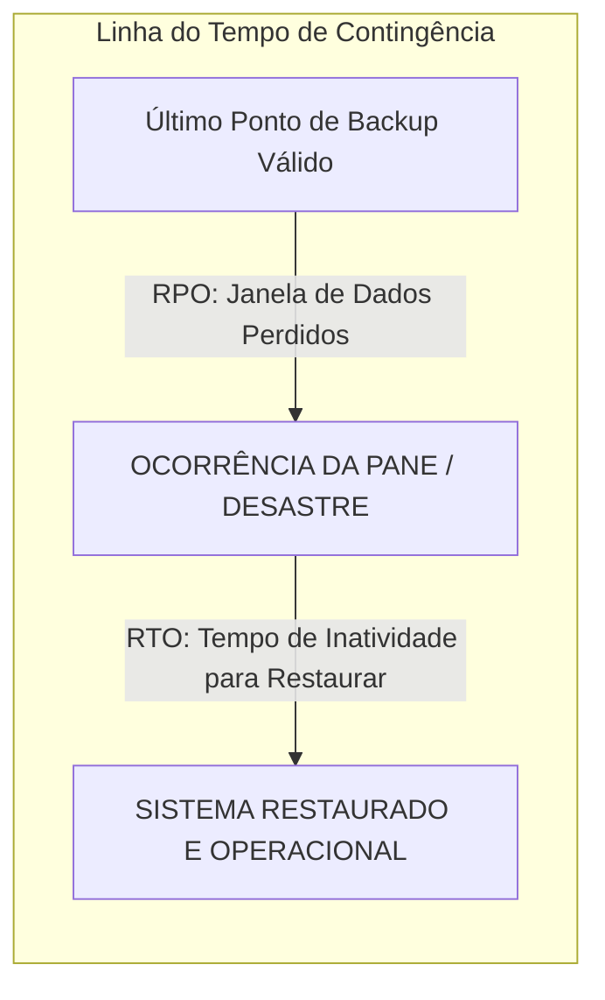
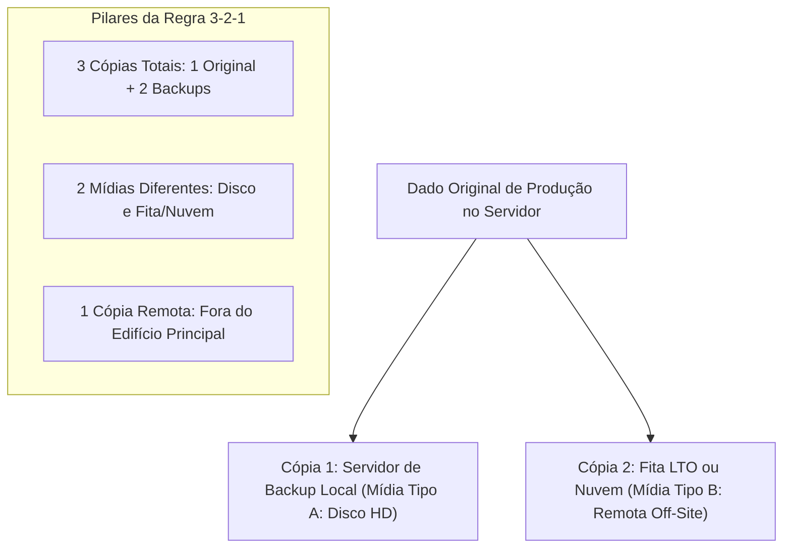
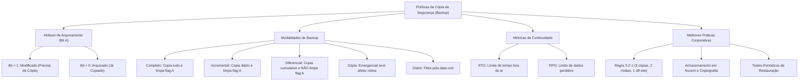

A perda de dados institucionais decorrente de desastres físicos, falhas mecânicas em discos, ataques de sequestro digital (*ransomware*) ou exclusão humana acidental pode inviabilizar a atuação das forças de segurança pública e defesa civil. A salvaguarda periódica de bases cadastrais, registros periciais e despachos operacionais constitui o núcleo indispensável da continuidade de negócios.

O **Backup** (ou cópia de segurança) é o procedimento sistemático que garante a recuperação fidedigna e tempestiva das informações corporativas após um incidente destrutivo. Este capítulo disseca os princípios fundamentais de contingência de dados, o funcionamento do atributo de arquivamento (*Archive Bit*), as cinco modalidades clássicas de cópia, os métodos de restauração emergencial e a consagrada regra corporativa 3-2-1.

> [!objetivos]
> - Compreender o conceito de cópia de segurança, diferenciando integridade e disponibilidade.
> - Conhecer as características e limitações das principais mídias de armazenamento físico e em nuvem.
> - Dominar o funcionamento do atributo de arquivamento (Bit Archive) na marcação de arquivos.
> - Diferenciar detalhadamente as cinco modalidades de backup: completo, incremental, diferencial, cópia e diário.
> - Aplicar a regra de proteção 3-2-1 e as melhores práticas de restauração e métricas de contingência.

## Conceitos Básicos de Cópia de Segurança

O termo **backup** (frequentemente aportuguesado em certames públicos como "becape") refere-se à duplicata idêntica de dados mantida em um meio de armazenamento independente. Seu propósito exclusivo é viabilizar a recuperação integral do ambiente informacional caso os dados originais sofram corrupção, destruição ou indisponibilidade.

### Princípios de Segurança e Limites do Backup

Na teoria clássica da segurança da informação, o backup atua diretamente na salvaguarda da **Integridade** e da **Autenticidade** dos dados corporativos:
- Ao restaurar uma cópia fidedigna gerada antes de um incidente, a organização reconstitui o estado exato dos dados sem adulterações indevidas.
- **Atenção doutrinária**: O backup, isoladamente, **não garante a disponibilidade imediata contínua** de um serviço em tempo real. A restauração de terabytes de dados exige horas de processamento. A alta disponibilidade ininterrupta é atributo de sistemas redundantes em alta escala (*clusters* e espelhamento em tempo real), e não da cópia de segurança em si.

> [!atencao]
> **Backup não é sincronização de arquivos:**
> Muitas pessoas confundem rotinas de backup com serviços de sincronização automática de pastas (como Google Drive, OneDrive ou Dropbox convencionais).
> - Na sincronização em tempo real, se um arquivo for infectado por um ransomware ou excluído por engano, a versão danificada é replicada instantaneamente para a nuvem.
> - O verdadeiro backup preserva o histórico de versões congeladas em pontos fixos do tempo (*snapshots*), permitindo voltar a um momento anterior ao desastre.

### Localização Física: Cópias On-Site versus Off-Site

A dispersão geográfica dos dados é uma das salvaguardas mais críticas para a continuidade operacional:

1. **Cópias Locais (*On-Site*)**:
   O dispositivo de armazenamento da cópia permanece instalado no mesmo prédio ou sala de servidores dos computadores de produção. Apresenta alta velocidade de gravação e restauração rápida em falhas corriqueiras de hardware. No entanto, fica vulnerável a incêndios, inundações, desabamentos ou furtos no edifício principal.
2. **Cópias Remotas (*Off-Site*)**:
   O dispositivo de armazenamento é transportado ou transmitido para um local geograficamente distante do centro de processamento primário. É a abordagem recomendada para contingências severas. Um sinistro físico que destrua completamente a sede da corporação não atingirá a cópia remota dos dados.

| Modalidade de Guarda | Local de Armazenamento | Velocidade de Restauração | Proteção Contra Desastres Físicos |
|---|---|---|---|
| **Cópia Local (*On-Site*)** | Mesmo edifício da produção | Muito rápida (rede local ou cabo direto) | Baixa (vulnerável a sinistros prediais) |
| **Cópia Remota (*Off-Site*)** | Prédio distante ou cofre de segurança | Média (depende do transporte físico) | Alta (resguardada contra desastres locais) |
| **Cópia em Nuvem (*Cloud*)** | Centros de dados distribuídos | Variável (depende da largura de banda) | Altíssima (redundância geográfica global) |

### Comparativo de Mídias de Armazenamento

A escolha do meio de gravação balanceia custo financeiro, capacidade volumétrica, velocidade de acesso e durabilidade física:

- **Memória RAM Não Serve para Backup**:
  A memória principal do computador é volátil. Ela perde todo o conteúdo armazenado no instante em que o fornecimento de energia elétrica é interrompido. O backup exige mídias não voláteis persistentes.
- **Fitas Magnéticas (LTO - *Linear Tape-Open*)**:
  Mídia clássica de altíssima densidade e baixo custo unitário por terabyte. É excelente para arquivamento frio de longo prazo (durabilidade superior a 30 anos). Sua desvantagem é o acesso puramente sequencial, que torna a recuperação de arquivos individuais excessivamente lenta.
- **Discos Rígidos Externos (HD) e Mídias SSD**:
  Oferecem acesso aleatório rápido e grande conveniência operacional. São amplamente utilizados em cópias intermediárias diárias e semanais.
- **Armazenamento em Nuvem Corporativa (*Cloud Storage*)**:
  Consolida-se como o padrão moderno predominante. Oferece infraestrutura física profissional, redundância geográfica automatizada, replicação em múltiplos continentes e suporte a chaves robustas de criptografia em trânsito e em repouso.

| Mídia de Armazenamento | Método de Leitura | Durabilidade Média | Vantagem Central | Principal Desvantagem |
|---|---|---|---|---|
| **Fita Magnética (LTO)** | Acesso Sequencial | Superior a 30 anos | Baixíssimo custo para arquivamento | Restauração pontual muito lenta |
| **Disco Rígido Externo (HD)** | Acesso Aleatório | 3 a 7 anos | Grande capacidade e custo moderado | Sensível a choques mecânicos e quedas |
| **Unidade de Estado Sólido (SSD)** | Acesso Eletrônico | 5 a 10 anos | Altíssima velocidade de transferência | Custo financeiro por terabyte mais elevado |
| **Armazenamento em Nuvem** | Acesso Remoto TCP/IP | Indeterminada (provedor) | Resiliência e isolamento off-site nativo | Dependência de conexão de internet veloz |

> [!exemplo]
> Em um departamento de polícia científica, o arquivo morto com laudos periciais de mais de vinte anos fica gravado em fitas magnéticas LTO guardadas em cofres secos. O custo de custódia é reduzido e a fita resiste por décadas.
> Por outro lado, para a base de ocorrências ativas do plantão policial, a equipe utiliza storages em matriz SSD com replicação em nuvem. A leitura é aleatória e instantânea, viabilizando consultas periciais em segundos.

## O Atributo de Arquivamento (Bit Archive)

Nos sistemas de arquivos modernos (como NTFS em ambientes Windows e ext4 em sistemas Linux), cada arquivo possui metadados denominados atributos de sistema.

Entre os atributos mais comuns estão o atributo **R** (*Read-Only* / Somente Leitura), **H** (*Hidden* / Oculto), **S** (*System* / Sistema) e o atributo **A** (**Archive** / Arquivamento).

### O Papel do Atributo A na Lógica de Backup

O **Atributo A** (também denominado tecnicamente como **Bit Archive** ou *Flag de Arquivamento*) é uma marca lógica binária de 1 bit que informa aos softwares de cópia se determinado arquivo foi modificado e precisa passar por backup:

1. **Quando o arquivo é criado ou modificado**:
   Sempre que o usuário cria um novo documento ou altera o conteúdo de um arquivo existente e o salva em disco, o sistema operacional automaticamente **ativa o atributo A** (`Bit Archive = 1` / Marcado).
   Essa marcação significa: *"Este arquivo sofreu alterações e necessita de cópia de segurança"*.
2. **Quando o software de backup copia o arquivo**:
   Dependendo da modalidade de backup adotada, o programa pode efetuar a cópia e em seguida **desmarcar o atributo A** (`Bit Archive = 0` / Desmarcado ou Limpo).
   A desmarcação significa: *"Este arquivo já passou por cópia e encontra-se devidamente resguardado"*.

> [!bizu]
> **A regra do bit para a prova:**
> - **Atributo A Marcado (Bit = 1)**: O arquivo foi modificado e **PRECISA** ser copiado;
> - **Atributo A Desmarcado (Bit = 0)**: O arquivo já foi copiado e **NÃO PRECISA** de nova cópia (a menos que seja uma rotina completa ou de cópia que ignore a flag).

## As Cinco Modalidades de Backup

A doutrina de informática aplicada a concursos estrutura as cópias de segurança em cinco modalidades fundamentais, diferenciadas pelo volume de dados transferido e pelo comportamento do atributo de arquivamento.

| Modalidade de Backup | O que é Copiado na Execução? | O Atributo A é Desmarcado (Limpo)? | Velocidade de Criação | Velocidade de Restauração |
|---|---|---|---|---|
| **Completo (*Full*)** | Todos os arquivos selecionados | **SIM** (limpa o atributo A) | A mais lenta de todas | A mais rápida e simples |
| **Incremental** | Apenas criados/alterados desde o último completo ou incremental | **SIM** (limpa o atributo A) | A mais rápida de todas | A mais lenta e trabalhosa |
| **Diferencial** | Todos criados/alterados desde o último backup completo | **NÃO** (mantém o atributo A marcado) | Intermediária (cresce a cada dia) | Rápida (apenas completo + último) |
| **De Cópia (*Copy*)** | Todos os arquivos selecionados | **NÃO** (não altera o atributo A) | Lenta (recopia tudo) | Rápida (independente) |
| **Diário (*Daily*)** | Apenas arquivos modificados na data da execução | **NÃO** (não altera o atributo A) | Rápida (filtra pelo calendário) | Variável e complexa |

---

### Backup Completo (Normal, Total ou Full)

O **Backup Completo** é a pedra angular sobre a qual se estruturam todas as políticas corporativas de segurança de dados:
- **Abrangência**: Copia absolutamente todos os arquivos e diretórios selecionados pelo administrador, independentemente de terem sido modificados recentemente ou não. Ele ignora o estado prévio do atributo A e processa a base inteira.
- **Comportamento do Atributo**: Após gravar a cópia com sucesso na mídia, o software **desmarca o atributo de arquivamento** (`A = 0`) de todos os arquivos processados.
- **Vantagens**: Oferece o menor risco de falha na restauração. Todos os dados residem concentrados em um único conjunto de mídia. O processo de restauração é o mais rápido e simples possível: basta restaurar o último arquivo de backup completo gerado.
- **Desvantagens**: É a modalidade mais demorada para ser criada e a que consome maior volume de espaço em disco ou fita. Por essa razão, raramente é executado diariamente em grandes redes corporativas, sendo agendado para finais de semana ou quinzenas.

---

### Backup Incremental

O **Backup Incremental** foi concebido especificamente para solucionar a lentidão e o desperdício de espaço do backup completo:
- **Abrangência**: Copia exclusivamente os arquivos que foram **criados ou modificados desde o último backup de qualquer tipo (seja ele completo ou incremental)**.
- **Mecanismo do Atributo**: O software procura arquivos com o atributo A marcado (`Bit Archive = 1`). Ele copia esses arquivos e, imediatamente após a gravação, **desmarca o atributo A** (`Bit Archive = 0`).
- **Comportamento no Tempo**: Como o atributo A é limpo a cada execução diária, o próximo backup incremental copiará apenas o que foi alterado nas últimas 24 horas. Ele nunca recopia dados que já foram salvos no dia anterior.
- **Vantagens**: É a modalidade **mais rápida de ser executada** e a que **menos espaço de armazenamento consome** no dia a dia.
- **Desvantagens**: É a modalidade **mais lenta, complexa e arriscada para restauração de desastres**. Para recuperar o sistema após uma pane completa, o administrador precisa restaurar o último backup completo e, em seguida, **todos os backups incrementais intermediários, um a um, rigorosamente na mesma ordem cronológica** em que foram gerados. Se uma única fita ou arquivo intermediário estiver corrompido, a cadeia de restauração é interrompida.

---

### Backup Diferencial (Incremental Cumulativo)

O **Backup Diferencial** estabelece um ponto de equilíbrio técnico entre o consumo de espaço do backup completo e a complexidade de restauração do backup incremental:
- **Abrangência**: Salva todos os arquivos produzidos ou alterados a partir da última rotina integral realizada.
- **Mecanismo do Atributo**: O software procura arquivos com o atributo A marcado (`Bit Archive = 1`). Ele copia esses arquivos, mas **NÃO desmarca o atributo de arquivamento**. O atributo A permanece ativado (`Bit Archive = 1`).
- **Comportamento no Tempo**: Como a flag de arquivamento permanece marcada após a cópia, o backup diferencial seguinte copiará novamente tudo o que já havia sido copiado no dia anterior, mais as novas alterações ocorridas na data de hoje. O tamanho do arquivo diferencial cresce cumulativamente a cada dia ao longo da semana.
- **Vantagens**: A restauração é significativamente **mais rápida e confiável do que a do incremental**. Para restabelecer o ambiente após uma falha total, são necessários **apenas dois conjuntos de arquivos**: o **último backup completo** e o **último backup diferencial gerado**. Todos os backups diferenciais anteriores tornam-se descartáveis para a recuperação.
- **Desvantagens**: Exige mais tempo de gravação diária e mais espaço em disco do que o incremental, uma vez que acumula redundâncias sucessivas ao longo dos dias.

> [!bizu]
> Na rotina com backup diferencial, os arquivos diferenciais dos dias intermediários não são utilizados na recuperação de desastres.
> Por exemplo, se a pane ocorrer na sexta-feira, o administrador precisará apenas da mídia do completo de domingo e do diferencial de quinta-feira. Os diferenciais de segunda, terça e quarta podem ser descartados sem qualquer prejuízo à integridade dos dados restaurados.

---

### Backup de Cópia (Copy Backup)

O **Backup de Cópia** é uma modalidade utilizada em situações pontuais ou emergenciais:
- **Abrangência**: Copia todos os arquivos selecionados, exatamente como o backup completo.
- **Mecanismo do Atributo**: **NÃO altera o atributo de arquivamento**. Se um arquivo estava com `A = 1`, ele permanece com `A = 1`; se estava com `A = 0`, permanece desmarcado.
- **Finalidade Operacional**: Sua grande virtude é a **não interferência na rotina programada da empresa**. Se um técnico precisar extrair uma cópia emergencial de um servidor antes de uma atualização arriscada de software em plena quarta-feira, ele utiliza o backup de cópia. Essa ação não desmarcará os atributos A, preservando intacta a rotina de backups diferenciais ou incrementais que rodará automaticamente durante a madrugada.

---

### Backup Diário (Daily Backup)

O **Backup Diário** baseia sua seleção exclusivamente em critérios cronológicos de calendário:
- **Abrangência**: Copia apenas os arquivos cujo registro de data de modificação no sistema de arquivos coincida com o dia civil da execução da rotina.
- **Mecanismo do Atributo**: **NÃO altera o atributo de arquivamento**. Ele consulta apenas a estampa de data e hora do arquivo, ignorando o Bit Archive.
- **Finalidade Operacional**: Utilizado para extrações rápidas de produtividade diária em setores de redação ou perícia, sem desestabilizar as listas de controle de arquivamento corporativo.

> [!pegadinha]
> **Pegadinha campeã de bancas organizadoras:**
> A banca apresenta uma rotina semanal e pergunta o que é necessário para restaurar os dados após uma pane na sexta-feira à tarde:
> - Se a rotina utilizou **Completo no Domingo + Incrementais de Segunda a Quinta**:
>   A restauração exige **5 conjuntos de mídia**: o Completo do Domingo + Incremental de Segunda + Incremental de Terça + Incremental de Quarta + Incremental de Quinta.
> - Se a rotina utilizou **Completo no Domingo + Diferenciais de Segunda a Quinta**:
>   A restauração exige **apenas 2 conjuntos de mídia**: o Completo do Domingo + o Diferencial de Quinta-feira. Os diferenciais de segunda, terça e quarta são totalmente desnecessários.

## Comparativo Passo a Passo: Rotina Incremental versus Diferencial

Para consolidar definitivamente o entendimento do comportamento das mídias ao longo de uma semana de expediente, analisemos a evolução de um conjunto de dados corporativo submetido a ambas as abordagens de contingência.

Considere uma base de dados governamental que inicia a semana no domingo com os arquivos A, B e C, sofrendo acréscimos e alterações diárias regulares:
- **Domingo à noite**: Executa-se o Backup Completo inicial de base;
- **Segunda-feira**: Usuários alteram o arquivo A e criam o arquivo D;
- **Terça-feira**: Usuários alteram o arquivo B e criam o arquivo E;
- **Quarta-feira**: Usuários criam o arquivo F;
- **Quinta-feira à tarde**: Ocorre uma queima total dos discos rígidos de produção do servidor.

| Dia da Semana | Evento nos Dados | O que grava o Backup Incremental? | O que grava o Backup Diferencial? |
|---|---|---|---|
| **Domingo** | Base inicial: A, B, C | Completo: copia A, B, C (limpa flag A) | Completo: copia A, B, C (limpa flag A) |
| **Segunda** | Altera A, cria D | Copia apenas A e D (limpa flag A) | Copia apenas A e D (mantém flag A) |
| **Terça** | Altera B, cria E | Copia apenas B e E (limpa flag A) | Copia A, D, B e E (mantém flag A) |
| **Quarta** | Cria F | Copia apenas F (limpa flag A) | Copia A, D, B, E e F (mantém flag A) |
| **Quinta (Pane)** | **Processo de Restauração** | **Exige 4 arquivos**: Full + Inc1 + Inc2 + Inc3 | **Exige 2 arquivos**: Full + Dif3 (Quarta) |

O exame da tabela evidencia com clareza matemática a compensação de engenharia:
- O backup incremental transfere pacotes mínimos de dados a cada noite, exigindo menor janela de backup;
- O backup diferencial acumula volume de gravação progressivo a cada noite, mas reduz a complexidade e o tempo de inatividade durante a restauração de desastres.

## Diretrizes e Procedimentos de Restauração de Desastres

A restauração de dados é o teste definitivo da eficiência de uma política de salvaguarda. Ter backups gravados sem a capacidade de recuperá-los de forma célere e íntegra é uma falsa ilusão de segurança.

### Métricas Críticas: RTO e RPO

O planejamento de contingência de dados fundamenta-se em duas métricas internacionais de continuidade de negócios:

1. **RTO (Recovery Time Objective / Objetivo de Tempo de Recuperação)**:
   É o tempo máximo tolerável que a organização pode suportar com seus sistemas fora do ar após uma falha antes que ocorram prejuízos graves. Ele dita a velocidade necessária da mídia de restauração. Se o RTO de um sistema de despacho policial for de 2 horas, uma rotina de fita magnética que demore 8 horas para rebobinar é inadequada.
2. **RPO (Recovery Point Objective / Objetivo de Ponto de Recuperação)**:
   É o volume máximo tolerável de perda de dados medido em escala temporal. Ele dita a frequência com que os backups devem ser executados. Se o RPO for de 24 horas, um backup diário noturno é satisfatório. Se o RPO de uma central financeira for de 15 minutos, a organização exigirá backups incrementais contínuos de transações a cada 15 minutos.

### Procedimentos Técnicos de Restauração

Para restabelecer um ambiente computacional após um desastre, o protocolo operacional deve obedecer às seguintes fases estruturadas:
1. **Isolamento e Estabilização**: Antes de iniciar a restauração, o hardware substituto deve ser testado e isolado da rede para evitar que eventuais ransomwares remanescentes reinfectem a nova máquina.
2. **Restauração da Imagem Base**: Aplica-se o backup completo mais recente para estruturar as partições, o sistema operacional e as configurações mestre.
3. **Aplicação das Cargas Incrementais ou Diferenciais**: Restauram-se os dados acumulados de acordo com a metodologia adotada, respeitando a ordem cronológica de gravação.
4. **Validação de Integridade e Teste Funcional**: O administrador executa checagens de integridade nas tabelas de banco de dados e valida o funcionamento dos serviços antes de liberar o acesso aos usuários finais.

## A Regra de Proteção 3-2-1 e Melhores Práticas Corporativas

A comunidade global de segurança da informação convencionou uma metodologia padrão de resiliência corporativa conhecida universalmente como a **Regra 3-2-1 de Backup**.

### Os Pilares da Regra 3-2-1

Para garantir que nenhuma falha isolada provoque a destruição permanente dos ativos corporativos, a organização deve manter:

- **3 Cópias dos Dados**: Manter o dado de produção original mais pelo menos duas cópias de segurança adicionais independentes;
- **2 Mídias de Tipos Diferentes**: Gravar as cópias em tecnologias de armazenamento fisicamente distintas (por exemplo, uma cópia em disco rígido corporativo local e outra cópia em fita magnética ou matriz SSD), evitando que falhas de lote de fabricação atinjam todas as mídias simultaneamente;
- **1 Cópia Fora do Local (*Off-Site* / Nuvem)**: Manter obrigatoriamente pelo menos uma das cópias armazenada em localização geograficamente isolada da sede da corporação (como cofre externo de custódia ou provedor de computação em nuvem).

> [!pegadinha]
> **Pegadinha frequente sobre tipos de mídia:**
> Dividir um mesmo disco rígido físico em duas partições lógicas (como unidades C: e D:) não cumpre o requisito de duas mídias diferentes da regra 3-2-1.
> Se o disco rígido sofrer queima de placa lógica, defeito mecânico de leitura ou furto, ambas as partições serão perdidas simultaneamente. As mídias devem ser fisicamente distintas (como um HD interno e uma fita magnética, storage SSD externo ou nuvem).

> [!esquema]
> **Checklist das Melhores Práticas de Cópia de Segurança:**
> 1. **Automação via Agendamento**: Programar as rotinas em horários de baixo uso da rede para evitar falhas humanas de esquecimento;
> 2. **Criptografia Forte**: Criptografar os arquivos de backup em repouso e durante o tráfego de rede para impedir que o furto de uma fita ou invasão da nuvem exponha dados confidenciais de inquéritos;
> 3. **Imutabilidade de Dados (*WORM - Write Once, Read Many*)**: Configurar políticas de armazenamento em nuvem que impeçam a alteração ou exclusão de backups antes de um prazo predeterminado (proteção vital contra ransomwares);
> 4. **Testes Periódicos de Restauração**: Executar simulações periódicas de desastre em ambiente de homologação. O jargão profissional adverte: *"Backup que nunca foi testado na restauração não existe"*;
> 5. **Documentação Formal**: Manter manuais atualizados com a árvore de dependência de arquivos e as senhas mestre em custódia segura.

## Armazenamento de Backup em Nuvem (*Cloud Backup*)

O armazenamento em nuvem revolucionou a gestão de contingência nas instituições públicas. Provedores corporativos de computação em nuvem disponibilizam infraestruturas altamente protegidas com certificados internacionais de segurança:

- **Escalabilidade Elástica**: A corporação expande ou reduz o volume de armazenamento contratado sob demanda, eliminando a necessidade de adquirir dezenas de gavetas físicas de discos.
- **Isolamento Geográfico Automático**: O provedor distribui as réplicas em múltiplos centros de processamento (*data centers*) geograficamente dispersos. Uma tempestade ou falha elétrica em um estado não afeta o funcionamento do centro de dados secundário.
- **Defesa Contra Ransomware com Versionamento**: Sistemas de armazenamento em nuvem oferecem versionamento nativo imutável. Se arquivos forem criptografados localmente por um criminoso cibernético, o administrador simplesmente reverte a base para a versão do snapshot gravada minutos antes da invasão.

| Vantagem da Nuvem | Benefício Direto para a Instituição |
|---|---|
| **Eliminação de Mídias Físicas** | Dispensa o manuseio, transporte manual e estocagem física de fitas e discos |
| **Resiliência Geográfica Nativa** | Atende automaticamente ao requisito de cópia off-site da regra 3-2-1 |
| **Criptografia em Camadas** | Aplica cifras robustas (AES-256) antes do envio e no repouso dos servidores |
| **Controle de Acesso Granular** | Integração com políticas de privilégio mínimo e auditoria contínua de acessos |

## Exercício Prático Resolvido

A aplicação prática do raciocínio analítico consolida os tópicos cobrados pelas principais bancas de concurso.

> [!resolvido]
> **Questão Adaptada - Oficial de Segurança Pública**
> O setor de tecnologia de um comando operacional planejou a política semanal de proteção de dados. No domingo às 23h, executa-se um backup completo de todos os servidores. De segunda a sexta-feira, a equipe avalia duas propostas técnicas concorrentes para a execução diária às 23h:
> - **Proposta Alfa**: Executar backups incrementais a cada noite.
> - **Proposta Beta**: Executar backups diferenciais a cada noite.
> 
> Na quinta-feira, às 14h, um pico de tensão elétrica provocou a queima irreversível do subsistema de armazenamento de produção.
> 
> Com base na doutrina de backup e restauração:
> 1. Quais arquivos de backup serão necessários para restaurar a base de dados até o estado de quarta-feira à noite sob a **Proposta Alfa**?
> 2. Quais arquivos de backup serão necessários para restaurar a base de dados sob a **Proposta Beta**?
> 3. Qual proposta técnica propicia a restauração mais rápida para reativar o atendimento de emergência? Justifique.
> 
> **Resolução Analítica Passo a Passo:**
> 
> 1. **Restauração sob a Proposta Alfa (Incremental):**
>    - Como o backup incremental copia apenas as alterações do dia e desmarca o atributo de arquivamento a cada execução, os dados ficam particionados em pedaços cronológicos sucessivos.
>    - Serão necessários **4 conjuntos de mídia**: o **Backup Completo de Domingo** + o **Incremental de Segunda** + o **Incremental de Terça** + o **Incremental de Quarta**. A ordem deve ser estritamente cronológica.
> 
> 2. **Restauração sob a Proposta Beta (Diferencial):**
>    - O backup diferencial não desmarca o atributo de arquivamento. Ele acumula a cada noite todas as alterações ocorridas desde o domingo.
>    - Serão necessários **apenas 2 conjuntos de mídia**: o **Backup Completo de Domingo** e o **Backup Diferencial de Quarta-feira**. Os diferenciais de segunda e terça são totalmente dispensáveis.
> 
> 3. **Proposta com restauração mais rápida:**
>    - A **Proposta Beta (Diferencial)** oferece a restauração mais rápida e segura.
>    - O administrador processa apenas dois arquivos (o completo inicial e o diferencial cumulativo mais recente). Na proposta incremental, seria necessário montar, ler e encadear quatro mídias distintas, elevando a probabilidade de falhas e o tempo total de inatividade operacional (*RTO*).

## Mapa do capítulo

| Tópico Estruturante | Conceito Crítico para a Prova |
|---|---|
| **Finalidade Central** | Recuperar dados íntegros após desastres; não garante alta disponibilidade em tempo real |
| **Bit Archive (Flag A)** | Marcado (1) indica necessidade de backup; desmarcado (0) indica arquivo já resguardado |
| **Backup Completo** | Base de tudo; copia todos os dados selecionados e limpa o atributo A |
| **Backup Incremental** | Copia novidades desde o último backup e limpa A; criação rápida e restauração lenta |
| **Backup Diferencial** | Copia acumulado desde o último completo e NÃO limpa A; restaura com apenas 2 mídias |
| **Backup de Cópia** | Não mexe no atributo A; ideal para extrações avulsas sem bagunçar a rotina |
| **Backup Diário** | Filtra arquivos pela data do calendário do dia da execução; não altera o bit A |
| **Regra 3-2-1** | 3 cópias de segurança em 2 mídias de tipos diferentes com 1 cópia mantida off-site |
| **RTO e RPO** | Métricas de tempo máximo de inatividade tolerável e perda temporal aceitável de dados |
| **Nuvem e Criptografia** | Resiliência contra desastres prediais e blindagem de dados confidenciais |

### Para fixar

- O backup atua prioritariamente na garantia da integridade e na recuperação tempestiva de dados após falhas e sinistros.
- A memória RAM é volátil e não serve como meio de armazenamento de cópias de segurança.
- O atributo de arquivamento (Flag A = 1) indica modificação e necessidade de inclusão em nova cópia de segurança.
- O backup completo copia toda a base de arquivos selecionada e desmarca o atributo de arquivamento.
- O backup incremental copia apenas as novidades diárias e limpa o atributo A, exigindo todas as mídias da cadeia para a restauração.
- O backup diferencial acumula alterações desde o último completo sem desmarcar o atributo A, restaurando com apenas duas mídias.
- O backup de cópia grava todos os arquivos sem alterar o atributo A, sendo ideal para extrações emergenciais sem afetar a rotina.
- O backup diário utiliza a data de modificação como critério temporal e também preserva inalterado o estado do bit A.
- A regra corporativa 3-2-1 preconiza 3 cópias em 2 mídias distintas com pelo menos 1 cópia off-site ou em nuvem.
- Testes periódicos de restauração em ambiente simulado são indispensáveis para comprovar a eficácia da política de contingência.
