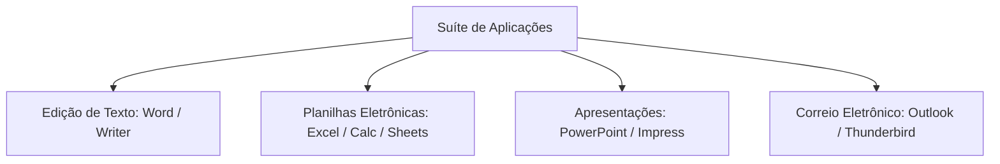
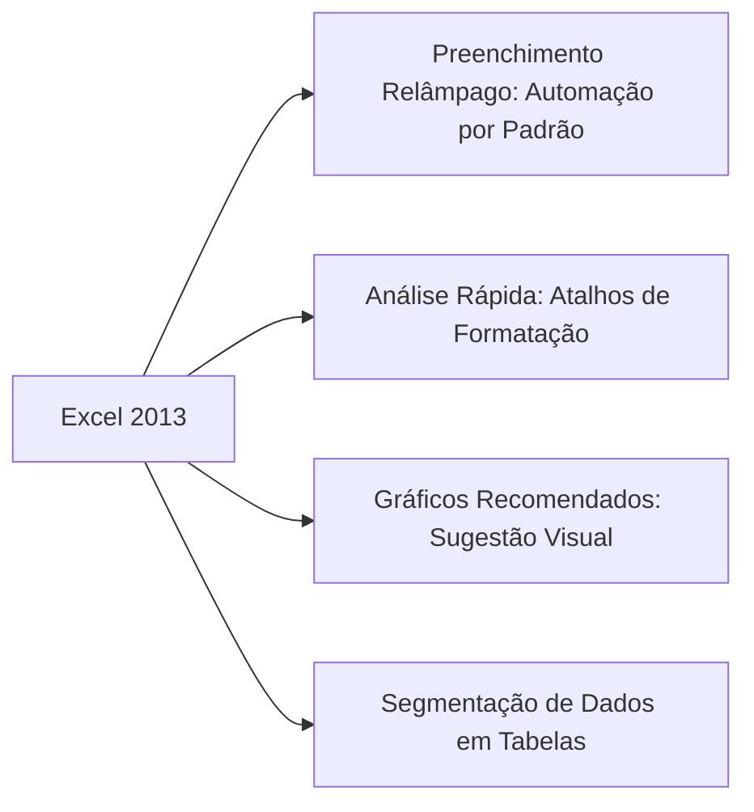
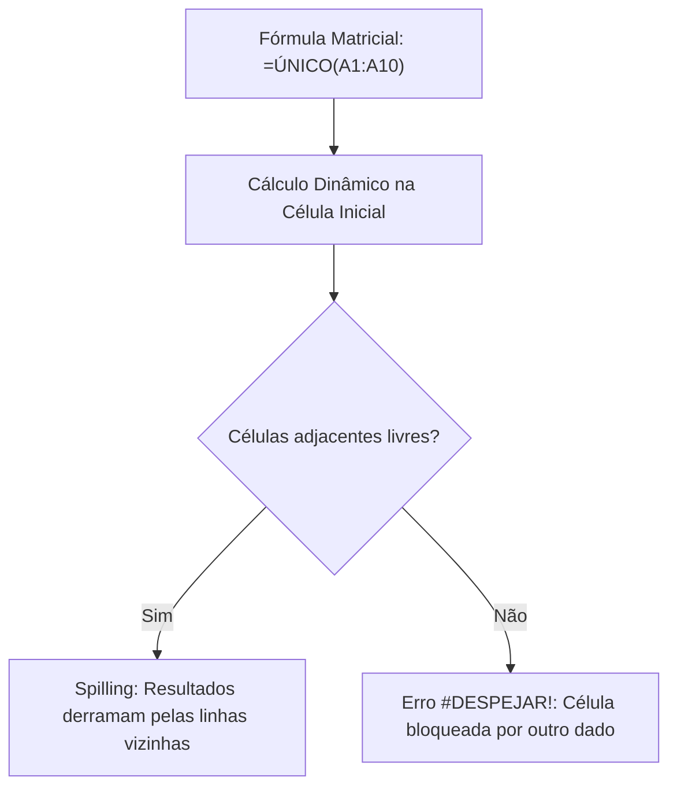
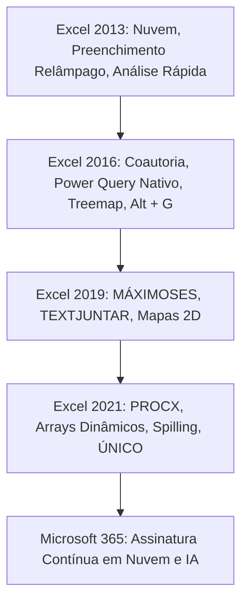

O **Microsoft Excel** representa a aplicação líder mundial no segmento de planilhas eletrônicas corporativas. No âmbito dos órgãos de segurança pública e defesa civil, o programa apoia a confecção de escalas de serviço, o controle de estoque de viaturas e a compilação estatística de atendimentos operacionais. Compreender sua evolução histórica e seus modelos de licenciamento permite resolver questões recorrentes em concursos públicos.

> [!objetivos]
> - Compreender o papel do Excel na suíte de aplicativos de escritório.
> - Distinguir os modelos de licenciamento perpétuo e de assinatura em nuvem.
> - Conhecer as inovações introduzidas nas edições do Excel 2013, 2016, 2019 e 2021.
> - Identificar as características contemporâneas do ecossistema Microsoft 365.
> - Dominar os conceitos de matrizes dinâmicas e colaboração em tempo real.

## Conceitos Fundamentais: A Suíte de Produtividade

A Microsoft desenvolveu ao longo de décadas um ecossistema integrado denominado suíte Office. Uma suíte consiste em um agrupamento de programas concebidos para tarefas rotineiras de escritório. Cada aplicação atende a uma finalidade técnica específica dentro da organização.

| Aplicativo | Categoria Funcional Primária | Exemplo de Aplicação Operacional |
|---|---|---|
| Microsoft Word | Processador de textos | Elaboração de portarias, pareceres e boletins internos |
| **Microsoft Excel** | **Editor de planilhas eletrônicas** | **Cálculo de efetivo, controle financeiro e estatísticas** |
| Microsoft PowerPoint | Editor de apresentações gráficas | Instrução técnica para tropas e relatórios de comando |
| Microsoft Outlook | Cliente de correio e agenda | Comunicação institucional e agendamento de inspeções |

Em provas de concurso, as bancas costumam comparar o Excel com outros aplicativos do mercado. O Google Sheets funciona como planilha em nuvem concorrente. O LibreOffice Calc atua como alternativa livre de código aberto. O Photoshop destina-se ao tratamento gráfico de imagens. Quando a banca exigir o editor padrão corporativo de planilhas eletrônicas, a resposta aponta para o Microsoft Excel.

## Contexto Histórico e Modelos de Distribuição

Uma planilha eletrônica é uma folha de cálculo estruturada em linhas e colunas. Esse arranjo matricial viabiliza a inserção de dados alfanuméricos e a execução de cálculos automáticos. O termo "eletrônica" indica que os cálculos são processados por rotinas computacionais dinâmicas.

A primeira edição do Excel surgiu na década de 1980 para computadores Macintosh, migrando em seguida para o ambiente Windows. O programa está disponível para plataformas Windows, macOS, Android e iOS. Todavia, a Microsoft **não disponibiliza versão nativa instalável para sistemas Linux**.

Atualmente, o usuário pode acessar o software por meio de três modalidades distintas:

1. **Licença Perpétua (Desktop Tradicional)**: O cliente adquire uma versão fechada (como Office 2019 ou 2021) mediante pagamento único. Essa edição recebe apenas atualizações de segurança e correções de falhas, sem novos recursos funcionais.
2. **Excel para a Web (Excel Online)**: Modalidade gratuita operada diretamente pelo navegador de internet. Atende a tarefas rotineiras, mas possui limitações em macros complexas e ferramentas avançadas de análise.
3. **Assinatura do Microsoft 365**: Modalidade de serviço contratada por pagamentos mensais ou anuais. O assinante desfruta de versões desktop e online continuamente atualizadas, com inteligência artificial, armazenamento na nuvem e ferramentas colaborativas em tempo real.

| Modalidade de Uso | Forma de Pagamento | Modelo de Atualização | Suporte a Recursos Avançados |
|---|---|---|---|
| Licença Perpétua | Pagamento único por licença | Apenas correções de falhas | Completo na versão adquirida |
| Excel Online | Gratuito via navegador | Contínuo na nuvem | Limitado a recursos básicos |
| Microsoft 365 | Assinatura periódica contínua | Atualizações mensais ativas | Completo e sempre atualizado |

> [!bizu]
> Guarde bem esta distinção para provas: versões perpétuas como Excel 2019 e Excel 2021 mantêm o conjunto de recursos congelado no momento do lançamento. Recursos criados posteriormente chegam exclusivamente por meio do Microsoft 365.

## Inovações do Excel 2013: Abertura para a Nuvem

O Excel 2013 marcou uma profunda transição visual e tecnológica do aplicativo. A interface adotou linhas minimalistas, concentrando o foco na área de trabalho da planilha. Foi também a edição que inaugurou a integração profunda com o armazenamento em nuvem no OneDrive.

Principais inovações introduzidas na versão 2013:
- **Preenchimento Relâmpago (Flash Fill)**: Recurso inteligente que reconhece padrões a partir do primeiro exemplo digitado pelo operador. Ele preenche a coluna inteira automaticamente sem exigir fórmulas. É muito usado para separar nomes e sobrenomes ou formatar números de documentos.
- **Análise Rápida (Quick Analysis)**: Ferramenta contextual exibida ao selecionar um intervalo de dados. Ela sugere formatações condicionais, minigráficos e tabelas dinâmicas em poucos cliques.
- **Gráficos Recomendados**: O aplicativo analisa a estrutura dos dados e recomenda as opções visuais mais adequadas para a representação gráfica.
- **Segmentação de Dados em Tabelas Comuns**: O recurso de filtros visuais (slicers), antes restrito a tabelas dinâmicas, passou a funcionar também em tabelas estruturadas comuns.
- **Módulos de Business Intelligence**: Integração nativa dos suplementos Power View e PowerPivot para modelagem multidimensional de dados.

## Inovações do Excel 2016: Colaboração e Novos Gráficos

O lançamento do Excel 2016 teve como foco prioritário o trabalho em equipe e a expansão gráfica. O ambiente de trabalho passou a permitir edição colaborativa simultânea caso o arquivo estivesse salvo no OneDrive ou no SharePoint.

Destaques da versão 2016 cobrados em concurso:
- **Coautoria em Tempo Real**: Múltiplos usuários podem visualizar e editar a mesma pasta de trabalho simultaneamente.
- **Novas Famílias de Gráficos**: Introdução de tipos gráficos contemporâneos, como Mapa de Árvores (Treemap), Explosão Solar, Histograma, Gráfico de Pareto, Gráfico de Cascata e Diagrama de Caixa (Box-plot).
- **Power Query Nativo**: O módulo de extração e tratamento de dados deixou de ser um suplemento externo. Ele foi integrado permanentemente na guia Dados, sob o grupo Obter e Transformar Dados.
- **Diga-me o Que Você Deseja Fazer**: Caixa de busca de comandos situada na faixa superior. Permite localizar ferramentas rapidamente pelo atalho Alt + G sem que o usuário precise saber em qual guia o comando reside.
- **Pesquisa Inteligente (Insights)**: Permite pesquisar conceitos e termos das células na internet por meio do motor de buscas Bing sem sair da planilha.

> [!pegadinha]
> A ferramenta "Diga-me o que você deseja fazer" é um campo de localização de recursos do próprio Excel, e não um assistente para redigir textos. Em versões posteriores integradas ao Microsoft 365, essa caixa evoluiu para a barra de Pesquisa universal.

## Inovações do Excel 2019: Modernização Perpétua

O Excel 2019 consolidou para os compradores de licença perpétua diversas funções e recursos que haviam sido lançados anteriormente no modelo por assinatura. Todavia, a colaboração em tempo real permaneceu como exclusividade do plano por assinatura na época.

Principais avanços incorporados no Excel 2019:
- **Funções de Texto e Lógica Modernas**: Inclusão das funções TEXTJUNTAR (que une textos com delimitadores e ignora células vazias), CONCAT e SES (que simplifica testes condicionais múltiplos).
- **Funções Estatísticas Condicionais**: Introdução de MÁXIMOSES e MÍNIMOSES, que encontram os valores extremos condicionadas a múltiplos critérios sem recorrer a fórmulas matriciais complexas.
- **Gráficos de Mapas Geográficos e Funil**: Possibilidade de gerar mapas 2D coloridos correlacionando dados a países, estados ou municípios reconhecidos automaticamente.
- **Tinta Digital Personalizável**: Suporte expandido a canetas e telas sensíveis ao toque para desenhar anotações e converter esboços manuais em formas matemáticas.

## Inovações do Excel 2021: O Marco dos Arrays Dinâmicos

O Excel 2021 trouxe uma das maiores revoluções estruturais da história do aplicativo: o suporte nativo a **matrizes dinâmicas (arrays dinâmicos)** com o comportamento de derramamento de resultados (*spilling*). 

Nas versões antigas, uma fórmula matricial exigia o atalho Ctrl + Shift + Enter para retornar valores em múltiplas células. No Excel 2021, uma fórmula que retorna múltiplos resultados espalha-se naturalmente pelas células adjacentes livres. Se houver alguma obstrução no caminho do derramamento, o Excel emite o erro `#DESPEJAR!`.

| Recurso ou Função | Finalidade Operacional | Avanço em Relação ao Modelo Antigo |
|---|---|---|
| **PROCX** | Busca de registros bidirecional | Substitui PROCV e PROCH sem limitação de direção |
| **CORRESPX** | Localiza a posição relativa de um item | Mais rápido e com busca exata por padrão |
| **FILTRAR** | Filtra intervalos dinamicamente | Retorna matriz de dados sem alterar a tabela original |
| **CLASSIFICAR** | Ordena dados automaticamente | Gera nova matriz ordenada por critérios definidos |
| **ÚNICO** | Extrai valores sem duplicidade | Isola itens distintos sem usar ferramentas de remoção |
| **SEQUÊNCIA** | Gera sequências de números | Cria séries numéricas em linhas e colunas instantaneamente |

Além das matrizes dinâmicas, o Excel 2021 incluiu coautoria em tempo real mesmo em licenças perpétuas (desde que o arquivo esteja na nuvem da Microsoft) e renovou o visual alinhando-o ao design do Windows 11.

> [!atencao]
> A função PROCX é um dos temas mais cotados pelas bancas examinadoras contemporâneas. Ela busca valores tanto para a direita quanto para a esquerda, adota correspondência exata por padrão e trata valores não encontrados diretamente no seu quarto argumento, dispensando a função SEERRO.

## A Transição para o Microsoft 365

Em abril de 2020, a Microsoft alterou a nomenclatura oficial de sua suíte corporativa por assinatura. O tradicional pacote Office 365 passou a denominar-se oficialmente **Microsoft 365**. A mudança visual consolidou-se para todos os consumidores globais a partir de novembro de 2022. Essa alteração não foi meramente cosmética ou mercadológica. Ela refletiu a transformação estrutural de um pacote de escritório isolado em uma plataforma ampla de produtividade, computação em nuvem e inteligência artificial.

O Microsoft 365 distingue-se pelo ritmo ininterrupto de atualizações operacionais. Mensalmente, novos recursos chegam aos assinantes ativos sem necessidade de comprar uma nova versão. A plataforma engloba armazenamento em nuvem no OneDrive, ferramentas integradas de comunicação no Microsoft Teams e mecanismos avançados de proteção de dados contra vazamentos. Além disso, a assinatura permite ao usuário instalar os aplicativos desktop em múltiplos dispositivos compatíveis (computadores pessoais, tablets e celulares).

O candidato a concurso público deve ter clareza total sobre as edições. O Excel 2016, 2019 e 2021 são produtos estáticos de licença perpétua que permanecem com as funções originais congeladas. O Microsoft 365 representa o serviço dinâmico de assinatura contínua em nuvem.

## Mapa do capítulo

| Marco Tecnológico | Versão Marcante | Principais Recursos Introduzidos |
|---|---|---|
| **Automação por Padrão** | Excel 2013 | Preenchimento Relâmpago (Flash Fill) e Análise Rápida |
| **Colaboração e BI** | Excel 2016 | Coautoria em tempo real, Power Query nativo e Diga-me (Alt + G) |
| **Funções Condicionais** | Excel 2019 | MÁXIMOSES, MÍNIMOSES, TEXTJUNTAR e mapas 2D |
| **Matrizes Dinâmicas** | Excel 2021 | PROCX, FILTRAR, ÚNICO, SEQUÊNCIA e derramamento (*spill*) |
| **Ecossistema em Nuvem** | Microsoft 365 | Modelo de assinatura contínua, OneDrive integrado e segurança avançada |

### Para fixar

- O Excel é o editor de planilhas eletrônicas da Microsoft, disponível para Windows, macOS, Android e iOS, inexistindo versão para Linux.
- A licença perpétua é paga uma única vez e recebe apenas correções de segurança, mantendo os recursos congelados.
- O Microsoft 365 opera por assinatura mensal ou anual com atualizações contínuas de recursos na nuvem.
- O Excel 2013 inaugurou o Preenchimento Relâmpago, a Análise Rápida e a segmentação de dados em tabelas comuns.
- O Excel 2016 incorporou coautoria em tempo real, novos gráficos (treemap, cascata, histograma), Power Query nativo e a ferramenta Diga-me (Alt + G).
- O Excel 2019 trouxe funções modernas como MÁXIMOSES, MÍNIMOSES, TEXTJUNTAR e gráficos de mapas 2D.
- O Excel 2021 consagrou os arrays dinâmicos com spilling e introduziu as funções PROCX, CORRESPX, FILTRAR e ÚNICO.
- Se células vizinhas estiverem ocupadas impedindo o derramamento de uma matriz dinâmica, o Excel emite o erro `#DESPEJAR!`.
- O nome Office 365 migrou oficialmente para a denominação Microsoft 365 em abril de 2020.
