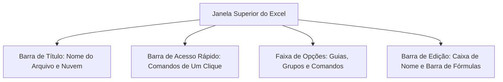
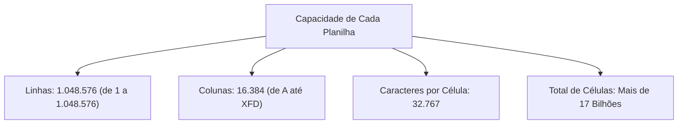
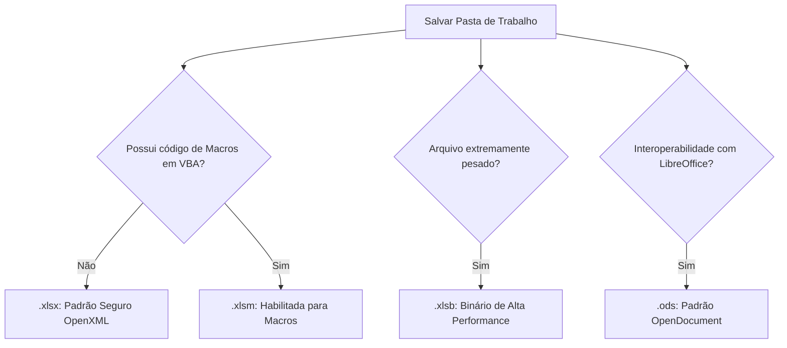
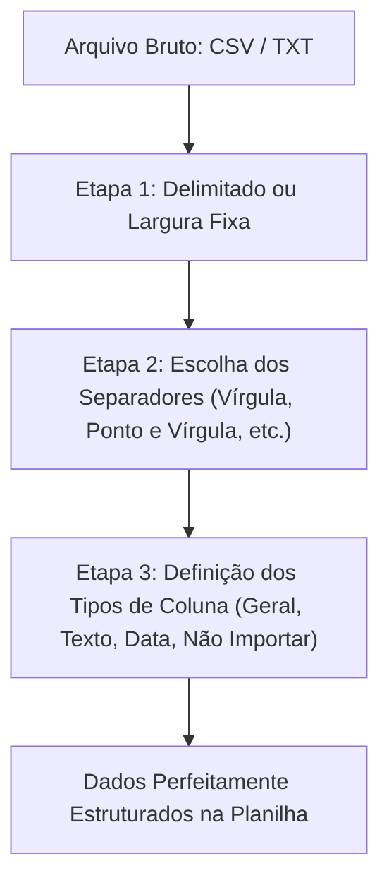

A **Arquitetura Estrutural do Microsoft Excel** engloba os componentes visuais de comando, a matriz de células e os formatos de interoperabilidade de dados. No serviço de segurança pública e defesa civil, o domínio desses recursos é indispensável. O militar e o policial precisam tabular relatórios de ocorrências, exportar cadastros de viaturas e parametrizar dados tabulares sem risco de perda de registros.

> [!objetivos]
> - Reconhecer os componentes da porção superior da interface do Excel.
> - Compreender a organização hierárquica da Faixa de Opções.
> - Dominar as funções da Caixa de Nome e da Barra de Fórmulas.
> - Decorar os limites físicos máximos de linhas, colunas e caracteres por célula.
> - Identificar as principais extensões de arquivo e as particularidades do padrão CSV.

## Interface Superior: Título e Ferramentas de Acesso Rápido

A região superior da janela do Excel centraliza os controles fundamentais de gerenciamento da sessão de trabalho. Essa área organiza-se em três elementos fundamentais:



### Barra de Título

A Barra de Título ocupa a linha mais alta da janela do aplicativo. Ela desempenha papéis de controle visual e operacional:
- **Identificação do Documento**: Exibe o nome do arquivo atualmente em edição. Quando uma nova pasta é criada, o sistema atribui provisoriamente o nome padronizado *Pasta1*. Ao lado do nome, exibe-se a identificação do aplicativo (*Excel*).
- **Botão de Salvamento Automático**: Presente nas versões contemporâneas do Microsoft 365. Esse interruptor deslizante grava as alterações em tempo real na nuvem sempre que a pasta de trabalho estiver hospedada no OneDrive ou no SharePoint.
- **Caixa de Pesquisa Universal**: Permite buscar comandos, consultar tópicos de ajuda ou localizar dados no documento ativo.
- **Identificação da Conta**: Mostra o perfil do usuário logado na assinatura corporativa.
- **Botões de Controle de Janela**: No canto superior direito, localizam-se os botões Minimizar, Restaurar/Maximizar e Fechar.

### Barra de Ferramentas de Acesso Rápido

A Barra de Ferramentas de Acesso Rápido disponibiliza comandos recorrentes em botões de um clique. Ela opera de modo independente da guia aberta na Faixa de Opções.

Por padrão, essa barra localiza-se acima da Faixa de Opções, mas o operador pode movê-la para baixo da faixa. Seus comandos iniciais típicos incluem Salvar, Desfazer e Refazer. O usuário pode personalizá-la livremente por meio de um menu suspenso, adicionando atalhos operacionais como Novo, Impressão Rápida e Visualizar Impressão.

| Elemento Superior | Posição Visual Típica | Finalidade Primária | Possibilidade de Personalização |
|---|---|---|---|
| Barra de Título | Topo absoluto da tela | Identificar arquivo e controlar janela | Limitada às opções de nuvem e busca |
| Barra de Acesso Rápido | Acima ou abaixo da Ribbon | Acesso imediato a comandos de um clique | Totalmente configurável pelo usuário |

> [!bizu]
> Personalizações na Barra de Acesso Rápido afetam apenas o ambiente do Microsoft Excel. As modificações não são transferidas automaticamente para o Word ou para o PowerPoint.

> [!esquema]
> A Barra de Acesso Rápido pode ser restaurada para as configurações originais de fábrica a qualquer momento. Basta acessar o menu Opções do Excel e selecionar a guia correspondente, clicando em Redefinir Apenas Barra de Ferramentas de Acesso Rápido.

## A Faixa de Opções (Ribbon)

A Faixa de Opções representa o coração visual de comando das aplicações do ecossistema Microsoft. Ela substituiu o modelo antigo de menus e barras de ferramentas flutuantes, adotando uma organização hierárquica em três níveis lógicos:

1. **Guias**: Grandes divisões temáticas de trabalho situadas na linha superior (como Página Inicial, Inserir, Layout da Página, Fórmulas, Dados, Revisão e Exibir).
2. **Grupos**: Subdivisões lógicas dentro de cada guia que reúnem ferramentas afins. Na guia Página Inicial, por exemplo, encontramos as seções de formatação tipográfica, alinhamento espacial, ajustes numéricos, estilos visuais e ferramentas de edição celular.
3. **Comandos**: Botões, menus suspensos, caixas de diálogo e campos de entrada que executam tarefas específicas sobre as células.


O usuário pode recolher a Faixa de Opções para maximizar a área visível das células da planilha. Isso pode ser feito clicando duas vezes sobre qualquer guia ou pelo atalho de teclado `Ctrl + F1`. Clicando novamente ou utilizando o mesmo atalho, a faixa é restaurada integralmente.

> [!atencao]
> A Faixa de Opções admite a criação de guias e grupos personalizados pelo usuário. Contudo, as guias padrão de fábrica do Excel não podem ter seus nomes originais alterados nem seus comandos nativos excluídos individualmente.

> [!exemplo]
> Em uma central de despacho do Corpo de Bombeiros, o operador pode criar uma guia personalizada denominada "Operações". Nessa guia, ele reúne atalhos para filtros rápidos de viaturas, formatação condicional de chamados prioritários e botões de exportação para PDF em uma única tela.

## Caixa de Nome e Sistema de Endereçamento

Logo abaixo da Faixa de Opções, encontra-se a área de controle de edição da planilha. Na extremidade esquerda dessa faixa situa-se a **Caixa de Nome**.

A Caixa de Nome desempenha três funções vitais para o operador:
- **Exibição da Célula Ativa**: Apresenta em tempo real a coordenada alfanumérica da célula atualmente em foco (como `A1`, `B12` ou `AA50`).
- **Navegação Rápida**: Permite ao usuário digitar qualquer coordenada válida e pressionar a tecla `Enter` para saltar imediatamente para aquela posição da planilha.
- **Gerenciamento de Intervalos Nomeados**: Permite selecionar um bloco de células e atribuir-lhe um rótulo textual legível (por exemplo, denominar o intervalo `B2:B50` como `EfetivoDeServico`). Uma vez criado o nome, basta digitá-lo ou selecioná-lo na Caixa de Nome para remarcar todo o bloco instantaneamente.

| Recurso da Caixa de Nome | Ação do Operador | Resultado Prático na Grade |
|---|---|---|
| Leitura de Posição | Observar a coordenada exibida | Saber onde o cursor está focado |
| Salto Direto | Digitar `Z100` e teclar `Enter` | A célula Z100 torna-se imediatamente a ativa |
| Batismo de Intervalo | Selecionar `A1:A10` e digitar `Viaturas` | O intervalo passa a responder pelo nome batizado |


> [!bizu]
> Ao nomear intervalos na Caixa de Nome, os nomes não podem conter espaços em branco nem iniciar com numerais. O caractere sublinhado pode ser empregado para separar palavras (por exemplo, `Quartel_Central` ou `Escala2026`).

## A Barra de Fórmulas e Seus Botões de Controle

A **Barra de Fórmulas** localiza-se à direita da Caixa de Nome. Ela funciona como a área de visualização e edição minuciosa dos conteúdos das células.

Entre a Caixa de Nome e a Barra de Fórmulas, existem três botões auxiliares que se iluminam durante a digitação:
1. **Cancelar (Ícone X ou tecla Esc)**: Aborta a digitação em andamento, restaurando o conteúdo anterior da célula sem salvar modificações.
2. **Confirmar (Ícone de confirmação ou tecla Enter)**: Grava o dado ou a fórmula digitada na célula, mantendo o cursor posicionado nela.
3. **Inserir Função (Ícone fx ou atalho Shift + F3)**: Abre o assistente de fórmulas, auxiliando na escolha e no preenchimento de argumentos de funções.

```mermaid Diferença entre valor exibido na célula e conteúdo na Barra de Fórmulas
flowchart LR
    Cel["Célula na Grade Visual<br>Exibe o Resultado Numérico: 250"] 
    BF["Barra de Fórmulas<br>Exibe a Expressão Real: =SOMA(A1:A5)"]
    Cel -. "Depende de" .-> BF
```

Uma das características fundamentais das planilhas eletrônicas é a discrepância entre a exibição visual e o conteúdo subjacente. Uma célula pode exibir o número formatado `R$ 1.500,00`, enquanto a Barra de Fórmulas revela a equação matemática que gerou esse resultado: `=B2 * 1,2`.

O usuário pode expandir a altura da Barra de Fórmulas clicando na sua borda inferior ou utilizando o atalho `Ctrl + Shift + U`. Essa expansão é especialmente útil ao redigir equações longas com funções lógicas encadeadas ou múltiplos critérios de cálculo.

> [!pegadinha]
> Fique atento em provas práticas: o valor impresso ou visível na célula pode estar arredondado pela formatação visual. Contudo, os cálculos subsequentes do Excel utilizam sempre o valor real com todas as casas decimais arquivado na Barra de Fórmulas.

## Estrutura da Planilha: Pastas, Abas e Matrizes

No vocabulário formal do Microsoft Excel, os conceitos de arquivo e de folha de cálculo não se confundem:

- **Pasta de Trabalho**: Representa o **arquivo físico completo** gravado em disco ou na nuvem (análogo a um fichário ou documento no Word). Uma pasta de trabalho possui extensão própria (como `.xlsx`) e abriga uma ou dezenas de planilhas.
- **Planilha (Plan)**: Corresponde a cada **folha, aba ou página individual de cálculo** contida dentro da pasta de trabalho. As planilhas são gerenciadas por abas situadas na margem inferior da janela.

Em versões anteriores do Office, uma nova pasta de trabalho abria com três planilhas pré-configuradas (*Plan1*, *Plan2*, *Plan3*). A partir do Excel 2013, o padrão de fábrica foi simplificado: uma nova pasta de trabalho abre com apenas **uma planilha ativa** (*Plan1*), podendo o operador criar novas abas pelo botão de adição (`+`).

| Conceito Estrutural | Analogia Prática | Identificação Técnica |
|---|---|---|
| Pasta de Trabalho | O fichário físico completo | O arquivo gravado (`Relatorio.xlsx`) |
| Planilha | Cada folha plástica do fichário | As abas inferiores (*Plan1*, *Escalas*) |
| Célula | O quadradinho pautado da folha | A interseção de uma coluna com uma linha |

As abas inferiores podem ser renomeadas livremente com até 31 caracteres alfanuméricos. O usuário pode atribuir cores personalizadas às guias para categorizar setores operacionais. Também é possível ocultar planilhas inteiras para evitar edições indevidas por terceiros.

> [!atencao]
> Uma pasta de trabalho deve conter obrigatoriamente ao menos uma planilha visível. O Excel impede o usuário de ocultar ou excluir todas as abas de uma pasta simultaneamente.

## Limites Físicos Estruturais do Excel

Para que o candidato não caia em armadilhas conceituais sobre capacidade de dados, é imperativo memorizar as dimensões máximas suportadas por cada planilha a partir do Excel 2007 (aplicável ao Excel 2010, 2013, 2016, 2019, 2021 e Microsoft 365).

A grade de cálculo possui fronteiras matemáticas exatas:

1. **Número Total de Linhas**: Cada planilha contém exatamente **1.048.576 linhas**. Elas são identificadas por numerais arábicos sequenciais de 1 até 1.048.576.
2. **Número Total de Colunas**: Cada planilha contém exatamente **16.384 colunas**. Elas são identificadas por letras do alfabeto romano, iniciando na coluna `A` e finalizando na coluna `XFD`.
3. **Capacidade Máxima por Célula**: Uma única célula comporta até **32.767 caracteres** de texto ou números.
4. **Total de Células por Planilha**: O produto dimensional resulta em 1.048.576 × 16.384 = **17.179.869.184 células**.
5. **Níveis de Desfazer**: O aplicativo suporta até 100 ações sucessivas na pilha de desfazer comandos.
6. **Zoom de Exibição**: A aproximação visual varia entre o mínimo de 10% e o máximo de 400%.



### O Sistema Alfabético de Nomenclatura de Colunas

As primeiras 26 colunas recebem letras simples de `A` até `Z`. Esgotado o alfabeto inicial, o Excel adota combinações de duas letras: `AA`, `AB`, `AC` até `AZ`. Em seguida, inicia `BA`, `BB` até `ZZ`. Esgotadas as combinações de duas letras, inicia combinações de três letras: `AAA`, `AAB` sucessivamente até atingir o limite físico na coluna **`XFD`**.

| Faixa Dimensional | Nomenclatura das Colunas | Quantidade de Colunas |
|---|---|---|
| Letras Simples | `A` até `Z` | 26 colunas |
| Duas Letras | `AA` até `ZZ` | 676 colunas (26 × 26) |
| Três Letras | `AAA` até `XFD` | 15.682 colunas |
| **Capacidade Total** | **`A` até `XFD`** | **16.384 colunas exatas** |

> [!pegadinha]
> Algumas bancas examinadoras afirmam que o Excel comporta linhas infinitas para operar como banco de dados relacional ilimitado. Essa afirmação é falsa. O limite máximo inegociável é de 1.048.576 linhas por planilha. Em versões legadas (Excel 97 a 2003), o teto era de apenas 65.536 linhas e 256 colunas (`IV`).

### Atalhos de Teclado Fundamentais para Navegação

A navegação eficiente pela imensa matriz dimensional do Excel apoia-se em atalhos consagrados de teclado:
- `Ctrl + Seta para Baixo`: Salta instantaneamente para a última linha preenchida do bloco contínuo ou para a linha 1.048.576 se a coluna estiver vazia.
- `Ctrl + Seta para a Direita`: Salta para a última coluna preenchida ou para a coluna extrema `XFD`.
- `Ctrl + Home`: Move a célula ativa imediatamente para a coordenada inicial superior esquerda `A1`.
- `Ctrl + End`: Conduz o foco para a última célula utilizada na interseção extrema inferior direita da planilha.
- `Page Down` e `Page Up`: Deslocam a visualização uma tela inteira para baixo ou para cima.
- `Alt + Page Down` e `Alt + Page Up`: Deslocam a tela lateralmente para a direita ou para a esquerda.

## Formatos Nativos de Arquivo Suportados

O Microsoft Excel reconhece múltiplos formatos para gravação e interoperabilidade. A escolha do formato adequado impacta a segurança corporativa, a capacidade de execução de rotinas automáticas e o desempenho de abertura de arquivos volumosos.

### Formatos Próprios do Ecossistema Excel

- **`.xlsx` (Pasta de Trabalho Padrão)**: Formato nativo baseado na especificação aberta OpenXML compactada em padrão ZIP. É o padrão oficial desde o Excel 2007. Por razões de segurança digital contra vírus e softwares maliciosos, **o formato `.xlsx` não pode armazenar nem executar código de macros em VBA**.
- **`.xlsm` (Pasta de Trabalho Habilitada para Macros)**: Possui a mesma estrutura baseada em XML, mas conta com permissão especial para armazenar e executar rotinas de automação em VBA (Visual Basic for Applications).
- **`.xlsb` (Pasta de Trabalho Binária)**: Armazena as informações em código binário compactado puro, em vez de texto XML. Essa extensão é ideal para pastas de trabalho gigantescas, pois reduz o tamanho do arquivo no disco em até 50% e acelera dramaticamente a velocidade de abertura e gravação. Suporta macros.
- **`.xltx` e `.xltm` (Modelos de Pasta de Trabalho)**: Arquivos de matriz padronizados, sem e com suporte a macros, utilizados como base para a criação de novos documentos predefinidos.
- **`.xls` (Pasta de Trabalho Legada 97-2003)**: Formato binário proprietário antigo. É limitado tecnologicamente a 65.536 linhas e 256 colunas, não suportando as novas funções e capacidades das versões modernas.
- **`.ods` (Planilha OpenDocument)**: Formato padronizado aberto utilizado nativamente pela suíte LibreOffice Calc, garantindo interoperabilidade entre diferentes softwares de escritório.

| Extensão de Arquivo | Estrutura Técnica | Suporta Código VBA (Macros)? | Uso Recomendado |
|---|---|---|---|
| `.xlsx` | OpenXML (ZIP) | Não (Bloqueado por segurança) | Padrão diário para documentos seguros |
| `.xlsm` | OpenXML habilitado | Sim (Executa rotinas) | Planilhas com rotinas automatizadas em VBA |
| `.xlsb` | Código Binário Puro | Sim (Executa rotinas) | Bases de dados muito pesadas |
| `.xltx` | Modelo OpenXML | Não | Modelos padrão de formulários |
| `.xls` | Binário Legado | Sim | Compatibilidade com sistemas antigos |
| `.ods` | Padrão OpenDocument | Variável | Intercâmbio com LibreOffice Calc |



> [!bizu]
> Um arquivo com extensão `.xlsx` pode ser renomeado para `.zip` no sistema operacional. Ao descompactar a pasta resultante, o usuário tem acesso direto a arquivos XML internos com os dados e configurações da planilha.

## O Formato CSV e a Interoperabilidade Universal

O padrão **CSV (Comma-Separated Values, ou Valores Separados por Vírgula)** representa uma das linguagens mais universais para intercâmbio de matrizes de dados entre sistemas heterogêneos. Bancos de dados, sistemas de despacho de bombeiros e softwares de folha de pagamento exportam e importam relatórios rotineiramente nesse formato.

O formato CSV estrutura-se essencialmente como um documento de texto puro desprovido de formatações. Cada linha do arquivo de texto corresponde a um registro da tabela. Dentro de cada linha, os campos individuais de dados são separados por um caractere delimitador padrão.

### Delimitadores no Padrão Internacional e Brasileiro

- **Padrão Internacional (EUA e países de língua inglesa)**: Como o separador decimal utilizado nesses países é o ponto (`.`), o delimitador oficial de colunas do CSV é a **vírgula (`,`)**.
- **Padrão Brasileiro e da Europa Ocidental**: No Brasil, a vírgula é o caractere oficial reservado para a separação decimal dos números (ex.: `15,50`). Se a vírgula fosse usada como delimitador de colunas, ocorreria confusão nos valores fracionários. Por essa razão técnica, no ambiente em português do Brasil, o delimitador padrão das planilhas CSV é o **ponto e vírgula (`;`)**.

### O Que o Formato CSV NÃO Suporta

Por se tratar de um arquivo de texto não formatado puro, o padrão CSV possui restrições severas que despencam em concursos:
- **Não armazena fórmulas**: Ao salvar uma planilha em CSV, todas as fórmulas são destruídas, restando apenas os valores de texto correspondentes ao resultado visível no momento.
- **Não armazena formatação visual**: Cores de fundo, estilos de fonte, negrito, itálico, bordas e alinhamentos são integralmente eliminados.
- **Não suporta múltiplos gráficos ou imagens**: Quaisquer ilustrações, formas ou gráficos inseridos na grade são sumariamente descartados.
- **Não suporta múltiplas abas**: Um arquivo CSV é capaz de armazenar **apenas uma única planilha**. Se a pasta de trabalho possuir várias abas, o Excel emite um aviso e grava unicamente a aba ativa selecionada.

| Recurso do Excel | Suportado em `.xlsx`? | Suportado em `.csv`? |
|---|---|---|
| Fórmulas e Funções Dinâmicas | Sim | Não (Apenas texto estático) |
| Cores, Bordas e Formatação de Fonte | Sim | Não (Texto puro desprovido de estilo) |
| Gráficos e Imagens Inseridas | Sim | Não (Eliminados na gravação) |
| Múltiplas Abas de Planilhas | Sim (Centenas de abas) | Não (Grava apenas a aba em foco) |
| Abertura em Editores Simples (Bloco de Notas) | Não (Exige descompactador ZIP) | Sim (Arquivo de texto direto) |

> [!atencao]
> Tenha cautela máxima: se você construir uma planilha sofisticada com fórmulas complexas e salvá-la em formato `.csv`, ao fechar e reabrir o arquivo, todas as equações terão desaparecido, restando apenas números estáticos.

## O Assistente de Importação de Texto

Ao abrir um arquivo de texto bruto (`.csv`, `.txt` ou `.prn`) pela guia Dados ou pela caixa de diálogo Abrir, o Excel aciona o **Assistente de Importação de Texto**. Essa ferramenta é estruturada em três etapas lógicas indispensáveis:

1. **Etapa 1 (Tipo de Dados Original)**: O usuário indica se o arquivo possui campos separados por caracteres específicos (*Delimitado*) ou se os dados estão organizados em colunas com alinhamento fixo de espaçamento (*Largura Fixa*).
2. **Etapa 2 (Delimitadores)**: Permite selecionar ou marcar os caracteres divisores empregados na matriz (tabulação, ponto e vírgula, vírgula, espaço ou caractere personalizado). Também permite marcar a opção de tratar delimitadores consecutivos como um único separador.
3. **Etapa 3 (Formato dos Dados das Colunas)**: Etapa crítica de segurança da informação. Permite definir previamente a tipologia de cada coluna importada:
   - *Geral*: Converte numerais em valores numéricos padrão e datas em valores de calendário.
   - *Texto*: Preserva a coluna como cadeia literal pura. Essa escolha é mandatória para colunas que abrigam CPFs, matrículas de servidores ou códigos de patrimônio iniciados pelo algarismo zero. Se a coluna for importada como Geral, o Excel interpretará o dado como número e eliminará automaticamente os zeros à esquerda (por exemplo, o CPF `01234567890` seria truncado indevidamente para `1234567890`).
   - *Data*: Permite indicar a ordem de dia, mês e ano para garantir interpretação cronológica correta.
   - *Não Importar Coluna (Ignorar)*: Permite descartar colunas desnecessárias antes de carregá-las para a memória da planilha.



> [!bizu]
> Sempre que uma questão de concurso tratar de perda de zeros à esquerda na importação de relatórios cadastrais para o Excel, a solução metodológica consiste em formatar a respectiva coluna como **Texto** na terceira etapa do assistente de importação.

## Mapa do capítulo


| Elemento Estrutural | Especificação Técnica | Regra de Ouro para Provas |
|---|---|---|
| **Barra de Acesso Rápido** | Botões rápidos independentes | Customizável; afeta exclusivamente o Excel |
| **Faixa de Opções** | Guias, Grupos e Comandos | Atalho `Ctrl + F1` recolhe e expande a faixa |
| **Caixa de Nome** | Extremidade esquerda da barra | Aponta célula ativa e batiza intervalos de dados |
| **Barra de Fórmulas** | Campo de visualização textual | Mostra a fórmula real, enquanto a célula exibe o resultado |
| **Limite de Linhas** | Exatamente 1.048.576 linhas | Identificadas numericamente de 1 a 1.048.576 |
| **Limite de Colunas** | Exatamente 16.384 colunas | Identificadas por letras de `A` até `XFD` |
| **Extensão .xlsx** | Formato padrão OpenXML | Não grava nem executa macros por segurança |
| **Extensão .xlsm** | Formato habilitado para macros | Suporta código de programação em VBA |
| **Padrão CSV** | Valores separados por delimitador | Texto puro; destrói fórmulas, cores, gráficos e abas |

### Para fixar

- A Barra de Título abriga o nome do arquivo, a caixa de pesquisa e o interruptor de Salvamento Automático do OneDrive.
- A Barra de Acesso Rápido reúne comandos de um clique e pode ser livremente personalizada pelo operador.
- A Faixa de Opções estrutura-se hierarquicamente em guias, grupos lógicos e comandos específicos, sendo recolhida pelo atalho `Ctrl + F1`.
- A Caixa de Nome exibe a célula selecionada no momento, permite navegação por coordenadas e gerencia intervalos nomeados.
- A Barra de Fórmulas revela a equação real calculada, enquanto a grade da célula exibe apenas o valor resultante.
- O arquivo físico completo chama-se Pasta de Trabalho, enquanto as páginas internas denominam-se Planilhas.
- Cada planilha suporta rigorosamente 1.048.576 linhas e 16.384 colunas (finalizando em XFD), com até 32.767 caracteres por célula.
- A extensão nativa padrão `.xlsx` é desprovida de suporte a macros em VBA por diretrizes de segurança digital.
- Para armazenar códigos de automação em macros, deve-se selecionar obrigatoriamente a extensão `.xlsm`.
- O formato `.csv` grava dados em texto puro separados por delimitadores (ponto e vírgula no Brasil), eliminando fórmulas, gráficos e formatações.
