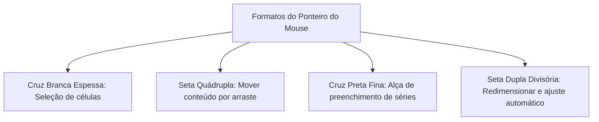
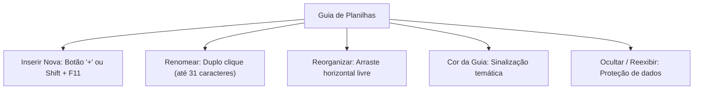
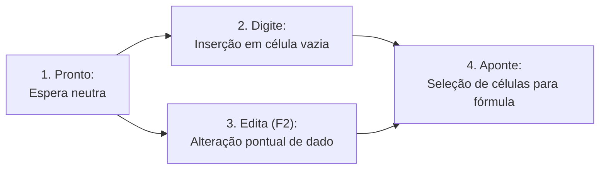
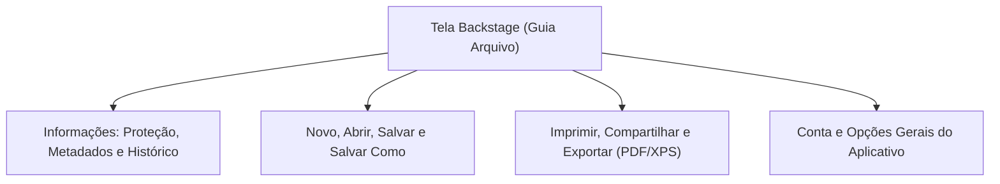
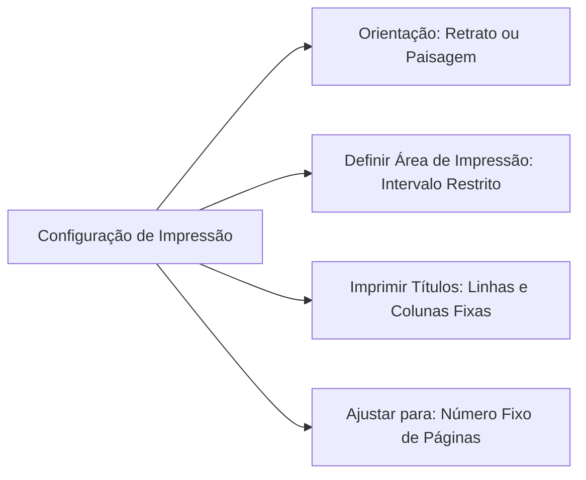
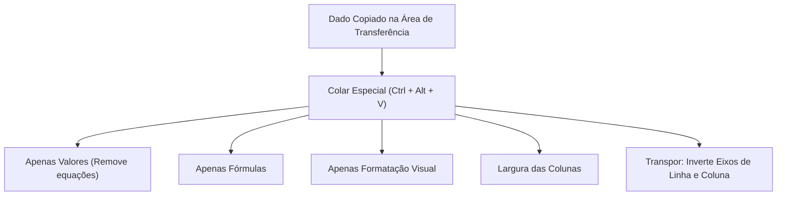
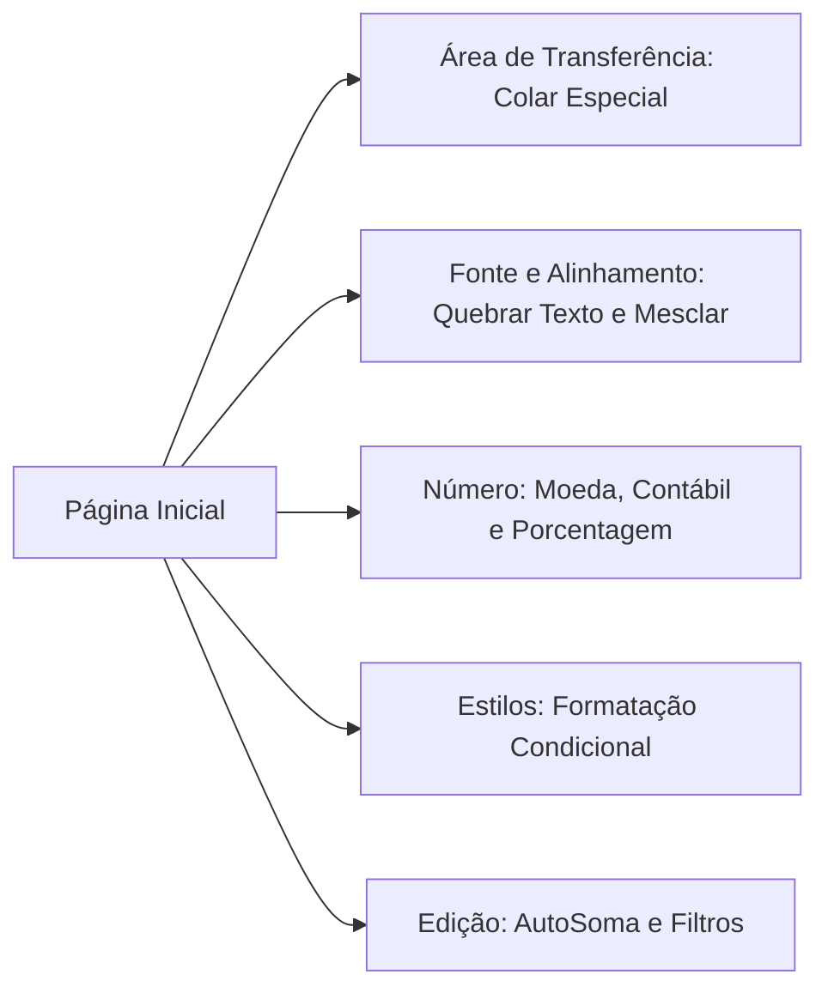
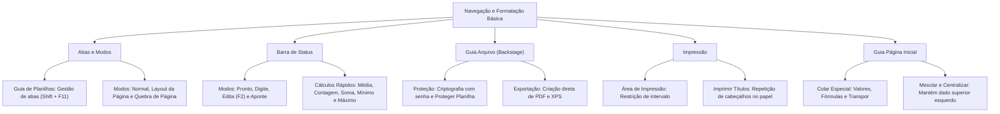

A **Navegação Operacional e a Formatação no Excel** constituem competências centrais para a elaboração de planilhas claras e profissionais. Na rotina dos órgãos de segurança pública e defesa civil, o correto manuseio de abas de planilhas, a inspeção da barra de status, os parâmetros de impressão corporativa e o uso avançado da guia Página Inicial garantem relatórios de serviço padronizados e relatórios de inteligência invioláveis.

> [!objetivos]
> - Dominar os conceitos básicos de navegação, seleção e ponteiros do mouse.
> - Gerenciar abas na Guia de Planilhas e controlar os modos de visualização.
> - Interpretar os estados operacionais e cálculos automáticos da Barra de Status.
> - Compreender a tela Backstage da Guia Arquivo e a segurança da informação.
> - Configurar parâmetros de impressão e aplicar comandos da Guia Página Inicial.

## Conceitos Básicos de Interação e Seleção de Células

A operação diária de uma planilha eletrônica exige o domínio dos métodos básicos de apontamento e seleção. O ponteiro do mouse assume formas visuais distintas conforme a posição ocupada sobre a grade de células. Cada formato de ponteiro desempenha uma função operacional específica:

1. **Cruz Branca Espessa**: Formato padrão do ponteiro ao pairar sobre o centro de qualquer célula. Essa forma indica que o clique selecionará a célula ou iniciará a demarcação de um bloco contíguo de dados.
2. **Seta Quádrupla de Quatro Pontas**: Aparece ao posicionar o cursor sobre a borda externa da célula ativa. Ao clicar e arrastar com essa seta, o operador move o conteúdo da célula para outra posição da grade. O comando equivale a recortar e colar.
3. **Cruz Preta Fina (Alça de Preenchimento)**: Aparece ao posicionar o mouse exatamente sobre o pequeno quadrado no vértice inferior direito da célula ativa. Ao arrastar essa cruz, o software duplica fórmulas ou projeta séries lógicas e progressões aritméticas.
4. **Seta Dupla com Traço Divisório**: Surge nas linhas divisórias entre as letras de colunas ou entre os numerais de linhas. Permite redimensionar a largura da coluna ou a altura da linha por arraste. Um duplo clique nessa divisória aplica o **Ajuste Automático**, redimensionando o eixo exatamente para a extensão do maior conteúdo presente.

### Técnicas de Seleção com Teclado e Mouse

Para manusear grandes volumes de informações em concursos e na vida profissional, combinam-se teclas modificadoras com o mouse:
- **Seleção Contígua (Tecla Shift)**: Ao clicar em uma célula inicial, pressionar a tecla `Shift` e clicar em uma célula final, o Excel seleciona todo o bloco retangular contínuo delimitado entre os dois pontos.
- **Seleção Dispersa ou Alternada (Tecla Ctrl)**: Mantendo a tecla `Ctrl` pressionada, o operador pode clicar em células ou intervalos não vizinhos. Todas as posições clicadas tornam-se parte de uma seleção múltipla fragmentada.
- **Seleção de Linha ou Coluna Inteira**: Clicar diretamente sobre a letra identificadora da coluna ou sobre o numeral da linha seleciona a totalidade das suas células até o limite máximo da planilha.
- **Seleção de Toda a Planilha**: Clicar no botão retangular cinza situado no cruzamento entre a coluna A e a linha 1, ou pressionar o atalho de teclado `Ctrl + T` (ou `Ctrl + Shift + Espaço`).

| Método de Seleção | Combinação de Teclas | Efeito Prático na Planilha |
|---|---|---|
| Bloco Contíguo | Clique inicial + `Shift` + Clique final | Seleciona todas as células entre os extremos |
| Células Alternadas | `Ctrl` mantido + Cliques avulsos | Cria seleção múltipla de posições dispersas |
| Linha Inteira | `Shift + Barra de Espaço` | Seleciona a linha completa da célula ativa |
| Coluna Inteira | `Ctrl + Barra de Espaço` | Seleciona a coluna completa da célula ativa |
| Planilha Completa | `Ctrl + T` ou botão de cruzamento | Seleciona todas as mais de 17 bilhões de células |

> [!bizu]
> Os atalhos `Shift + Barra de Espaço` (selecionar linha inteira) e `Ctrl + Barra de Espaço` (selecionar coluna inteira) são muito explorados em provas de concurso.

## Guia de Planilhas e Modos de Exibição

A porção inferior da janela do Excel abriga elementos decisivos para a navegação estrutural e visualização matricial.

Na extremidade inferior esquerda, a **Guia de Planilhas** permite alternar rapidamente entre as folhas de cálculo da pasta de trabalho. Uma mesma pasta pode abrigar controles de viaturas, folhas de pagamento e relatórios estatísticos em abas autônomas.

O usuário dispõe de ações diretas sobre as abas:
- **Inserir Nova Planilha**: Clicar no botão de adição (`+`) situado ao lado da última aba ou acionar o atalho de teclado `Shift + F11`.
- **Renomear Planilha**: Executar um duplo clique sobre a aba ou clicar com o botão direito e escolher a opção Renomear (máximo de 31 caracteres). Não são permitidos caracteres especiais como dois-pontos, barras ou pontos de interrogação.
- **Reorganizar**: Clicar e arrastar a aba horizontalmente para a posição desejada.
- **Colorir Guia**: Aplicar cores temáticas para categorizar frentes de serviço (por exemplo, vermelho para socorro e azul para salvamento).
- **Mover ou Copiar**: Duplicar a planilha na mesma pasta ou transferi-la para outra pasta aberta.
- **Ocultar e Reexibir**: Suprimir a visualização da aba para proteger dados auxiliares de apoio.

Na margem inferior direita, ao lado do controle de zoom, localizam-se os três botões de atalho dos **Modos de Exibição da Pasta de Trabalho**:

1. **Modo Normal**: Modo padrão de trabalho. Exibe a grade contínua de células otimizada para inserção rápida de dados, fórmulas e tabelas.
2. **Modo Layout da Página**: Apresenta a planilha fragmentada visualmente exatamente como sairá nas folhas impressas. Exibe réguas verticais e horizontais, margens configuradas e áreas reservadas para digitação de cabeçalhos e rodapés.
3. **Modo Visualização de Quebra de Página**: Exibe a matriz de células com contornos azuis e divisões pontilhadas. Permite ao operador ajustar manualmente os limites de cada página impressa apenas arrastando as linhas divisórias azuis.

O controle deslizante de **zoom** situa-se nessa mesma barra inferior. Ele permite variar a ampliação visual da planilha entre **10% e 400%**. Essa aproximação modifica unicamente a visualização em tela, mantendo inalterados os tamanhos físicos de fontes e células no momento da impressão.

| Modo de Visualização | Característica Principal | Melhor Aplicação Prática |
|---|---|---|
| Normal | Grade contínua sem quebras visíveis | Digitação e cálculo diário de dados |
| Layout da Página | Réguas e folhas individuais com margens | Edição de cabeçalhos e rodapés corporativos |
| Quebra de Página | Linhas divisórias azuis arrastáveis | Ajuste de enquadramento para saída impressa |

> [!bizu]
> O atalho de teclado `Shift + F11` insere uma nova planilha imediatamente à esquerda da aba ativa no momento. É um atalho muito cobrado em provas de concurso.

## Barra de Status e Seus Indicadores Operacionais

A **Barra de Status** posiciona-se no rodapé absoluto da janela do aplicativo. Ela comunica continuamente o estado operacional do sistema e calcula resumos matemáticos em tempo real.

Clicando com o botão direito do mouse sobre qualquer área vazia da Barra de Status, o operador abre o menu de personalização. Esse painel permite ligar ou desligar a visualização de bloqueios de teclado (*Caps Lock*, *Num Lock*, *Scroll Lock*) e métricas estatísticas instantâneas.

### Modos Operacionais da Barra de Status

O indicador de modo situa-se no canto inferior esquerdo da barra:
- **Modo Pronto**: Representa o estado neutro de descanso do software. O aplicativo está disponível para receber novos comandos, seleções ou atalhos.
- **Modo Digite**: Ativado no momento em que o operador começa a digitar caracteres em uma célula desocupada ou ao sobrescrever um conteúdo existente.
- **Modo Edita**: Ativado quando o operador edita o conteúdo existente sem apagá-lo previamente. Pode ser acionado por um duplo clique na célula ou pelo pressionamento da tecla funcional **`F2`**.
- **Modo Aponte**: Ativado durante a construção de uma fórmula iniciada pelo sinal de igualdade (`=`). Ocorre quando o usuário clica com o mouse em outras células para capturar suas referências coordenadas.

### Cálculos Automáticos Rápidos na Barra de Status

Quando o operador seleciona duas ou mais células contendo números, a Barra de Status calcula e exibe de imediato resumos estatísticos automáticos sem demandar nenhuma fórmula:
- **Média**: Média aritmética simples dos valores numéricos contidos na seleção.
- **Contagem**: Quantidade total de células preenchidas na seleção (inclui números, textos e datas).
- **Contagem Numérica**: Quantidade exclusiva de células que contêm valores estritamente numéricos.
- **Mínimo**: O menor valor numérico localizado no intervalo selecionado.
- **Máximo**: O maior valor numérico presente no bloco.
- **Soma**: Somatório aritmético total de todos os valores numéricos selecionados.

| Indicador Automático | O que ele computa na seleção? | Exemplo com as Células (10, 20, "Texto", Vazia) |
|---|---|---|
| Média | Média dos números válidos | (10 + 20) / 2 = 15 |
| Contagem | Todas as células preenchidas | 3 células (10, 20 e "Texto") |
| Contagem Numérica | Células com números puros | 2 células (10 e 20) |
| Mínimo | Menor valor numérico | 10 |
| Máximo | Maior valor numérico | 20 |
| Soma | Total dos valores numéricos | 10 + 20 = 30 |

> [!pegadinha]
> Cuidado em provas: a métrica "Contagem" conta qualquer célula preenchida, inclusive textos literais. Já a métrica "Contagem Numérica" ignora células textuais e contabiliza apenas números e datas.

## A Tela Backstage e a Guia Arquivo

Ao clicar na **Guia Arquivo** na extremidade esquerda da Faixa de Opções, o Excel não abre uma guia convencional de comandos sobre células. Ele abre a tela **Backstage** (Bastidores). Essa interface em tela cheia centraliza a gestão global da pasta de trabalho e as diretrizes do arquivo como um todo.

A tela Backstage concentra comandos de alto escalão de segurança e controle documental:

### Painel Informações

Exibe as propriedades do documento (tamanho do arquivo, datas de criação e última alteração, autor corporativo e tempo de edição) e abriga o menu **Proteger Pasta de Trabalho**:
- **Abrir Sempre como Somente Leitura**: Recomenda que leitores não façam alterações acidentais no documento.
- **Criptografar com Senha**: Protege o arquivo físico por criptografia forte de 128 ou 256 bits. Sem a senha informada, o arquivo não pode ser aberto nem decodificado por nenhum leitor de planilhas.
- **Proteger Planilha Atual**: Bloqueia células específicas contra alteração, permitindo impedir que usuários desavisados apaguem fórmulas complexas.
- **Proteger Estrutura da Pasta de Trabalho**: Impede que terceiros adicionem, excluam, movam, ocultem ou renomeiem as abas de planilhas.
- **Marcar como Final**: Declara que o documento está em sua versão definitiva, desativando a digitação e os botões de edição da Faixa de Opções.
- **Adicionar uma Assinatura Digital**: Insere um certificado digital criptográfico invisível que garante a integridade e a autenticidade jurídica do relatório.

Além da proteção, o painel reúne a **Inspeção de Documentos** (para localizar e limpar metadados pessoais ou comentários ocultos antes do envio externo) e o **Gerenciamento de Pastas de Trabalho** (para recuperar versões não salvas fechadas acidentalmente pelo recurso de Auto-Recuperação).

### Comandos de Exportação e Impressão

- **Exportar**: Permite gerar arquivos estáticos não editáveis em formato **PDF** ou **XPS** com apenas um clique, mantendo a paginação idêntica à projetada.
- **Compartilhar**: Envia links de acesso para colaboradores no OneDrive ou anexa a pasta de trabalho diretamente a uma nova mensagem no Outlook.

> [!atencao]
> A opção "Marcar como Final" não é um recurso de segurança criptográfica com senha. Ela funciona como um aviso de confirmação. Qualquer usuário que receba o arquivo pode clicar no botão "Editar Assim Mesmo" para reativar as ferramentas de edição.

## Parâmetros e Ferramentas de Impressão de Páginas

A saída impressa de planilhas eletrônicas exige calibração cuidadosa. Diferente de um editor de texto, uma planilha pode ter dezenas de colunas largas que se espalham de modo desordenado por múltiplas folhas de papel.

O operador acessa a tela de impressão pelo atalho `Ctrl + P` (ou `Ctrl + F2`), ou configura os parâmetros técnicos diretamente na guia Layout da Página.

### Orientação do Papel e Margens

- **Orientação Retrato (Vertical)**: Indicada para tabelas com poucas colunas e muitas linhas sequenciais.
- **Orientação Paisagem (Horizontal)**: Indicada para matrizes largas com muitas colunas de acompanhamento.
- **Margens**: O Excel oferece configurações pré-ajustadas (Normal, Larga e Estreita), além de margens personalizadas com controle milimétrico de cabeçalhos e rodapés.

### Definir Área de Impressão

O comando **Definir Área de Impressão** é um dos recursos mais cobrados em concursos. Quando o operador seleciona um intervalo (por exemplo, `A1:F20`) e aciona esse comando, o Excel armazena aquela coordenada como a única área a ser impressa. Quaisquer outros dados digitados fora desse bloco demarcado são completamente ignorados no momento do envio para a impressora.

Para desfazer a restrição e voltar a imprimir a planilha completa, basta acionar a opção **Limpar Área de Impressão**.

### Imprimir Títulos (Cabeçalhos Repetidos)

Em relatórios volumosos com centenas de linhas, a primeira página exibe os cabeçalhos de identificação (como *Nome*, *Matrícula*, *Lotação*). No entanto, a partir da segunda folha, o leitor perde o contexto de cada coluna caso os títulos não sejam repetidos.

A ferramenta **Imprimir Títulos** soluciona essa demanda de modo definitivo. Ela permite fixar:
- **Linhas a repetir na parte superior**: O usuário indica a linha de cabeçalho (por exemplo, com a referência fixa de linha `1:1`), fazendo com que o Excel imprima aquela linha automaticamente no topo de todas as páginas do relatório impresso.
- **Colunas a repetir à esquerda**: O usuário indica a coluna de referência (por exemplo, com a referência fixa de coluna `A:A`), mantendo a identificação do militar ou servidor visível em todas as folhas de tabelas largas.

> [!bizu]
> O recurso "Imprimir Títulos" não se confunde com "Congelar Painéis". Congelar Painéis atua apenas na visualização da tela do computador durante a rolagem. Imprimir Títulos atua na saída física das folhas de papel enviadas à impressora.

## Guia Página Inicial: Comandos e Grupos Operacionais

A guia Página Inicial concentra as ferramentas diárias de formatação celular, movimentação de dados e tratamento visual.

### Grupo Área de Transferência e o Colar Especial

Reúne os clássicos botões Recortar (`Ctrl + X`), Copiar (`Ctrl + C`) e o Pincel de Formatação. O **Pincel de Formatação** captura os estilos de cor, borda e tipografia de uma célula e os aplica em outras células com um clique. Um duplo clique no Pincel mantém a ferramenta travada para múltiplas aplicações consecutivas.

O comando **Colar Especial** (`Ctrl + Alt + V`) viabiliza transferências seletivas avançadas:
- **Fórmulas**: Cola unicamente as equações matemáticas, adaptando as referências relativas.
- **Valores**: Destrói as fórmulas e grava apenas os resultados numéricos ou textuais finais estáticos.
- **Formatos**: Copia exclusivamente cores, bordas e alinhamentos sem alterar o dado da célula receptora.
- **Comentários e Validação**: Replica anotações ou regras de consistência de dados.
- **Largura das Colunas**: Ajusta a dimensão da coluna receptora de modo perfeitamente idêntico à coluna de origem.
- **Operações Matemáticas Integradas**: Permite somar, subtrair, multiplicar ou dividir o valor copiado diretamente sobre as células de destino.
- **Transpor**: Converte linhas em colunas e colunas em linhas com reorganização automática da matriz.

| Opção do Colar Especial | O que é transferido para o destino? | Aplicação Prática Típica |
|---|---|---|
| Fórmulas | Apenas as expressões de cálculo | Replicar a mesma lógica em outro setor |
| Valores | Apenas os números finais calculados | Congelar resultados de relatórios contábeis |
| Formatos | Cores, bordas e fontes visuais | Padronizar tabelas sem afetar números |
| Largura das Colunas | A dimensão milimétrica da coluna | Evitar o erro de exibição de cerquilhas (`###`) |
| Transpor | Linhas convertidas em colunas | Inverter orientação de matrizes de dados |

### Grupos Fonte e Alinhamento

- **Grupo Fonte**: Ajustes tipográficos de família de fontes, tamanho, controles de aumento e redução gradual, Negrito (`Ctrl + N`), Itálico (`Ctrl + I`), Sublinhado (`Ctrl + S`), aplicação de bordas e preenchimento de cor de fundo.
- **Grupo Alinhamento**: 
  - Alinhamentos verticais: Superior, Meio e Inferior.
  - Alinhamentos horizontais: Alinhar à Esquerda, Centralizar e Alinhar à Direita.
  - **Quebrar Texto Automaticamente**: Quando o texto digitado excede a largura da coluna, esse botão força o conteúdo a desdobrar-se em várias linhas visíveis, aumentando a altura da linha automaticamente.
  - **Mesclar e Centralizar**: O botão Mesclar e Centralizar funde o intervalo selecionado em uma única entidade geométrica contínua e centraliza a informação.

> [!pegadinha]
> Ao acionar "Mesclar e Centralizar" sobre um intervalo com múltiplos dados, o Excel emite um aviso formal. O aplicativo retém exclusivamente a informação localizada na célula superior esquerda. Todas as informações contidas nas demais células mescladas são descartadas.

### Grupos Número, Estilos e Edição

- **Grupo Número**: Formatações de tipo de dados (Geral, Número, Moeda, Contábil, Porcentagem, Data, Hora, Texto).
  - *Estilo de Moeda versus Contábil*: O Estilo de Moeda posiciona a sigla financeira colada ao número. O Estilo Contábil alinha a sigla financeira rente à margem esquerda da célula e alinha as frações decimais à direita com tabulação uniforme.
  - *Estilo de Porcentagem (`Ctrl + Shift + %`)*: Multiplica o valor por 100 e exibe o símbolo de percentual.
  - *Separador de Milhares e Casas Decimais*: Botões para expandir ou retrair casas decimais visíveis.
- **Grupo Estilos**: Engloba a **Formatação Condicional** (aplicação automática de cores, barras de dados e ícones com base em regras matemáticas prévias), **Formatar como Tabela** e Estilos Rápidos de Célula.
- **Grupo Edição**: Reúne a ferramenta **AutoSoma** (`Alt + =`), botões de preenchimento sequencial de séries, ferramentas de limpeza de formatos, classificação rápida e a caixa de diálogo de localização e substituição (`Ctrl + L` e `Ctrl + U`).

> [!bizu]
> O atalho de teclado `Alt + =` aciona automaticamente a ferramenta AutoSoma, inserindo a função de soma e sugerindo o intervalo de dados contíguo acima ou à esquerda da célula ativa.

## Mapa do capítulo

| Componente de Interface | Recurso de Destaque | Aplicação em Provas de Concurso |
|---|---|---|
| **Barra de Status** | Modo Edita (`F2`) | Edita a célula ativa sem apagar dados anteriores |
| **Cálculo Automático** | Média, Contagem e Soma | Exibidos instantaneamente ao selecionar números |
| **Tela Backstage** | Criptografar com Senha | Exige senha de decodificação para abrir o arquivo |
| **Definir Área de Impressão** | Delimitação de intervalo | Imprime unicamente o bloco delimitado |
| **Imprimir Títulos** | Linhas no topo e colunas à esquerda | Repete cabeçalhos em todas as folhas impressas |
| **Colar Especial** | Opção Valores | Elimina fórmulas e retém dados estáticos |
| **Colar Especial** | Opção Transpor | Inverte eixos de linhas e colunas da matriz |
| **Mesclar e Centralizar** | Fusão de células | Retém exclusivamente o dado da célula superior esquerda |
| **AutoSoma** | Atalho `Alt + =` | Insere a função de soma automática no intervalo adjacente |

### Para fixar

- Os quatro formatos do ponteiro do mouse executam seleção, movimentação de células, preenchimento e redimensionamento de colunas.
- A Guia de Planilhas gerencia as abas da pasta de trabalho, inserindo novas folhas pelo botão de adição ou pelo atalho `Shift + F11`.
- A Barra de Status exibe quatro modos primordiais: Pronto, Digite, Edita (acionado por `F2`) e Aponte (durante seleção de fórmulas).
- A seleção de duas ou mais células numéricas ativa cálculos imediatos de Média, Contagem, Mínimo, Máximo e Soma na Barra de Status.
- A tela Backstage é acessada pela guia Arquivo, centralizando o salvamento, a criptografia com senha e a exportação em PDF ou XPS.
- A ferramenta Definir Área de Impressão restringe o envio à impressora exclusivamente ao bloco de células demarcado.
- O recurso Imprimir Títulos repete linhas e colunas de cabeçalho em todas as páginas impressas do relatório corporativo.
- O comando Colar Especial permite extrair unicamente valores estáticos de fórmulas ou transpor eixos matriciais.
- O comando Mesclar e Centralizar unifica células preservando exclusivamente a informação contida na célula superior esquerda.
- O atalho `Alt + =` insere de modo imediato a fórmula da ferramenta AutoSoma na célula ativa.
