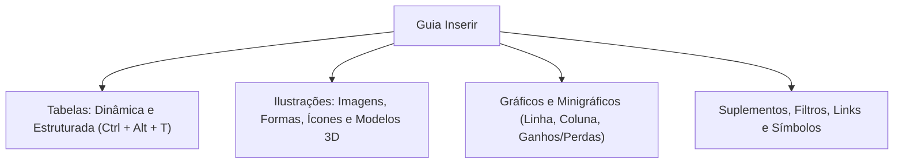
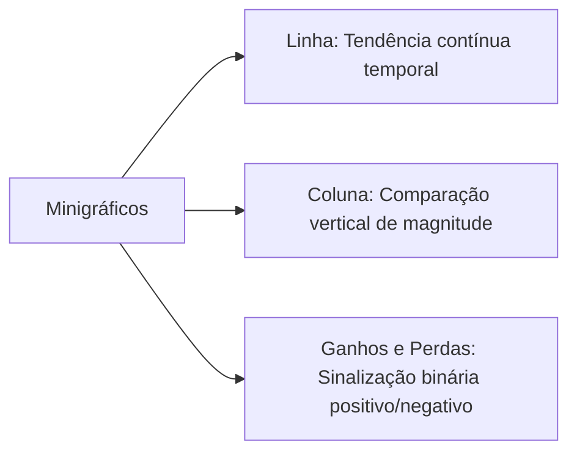
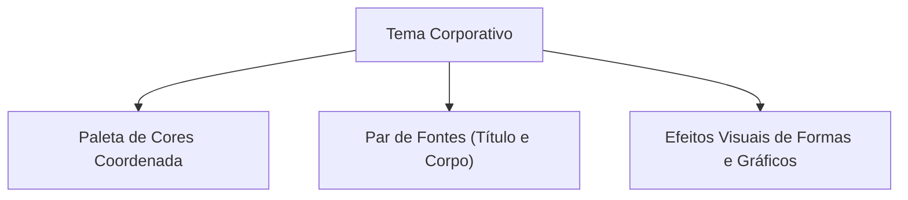
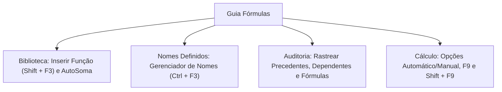
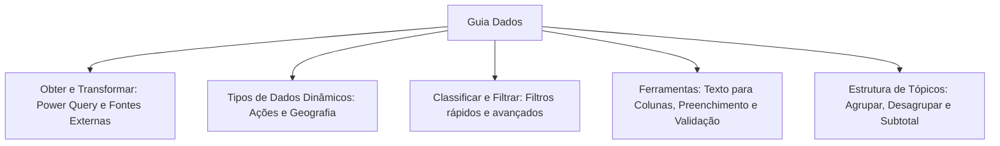
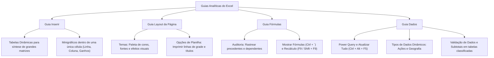

As **Guias Avançadas da Faixa de Opções** proporcionam recursos analíticos indispensáveis para a inteligência de segurança pública e defesa civil. A compilação de grandes matrizes operacionais exige o emprego de tabelas dinâmicas, minigráficos nas células, ferramentas de auditoria matemática e conexão externa com bancos de dados. Dominar as guias Inserir, Layout da Página, Fórmulas e Dados capacita o militar a estruturar painéis gerenciais robustos e confiáveis.

> [!objetivos]
> - Utilizar os recursos analíticos da Guia Inserir, incluindo tabelas dinâmicas e minigráficos.
> - Configurar a harmonia visual corporativa com o Grupo Temas na Guia Layout da Página.
> - Compreender a Biblioteca de Funções e as ferramentas de Auditoria de Fórmulas.
> - Aplicar as rotinas de tratamento do Grupo Obter e Transformar Dados (Power Query).
> - Dominar a Validação de Dados, o Preenchimento Relâmpago e a Estrutura de Tópicos.

## Guia Inserir: Relatórios, Ilustrações e Gráficos

A **Guia Inserir** reúne comandos projetados para agregar componentes externos, recursos visuais e ferramentas de síntese analítica à grade da planilha.

### Tabelas Dinâmicas e Tabelas Estruturadas

- **Tabela Dinâmica**: Ferramenta analítica mais poderosa do software para resumir, cruzar e filtrar grandes volumes de dados brutos. Permite arrastar campos para quatro áreas de trabalho: Linhas, Colunas, Valores e Filtros. Viabiliza totalizações instantâneas sem exigir escrita de fórmulas. O campo de Valores permite configurar operações variadas, como Soma, Contagem, Média, Máximo e Mínimo. Também permite exibir percentuais do total geral ou de colunas.
- **Tabela Estruturada (Atalho `Ctrl + Alt + T`)**: Converte um bloco de dados comum em uma tabela inteligente com filtros automáticos nos cabeçalhos, formatação zebrada alternada e cálculos automáticos de coluna. Ao inserir uma nova linha na base da tabela estruturada, ela é incorporada automaticamente com expansão dinâmica de fórmulas e regras.

> [!exemplo]
> Em uma corporação de bombeiros, uma base de dados com 10.000 chamados pode ser sintetizada em segundos por uma Tabela Dinâmica. O analista arrasta o campo "Batalhão" para Linhas, o campo "Tipo de Ocorrência" para Colunas e o campo "Tempo de Resposta" para Valores configurado como Média. O resultado gera um painel cruzado completo sem nenhuma digitação manual de funções.

### Grupo Ilustrações

Permite agregar recursos gráficos para valorizar a apresentação do documento:
- **Imagens**: Inserção de arquivos locais do disco ou buscas online.
- **Formas**: Desenho de setas, retângulos, balões de texto e fluxogramas.
- **Ícones e Modelos 3D**: Elementos vetoriais e objetos tridimensionais rotacionáveis em 360 graus.
- **SmartArt**: Diagramas relacionais pré-formatados para representar organogramas hierárquicos e sequências de processos operacionais.
- **Instantâneo**: Captura janelas abertas do sistema operacional ou recorta regiões da tela para colagem imediata na planilha.

| Recurso de Ilustração | Finalidade Visual Primária | Aplicação em Relatórios Corporativos |
|---|---|---|
| Imagens | Ilustração fotográfica | Registro de ocorrências periciais |
| Formas | Destaque geométrico | Sinalização de áreas de risco em mapas |
| SmartArt | Diagramas de processos | Organograma de batalhões e comandos |
| Instantâneo | Captura de tela direta | Comprovação de telas de sistemas de despacho |

### Grupo Suplementos e Grupo Links

O grupo **Suplementos** permite conectar extensões externas da Office Store e módulos analíticos especializados desenvolvidos por terceiros. 

O grupo **Links** disponibiliza o comando Link (acionado pelo atalho de teclado `Ctrl + K`). Esse recurso permite vincular qualquer célula a um endereço da internet, a outro arquivo do computador ou a um intervalo específico dentro da própria pasta de trabalho.

| Comando do Grupo Links | Atalho de Teclado | Destino do Vínculo |
|---|---|---|
| Inserir Hiperlink | `Ctrl + K` | Página Web, arquivo local ou coordenada de célula |

### Grupo Minigráficos: Tendências Dentro da Célula

Os **Minigráficos** são gráficos compactos desenhados inteiramente no interior de uma **única célula**. Eles não flutuam sobre a grade como os gráficos normais. Sua função é exibir tendências imediatas ao lado de tabelas numéricas, sem poluir o visual da tela.

Subdividem-se em três formatos:
1. **Linha**: Traça uma curva contínua revelando a oscilação cronológica da série.
2. **Coluna**: Apresenta barras verticais proporcionais às grandezas registradas.
3. **Ganhos e Perdas**: Exibe blocos binários para cima (valores positivos) ou para baixo (valores negativos), sendo ideal para demonstrar metas atingidas ou saldos deficitários.

> [!bizu]
> Lembre-se para a prova: Minigráficos residem dentro da célula e não admitem títulos, legendas ou eixos numéricos detalhados. Para construir gráficos completos com legendas, recorre-se ao grupo Gráficos.

## Guia Layout da Página: Temas e Dimensionamento

A **Guia Layout da Página** comanda a padronização estética global e as regras de diagramação física.

### Grupo Temas

O grupo Temas padroniza a aparência de toda a pasta de trabalho com um único clique. Um Tema do Excel engloba três especificações coordenadas:
- **Paleta de Cores**: Conjunto harmônico de tonalidades para preenchimentos, gráficos e tabelas.
- **Par de Fontes**: Seleção de uma tipografia padronizada para títulos e outra para o corpo dos textos.
- **Efeitos Gráficos**: Estilizações de sombreamento, reflexo e relevo para formas e ilustrações.

Ao alterar o Tema ativo na pasta de trabalho, todas as tabelas, gráficos e títulos formatados com estilos de tema modificam-se simultaneamente.

### Grupo Dimensionar para Ajustar e Opções de Planilha

- **Dimensionar para Ajustar**: Permite forçar o enquadramento de uma planilha extensa para caber exatamente em um número predeterminado de páginas na Largura e na Altura. O operador pode também calibrar manualmente o percentual de Escala de impressão.
- **Opções de Planilha**: Contém duas opções independentes para **Linhas de Grade** e **Títulos** (as letras das colunas e os números das linhas). O operador pode marcar a caixa **Exibir** (para ver na tela) e a caixa **Imprimir** (para sair na impressora física).

> [!pegadinha]
> Por padrão de fábrica, as linhas de grade cinzas da planilha são visíveis na tela do computador, mas não saem na impressão física. Para que as linhas de grade sejam impressas no papel, o usuário deve marcar expressamente a caixa "Imprimir" no grupo Opções de Planilha.

## Guia Fórmulas: Biblioteca e Auditoria

A **Guia Fórmulas** reúne as ferramentas de cálculo matemático, gerenciamento de identificadores de intervalos e auditoria de equações complexas.

### Biblioteca de Funções e Nomes Definidos

- **Inserir Função (`Shift + F3`)**: Abre o assistente de busca que orienta o preenchimento sintático de argumentos de qualquer fórmula nativa.
- **Gerenciador de Nomes (`Ctrl + F3`)**: Permite criar, editar e excluir intervalos nomeados de células em toda a pasta de trabalho.
- **Criar a Partir da Seleção (`Ctrl + Shift + F3`)**: Converte automaticamente os rótulos de cabeçalhos de linhas ou colunas em nomes oficiais de intervalos.

### Ferramentas de Auditoria de Fórmulas

Quando uma planilha financeira ou operacional apresenta resultados inconsistentes, o analista utiliza as ferramentas de auditoria:
- **Rastrear Precedentes (`Ctrl + [`)**: Desenha setas azuis na tela apontando para as células que fornecem dados para a fórmula selecionada. Clicar duas vezes sobre o comando adiciona níveis sucessivos de precedentes remotos.
- **Rastrear Dependentes (`Ctrl + ]`)**: Desenha setas azuis indicando quais fórmulas na planilha dependem do valor contido na célula ativa. Clicar em Remover Setas apaga todas as indicações gráficas da tela.
- **Mostrar Fórmulas (Atalho `Ctrl + \`` ou `Ctrl + Shift + \``)**: Alterna a exibição da planilha. Em vez de mostrar os números calculados finais, a grade passa a exibir o texto real de todas as fórmulas inseridas. O comando expande automaticamente a largura das colunas para permitir a leitura confortável das equações.
- **Avaliar Fórmula**: Abre uma janela de depuração passo a passo que resolve individualmente cada termo da equação matemática. O botão Avaliar sublinha o termo que será calculado em seguida e apresenta o resultado parcial intermediário. É ideal para localizar a origem exata de erros aritméticos como `#DIV/0!` ou falhas de referência como `#REF!`.
- **Janela de Inspeção**: Painel flutuante que permite acompanhar os valores calculados de células críticas localizadas em abas distantes sem precisar alternar entre as planilhas. O usuário pode adicionar células vitais à janela de inspeção e monitorar o impacto imediato de qualquer alteração de dados em tempo real.
- **Verificação de Erros**: Examina a planilha em busca de inconsistências lógicas comuns, como números armazenados como texto, fórmulas que omitem células adjacentes ou divisão por zero.

> [!bizu]
> Em provas de concurso, lembre-se de que a ferramenta "Mostrar Fórmulas" altera apenas a exibição na tela do computador. Ela não recalcula nem altera os valores reais gravados nas células. Para retornar à exibição dos resultados normais, basta pressionar o atalho `Ctrl + \`` novamente.

| Ferramenta de Auditoria | Atalho de Teclado | Comportamento na Planilha |
|---|---|---|
| Rastrear Precedentes | `Ctrl + [` | Traça setas para as células que alimentam a fórmula |
| Rastrear Dependentes | `Ctrl + ]` | Traça setas para as fórmulas que usam a célula |
| Mostrar Fórmulas | `Ctrl + \`` | Substitui resultados numéricos pelo texto das equações |
| Avaliar Fórmula | — | Depura a equação resolvendo termos sequencialmente |
| Recalcular Tudo | `F9` | Atualiza todas as fórmulas de todas as pastas abertas |
| Recalcular Planilha | `Shift + F9` | Recalcula apenas as fórmulas da aba atualmente ativa |

> [!bizu]
> Decore para a prova: o atalho `F9` recalcula todas as fórmulas de todas as pastas de trabalho abertas no Excel. O atalho `Shift + F9` recalcula unicamente a planilha ativa em exibição.

## Guia Dados: Conexões, Tratamento e Estrutura de Tópicos

A **Guia Dados** comanda o fluxo de entrada externa de registros, a higienização de tabelas e a modelagem preditiva.

### Grupo Obter e Transformar Dados (Power Query)

Abriga a tecnologia do Power Query integrada nativamente ao Excel. Permite conectar e extrair dados de arquivos de Texto/CSV, páginas da Web, pastas de trabalho, servidores SQL e arquivos PDF. Permite inclusive extrair dados tabulares a partir de **Imagens** salvas ou da área de transferência.

No grupo Consultas e Conexões, o comando **Atualizar Tudo (Atalho `Ctrl + Alt + F5`)** reprocessa simultaneamente todas as conexões externas e tabelas dinâmicas da pasta de trabalho.

### Grupo Tipos de Dados Dinâmicos

O Excel moderno conecta-se à nuvem para transformar textos comuns em objetos dinâmicos:
- **Ações**: Converte códigos de empresas em dados com cotações financeiras em tempo real.
- **Geografia**: Converte nomes de cidades, estados ou países em entidades geográficas com acesso a dados de população, área territorial e bandeira.
- **Moedas**: Acompanha taxas de câmbio internacionais sincronizadas continuamente.

### Ferramentas de Dados Essenciais

- **Texto para Colunas**: Divide o conteúdo de uma coluna em várias colunas adjacentes utilizando delimitadores (como vírgulas ou pontos e vírgulas) ou largura fixa de caracteres. A ferramenta divide-se em três etapas similares ao assistente de importação. Na primeira etapa, escolhe-se entre texto delimitado ou largura fixa. Na segunda etapa, marcam-se os caracteres divisores. Na terceira etapa, define-se o formato de dados de cada coluna gerada, prevenindo a perda de dígitos e zeros à esquerda.
- **Preenchimento Relâmpago (Atalho `Ctrl + E`)**: Reconhece padrões nos exemplos digitados e automatiza a extração ou junção de dados na coluna inteira sem fórmulas.
- **Remover Duplicadas**: Examina a matriz de dados e exclui registros redundantes, preservando unicamente a primeira ocorrência exclusiva de cada linha.
- **Validação de Dados**: Cria regras de consistência para impedir a digitação de informações incorretas na planilha. O administrador define critérios como números inteiros, valores decimais, intervalos de datas ou uma lista suspensa de opções válidas. 

A ferramenta de Validação de Dados disponibiliza três estilos de **Alerta de Erro**:
1. *Parar*: O estilo mais severo. Bloqueia a inserção de dados inválidos e impede que o usuário prossiga até que o conteúdo seja corrigido ou a edição cancelada.
2. *Aviso*: Exibe uma mensagem de advertência com opções Sim e Não, permitindo ao usuário manter o valor incorreto se confirmar a escolha.
3. *Informações*: Notifica o usuário sobre a divergência, mas aceita o dado digitado automaticamente ao clicar em OK.

> [!esquema]
> A Validação de Dados conta também com a guia **Mensagem de Entrada**. Essa opção exibe uma pequena caixa amarela flutuante sempre que a célula validada recebe o foco do ponteiro. O recurso é ideal para orientar operadores sobre os formatos aceitos antes mesmo do início da digitação.

### Grupo Estrutura de Tópicos e Subtotais

O grupo Estrutura de Tópicos permite condensar planilhas extensas facilitando a leitura de relatórios executivos de comando:
- **Agrupar (Atalho `Shift + Alt + Seta para a Direita`)**: Agrupa linhas ou colunas selecionadas sob uma barra retrátil com botões de recolhimento (`+` e `-`).
- **Desagrupar (Atalho `Shift + Alt + Seta para a Esquerda`)**: Desfaz o agrupamento estruturado.
- **Subtotal**: Insere automaticamente linhas de subtotais e somatório geral na tabela. Para que o comando Subtotal funcione corretamente, a tabela **deve estar previamente classificada** pela coluna que servirá de critério de quebra.

> [!atencao]
> A ferramenta Subtotal utiliza internamente a função `=SUBTOTAL()`. Essa função possui uma vantagem decisiva sobre a função SOMA: ela ignora linhas ocultas por filtros manuais e não duplica valores de subtotais parciais na linha do total geral.

## Mapa do capítulo

| Guia e Grupo | Ferramenta Chave | Finalidade em Questões de Prova |
|---|---|---|
| **Inserir / Tabelas** | Tabela Dinâmica | Cruza campos sem fórmulas e gera resumos gerenciais |
| **Inserir / Minigráficos** | Linha, Coluna, Ganhos | Gráficos compactos no interior de uma única célula |
| **Layout / Temas** | Paleta de Cores e Fontes | Padroniza a identidade visual corporativa da pasta |
| **Layout / Opções** | Imprimir Linhas de Grade | Habilita a impressão das divisórias cinzas no papel |
| **Fórmulas / Auditoria** | Mostrar Fórmulas (`Ctrl + \``) | Exibe o texto real das equações em todas as células |
| **Fórmulas / Cálculo** | `F9` e `Shift + F9` | Recalcula toda a pasta aberta ou apenas a planilha ativa |
| **Dados / Obter Dados** | Atualizar Tudo (`Ctrl + Alt + F5`) | Reprocessa conexões externas e tabelas dinâmicas |
| **Dados / Ferramentas** | Preenchimento Relâmpago (`Ctrl + E`) | Reconhece padrões digitados e completa a coluna |
| **Dados / Estrutura** | Subtotal | Agrupa dados e calcula somas em tabelas pré-ordenadas |

### Para fixar

- As tabelas dinâmicas realizam cruzamento e síntese de dados distribuídos em Linhas, Colunas, Valores e Filtros.
- Os minigráficos residem no interior de uma única célula nos formatos de Linha, Coluna e Ganhos e Perdas.
- Na guia Layout da Página, os Temas coordenam simultaneamente conjuntos de cores, fontes tipográficas e efeitos visuais.
- As linhas de grade da planilha só aparecem na impressão física se a opção Imprimir estiver expressamente marcada.
- A auditoria de fórmulas traça precedentes e dependentes, enquanto Mostrar Fórmulas (`Ctrl + \``) exibe o texto das equações na grade.
- O atalho `F9` recalcula todas as fórmulas da pasta de trabalho, enquanto `Shift + F9` recalcula exclusivamente a aba ativa.
- O grupo Obter e Transformar Dados gerencia o Power Query, atualizando todas as consultas externas pelo atalho `Ctrl + Alt + F5`.
- O grupo Tipos de Dados converte textos em dados dinâmicos conectados à nuvem nas categorias Ações, Geografia e Moedas.
- O comando Preenchimento Relâmpago (`Ctrl + E`) reconhece padrões de preenchimento sem demandar equações matemáticas.
- A ferramenta Subtotal exige que a coluna base esteja previamente ordenada para agrupar e totalizar os registros corretamente.
