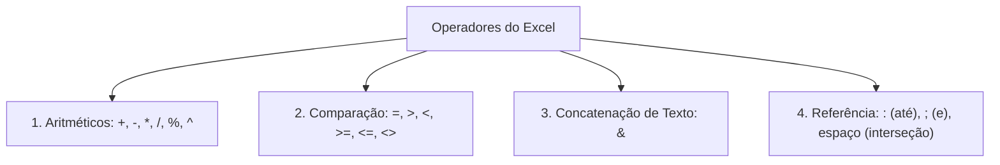
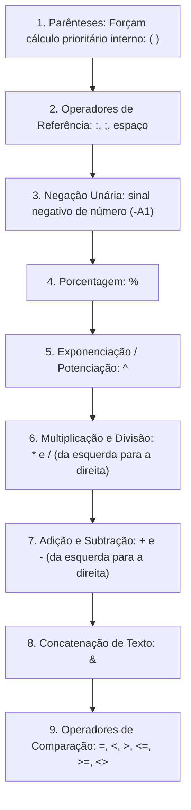
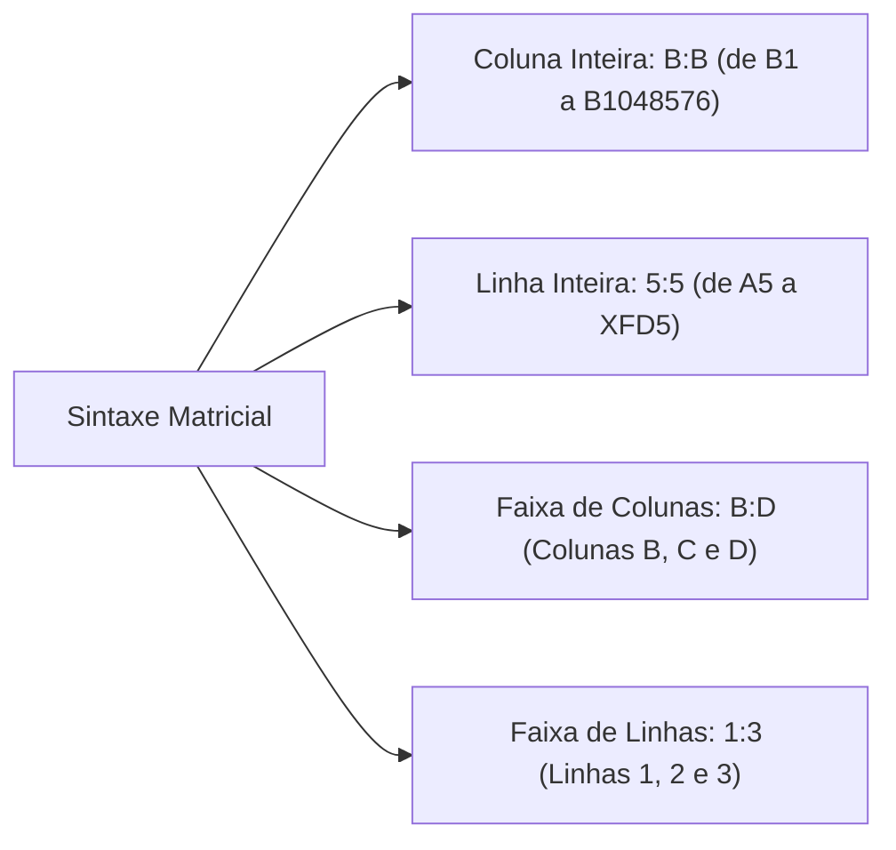
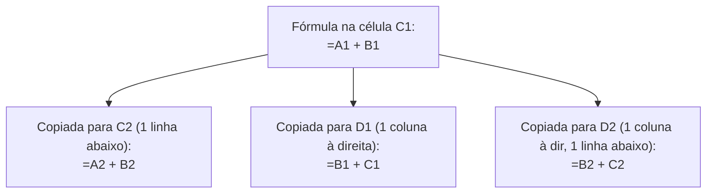
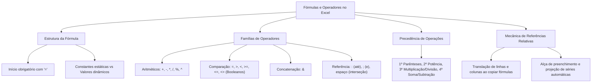

A **Construção de Fórmulas e o Emprego de Operadores** constituem a espinha dorsal de qualquer rotina de cálculo no Microsoft Excel. Na gestão de recursos de segurança pública e defesa civil, o domínio da precedência de sinais matemáticos, das referências relativas e da alça de preenchimento é vital. Um equívoco em uma única fórmula pode falsear totais de efetivo operacional ou gerar distorções orçamentárias severas.

> [!objetivos]
> - Compreender a estrutura formal e os componentes essenciais de uma fórmula no Excel.
> - Dominar as quatro famílias de operadores: aritméticos, comparação, texto e referência.
> - Aplicar a ordem rigorosa de precedência algébrica e o uso estratégico de parênteses.
> - Diferenciar constantes estáticas de valores dinâmicos calculados.
> - Compreender a dinâmica posicional das referências relativas sob a alça de preenchimento.

## Conceitos Básicos de Fórmulas e Operadores

Os conceitos básicos que regem o mecanismo de planilhas do Microsoft Excel baseiam-se na distinção clara entre inserção estática de dados e computação dinâmica. Uma fórmula no Excel consiste em uma instrução lógica que processa dados e retorna um resultado calculado dinamicamente. Para que o mecanismo de cálculo do programa reconheça a expressão como uma fórmula e não como mero texto alfanumérico, a digitação deve **iniciar obrigatoriamente com o sinal de igualdade (`=`)**.

Uma fórmula bem estruturada pode conter quatro elementos fundamentais:
1. **Constantes**: Valores fixos numéricos ou textuais digitados diretamente (como `10`, `3,14` ou `"Aprovado"`).
2. **Referências a Células**: Coordenadas que apontam para onde colher os dados na grade (como `A1`, `B5:B10` ou `Escala!C2`).
3. **Operadores de Cálculo**: Símbolos que determinam a operação aritmética, relacional ou lógica a executar (como `+`, `*`, `&`, `>`).
4. **Funções Nativas**: Fórmulas pré-programadas do aplicativo (como `SOMA`, `MÉDIA` ou `SE`).

Se o usuário digitar uma expressão sem o sinal de igual (por exemplo, `10 + 20`), o Excel entenderá a entrada como uma cadeia de texto literal comum. A célula exibirá exatamente o texto `10 + 20` e nenhum processamento matemático será executado.

> [!bizu]
> Embora o sinal de igualdade (`=`) seja o padrão universal, o Excel também aceita que uma fórmula seja iniciada pelos sinais de adição (`+`) ou subtração (`-`). Nesses casos, assim que o operador pressiona a tecla Enter, o próprio Excel insere o sinal de igual automaticamente no início da Barra de Fórmulas (por exemplo, `+A1+A2` vira `=+A1+A2`).

## Constantes versus Valores Calculados

No ambiente do Microsoft Excel, é crucial distinguir dados estáticos de resultados gerados por equações dinâmicas:

- **Constantes**: São valores invariáveis inseridos diretamente na célula ou na fórmula que não mudam a menos que o operador os edite manualmente. Podem ser números literais (como `150` ou `0,05`), textos delimitados por aspas duplas (como `"Bombeiro"`) ou datas estáticas.
- **Valores Calculados (Dinâmicos)**: São resultados que derivam do processamento de fórmulas ou funções referenciadas. Se o valor contido em uma célula de origem for alterado, o resultado da fórmula atualiza-se instantaneamente na grade por recálculo automático.

| Característica Avaliada | Constante Numérica / Literal | Valor Calculado Dinâmico |
|---|---|---|
| Forma de Entrada | Digitação direta do dado fixo | Escrita de fórmula iniciada com `=` |
| Comportamento na Edição | Permanece estático na célula | Atualiza-se ao modificar células precedentes |
| Exibição na Barra de Fórmulas | Mostra o próprio valor literal | Mostra a fórmula subjacente de cálculo |
| Exemplo Típico | O número `120` ou `"Apto"` | A expressão `=B2 * C2` |

> [!atencao]
> Constantes de texto utilizadas dentro de fórmulas devem ser obrigatoriamente delimitadas por **aspas duplas** (por exemplo, `="Nível " & "Alfa"`). Se o operador omitir as aspas ou utilizar aspas simples, o Excel gerará o erro `#NOME?`, presumindo que o texto represente um intervalo batizado inexistente.

## Famílias de Operadores de Cálculo

O Excel divide seus operadores em quatro categorias com papéis perfeitamente especializados: aritméticos, de comparação, de concatenação de texto e de referência de intervalos.

### Operadores Aritméticos

Executam operações matemáticas fundamentais sobre grandezas numéricas, retornando resultados quantitativos contínuos:
- **Adição (`+`)**: Soma dois ou mais valores (ex.: `=10 + 5` resulta em `15`).
- **Subtração ou Negação (`-`)**: Subtrai valores ou inverte o sinal algébrico de um número (ex.: `=20 - 8` gera `12`; `=-A1` inverte o sinal do dado).
- **Multiplicação (`*`)**: Realiza o produto entre fatores (ex.: `=4 * 5` resulta em `20`). Jamais utilize a letra `x` para multiplicação em fórmulas.
- **Divisão (`/`)**: Calcula o quociente entre dividendo e divisor (ex.: `=20 / 4` gera `5`).
- **Porcentagem (`%`)**: Divide o número antecedente por 100 (ex.: `=50%` converte-se no valor decimal `0,5`).
- **Exponenciação ou Potenciação (`^`)**: Eleva uma base a um determinado expoente (ex.: `=2 ^ 3` calcula 2 ao cubo, gerando `8`; `=16 ^ (1/2)` extrai a raiz quadrada, gerando `4`).

### Operadores de Comparação (Relacionais)

Comparam dois valores ou expressões e retornam obrigatoriamente um resultado lógico booleano: **VERDADEIRO** ou **FALSO**.
- **Igual a (`=`)**: Testa a igualdade exata (ex.: `=10 = 10` resulta em `VERDADEIRO`).
- **Maior que (`>`)**: Verifica se o primeiro termo é estritamente maior (ex.: `=15 > 20` resulta em `FALSO`).
- **Menor que (`<`)**: Verifica se o primeiro termo é estritamente menor (ex.: `=5 < 8` resulta em `VERDADEIRO`).
- **Maior ou igual a (`>=`)**: Avalia se é maior ou equivalente (ex.: `=10 >= 10` resulta em `VERDADEIRO`).
- **Menor ou igual a (`<=`)**: Avalia se é menor ou equivalente (ex.: `=12 <= 15` resulta em `VERDADEIRO`).
- **Diferente de (`<>`)**: Testa a desigualdade entre dois elementos (ex.: `=10 <> 20` resulta em `VERDADEIRO`). O operador forma-se pela união dos sinais de menor e maior juntos.

### Operador de Concatenação de Texto (`&`)

O caractere e-comercial (`&`) une duas ou mais cadeias textuais ou conteúdos celulares em uma única sequência literal contínua:
- Exemplo 1: `="Corpo " & "de " & "Bombeiros"` resulta no texto unificado `"Corpo de Bombeiros"`.
- Exemplo 2: Se a célula `A1` contiver `"Soldado"` e `B1` contiver `100`, a fórmula `=A1 & " - " & B1` resultará em `"Soldado - 100"`.

### Operadores de Referência

Orientam o mecanismo de cálculo sobre como combinar intervalos e coordenadas matriciais na grade:
- **Dois-Pontos (`:`) - Operador de Intervalo Contínuo**: Representa a preposição "até". Abrange todas as células compreendidas desde o ponto inicial até o ponto final do bloco retangular (ex.: `A1:B3` abrange seis células: `A1, A2, A3, B1, B2, B3`).
- **Ponto e Vírgula (`;`) - Operador de União**: Atua como a conjunção aditiva "e". Agrega células ou intervalos discretos e independentes em uma lista (ex.: `=SOMA(A1; B3; D5)` soma exclusivamente essas três células avulsas).
- **Espaço em Branco - Operador de Interseção**: Identifica e avalia a célula ou bloco que pertence simultaneamente a dois intervalos que se cruzam na grade (ex.: a expressão `=B1:B10 A1:C5` identifica a interseção comum entre a coluna B e as linhas 1 a 5, avaliando o intervalo `B1:B5`).

| Operador de Referência | Símbolo Gráfico | Significado Lógico | Exemplo de Aplicação |
|---|---|---|---|
| Intervalo Contíguo | `:` (Dois-pontos) | "Até" (Faixa contínua) | `=SOMA(A1:A10)` |
| União Discreta | `;` (Ponto e vírgula) | "E" (Células avulsas) | `=SOMA(A1; A10)` |
| Interseção Matricial | ` ` (Espaço em branco) | Elemento compartilhado | `=B1:D5 C1:C10` (Resulta em C1:C5) |

> [!pegadinha]
> Fique atento em questões de cálculo de fórmulas. A expressão `=SOMA(A1:A3)` soma três células consecutivas (A1, A2 e A3). Já a expressão `=SOMA(A1;A3)` soma exclusivamente duas células (A1 e A3), ignorando a célula intermediária A2. A troca de dois-pontos por ponto e vírgula altera drasticamente o resultado da operação.

## Ordem de Precedência Algébrica

Quando uma fórmula combina múltiplos operadores, o Excel não resolve a expressão simplesmente da esquerda para a direita. O software obedece a uma rigorosa hierarquia algébrica matemática.

A escala de prioridade estrutura-se em nove níveis sucessivos:
1. **Parênteses `( )`**: Qualquer subexpressão envolvida por parênteses é processada com prioridade absoluta. Em casos de parênteses aninhados, o Excel resolve dos mais internos para os mais externos.
2. **Operadores de Referência**: Dois-pontos (`:`), espaço de interseção e ponto e vírgula (`;`).
3. **Negação Unária**: O sinal de menos indicativo de número negativo (como em `-5`).
4. **Porcentagem (`%`)**.
5. **Potenciação (`^`)**.
6. **Multiplicação (`*`) e Divisão (`/`)**: Possuem a mesma precedência hierárquica. Quando aparecem juntas, o software resolve na ordem direta em que aparecem, da esquerda para a direita.
7. **Adição (`+`) e Subtração (`-`)**: Possuem o mesmo nível de prioridade, sendo resolvidas da esquerda para a direita.
8. **Concatenação (`&`)**.
9. **Operadores de Comparação (`=`, `<`, `>`, `<=`, `>=`, `<>`)**: São sempre os últimos a serem avaliados, gerando o veredito booleano final.

### Exemplos Práticos de Precedência

Examine como a prioridade de operadores modifica os resultados:
- **Expressão A**: `=2 + 3 * 4`
  A multiplicação tem prioridade sobre a adição. O Excel multiplica `3 * 4 = 12` e soma `2 + 12 = 14`.
- **Expressão B**: `=(2 + 3) * 4`
  Os parênteses forçam o cálculo prioritário da soma. O Excel calcula `2 + 3 = 5` e multiplica `5 * 4 = 20`.
- **Expressão C**: `=10 - 2 ^ 3 + 4 / 2`
  Primeiro calcula a potência: `2 ^ 3 = 8`. Em seguida resolve a divisão: `4 / 2 = 2`. Por fim, resolve as somas e subtrações da esquerda para a direita: `10 - 8 + 2 = 2 + 2 = 4`.
- **Expressão D**: `=3 * 2 ^ 2`
  Primeiro resolve a potência `2 ^ 2 = 4`, e depois multiplica `3 * 4 = 12`. Não multiplique antes da potência.

> [!bizu]
> Em provas com fórmulas longas, identifique imediatamente potências, multiplicações e divisões. Resolva-as antes de qualquer adição ou subtração, a menos que existam parênteses delimitando a operação.

## Sintaxe Especial de Linhas e Colunas Inteiras

O Excel admite uma notação compacta e elegante para fazer referência a linhas inteiras ou colunas completas sem exigir a digitação de coordenadas numéricas extremas:

- **Coluna Inteira**: Escreve-se a letra da coluna duas vezes separada por dois-pontos.
  - Exemplo: `A:A` representa a totalidade da coluna A (todas as 1.048.576 células de A1 até A1048576).
  - A fórmula `=SOMA(B:B)` soma todos os números da coluna B, inclusive dados que venham a ser inseridos no futuro na base da planilha.
- **Bloco de Colunas Contíguas**: Escreve-se a coluna inicial e a final separadas por dois-pontos.
  - Exemplo: `B:D` engloba todas as células das colunas B, C e D simultaneamente.
- **Linha Inteira**: Escreve-se o número da linha duas vezes separado por dois-pontos.
  - Exemplo: `5:5` representa todas as 16.384 células da linha 5 (desde a célula `A5` até `XFD5`).
  - A fórmula `=SOMA(1:1)` totaliza todos os valores numéricos contidos na linha 1.
- **Bloco de Linhas Contíguas**:
  - Exemplo: `5:10` abrange todas as células das linhas 5, 6, 7, 8, 9 e 10 de ponta a ponta.

| Sintaxe Especial | Abrangência Matricial | Quantidade de Células Abrangidas |
|---|---|---|
| `H:H` | A coluna H inteira | 1.048.576 células |
| `B:E` | As colunas B, C, D e E completas | 4 × 1.048.576 = 4.194.304 células |
| `3:3` | A linha 3 inteira | 16.384 células |
| `1:5` | As linhas de 1 a 5 completas | 5 × 16.384 = 81.920 células |

## Mecânica das Referências Relativas

Uma **referência relativa** identifica a posição da célula de modo relativo à célula que abriga a fórmula. É a modalidade padrão de endereçamento no Excel (grafada sem nenhum símbolo especial, como `A1`, `B5` ou `C10`).

Quando uma fórmula contendo referências relativas é copiada ou arrastada para outras posições da grade, suas coordenadas de linha e coluna sofrem uma **translação posicional automática**:
- Se a fórmula for copiada **uma linha para baixo**, todos os números de linha aumentam em uma unidade (a coordenada `A1` converte-se em `A2`).
- Se a fórmula for copiada **duas linhas para cima**, todos os números de linha diminuem em duas unidades (a coordenada `B5` converte-se em `B3`).
- Se a fórmula for copiada **uma coluna para a direita**, as letras de coluna avançam uma posição no alfabeto (a coordenada `A1` converte-se em `B1`).
- Se a fórmula for copiada **uma coluna para a esquerda**, as letras de coluna retrocedem uma posição no alfabeto (a coordenada `C4` converte-se em `B4`).

Essa maleabilidade dinâmica é o que torna as planilhas eletrônicas tão eficientes. O operador escreve a fórmula de cálculo de salário ou de consumo de combustível apenas na primeira linha da tabela. Em seguida, basta arrastar a fórmula para as centenas de linhas abaixo para que todas as contas sejam ajustadas automaticamente para cada registro correspondente.

## Alça de Preenchimento e Séries Automáticas

A **alça de preenchimento** consiste no pequeno quadrado preto localizado no vértice inferior direito da borda da célula ativa. Ao posicionar o mouse sobre esse ponto, o ponteiro transforma-se em uma cruz preta fina.

O operador pode interagir com a alça de preenchimento de duas maneiras:
1. **Arrastar com o Botão Principal**: Clicar e puxar a alça na vertical ou na horizontal.
2. **Duplo Clique na Alça**: Dá o comando de preenchimento automático para baixo. O Excel examina a coluna vizinha imediatamente à esquerda e projeta a fórmula para todas as linhas preenchidas até encontrar a primeira célula em branco.

### Comportamento na Duplicação de Fórmulas e Valores

- **Fórmulas**: Duplica a equação matemática adaptando as referências relativas para cada nova linha ou coluna.
- **Um Número Isolado**: Se uma célula contiver apenas o número `10` e a alça for arrastada para baixo com o botão normal, o Excel **repete o número** `10` em todas as células de destino. Para forçar uma progressão (`11, 12, 13`), o usuário deve manter a tecla `Ctrl` pressionada durante o arraste ou selecionar a opção de gerar série numérica no botão de opções contextuais que surge ao final.
- **Dois Números Selecionados Juntos**: Quando o operador digita dois números em células adjacentes (por exemplo, `5` na célula A1 e `10` na célula A2), seleciona ambas e arrasta a alça, o Excel deduz a **Progressão Aritmética (PA)**. A razão da progressão é calculada pela diferença direta: `10 − 5 = 5`. As células subsequentes receberão os valores `15, 20, 25` automaticamente.
  - Outro exemplo: Células com `20` e `18` geram uma progressão decrescente: `16, 14, 12`.

### Listas Pré-configuradas do Sistema

O Excel possui listas sequenciais nativas gravadas em sua configuração de fábrica. Quando uma célula contém o primeiro termo de uma lista reconhecida e sua alça é arrastada, o aplicativo projeta os itens seguintes automaticamente sem precisar de dois valores:
- **Dias da Semana**: Digitar `segunda-feira` e arrastar projeta `terça-feira`, `quarta-feira`, `quinta-feira`, etc. Funciona também com abreviações: `seg`, `ter`, `qua`.
- **Meses do Ano**: Digitar `janeiro` e arrastar gera `fevereiro`, `março`, `abril`. Funciona igualmente com abreviações: `jan`, `fev`, `mar`.
- **Textos Combinados com Números**: Se a célula contiver texto seguido de numeral (como `Turma 1`, `Viatura 01` ou `Setor 1`), o arraste incrementa o algarismo final automaticamente: `Turma 2`, `Turma 3`, `Turma 4`.

| Dado Inicial na Célula | Ação do Operador na Alça | Resultado nas Três Células Seguintes |
|---|---|---|
| Número `100` | Arrastar com botão normal | `100`, `100`, `100` (Repetição pura) |
| Número `100` | Arrastar segurando `Ctrl` | `101`, `102`, `103` (Série incremental) |
| Números `10` e `20` selecionados | Arrastar normalmente | `30`, `40`, `50` (Progressão aritmética) |
| Texto `janeiro` | Arrastar normalmente | `fevereiro`, `março`, `abril` (Lista de meses) |
| Texto `Viatura 1` | Arrastar normalmente | `Viatura 2`, `Viatura 3`, `Viatura 4` |

> [!bizu]
> O usuário pode criar suas próprias listas personalizadas acessando Arquivo > Opções > Avançado > Editar Listas Personalizadas. Isso permite que um batalhão cadastre os nomes dos seus pelotões ou postos para preenchimento instantâneo pela alça.

## Mapa do capítulo

| Conceito Operacional | Regra Algébrica | Comportamento em Questões de Concurso |
|---|---|---|
| **Sinal Inicial** | `=` (ou `+` convertido) | Sem ele, a expressão é tratada como texto comum |
| **Operador `<>`** | Diferente de | Retorna VERDADEIRO se os elementos forem desiguais |
| **Operador `&`** | Concatenação de texto | Funde palavras e valores de células em um só texto |
| **Operador `:`** | Intervalo contínuo | Seleciona todas as células entre o início e o fim |
| **Operador `;`** | União de argumentos | Seleciona exclusivamente células discretas listadas |
| **Operador Espaço** | Interseção | Retorna a célula compartilhada por dois intervalos |
| **Sintaxe `A:A`** | Coluna inteira | Abrange todas as 1.048.576 células da coluna A |
| **Sintaxe `1:1`** | Linha inteira | Abrange todas as 16.384 células da linha 1 |
| **Referência Relativa** | `A1` | Adapta linha e coluna ao ser copiada ou arrastada |
| **Dois Números na Alça** | Progressão Aritmética | Calcula a diferença e projeta a sequência numérica |

### Para fixar

- Toda fórmula válida no Excel inicia-se obrigatoriamente pelo sinal de igualdade (`=`).
- As constantes são dados fixos, enquanto as fórmulas recalculam seus valores dinamicamente a cada modificação na planilha.
- Constantes de texto dentro de fórmulas exigem o uso obrigatório de aspas duplas, sob pena de erro `#NOME?`.
- Os operadores de comparação (`=`, `<`, `>`, `<=`, `>=`, `<>`) produzem exclusivamente respostas booleanas: VERDADEIRO ou FALSO.
- O operador e-comercial (`&`) realiza a concatenação de cadeias textuais.
- O operador dois-pontos (`:`) define faixas contínuas ("até"), o ponto e vírgula (`;`) define união ("e") e o espaço define interseção.
- A ordem de precedência resolve parênteses em primeiro lugar, seguidos de potenciação (`^`), multiplicação/divisão e soma/subtração.
- A sintaxe `H:H` referencia uma coluna inteira de ponta a ponta, enquanto `5:5` referencia uma linha completa.
- As referências relativas sofrem translação automática proporcional de coordenadas quando copiadas pela grade.
- Ao selecionar dois números e arrastar a alça de preenchimento, o Excel projeta automaticamente a progressão aritmética correspondente.
