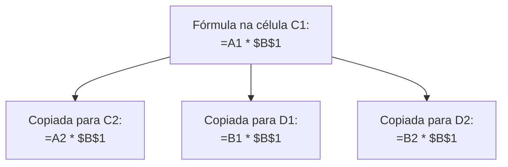
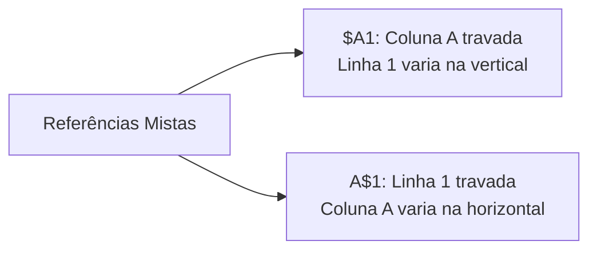
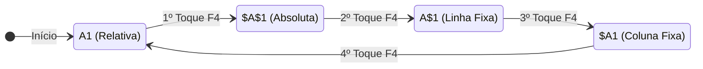
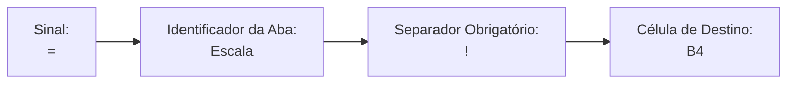
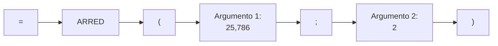
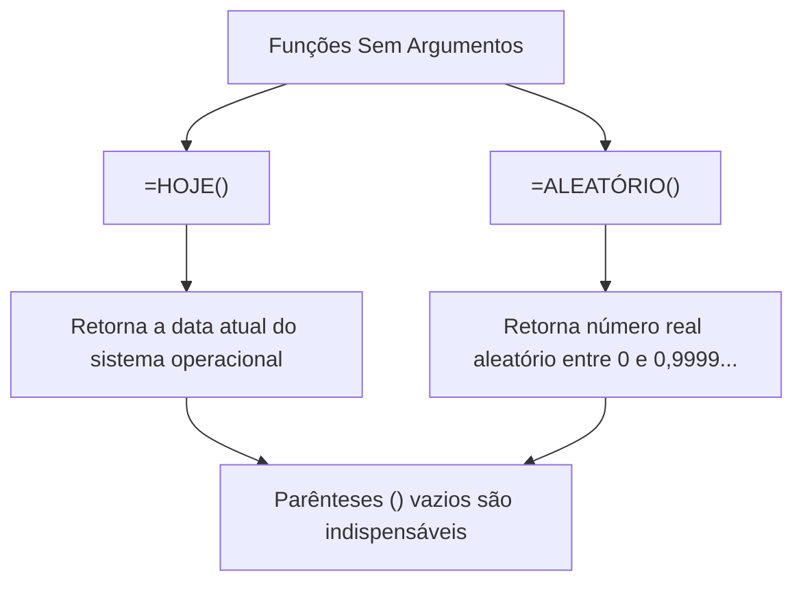
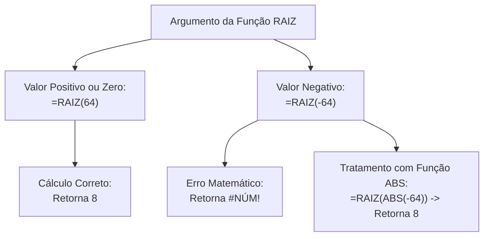
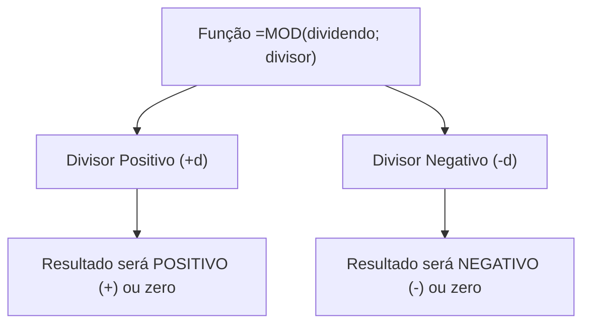

O domínio rigoroso dos mecanismos de fixação de coordenadas e das rotinas matemáticas nativas constitui o alicerce operacional dos cálculos no Microsoft Excel. Em atividades de segurança pública, defesa civil e comando operacional, planilhas gerenciais exigem fórmulas robustas que combinem referências imutáveis a alíquotas ou tabelas de parâmetros, cruzamento de dados entre relatórios externos e processamento aritmético exato de valores. Compreender o comportamento das células sob cópia ou movimentação assegura a integridade absoluta das análises estatísticas e financeiras da corporação.

> [!objetivos]
> - Diferenciar o comportamento posicional de referências relativas, absolutas e mistas durante a cópia de fórmulas.
> - Compreender a alternância sequencial de fixações acionada pelo atalho funcional F4.
> - Aplicar a sintaxe formal de vínculos externos entre abas da mesma pasta e entre arquivos independentes.
> - Dominar a mecânica de cálculo das funções matemáticas nativas: ARRED, FATORIAL, RAIZ, ÍMPAR, MOD e MULT.

## Mecânica das Referências: Relativas, Absolutas e Mistas

A manipulação eficiente de fórmulas no Excel assenta-se na forma como as células são endereçadas na grade matricial. Quando uma fórmula é inserida em uma célula, o aplicativo interpreta as coordenadas indicadas com base em um sistema posicional flexível. Conforme a necessidade da rotina administrativa, o operador pode permitir a adaptação automática dessas coordenadas ou travar rigidamente linhas e colunas.

### Referência Relativa e Seus Deslocamentos

A referência relativa representa o padrão nativo do programa (grafada sem caracteres adicionais, como `A1` ou `B5`). Ela não armazena a posição estática do dado na planilha. Em vez disso, ela registra a distância relativa existente entre a célula que abriga a fórmula e a célula de onde o valor é coletado.

Ao copiar ou arrastar uma fórmula contendo referências relativas para outras linhas ou colunas, as coordenadas deslocam-se de forma proporcional:
- Se a fórmula for copiada uma linha para baixo, o número da linha é incrementado em uma unidade (a coordenada `A1` torna-se `A2`).
- Se a fórmula for copiada duas colunas para a direita, a letra da coluna avança duas posições no alfabeto (a coordenada `A1` converte-se em `C1`).
- Se a fórmula for copiada em diagonal (uma linha para baixo e uma coluna para a direita), ambos os eixos são incrementados (a coordenada `A1` vira `B2`).

> [!exemplo]
> Considere a fórmula `=A1 + B1` digitada originalmente na célula `C1`.
> Ao copiar essa fórmula para a célula `C2`, ela é convertida para `=A2 + B2`.
> Se for copiada para a célula `D1`, ela assume a redação `=B1 + C1`.
> Caso seja colada na célula `D2`, seu texto final será `=B2 + C2`.

### Referência Absoluta e o Papel do Cifrão

A **referência absoluta** neutraliza a adaptação automática de coordenadas. Ela fixa de forma incondicional tanto a coluna quanto a linha da célula indicada. O elemento gráfico responsável por esse travamento é o símbolo monetário cifrão.

Na sintaxe do Excel, o cifrão atua como uma trava de direção. Inserido antes da letra da coluna e antes do número da linha, ele impede qualquer modificação posicional quando a fórmula é reproduzida pela planilha. Uma célula grafada como `$A$1` continuará apontando invariavelmente para a coluna A e para a linha 1, não importando para qual local da grade a fórmula seja duplicada.

> [!bizu]
> Pense no cifrão como um cadeado posicional. Ele trava rigorosamente o caractere alfanumérico colocado logo à sua direita. Se houver um cifrão antes da letra A, a coluna A não muda. Se houver um cifrão antes do número 1, a linha 1 não muda.

Essa fixação rígida é indispensável quando múltiplos registros da tabela precisam consultar uma mesma célula de referência. Esse é o caso de tabelas salariais que multiplicam os vencimentos de centenas de militares por uma alíquota única de gratificação alojada no topo da planilha.

### Referências Mistas: Fixando Linha ou Coluna

As referências mistas ocorrem quando o operador opta por travar apenas um dos eixos de coordenadas da célula, deixando o outro eixo livre para transladar. Existem duas variações estruturais de referência mista:

1. **Coluna Fixa e Linha Livre (`$A1`)**: O cifrão posiciona-se exclusivamente antes da letra da coluna. Ao copiar a fórmula na horizontal, a coluna permanece eternamente travada em A. Ao copiar na vertical, a linha desloca-se livremente para baixo ou para cima conforme as novas linhas da tabela.
2. **Coluna Livre e Linha Fixa (`A$1`)**: O cifrão situa-se apenas antes do número da linha. Ao duplicar a fórmula na vertical, a linha permanece travada no número 1. Se a fórmula for copiada na horizontal, a coluna avança de A para B, C, D e assim sucessivamente.

| Tipo de Endereçamento | Grafia da Coordenada | Eixo Travado | Eixo Livre | Comportamento ao Copiar na Grade |
|---|---|---|---|---|
| Referência Relativa | `A1` | Nenhum | Coluna e Linha | Varia livremente nas quatro direções |
| Referência Absoluta | `$A$1` | Coluna e Linha | Nenhum | Imutável; aponta sempre para `A1` |
| Referência Mista (Coluna Fixa) | `$A1` | Coluna (A) | Linha (1) | Coluna travada; linha translada |
| Referência Mista (Linha Fixa) | `A$1` | Linha (1) | Coluna (A) | Linha travada; coluna translada |

### O Comutador Cíclico da Tecla F4

Digitar manualmente o caractere de cifrão na barra de fórmulas é um procedimento lento e suscetível a falhas de pontuação. Para agilizar essa tarefa, o Excel disponibiliza uma tecla de atalho funcional dedicada: a **tecla `F4`**.

Durante a edição de uma fórmula, com o ponto de inserção posicionado sobre o nome da célula, pressionar sucessivamente a tecla `F4` aciona um comutador cíclico de quatro estágios:
1. **Primeiro Toque em `F4`**: Converte a referência relativa simples (`A1`) em referência absoluta total (`$A$1`).
2. **Segundo Toque em `F4`**: Converte a coordenada em referência mista com travamento exclusivo de linha (`A$1`).
3. **Terceiro Toque em `F4`**: Converte a coordenada em referência mista com travamento exclusivo de coluna (`$A1`).
4. **Quarto Toque em `F4`**: Remove todos os cifrões, retornando a coordenada ao estado de referência relativa nativa (`A1`).

> [!atencao]
> Em teclados compactos de notebooks corporativos, as teclas de função frequentemente compartilham espaço físico com atalhos multimídia. Nesses aparelhos, pode ser necessário pressionar a tecla `Fn` em conjunto (`Fn + F4`) para disparar a alternância de referências na planilha.

### Invariância das Fórmulas ao Mover e Recortar

As regras de adaptação posicional que afetam referências relativas e mistas aplicam-se com exclusividade aos procedimentos de **cópia** de células. Isso abrange o uso do atalho de teclado `Ctrl + C` combinado com `Ctrl + V`, bem como o arrastar da alça no canto da seleção.

Quando uma célula contendo fórmula é **movida ou recortada** (por meio do atalho `Ctrl + X` seguido de `Ctrl + V`, ou pelo arrasto da borda da célula com o ponteiro do mouse), ocorre um fenômeno completamente distinto: **nenhuma coordenada se altera**.

O mecanismo interno do Excel compreende que o usuário está apenas mudando o cálculo de residência física na grade. Dessa forma, as coordenadas internas são preservadas exatamente como foram originalmente digitadas. Uma fórmula contendo coordenadas relativas puras permanecerá idêntica à sua matriz de origem.

> [!pegadinha]
> A banca examinadora explora frequentemente essa distinção em enunciados capciosos. Se a questão afirmar que o candidato "recortou a célula A3 contendo a fórmula `=A1 + A2` e colou na célula D10", o resultado na nova célula continuará sendo exatamente `=A1 + A2`. Não ocorre nenhuma translação quando a operação realizada for o recorte.

| Ação Executada na Célula | Atalhos de Teclado Empregados | Comportamento das Referências Relativas | Comportamento das Referências Absolutas |
|---|---|---|---|
| Copiar e Colar | `Ctrl + C` e `Ctrl + V` | Sofrem translação posicional proporcional | Permanecem estáticas com cifrão |
| Arrastar pela Alça | Ponteiro em cruz fina | Sofrem translação posicional proporcional | Permanecem estáticas com cifrão |
| Recortar e Colar | `Ctrl + X` e `Ctrl + V` | Preservação total da fórmula original | Preservação total da fórmula original |
| Mover pela Borda | Ponteiro em quatro setas | Preservação total da fórmula original | Preservação total da fórmula original |

## Referências Externas: Interligando Planilhas e Arquivos Distintos

Em sistemas de gestão e perícia operacional, é comum que dados correlatos fiquem distribuídos em matrizes separadas. O Excel permite criar fórmulas dinâmicas que resgatam valores alocados em outras planilhas do mesmo arquivo ou em arquivos externos armazenados no disco rígido.

### Vínculo entre Abas da Mesma Pasta de Trabalho

Uma pasta de trabalho do Excel pode comportar dezenas de abas (planilhas) distintas, exibidas na barra inferior da interface (como `Plan1`, `Escala`, `Combustível`). Para referenciar uma célula localizada em outra aba da mesma pasta de trabalho, o software utiliza a pontuação de exclamação como separador estrutural.

A sintaxe padrão de referência entre abas adota a seguinte convenção:
`=NomeDaAba!CoordenadaDaCélula`

Exemplos práticos de vínculos internos:
- `=Estoque!B5`: Coleta o conteúdo localizado na célula B5 da planilha intitulada `Estoque`.
- `=Plan2!A1:D10`: Determina um intervalo matricial contínuo entre as células A1 e D10 pertencentes à planilha `Plan2`.
- `=SOMA(Jan:Mar!A1)`: Calcula a soma tridimensional da célula A1 em todas as abas no intervalo entre `Jan` e `Mar`.

> [!atencao]
> Se o nome da aba contiver espaços em branco, hífen, números isolados ou caracteres gramaticais acentuados, o nome completo da planilha deve ser **envolvido obrigatoriamente por aspas simples**.
> Veja a diferença:
> - Nome sem espaço: `=Pelotao!A1` (dispensa aspas simples).
> - Nome composto com espaço: `='Escala Diurna'!A1` (exige aspas simples delimitando o nome).

### Vínculo entre Pastas de Trabalho Distintas (Arquivos Diferentes)

Quando a fórmula precisa coletar grandezas alocadas em outro arquivo salvo no sistema de arquivos, o endereçamento amplia sua hierarquia sintática. A estrutura da referência externa passa a demandar o nome do arquivo delimitado por colchetes, seguido do nome da planilha de origem e da respectiva coordenada.

A sintaxe varia segundo o estado operacional do arquivo de origem no momento da edição:

1. **Arquivo de Origem Aberto na Sessão do Excel**: O aplicativo omite o caminho do disco e exibe apenas o nome do arquivo entre colchetes, seguido do nome da aba e da célula de interesse.
   - Sintaxe: `=[NomeDoArquivo.xlsx]NomeDaPlanilha!Coordenada`
   - Exemplo: `=[EfetivoGeral.xlsx]Operacional!C15`
2. **Arquivo de Origem Fechado no Disco Rígido**: O Excel adiciona automaticamente a rota de diretório absoluta do arquivo. Toda a rota e o nome da planilha ficam abrigados sob aspas simples.
   - Sintaxe: `='Unidade:/Pasta/[NomeDoArquivo.xlsx]NomeDaPlanilha'!Coordenada`
   - Exemplo: `='C:/Comando/Relatorios/[EfetivoGeral.xlsx]Operacional'!C15`

> [!bizu]
> Caso você renomeie ou mova o arquivo vinculado para outra pasta enquanto a pasta principal estiver fechada, o Excel exibirá aviso de quebra de vínculo na próxima inicialização. O aplicativo disponibiliza o painel Dados > Consultas e Conexões > Editar Links para reconectar as fontes extraviadas.

| Cenário de Localização do Dado | Sintaxe Padronizada | Exemplo Concreto |
|---|---|---|
| Mesma planilha corrente | `Coordenada` | `=B10 + C10` |
| Outra aba sem espaço no nome | `NomeDaAba!Coordenada` | `=Financeiro!B10` |
| Outra aba com espaço no nome | `'Nome Composto'!Coordenada` | `='Controle de Frotas'!D4` |
| Outro arquivo aberto no Excel | `=[Arquivo.xlsx]Aba!Coordenada` | `=[Reserva.xlsx]Armas!A1` |
| Outro arquivo fechado no disco | `'C:/Caminho/[Arquivo.xlsx]Aba'!Coordenada` | `='D:/Bases/[Reserva.xlsx]Armas'!A1` |

## Estrutura, Sintaxe e Argumentos das Funções Nativas

Enquanto uma fórmula aritmética manual pode tornar-se extensa e complexa, as funções nativas do Excel atuam como blocos padronizados de produtividade. Uma função representa uma rotina algorítmica embutida no código-fonte do programa, projetada para executar operações lógicas, matemáticas, estatísticas ou de texto mediante o fornecimento de parâmetros.

### Componentes Formais de uma Função

A invocação regular de qualquer função nativa obedece a uma ordem gramatical estrita:
1. **Sinal de Inicialização**: A digitação começa sempre pelo sinal de igualdade (`=`). Sem esse caractere, o programa trata a entrada como texto alfanumérico.
2. **Nome Canônico**: Vocábulo padronizado que identifica a rotina (como `SOMA`, `MEDIA`, `ARRED`, `RAIZ`). O aplicativo aceita letras maiúsculas ou minúsculas na digitação, convertendo-as automaticamente para maiúsculas após a confirmação.
3. **Parêntese de Abertura**: Delimita o início do bloco de parâmetros recebidos pela função.
4. **Lista de Argumentos**: Valores numéricos, textos, coordenadas de células ou expressões aninhadas que alimentam o cálculo.
5. **Parêntese de Fechamento**: Encerra a declaração formal da função. A ausência do parêntese final gera mensagens de correção automática pelo Excel.

### Separadores de Argumentos e Delimitadores de Intervalo

Um dos aspectos mais cobrados em avaliações de informática para carreiras públicas é a distinção funcional entre a pontuação de ponto e vírgula e a pontuação de dois-pontos:

- **Ponto e Vírgula (`;`)**: Exerce o papel de **separador de argumentos individuais independentes**. Ele instrui a rotina a avaliar valores isolados ou descontinuados. Pode ser lido mentalmente com o sentido aditivo da conjunção "e".
- **Dois-Pontos (`:`)**: Funciona como o **delimitador de intervalo contínuo**. Ele abrange todos os endereços físicos situados entre a primeira célula e a última célula da matriz retangular indicada. Pode ser lido mentalmente como a preposição "até".

> [!exemplo]
> Compare a execução das duas expressões na mesma tabela de efetivo:
> - A expressão `=SOMA(A1; A5)` processa apenas o valor alojado na célula `A1` e o valor alojado na célula `A5`. Os registros intermediários (`A2`, `A3` e `A4`) são ignorados.
> - A expressão `=SOMA(A1:A5)` processa o intervalo contínuo completo, somando os números presentes nas células `A1`, `A2`, `A3`, `A4` e `A5`.

### Funções que Não Exigem Parâmetros Internos

Embora a imensa maioria das funções demande o fornecimento de referências ou valores numéricos, o Excel dispõe de rotinas automatizadas que não requerem argumentos para operar. Nesses casos especiais, **a presença dos parênteses abertos e fechados continua sendo obrigatória**.

Duas rotinas destacam-se nesse padrão:
1. **Função `HOJE()`**: Consulta o relógio interno do sistema operacional e exibe a data presente na célula, atualizando-se a cada recálculo da planilha.
2. **Função `ALEATÓRIO()`**: Retorna um número fracionário randômico distribuído uniformemente no intervalo real maior ou igual a 0 e estritamente menor que 1.

> [!atencao]
> Digitar `=HOJE` sem os parênteses anexos resulta no erro gramatical `#NOME?`. O Excel interpreta a digitação isolada como um nome de intervalo indefinido e não como a invocação da rotina nativa.

## Funções Matemáticas e Trigonométricas Essenciais

A biblioteca matemática do Excel engloba dezenas de utilitários avançados. Para concursos de alto rendimento, o domínio das rotinas `ARRED`, `FATORIAL`, `RAIZ`, `ÍMPAR`, `MOD` e `MULT` é fundamental para antecipar questões práticas da banca examinadora.

### Função ARRED e as Potências de Dez

A função `ARRED` executa o arredondamento simétrico formal de um valor numérico de acordo com a quantidade de casas decimais estipulada pelo usuário. Sua sintaxe formal apresenta dois argumentos obrigatórios:
`=ARRED(número; núm_dígitos)`

O critério de corte segue a convenção matemática clássica:
- Se o primeiro algarismo descartado for **maior ou igual a 5**, o dígito retido imediatamente anterior é **acrescido de uma unidade** (arredondamento para cima).
- Se o primeiro algarismo descartado for **estritamente menor que 5** (de 0 a 4), o dígito retido é **mantido sem alteração** (arredondamento para baixo).

A grande peculiaridade explorada pelas bancas examinadoras reside na interpretação do segundo argumento (`núm_dígitos`):

1. **Parâmetro Positivo (`núm_dígitos > 0`)**: Calibra a precisão das frações decimais à direita da vírgula.
   - `=ARRED(8,154; 2)` resulta em `8,15` (o algarismo descartado 4 é inferior a 5).
   - `=ARRED(8,155; 2)` resulta em `8,16` (o algarismo descartado 5 força a elevação).
2. **Parâmetro Nulo (`núm_dígitos = 0`)**: Converte o número decimal no inteiro mais próximo, eliminando todas as casas fracionárias.
   - `=ARRED(4,49; 0)` retorna `4`.
   - `=ARRED(4,50; 0)` retorna `5`.
3. **Parâmetro Negativo (`núm_dígitos < 0`)**: Provoca o arredondamento em potências de dez situadas **à esquerda da vírgula**, calibrando dezenas, centenas ou milhares inteiros.
   - Com `-1`: Arredonda para a dezena mais próxima. O número `118` torna-se `120` (pois 8 eleva a dezena). O número `114` vira `110`.
   - Com `-2`: Arredonda para a centena mais próxima. O número `640` converte-se em `600` (40 é inferior a 50). O número `660` vira `700`.
   - Com `-3`: Arredonda para o milhar inteiro mais próximo. O número `7.400` vira `7.000`, enquanto `7.650` vira `8.000`.

| Expressão Digitada na Célula | Valor Base | Parâmetro de Dígitos | Análise da Regra Matemática | Resultado Final no Excel |
|---|---|---|---|---|
| `=ARRED(12,342; 2)` | 12,342 | 2 (Centésimos) | Dígito descartado é 2 (menor que 5) | `12,34` |
| `=ARRED(12,348; 2)` | 12,348 | 2 (Centésimos) | Dígito descartado é 8 (maior que 5) | `12,35` |
| `=ARRED(7,5; 0)` | 7,5 | 0 (Inteiro) | Primeiro decimal é 5 (eleva a unidade) | `8` |
| `=ARRED(173; -1)` | 173 | -1 (Dezena) | Unidade descartada é 3 (abaixo de 5) | `170` |
| `=ARRED(178; -1)` | 178 | -1 (Dezena) | Unidade descartada é 8 (eleva a dezena) | `180` |
| `=ARRED(1.450; -3)` | 1.450 | -3 (Milhar) | Centena descartada é 4 (abaixo de 5) | `1.000` |

> [!bizu]
> Memorize este esquema para o parâmetro num_dígitos de ARRED:
> - Dígito positivo: caminha para a direita, lapidando as casas decimais.
> - Dígito zero: corta na vírgula, transformando em número inteiro.
> - Dígito negativo: caminha para a esquerda, transformando algarismos de unidades e dezenas em zeros redondos.

### Função FATORIAL e Multiplicação Cumulativa

A rotina `FATORIAL` processa o cálculo clássico da análise combinatória. Ela determina o produto cumulativo de todos os números inteiros positivos situados entre a unidade e o algarismo informado como parâmetro.

Sua sintaxe estrutural resume-se a:
`=FATORIAL(número)`

Se o usuário fornecer um valor com casas decimais, o Excel trunca a parcela fracionária antes de processar o cálculo (considerando apenas a parte inteira).

Exemplos de avaliação:
- `=FATORIAL(3)`: Calcula a série `3 * 2 * 1`, resultando no número `6`.
- `=FATORIAL(4)`: Calcula a série `4 * 3 * 2 * 1`, totalizando `24`.
- `=FATORIAL(5)`: Calcula `5 * 4 * 3 * 2 * 1`, resultando em `120`.
- `=FATORIAL(0)`: Por definição matemática fundamental, o fatorial de zero equivale a `1`.

> [!atencao]
> Inserir valores numéricos negativos na função `FATORIAL` gera imediatamente o código de erro `#NÚM!`. A análise combinatória clássica não define fatorial para conjuntos de números reais estritamente negativos.

### Função RAIZ e o Tratamento de Números Negativos

A função `RAIZ` extrai o valor da raiz quadrada principal positiva do número contido em seu parâmetro:
`=RAIZ(número)`

Casos de cálculo regular:
- `=RAIZ(25)` resulta no algarismo `5`.
- `=RAIZ(81)` resulta no algarismo `9`.
- `=RAIZ(144)` resulta no algarismo `12`.
- `=RAIZ(0)` resulta no valor `0`.

Caso o operador forneça um número negativo como parâmetro direto, o Excel recusa o processamento e devolve o erro `#NÚM!`, visto que raízes pares de números negativos não pertencem ao conjunto dos números reais.

> [!bizu]
> Para evitar o erro `#NÚM!` ao lidar com dados que possam oscilar para sinais negativos, os analistas aninham a função `ABS` (valor absoluto em módulo) no interior do parâmetro:
> `=RAIZ(ABS(A1))`
> Dessa forma, se a célula `A1` registrar `-49`, a rotina `ABS` converte a grandeza para `49`, permitindo que a raiz calcule o resultado final `7` sem falhas.

### Funções ÍMPAR e PAR no Afastamento do Marco Zero

O Excel conta com rotinas de arredondamento direcionadas expressamente para a obtenção de números pares ou ímpares:
- `=ÍMPAR(número)`: Arredonda o valor para cima, em direção ao número inteiro ímpar mais próximo.
- `=PAR(número)`: Arredonda o valor para cima, em direção ao número inteiro par mais próximo.

A expressão "para cima", na documentação técnica do aplicativo, significa **afastamento do marco zero**. Isso acarreta um comportamento assimétrico relevante quando se comparam grandezas positivas e negativas:

1. **Valores Positivos**: O número é deslocado rumo a uma grandeza positiva maior.
   - `=ÍMPAR(2)` resulta em `3`.
   - `=ÍMPAR(2,1)` afasta-se de zero e resulta em `3`.
   - `=ÍMPAR(3)` já é ímpar e permanece `3`.
   - `=PAR(3)` resulta em `4`.
   - `=PAR(3,2)` resulta em `4`.
2. **Valores Negativos**: O número é deslocado rumo a uma grandeza negativa ainda menor (mais distante do zero na reta numérica).
   - `=ÍMPAR(-2)` afasta-se do marco zero rumo ao infinito negativo, resultando em `-3`.
   - `=ÍMPAR(-2,1)` resulta em `-3`.
   - `=PAR(-3)` afasta-se do marco zero, resultando em `-4`.
   - `=PAR(-3,2)` resulta em `-4`.

| Expressão no Excel | Valor de Entrada | Condição Original | Direção de Deslocamento | Resultado Apurado |
|---|---|---|---|---|
| `=ÍMPAR(4)` | 4 | Par positivo | Afasta de zero | `5` |
| `=ÍMPAR(5)` | 5 | Ímpar positivo | Já é ímpar | `5` |
| `=ÍMPAR(5,2)` | 5,2 | Fracionário positivo | Próximo ímpar afastado de zero | `7` |
| `=ÍMPAR(-4)` | -4 | Par negativo | Afasta de zero rumo ao negativo | `-5` |
| `=ÍMPAR(-5)` | -5 | Ímpar negativo | Já é ímpar | `-5` |
| `=PAR(5)` | 5 | Ímpar positivo | Afasta de zero | `6` |
| `=PAR(-5)` | -5 | Ímpar negativo | Afasta de zero rumo ao negativo | `-6` |

> [!pegadinha]
> Muita atenção com os números negativos! Candidatos desatentos costumam imaginar que `=ÍMPAR(-2)` resultaria em `-1`, por ser numericamente maior. Lembre-se sempre de que o algoritmo oficial do Excel afasta o número do marco zero. Portanto, `-2` desloca-se para `-3`, e `-4` desloca-se para `-5`.

### Função MOD e a Regra do Sinal do Divisor

A função `MOD` extrai o **resto da divisão inteira** entre dois números reais. Sua sintaxe formal apresenta dois argumentos obrigatórios:
`=MOD(dividendo; divisor)`

No caso elementar de números inteiros positivos, o funcionamento espelha a aritmética elementar:
- `=MOD(10; 3)`: Como 10 dividido por 3 resulta em quociente 3 com sobra de 1 unidade, o resultado é `1`.
- `=MOD(17; 5)`: Como 17 equivale a `5 * 3 + 2`, a rotina devolve `2`.
- `=MOD(20; 4)`: Sendo uma divisão exata sem resíduos, a função retorna `0`.

Contudo, questões elaboradas de prova inserem números com sinais opostos. Nesses casos, o cálculo do Excel obedece à equação matemática algorítmica:
`MOD(n; d) = n - d * INT(n / d)`

Dessa relação matemática decorre uma regra mnemônica de ouro para o concurseiro: **o sinal do resultado final da função MOD acompanha rigorosamente o sinal do divisor** (o segundo argumento).

> [!exemplo]
> Observe o comportamento com sinais opostos:
> - Expressão `=MOD(10; -3)`: O divisor é `-3` (negativo). O quociente real `10 / -3 = -3,333...` tem como parte inteira arredondada para baixo (`INT`) o valor `-4`. Aplicando a fórmula: `10 - (-3 * -4) = 10 - 12 = -2`. O resultado é `-2`. Note que o sinal do resultado seguiu o sinal do divisor `-3`.
> - Expressão `=MOD(-10; 3)`: O divisor é `3` (positivo). O quociente `-10 / 3 = -3,333...` gera `INT = -4`. Aplicando a fórmula: `-10 - (3 * -4) = -10 + 12 = 2`. O resultado é `2` (positivo).

> [!atencao]
> Fornecer o algarismo zero como divisor em `=MOD(número; 0)` provoca a paralisação do algoritmo e exibe o código de erro `#DIV/0!`, pois a divisão por zero é indefinida no cálculo computacional.

### Função MULT e o Produto em Lote

A função `MULT` calcula a multiplicação acumulada de todos os termos, números individuais ou intervalos de células fornecidos em seus parâmetros:
`=MULT(núm1; [núm2]; ...)`

A rotina equivale funcionalmente ao emprego repetitivo do operador aritmético asterisco (`*`), trazendo enorme comodidade operacional quando se multiplicam faixas matriciais extensas.

Comparações de produtividade:
- Digitação manual: `=A1 * A2 * A3 * A4 * A5`
- Digitação por função: `=MULT(A1:A5)`

Caso uma célula dentro do intervalo referenciado contenha texto alfanumérico ou esteja em branco, a função `MULT` simplesmente ignora essa célula durante a multiplicação, sem gerar erros de cálculo. Isso confere maior resiliência à planilha quando comparada à multiplicação manual por asterisco, que pode gerar o erro `#VALOR!` se encontrar células textuais.

## Mapa do capítulo

```mermaid Síntese de referências e funções matemáticas no Excel
flowchart TD
    A["Mecânica de Referências e Funções"] --> B["Tipos de Referências"]
    B --> B1["Relativa: A1 (Translada em cópia)"]
    B --> B2["Absoluta: $A$1 (Imutável com cifrão)"]
    B --> B3["Mista: $A1 ou A$1 (Trava linha ou coluna)"]
    B --> B4["Invariância: Ctrl+X preserva coordenadas"]
    
    A --> C["Referências Externas"]
    C --> C1["Mesma Pasta: =Planilha!Célula"]
    C --> C2["Nome com Espaço: ='Aba Longa'!A1"]
    C --> C3["Outro Arquivo: =[Pasta.xlsx]Aba!Célula"]
    
    A --> D["Estrutura das Funções"]
    D --> D1["Ponto e vírgula (;): Separa argumentos"]
    D --> D2["Dois-pontos (:): Intervalo contínuo"]
    D --> D3["Sem argumentos: =HOJE() e =ALEATÓRIO()"]
    
    A --> E["Rotinas Matemáticas"]
    E --> E1["ARRED: Positivo (decimais), Negativo (dezenas)"]
    E --> E2["FATORIAL: Multiplicação sucessiva até 1"]
    E --> E3["RAIZ: Raiz positiva; Erro #NÚM! em negativos"]
    E --> E4["ÍMPAR e PAR: Afastamento do marco zero"]
    E --> E5["MOD: Resto da divisão; Sinal segue o divisor"]
    E --> E6["MULT: Produto contínuo em lote"]
```

### Para fixar

- Referências relativas variam proporcionalmente ao serem copiadas, adaptando suas coordenadas às novas posições da grade.
- A referência absoluta (`$A$1`) utiliza o cifrão para travar simultaneamente a coluna e a linha contra qualquer adaptação.
- A tecla de atalho `F4` atua como um comutador cíclico de quatro fases entre formatos relativos, absolutos e mistos.
- Operações de recorte (`Ctrl + X`) ou de movimentação de células nunca alteram as fórmulas originais, preservando suas coordenadas.
- Referências a outras abas utilizam a sintaxe `=Planilha!Célula`, enquanto arquivos externos usam colchetes (`=[Pasta.xlsx]Aba!Célula`).
- O ponto e vírgula (`;`) separa argumentos individuais, enquanto os dois-pontos (`:`) delimitam intervalos contínuos de células.
- A função `ARRED` com parâmetro negativo arredonda grandezas inteiras para as potências de dez mais próximas (dezenas ou centenas).
- As funções `ÍMPAR` e `PAR` afastam os valores do marco zero, e o sinal retornado por `MOD` segue obrigatoriamente o sinal do divisor.
