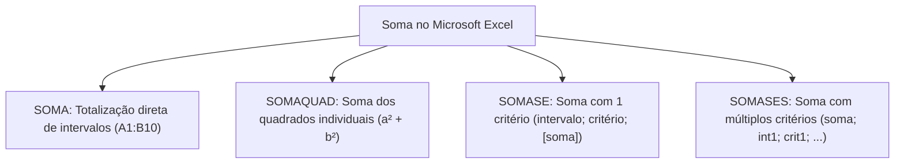
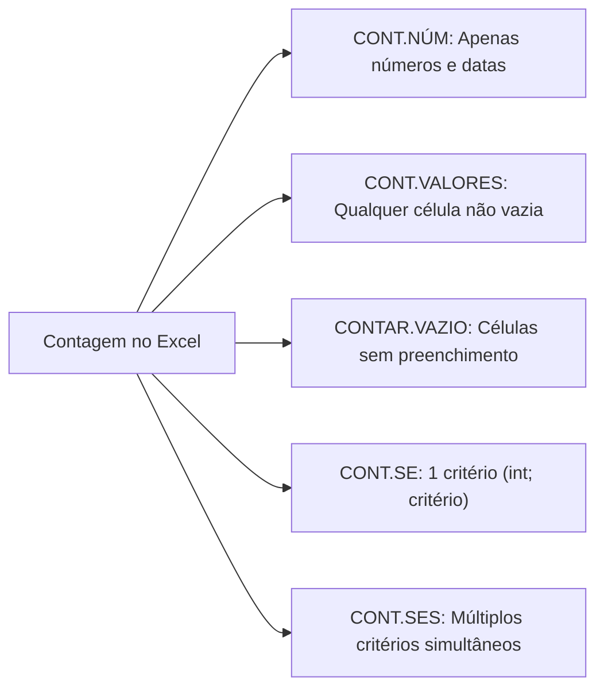
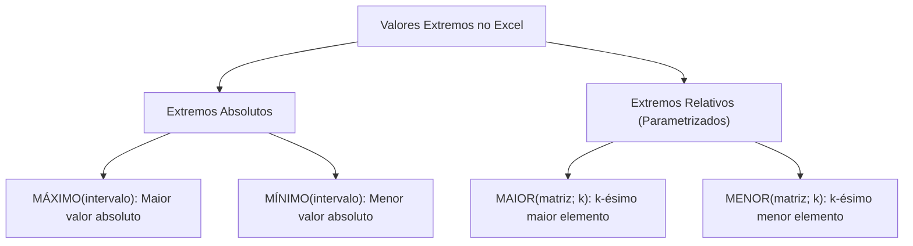
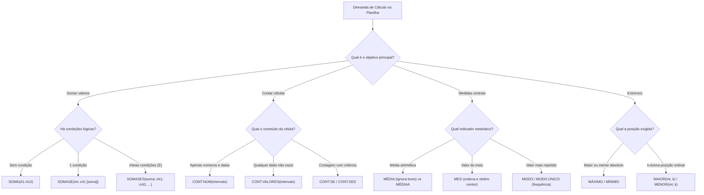

O domínio rigoroso das funções matemáticas e estatísticas no Microsoft Excel e no Microsoft 365 é indispensável em concursos. Nas provas, as questões exigem muito mais do que a simples identificação de nomes de fórmulas. O examinador cobra o cálculo do resultado numérico exato, a compreensão da ordem de precedência matemática e a interpretação de intervalos e critérios condicionais.

Compreender a sintaxe das funções de arredondamento, a mecânica da família da soma simples e condicional, a distinção entre contagens numéricas e de valores preenchidos, bem como as medidas de tendência central e de extremos, assegura pontuação decisiva. O candidato deve dominar os separadores canônicos do Excel em português: o ponto e vírgula (`;`) para separar argumentos distintos e os dois-pontos (`:`) para delimitar intervalos contíguos de células.

> [!objetivos]
> - Aplicar as constantes e operadores matemáticos com destaque para as funções `PI`, `POTÊNCIA`, `TRUNCAR`, `INT` e `PAR`.
> - Dominar a sintaxe e a lógica de processamento de `SOMA`, `SOMAQUAD`, `SOMASE` e `SOMASES`.
> - Diferenciar com exatidão as contagens realizadas por `CONT.NÚM`, `CONT.VALORES`, `CONTAR.VAZIO`, `CONT.SE` e `CONT.SES`.
> - Calcular medidas estatísticas essenciais: média aritmética com `MÉDIA` e `MÉDIAA`, mediana com `MED` e moda com `MODO`.
> - Extrair valores extremos por meio de `MÍNIMO`, `MÁXIMO`, `MENOR` e `MAIOR`, dominando a obrigatoriedade do argumento de posição.

---

## Constantes Matemáticas, Potenciação e Funções de Arredondamento

O Microsoft Excel disponibiliza funções matemáticas para manipulação de grandezas numéricas, constantes transcendentais e truncamentos inteiros. Dominar o comportamento dessas ferramentas evita armadilhas em cálculos aritméticos compostos.

A função `PI()` retorna o valor aproximado do número irracional pi com precisão de 15 dígitos decimais (`3,14159265358979`). Essa função não aceita nenhum argumento interno dentro de seus parênteses. Uma fórmula como `=PI()*10` multiplica a constante por dez. Caso o usuário tente inserir argumentos em `=PI(2)`, o Excel gera código de erro sintático. Na ordem de precedência operacional, a potenciação precede a multiplicação e a divisão, as quais precedem a adição e a subtração.

A função `POTÊNCIA(base; expoente)` eleva a base numérica ao expoente indicado, funcionando de maneira perfeitamente equivalente ao operador circunflexo (`^`). Dessa forma, a fórmula `=POTÊNCIA(3; 4)` produz exatamente o mesmo resultado que `=3^4`, cujo valor numérico é 81. Essa função aceita expoentes fracionários para o cálculo de raízes: a expressão `=POTÊNCIA(16; 1/2)` extrai a raiz quadrada de 16, resultando em 4.

| Função | Sintaxe Padrão | Exemplo Prático | Resultado | Comportamento Operacional |
| :--- | :--- | :--- | :--- | :--- |
| `PI` | `=PI()` | `=PI()` | `3,14159...` | Retorna pi com 15 dígitos; parênteses sempre vazios |
| `POTÊNCIA` | `=POTÊNCIA(base; exp)` | `=POTÊNCIA(2; 5)` | `32` | Eleva a base à potência especificada; equivale a `2^5` |
| `PAR` | `=PAR(número)` | `=PAR(35)` | `36` | Arredonda para longe do zero até o inteiro par mais próximo |
| `ÍMPAR` | `=ÍMPAR(número)` | `=ÍMPAR(4)` | `5` | Arredonda para longe do zero até o inteiro ímpar mais próximo |
| `TRUNCAR` | `=TRUNCAR(n; [casas])` | `=TRUNCAR(4,656; 2)` | `4,65` | Corta dígitos decimais sem efetuar arredondamento |
| `INT` | `=INT(número)` | `=INT(8,9)` | `8` | Arredonda para baixo até o inteiro imediatamente inferior |

A função `PAR(número)` arredonda o valor fornecido para longe do zero até alcançar o número inteiro par mais próximo. Se o valor for 1,5, o resultado será 2; se o número for 3, o resultado será 4; se o valor fornecido for negativo como -1, o resultado será -2. Por exemplo, a expressão `=PAR(35)/2` processa primeiro `PAR(35)`, que se converte em 36, e em seguida divide por 2, resultando no valor 18. A função `ÍMPAR(número)` segue idêntico princípio aritmético, direcionando o cálculo para o próximo número ímpar afastado do zero.

As funções `TRUNCAR` e `INT` produzem frequente confusão entre candidatos desatentos. A função `TRUNCAR(número; [número_dígitos])` simplesmente elimina os dígitos decimais excedentes sem avaliar se o próximo dígito é maior ou menor que cinco. Se o segundo argumento for omitido, ela elimina todas as casas decimais, preservando estritamente a parte inteira original. Por sua vez, a função `INT(número)` arredonda o valor estritamente para baixo, buscando o inteiro menor ou igual ao número testado.

> [!pegadinha]
> A divergência crítica entre `TRUNCAR` e `INT` manifesta-se nos números negativos. Enquanto para positivos ambos coincidem (`=TRUNCAR(8,9)` dá 8 e `=INT(8,9)` dá 8), nos números negativos o comportamento é diferente: `=TRUNCAR(-3,55)` resulta em -3, pois apenas descarta os decimais. Já `=INT(-3,55)` resulta em -4, pois -4 é o número inteiro imediatamente inferior a -3,55. Arredondar para baixo nos números negativos afasta o valor do zero.

> [!exemplo]
> Aplicação combinada de operadores: considere que a célula A1 armazene o valor 2 e a célula A2 armazene o valor 3. A fórmula `=POTÊNCIA(A1; A2) + TRUNCAR(7,89)` calcula inicialmente `POTÊNCIA(2; 3)`, que resulta em 8. Em seguida, processa `TRUNCAR(7,89)`, que resulta em 7. A soma final resulta no número 15.

> [!bizu]
> Ordem de precedência matemática no Excel: 1º Parênteses internos; 2º Operador de intervalo e interseção (`:`, espaço, `;`); 3º Negação numérica; 4º Porcentagem (`%`); 5º Potenciação (`^` ou `POTÊNCIA`); 6º Multiplicação e Divisão (`*` e `/`); 7º Adição e Subtração (`+` e `-`); 8º Concatenação (`&`); 9º Operadores relacionais de comparação (`=`, `>`, `<`, `>=`, `<=`, `<>`).

---

## Família da Soma: Simples, Quadrática e Condicional

O somatório de dados numéricos constitui a operação mais universal das planilhas eletrônicas. O Excel oferece desde a soma direta de células dispersas até somatórios com múltiplos critérios lógicos simultâneos.

A função `SOMA(núm1; [núm2]; ...)` aceita números literais, referências isoladas de células e blocos contínuos de intervalos. A sintaxe `=SOMA(B1; B2; B3)` é funcionalmente idêntica a `=SOMA(B1:B3)`. Quando se deseja referenciar estruturas inteiras, o Excel adota notações específicas: `=SOMA(A:C)` totaliza todos os valores contidos nas três colunas completas (A, B e C); `=SOMA(1:3)` totaliza os valores de todas as células das linhas 1, 2 e 3; e `=SOMA(A1:C1)` totaliza exclusivamente as três células da primeira linha.

A função `SOMAQUAD(núm1; [núm2]; ...)` calcula inicialmente o quadrado de cada argumento individual e, na sequência, realiza a soma desses quadrados intermediários. Dessa forma, a fórmula `=SOMAQUAD(5; 6)` executa o cálculo aritmético `(5^2) + (6^2) = 25 + 36`, devolvendo o valor consolidado 61.

*Figura 1: Panorama e especialização funcional da família de funções de soma no Excel.*

Quando o somatório depende do atendimento de uma condição lógica prévia, utilizam-se as funções `SOMASE` e `SOMASES`. A estrutura posicional de seus argumentos exige memorização técnica rigorosa pelo candidato.

A função `SOMASE(intervalo; critérios; [intervalo_soma])` avalia exatamente uma condição. O primeiro argumento delimita o intervalo que será submetido ao teste do critério; o segundo argumento estabelece o teste lógico desejado; e o terceiro argumento, opcional, define as células cujos valores serão somados. Quando o terceiro argumento é omitido, o Excel soma diretamente os valores do próprio intervalo testado no primeiro argumento.

A função `SOMASES(intervalo_soma; intervalo_critérios1; critérios1; [intervalo_critérios2; critérios2]; ...)` permite aplicar dois ou mais critérios simultâneos sob a lógica booleana restritiva E (*AND*). Para que uma célula seja somada no total final, ela precisa atender concomitantemente a todas as condições estabelecidas nos pares subsequentes.

| Característica | Função `SOMASE` | Função `SOMASES` |
| :--- | :--- | :--- |
| Quantidade de critérios | Avalia rigorosamente **um** critério | Avalia **dois ou mais** critérios concomitantes |
| Posição do intervalo de soma | Declarado por **último** (terceiro argumento) | Declarado em **primeiro** lugar (obrigatório) |
| Obrigatoriedade da soma | Intervalo de soma é **opcional** | Intervalo de soma é **obrigatório** |
| Operador lógico implícito | Condição unitária | Operador booleano **E** (*AND*) entre os pares |

> [!atencao]
> Inversão posicional dos argumentos: no `SOMASE`, o intervalo com os números que serão somados localiza-se na última posição: `=SOMASE(A2:A10; "Oeste"; B2:B10)`. No `SOMASES`, o intervalo somado é obrigatoriamente antecipado para a primeiríssima posição da fórmula: `=SOMASES(B2:B10; A2:A10; "Oeste"; C2:C10; ">1000")`. Inverter essas ordens produz erro de sintaxe ou distorção completa dos resultados.

> [!exemplo]
> Mecânica do somatório condicional unitário: imagine uma planilha onde a coluna A liste os postos de bombeiros militares ("Posto Norte", "Posto Sul") e a coluna B informe o quantitativo de ocorrências atendidas. Para somar as ocorrências apenas do "Posto Sul", utiliza-se `=SOMASE(A2:A9; "Posto Sul"; B2:B9)`. Caso se queira somar diretamente os valores da coluna B que superem 15 atendimentos, dispensa-se o terceiro argumento: `=SOMASE(B2:B9; ">15")`.

> [!bizu]
> Passo a passo para interpretar soma condicional: 1º Localize o que deve ser somado; 2º Identifique os critérios e seus operadores; 3º Conte os critérios (se houver apenas um teste, use `SOMASE`; se houver múltiplos testes simultâneos, use `SOMASES`); 4º Certifique-se de que os critérios textuais e comparativos estejam entre aspas duplas.

> [!pegadinha]
> Intervalo único no `SOMASE`: quando a fórmula traz apenas `=SOMASE(B2:C5; "<7")`, sem o terceiro argumento, ela soma unicamente os números contidos no próprio retângulo de B2 até C5 que sejam estritamente menores que 7. Candidatos costumam errar achando que falta argumento obrigatório.

---

## Funções Estatísticas de Contagem: Numérica, de Valores e Condicional

No trabalho diário com grandes bancos de dados, surge a necessidade frequente de quantificar registros em vez de somar seus conteúdos numéricos. O Excel dispõe de uma série estruturada de funções iniciadas pelo prefixo `CONT`.

A função `CONT.NÚM(valor1; [valor2]; ...)` contabiliza exclusivamente as células que contêm valores numéricos válidos. As datas e os horários são tratados internamente pelo Excel como números de série sequenciais, sendo, portanto, contabilizados normalmente por essa função. Células preenchidas com textos alfanuméricos, valores lógicos booleanos inseridos diretamente na planilha ou mensagens de erro são sumariamente ignoradas.

A função `CONT.VALORES(valor1; [valor2]; ...)` contabiliza qualquer célula que não esteja vazia. Ela computa números, datas, horários, cadeias de texto, códigos de erro e valores lógicos. Uma célula contendo um simples espaço em branco ou fórmula que retorne texto vazio (`""`) é considerada não vazia e entra na contagem. Para identificar células sem qualquer conteúdo, utiliza-se a função complementar `CONTAR.VAZIO(intervalo)`.

*Figura 2: Árvore de decisão para escolha da função de contagem adequada no Excel.*

A função `CONT.SE(intervalo; critérios)` conta a quantidade de células dentro de um intervalo delimitado que cumprem uma condição específica. Os critérios de texto ou que envolvam operadores relacionais matemáticos devem figurar obrigatoriamente delimitados entre aspas duplas, tais como `">50"`, `"<0"` ou `"Aprovado"`.

A função `CONT.SES(intervalo_critérios1; critérios1; [intervalo_critérios2; critérios2]; ...)` estende o poder analítico da contagem condicional, permitindo fixar múltiplos pares de intervalos e critérios associados. Todos os critérios devem ser satisfeitos simultaneamente na mesma posição relativa de linha para que a ocorrência seja incrementada no contador.

| Função | O que contabiliza | O que ignora | Exemplo Típico |
| :--- | :--- | :--- | :--- |
| `CONT.NÚM` | Números inteiros, decimais, datas e horas | Textos, células vazias e códigos de erro | `=CONT.NÚM(A1:A10)` |
| `CONT.VALORES` | Todas as células preenchidas (texto, número, erro) | Células estritamente em branco | `=CONT.VALORES(A1:A10)` |
| `CONTAR.VAZIO` | Células sem nenhum dado registrado | Qualquer célula com caractere ou fórmula | `=CONTAR.VAZIO(A1:A10)` |
| `CONT.SE` | Células que atendem a um critério determinado | Células fora do critério estipulado | `=CONT.SE(B2:B20; ">=18")` |
| `CONT.SES` | Células que cumprem múltiplos critérios sob E | Células que falham em ao menos um teste | `=CONT.SES(A1:A10; "Sim"; B1:B10; ">5")` |

> [!bizu]
> Distinção conceitual em provas: jamais confunda `CONT.SE` com `SOMASE`. O `CONT.SE` calcula a frequência de registros (quantas células atendem ao teste), aceitando apenas dois argumentos. O `SOMASE` calcula a magnitude cumulativa dos valores (quanto somam os números das células aprovadas), aceitando até três argumentos.

> [!exemplo]
> Auditoria de relatórios de plantão: considere uma coluna de controle de viaturas operacionais. Os dias com saída de viatura registram o número de chamados atendidos (números), enquanto os dias sem operação trazem a anotação textual "Sem escala". Para quantificar os dias em que houve viatura em campo, utiliza-se `=CONT.NÚM(C2:C31)`. Caso se utilizasse `=CONT.VALORES(C2:C31)`, os dias com a anotação "Sem escala" seriam indevidamente computados.

> [!atencao]
> Delimitação de critérios no `CONT.SES`: todos os intervalos declarados em `=CONT.SES(A2:A10; "Sul"; B2:B10; ">10")` devem possuir rigorosamente a mesma quantidade de linhas e colunas. Se o primeiro intervalo abranger 9 linhas (A2:A10) e o segundo tentar abranger 10 linhas (B2:B11), o Excel retorna erro imediato de dimensão `#VALOR!`.

---

## Medidas de Tendência Central: Média, Mediana e Moda

A estatística descritiva no Excel organiza conjuntos de dados por meio de indicadores centrais de posição. O examinador explora as regras específicas de tratamento de dados nulos e não numéricos em cada uma dessas funções.

A função `MÉDIA(núm1; [núm2]; ...)` calcula a média aritmética simples, somando todos os valores numéricos presentes nos argumentos e dividindo o total apurado pela quantidade exata de números somados. As células contendo textos alfanuméricos ou células totalmente vazias são sumariamente desconsideradas do cálculo e não afetam o denominador da divisão. Por outro lado, a função `MÉDIAA(valor1; [valor2]; ...)` inclui valores lógicos e representações textuais na apuração: o texto alfanumérico recebe valor zero (0), a constante lógica `VERDADEIRO` equivale a um (1) e a constante `FALSO` equivale a zero (0), aumentando o denominador.

A função `MED(núm1; [núm2]; ...)` determina a mediana, isto é, o valor central que divide uma amostra ordenada em duas partes perfeitamente iguais. Ao processar a função, o Excel classifica internamente os números em ordem crescente:
1. Se a quantidade de elementos numéricos for ímpar, a mediana será exatamente o elemento posicionado no centro físico da distribuição.
2. Se a quantidade de elementos numéricos for par, a mediana corresponderá à média aritmética dos dois valores numéricos centrais.

Por exemplo, na amostra ímpar `{7; 2; 0; 1; 9}`, a ordenação gera `{0; 1; 2; 7; 9}`, resultando em `MED = 2`. Na amostra par `{6; 2; 1; 9}`, a ordenação gera `{1; 2; 6; 9}`, resultando na média dos dois termos centrais: `(2 + 6)/2 = 4`.

A função `MODO(núm1; [núm2]; ...)` — mantida nas versões recentes como `MODO.ÚNICO` para padronização internacional — identifica a moda amostral, isto é, o valor que ocorre com maior frequência repetida no conjunto de dados avaliado. Se nenhum número se repetir dentro do intervalo analisado, o Excel retorna o erro de dados não disponíveis `#N/D`.

| Medida Estatística | Função Excel | Lógica de Processamento | Comportamento com Texto |
| :--- | :--- | :--- | :--- |
| Média Aritmética | `MÉDIA` | Soma dividida pela contagem de números | Ignora células textuais e vazias |
| Média Abrangente | `MÉDIAA` | Inclui texto (0) e lógicos (V=1, F=0) | Computa texto no denominador com valor 0 |
| Mediana | `MED` | Valor central após ordenação crescente | Ignora células textuais e vazias |
| Moda Amostral | `MODO` / `MODO.ÚNICO` | Valor com maior repetição no conjunto | Requer ao menos uma repetição (`#N/D`) |
| Resto da Divisão | `MOD` | Operação matemática: resto inteiro | Não é função estatística de moda |

> [!pegadinha]
> Homonímia perigosa: não confunda a função estatística `MODO` com a função matemática `MOD(número; divisor)`. A função `MOD` não calcula a moda de um grupo numérico; ela calcula o resto da divisão inteira entre dois números. Por exemplo, a fórmula `=MOD(31; 9)` resulta no valor 4, pois 31 dividido por 9 resulta em quociente 3 com resto 4 (`31 = 3 * 9 + 4`).

> [!exemplo]
> Operações aritméticas com média: considere as células com os seguintes valores: A1=2, A2=5, B1=3 e B2=-2. A expressão complexa `=MÉDIA(A1:B2)^A1` resolve inicialmente a média aritmética do bloco de quatro células: `(2 + 5 + 3 - 2) / 4 = 8 / 4 = 2`. Na sequência, aplica a potenciação com base 2 elevada ao expoente contido em A1 (2), resultando em `2^2 = 4`.

> [!bizu]
> Comparativo `MÉDIA` versus `MÉDIAA`: se uma coluna possui os números 10 e 20, uma célula com o texto "Ausente" e uma célula vazia, `=MÉDIA` calcula `(10 + 20) / 2 = 15`. Já `=MÉDIAA` computa o texto como zero, calculando `(10 + 20 + 0) / 3 = 10`. Células verdadeiramente em branco permanecem ignoradas em ambas.

---

## Funções de Extremos: Mínimo, Máximo, Menor e Maior

A localização de elementos extremos e ordenados compõe outro bloco de frequente incidência nas avaliações de concurso público. O candidato deve diferenciar com rigor as funções absolutas das funções posicionais parametrizadas.

As funções `MÍNIMO(núm1; [núm2]; ...)` e `MÁXIMO(núm1; [núm2]; ...)` localizam, respectivamente, o menor e o maior valor numérico absoluto presente no conjunto de argumentos informado. Essas funções aceitam intervalos inteiros bem como números literais avulsos inseridos diretamente nos argumentos. Por exemplo, a fórmula `=MÁXIMO(A1:E4; 100)` varre toda a matriz bidimensional de A1 até E4 e compara o maior elemento encontrado contra a constante numérica 100, retornando o maior entre todos eles.

As funções `MENOR(matriz; k)` e `MAIOR(matriz; k)` fornecem valores extremos relativos condicionados ao argumento de ordem posicional `k`. O argumento `k` indica a posição hierárquica ordinal desejada a partir do extremo:
- `=MAIOR(intervalo; 1)` localiza o primeiro maior valor (equivalente a `MÁXIMO`).
- `=MAIOR(intervalo; 2)` localiza o segundo maior valor do conjunto.
- `=MENOR(intervalo; 1)` localiza o primeiro menor valor (equivalente a `MÍNIMO`).
- `=MENOR(intervalo; 3)` localiza o terceiro menor valor do conjunto.

*Figura 3: Classificação e inter-relação das funções de extremos absolutos e relativos.*

A sintaxe de `MAIOR` e `MENOR` exige estritamente dois argumentos separados por ponto e vírgula. O primeiro argumento define o intervalo ou matriz de dados; o segundo argumento define o número inteiro correspondente ao índice ordinal `k`. Omitir o valor de `k` impede a aceitação da fórmula pelo programa. Além disso, inverter a ordem dos parâmetros, declarando `=MAIOR(2; A1:A10)`, dispara erro imediato de sintaxe no Excel.

| Função | Quantidade de Argumentos | Exigência do Argumento `k` | Equivalência Notável | Exemplo Prático |
| :--- | :--- | :--- | :--- | :--- |
| `MÍNIMO` | De 1 a 255 argumentos | Não utiliza argumento posicional | Equivalente a `=MENOR(int; 1)` | `=MÍNIMO(C5:E5)` |
| `MÁXIMO` | De 1 a 255 argumentos | Não utiliza argumento posicional | Equivalente a `=MAIOR(int; 1)` | `=MÁXIMO(C5:E5)` |
| `MENOR` | Estritamente 2 argumentos | **Obrigatório** como segundo argumento | Com k=1 reproduz o `MÍNIMO` | `=MENOR(A1:A10; 2)` |
| `MAIOR` | Estritamente 2 argumentos | **Obrigatório** como segundo argumento | Com k=1 reproduz o `MÁXIMO` | `=MAIOR(A1:A10; 3)` |

> [!bizu]
> Passo a passo infalível para resolver `MAIOR` e `MENOR`: quando a questão apresentar um conjunto disperso como `{14; 29; 5; 42; 18; 29}`, organize os valores em ordem crescente: `{5; 14; 18; 29; 29; 42}`. Se a questão pedir `=MAIOR(intervalo; 2)`, conte as posições a partir do final (o maior é 42, o segundo maior é 29). Se pedir `=MENOR(intervalo; 3)`, conte a partir do início (1º é 5, 2º é 14, 3º é 18). Valores repetidos ocupam posições ordinais consecutivas normais.

> [!atencao]
> Delimitadores de sintaxe em bancas examinadoras: certifique-se de que os argumentos estejam separados exclusivamente pelo ponto e vírgula. A banca frequentemente insere opções contendo caracteres inválidos como vírgulas isoladas em português, barras ou símbolos como `@` e `#` no lugar de separadores funcionais, tornando o item automaticamente incorreto.

> [!exemplo]
> Extração de extremos em listas desordenadas: no conjunto `{4; 9; 1; 7; 3}`, a fórmula `=MAIOR(A1:A5; 2)` busca o segundo maior número, retornando o valor 7. Já a fórmula `=MENOR(A1:A5; 3)` localiza o terceiro menor valor da distribuição ordenada `{1; 3; 4; 7; 9}`, devolvendo o valor 4.

---

## Mapa do Capítulo

O fluxograma integrado abaixo sintetiza o processo decisório para identificação e aplicação das funções matemáticas e estatísticas fundamentais do Microsoft Excel:

*Figura 4: Fluxograma lógico para seleção analítica de fórmulas matemáticas e estatísticas no Excel.*

---

### Para fixar

1. **Constante `PI` e potência**: a função `=PI()` retorna a constante matemática com 15 casas e nunca admite argumentos internos; a função `=POTÊNCIA(base; exp)` equivale ao operador `^`.
2. **Arredondamento e truncamento**: a função `TRUNCAR` corta as casas sem arredondar; a função `INT` arredonda para baixo (ambas divergem nos negativos, onde `INT(-3,55) = -4` e `TRUNCAR(-3,55) = -3`).
3. **Mecânica do `PAR`**: arredonda para longe do zero até atingir o próximo inteiro par (`PAR(35) = 36`).
4. **Sintaxe do `SOMASE`**: recebe o intervalo testado, o critério e, por último de forma opcional, o intervalo de soma.
5. **Inversão no `SOMASES`**: exige o intervalo de soma obrigatoriamente na primeira posição, associando múltiplos pares sob o operador lógico restritivo E.
6. **Contagem numérica versus de valores**: `CONT.NÚM` computa apenas números e datas; `CONT.VALORES` contabiliza qualquer célula preenchida, incluindo textos e erros.
7. **Mediana e moda**: `MED` ordena a amostra e captura o valor central (média dos dois do meio se a quantidade for par); `MODO` retorna o valor de maior frequência repetida.
8. **Resto da divisão**: a função matemática `MOD(número; divisor)` devolve o resto inteiro da divisão e não guarda relação com a moda estatística.
9. **Extremos parametrizados**: `MAIOR(matriz; k)` e `MENOR(matriz; k)` exigem obrigatoriamente o parâmetro ordinal `k` na segunda posição, correspondendo ao `MÁXIMO` e `MÍNIMO` quando `k = 1`.
