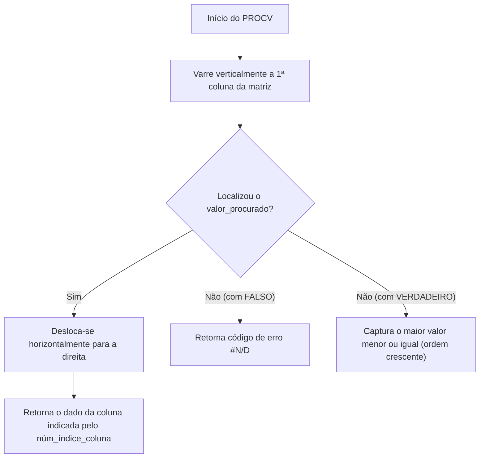
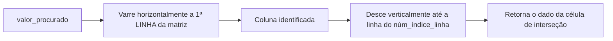
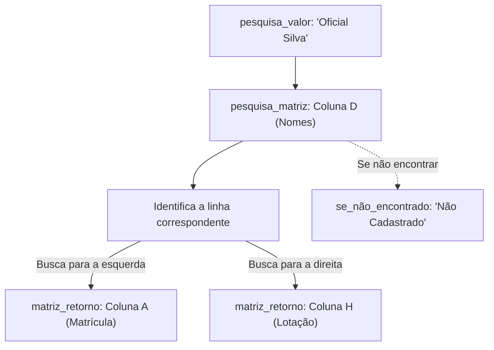
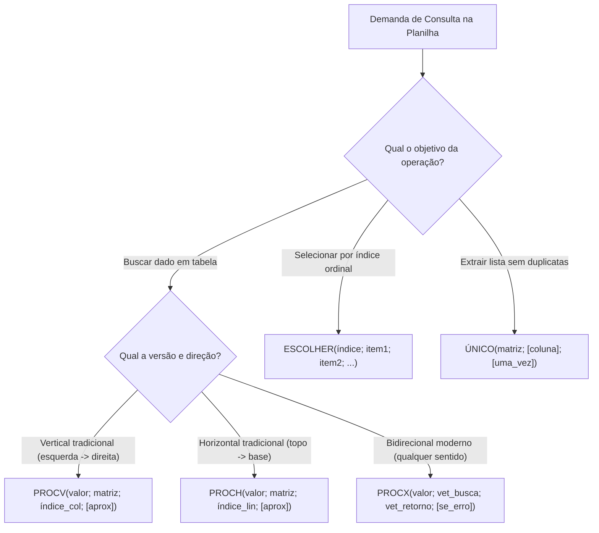

A recuperação automatizada e o cruzamento de registros entre diferentes tabelas constituem rotinas essenciais na gestão pública e na atividade policial. No Microsoft Excel e no ecossistema Microsoft 365, as funções de pesquisa e referência eliminam a digitação manual redundante, conectando bases cadastrais por meio de chaves unívocas de identificação.

Nas provas de concurso, as bancas examinadoras exploram com rigor a sintaxe das funções clássicas de consulta vertical e horizontal, as limitações estruturais dos modelos tradicionais e a superioridade técnica das novas ferramentas matriciais dinâmicas. Compreender como operam os argumentos de aproximação, a indexação de colunas e linhas e o tratamento nativo de falhas de localização é indispensável para gabaritar esse módulo.

> [!objetivos]
> - Dominar a sintaxe completa e o funcionamento passo a passo do `PROCV` e do `PROCH`.
> - Identificar as limitações operacionais clássicas do `PROCV` e os riscos da correspondência aproximada por padrão.
> - Compreender a arquitetura desacoplada e a busca bidirecional da moderna função `PROCX`.
> - Aplicar a função `ESCOLHER` para seleção posicional de valores e referências dinâmicas.
> - Utilizar a função matricial dinâmica `ÚNICO` para extração de listas consolidadas sem duplicidades.

---

## Funções Clássicas de Pesquisa: A Mecânica do PROCV

A função `PROCV` (Pesquisa Vertical) é a fórmula de consulta mais tradicional das planilhas eletrônicas. Seu propósito consiste em localizar um valor específico na primeira coluna de uma tabela e, a partir dessa linha encontrada, retornar a informação armazenada em uma coluna situada à sua direita.

A sintaxe canônica do `PROCV` compõe-se de quatro argumentos bem definidos:
`=PROCV(valor_procurado; matriz_tabela; núm_índice_coluna; [procurar_intervalo])`

1. **`valor_procurado`**: o dado a ser localizado, que pode ser inserido diretamente como texto entre aspas, número literal ou referência a outra célula da planilha (por exemplo, `G5`).
2. **`matriz_tabela`**: o intervalo bidimensional contínuo onde os dados estão estruturados. O valor procurado deve estar obrigatoriamente na primeira coluna desse bloco.
3. **`núm_índice_coluna`**: um número inteiro que representa a contagem ordinal da coluna desejada para retorno dentro da matriz (a primeira coluna da matriz é 1, a segunda é 2, e assim por diante). A contagem refere-se ao bloco delimitado e não às letras das colunas da planilha.
4. **`[procurar_intervalo]`**: argumento lógico booleano opcional que define a precisão da busca. Se for preenchido com `FALSO` (ou `0`), impõe correspondência exata. Se for preenchido com `VERDADEIRO` (ou `1`, ou simplesmente omitido), o Excel assume busca aproximada.

*Figura 1: Fluxo operacional de processamento e tomada de decisão da função PROCV.*

Considere uma tabela de viaturas policiais localizada no intervalo B5:D10, contendo as colunas Modelo (B), Placa (C) e Km Rodados (D). Para consultar os quilômetros rodados do modelo "Camburão", a fórmula adequada é `=PROCV("Camburão"; B5:D10; 3; FALSO)`. O Excel localiza "Camburão" na coluna B (coluna 1 da matriz) e retorna o dado correspondente na coluna D (coluna 3 da matriz). Caso se queira consultar pela Placa, a matriz deve começar obrigatoriamente na coluna C (`C5:D10`), passando a quilometragem a ocupar a coluna de índice 2: `=PROCV("PCA1234"; C5:D10; 2; FALSO)`.

| Parâmetro no `PROCV` | Papel Técnico | Exemplo Típico | Observação Crítica |
| :--- | :--- | :--- | :--- |
| `valor_procurado` | Termo ou código de busca | `"C003"` ou `A2` | Deve constar na coluna inicial do bloco |
| `matriz_tabela` | Bloco retangular de consulta | `B5:D10` | Não precisa abranger toda a planilha |
| `núm_índice_coluna` | Índice ordinal da coluna de saída | `3` | Conta dentro da matriz, não da planilha |
| `procurar_intervalo` | Tipo de correspondência | `FALSO` ou `0` | Se omitido, assume busca aproximada |

> [!pegadinha]
> A armadilha da correspondência aproximada omitida: quando o quarto argumento do `PROCV` não é informado, o Excel adota tacitamente `VERDADEIRO`. Nessa situação, a primeira coluna da matriz de busca deve estar rigorosamente classificada em ordem alfabética ou numérica crescente. Na correspondência aproximada, o Excel não busca o valor matematicamente mais próximo; ele busca o maior valor que seja menor ou igual ao procurado. Em uma tabela com valores 1, 3 e 5, ao pesquisar por 2,99 com busca aproximada, o sistema retorna o valor associado ao número 1. Se a correspondência for `FALSO` e o termo não existir, o resultado será imediatamente `#N/D`.

> [!bizu]
> Unidirecionalidade e fragilidade estrutural: o `PROCV` nunca opera da direita para a esquerda. Ele é incapaz de consultar uma chave localizada na coluna C e resgatar uma informação posicionada na coluna A. Além disso, se um usuário inserir uma nova coluna entre a placa e a quilometragem, a fórmula estática com índice 3 continuará apontando para a terceira posição relativa, que agora conterá dados alheios, quebrando a integridade do relatório.

---

## Pesquisa Horizontal: A Sistemática do PROCH

A função `PROCH` (Pesquisa Horizontal) opera segundo a mesmíssima estrutura conceitual do `PROCV`, diferenciando-se unicamente pela orientação espacial da varredura na grade da planilha. Em vez de percorrer linhas dentro de uma coluna, o `PROCH` percorre colunas ao longo da primeira linha superior de uma matriz de dados.

Sua sintaxe padronizada apresenta os seguintes parâmetros:
`=PROCH(valor_procurado; matriz_tabela; núm_índice_linha; [procurar_intervalo])`

1. **`valor_procurado`**: a chave de identificação a ser localizada ao longo da primeira linha superior da matriz indicada.
2. **`matriz_tabela`**: o intervalo de células onde a busca será executada. O valor de consulta deve residir obrigatoriamente na linha mais alta do intervalo.
3. **`núm_índice_linha`**: o número ordinal da linha da matriz que contém a informação a ser retornada (a linha de pesquisa é a 1, a linha imediatamente abaixo é a 2, e assim por diante).
4. **`[procurar_intervalo]`**: define se a correspondência será exata (`FALSO` ou `0`) ou aproximada (`VERDADEIRO` ou `1`, padrão se omitido).

*Figura 2: Esquema direcional de varredura e extração de dados na função PROCH.*

Considere uma matriz horizontal no intervalo A9:E13, onde a linha 9 lista os meses ("Jan", "Fev", "Mar", "Abr", "Mai") e as linhas abaixo detalham custos operacionais de combustível, manutenção e diárias. Para resgatar o valor de manutenção (localizado na linha 12, que corresponde à 4ª linha da matriz) referente ao mês de março indicado na célula C9, utiliza-se `=PROCH(C9; A9:E13; 4; FALSO)`. O sistema localiza "Mar" na linha 9 e desce quatro linhas naquela mesma coluna, devolvendo o valor pretendido.

| Aspecto Comparativo | Função `PROCV` | Função `PROCH` |
| :--- | :--- | :--- |
| Direção inicial da varredura | **Vertical** (de cima para baixo na 1ª coluna) | **Horizontal** (da esquerda para a direita na 1ª linha) |
| Sentido do deslocamento de saída | Desloca-se para a **direita** | Desloca-se para **baixo** |
| Parâmetro de posição | `núm_índice_coluna` | `núm_índice_linha` |
| Organização típica dos dados | Tabelas com registros em linhas e campos em colunas | Tabelas transpostas com séries em colunas e campos em linhas |

> [!atencao]
> Assim como no `PROCV`, o `PROCH` possui restrição direcional severa: ele busca apenas na primeira linha da matriz e desloca-se estritamente para baixo. Ele é incapaz de retornar dados que estejam localizados em linhas superiores à linha onde foi realizada a pesquisa.

---

## O Salto Tecnológico do PROCX: A Nova Geração de Consultas

Introduzida no Microsoft 365 e no Excel 2021, a função `PROCX` foi desenvolvida pela Microsoft para superar em definitivo todas as limitações, fragilidades e complexidades do `PROCV` e do `PROCH`, integrando busca multidirecional com alta robustez.

A sintaxe flexível do `PROCX` apresenta a seguinte estrutura:
`=PROCX(pesquisa_valor; pesquisa_matriz; matriz_retorno; [se_não_encontrado]; [modo_correspondência]; [modo_pesquisa])`

Os três primeiros argumentos são suficientes para realizar a vasta maioria das operações:
1. **`pesquisa_valor`**: o item procurado.
2. **`pesquisa_matriz`**: o vetor (coluna ou linha) onde a busca será executada.
3. **`matriz_retorno`**: o vetor de onde o resultado será extraído.

*Figura 3: Modelo flexível de vetores desacoplados e busca bidirecional do PROCX.*

As vantagens técnicas do `PROCX` em relação ao modelo antigo são revolucionárias:
- **Busca bidirecional irrestrita**: localiza dados para a direita, para a esquerda, para cima ou para baixo. Se a chave estiver na coluna C e o dado pretendido na coluna A, o `PROCX` processa com perfeição: `=PROCX("Silva"; C2:C100; A2:A100)`.
- **Desacoplamento por vetores independentes**: dispensa contagem manual de números ordinais de colunas. Se colunas intermediárias forem inseridas ou excluídas da planilha, as referências vetoriais ajustam-se de forma dinâmica sem quebrar a fórmula.
- **Correspondência exata como padrão nativo**: diferente do `PROCV`, que assume busca aproximada, o `PROCX` adota por padrão a busca exata (modo 0). O usuário não precisa mais lembrar de digitar `FALSO` ao final da fórmula.
- **Tratamento integrado de exceções**: o quarto argumento opcional `[se_não_encontrado]` permite definir um texto amigável caso a chave não exista (por exemplo, `"Não localizado"`), eliminando a necessidade histórica de envolver a fórmula em funções complementares como `SEERRO` ou `SE.NÃO.DISP`.

O quinto argumento (`modo_correspondência`) permite calibrar o tipo de comparação, oferecendo grande precisão analítica:
- `0`: Correspondência exata. Se não localizado, retorna o valor definido em `se_não_encontrado` ou o erro `#N/D` (padrão nativo).
- `-1`: Correspondência exata. Se não localizado, retorna o próximo item menor.
- `1`: Correspondência exata. Se não localizado, retorna o próximo item maior.
- `2`: Correspondência por caracteres curinga: asterisco (`*`) para qualquer sequência de caracteres, interrogação (`?`) para exatamente um caractere, e til (`~`) para escapar o próprio curinga.

O sexto argumento (`modo_pesquisa`) define a método de varredura nos dados:
- `1`: Pesquisa do primeiro item para o último (varredura progressiva padrão).
- `-1`: Pesquisa reversa, do último item para o primeiro (útil para encontrar a ocorrência mais recente).
- `2`: Pesquisa binária em matriz classificada em ordem crescente.
- `-2`: Pesquisa binária em matriz classificada em ordem decrescente.

> [!atencao]
> Na pesquisa binária do `PROCX` (modos 2 e -2), a velocidade de execução é exponencialmente mais rápida em bancos de dados com milhões de registros. Contudo, se a matriz não estiver perfeitamente ordenada segundo a orientação exigida, o algoritmo retornará dados inválidos ou códigos de erro.

---

## Seleção por Índice e Matrizes Dinâmicas: ESCOLHER e ÚNICO

Além das funções de busca tabular, o Excel contemporâneo fornece ferramentas de seleção posicional e manipulação de matrizes que dispensam procedimentos operacionais arcaicos.

A função `ESCOLHER(núm_índice; valor1; [valor2]; ...)` resgata um valor específico de uma relação enumerada de até 254 argumentos, orientando-se pelo índice numérico ordinal informado no início. Se o índice for 1, a função extrai o primeiro valor; se o índice for 3, extrai o terceiro termo da lista.
- Exemplo direto: na fórmula `=ESCOLHER(2; "Ouro"; "Prata"; "Bronze")`, o resultado é `"Prata"`.
- Seleção por referências celulares: a expressão `=ESCOLHER(4; A1; A2; A3; A4; A5)` avalia o índice 4 e devolve diretamente o conteúdo abrigado na célula A4.

Uma propriedade notável da função `ESCOLHER` explorada pelas bancas de concurso é a capacidade de gerar referências de intervalo dinâmicas quando associada a outras fórmulas matemáticas. Considere a fórmula `=SOMA(A1:ESCOLHER(3; A2; A3; A4; A5))`. A função interna avalia o índice 3 e retorna a referência da célula A4. Com isso, a expressão externa converte-se em `=SOMA(A1:A4)`. Se as células A1 a A4 contiverem os valores 5, 15, 25 e 35, o somatório final resultará no valor 80.

A função `ÚNICO(matriz; [por_coluna]; [exatamente_uma_vez])` constitui um divisor de águas na tecnologia de matrizes dinâmicas do Microsoft 365. Ela analisa um intervalo contendo dados com repetições e extrai instantaneamente uma lista desduplicada, exibindo apenas os valores distintos.

| Argumento de `ÚNICO` | Tipo de Dado | Efeito no Processamento |
| :--- | :--- | :--- |
| `matriz` | Intervalo obrigatório | O conjunto de células original contendo duplicidades |
| `[por_coluna]` | Booleano opcional | `FALSO` (ou omitido) avalia linhas; `VERDADEIRO` avalia colunas |
| `[exatamente_uma_vez]` | Booleano opcional | `FALSO` (ou omitido) traz itens distintos; `VERDADEIRO` traz apenas os que não se repetem |

O comportamento dos resultados de `ÚNICO` fundamenta-se no princípio do "derramamento" (*spill*). O usuário insere a fórmula em uma única célula de destino (por exemplo, em C1: `=ÚNICO(A1:A10)`). O Excel processa o cálculo matricial dinâmico e projeta automaticamente os itens únicos para baixo pelas células adjacentes livres (C1, C2, C3...), circundando o bloco por uma borda azul sutil. Se alguma célula no caminho do derramamento estiver ocupada com dados preexistentes, o Excel sinaliza o código de erro de bloqueio `#DESPEJAR!` (*#SPILL!*).

> [!exemplo]
> Extração de cidades de atendimento: imagine que o intervalo A1:A7 contenha os seguintes registros operacionais: `{"Recife"; "Olinda"; "Recife"; "Paulista"; "Olinda"; "Recife"; "Jaboatão"}`. Ao aplicar a fórmula `=ÚNICO(A1:A7)`, o Excel elimina as redundâncias e projeta uma lista contendo exatamente quatro elementos distintos: Recife, Olinda, Paulista e Jaboatão. Caso se configure o terceiro argumento como verdadeiro em `=ÚNICO(A1:A7; FALSO; VERDADEIRO)`, o resultado apresentará unicamente as cidades que figuraram exatamente uma única vez: Paulista e Jaboatão.

---

## Mapa do Capítulo

O fluxograma comparativo abaixo orienta a escolha técnica entre as diversas funções de pesquisa e referência disponíveis no Microsoft Excel:

*Figura 4: Fluxograma para seleção sistemática de funções de pesquisa e manipulação de matrizes.*

---

### Para fixar

1. **Varredura do `PROCV`**: pesquisa verticalmente na primeira coluna da matriz e desloca-se estritamente para a direita, retornando a coluna referenciada pelo índice.
2. **Padrão de aproximação**: o quarto argumento de `PROCV` e `PROCH` assume `VERDADEIRO` por padrão, exigindo ordenação crescente da primeira coluna; para busca exata, declare `FALSO` ou `0`.
3. **Varredura do `PROCH`**: pesquisa horizontalmente na primeira linha superior da matriz e desloca-se para baixo até a linha indicada no índice ordinal.
4. **Fragilidade do índice numérico**: inserir ou deletar colunas intermediárias em planilhas que usam `PROCV` corrompe o resultado por quebrar a indexação estática.
5. **Busca bidirecional do `PROCX`**: atua em qualquer direção espacial (esquerda, direita, cima, baixo) por meio de vetores desacoplados de busca e retorno.
6. **Configuração nativa do `PROCX`**: adota busca exata por padrão e inclui argumento próprio (`se_não_encontrado`) para tratamento de exceções sem usar `SEERRO`.
7. **Seleção com `ESCOLHER`**: retorna o item posicionado na ordem ordinal informada pelo índice inicial dentro de uma lista de até 254 argumentos.
8. **Matriz dinâmica `ÚNICO`**: extrai valores sem duplicidade de um intervalo e projeta o resultado por derramamento contínuo nas células adjacentes livres.
