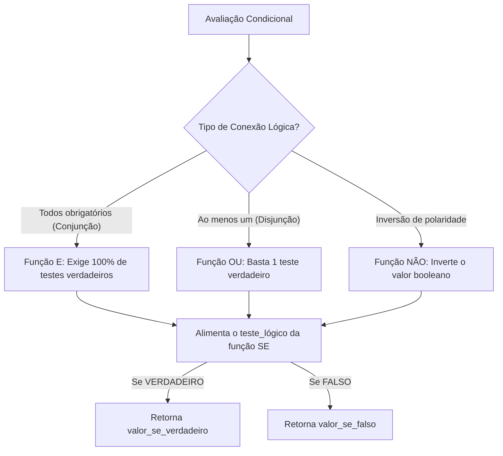
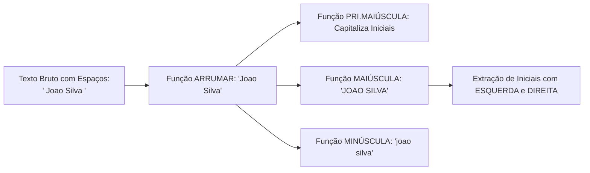
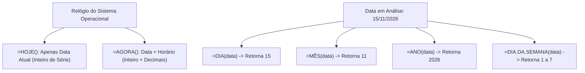
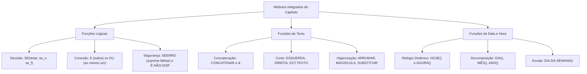

O processamento estruturado de informações no Microsoft Excel apoia-se em bibliotecas especializadas para tomada de decisão lógica, higienização de dados textuais e controle cronológico de eventos. Em concursos públicos, as bancas examinadoras valorizam a habilidade do candidato em interpretar fórmulas aninhadas, onde funções condicionais operam conjuntamente com manipuladores de texto e variáveis temporais.

Compreender o comportamento das tabelas-verdade sob as funções `SE`, `E`, `OU` e `NÃO`, dominar o tratamento preventivo de exceções com `SEERRO` e `É.NÃO.DISP`, e manipular fragmentos alfanuméricos com `ESQUERDA`, `DIREITA`, `ARRUMAR`, `SUBSTITUIR` e `PROCURAR` capacita o estudante a solucionar problemas complexos. Paralelamente, o manuseio exato de datas com `HOJE`, `AGORA`, `DIA`, `MÊS` e `ANO` garante precisão no cálculo de prazos processuais e escalas operacionais.

> [!objetivos]
> - Aplicar as funções lógicas booleanas `SE`, `E`, `OU` e `NÃO` na modelagem de regras operacionais condicionais.
> - Tratar exceções aritméticas e erros de busca com as funções `SEERRO` e `É.NÃO.DISP`.
> - Manipular cadeias textuais com `CONCATENAR`, `ESQUERDA`, `DIREITA`, `MAIÚSCULA`, `MINÚSCULA` e `ARRUMAR`.
> - Localizar e substituir padrões alfanuméricos com `PROCURAR` e `SUBSTITUIR`.
> - Extrair variáveis cronológicas dinâmicas utilizando `HOJE`, `AGORA`, `DIA`, `MÊS` e `ANO`.

---

## Funções Lógicas de Decisão: SE, E, OU, NÃO e SEERRO

As funções lógicas avaliam premissas relacionais que resultam em `VERDADEIRO` ou `FALSO`, orientando cálculos e decisões operacionais.

A função `SE(teste_lógico; [valor_se_verdadeiro]; [valor_se_falso])` examina uma proposição e adota bifurcação binária: se o teste for satisfeito, executa o segundo argumento; se for rejeitado, processa o terceiro argumento. Por exemplo, a fórmula `=SE(B2>=7; "Aprovado"; "Reprovado")` confere o resultado acadêmico imediato.

A função `E(lógico1; [lógico2]; ...)` opera como conjunção booleana estrita. Ela retorna `VERDADEIRO` unicamente se todos os testes contidos em seus argumentos forem concomitantemente verdadeiros. Basta a existência de um único teste falso para que o resultado final da função seja `FALSO`.

A função `OU(lógico1; [lógico2]; ...)` opera como disjunção lógica inclusiva. Ela retorna `VERDADEIRO` se pelo menos uma das condições avaliadas for satisfeita. A função `OU` somente devolverá `FALSO` caso todas as premissas testadas sejam simultaneamente falsas.

A função `NÃO(lógico)` inverte a polaridade lógica do teste: converte `VERDADEIRO` em `FALSO` e vice-versa. Por exemplo, a fórmula `=NÃO(5>2)` resulta em `FALSO`.

*Figura 1: Arquitetura de integração lógica entre operadores booleanos e a estrutura de decisão SE.*

A função `SEERRO(valor; valor_se_erro)` intercepta e neutraliza erros de execução da planilha. Quando uma fórmula resulta em códigos como `#DIV/0!`, `#N/D`, `#VALOR!`, `#REF!`, `#NOME?` ou `#NÚM!`, o `SEERRO` suprime a mensagem críptica do sistema e devolve uma saída customizada. A sintaxe `=SEERRO(A1/B1; 0)` divide A1 por B1; caso B1 contenha zero, o Excel evita a mensagem `#DIV/0!` e retorna o numeral 0.

A função `É.NÃO.DISP(valor)` atua como detector pontual do erro `#N/D` (valor não disponível), muito comum em buscas frustradas do `PROCV`. Ela retorna `VERDADEIRO` exclusivamente se o argumento avaliar para `#N/D`, retornando `FALSO` para quaisquer outros erros ou dados numéricos válidos.

| Função Lógica | Operação Central | Retorno VERDADEIRO | Retorno FALSO |
| :--- | :--- | :--- | :--- |
| `SE` | Bifurcação condicional binária | Quando o `teste_lógico` for cumprido | Quando o `teste_lógico` for rejeitado |
| `E` | Conjunção booleana estrita | Quando **todos** os testes forem verdadeiros | Se **ao menos um** teste for falso |
| `OU` | Disjunção inclusiva flexível | Se **ao menos um** teste for verdadeiro | Apenas quando **todos** forem falsos |
| `NÃO` | Negação lógica unária | Quando a premissa de entrada for falsa | Quando a premissa de entrada for verdadeira |
| `SEERRO` | Tratamento preventivo de falhas | Retorna o cálculo normal se não houver erro | Substitui qualquer erro por `valor_se_erro` |
| `É.NÃO.DISP` | Auditoria pontual de busca | Exclusivamente quando o resultado for `#N/D` | Para números, textos ou outros erros |

> [!pegadinha]
> Aninhamento de `E` e `OU` dentro do `SE`: em questões de concurso, as bancas testam a prioridade de avaliação. Em `=SE(OU(A1>10; E(B1="Sim"; C1<5)); "Apto"; "Inapto")`, avalia-se primeiro a conjunção interna `E`. Se B1 for "Sim" e C1 for 3, a conjunção interna vira `VERDADEIRO`, tornando a disjunção `OU` verdadeira, culminando na resposta "Apto", mesmo que A1 seja menor que 10.

> [!exemplo]
> Tratamento de divisão por zero: considere uma planilha de produtividade onde a coluna A liste o número de ocorrências e a coluna B informe as horas de plantão. Para calcular a taxa horária de atendimentos sem gerar erros em dias de folga, utiliza-se `=SEERRO(A2/B2; "Sem atividade")`. Caso a célula B2 contenha zero ou esteja em branco, a célula exibe amigavelmente o texto "Sem atividade".

> [!bizu]
> Regra de ouro da função `SE`: se o terceiro argumento (`valor_se_falso`) for omitido e o teste resultar em falso, a célula exibirá literalmente a palavra booleana `FALSO`. Caso se deseje deixar a célula visualmente limpa em caso de teste falso, deve-se declarar aspas duplas vazias: `=SE(A1>0; A1*2; "")`.

---

## Funções de Texto: Extração, Transformação e Higienização

Bancos de dados administrativos frequentemente contêm imperfeições de digitação. As funções textuais padronizam e recortam caracteres com precisão.

A junção de fragmentos alfanuméricos pode ser executada por meio da função `=CONCATENAR(texto1; [texto2]; ...)` ou pelo operador comercial de concatenação `&`. A expressão `="Oficial" & " " & "PM"` produz a cadeia unificada `"Oficial PM"`. No Excel moderno, a função `CONCAT` atua de forma ampliada, aceitando intervalos contínuos inteiros como `=CONCAT(A1:A5)`.

As funções de corte extraem subconjuntos específicos de caracteres:
- `=ESQUERDA(texto; [núm_caract])`: extrai caracteres a partir da borda esquerda inicial da string. Se `núm_caract` for omitido, extrai exatamente um caractere. Por exemplo, `=ESQUERDA("CFO-BM"; 3)` resulta em `"CFO"`.
- `=DIREITA(texto; [núm_caract])`: extrai caracteres a partir da borda direita final da string. Exemplo: `=DIREITA("2026-PE"; 2)` resulta em `"PE"`.
- `=EXT.TEXTO(texto; núm_inicial; núm_caract)`: recorta uma fatia no interior da cadeia, partindo da posição numérica `núm_inicial`.

*Figura 2: Fluxo sequencial de limpeza, padronização tipográfica e extração em cadeias de texto.*

> [!bizu]
> Posição e extensão com EXT.TEXTO: a função `=EXT.TEXTO(texto; núm_inicial; núm_caract)` exige três argumentos obrigatórios. Em `=EXT.TEXTO("PERNAMBUCO"; 4; 3)`, a contagem inicia na 4ª letra ("N") e captura 3 caracteres, retornando "NAM". Omitir qualquer parâmetro gera erro de sintaxe.

A padronização da caixa tipográfica conta com três funções fundamentais:
- `=MAIÚSCULA(texto)`: converte todas as letras da cadeia para caixa alta (`"recife"` vira `"RECIFE"`).
- `=MINÚSCULA(texto)`: converte todas as letras da cadeia para caixa baixa (`"BRASIL"` vira `"brasil"`).
- `=PRI.MAIÚSCULA(texto)`: converte em maiúscula a letra inicial de cada vocábulo e força as demais letras para minúsculas (`"corpo de bombeiros"` converte-se em `"Corpo De Bombeiros"`).

Para auditoria e higienização cadastral, destacam-se três ferramentas indispensáveis:
- A função `ARRUMAR(texto)` remove todos os espaços em branco excedentes de uma cadeia textual, eliminando espaços vazios no início, no final e espaçamentos múltiplos internos, preservando apenas um espaço simples entre as palavras.
- A função `PROCURAR(texto_procurado; no_texto; [núm_inicial])` localiza a posição numérica onde uma substring se inicia dentro de outra cadeia. Trata-se de uma função sensível a maiúsculas e minúsculas (*case-sensitive*).
- A função `SUBSTITUIR(texto; texto_antigo; novo_texto; [núm_da_ocorrência])` substitui um trecho textual por outro conteúdo determinado.

| Função de Texto | Finalidade Principal | Exemplo de Aplicação | Saída Resultante |
| :--- | :--- | :--- | :--- |
| `CONCATENAR` / `&` | Unir termos em uma cadeia única | `="Cadete " & "2026"` | `"Cadete 2026"` |
| `ESQUERDA` | Extrair caracteres da borda inicial | `=ESQUERDA("POLICIA"; 4)` | `"POLI"` |
| `DIREITA` | Extrair caracteres da borda final | `=DIREITA("MILITAR"; 3)` | `"TAR"` |
| `MAIÚSCULA` | Converter para caixa alta | `=MAIÚSCULA("bombeiro")` | `"BOMBEIRO"` |
| `MINÚSCULA` | Converter para caixa baixa | `=MINÚSCULA("PLANILHA")` | `"planilha"` |
| `PRI.MAIÚSCULA` | Capitalizar iniciais de palavras | `=PRI.MAIÚSCULA("joao silva")` | `"Joao Silva"` |
| `ARRUMAR` | Eliminar espaçamentos excedentes | `=ARRUMAR("  BM   PE  ")` | `"BM PE"` |
| `PROCURAR` | Localizar posição numérica de termo | `=PROCURAR("-"; "PE-2026")` | `3` |
| `SUBSTITUIR` | Trocar conteúdo por novo texto | `=SUBSTITUIR("2025"; "5"; "6")` | `"2026"` |

> [!bizu]
> `PROCURAR` versus `LOCALIZAR`: ambas as funções retornam a posição numérica de um caractere dentro do texto. Contudo, `PROCURAR` é estritamente sensível a maiúsculas e minúsculas (procurar `"A"` em `"recife"` não localiza). A função `LOCALIZAR`, por sua vez, ignora maiúsculas e minúsculas, aceitando caracteres curinga (`*` e `?`).

> [!exemplo]
> Higienização cadastral de nomes: ao importar dados de sistemas legados, o nome de um militar surge com espaços indesejados: `"  carlos   alberto  "`. A aplicação da fórmula `=PRI.MAIÚSCULA(ARRUMAR(A1))` processa inicialmente a eliminação dos espaços espúrios com `ARRUMAR`, gerando `"carlos alberto"`. Na sequência, `PRI.MAIÚSCULA` ajusta a tipografia, devolvendo o formato impecável `"Carlos Alberto"`.

> [!atencao]
> Comportamento numérico do `SUBSTITUIR`: a função `SUBSTITUIR` opera exclusivamente sobre cadeias textuais. Caso se aplique `=SUBSTITUIR("100.000"; "."; "")`, o resultado produzido será o texto `"100000"`, e não um número operável aritmeticamente de imediato, a menos que seja convertido por operador matemático.

---

## Funções de Data e Hora: Variáveis Temporais e Prazos

O Excel gerencia datas como números de série inteiros contínuos a partir de 1º de janeiro de 1900. Frações decimais representam horas (0,5 equivale a 12h).

As duas funções de carimbo temporal dinâmico do sistema são:
- A função `=HOJE()` retorna exclusivamente a data atual do computador (dia, mês e ano). Ela não aceita argumentos em seus parênteses e atualiza seu conteúdo sempre que a planilha é recalculada ou reaberta.
- A função `=AGORA()` retorna a data atual combinada com o horário corrente com resolução de horas, minutos e segundos. Seus parênteses também permanecem sempre vazios.

*Figura 3: Desdobramento e extração de parâmetros temporais a partir de números de série.*

> [!atencao]
> Subtração direta de datas: no Excel, cada dia corresponde ao número inteiro 1. Subtrair uma data anterior de uma data posterior (`=B2 - B1`) calcula diretamente a quantidade exata de dias corridos entre os dois eventos, dispensando fórmulas adicionais.

Para decomposição de datas em seus componentes elementares, utilizam-se funções de fracionamento numérico:
- `=DIA(data)`: extrai o dia do mês, retornando um número inteiro de 1 a 31.
- `=MÊS(data)`: extrai o mês da data informada, retornando um inteiro compreendido entre 1 e 12.
- `=ANO(data)`: extrai o ano correspondente, representado por quatro dígitos (por exemplo, 2026).
- `=DIA.DA.SEMANA(data; [retornar_tipo])`: retorna um código numérico representativo do dia da semana. No padrão omitido (tipo 1), o domingo vale 1, a segunda-feira vale 2, até o sábado, que vale 7.

| Função Temporal | Tipo de Retorno | Argumentos Exigidos | Aplicação Típica em Provas |
| :--- | :--- | :--- | :--- |
| `HOJE` | Data atual do sistema | Nenhum parêntese preenchido (`=HOJE()`) | Cálculo de tempo decorrido de serviço |
| `AGORA` | Data e horário correntes | Nenhum parêntese preenchido (`=AGORA()`) | Registro exato de entrada e saída |
| `DIA` | Inteiro de 1 a 31 | Data válida | Isolar o dia de um vencimento legal |
| `MÊS` | Inteiro de 1 a 12 | Data válida | Agrupamento mensal de ocorrências |
| `ANO` | Inteiro de 4 dígitos | Data válida | Apuração de exercício orçamentário |
| `DIA.DA.SEMANA` | Inteiro de 1 a 7 | Data válida e tipo opcional | Identificação de escalas em finais de semana |

> [!pegadinha]
> Diferença crítica entre `HOJE()` e `AGORA()`: ambas são funções voláteis que se atualizam automaticamente. Contudo, em questões de prova sobre formatação, `=HOJE()` armazena internamente um número inteiro puro (exemplo: 46327). Já `=AGORA()` armazena um número decimal com fração horária (exemplo: 46327,625). Ao subtrair duas datas calculadas por `AGORA()`, o resultado pode conter resíduos fracionários indesejados.

> [!exemplo]
> Extração combinada de elementos de data: considere que a célula B5 abrigue a data `"25/12/2026"`. A fórmula `=ANO(B5) - DIA(B5)` processa inicialmente `ANO(B5)`, que resulta no número 2026. Em seguida, processa `DIA(B5)`, que resulta em 25. A subtração aritmética subsequente `2026 - 25` entrega como resultado final o valor numérico 2001.

---

## Mapa do Capítulo

O diagrama abaixo sintetiza a integração prática entre as funções lógicas de decisão, ferramentas de manipulação de texto e variáveis temporais:

*Figura 4: Mapa conceitual da integração entre raciocínio lógico, engenharia de texto e cronologia no Excel.*

---

### Para fixar

1. **Função `SE`**: implementa bifurcação lógica binária entre verdadeiro e falso a partir de um teste condicional.
2. **Conjunção estrita `E`**: exige que 100% dos testes sejam verdadeiros para produzir retorno verdadeiro.
3. **Disjunção flexível `OU`**: basta um único teste verdadeiro entre os argumentos para retornar verdadeiro.
4. **Negação com `NÃO`**: inverte a polaridade lógica da premissa booleana testada.
5. **Prevenção com `SEERRO`**: intercepta qualquer falha operacional na célula e entrega um resultado alternativo programado.
6. **Detector `É.NÃO.DISP`**: função lógica informativa especializada em auditar especificamente o erro de busca `#N/D`.
7. **Corte com `ESQUERDA` e `DIREITA`**: extraem fatias de caracteres a partir da borda inicial ou terminal da cadeia textual.
8. **Higienização com `ARRUMAR`**: elimina espaços duplos e resíduos vazios laterais, mantendo apenas espaços simples entre termos.
9. **Diferença entre `HOJE` e `AGORA`**: `HOJE()` extrai apenas a data presente; `AGORA()` agrega a data e a fração do horário corrente.
10. **Decomposição temporal**: as funções `DIA()`, `MÊS()` e `ANO()` extraem isoladamente as partes integrantes de uma data de referência.
