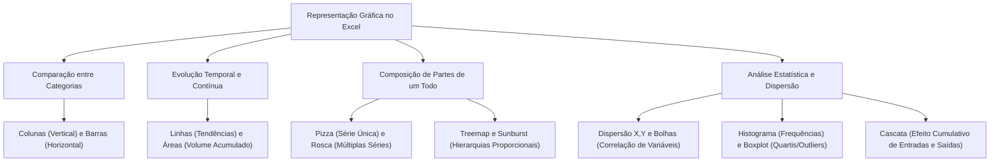
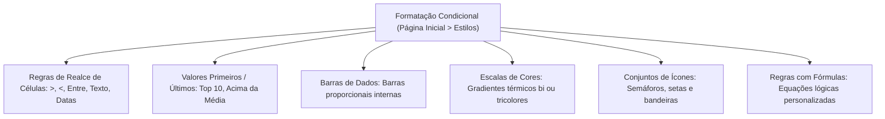
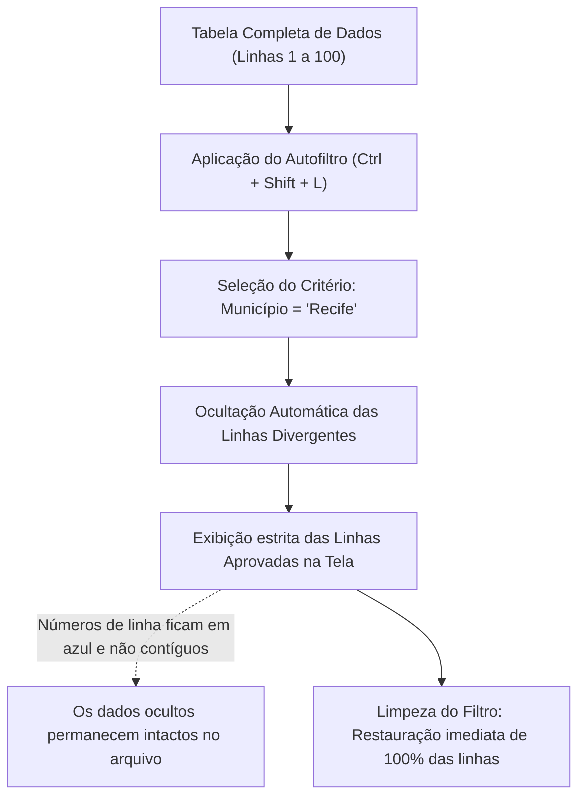
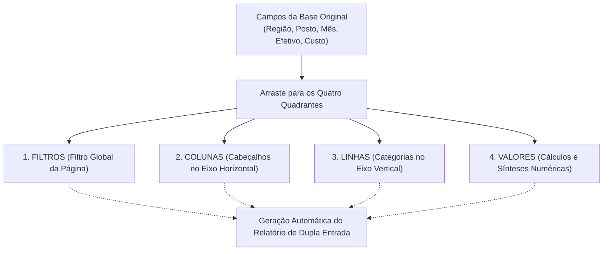
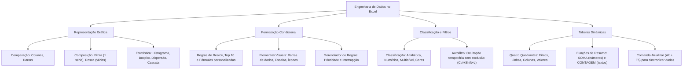

A interpretação visual de indicadores, a sinalização condicional de anomalias e a manipulação dinâmica de extensos volumes de dados representam competências essenciais no Microsoft Excel e no Microsoft 365. Em órgãos de segurança pública e secretarias de planejamento, tabelas puras com centenas de registros tornam-se ineficazes se o operador não souber traduzir números em representações geométricas elucidativas ou segmentar bancos de dados por critérios instantâneos.

Nas provas de concurso da banca examinadora, os examinadores cobram a taxonomia completa dos tipos de gráficos nativos, a hierarquia de prioridades das regras de formatação condicional e as sutilezas operacionais de classificação e filtragem de registros. O candidato precisa compreender a finalidade de cada gráfico estatístico, o comportamento das barras de dados e escalas de cor, bem como a arquitetura em quadrantes das tabelas dinâmicas, identificando com precisão as alternativas tecnicamente corretas.

> [!objetivos]
> - Compreender a taxonomia e as aplicações dos gráficos nativos no Excel.
> - Dominar as regras de formatação condicional por realces, barras, escalas, ícones e fórmulas.
> - Aplicar a classificação multinível e o recurso de Autofiltro com ocultação temporária.
> - Estruturar relatórios consolidados utilizando os quatro quadrantes das Tabelas Dinâmicas.

---

## Representação Gráfica no Excel: Taxonomia e Aplicações Práticas

Os gráficos constituem ferramentas visuais que convertem sequências numéricas bidimensionais em elementos geométricos expressivos, permitindo identificar padrões, tendências históricas e assimetrias de forma imediata. No Excel, os gráficos são criados selecionando-se os dados de interesse e acionando a guia Inserir no grupo Gráficos.

O ecossistema do Excel oferece mais de 15 tipos nativos de gráficos, cada qual concebido para uma finalidade estatística e comunicativa específica:

1. **Gráficos de Colunas e Barras**: confrontam valores quantitativos discretos entre categorias independentes. No gráfico de colunas, os dados projetam-se verticalmente no eixo Y. Eles são ideais para comparar departamentos, unidades operacionais ou períodos cronológicos curtos. No gráfico de barras, a projeção é horizontal. Isso facilita a legibilidade quando os rótulos das categorias possuem nomes extensos.
2. **Gráficos de Linhas e Áreas**: retratam a evolução contínua de grandezas ao longo de uma escala temporal ordenada (dias, meses, anos). O gráfico de linhas conecta pontos sucessivos; o gráfico de áreas colore a região situada abaixo da linha. Isso enfatiza o volume acumulado da magnitude.
3. **Gráficos de Pizza e Rosca**: expressam a participação proporcional de partes componentes em relação a um todo consolidado correspondente a 100%. O gráfico de pizza aceita rigorosamente uma única série de dados numéricos. Por sua vez, o gráfico de rosca possui abertura central. Ele aceita múltiplas séries em anéis concêntricos.
4. **Gráficos de Dispersão (X, Y) e Bolhas**: correlacionam duas variáveis numéricas contínuas independentes sem linhas conectivas forçadas. Essa análise avalia padrões estatísticos. O gráfico de bolhas agrega uma terceira variável quantitativa, representada proporcionalmente pelo diâmetro físico da bolha plotada na interseção das coordenadas cartesianas.
5. **Gráficos Estatísticos Especializados**:
   - *Histograma*: agrupa variáveis contínuas em faixas de distribuição de frequência (compartimentos ou *bins*). Isso ilustra a simetria da distribuição.
   - *Caixa Estreita (Boxplot)*: mapeia a dispersão de um conjunto numérico, evidenciando graficamente a mediana, o primeiro e o terceiro quartis e identificando valores atípicos discrepantes (*outliers*).
   - *Cascata (Waterfall)*: demonstra o efeito cumulativo de valores positivos adicionados e valores negativos subtraídos sobre um saldo inicial até atingir o total final. Esse formato é muito aplicado no setor financeiro.
   - *Treemap (Mapa de Árvore)* e *Explosão Solar (Sunburst)*: exibem dados hierárquicos e ramificações organizacionais por meio de retângulos proporcionais ou anéis divididos em setores.
   - *Radar*: plota valores de múltiplas categorias em coordenadas polares que irradiam a partir de um ponto central comum.

*Figura 1: Classificação taxonômica das tipologias de gráficos conforme o propósito analítico.*

Os gráficos no Excel mantêm vinculação bidirecional dinâmica com as células de origem: qualquer alteração de valor, inclusão de linha ou exclusão de registro na tabela base reflete-se instantaneamente na geometria do gráfico. Além disso, elementos estruturais como títulos, rótulos de dados, linhas de grade, legendas e eixos cartesianos podem ser individualmente formatados, redimensionados ou suprimidos por meio das guias contextuais Design do Gráfico e Formatar.

| Tipo de Gráfico | Orientação Estrutural | Finalidade Principal | Limitação / Exigência Crítica |
| :--- | :--- | :--- | :--- |
| **Colunas** | Barras verticais | Comparar valores entre categorias | Rótulos longos podem sobrepor-se |
| **Barras** | Barras horizontais | Comparar categorias com nomes longos | Inverte a leitura visual tradicional |
| **Linhas** | Pontos conectados por retas | Identificar tendências cronológicas | Exige ordenação temporal contínua |
| **Pizza** | Círculo dividido em fatias | Proporção de partes perante o todo | Restrito a **uma** série; valores positivos |
| **Rosca** | Anel com abertura central | Proporção de partes em anéis concêntricos | Permite mais de uma série simultânea |
| **Dispersão (X, Y)** | Pontos isolados em grade | Correlacionar duas variáveis contínuas | Eixo X deve conter valores numéricos |
| **Histograma** | Colunas contíguas de frequência | Analisar distribuição estatística | Agrupa valores em faixas automáticas |
| **Boxplot** | Diagrama de caixa com hastes | Mapear quartis, mediana e outliers | Exige amostras com dispersão suficiente |
| **Cascata** | Colunas flutuantes com totais | Demonstrar impacto de receitas e perdas | Ideal para conciliações financeiras |

> [!pegadinha]
> A restrição unissérie do gráfico de pizza: a banca examinadora formula itens alegando ser possível comparar o desempenho financeiro de três anos consecutivos em um único gráfico de pizza tradicional. Isso é falso. O gráfico de pizza aceita exclusivamente uma única série de dados numéricos. Para comparar mais de uma série em formato circular concêntrico, o Excel exige o gráfico de rosca.

> [!bizu]
> Gráficos dinâmicos versus estáticos: um gráfico comum gerado a partir de uma tabela comum requer ajuste manual de intervalo quando novas linhas são inseridas fora da área de seleção. Se a base for convertida em Tabela oficial do Excel (`Ctrl + Alt + T` ou `Ctrl + T`) ou se o gráfico for gerado a partir de uma Tabela Dinâmica (Gráfico Dinâmico), ele passa a expandir-se automaticamente e ganha botões de filtragem interativa integrados ao próprio desenho.

---

## Mecanismos de Formatação Condicional no Excel

A **Formatação Condicional** é a ferramenta do Excel destinada a alterar dinamicamente a formatação visual das células (como cor de preenchimento de fundo, cor e estilo da fonte, bordas e ícones gráficos) em resposta direta aos dados registrados ou ao resultado de equações lógicas. O recurso localiza-se na guia Página Inicial, no grupo Estilos.

As regras de formatação dividem-se em quatro categorias fundamentais:

1. **Regras de Realce de Células e Valores Superiores/Inferiores**:
   - Permitem aplicar formatações imediatas baseadas em comparações relacionais: valores maiores que determinado patamar, menores que um piso, valores contidos em um intervalo fechado, datas ocorridas na última semana ou células contendo textos específicos (como colorir de vermelho termos contendo "Inapto" ou "Vencido").
   - A opção de valores superiores/inferiores permite realçar os 10 maiores itens, os 10% superiores, os 10 menores valores ou registros situados acima ou abaixo da média aritmética automática do intervalo.
2. **Barras de Dados**:
   - Desenham barras horizontais preenchidas diretamente no interior da própria célula. O comprimento gráfico da barra reflete a magnitude proporcional daquele número em relação ao maior e ao menor valor do intervalo selecionado. As barras podem adotar preenchimento sólido ou gradiente suave. Isso auxilia na comparação rápida de grandezas na grade.
3. **Escalas de Cores**:
   - Aplicam gradientes térmicos contínuos bicolores ou tricolores às células. O modelo tricolor mais frequente distribui cores de forma proporcional: tons de verde para os maiores valores da distribuição, tons de amarelo para os valores intermediários da mediana e tons de vermelho para os valores mais baixos da amostra.
4. **Conjuntos de Ícones**:
   - Classificam e distribuem símbolos gráficos (como semáforos tricolores, setas direcionais de tendência, bandeiras de alerta ou estrelas de avaliação) ao lado dos números. O sistema segmenta o conjunto em faixas percentuais configuráveis. (por exemplo, atribuir seta verde para o terço superior, seta amarela para a faixa intermediária e seta vermelha para o terço inferior).

*Figura 2: Modalidades operacionais de formatação condicional disponíveis no Excel.*

Para cenários analíticos avançados que extrapolam os modelos pré-configurados, o Excel oferece a opção **Usar uma fórmula para determinar quais células devem ser formatadas**. Esse mecanismo permite construir testes lógicos personalizados que iniciam com o sinal de igual (`=`) e devolvem valor booleano verdadeiro ou falso.

A grande força da formatação por fórmula reside na possibilidade de colorir uma célula com base no valor armazenado em coordenadas totalmente diferentes. Por exemplo, para formatar a linha inteira de uma tabela de ocorrências caso a coluna D registre o status "Crítico", seleciona-se o intervalo de A2 até E100 e aplica-se a fórmula `=$D2="Crítico"`. O cifrão fixando a coluna D assegura que todas as colunas daquela linha avaliem a mesma célula de referência.

Todas as regras ativas na planilha são administradas por meio do **Gerenciador de Regras de Formatação Condicional** (Página Inicial > Estilos > Formatação Condicional > Gerenciar Regras). Esse painel possibilita criar, editar parâmetros numéricos, excluir estilos defasados e ajustar a **ordem hierárquica de prioridade**. Quando duas ou mais regras concorrentes incidem sobre a mesma célula, o Excel aplica a regra posicionada mais ao topo da lista de precedência, permitindo marcar a opção *Interromper se Verdadeiro* para suspender a execução de estilos subsequentes.

| Mecanismo de Formatação | Elemento Visual Modificado | Critério de Disparo | Exemplo Prático |
| :--- | :--- | :--- | :--- |
| **Realce de Células** | Fundo, fonte ou borda | Teste relacional direto | Destacar em vermelho valores `< 0` |
| **Top / Bottom** | Formatação visual completa | Posição ordinal percentual | Realçar os 5% maiores valores |
| **Barras de Dados** | Barra horizontal na célula | Magnitude proporcional relativa | Comparar produtividade de viaturas |
| **Escalas de Cores** | Matiz térmico gradiente | Posição no espectro contínuo | Verde para altas notas, vermelho para baixas |
| **Conjuntos de Ícones** | Símbolo gráfico ao lado do dado | Enquadramento em percentis | Semáforo: verde `>=67%`, amarelo `>=33%` |
| **Fórmula Personalizada** | Qualquer estilo configurado | Expressão lógica com retorno booleano | `=$C2="Urgente"` formata a linha inteira |

> [!bizu]
> Referências relativas e absolutas em fórmulas de formatação: se você selecionar o bloco A2:D10 e desejar colorir a linha inteira quando a coluna B for maior que 100, a fórmula deve ser `=$B2>100`. O cifrão antes do B é estritamente obrigatório para travar a coluna de teste enquanto a regra varre as colunas A, B, C e D da mesma linha 2. A ausência do cifrão faz a referência deslocar-se, desconfigurando a pintura da tabela.

> [!atencao]
> Conflito de regras e o Gerenciador de Regras: quando uma célula atende simultaneamente a duas regras ativas (por exemplo, "maior que 50 pinta de azul" e "maior que 80 pinta de verde"), a cor que prevalecerá na tela será aquela definida pela regra posicionada mais acima na lista de prioridades do Gerenciador de Regras. Caso a opção *Interromper se Verdadeiro* esteja desmarcada, propriedades não conflitantes (como cor de fonte de uma regra e cor de fundo de outra) podem acumular-se sobre a célula.

---

## Classificação de Dados e o Mecanismo de Autofiltro

A organização sistemática da grade de células viabiliza a localização célere de subconjuntos de dados sem exigir manipulações braçais exaustivas. O Excel fornece duas ferramentas de organização complementar: a classificação e a filtragem.

A **Classificação** reordena a disposição física das linhas da tabela segundo a grandeza ou atributo das colunas selecionadas. O recurso opera em modalidades bem definidas:
- **Classificação por Conteúdo**: ordena dados textuais em ordem alfabética (de A a Z ou de Z a A), dados numéricos em escala crescente (do menor para o maior) ou decrescente, e datas ou horários em ordem cronológica (do mais antigo para o mais novo ou vice-versa).
- **Classificação Multinível**: permite fixar critérios hierárquicos em cascata por meio da caixa de diálogo Classificar (guia Dados > grupo Classificar e Filtrar). Por exemplo, ordenar primeiramente pelo Batalhão (nível primário em ordem alfabética); para militares do mesmo batalhão, desempatar pelo Posto ou Graduação (nível secundário); e, persistindo a igualdade, ordenar pelo Tempo de Serviço (nível terciário numérico decrescente).
- **Classificação por Atributos Visuais**: ordena linhas baseando-se na cor de preenchimento da célula, na cor da fonte aplicada ou no conjunto de ícones decorrente de formatação condicional, posicionando os itens destacados no topo ou na base da planilha.
- **Classificação por Listas Personalizadas**: permite ordenar termos que não seguem a ordem alfabética natural, como os meses do ano ("Janeiro", "Fevereiro", "Março"...), dias da semana ou categorias hierárquicas como "Pequeno", "Médio" e "Grande".

O recurso de **Filtro** (Autofiltro), acionado pela guia Dados ou pelo atalho universal de teclado `Ctrl + Shift + L`, insere pequenas setas suspensas de menu nos cabeçalhos de cada coluna da tabela. Ao clicar na seta, o usuário pode selecionar valores pontuais por caixas de seleção, aplicar filtros de texto (como "contém", "começa com", "termina com"), filtros numéricos ("maior que", "está entre", "dez primeiros") ou filtros por cor.

*Figura 3: Ciclo operacional de filtragem e ocultação reversível na planilha do Excel.*

| Recurso | Atalho / Caminho | Ação Executada na Grade | Impacto na Estrutura dos Dados |
| :--- | :--- | :--- | :--- |
| **Classificar Simples** | Dados > A-Z / Z-A | Reordena a posição das linhas | Modifica a sequência física original das linhas |
| **Classificar Avançado** | Dados > Classificar | Aplica múltiplos níveis hierárquicos | Permite múltiplos critérios e listas personalizadas |
| **Autofiltro** | `Ctrl + Shift + L` | Exibe apenas registros selecionados | **Oculta temporariamente** as linhas divergentes |
| **Limpar Filtro** | Dados > Limpar | Restaura a visibilidade completa | Reexibe as linhas ocultadas sem perdas |

> [!pegadinha]
> A pegadinha clássica sobre a exclusão de dados no filtro: as bancas examinadoras de vários concursos públicos afirmam repetidamente que a aplicação de um filtro "exclui definitivamente as linhas que não cumprem o critério", "apaga os dados não selecionados para economizar memória" ou "impede a digitação de novos dados". Todas essas afirmações são completamente falsas. O filtro **nunca exclui** registros; ele simplesmente **oculta temporariamente** as linhas que não satisfazem o critério da visualização na tela. A numeração das linhas na lateral esquerda passa a exibir números não contíguos grafados em azul (por exemplo, pulando da linha 4 direto para a linha 9), evidenciando que as linhas intermediárias continuam existindo e reaparecerão intactas ao se limpar o filtro.

> [!bizu]
> Filtro versus Validação de Dados: não confunda a função do Filtro com a Validação de Dados. O Filtro seleciona quais linhas já existentes na planilha serão visualizadas na tela. A Validação de Dados (guia Dados > grupo Ferramentas de Dados) restringe e controla o que o usuário tem permissão de digitar nas células, exibindo listas suspensas de preenchimento para impedir entradas incorretas.

---

## Estrutura e Operação das Tabelas Dinâmicas

A **Tabela Dinâmica** (*PivotTable*) é a ferramenta analítica mais sofisticada e poderosa do Microsoft Excel para sintetizar, cruzar, agrupar e explorar grandes bases de dados sem a necessidade de escrever fórmulas matemáticas complexas. Ela converte listagens extensas em tabelas de dupla entrada claras e interativas.

Para que uma Tabela Dinâmica funcione com perfeição técnica, a base de dados de origem deve atender a três requisitos estruturais indispensáveis:
1. Deve estar estruturada como uma tabela retangular homogênea, sem linhas ou colunas totalmente vazias no meio da área útil.
2. Cada coluna deve possuir um cabeçalho único e textual na primeira linha superior.
3. Cada coluna deve conter estritamente o mesmo tipo de dado em todas as suas linhas (não misturar valores textuais e datas na mesma coluna).

A criação de uma Tabela Dinâmica dá-se pela guia Inserir no grupo Tabelas, selecionando a opção Tabela Dinâmica. Ao acionar o comando, o Excel abre o painel lateral **Campos da Tabela Dinâmica**, que lista todos os cabeçalhos da base original e disponibiliza quatro quadrantes funcionais fundamentais para arrastar e soltar os campos:

*Figura 4: Arquitetura dos quadrantes de processamento e consolidação da Tabela Dinâmica.*

A função de cada quadrante estrutural é rigorosamente delineada:
1. **Filtros (Filtro de Relatório)**: posiciona-se no topo da tabela gerada. Isso permite filtrar a análise por um critério global. (por exemplo, filtrar todo o relatório para exibir exclusivamente os dados do "Ano 2026").
2. **Linhas**: define os campos cujos valores únicos serão listados verticalmente, linha por linha, na lateral esquerda da tabela (por exemplo, dispor os nomes dos "Batalhões").
3. **Colunas**: define os campos que estruturarão os cabeçalhos horizontais das colunas da tabela dinâmica (por exemplo, dispor os "Trimestres").
4. **Valores**: quadrante onde se depositam as variáveis que sofrerão consolidação numérica e cálculos agregados na interseção de cada linha com cada coluna.

Por padrão do sistema, ao arrastar um campo para o quadrante **Valores**, o Excel adota automaticamente a função de consolidação **SOMA** caso o campo contenha dados estritamente numéricos. Caso o campo arrastado contenha células de texto ou dados alfanuméricos, o Excel aplica automaticamente a função **CONTAGEM**.

Por meio da janela **Configurações do Campo de Valor**, o usuário tem total liberdade para comutar o cálculo padrão de SOMA para diversas outras operações estatísticas:
- `Média`: calcula a média aritmética dos registros agrupados.
- `Contagem`: apura o número total de ocorrências.
- `Mínimo` e `Máximo`: identifica os extremos daquele agrupamento.
- `Produto`: calcula a multiplicação cumulativa dos valores.
- `Desvio-Padrão` e `Variância`: mensura a dispersão estatística da amostra.
- Guia **Mostrar Valores Como**: exibe os números calculados em formato de porcentagens do total geral, porcentagens da linha ou porcentagens da coluna.

Além disso, a Tabela Dinâmica permite o agrupamento cronológico automático de datas (agrupando dias em meses, trimestres e anos com um clique direito), inserção de subtotais e totais gerais configuráveis, e aceita a aplicação direta de regras de Formatação Condicional no interior de suas células consolidadas.

| Quadrante | Posição no Relatório | Função Analítica | Padrão Automático |
| :--- | :--- | :--- | :--- |
| **Filtros** | Topo da tabela | Filtragem global da amostra examinada | Exibe "(Tudo)" |
| **Linhas** | Eixo vertical esquerdo | Agrupamento de categorias em linhas | Lista valores distintos |
| **Colunas** | Eixo horizontal superior | Distribuição de categorias em colunas | Lista valores distintos |
| **Valores** | Miolo / Interseções | Realização de cálculos matemáticos e resumos | **SOMA** para números; **CONTAGEM** para textos |

> [!exemplo]
> Montagem de relatório de ocorrências policiais: considere uma base bruta com 10.000 linhas contendo as colunas Município, Batalhão, Tipo de Delito e Ocorrências. Ao arrastar Batalhão para Linhas, Tipo de Delito para Colunas e Ocorrências para Valores, o Excel monta instantaneamente uma matriz perfeita que exibe a soma exata de ocorrências de cada delito por batalhão, incluindo totais gerais por linha e por coluna, sem a redação de nenhuma fórmula manual.

> [!bizu]
> Atualização de Tabelas Dinâmicas: diferente das fórmulas comuns como `SOMA`, que se recalculam de forma automática instantânea quando um número da planilha é alterado, as Tabelas Dinâmicas não atualizam seus valores na tela automaticamente por padrão. Se você alterar um número na base de dados original, deve clicar com o botão direito sobre a Tabela Dinâmica e selecionar o comando **Atualizar** (ou pressionar o atalho `Alt + F5`).

---

## Mapa do Capítulo

O fluxograma integrado abaixo sintetiza os componentes fundamentais de visualização, formatação condicional, organização tabular e análise dinâmica no Microsoft Excel:

*Figura 5: Mapa estrutural integrando gráficos, estilos condicionais, filtros e relatórios dinâmicos.*

---

### Para fixar

1. **Taxonomia dos gráficos**: colunas comparam categorias na vertical; barras comparam na horizontal; linhas evidenciam tendências temporais contínuas.
2. **Restrição da pizza**: o gráfico de pizza aceita rigorosamente uma única série numérica; comparações concêntricas de múltiplas séries utilizam o gráfico de rosca.
3. **Gráficos estatísticos**: o histograma agrupa dados em classes de frequência; o boxplot mapeia medianas, quartis e outliers; o cascata ilustra adições e subtrações cumulativas.
4. **Formatação condicional**: altera cores de fundo, fontes e bordas automaticamente com base em testes relacionais, barras de dados proporcionais, escalas térmicas e ícones.
5. **Formatação com fórmulas**: equações lógicas personalizadas iniciadas por `=` permitem formatar células com base nos valores contidos em colunas vizinhas (usando `$`).
6. **Gerenciador de regras**: administra a prioridade de execução das regras de formatação condicional, permitindo ordenar precedências e marcar *Interromper se Verdadeiro*.
7. **Classificação multinível**: permite ordenar tabelas por múltiplos níveis sucessivos de desempate, além de classificar por cores de célula e listas personalizadas.
8. **Mecanismo do Autofiltro**: oculta temporariamente da visualização as linhas que não cumprem o critério sem jamais excluir os dados do arquivo (`Ctrl + Shift + L`).
9. **Quadrantes da Tabela Dinâmica**: estrutura variáveis em quatro áreas: Filtros (escopo global), Linhas (eixo vertical), Colunas (eixo horizontal) e Valores (cálculo de síntese).
10. **Padrão em Valores**: adota automaticamente a função `SOMA` para campos numéricos e `CONTAGEM` para campos de texto, exigindo o comando `Atualizar` (`Alt + F5`) para refletir alterações da base.
