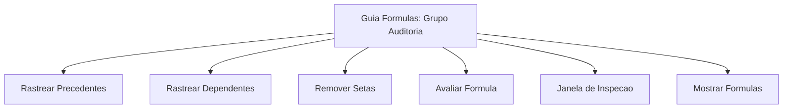
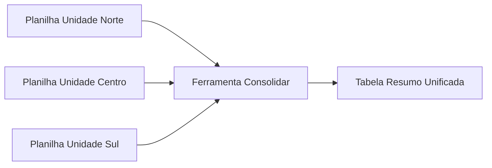
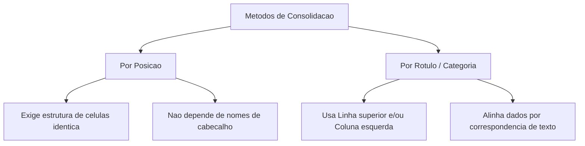
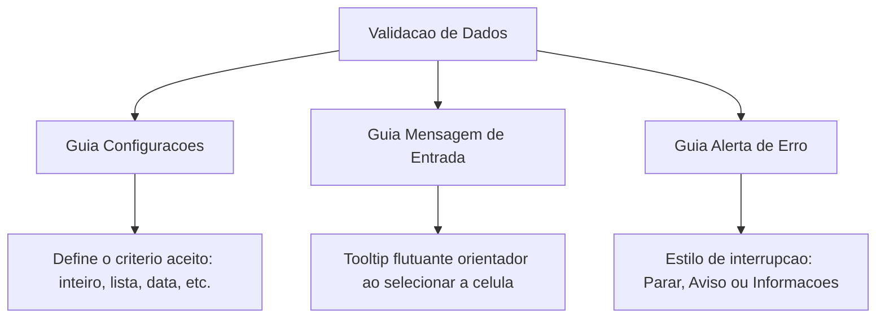
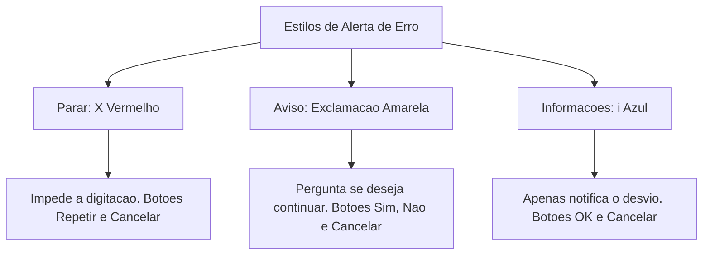

A gestão de dados em planilhas eletrônicas corporativas e governamentais exige mecanismos rigorosos de controle. Em ambientes operacionais e de inteligência, como nos centros de comando do Corpo de Bombeiros Militar e da Polícia Civil, erros numéricos podem comprometer relatórios estatísticos e planos orçamentários.

Por essa razão, o Microsoft Excel disponibiliza ferramentas avançadas para inspecionar cálculos, garantir a integridade da entrada de dados e modelar fluxos financeiros.

Neste capítulo, estudaremos a auditoria visual de fórmulas, a consolidação de informações em matrizes multifolhas, as regras de validação de células com seus alertas de severidade e as funções fundamentais de matemática financeira.

> [!objetivos]
> - Rastrear precedentes e dependentes em planilhas eletrônicas utilizando recursos gráficos de auditoria.
> - Consolidar dados dispersos entre diferentes matrizes, compreendendo os impactos de vínculos dinâmicos.
> - Configurar regras de validação de dados e distinguir o comportamento dos estilos de alerta de erro.
> - Aplicar as funções financeiras de valor futuro (VF) e valor presente (VP), respeitando a convenção de sinais.

---

## Auditoria de Fórmulas

À medida que uma pasta de trabalho cresce em complexidade, torna-se difícil identificar a origem exata de um valor ou medir o impacto de uma alteração em células periféricas. 

Para solucionar essa demanda, a guia **Fórmulas** do Microsoft Excel oferece o grupo **Auditoria de Fórmulas**. Esse conjunto de ferramentas disponibiliza diagnóstico visual, inspeção passo a passo e monitoramento contínuo.

### Rastrear Precedentes

O comando **Rastrear Precedentes** permite visualizar quais células fornecem informações diretamente para a célula selecionada. Ao acionar essa função, o Excel desenha vetores gráficos (setas azuis com uma pequena esfera na origem e uma ponta de seta na célula destino).

- **Células locais na mesma planilha**: o software exibe setas azuis contínuas apontando diretamente das células de entrada para a fórmula ativa.
- **Células em outras planilhas ou pastas de trabalho externas**: o Excel desenha uma linha tracejada preta conectada a um ícone estilizado de planilha eletrônica. Dê um clique duplo sobre a linha tracejada para abrir a caixa de diálogo "Ir Para", facilitando a navegação até o endereço externo.
- **Chamadas sucessivas**: cada clique subsequente no botão Rastrear Precedentes expande a análise em um nível precedente adicional na cadeia de cálculo.

> [!bizu]
> Guarde a regra prática para a prova: os **precedentes alimentam** a célula examinada. A seta nasce na célula fornecedora de dado e aponta diretamente para a fórmula que realiza o cálculo.

### Rastrear Dependentes

O comando **Rastrear Dependentes** executa o movimento inverso. Ele responde à seguinte pergunta: se o operador alterar o valor desta célula agora, quais fórmulas da planilha sofrerão impacto direto ou indireto?

- Ao clicar sobre uma célula com dado e acionar o botão, setas azuis partem da célula ativa em direção a todas as outras células que a utilizam como argumento de cálculo.
- Cliques sucessivos revelam os níveis de dependência indireta de segundo e terceiro graus.

### Remoção de Setas Gráficas

As setas de auditoria constituem camadas gráficas temporárias que sobrepõem as células. Elas não alteram valores, formatos ou fórmulas. 

Para limpá-las da interface, o operador utiliza o botão **Remover Setas**. O menu suspenso desse comando oferece três opções específicas:

1. **Remover Setas**: apaga todas as representações vetoriais presentes na planilha.
2. **Remover Setas Precedentes**: elimina somente as setas de precedência de um nível por clique.
3. **Remover Setas Dependentes**: elimina somente as setas de dependência de um nível por clique.

| Comando de Auditoria | Ação Visual Realizada | Sentido do Vetor |
|---|---|---|
| Rastrear Precedentes | Identifica as células que alimentam o cálculo | Da fonte de dados para a célula ativa |
| Rastrear Dependentes | Identifica as fórmulas que dependem da célula ativa | Da célula ativa para as fórmulas consumidoras |
| Remover Setas | Limpa as sobreposições gráficas da tela | Não possui sentido vetorial (exclusão) |
| Mostrar Fórmulas | Substitui resultados numéricos pelos textos das fórmulas | Alternância de modo em toda a planilha |
| Avaliar Fórmula | Abre caixa de diálogo para cálculo subexpressão a subexpressão | Execução incremental passo a passo |
| Janela de Inspeção | Painel fixo para monitorar células críticas de qualquer aba | Monitoramento desacoplado em tempo real |

### Avaliar Fórmula e Janela de Inspeção

O recurso **Avaliar Fórmula** atua como um depurador analítico. Ao clicar nesse botão, uma janela exibe a expressão completa da célula selecionada. 

A primeira subexpressão a ser calculada surge sublinhada. Ao pressionar o botão **Avaliar**, o Excel substitui o trecho sublinhado pelo seu resultado intermediário e avança para a próxima etapa lógica. Essa ferramenta é essencial para desvendar a causa de erros de cálculo complexos em fórmulas aninhadas.

A **Janela de Inspeção** permite adicionar células estratégicas de qualquer aba ou arquivo aberto a uma lista de observação permanente. Mesmo navegando em abas distantes, o usuário acompanha atualizações em tempo real no valor, na fórmula e no endereço da célula monitorada.

> [!exemplo]
> Suponha que a célula `D10` possua a fórmula `=SE(SOMA(A1:A5)>100; B1*2; C1/2)`. O recurso Avaliar Fórmula exibirá primeiro o sublinhado em `SOMA(A1:A5)`. Ao clicar em Avaliar, esse trecho torna-se um valor numérico (por exemplo, `120`). A expressão passa a exibir `=SE(120>100; B1*2; C1/2)`. O próximo passo avalia o teste lógico para `VERDADEIRO`, direcionando a execução final exclusivamente para `B1*2`.

---

## Consolidação de Dados

Em muitas organizações, cada unidade operacional alimenta sua própria planilha de controle mensal. No fim do ciclo, a administração central precisa consolidar esses números dispersos em um relatório unificado.

O Microsoft Excel disponibiliza para essa tarefa a ferramenta **Consolidar**, localizada na guia **Dados**, grupo **Ferramentas de Dados**.

### Funções Matemáticas de Consolidação

Embora a soma seja o procedimento padrão, a caixa de diálogo Consolidar permite aplicar diferentes operações matemáticas sobre as matrizes de entrada:

- **Soma**: totaliza os valores numéricos correspondentes de todas as referências.
- **Média**: apura a média aritmética dos valores mapeados.
- **Contagem**: contabiliza a quantidade de entradas numéricas inseridas.
- **Máximo e Mínimo**: extrai o maior ou o menor valor entre os intervalos combinados.
- **Produto**: multiplica os valores coincidentes.
- **DesvPad e DesvPadp**: calcula desvios-padrão amostrais e populacionais.
- **Var e Varp**: calcula variâncias estatísticas.

### Métodos de Agrupamento: Posição versus Rótulo

A consolidação de matrizes pode ser executada por dois métodos distintos:

1. **Consolidação por Posição**: adotada quando todas as planilhas de origem possuem idêntica estrutura dimensional. Por exemplo, a célula `B2` sempre contém o número de ocorrências de janeiro em todas as abas. O Excel soma o conteúdo da célula `B2` de cada planilha selecionada sem precisar ler cabeçalhos.
2. **Consolidação por Categoria (Rótulos)**: utilizada quando a ordem das linhas ou colunas varia entre as fontes. O usuário marca as opções **Linha superior** e/ou **Coluna esquerda**. O Excel lê os nomes das categorias e consolida os números com base na coincidência dos textos dos rótulos, mesmo que a ordem física seja completamente diferente.

### A Opção Crítica: Criar Vínculos com Dados de Origem

Na parte inferior da janela de consolidação, existe a caixa de seleção **Criar vínculos com dados de origem**. Essa configuração é alvo frequente de bancas examinadoras.

- **Caixa desmarcada (Padrão)**: o Excel realiza uma consolidação **estática**. O software calcula os valores pontuais no momento da operação e grava apenas números fixos na planilha destino. Se os valores das planilhas de origem mudarem no futuro, a tabela consolidada permanecerá inalterada.
- **Caixa marcada**: o Excel realiza uma consolidação **dinâmica**. O programa constrói fórmulas de referência externa e organiza as linhas em uma estrutura de tópicos com botões de recolhimento e expansão (+ e -). Qualquer alteração nas matrizes originais será imediatamente refletida no resumo consolidado.

> [!pegadinha]
> Fique atento às questões de concurso: o Excel não permite marcar a opção "Criar vínculos com dados de origem" se a planilha de destino pertencer ao mesmo arquivo e fizer parte do intervalo de entrada. Além disso, se a opção estiver desmarcada, não há vínculo ativo: os dados consolidados tornam-se constantes numéricas estáticas.

| Característica da Consolidação | Vínculos Desmarcados (Estático) | Vínculos Marcados (Dinâmico) |
|---|---|---|
| Natureza dos dados finais | Constantes numéricas gravadas | Fórmulas com apontamento externo |
| Reação a mudanças na origem | Não atualiza; permanece congelado | Atualiza imediatamente |
| Estrutura visual gerada | Tabela simples bidimensional | Estrutura de tópicos agrupada (+ e -) |
| Desempenho do arquivo | Leve; sem conexões em segundo plano | Mais pesado por manter dependências ativas |

---

## Validação de Dados

A integridade analítica de uma base de dados depende da qualidade da digitação inicial. Permitir que operadores insiram valores fora da faixa estabelecida gera inconformidades que inviabilizam relatórios automatizados.

Para controlar o que pode ser inserido em uma célula, o Excel dispõe do recurso **Validação de Dados**, acessível na guia **Dados**, grupo **Ferramentas de Dados**.

### Critérios de Validação Disponíveis

Na guia **Configurações**, o avaliador define a regra que o dado digitado deve satisfazer:

1. **Qualquer valor**: configuração padrão de qualquer célula desprotegida; aceita qualquer conteúdo.
2. **Número inteiro**: limita a entrada a números inteiros dentro de operadores como *está entre*, *não está entre*, *é igual a*, *é maior do que* ou *é menor do que*.
3. **Decimal**: admite valores fracionários dentro de limites definidos.
4. **Lista**: cria uma lista suspensa de opções na célula. O usuário pode digitar os itens diretamente na caixa separados por ponto e vírgula (ex.: `Ativo;Inativo;Pendente`) ou selecionar um intervalo de células de suporte (ex.: `M1:M3`).
5. **Data e Hora**: restringe valores cronológicos a períodos autorizados.
6. **Comprimento do texto**: delimita a quantidade mínima e máxima de caracteres aceitos na célula (útil para validar matrículas funcionais e códigos padronizados).
7. **Personalizado**: permite inserir uma fórmula lógica que retorne `VERDADEIRO` ou `FALSO`. A digitação só será aceita se a expressão resultar em `VERDADEIRO`.

### Mensagem de Entrada

Na guia **Mensagem de Entrada**, o autor configura um título e uma mensagem descritiva. Quando a opção "Mostrar mensagem de entrada ao selecionar a célula" está ativada, um pequeno balão amarelo flutuante surge na tela assim que a célula recebe foco. 

Essa mensagem desempenha função estritamente orientadora, instruindo o operador antes mesmo que qualquer tecla seja pressionada.

### Alertas de Erro: Estilos e Graus de Severidade

Quando o usuário digita um valor que desrespeita a regra estabelecida na guia Configurações, o Excel aciona a guia **Alerta de Erro**. O comportamento do sistema dependerá obrigatoriamente do **Estilo** configurado.

Existem três estilos de alerta de erro, cada um com símbolo visual e comportamento operacional próprios:

No estilo **Parar (Stop)**, o ícone exibe um círculo vermelho com um X branco. A severidade é máxima e intransigente. O sistema bloqueia compulsoriamente a entrada do dado inválido. O dado não é aceito de maneira alguma na célula, oferecendo apenas os botões **Repetir** (reabre o campo para correção imediata) e **Cancelar** (restaura o conteúdo anterior da célula).

No estilo **Aviso (Warning)**, o ícone apresenta um triângulo amarelo com um ponto de exclamação. A severidade é intermediária e flexível. O sistema adverte o usuário de que o valor viola a regra, mas formula a pergunta: *"Deseja continuar?"*. O operador dispõe dos botões **Sim** (aceita o valor incorreto na célula), **Não** (reabre a célula para edição) e **Cancelar** (anula a digitação).

No estilo **Informações (Information)**, o ícone exibe um círculo azul com a letra "i" minúscula. A severidade é branda e puramente notificadora. O sistema apenas comunica a incompatibilidade da entrada, aceitando o dado mediante um clique no botão **OK** ou descartando-o com o botão **Cancelar**.

> [!atencao]
> As bancas examinadoras costumam afirmar que "toda validação de dados impede que valores incorretos sejam salvos na planilha". Isso é falso. Apenas o estilo **Parar** impede compulsoriamente a gravação de dados inválidos. Os estilos **Aviso** e **Informações** concedem ao usuário a faculdade de confirmar e manter o valor divergente na célula.

| Estilo de Alerta | Ícone Visual | Pergunta ao Usuário | Impede Gravação? | Botões Disponíveis |
|---|---|---|---|---|
| Parar | Círculo vermelho com "X" | Nenhuma (bloqueio definitivo) | Sim, obrigatoriamente | Repetir, Cancelar, Ajuda |
| Aviso | Triângulo amarelo com "!" | "Deseja continuar?" | Não (opcional) | Sim, Não, Cancelar, Ajuda |
| Informações | Círculo azul com "i" | Nenhuma (notificação) | Não (opcional) | OK, Cancelar, Ajuda |

### Identificação Posterior: Circular Dados Inválidos

Se uma célula receber dados incorretos por meio de operações de copiar e colar, ou se as regras de validação forem aplicadas após a planilha já ter sido alimentada, o Excel não disparará o alerta retroativamente de forma automática.

Para localizar inconsistências preexistentes, a lista suspensa do botão Validação de Dados oferece a função **Circular Dados Inválidos**. O programa desenha círculos ovais vermelhos em torno de todas as células que contenham valores divergentes das regras atuais. 

Para ocultar esses círculos da tela, basta selecionar a opção **Limpar Círculos de Validação**.

---

## Fundamentos da Matemática Financeira no Microsoft Excel

O Microsoft Excel disponibiliza um pacote robusto de funções financeiras projetadas para cálculos de engenharia econômica, análise de investimentos e crédito consignado. 

Para operar essas fórmulas com exatidão em provas de concurso, é necessário compreender a convenção universal de sinais do fluxo de caixa e a padronização de seus argumentos.

### A Convenção de Sinais do Fluxo de Caixa

As funções financeiras do Excel baseiam-se no princípio contábil da partida dobrada e no equilíbrio dos fluxos monetários:

- **Valores Negativos (`-`)**: representam **saídas de caixa**, desembolsos, depósitos efetuados em contas de poupança ou investimentos iniciais aplicados.
- **Valores Positivos (`+`)**: representam **entradas de caixa**, recebimentos, resgates de capital ou montantes sacados ao final de um período.

Se um investidor realiza depósitos mensais de `500 reais` em um fundo de investimento, o valor do pagamento periódico (`pgto`) deve ser inserido como `-500`. Dessa forma, o saldo final resgatado (`vf`) retornará com sinal positivo, indicando um direito financeiro adquirido.

### Padronização dos Argumentos Financeiros

As fórmulas de valor temporal do dinheiro compartilham uma estrutura homogênea de parâmetros:

- **Taxa**: taxa de juros incidente por período unitário de capitalização (ex.: `0,5%` ao mês ou `8%` ao ano).
- **Nper**: número total de períodos da transação financeira (ex.: `60` meses ou `5` anos).
- **Pgto**: valor do pagamento constante efetuado a cada período ao longo de toda a vigência. Não pode sofrer variações de valor no modelo de anuidade uniforme.
- **Vp**: valor presente monetário, equivalente ao capital inicial ou valor financiado hoje.
- **Vf**: valor futuro monetário, correspondente ao montante acumulado ou saldo residual após o último pagamento.
- **Tipo**: indicador do momento exato do vencimento do fluxo financeiro:
  - `0` ou omitido: pagamentos **postecipados** (ocorrem no final de cada período).
  - `1`: pagamentos **antecipados** (ocorrem no início de cada período).

> [!bizu]
> Regra de ouro da matemática financeira: a **taxa** e o **número de períodos (nper)** devem estar rigorosamente expressos na mesma base cronológica. Se os aportes forem mensais e a taxa informada for anual, você deve dividir a taxa anual por 12 na fórmula (ex.: `6%/12`). Caso contrário, o cálculo produzirá distorções graves.

---

## Função Valor Futuro: VF

A função **VF** (Valor Futuro) calcula o montante financeiro total acumulado ao término de uma operação, considerando pagamentos constantes e uma taxa de juros homogênea.

### Sintaxe Oficial de VF

A sintaxe canônica da função organiza-se na seguinte estrutura: `=VF(taxa; nper; pgto; [vp]; [tipo])`.

- `taxa`: taxa de juros por período (obrigatória).
- `nper`: número total de períodos da operação (obrigatório).
- `pgto`: pagamento realizado em cada período (obrigatório se `vp` for omitido).
- `vp`: valor presente aplicado inicialmente (opcional; se omitido, assume o valor `0`).
- `tipo`: momento dos desembolsos, sendo `0` para final do período e `1` para início (opcional; se omitido, assume `0`).

Se o usuário omitir o argumento `pgto`, ele deverá obrigatoriamente fornecer o argumento `vp`, indicando uma aplicação única que renderá juros compostos sem novos depósitos mensais.

| Argumento | Natureza | Descrição Operacional | Padrão se Omitido |
|---|---|---|---|
| taxa | Obrigatório | Taxa de juros do período | Nenhum |
| nper | Obrigatório | Número total de períodos da anuidade | Nenhum |
| pgto | Condicional | Depósito fixo periódico | Exige inserção de `vp` |
| vp | Opcional | Valor presente ou capital inicial de partida | Zero (0) |
| tipo | Opcional | 0 para postecipado; 1 para antecipado | Zero (0) |

### Estudo de Caso Prático: VF(0,5%; 60; -500; 0; 0)

Considere a expressão consagrada em provas: `=VF(0,5%; 60; -500; 0; 0)`.

Vamos dissecar cada parâmetro fornecido pelo cálculo:

1. **Taxa = `0,5%` (ou `0,005`)**: representa a rentabilidade percentual auferida ao mês.
2. **Nper = `60`**: indica que a operação financeira durará 60 meses (5 anos consecutivos).
3. **Pgto = `-500`**: expressa um desembolso mensal constante de 500 reais saindo do bolso do investidor. O sinal negativo é essencial para a higidez contábil da expressão.
4. **Vp = `0`**: o investidor parte de uma conta com saldo zerado, sem aplicação inicial anterior.
5. **Tipo = `0`**: os depósitos ocorrem no final de cada mês (regime postecipado).

Ao executar o cálculo segundo a fórmula de anuidade capitalizada:
VF = Pgto * ((1 + i)^n - 1) / i
VF = 500 * ((1 + 0,005)^60 - 1) / 0,005 = 500 * (1,34885015 - 1) / 0,005 = 500 * 69,77003 = 34.885,02 reais.

O Excel retorna o valor positivo aproximado de **34.885,02 reais**. Observe que o valor total nominal desembolsado foi de 30.000 reais (60 depósitos de 500 reais). O valor excedente de 4.885,02 reais decorre da capitalização contínua dos juros compostos de 0,5% ao mês sobre o saldo acumulado.

> [!exemplo]
> Em uma questão onde os parâmetros estejam distribuídos nas células:
> - `B2`: Taxa anual de juros (`6%`)
> - `B3`: Quantidade de meses (`60`)
> - `B4`: Depósito mensal (`-500`)
> 
> A fórmula para depósitos no início de cada mês (antecipados) e sem valor presente inicial será escrita no Excel como `=VF(B2/12; B3; B4; ; 1)`.
> Observe o uso do ponto e vírgula consecutivo (`;;`) para indicar a omissão deliberada do argumento opcional `vp`.

---

## Função Valor Presente: VP

A função **VP** (Valor Presente) atua de maneira inversa ao valor futuro. Ela afere o montante financeiro inicial correspondente a uma sucessão de entradas ou saídas de caixa futuras sob taxa pré-fixada.

### Sintaxe Oficial de VP

A construção da função obedece ao seguinte formato: `=VP(taxa; nper; pgto; [vf]; [tipo])`.

- `taxa`: taxa de desconto ou juros por período (obrigatória).
- `nper`: quantidade de períodos da operação (obrigatório).
- `pgto`: pagamento regular recebido ou pago por período (obrigatório se `vf` for omitido).
- `vf`: saldo futuro ou montante desejado após os pagamentos (opcional; se omitido, assume `0`).
- `tipo`: define se os pagamentos vencem no fim (`0`) ou no início (`1`) do período (opcional; padrão `0`).

Se o usuário desejar apurar quanto deve investir hoje em cota única para resgatar um montante específico no futuro sem depósitos mensais, basta omitir o `pgto` e fornecer o `vf` desejado.

### Estudo de Caso Prático: VP(0,08; 5; 1000)

Examine a seguinte aplicação da função: `=VP(0,08; 5; 1000)`.

Neste exemplo, o usuário deseja descobrir qual quantia financeira equivale a uma série de 5 recebimentos anuais constantes de 1.000 reais, descontados a uma taxa de 8% ao ano.

Análise dos argumentos informados:
- **Taxa = `0,08` (ou `8%`)**: juros anuais de desconto.
- **Nper = `5`**: 5 anos de duração.
- **Pgto = `1000`**: recebimento anual de 1.000 reais (sinal positivo indica dinheiro entrando no caixa do recebedor).
- **Vf e Tipo**: omitidos, assumindo respectivamente `0` e regime postecipado (`0`).

Pela formulação matemática de amortização financeira:
VP = -Pgto * (1 - (1 + i)^(-n)) / i
VP = -1000 * (1 - (1 + 0,08)^(-5)) / 0,08 = -1000 * (1 - 0,680583) / 0,08 = -1000 * 3,99271 = -3.992,71 reais.

O Excel retorna o resultado **-3.992,71 reais**. 

Por que o resultado é negativo? Porque para adquirir o direito de receber cinco parcelas positivas de 1.000 reais no futuro, o investidor precisa realizar um **desembolso financeiro de 3.992,71 reais hoje**. O sinal negativo atesta a saída necessária de capital no momento presente.

> [!pegadinha]
> Fique atento às divergências de arredondamento em enunciados teóricos. O valor analítico exato da função `=VP(0,08; 5; 1000)` é **-3.992,71 reais**. Caso uma alternativa traga `-3.993,00 reais` por arredondamento para o inteiro mais próximo, analise as outras opções para verificar se a questão exigiu truncamento ou precisão centesimal.

| Comparativo de Parâmetros | Função `=VF( )` | Função `=VP( )` |
|---|---|---|
| Pergunta fundamental | "Quanto acumularei ao final deste plano?" | "Quanto vale hoje esta série de recebimentos?" |
| Aporte constante | Argumento `pgto` | Argumento `pgto` |
| Capital inicial | Informado no argumento `vp` | É o próprio valor retornado pela fórmula |
| Montante final | É o próprio valor retornado pela fórmula | Informado no argumento `vf` |
| Padrão do argumento tipo | 0 (postecipado, no fim do período) | 0 (postecipado, no fim do período) |

---

## Quadro Sinóptico de Ferramentas e Recursos

Para consolidar as distinções operacionais estudadas neste capítulo, revise a matriz comparativa abaixo com foco nas pegadinhas clássicas de provas:

| Ferramenta do Excel | Localização na Faixa de Opções | Função Principal | Comportamento Relevante em Concursos |
|---|---|---|---|
| **Rastrear Precedentes** | Fórmulas > Auditoria de Fórmulas | Mapeia as células alimentadoras | Traça setas azuis contínuas (locais) ou linha preta tracejada com ícone (externas) |
| **Rastrear Dependentes** | Fórmulas > Auditoria de Fórmulas | Mapeia as fórmulas afetadas | Traça setas azuis partindo da célula selecionada rumo aos cálculos dependentes |
| **Avaliar Fórmula** | Fórmulas > Auditoria de Fórmulas | Depura expressões matemáticas | Resolve subexpressão por subexpressão de forma sublinhada e sequencial |
| **Consolidar Dados** | Dados > Ferramentas de Dados | Agrupa dados de várias planilhas | Marcar vínculos gera tópicos dinâmicos; desmarcar gera valores estáticos |
| **Validação de Dados** | Dados > Ferramentas de Dados | Restringe digitação nas células | Apenas o alerta Parar bloqueia; Aviso e Informações permitem aceitar |
| **Circular Dados Inválidos** | Dados > Ferramentas de Dados | Destaca divergências preexistentes | Circula células com linha oval vermelha sem alterar os dados inseridos |
| **Função VF** | Fórmulas > Financeira | Calcula o montante acumulado | `=VF(taxa; nper; pgto; [vp]; [tipo])`; desembolsos entram com sinal negativo |
| **Função VP** | Fórmulas > Financeira | Calcula o valor presente descontado | `=VP(taxa; nper; pgto; [vf]; [tipo])`; reflete o investimento inicial equivalente |

---

## Questões Comentadas

### Questão 1 (Adaptada)
Um analista de planejamento do Corpo de Bombeiros Militar precisa garantir que os operadores de uma planilha insiram os códigos de ocorrência estritamente com valores numéricos inteiros entre 100 e 500. Ele configurou a Validação de Dados correspondente, mas precisa assegurar que nenhum valor fora desse intervalo seja admitido em hipótese alguma na célula. Para atender a essa exigência intransigente, o estilo de alerta de erro escolhido na guia Alerta de Erro deve ser:
A) Aviso.
B) Informações.
C) Notificação.
D) Parar.
E) Bloqueio Condicional.

**Gabarito: D**

**Comentário detalhado:**
A questão cobra os níveis de severidade da Validação de Dados do Microsoft Excel. Existem apenas três estilos de alerta de erro: Parar, Aviso e Informações. O estilo **Parar** (Stop), representado por um círculo vermelho com um X branco, é o único que impede compulsoriamente a gravação de dados incorretos, oferecendo apenas os botões Repetir e Cancelar. Os estilos Aviso e Informações notificam o operador, mas permitem que ele confirme e mantenha o dado inválido na célula. O termo "Bloqueio Condicional" não existe como estilo de validação.

---

### Questão 2 (Adaptada)
Ao consolidar dados provenientes das planilhas das quatro diretorias regionais do órgão, o gestor utilizou o comando Dados > Consolidar. Ele selecionou os intervalos correspondentes e deliberadamente **não marcou** a opção "Criar vínculos com dados de origem". Dias após a operação, a Diretoria Regional Norte retificou seus dados de atendimento, alterando valores na sua planilha original. Considerando essa situação hipotética, o que ocorreu na planilha consolidada?
A) Os valores da planilha consolidada foram atualizados automaticamente em tempo real.
B) A planilha consolidada exibiu a mensagem de erro `#REF!` na coluna correspondente à Diretoria Norte.
C) Os valores da planilha consolidada permaneceram inalterados, pois a consolidação sem vínculos gera apenas valores estáticos.
D) O Excel converteu a tabela consolidada em uma estrutura de tópicos agrupada para aguardar autorização do usuário.
E) A planilha de origem da Diretoria Norte foi revertida ao seu estado anterior para evitar discrepâncias.

**Gabarito: C**

**Comentário detalhado:**
Quando a caixa de seleção "Criar vínculos com dados de origem" permanece desmarcada na ferramenta Consolidar, o Excel realiza uma cópia numérica estática com base no cálculo pontual do momento. Nenhuma fórmula de apontamento externo é criada. Por essa razão, modificações subsequentes nas planilhas de origem não produzem qualquer reflexo na tabela consolidada. Para que houvesse atualização dinâmica, seria mandatório marcar a caixa de seleção de vínculos.

---

### Questão 3 (Inédita)
Um militar estadual deseja projetar o capital acumulado ao final de 5 anos aplicando mensalmente a quantia constante de 500 reais em um fundo de previdência complementar remunerado à taxa de juros compostos de 0,5% ao mês. Os depósitos serão efetuados pontualmente no encerramento de cada mês, sem qualquer depósito inicial. No Microsoft Excel, a fórmula correta que calcula diretamente esse montante financeiro é:
A) `=VF(0,5%; 60; -500; 0; 0)`
B) `=VP(0,5%; 60; 500; 0; 1)`
C) `=VF(60; 0,5%; -500; 1; 0)`
D) `=TAXA(60; -500; 0; 34885)`
E) `=PGTO(0,5%; 60; -500; 0; 0)`

**Gabarito: A**

**Comentário detalhado:**
A função para calcular o montante acumulado ao final de uma série de aportes constantes sob juros compostos é a função `=VF(taxa; nper; pgto; [vp]; [tipo])`. Os parâmetros corretos são: taxa mensal de `0,5%`; número de períodos correspondente a 5 anos vezes 12 meses (`60`); depósito mensal negativo de `-500` (saída de caixa); valor presente inicial nulo (`0`); e tipo de vencimento postecipado no encerramento do mês (`0`). A alternativa A expressa perfeitamente todos os argumentos em sua devida ordem. A alternativa B utiliza incorretamente a função VP; a alternativa C inverte a ordem entre taxa e nper; e as alternativas D e E aplicam funções incompatíveis com o objetivo desejado.

---

## Mapa do Capítulo

```mermaid Mapa Conceitual de Auditoria, Validacao e Financas
flowchart TD
    Modulos["Gestao Avancada no Excel"] --> AUD["Auditoria de Formulas"]
    Modulos --> CON["Consolidacao de Dados"]
    Modulos --> VAL["Validacao de Dados"]
    Modulos --> FIN["Funcoes Financeiras"]
    
    AUD --> AUD1["Precedentes: setas azuis das celulas de origem"]
    AUD --> AUD2["Dependentes: setas azuis para formulas consumidoras"]
    AUD --> AUD3["Avaliar Formula: depuracao passo a passo sublinhada"]
    
    CON --> CON1["Modos: por Posicao ou por Categoria/Rotulos"]
    CON --> CON2["Vinculos Marcados: formulas dinamicas em topicos"]
    CON --> CON3["Vinculos Desmarcados: constantes estaticas congeladas"]
    
    VAL --> VAL1["Criterios: inteiro, decimal, lista, data, formula"]
    VAL --> VAL2["Alerta Parar: bloqueio compulsorio definitivo"]
    VAL --> VAL3["Alerta Aviso e Informacoes: permitem aceitar desvio"]
    
    FIN --> FIN1["Convencao de Sinais: desembolsos negativos (-)"]
    FIN --> FIN2["Funcao VF: capital acumulado no futuro"]
    FIN --> FIN3["Funcao VP: valor presente descontado hoje"]
```

---

### Para fixar

- **Rastrear Precedentes**: desenha setas azuis contínuas partindo das células fornecedoras de dados em direção à fórmula selecionada.
- **Rastrear Dependentes**: desenha setas azuis partindo da célula ativa em direção a todas as fórmulas que consomem o seu valor.
- **Avaliar Fórmula**: depura cálculos subexpressão por subexpressão na guia Fórmulas, permitindo diagnosticar a origem de falhas lógicas.
- **Consolidação por Posição**: agrega células com idêntica localização física entre planilhas sem exigir coincidência de rótulos de cabeçalho.
- **Consolidação por Categoria**: utiliza rótulos da linha superior ou coluna esquerda para correlacionar itens ordenados de maneira distinta.
- **Vínculos na Consolidação**: marcar a opção de vínculos gera fórmulas dinâmicas em tópicos; desmarcar gera valores estáticos congelados.
- **Alerta de Erro Parar**: único estilo de validação que bloqueia compulsoriamente a gravação de dados inválidos na célula.
- **Alertas Aviso e Informações**: advertem sobre inconsistências, mas facultam ao operador aceitar e gravar o dado fora da regra.
- **Convenção de Sinais Financeiros**: saídas de caixa e aportes assumem sinal negativo (-), enquanto resgates assumem sinal positivo (+).
- **Funções VF e VP**: VF afere o montante capitalizado acumulado ao término do prazo; VP traz fluxos futuros a valor presente sob desconto.
