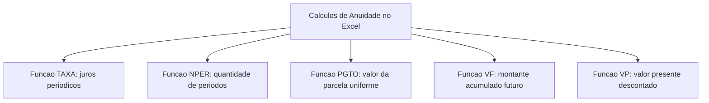
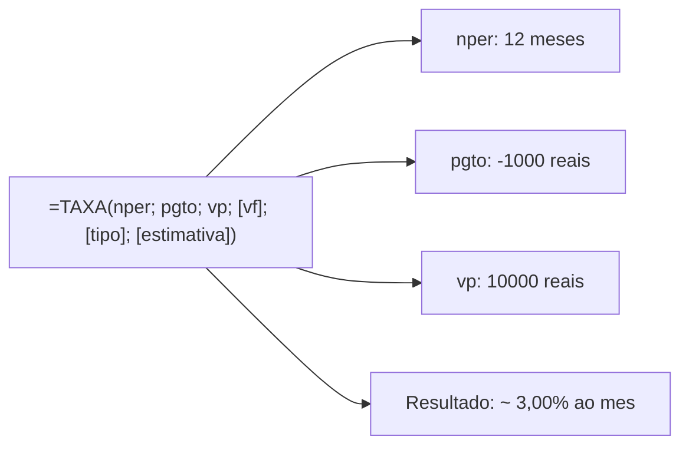
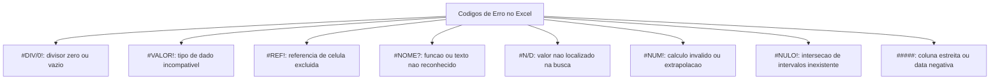
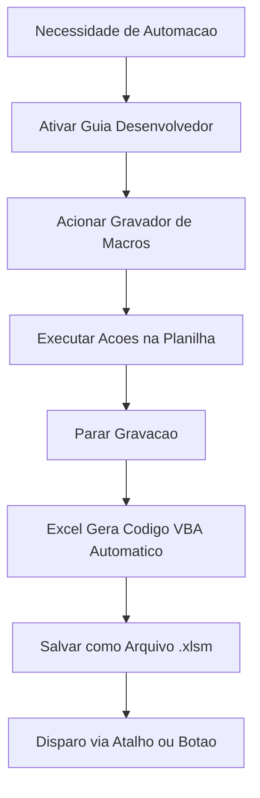
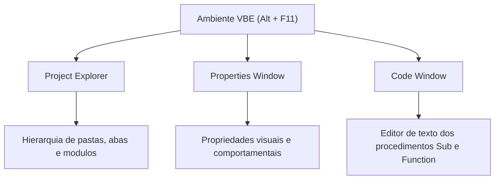

O domínio avançado do Microsoft Excel engloba cálculos financeiros de amortização e retorno, interpretação precisa de códigos de erro de fórmulas, automação de rotinas via macros e programação VBA, além de integração de repositórios externos via ODBC e técnicas analíticas para auditoria e higienização de matrizes numéricas.

Em instituições de segurança pública e defesa social, como a Polícia Civil e o Corpo de Bombeiros Militar, analistas lidam diariamente com auditorias de compras, orçamentos plurianuais e bases de dados investigativas com milhares de registros. 

Nesses cenários, saber interpretar um código de erro, parametrizar funções financeiras de empréstimos, criar rotinas automatizadas e higienizar massas brutas de dados separa o operador comum do especialista técnico.

> [!objetivos]
> - Aplicar as funções financeiras TAXA, NPER e PGTO, compreendendo a equivalência temporal e a convenção de fluxo de caixa.
> - Diagnosticar com exatidão a causa de cada código de erro retornado pelo Excel e aplicar os métodos de resolução.
> - Compreender o funcionamento de macros gravadas, o ambiente de desenvolvimento VBA e o formato de arquivo `.xlsm`.
> - Explorar a conectividade externa via ODBC e as práticas de higienização e análise exploratória de dados (AED).

---

## Funções Financeiras Avançadas: TAXA, NPER e PGTO

Além do valor futuro (VF) e do valor presente (VP), o Microsoft Excel oferece três funções financeiras consagradas em rotinas corporativas e bancas examinadoras: **TAXA**, **NPER** e **PGTO**. 

Todas operam sob o modelo de anuidades uniformes, no qual pagamentos periódicos sucessivos mantêm valor constante sob incidência de juros compostos.

### Função TAXA

A função **TAXA** calcula a taxa de juros auferida ou cobrada por período unitário a partir de uma série homogênea de pagamentos, do prazo de vigência e do valor presente ou futuro da transação.

A sua sintaxe oficial obedece à estrutura: `=TAXA(nper; pgto; vp; [vf]; [tipo]; [estimativa])`.

- `nper`: quantidade total de períodos de pagamento da operação (obrigatório).
- `pgto`: valor fixo do desembolso ou recebimento por período (obrigatório).
- `vp`: valor presente da operação ou quantia financiada (obrigatório se `vf` for omitido).
- `vf`: saldo monetário final pretendido após o último período (opcional; padrão zero).
- `tipo`: momento dos vencimentos, sendo `0` para final de período (postecipado) e `1` para início (antecipado; padrão zero).
- `estimativa`: taxa percentual inicial de partida para os cálculos iterativos do software (opcional; se omitida, o Excel adota `10%`).

Considere o caso prático consagrado em provas: `=TAXA(12; -1000; 10000)`.

Examinando os parâmetros:
1. `nper = 12`: doze parcelas mensais.
2. `pgto = -1000`: saída mensal de mil reais (sinal negativo).
3. `vp = 10000`: recebimento inicial de dez mil reais (sinal positivo).
4. `vf`, `tipo` e `estimativa`: omitidos, assumindo `0`, postecipado (`0`) e estimativa de `10%`.

O software realiza iterações matemáticas internas e apura uma taxa periódica de aproximadamente **3,00% ao mês**. Se os sinais de `pgto` e `vp` tivessem o mesmo sentido (ambos positivos ou ambos negativos), o Excel não conseguiria balancear o fluxo de caixa e retornaria o erro `#NÚM!`.

> [!bizu]
> Atenção aos sinais na função TAXA: se você informar o pagamento (`pgto`) e o valor presente (`vp`) com o mesmo sinal algébrico, o cálculo entrará em conflito conceitual, pois não há operação financeira real sem contrapartida de entrada e saída de capital. O resultado será invariavelmente o erro `#NÚM!`.

### Função NPER

A função **NPER** afere a quantidade de períodos de tempo necessários para saldar um financiamento ou para atingir determinada meta financeira de poupança mediante contribuições periódicas fixas.

A sintaxe oficial organiza-se da seguinte forma: `=NPER(taxa; pgto; vp; [vf]; [tipo])`.

- `taxa`: taxa de juros por período unitário (obrigatória).
- `pgto`: pagamento periódico constante da anuidade (obrigatório).
- `vp`: valor presente do fluxo de capital (obrigatório se `vf` for omitido).
- `vf`: montante acumulado ou saldo final desejado (opcional; padrão zero).
- `tipo`: define regime postecipado (`0`) ou antecipado (`1`).

Examine a seguinte expressão prática: `=NPER(6%/12; -500; 0; 50000)`.

Analisando os argumentos:
1. `taxa = 6%/12`: taxa de 6% ao ano convertida para mensal (0,5% ao mês).
2. `pgto = -500`: aporte mensal negativo de quinhentos reais.
3. `vp = 0`: ausência de capital inicial.
4. `vf = 50000`: meta final de cinquenta mil reais.

O Excel processa a equação de juros compostos e retorna aproximadamente **81 períodos**. Ou seja, serão necessários cerca de 81 meses (seis anos e nove meses) de aportes regulares para atingir o montante pretendido de cinquenta mil reais.

> [!atencao]
> A homogeneidade cronológica entre taxa e prazos é mandatória. Se os depósitos forem mensais e a taxa for fornecida anualmente sem conversão direta na fórmula (por exemplo, digitando `=NPER(6%; -500; 0; 50000)`), o Excel considerará que cada período equivale a um ano inteiro com aportes anuais de quinhentos reais, gerando um resultado completamente distorcido.

### Função PGTO

A função **PGTO** calcula o valor exato da parcela monetária uniforme requerida para amortizar um empréstimo ou capitalizar um fundo, considerando pagamentos periódicos constantes sob taxa de juros inalterada.

A sua sintaxe canônica apresenta os seguintes parâmetros: `=PGTO(taxa; nper; vp; [vf]; [tipo])`.

- `taxa`: taxa de juros incidente por período (obrigatória).
- `nper`: quantidade total de pagamentos do contrato (obrigatório).
- `vp`: valor presente ou capital tomado emprestado (obrigatório).
- `vf`: saldo financeiro remanescente ao término do último vencimento (opcional; padrão zero).
- `tipo`: vencimento ao fim (`0`) ou no início (`1`) do período (opcional; padrão zero).

A prestação calculada por `=PGTO()` compreende exclusivamente a parcela de amortização do capital somada à incidência dos juros contratuais. Taxas de administração bancária, prêmios de seguro e tributos fiscais (como o IOF) não fazem parte do cálculo nativo da função.

> [!exemplo]
> Suponha que uma corporação militar financie a aquisição de equipamentos de comunicação no valor presente de 50.000 reais, a ser amortizado em 60 parcelas mensais com incidência de taxa de juros de 8% ao ano. A fórmula no Excel será redigida como:
> `=PGTO(8%/12; 60; -50000)`
> O resultado retornará uma parcela positiva de aproximadamente 1.013,82 reais por mês. Se o valor financiado fosse inserido como `50000` positivo, a parcela retornaria com valor negativo de `-1.013,82 reais`, indicando o desembolso mensal devido pelo órgão pagador.

| Função Financeira | Objetivo Principal | Parâmetro Procurado | Retorno Típico |
|---|---|---|---|
| `=TAXA()` | Estimar a taxa periódica de juros | Taxa percentual por ciclo | Percentual (ex.: 3,00%) |
| `=NPER()` | Calcular a quantidade de parcelas | Número de períodos | Número inteiro/decimal (ex.: 81) |
| `=PGTO()` | Calcular o valor da prestação fixa | Pagamento periódico | Valor monetário (ex.: 1.013,82 reais) |
| `=VF()` | Projetar o saldo financeiro futuro | Montante acumulado | Valor monetário (ex.: 34.885,02 reais) |
| `=VP()` | Determinar o capital presente à vista | Valor presente equivalente | Valor monetário (ex.: -3.992,71 reais) |

---

## Diagnóstico e Resolução de Códigos de Erro no Excel

Durante o desenvolvimento de planilhas complexas, falhas sintáticas, referências inconsistentes ou tipos de dados incompatíveis interrompem a avaliação normal das fórmulas. Quando isso ocorre, o Microsoft Excel exibe códigos de erro específicos iniciados pelo caractere `#`.

Compreender o significado exato de cada código e saber como solucioná-lo é uma das competências mais exigidas em certames públicos.

### O Alerta Visual `#####`

O preenchimento da célula por caracteres cardinais (`#####`) não configura tecnicamente uma falha sintática na fórmula, mas sim um alerta visual de exibição da interface gráfica.

Existem duas causas fundamentais para o surgimento de `#####`:
1. **Largura insuficiente da coluna**: a célula abriga um número formatado, uma data ou um percentual cujo comprimento visual excede a largura física da coluna. Para corrigir, basta dar um clique duplo sobre a divisória direita do cabeçalho da coluna (AutoAjuste) ou arrastá-la manualmente para a direita.
2. **Datas ou horas com valores negativos**: no sistema padrão de datação do Excel (base 1900), o aplicativo não admite a exibição de datas ou horas negativas. Se uma subtração de horários resultar em número negativo, a célula apresentará `#####` indefinidamente, independentemente da largura da coluna.

### O Erro `#DIV/0!` (Divisão por Zero)

O código `#DIV/0!` denuncia uma violação aritmética clássica: uma fórmula tenta dividir um número por zero ou aponta para uma célula que se encontra totalmente em branco ou sem conteúdo numérico.

No Excel, uma célula vazia é interpretada como número zero quando utilizada em operações puramente matemáticas. Portanto, se a fórmula `=A1/B1` for executada com a célula `B1` em branco, o programa acusará `#DIV/0!`.

Para prevenir a exibição desse código em relatórios oficiais, o operador deve blindar a fórmula com funções lógicas:
- Utilizando a função `SEERRO`: `=SEERRO(A1/B1; 0)` ou `=SEERRO(A1/B1; "Não aplicável")`.
- Utilizando a função `SE`: `=SE(B1=0; "Pendente"; A1/B1)`.

> [!atencao]
> Uma célula em branco no denominador atua como zero e dispara `#DIV/0!`. Para relatórios profissionais, sempre envolva operações divisionais na função `=SEERRO()`, preservando a estética da planilha.

### O Erro `#VALOR!` (Incompatibilidade de Tipos)

O erro `#VALOR!` manifesta-se quando um operador aritmético recebe argumentos de tipos conflitantes ou quando uma função espera determinado tipo de dado e recebe outro incompatível.

Ocorre comumente nas seguintes situações:
- Tentar somar algebricamente um numeral com uma cadeia de texto puro: `=10 + "viatura"`.
- Fornecer um texto alfanumérico longo para uma função que exige rigorosamente valores lógicos ou matrizes numéricas.
- Deixar de fornecer o ponto e vírgula delimitador entre argumentos em chamadas manuais.

Para evitar o erro `#VALOR!` em somatórios, recomenda-se utilizar funções nativas em vez de operadores diretos. A expressão `=SOMA(A1; B1)` ignora células que contenham textos, ao passo que a fórmula direta `=A1 + B1` retornará `#VALOR!` se `B1` contiver texto.

### O Erro `#REF!` (Referência Inválida)

O código `#REF!` avisa que a coordenada de célula referenciada pela fórmula foi excluída fisicamente da pasta de trabalho ou perdeu sua validade referencial.

Situações típicas geradoras de `#REF!`:
- O usuário cria a fórmula `=A1 + B1 + C1`. Em seguida, clica com o botão direito sobre o cabeçalho da coluna `B` e aciona a opção **Excluir**. A fórmula é imediatamente convertida para `=A1 + #REF! + C1`, resultando no erro permanente `#REF!`.
- Copiar e colar uma fórmula com referências relativas para uma posição que extrapolaria os limites da grade da planilha (por exemplo, copiar uma fórmula que referencia uma célula acima para a linha 1).

> [!pegadinha]
> Cuidado: limpar o conteúdo de uma célula (pressionando a tecla `Delete`) não gera `#REF!`. Ao apagar o conteúdo, a célula continua existindo na coordenada e passa a valer zero. O erro `#REF!` só se manifesta quando a célula, linha ou coluna é **excluída estruturalmente** da grade (ou movida de forma a romper o apontamento).

### O Erro `#NOME?` (Termo Desconhecido)

O erro `#NOME?` informa que o interpretador do Excel não reconheceu uma palavra escrita na fórmula.

As causas mais frequentes envolvem:
1. **Erro de digitação no nome de uma função nativa**: digitar `=SOM(A1:A10)` em vez de `=SOMA(A1:A10)`, ou `=PROCVV(...)` em vez de `=PROCV(...)`.
2. **Omissão de aspas duplas em textos**: digitar `=SE(A1=Aprovado; 1; 0)` sem aspas em torno da palavra "Aprovado". O Excel assume que "Aprovado" é o nome de um intervalo nomeado inexistente na planilha e dispara `#NOME?`.
3. **Erros ortográficos em intervalos nomeados**: referenciar uma tabela pelo nome `TabelaVendas` quando o nome formalmente cadastrado no Gerenciador de Nomes é `TabVendas`.
4. **Omissão de dois-pontos em intervalos contínuos**: escrever `=SOMA(A1 A10)` sem pontuação intermediária pode gerar `#NULO!` ou `#NOME?` a depender da sintaxe.

### O Erro `#N/D` (Dado Não Disponível)

O identificador `#N/D` (*Não Disponível* ou *Not Available*) surge predominantemente em funções de pesquisa e referência, como `PROCV`, `PROCH`, `PROCX` e `CORRESP`.

Indica que o algoritmo de busca funcionou perfeitamente, mas o valor procurado simplesmente não foi localizado dentro da matriz de consulta selecionada.

Para contornar o impacto visual do erro `#N/D`, o operador utiliza:
- A função específica `É.NÃO.DISP()` em testes lógicos.
- A função `SEERRO()` para capturar qualquer anomalia.
- O argumento nativo `se_não_encontrado` da função moderna `PROCX`: `=PROCX(F1; A1:A50; B1:B50; "Não cadastrado")`.

### Os Erros `#NÚM!` e `#NULO!`

- **`#NÚM!`**: aponta argumentos numéricos inválidos ou cálculos que extrapolam a capacidade computacional do Excel. Ocorre ao tentar calcular a raiz quadrada de um número negativo por meio de `=RAIZ(-25)` sem suporte a números complexos, ou quando uma rotina iterativa (como a função `TAXA`) não converge após centenas de tentativas lógicas.
- **`#NULO!`**: manifesta-se quando a fórmula tenta apurar a interseção espacial entre dois intervalos geométricos que não possuem nenhuma célula em comum. No Excel, o operador de interseção é o caractere de **espaço em branco**. A fórmula `=SOMA(A1:B2 C3:D4)` resulta em `#NULO!`, pois as áreas `A1:B2` e `C3:D4` não se tocam.

| Código de Erro | Causa Primária | Cenário Prático Típico | Ação Corretiva Recomendada |
|---|---|---|---|
| `#####` | Largura estreita ou data negativa | Número longo ou hora negativa | Ajustar largura da coluna ou corrigir datação |
| `#DIV/0!` | Divisão por zero ou célula vazia | Denominador nulo em divisões | Tratar com `=SEERRO()` ou verificar divisor |
| `#VALOR!` | Tipo de dado conflitante | Adição direta de texto com número | Converter dados ou utilizar funções nativas |
| `#REF!` | Coordenada excluída da grade | Coluna ou linha deletada da planilha | Restaurar coluna ou reescrever fórmula |
| `#NOME?` | Termo nominal não reconhecido | Função digitada errada ou texto sem aspas | Corrigir nome da função ou inserir aspas |
| `#N/D` | Valor não localizado na matriz | Registro inexistente em `PROCV`/`CORRESP` | Utilizar tratamento ou cláusula alternativa |
| `#NÚM!` | Número inválido ou cálculo infinito | Raiz de negativo ou iteração divergente | Validar limites e sinais dos argumentos |
| `#NULO!` | Interseção geométrica vazia | Espaço entre intervalos que não se tocam | Substituir espaço por ponto e vírgula |

---

## Macros e Automação em Visual Basic for Applications (VBA)

A rotina de servidores públicos envolve tarefas repetitivas, como importar relatórios diários de boletins de ocorrência, aplicar formatações padronizadas e gerar tabelas consolidadas. O Microsoft Excel disponibiliza mecanismos avançados de automação que eliminam retrabalho e reduzem falhas operacionais.

### O Que É uma Macro?

Uma **Macro** é uma sequência gravada de comandos e instruções que executa automaticamente ações previamente definidas pelo usuário. Ela permite que uma sequência complexa de dezenas de cliques e formatações seja disparada instantaneamente por meio de um único atalho de teclado ou clique em um botão gráfico.

### A Guia Desenvolvedor e o Atalho `Alt + F11`

Por padrão de instalação do Microsoft Office, a guia **Desenvolvedor** vem **oculta** na Faixa de Opções para evitar que usuários leigos alterem scripts do sistema. 

Para torná-la visível:
1. Acesse o menu **Arquivo** > **Opções**.
2. Clique em **Personalizar Faixa de Opções**.
3. Na coluna de guias principais, marque a caixa de seleção correspondente à guia **Desenvolvedor** e confirme com **OK**.

No grupo **Código** da guia Desenvolvedor, o usuário encontra os botões:
- **Visual Basic**: abre o editor integrado de desenvolvimento. O atalho de teclado universal para invocar o ambiente Visual Basic é **`Alt + F11`**.
- **Macros**: lista as macros gravadas na pasta de trabalho e permite executá-las, editá-las ou excluí-las (atalho **`Alt + F8`**).
- **Gravar Macro**: inicia a gravação passo a passo de todas as ações executadas na interface.
- **Usar Referências Relativas**: define se a macro atuará nas coordenadas físicas fixas da gravação ou em relação à célula ativa.

> [!bizu]
> Memorize os dois atalhos centrais da automação: `Alt + F11` abre o editor do Visual Basic (VBE), enquanto `Alt + F8` abre a janela para executar ou gerenciar macros existentes.

### O Formato de Arquivo Obrigatório: `.xlsm`

A segurança do ambiente corporativo exige blindagem contra códigos maliciosos que possam ser embutidos em pastas de trabalho. Por essa razão, a Microsoft adota uma política rigorosa de extensão de arquivos:

- **`.xlsx`**: formato padrão do Excel moderno. Suporta planilhas, tabelas, fórmulas e gráficos, mas **bloqueia compulsoriamente** o armazenamento de códigos de macro. Se um usuário gravar uma macro em uma planilha comum e salvá-la como `.xlsx`, o Excel exibirá um aviso enfático e **descartará definitivamente todo o código VBA gravado**.
- **`.xlsm`**: Pasta de Trabalho Habilitada para Macro do Excel. É o único formato padrão aberto que preserva integralmente as rotinas de macro e módulos de código VBA para execuções futuras.
- **`.xlsb`**: Pasta de Trabalho Binária do Excel. Também aceita macros e apresenta carregamento acelerado para matrizes de dados de grande porte.

> [!pegadinha]
> Esta é uma das pegadinhas mais clássicas de informática em concursos: a banca afirma que o formato padrão `.xlsx` preserva scripts e macros desenvolvidos no VBA. Isso é incorreto. Para armazenar e executar rotinas de macro, o arquivo precisa ser formalmente gravado na extensão `.xlsm`.

### O Ambiente Visual Basic for Applications (VBA)

Quando uma macro é gravada ou editada, o Excel converte as ações do usuário na linguagem de programação **VBA** (*Visual Basic for Applications*), uma variante do Visual Basic adaptada para automatizar os softwares do pacote Microsoft Office.

Ao pressionar `Alt + F11`, o usuário é apresentado ao ambiente VBE (*Visual Basic Editor*), composto por três áreas principais:

1. **Project Explorer**: painel hierárquico com pastas, abas de planilha e a pasta `Módulos` com os scripts de macro.
2. **Properties Window**: janela para configurar atributos visuais e operacionais de formulários e componentes.
3. **Code Window**: editor textual onde rotinas delimitadas por `Sub` e `End Sub` são escritas.

O VBA suporta variáveis, laços (`For...Next`), estruturas condicionais (`If...Then`) e caixas interativas (`MsgBox` e `InputBox`).

---

## Integração de Dados Externos via Conexão ODBC

Em ambientes corporativos e centros de computação das polícias civis e militares, os dados operacionais volumosos raramente residem em simples arquivos locais de planilha. Eles são gerenciados por Sistemas Gerenciadores de Bancos de Dados (SGBD) robustos, como Oracle, PostgreSQL, Microsoft SQL Server e MySQL.

Para interligar a planilha a essas matrizes corporativas sem exigir transcrição manual ou exportações diárias estáticas, o Microsoft Excel implementa a tecnologia **ODBC**.

### O Que É a Conectividade ODBC?

A sigla **ODBC** (*Open Database Connectivity*) designa uma interface de software de padrão aberto desenvolvida para permitir que aplicações tabulares e de análise se comuniquem com sistemas de bancos de dados heterogêneos.

Por meio de drivers específicos instalados no sistema operacional (como o Driver ODBC do PostgreSQL ou do SQL Server), o Excel envia requisições em linguagem SQL para o servidor remoto e traz tabelas inteiras para a memória da planilha.

### Benefícios Operacionais da Conexão ODBC

- **Desacoplamento e Segurança**: a planilha consome consultas sem sobrecarregar o banco corporativo.
- **Atualização Dinâmica**: na guia **Dados**, o botão **Atualizar Tudo** (`Ctrl + Alt + F5`) sincroniza os números com a base remota.
- **Integração com Power Query**: no Excel moderno, o grupo **Obter e Transformar Dados** permite filtrar e transformar dados antes da carga na planilha.

---

## Higienização e Análise Exploratória de Dados (AED)

A atividade de inteligência policial e o planejamento governamental exigem a manipulação de matrizes de dados antes de sua submissão a modelos estatísticos e decisões de comando. Dados brutos frequentemente apresentam campos vazios, registros duplicados e inconsistências de preenchimento.

A esse processo inicial dá-se o nome de **higienização** (*data cleaning*), etapa preparatória indispensável para a **Análise Exploratória de Dados** (AED ou *Exploratory Data Analysis - EDA*).

### Tratamento de Células Vazias e Incompletas

Registros nulos ou em branco comprometem cálculos de médias aritméticas e filtros consolidados. O Excel oferece ferramentas dedicadas para localizar e tratar essas ocorrências:

1. **Localização Rápida**: por meio do atalho `Ctrl + G` (comando *Ir Para*), clicando no botão **Especial** e marcando a opção **Em branco**. O Excel seleciona simultaneamente todas as células vazias da tabela, permitindo preenchê-las com zero ou texto padronizado em lote pressionando `Ctrl + Enter`.
2. **Funções Lógicas e Estatísticas**:
   - `=ÉCÉL.VAZIA(célula)`: retorna `VERDADEIRO` se a coordenada especificada estiver completamente sem dados.
   - `=CONTAR.VAZIO(intervalo)`: totaliza a quantidade de células vazias dentro de uma matriz delimitada.
3. **Filtragem por Vazios**: os filtros automáticos de coluna incluem a opção "(Vazias)" na parte inferior da lista de seleção, permitindo isolar e corrigir registros faltantes de forma imediata.

### Identificação e Remoção de Registros Duplicados

A inserção inadvertida de boletins de ocorrência idênticos distorce a contabilidade das estatísticas criminais.

O Excel dispõe de dois métodos principais para tratar duplicidades:
- **Identificação Visual via Formatação Condicional**: na guia Página Inicial, o comando *Regras de Realce das Células > Valores Duplicados* pinta as células com registros repetidos com fundo colorido, permitindo auditoria visual antes da exclusão física.
- **Exclusão Definitiva via Ferramenta Nativa**: na guia **Dados**, grupo Ferramentas de Dados, o botão **Remover Duplicatas** abre uma caixa de diálogo na qual o usuário seleciona quais colunas devem ser comparadas para atestar a identidade de um registro. O programa compara as linhas selecionadas, apaga compulsoriamente os registros idênticos posteriores e mantém apenas a primeira ocorrência encontrada, exibindo um balanço final com o total de linhas excluídas e remanescentes.

### Métodos de Análise Exploratória de Dados (AED)

Uma vez higienizada a matriz, o analista procede à caracterização estatística das variáveis por meio de técnicas descritivas:

- **Medidas de Tendência Central**: cálculo de `=MÉDIA()` e `=MED()` para compreender o centro da distribuição. Em distribuições assimétricas com valores extremos discrepantes (outliers), a mediana retrata a realidade operacional com maior fidedignidade que a média.
- **Medidas de Dispersão**: uso de `=DESVPAD.A()` e `=DESVPAD.P()` para apurar a variabilidade em torno da média amostral.
- **Segmentação por Tabelas Dinâmicas**: cruzamento multifatorial instantâneo de categorias para identificar tendências históricas de atendimento e sazonalidades criminais.
- **Representação Gráfica Diagnóstica**: geração de histogramas para visualizar a frequência dos dados em classes uniformes e diagramas de caixa (boxplots) para identificar visualmente discrepâncias e valores atípicos.

---

## Questões Comentadas

### Questão 1 (Adaptada)
Durante o preenchimento de uma planilha orçamentária do Corpo de Bombeiros Militar, um operador digitou a fórmula `=SOMA(B2:B10)` em uma determinada célula. Ao pressionar a tecla Enter, a célula passou a exibir imediatamente a representação textual `#####`. O operador verificou que os números contidos no intervalo de soma eram todos positivos. Diante desse cenário, a conduta técnica correta para solucionar o problema visual consiste em:
A) Inserir uma função SEERRO envolvendo a fórmula, pois houve divisão por zero.
B) Ajustar a largura física da coluna para a direita, pois o espaço é estreito para acomodar o numeral formatado.
C) Habilitar a execução de macros no arquivo salvando-o na extensão `.xlsm`.
D) Excluir as linhas que contenham textos alfanuméricos incompatíveis com o operador de adição.
E) Reconfigurar os drivers de conexão ODBC com o banco corporativo do órgão.

**Gabarito: B**

**Comentário detalhado:**
A exibição de uma sequência de caracteres cardinais (`#####`) ocorre quando a coluna da planilha é fisicamente estreita demais para acomodar dígitos numéricos, datas ou percentuais formatados, ou quando uma operação resulta em datas negativas no sistema 1900. Como o enunciado esclarece que todos os números somados eram positivos, o resultado da soma é positivo e o erro decorre unicamente de limitação de largura da coluna. Para corrigir, basta alargar a coluna, efetuando um clique duplo na divisória do cabeçalho ou arrastando-a. As demais alternativas tratam de erros distintos (`#DIV/0!`, `#VALOR!`, etc.).

---

### Questão 2 (Adaptada)
Um analista desenvolveu uma macro complexa no Microsoft Excel para automatizar a consolidação de relatórios mensais de ocorrências. Ele gravou os procedimentos de formatação, testou o funcionamento da rotina com sucesso e, em seguida, salvou a pasta de trabalho utilizando a extensão padrão `.xlsx`. No dia seguinte, ao reabrir o arquivo para dar continuidade aos trabalhos, o analista constatou que a macro não constava mais no menu de execução. O que causou essa perda do script automatizado?
A) O Excel exige obrigatoriamente permissão de administrador no Windows para gravar macros.
B) O formato `.xlsx` bloqueia códigos de macro e descarta compulsoriamente rotinas VBA ao salvar o arquivo.
C) O editor VBE corrompeu os módulos de código devido ao atalho de teclado `Alt + F11`.
D) Faltou configurar a conexão ODBC para sincronizar a macro com o banco de dados.
E) O aplicativo entrou em modo de compatibilidade binária descartando a guia Desenvolvedor.

**Gabarito: B**

**Comentário detalhado:**
O formato de arquivo padrão do Microsoft Excel moderno (`.xlsx`) foi concebido sem suporte a códigos executáveis como medida fundamental de segurança da informação contra scripts maliciosos. Quando um usuário salva um arquivo que contém rotinas em VBA com a extensão `.xlsx`, o aplicativo exibe uma janela de alerta e, caso o salvamento continue nesse padrão, descarta de forma irrevogável todas as macros gravadas. Para que as instruções automatizadas e procedimentos do VBA sejam armazenados de maneira íntegra, a pasta de trabalho deve ser formalmente salva com a extensão `.xlsm` (Pasta de Trabalho Habilitada para Macro).

---

### Questão 3 (Inédita)
Em uma planilha do Excel, o servidor executou a seguinte fórmula financeira:
`=TAXA(12; -1000; 10000)`
Considerando que a operação foi calculada com sucesso sem mensagens de erro, assinale a alternativa que descreve com exatidão o significado e o retorno dessa expressão:
A) Calcula o total de meses necessários para acumular dez mil reais investindo mil reais mensais, retornando 10 meses.
B) Apura o valor da prestação mensal devida em um financiamento de dez mil reais a doze por cento ao ano, retornando mil reais negativos.
C) Determina a taxa periódica mensal de juros de uma anuidade de doze parcelas mensais de mil reais sobre o capital presente de dez mil reais, retornando cerca de 3% ao mês.
D) Trata-se de uma anuidade antecipada que calcula o saldo residual futuro, retornando o erro `#NÚM!`.
E) Executa um desconto financeiro comercial projetando o valor presente descontado, retornando aproximadamente 34.885 reais.

**Gabarito: C**

**Comentário detalhado:**
A função `=TAXA(nper; pgto; vp; [vf]; [tipo]; [estimativa])` calcula a taxa de juros periódica de uma anuidade constante. No caso da fórmula `=TAXA(12; -1000; 10000)`, os parâmetros correspondem a 12 períodos mensais (`nper`), saída de caixa de 1.000 reais por mês (`pgto` com sinal negativo) e captação inicial presente de 10.000 reais (`vp` positivo). O resultado retornado pela avaliação iterativa do software aponta a taxa periódica mensal correspondente de equilíbrio financeiro, que é de aproximadamente 3,00% ao mês. A alternativa C sintetiza com exatidão matemática e conceitual a aplicação da função.

---

## Mapa do Capítulo

```mermaid Mapa Conceitual de Financas Avancadas, Erros e Macros
flowchart TD
    Avancado["Topicos Avancados do Excel"] --> FIN["Funcoes Financeiras"]
    Avancado --> ERR["Diagnostico de Erros"]
    Avancado --> MAC["Macros e VBA"]
    Avancado --> INT["Conectividade e Higienizacao"]
    
    FIN --> FIN1["TAXA: juros periodicos com pgto e vp"]
    FIN --> FIN2["NPER: quantidade de prazos e periodos"]
    FIN --> FIN3["PGTO: prestacao constante amortizada"]
    
    ERR --> ERR1["#####: largura insuficiente ou hora negativa"]
    ERR --> ERR2["#DIV/0!: divisao por zero ou celula vazia"]
    ERR --> ERR3["#REF!: referencia de coordenada excluida"]
    ERR --> ERR4["#NOME?: funcao digitada errada ou sem aspas"]
    
    MAC --> MAC1["Guia Desenvolvedor e Editor VBE: Alt + F11"]
    MAC --> MAC2["Formato Obrigatorio: extensao .xlsm"]
    MAC --> MAC3["Linguagem VBA: rotinas Sub e Funcoes"]
    
    INT --> INT1["ODBC: integracao via drivers com bancos externos"]
    INT --> INT2["Higienizacao: remover duplicatas e celulas vazias"]
    INT --> INT3["AED: estatistica descritiva e boxplots"]
```

---

### Para fixar

- **Função TAXA**: afere a taxa de juros periódica de anuidades constantes a partir do número de períodos, do pagamento e do valor presente.
- **Função NPER**: calcula a quantidade de períodos exigida para saldar uma obrigação ou atingir determinado saldo financeiro futuro.
- **Função PGTO**: determina o valor constante da prestação de um financiamento ou empréstimo sob taxa de juros inalterada.
- **Erro `#####`**: sinaliza largura física de coluna insuficiente para numerais formatados ou resultado de subtração cronológica com horário negativo.
- **Erro `#DIV/0!`**: manifesta-se perante divisões algébricas por zero ou por células totalmente vazias, solúvel com `=SEERRO()`.
- **Erro `#REF!`**: denuncia a exclusão definitiva de uma coluna, linha ou intervalo de células que participava como argumento de cálculo.
- **Erro `#NOME?`**: ocorre quando o programa não identifica um nome grafado, seja por erro ortográfico na função ou omissão de aspas em textos.
- **Extensão `.xlsm`**: padrão mandatório para salvar pastas de trabalho contendo rotinas de macro; o formato `.xlsx` descarta o código VBA.
- **Ambiente VBE**: editor de código em Visual Basic acessível pelo atalho de teclado `Alt + F11` a partir da guia Desenvolvedor.
- **Conexão ODBC e AED**: tecnologia baseada em drivers para importar dados dinâmicos de bancos externos, apoiando a higienização e análise exploratória.
