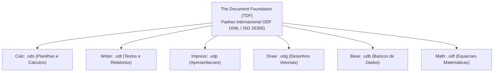
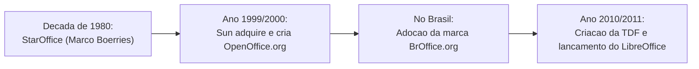
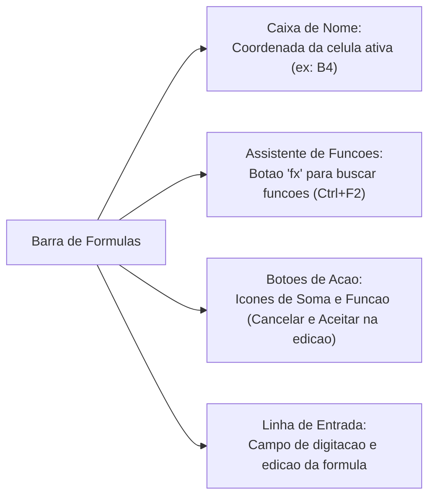
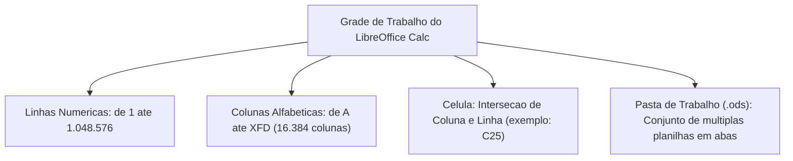
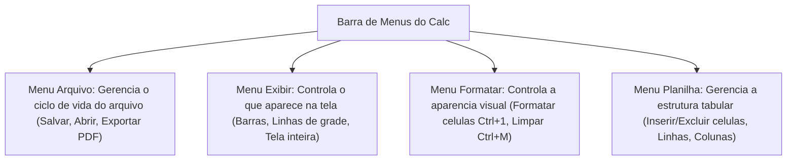
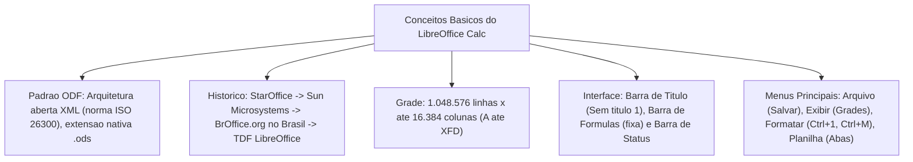

O estudo das planilhas eletrônicas no serviço público ganhou enorme relevância prática com a adoção de soluções de código aberto. Entre os softwares dessa categoria, o **LibreOffice Calc** destaca-se como a principal ferramenta livre de tabulação, cálculo numérico e análise estatística. O aplicativo oferece independência tecnológica aos órgãos estatais ao adotar padrões abertos e compatibilidade multiplataforma.

Neste capítulo inicial, apresentamos uma visão geral e os conceitos básicos do LibreOffice Calc. Estudaremos o padrão documental ODF, a trajetória histórica da suíte, a estrutura de células e os menus de comando. Esses tópicos são cobrados com frequência expressiva nas provas.

> [!objetivos]
> - Identificar as características fundamentais do LibreOffice Calc como aplicativo de software livre.
> - Compreender a estrutura do padrão internacional ODF (*Open Document Format*) e sua extensão nativa `.ods`.
> - Dominar a anatomia da interface de trabalho: barras de ferramentas, de fórmulas e de status.
> - Conhecer as dimensões estruturais da grade: 1.048.576 linhas e até 16.384 colunas na versão moderna.
> - Mapear os comandos operacionais dos menus Arquivo, Exibir, Formatar e Planilha com seus atalhos.

---

## Visão Geral e Conceitos Básicos do Padrão ODF

O LibreOffice Calc é uma aplicação de planilha eletrônica distribuída sob licença livre pela fundação *The Document Foundation* (TDF). Ao contrário de suítes comerciais proprietárias, o Calc pode ser executado, copiado e modificado livremente em sistemas Windows, Linux e macOS.

A arquitetura do LibreOffice adota o padrão internacional **ODF (*Open Document Format*)**, norma técnica aberta regulamentada pela OASIS e padronizada pela norma ISO/IEC 26300. Esse padrão organiza dados em arquivos baseados em XML (*eXtensible Markup Language*). Esse modelo evita o aprisionamento tecnológico em formatos proprietários fechados.

Cada aplicativo da suíte LibreOffice possui uma extensão de arquivo característica no formato ODF:

| Aplicativo | Finalidade Funcional | Extensão Nativa ODF | Equivalente Microsoft |
|---|---|---|---|
| **LibreOffice Calc** | Planilha eletrônica e gráficos | **`.ods`** (*Open Document Spreadsheet*) | `.xlsx` / `.xls` (Excel) |
| **LibreOffice Writer** | Processador de textos | **`.odt`** (*Open Document Text*) | `.docx` / `.doc` (Word) |
| **LibreOffice Impress** | Apresentações visuais | **`.odp`** (*Open Document Presentation*) | `.pptx` / `.ppt` (PowerPoint) |
| **LibreOffice Draw** | Desenho vetorial e diagramas | **`.odg`** (*Open Document Graphic*) | `.vsdx` (Visio) |
| **LibreOffice Base** | Banco de dados relacional | **`.odb`** (*Open Document Database*) | `.accdb` (Access) |
| **LibreOffice Math** | Editor de equações matemáticas | **`.odf`** / `.formula` | Equation Editor |

O Calc opera com interoperabilidade plena com o Microsoft Excel. Ele consegue abrir, editar e salvar arquivos nas extensões `.xls` e `.xlsx`. Além disso, exporta dados nativamente para arquivos no formato PDF e páginas em HTML.

> [!atencao]
> **Ponto de Atenção da Página 8**: o formato nativo do LibreOffice Calc é estritamente o **`.ods`** (*Open Document Spreadsheet*). Não confunda `.ods` com `.odt` (Writer) nem com `.odp` (Impress). A letra **S** remete a *Spreadsheet* (planilha), a letra **T** remete a *Text* (texto) e a letra **P** remete a *Presentation* (apresentação).

> [!bizu]
> Arquivos ODF consistem, estruturalmente, em pacotes compactados no formato ZIP contendo arquivos XML internos. Isso permite recuperar informações mesmo diante de corrupções parciais no sistema de arquivos.

---

## Contexto Histórico da Suíte LibreOffice

Para compreender a nomenclatura das ferramentas em provas, é necessário conhecer sucintamente a trajetória histórica que originou o LibreOffice:

1. **StarOffice (década de 1980)**: conjunto de escritório desenvolvido na Alemanha pela empresa *Star Division*.
2. **Aquisição pela Sun Microsystems (1999)**: a Sun adquiriu a tecnologia e abriu o código-fonte, criando no ano 2000 o projeto comunitário *OpenOffice.org*.
3. **A Marca BrOffice.org no Brasil**: no Brasil, a marca OpenOffice já estava registrada por terceiros. Por essa razão legal, a comunidade brasileira adotou formalmente o nome **BrOffice.org**.
4. **Criação do LibreOffice (2010)**: após a compra da Sun pela corporação Oracle, voluntários criaram *The Document Foundation* e lançaram o **LibreOffice**. Em 2011, o projeto brasileiro concluiu a migração definitiva para a marca internacional LibreOffice.

---

## Anatomia da Interface e Barra de Ferramentas

Ao abrir um novo documento em branco no Calc, a janela exibe o título provisório **`Sem título 1`**. Esse nome temporário permanece até que o usuário salve o arquivo com um nome definitivo.

A interface divide-se em componentes operacionais bem estruturados:

### Barra de Título
Fica no topo da janela. Mostra o nome do arquivo atual, o nome do aplicativo (*LibreOffice Calc*) e os botões de controle da janela (minimizar, maximizar e fechar).

### Barra de Menus
Fica abaixo da barra de título. Reúne todos os comandos do programa: Arquivo, Editar, Exibir, Inserir, Formatar, Estilos, Planilha, Dados, Ferramentas, Janela e Ajuda.

### Barra de Ferramentas
Por padrão, o Calc apresenta duas barras de ferramentas primárias acopladas:
- **Barra Padrão**: contém botões para operações frequentes, como Novo, Abrir, Salvar, Exportar diretamente como PDF, Imprimir, Copiar, Colar e Desfazer.
- **Barra Formatação**: reúne controles de estética tipográfica, como fonte, tamanho, negrito (`Ctrl+B`), itálico (`Ctrl+I`), alinhamentos e formatos numéricos.

As barras de ferramentas podem ser desacopladas para funcionar como painéis flutuantes na tela.

### Barra de Fórmulas
A barra de fórmulas é fixa e localiza-se acima da grade de células. Ela é composta por quatro elementos principais:

- **Caixa de Nome**: mostra a referência da célula ativa (como `A1` ou `C15`) ou o nome de um intervalo de dados. O usuário pode digitar uma célula diretamente para mover o cursor.
- **Assistente de Funções (ícone `fx`)**: abre a lista completa de fórmulas organizadas por categorias, com ajuda interativa de argumentos (`Ctrl+F2`).
- **Botão Soma (ícone grego Σ)**: insere a fórmula `=SOMA()` preenchendo o intervalo numérico adjacente superior ou à esquerda.
- **Botão Função (ícone `=`)**: insere o sinal de igual na linha de entrada para iniciar a digitação de uma fórmula. Na edição, os botões alternam para **Cancelar (X vermelho)** e **Aceitar (visto verde)**.
- **Linha de Entrada**: exibe e permite editar o conteúdo real da célula selecionada.

> [!bizu]
> Atalhos úteis da interface: utilize **`Ctrl+Shift+F5`** para focar diretamente a Caixa de Nome. Pressione **`Ctrl+F2`** para abrir o Assistente de Funções.

---

## Estrutura da Planilha Eletrônica

A área de trabalho principal do Calc organiza dados em uma matriz celular bidimensional de alta capacidade:

1. **Linhas**: dispostas horizontalmente e identificadas por números inteiros contínuos de **1 até 1.048.576**. Para selecionar uma linha inteira, basta clicar diretamente sobre o respectivo cabeçalho numérico à esquerda da tela.
2. **Colunas**: dispostas verticalmente e identificadas por letras maiúsculas. As versões modernas do software suportam até **16.384 colunas**, estendendo-se de **`A` até `XFD`** (as versões clássicas anteriores limitavam-se a 1.024 colunas, de `A` até `AMJ`). Para selecionar uma coluna inteira, clica-se no cabeçalho alfabético no topo da grade.
3. **Célula**: ponto elementar de encontro entre uma coluna vertical e uma linha horizontal. Sua referência oficial une a letra da coluna ao número da linha sem espaços (exemplos clássicos: `A1`, `B10`, `XFD1048576`). Cada célula pode armazenar texto alfanumérico, valores numéricos puros, datas, horários ou fórmulas de cálculo automático.
4. **Intervalos de Células**: representam agrupamentos de células na matriz. O operador dois-pontos (`:`) indica continuidade (*intervalo de A1 até A10*), enquanto o operador ponto e vírgula (`;`) representa união ou enumeração de células isoladas (*célula A1 e célula A10*).
5. **Planilhas**: um documento pode conter dezenas de planilhas independentes agrupadas em abas inferiores (`Planilha1`, `Planilha2`). O usuário pode renomear, colorir, reordenar ou ocultar essas guias para organizar tabelas complexas de gestão de viaturas e efetivo.

> [!exemplo]
> **Notação de Intervalos em Provas**: ao escrever `=SOMA(A1:A5)`, a função somará todas as 5 células do bloco contíguo (A1, A2, A3, A4 e A5). Ao escrever `=SOMA(A1;A5)`, o cálculo somará apenas as duas células isoladas indicadas (A1 e A5). Essa distinção entre os operadores `:` e `;` é cobrada com frequência em exames militares.

---

## Barra de Status e Modos de Seleção

A **Barra de Status** fica na extremidade inferior da janela do Calc. Ela fornece diagnósticos imediatos da planilha:

- **Contador de Planilhas**: exibe a posição atual (ex.: `Planilha 1 de 3`).
- **Idioma**: indica o dicionário de correção ortográfica em uso.
- **Modos de Seleção**: alterna com cliques entre quatro comportamentos da seleção:
  - *Seleção Padrão*: o clique seleciona uma única célula ou intervalo contínuo.
  - *Seleção Estendida*: expande a seleção do ponto original até o próximo clique.
  - *Seleção Adicionar*: permite marcar células não contíguas sem segurar a tecla `Ctrl`.
  - *Seleção de Bloco*: autoriza selecionar colunas verticais de modo retangular estrito.
- **Cálculo Rápido Automático**: exibe na barra a soma, média ou contagem das células numéricas selecionadas.
- **Controle de Zoom**: barra deslizante para ajustar o nível de ampliação visual na tela.

> [!pegadinha]
> **Cálculo Rápido na Barra de Status**: o valor de soma exibido na barra de status é apenas uma informação visual temporária. Esse resultado não é inserido em nenhuma célula da planilha.

---

## Menus Operacionais e Comandos Essenciais

As provas de concurso cobram frequentemente os comandos dos menus do Calc:

| Menu | Principais Comandos e Operações | Atalho de Teclado Principal |
|---|---|---|
| **Arquivo** | Criar novo documento, abrir, salvar, salvar cópia com outro nome, exportar diretamente como PDF e imprimir. | `Ctrl+O` (Abrir) `Ctrl+S` (Salvar) `Ctrl+Shift+S` (Salvar como) `Ctrl+P` (Imprimir) |
| **Exibir** | Modificar visualizações: Normal, Quebra de página, Tela inteira, ativar barras de ferramentas e linhas de grade. | `Ctrl+Shift+J` (Tela inteira) `Ctrl+F8` (Destacar valores coloridos) |
| **Formatar** | Formatação estética: formatar células, altura de linhas, largura de colunas, mesclar células e limpar formatação direta. | `Ctrl+1` (Formatar células) `Ctrl+M` (Limpar formatação direta) `Ctrl+B` (Negrito) |
| **Planilha** | Estrutura de dados: inserir ou excluir células, linhas, colunas, novas planilhas, renomear e ocultar abas. | `Ctrl++` (Inserir células) `Ctrl+-` (Excluir células) |

### Particularidades Importantes dos Menus
- **Menu Arquivo -> Exportar como PDF**: permite gerar arquivos PDF diretamente com controle fino de compactação e segurança.
- **Menu Exibir -> Destacar Valores (`Ctrl+F8`)**: exibe números em azul, textos em preto e resultados de fórmulas em verde.
- **Menu Formatar -> Limpar Formatação Direta (`Ctrl+M`)**: retira negritos, cores e alinhamentos manuais, preservando os dados intactos.

---

## Exercícios Práticos e Questões Comentadas

### Questão 1 (Prova anterior)
No aplicativo LibreOffice Calc, ao criar um novo documento e inserir dados em células sem antes salvá-lo com um nome personalizado, o sistema atribui automaticamente ao arquivo o título provisório de:
A) Documento 1
B) Sem título 1
C) NovaPlanilha 1
D) Planilha1.ods
E) Pasta1.calc

**Gabarito: B**

**Comentário detalhado:**
No LibreOffice, arquivos novos não gravados recebem o nome temporário "Sem título 1". Documento 1 é usado no Word, e Pasta1 no Excel. A resposta correta é a alternativa B.

---

### Questão 2 (Prova anterior)
Assinale a alternativa que indica a extensão padrão nativa utilizada pelo LibreOffice Calc para armazenar seus documentos no padrão aberto ODF:
A) `.odt`
B) `.odp`
C) `.ods`
D) `.odg`
E) `.odb`

**Gabarito: C**

**Comentário detalhado:**
A extensão oficial do Calc é `.ods` (*Open Document Spreadsheet*). As extensões `.odt` (Writer), `.odp` (Impress), `.odg` (Draw) e `.odb` (Base) pertencem aos outros aplicativos da suíte. O gabarito é a opção C.

---

### Questão 3 (Inédita)
Um bombeiro militar precisa remover cores e negritos aplicados por engano em uma tabela no LibreOffice Calc, mantendo intactos os números originais. Ele deve selecionar as células e acionar o atalho:
A) `Ctrl+Z`
B) `Ctrl+Shift+F5`
C) `Ctrl+M`
D) `Ctrl+F2`
E) `Ctrl+1`

**Gabarito: C**

**Comentário detalhado:**
O atalho `Ctrl+M` executa o comando *Limpar Formatação Direta*, restaurando o estilo padrão sem apagar conteúdos. `Ctrl+1` abre a janela Formatar Células e `Ctrl+F2` abre o Assistente de Funções. A alternativa correta é a C.

---

## Mapa do Capítulo

---

### Para fixar

- **Padrão ODF**: formato aberto internacional baseado em XML que garante perenidade documental e interoperabilidade.
- **Extensão nativa**: `.ods` (*Open Document Spreadsheet*) é a extensão padrão do Calc.
- **Suíte LibreOffice**: mantida pela fundação TDF, sucessora do OpenOffice e do BrOffice.org no Brasil.
- **Dimensões da grade**: possui exatamente 1.048.576 linhas e até 16.384 colunas (rotuladas de `A` até `XFD`).
- **Título provisório**: arquivos recém-criados exibem a legenda transitória `Sem título 1`.
- **Barra de fórmulas**: elemento fixo composto por Caixa de Nome, Assistente de Funções (`fx`), botão Soma, botão Função e Linha de Entrada.
- **Barra de status**: posicionada na margem inferior; exibe modo de seleção celular, zoom e cálculo rápido automático.
- **Menu Arquivo**: gerencia abertura, gravação (`Ctrl+S`), exportação direta em PDF e impressão de planilhas.
- **Limpar formatação direta**: acionado pelo atalho `Ctrl+M` no menu Formatar, restabelecendo a formatação padrão.
- **Destacar valores**: recurso do menu Exibir acionado por `Ctrl+F8`, exibindo números em azul, textos em preto e fórmulas em verde.
