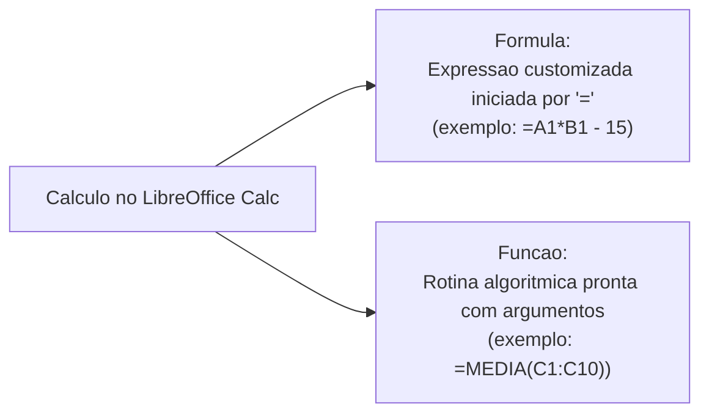
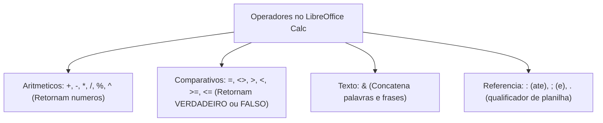
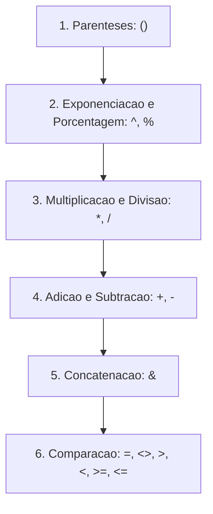
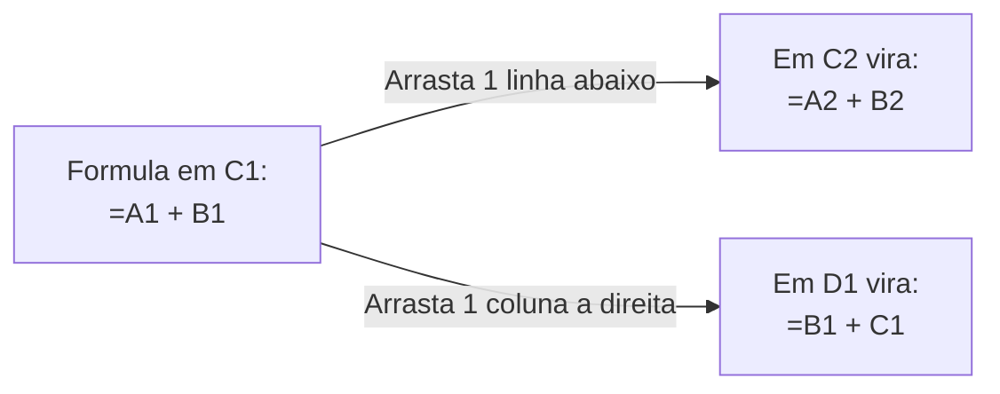
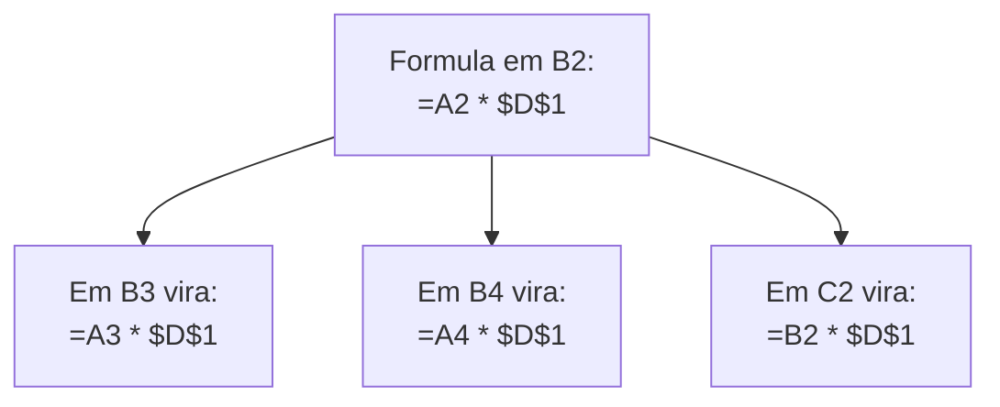
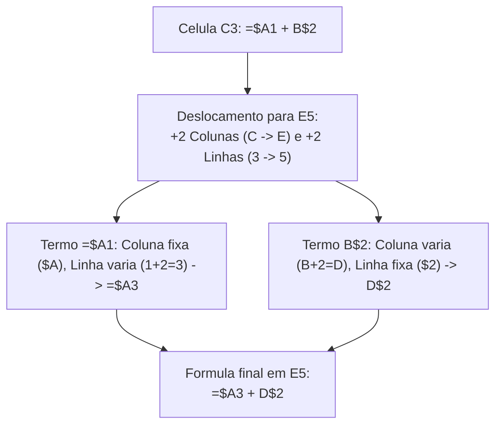
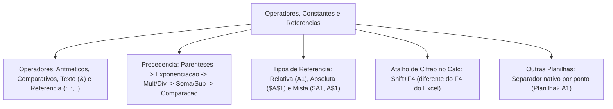

No LibreOffice Calc, o poder analítico das planilhas reside na manipulação de valores dinâmicos. Em vez de registrar dados puramente estáticos, o operador pode construir rotinas de cálculo automatizadas. Essas expressões recalculam seus resultados de forma instantânea sempre que uma célula de entrada sofre modificações na matriz.

Neste capítulo, estudaremos os conceitos básicos de fórmulas e funções, a tipologia das constantes, a classificação completa dos operadores e a ordem de precedência de cálculo. Em seguida, analisaremos a fundo o mecanismo de referências relativas, absolutas, mistas e entre diferentes planilhas. Esses temas representam o núcleo técnico mais recorrente nas questões de prova.

> [!objetivos]
> - Diferenciar a natureza operacional de uma fórmula personalizada e de uma função predefinida no Calc.
> - Classificar os operadores aritméticos, comparativos, de texto e de referência.
> - Dominar a ordem rigorosa de precedência matemática aplicada nas operações.
> - Compreender a dinâmica de deslocamento das referências relativas na alça de preenchimento.
> - Aplicar o caractere cifrão para fixar coordenadas em referências absolutas e referências mistas.

---

## Conceitos Básicos: Fórmulas versus Funções

Toda computação analítica no Calc organiza-se em torno de fórmulas e funções. Embora esses termos sejam utilizados como sinônimos na linguagem informal, a ciência da computação e as bancas de concurso estabelecem distinção técnica precisa entre eles:

- **Fórmula**: é uma expressão matemática ou lógica construída livremente pelo usuário. Toda fórmula no Calc deve ser iniciada compulsoriamente pelo sinal de igualdade (`=`). Pode conter operadores, valores constantes, coordenadas celulares e invocações de funções internas. Por exemplo, a estrutura `=A1*1,10 + B2` constitui uma fórmula personalizada de reajuste.
- **Função**: é um algoritmo predefinido e padronizado incorporado nativamente ao código do software. A função recebe um conjunto de valores conhecidos como argumentos. Ela processa esses dados internamente segundo regras matemáticas preestabelecidas e devolve um resultado específico na célula. Por exemplo, na expressão `=SOMA(A1:A10)`, a palavra `SOMA` é o nome da função e o intervalo `A1:A10` é o argumento delimitado por parênteses.

---

## Constantes Numéricas e de Texto

As **constantes** são valores literais inseridos de forma direta nas células ou no interior de fórmulas que não sofrem recálculo automatizado:

1. **Constantes Numéricas**: representam quantidades, medidas, valores monetários ou percentuais puros. Na configuração padrão do português brasileiro, a separação decimal é feita compulsoriamente por vírgula (como em `1500,75` ou `0,25`), enquanto o ponto pode ser adotado opcionalmente como separador de milhar.
2. **Constantes de Texto (Cadeias de Caracteres)**: representam rótulos, nomes ou mensagens. Quando digitadas no interior de uma fórmula, devem ser delimitadas compulsoriamente por aspas duplas (como em `="Recife"` ou `="Aprovado"`). A omissão das aspas faz o Calc interpretar o termo como o nome de uma função inexistente, resultando no código de erro `#NOME?`.
3. **Constantes Lógicas**: assumem apenas os estados booleanos `VERDADEIRO` ou `FALSO`. No Calc, em operações aritméticas, o valor booleano `VERDADEIRO` equivale ao número inteiro `1`, enquanto `FALSO` equivale ao número `0`.

> [!exemplo]
> **Ponto de Atenção da Página 22 (Constantes)**: ao digitar na célula a expressão `=A1 + "10"`, muitas bancas testam se o programa aceita somar texto com número. O LibreOffice Calc tenta converter automaticamente cadeias de texto numéricas delimitadas por aspas em números reais. Se a conversão for viável, ele realiza a soma normalmente. Contudo, se a célula contiver texto alfabético como `=A1 + "Pernambuco"`, o cálculo resultará no erro de valor `#VALOR!`.

---

## Operadores e Ordem de Precedência Algébrica

Os operadores são símbolos normativos que instruem o motor de cálculo do Calc sobre qual transformação matemática ou lógica deve ser executada sobre os dados:

### Operadores Aritméticos
Executam operações numéricas elementares e retornam sempre resultados quantitativos:
- **Adição (`+`)**: soma duas parcelas (`=5 + 3`, resulta `8`).
- **Subtração ou Negação (`-`)**: subtrai valores ou inverte o sinal algébrico (`=10 - 4`, resulta `6`; `=-A1`).
- **Multiplicação (`*`)**: calcula o produto entre fatores (`=6 * 7`, resulta `42`).
- **Divisão (`/`)**: divide o dividendo pelo divisor (`=20 / 4`, resulta `5`).
- **Porcentagem (`%`)**: divide o número antecedente por cem (`=50%`, resulta `0,5`).
- **Exponenciação (`^`)**: eleva a base a uma potência inteira ou fracionária (`=2^3`, resulta `8`).

### Operadores de Comparação
Comparam dois operandos e devolvem invariavelmente um resultado lógico booleano (`VERDADEIRO` ou `FALSO`):
- **Igualdade (`=`)**: verifica se os valores são idênticos (`=A1 = B1`).
- **Diferença (`<>`)**: verifica se os termos são desiguais (`=A1 <> B1`).
- **Maior que (`>`)** e **Menor que (`<`)**: verificam desigualdades estritas (`=10 > 5`).
- **Maior ou igual (`>=`)** e **Menor ou igual (`<=`)**: verificam desigualdades amplas.

### Operador de Concatenação de Texto
- **E-comercial (`&`)**: une duas ou mais sequências de texto em uma única cadeia contínua. Por exemplo, a fórmula `="Polícia " & "Militar"` resulta no texto unificado `"Polícia Militar"`.

### Operadores de Referência
- **Dois-pontos (`:`)**: operador de intervalo contínuo. Engloba todas as células delimitadas entre a primeira e a última coordenada indicada (`A1:C3` engloba 9 células).
- **Ponto e vírgula (`;`)**: operador de união ou separador de argumentos. Seleciona células isoladas (`A1;C3` engloba apenas 2 células).
- **Ponto (`.`)**: qualificador nativo de planilha no Calc. Especifica a aba de origem da coordenada (`Planilha2.A1`).

### Ordem Canônica de Precedência Matemática
Quando uma única fórmula reúne múltiplos operadores, o Calc não resolve a expressão pela simples ordem linear da esquerda para a direita. Ele segue a hierarquia matemática internacional:

1. **Expressões entre Parênteses `()`**: possuem a prioridade máxima absoluta de execução.
2. **Operadores de Referência**: dois-pontos (`:`), interseção e ponto e vírgula (`;`).
3. **Porcentagem (`%`) e Exponenciação (`^`)**: avaliadas em seguida.
4. **Multiplicação (`*`) e Divisão (`/`)**: executadas na ordem em que aparecem da esquerda para a direita.
5. **Adição (`+`) e Subtração (`-`)**: resolvidas após multiplicações e divisões.
6. **Concatenação de Texto (`&`)**: executada após as operações aritméticas.
7. **Operadores Comparativos (`=`, `<>`, `>`, `<`, `>=`, `<=`)**: avaliados por último na estrutura da fórmula.

> [!exemplo]
> **Ponto de Atenção da Página 21 (Operadores)**: considere a fórmula `=2 + 3 * 4 ^ 2`. Aplicando as regras de precedência:
> 1. Primeiro resolve-se a exponenciação: `4 ^ 2 = 16`.
> 2. Em seguida, resolve-se a multiplicação: `3 * 16 = 48`.
> 3. Por fim, executa-se a adição: `2 + 48 = 50`.
> Se o cálculo for feito linearmente da esquerda para a direita sem respeitar a precedência, o resultado seria `(2+3)*4^2 = 5*16 = 80`. Esse erro é muito comum em alternativas incorretas de prova.

---

## Sistema de Referências: Relativas, Absolutas e Mistas

O sistema de referências constitui o coração operacional das planilhas eletrônicas. Uma **referência** nada mais é do que o endereço de uma célula ou de um bloco de células utilizado como entrada em uma fórmula. A forma como essa coordenada é escrita determina como ela se comportará quando a fórmula for copiada ou arrastada pela planilha.

### Referências Relativas
Uma referência relativa expressa a posição de uma célula em relação à célula que contém a fórmula. Ela não indica uma localização geográfica imutável no arquivo. Ela indica um vetor de deslocamento relativo dentro da matriz.

Quando uma fórmula contendo referências relativas é copiada para outra posição ou arrastada por meio da **alça de preenchimento**, o Calc ajusta automaticamente os índices de linha e coluna:
- Ao arrastar a fórmula para **baixo**, o número da linha **aumenta** na mesma proporção.
- Ao arrastar para **cima**, o número da linha **diminui**.
- Ao arrastar para a **direita**, a letra da coluna avança no alfabeto (`A -> B -> C`).
- Ao arrastar para a **esquerda**, a letra da coluna recua no alfabeto (`C -> B -> A`).

> [!exemplo]
> **Ponto de Atenção da Página 23 (Referências Relativas)**: suponha que a célula `C1` contenha a fórmula `=A1 + B1`. Ao copiar essa fórmula e colá-la na célula `C2` (uma linha abaixo), a fórmula converter-se-á automaticamente em `=A2 + B2`. Se a mesma fórmula for colada na célula `D1` (uma coluna à direita), ela passará a ser `=B1 + C1`.

---

## Referências Absolutas e o Uso do Cifrão

Muitas vezes, o cálculo exige que determinada coordenada permaneça estritamente congelada. Isso ocorre independentemente de para onde a fórmula seja copiada. É o caso de tabelas que consultam uma alíquota fixa de imposto ou uma constante física posicionada em uma célula isolada.

Para impedir o deslocamento das coordenadas, utiliza-se a **referência absoluta**, sinalizada pelo caractere especial cifrão:
- O cifrão colocado antes da letra da coluna fixa a coluna contra deslocamentos horizontais.
- O cifrão colocado antes do número da linha fixa a linha contra deslocamentos verticais.
- Uma referência com duplo cifrão, como **`$A$1`**, congela simultaneamente a linha e a coluna.

Ao copiar ou arrastar uma fórmula contendo `$A$1` para qualquer outra célula da planilha, a coordenada permanecerá imutável como `$A$1`.

> [!atencao]
> **Ponto de Atenção da Página 24 (Referências Absolutas)**: suponha que a célula `B2` contenha a fórmula `=A2 * $D$1`, em que `D1` armazena a alíquota de gratificação militar de 20%. Se você arrastar essa fórmula pela alça de preenchimento até a célula `B10`, o termo relativo `A2` mudará sequencialmente para `A3`, `A4`, etc., mas o termo absoluto `$D$1` permanecerá exatamente o mesmo em todas as linhas.

> [!bizu]
> **Atalho para Alternar Cifrão**: no LibreOffice Calc, para alternar rapidamente entre referência relativa (`A1`), absoluta (`$A$1`) e mista (`$A1` ou `A$1`), selecione a coordenada na barra de fórmulas e pressione sucessivamente a combinação de teclas **`Shift+F4`** (no Microsoft Excel, o atalho equivalente tradicional é a tecla `F4`). Essa diferença é bastante cobrada em concursos públicos!

---

## Referências Mistas e Referências Entre Planilhas

As referências mistas e tridimensionais conferem versatilidade total na estruturação de modelos numéricos avançados:

### Referências Mistas
Nas **referências mistas**, apenas um dos eixos de coordenadas recebe o congelamento pelo cifrão, enquanto o outro eixo permanece livre para variar:

| Sintaxe Mista | Eixo Congelado (Fixo) | Eixo Livre (Relativo) | Comportamento ao Copiar ou Arrastar |
|---|---|---|---|
| **`$A1`** | Coluna **A** congelada | Linha **1** livre | Se arrastar para o lado, a coluna continuará sendo **A**; se arrastar para baixo, a linha mudará (`$A2`, `$A3`). |
| **`A$1`** | Linha **1** congelada | Coluna **A** livre | Se arrastar para baixo, a linha continuará sendo **1**; se arrastar para o lado, a coluna mudará (`B$1`, `C$1`). |

> [!exemplo]
> **Ponto de Atenção da Página 29 (Referências Mistas)**: se a célula `C3` contiver a fórmula `=$A1 + B$2` e for copiada para a célula `E5`:
> - Deslocamento horizontal: de `C` para `E` avançam-se 2 colunas.
> - Deslocamento vertical: de `3` para `5` avançam-se 2 linhas.
> - Análise do termo `=$A1`: a coluna tem cifrão e não muda (`$A`); a linha é livre e soma 2 (`1 + 2 = 3`). O termo vira `=$A3`.
> - Análise do termo `=B$2`: a coluna é livre e soma 2 (`B + 2 = D`); a linha tem cifrão e não muda (`$2`). O termo vira `=D$2`.
> - A fórmula resultante em `E5` será compulsoriamente `=$A3 + D$2`.

### Referências Entre Planilhas
Quando uma fórmula precisa capturar valores contidos em outra planilha da mesma pasta de trabalho, ela deve qualificar a coordenada com o nome da respectiva aba. No LibreOffice Calc, o separador padrão normativo entre o nome da planilha e a célula é o **caractere de ponto (`.`)**:

- Sintaxe padrão no Calc: **`Planilha2.A1`** ou **`'Orçamento Anual'.B5`** (aspas simples necessárias se o nome contiver espaços).
- No Microsoft Excel, o separador equivalente é o ponto de exclamação (`Planilha2!A1`). O Calc moderno consegue interpretar o ponto de exclamação para manter compatibilidade, mas a notação nativa oficial continua sendo o ponto.

### Referências Tridimensionais
Consistem na agregação de um intervalo idêntico de células através de múltiplas planilhas contíguas:
- Exemplo: `=SOMA(Planilha1.A1:Planilha4.A1)`.
- A função somará o valor da célula `A1` em todas as quatro planilhas compreendidas entre a `Planilha1` e a `Planilha4`.

---

## Copiar e Colar versus Recortar e Colar

O comportamento das referências varia radicalmente dependendo da operação de edição empregada pelo operador:

- **Operação Copiar e Colar (`Ctrl+C` e `Ctrl+V`)**: replica a fórmula para um novo endereço. Ela aplica todos os deslocamentos proporcionais nas coordenadas relativas e respeita os congelamentos impostos pelos cifrões.
- **Operação Recortar e Colar (`Ctrl+X` e `Ctrl+V`)**: move a fórmula de lugar. Nessa hipótese, o Calc preserva exatamente as mesmas referências originais intactas. Ele não aplica nenhum deslocamento relativo nas coordenadas.
- **Mover Células Referenciadas**: se você tiver a fórmula `=A1 + B1` na célula `C1` e recortar o conteúdo da célula `A1` para movê-lo até a célula `Z50`, a fórmula em `C1` será atualizada de forma automática para `=Z50 + B1`.

> [!pegadinha]
> **Recortar Não Altera Referência Relativa**: se a questão de concurso afirmar que uma fórmula com referências relativas foi *recortada e colada* em outra linha, as referências relativas não sofrerão nenhum acréscimo numérico. Elas permanecem rigorosamente idênticas ao conteúdo original recortado!

---

## Exercícios Práticos e Questões Comentadas

### Questão 1 (Prova anterior)
No LibreOffice Calc, um soldado digitou na célula D5 a seguinte expressão matemática: `=2 + 3 * 2 ^ 3`. Ao pressionar a tecla Enter, o resultado numérico calculado pelo aplicativo foi:
A) 40
B) 26
C) 64
D) 200
E) 16

**Gabarito: B**

**Comentário detalhado:**
Seguindo a ordem canônica de precedência matemática:
1. Primeiro calcula-se a exponenciação: `2 ^ 3 = 8`.
2. Em seguida, executa-se a multiplicação: `3 * 8 = 24`.
3. Por fim, executa-se a soma: `2 + 24 = 26`.
O resultado exato é 26. Portanto, a resposta correta é a B.

---

### Questão 2 (Prova anterior)
Na planilha LibreOffice Calc, a célula B1 contém a fórmula `=$A$1 + C1`. Se o usuário copiar o conteúdo da célula B1 e colar na célula B3, a fórmula resultante registrada na célula B3 será:
A) `=$A$3 + C3`
B) `=$A$1 + C3`
C) `=$A$1 + C1`
D) `=$B$3 + C3`
E) `=$A$1 + D3`

**Gabarito: B**

**Comentário detalhado:**
Ao copiar a fórmula da célula B1 para a célula B3, ocorre um deslocamento de 2 linhas para baixo (da linha 1 para a linha 3), sem deslocamento de colunas.
O termo `$A$1` possui duplo cifrão e é uma referência absoluta, permanecendo congelado como `$A$1`. O termo `C1` é relativo; mantendo-se na mesma coluna e somando 2 linhas, vira `C3`.
A fórmula final é `=$A$1 + C3`. O gabarito é a opção B.

---

### Questão 3 (Inédita)
Um bombeiro militar deseja referenciar na planilha ativa o valor registrado na célula B10 da planilha denominada `Efetivo`, ambas pertencentes à mesma pasta de trabalho do LibreOffice Calc. A sintaxe padrão nativa recomendada pelo aplicativo para essa referência é:
A) `=Efetivo!B10`
B) `=Efetivo->B10`
C) `=Efetivo.B10`
D) `=[Efetivo]:B10`
E) `=Efetivo#B10`

**Gabarito: C**

**Comentário detalhado:**
A sintaxe nativa clássica do padrão ODF adotada pelo LibreOffice Calc utiliza o caractere de ponto (`.`) para separar o identificador da planilha da coordenada da célula (`=Efetivo.B10`). A exclamação (`!`) é padrão nativo do Microsoft Excel. A opção C é a correta.

---

## Mapa do Capítulo

---

### Para fixar

- **Fórmula versus Função**: fórmula é construída pelo usuário com o sinal de igual; função é uma rotina pronta com nome e argumentos entre parênteses.
- **Constantes de texto**: devem ser inseridas entre aspas duplas nas fórmulas (`="Texto"`), sob pena de erro `#NOME?`.
- **Precedência algébrica**: parênteses primeiro, seguidos por exponenciação/porcentagem, multiplicação/divisão, soma/subtração e operadores lógicos.
- **Operador de concatenação**: o símbolo `&` une cadeias de texto em uma só sequência.
- **Referências relativas (`A1`)**: variam proporcionalmente na direção da cópia ou arrasto pela alça de preenchimento.
- **Referências absolutas (`$A$1`)**: congelam linha e coluna através do cifrão duplo, permanecendo invariáveis.
- **Referências mistas (`$A1` ou `A$1`)**: congelam apenas o elemento precedido imediatamente pelo cifrão.
- **Atalho do cifrão no Calc**: utiliza-se **`Shift+F4`** para alternar entre os tipos de referência.
- **Notação de outras planilhas**: o separador oficial nativo do Calc é o **ponto** (`Planilha1.A1`).
- **Recortar e colar**: preserva integralmente as referências sem aplicar variações relativas de deslocamento.
