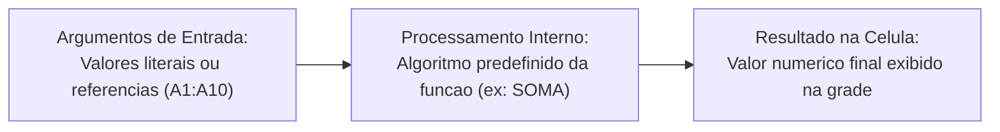
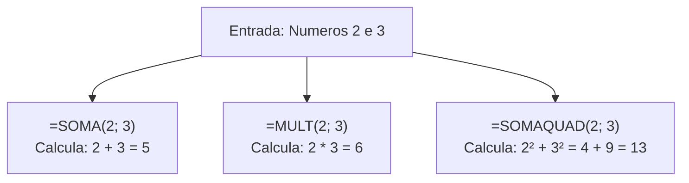
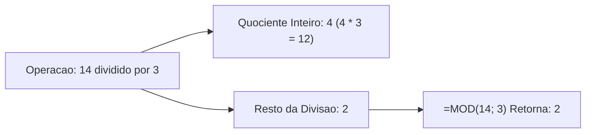
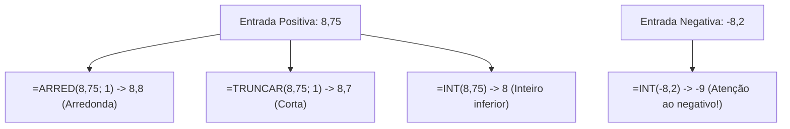
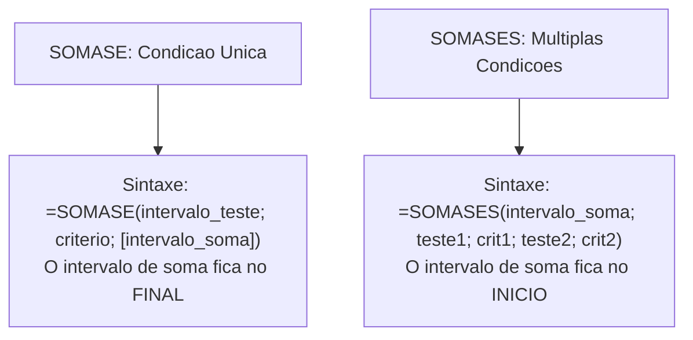
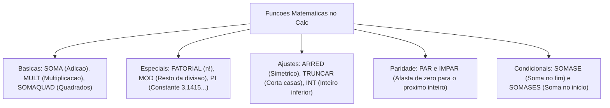

O processamento numérico no LibreOffice Calc baseia-se em sua biblioteca de funções matemáticas. Em rotinas administrativas de segurança pública, as planilhas exigem agregações de despesas e arredondamentos exatos. Também utilizam divisões modulares e somas condicionais. O domínio dessas ferramentas confere velocidade operacional e precisão às tarefas do servidor militar.

Neste capítulo, estudaremos a estrutura das funções e a passagem de argumentos. Em seguida, analisaremos as funções aritméticas básicas e especiais. Veremos as rotinas de potenciação, produto, arredondamento e truncamento. Por fim, examinaremos as fórmulas de soma condicional SOMASE e SOMASES. Esses itens compõem questões clássicas das bancas.

> [!objetivos]
> - Compreender a estrutura formal das funções e a sintaxe de argumentos.
> - Aplicar as funções de cálculo básico: SOMA, MULT, MOD, FATORIAL, PI e SOMAQUAD.
> - Dominar as distinções técnicas entre as funções de ajuste: ARRED, INT e TRUNCAR.
> - Identificar o comportamento das funções de paridade inteira PAR e ÍMPAR.
> - Estruturar filtros de soma condicional utilizando SOMASE e SOMASES.

---

## Estrutura das Funções e Passagem de Argumentos

Uma **função** no Calc é uma rotina predefinida. Ela recebe dados de entrada denominados **argumentos**. A função executa operações matemáticas e entrega o resultado final diretamente na célula. Toda função inicia-se pelo sinal de igualdade (`=`). Em seguida, vem o nome da rotina em maiúsculas e os parênteses que delimitam os parâmetros.

Os argumentos no interior dos parênteses separam-se compulsoriamente por **ponto e vírgula (`;`)**. O uso de vírgula gera erro de sintaxe, pois no Brasil ela atua como separador decimal.

A passagem de dados ocorre por valor ou por referência:
1. **Passagem por Valor**: os números entram diretamente na fórmula, como em `=FATORIAL(5)` ou `=MOD(17; 3)`. O resultado permanece fixo até a edição manual da célula.
2. **Passagem por Referência**: os argumentos apontam para coordenadas celulares, como em `=SOMA(A1:A10)`. O resultado atualiza-se dinamicamente quando as células de origem mudam.

> [!exemplo]
> **Ponto de Atenção da Página 30 (Funções)**: intervalos contíguos utilizam dois-pontos (`=SOMA(B2:B8)`), somando todos os valores de B2 até B8. Se o operador for ponto e vírgula (`=SOMA(B2; B8)`), a função processará apenas as duas células isoladas. Confundir esses dois operadores é um erro frequente em provas.

---

## Funções Aritméticas Básicas: SOMA, MULT e SOMAQUAD

As rotinas de agregação aritmética básica automatizam somatórios e multiplicações em blocos de células:

### Função SOMA
A função `=SOMA(número1; [número2]; ...)` totaliza todos os argumentos numéricos informados. Ela aceita números avulsos, referências isoladas e blocos matriciais:
- Células vazias ou com texto dentro de intervalos são ignoradas no cálculo.
- Exemplo: para despesas de combustíveis na faixa `A1:A5`, a fórmula `=SOMA(A1:A5)` soma os cinco lançamentos.

### Função MULT
A função `=MULT(número1; [número2]; ...)` calcula o produto de todos os argumentos informados. Ela substitui fórmulas extensas com operadores de multiplicação repetidos:
- Avaliação: a expressão `=MULT(2; 3; 4)` processa o cálculo 2 × 3 × 4, resultando no valor 24.
- Aplicação: `=MULT(B1:B4)` multiplica entre si os números contidos na faixa selecionada.

### Função SOMAQUAD
A função `=SOMAQUAD(número1; [número2]; ...)` eleva cada argumento ao quadrado e soma os resultados:
- Fórmula equivalente: x² + y² + z²...
- Avaliação prática: a fórmula `=SOMAQUAD(3; 4)` calcula 3² + 4² = 9 + 16, retornando 25.
- É muito aplicada em análises estatísticas e cálculos de desvio padrão.

> [!exemplo]
> **Ponto de Atenção da Página 37 (Função SOMA)**: se uma célula contiver texto como `"100"` entre aspas, a função `=SOMA(A1:A3)` ignorará essa célula. Contudo, se a soma for feita pelo operador direto `=A1 + A2 + A3`, o Calc tentará converter o texto em número para efetuar a soma.

---

## Funções Especiais: FATORIAL, MOD e PI

O Calc conta com rotinas para cálculos modulares e constantes combinatórias:

### Função FATORIAL
A função `=FATORIAL(número)` calcula o produto cumulativo decrescente dos inteiros positivos:
- Apenas inteiros positivos e o zero são válidos. O fatorial de zero é formalmente 1 (`=FATORIAL(0)` produz 1).
- Números decimais têm sua parte fracionária truncada pelo software.
- Exemplo: a chamada `=FATORIAL(5)` calcula 5 × 4 × 3 × 2 × 1 = 120. A fórmula `=FATORIAL(3,8)` trunca para 3! e retorna 6.

### Função MOD
A função `=MOD(dividendo; divisor)` calcula o **resto da divisão inteira** entre dois números:
- O primeiro argumento é o dividendo. O segundo argumento é o divisor.
- Avaliação: na expressão `=MOD(14; 3)`, o quociente inteiro é 4 (4 × 3 = 12) e o resto é 2. A função devolve 2.
- Se a divisão for exata, o resto é zero (`=MOD(12; 4)` resulta 0). Divisores nulos produzem o erro `#DIV/0!`.

### Função PI
A função `=PI()` retorna o valor aproximado da constante geométrica pi com até 14 casas decimais:
- Ela não recebe nenhum argumento interno. Deve ser grafada sempre com parênteses vazios.
- Aplicação: para calcular o perímetro de um círculo de raio contido em A1, usa-se `=2 * PI() * A1`.

> [!exemplo]
> **Ponto de Atenção da Página 35 (Função MOD)**: a função MOD é cobrada frequentemente em escalas de serviço militar. Para saber se um determinado dia é par ou ímpar, avalia-se `=MOD(dia; 2)`. Se o resto for 0, o dia é par; se for 1, o dia é ímpar.

---

## Métodos de Ajuste Numérico: ARRED, INT e TRUNCAR

Muitas operações de folha de pagamento e perícia técnica exigem controlar casas decimais:

### Função ARRED
A função `=ARRED(número; cont_dígitos)` executa arredondamento simétrico formal:
- Se o dígito após o corte for 5 ou superior, arredonda para cima. Se menor que 5, mantém.
- **Dígitos Positivos**: arredonda casas decimais. Exemplo: `=ARRED(5,456; 2)` resulta em `5,46`. Já `=ARRED(5,454; 2)` resulta em `5,45`.
- **Dígito Zero**: arredonda para inteiro. Exemplo: `=ARRED(7,6; 0)` resulta em 8; `=ARRED(7,4; 0)` resulta em 7.
- **Dígitos Negativos**: arredonda dezenas e centenas. Exemplo: `=ARRED(1264; -2)` arredonda na centena para `1300`. A fórmula `=ARRED(1234; -2)` resulta em `1200`.

### Função TRUNCAR
A função `=TRUNCAR(número; [núm_dígitos])` elimina os dígitos excedentes sem arredondar:
- O segundo parâmetro é opcional. Se omitido, o Calc assume 0 e descarta os decimais.
- Exemplo: a chamada `=TRUNCAR(8,799; 1)` corta os números após o primeiro decimal, resultando em `8,7`.

### Função INT
A função `=INT(número)` reduz o valor ao número inteiro imediatamente inferior:
- Para positivos, coincide com o truncamento: `=INT(8,9)` resulta em 8.
- Para negativos, arredonda para o inteiro menor: `=INT(-8,2)` resulta em `-9`.

| Valor | `=ARRED(valor; 0)` | `=TRUNCAR(valor; 0)` | `=INT(valor)` |
|---|---|---|---|
| **`8,7`** | `9` | `8` | `8` |
| **`8,2`** | `8` | `8` | `8` |
| **`-8,2`** | `-8` | `-8` | **`-9`** |
| **`-8,7`** | `-9` | `-8` | **`-9`** |

> [!pegadinha]
> **Ponto de Atenção das Páginas 39 e 40 (INT versus TRUNCAR)**: preste atenção máxima a números negativos. Ao avaliar `=TRUNCAR(-4,8)`, o resultado é `-4`. Ao avaliar `=INT(-4,8)`, o resultado é `-5`. Na reta real, o inteiro inferior a `-4,8` é o `-5`.

---

## Funções de Paridade: PAR e ÍMPAR

O Calc disponibiliza duas funções para converter valores para o próximo inteiro par ou ímpar:

### Função PAR
A função `=PAR(número)` arredonda o número para o próximo inteiro par, afastando-se do zero:
- Se já for par, é mantido: `=PAR(6)` resulta em 6.
- Se for ímpar, arredonda para o par superior: `=PAR(5)` resulta em 6.
- Se for decimal, arredonda: `=PAR(2,1)` resulta em 4.
- Para negativos, afasta-se de zero: `=PAR(-3)` resulta em `-4`.

### Função ÍMPAR
A função `=ÍMPAR(número)` arredonda para o próximo inteiro ímpar, afastando-se do zero:
- Se já for ímpar, preserva o valor: `=ÍMPAR(7)` resulta em 7.
- Se for par, avança para o próximo ímpar: `=ÍMPAR(6)` resulta em 7.
- Se for decimal, avança: `=ÍMPAR(3,2)` resulta em 5.
- Para negativos, afasta-se de zero: `=ÍMPAR(-2)` resulta em `-3`.

> [!bizu]
> **Afastamento do Zero (Páginas 34 e 36)**: as funções PAR e ÍMPAR sempre arredondam valores decimais para longe do zero. Elas nunca arredondam para baixo em grandeza absoluta.

---

## Agregações Condicionais: Funções SOMASE e SOMASES

As funções de soma condicional totalizam registros em tabelas com base em testes lógicos:

### Função SOMASE (Condição Única)
A função `=SOMASE(intervalo_critério; critério; [intervalo_soma])` totaliza células sob um critério:
1. `intervalo_critério`: células avaliadas contra a condição lógica.
2. `critério`: regra de teste numérico (`100`), textual (`"Oficial"`) ou lógico (`">50"`).
3. `[intervalo_soma]`: células com os valores a somar. Se omitido, soma o próprio intervalo de teste.

Exemplo: com patentes em `A2:A20` e soldos em `B2:B20`, a fórmula `=SOMASE(A2:A20; "Capitão"; B2:B20)` soma apenas os soldos de quem é Capitão.

### Função SOMASES (Múltiplas Condições)
A função `=SOMASES(intervalo_soma; intervalo_critério1; critério1; ...)` soma valores sob várias condições simultâneas:
- **Inversão de Sintaxe**: no SOMASES, o **`intervalo_soma` vem em primeiro lugar**.
- Em seguida, alternam-se os pares de intervalos de teste e critérios.
- Todas as condições devem ocorrer juntas na linha para que o valor seja somado.

> [!atencao]
> **Inversão entre SOMASE e SOMASES (Página 38)**: memorize com precisão. No SOMASE comum, o intervalo de soma fica no fim. No SOMASES com múltiplos critérios, o intervalo de soma fica no início da função. Essa inversão cai em quase todas as provas.

---

## Exercícios Práticos e Questões Comentadas

### Questão 1 (Prova anterior)
No LibreOffice Calc, um operador digitou na célula C1 a fórmula `=MOD(23; 5) + FATORIAL(4)`. O resultado numérico apresentado na célula foi:
A) 27
B) 28
C) 24
D) 123
E) 19

**Gabarito: A**

**Comentário detalhado:**
Calculando os termos:
1. `MOD(23; 5)`: 23 dividido por 5 dá quociente 4 com resto 3 (4 × 5 = 20). Retorna 3.
2. `FATORIAL(4)`: 4! = 4 × 3 × 2 × 1 = 24.
3. Somando as parcelas: 3 + 24 = 27.
A alternativa correta é a A.

---

### Questão 2 (Prova anterior)
Assinale a alternativa que indica o resultado produzido pela fórmula `=INT(-7,3) + TRUNCAR(8,75; 1)` no LibreOffice Calc:
A) `0,7`
B) `0,45`
C) `1,45`
D) `1,7`
E) `0,75`

**Gabarito: A**

**Comentário detalhado:**
Avaliando os termos da fórmula:
1. `INT(-7,3)`: reduz ao inteiro inferior na reta real, resultando em `-8`.
2. `TRUNCAR(8,75; 1)`: descarta decimais além da primeira casa, resultando em `8,7`.
3. Somando: `-8 + 8,7 = 0,7`.
A alternativa correta é a A.

---

### Questão 3 (Inédita)
Em uma planilha do Calc, a coluna B registra os postos militares e a coluna C as horas de plantão. Deseja-se somar as horas cumpridas exclusivamente por militares de posto "Tenente". A sintaxe correta é:
A) `=SOMASE(B2:B10; "Tenente"; C2:C10)`
B) `=SOMASE(C2:C10; "Tenente"; B2:B10)`
C) `=SOMASES(B2:B10; "Tenente"; C2:C10)`
D) `=SOMA(B2:B10 = "Tenente"; C2:C10)`
E) `=SOMASE("Tenente"; B2:B10; C2:C10)`

**Gabarito: A**

**Comentário detalhado:**
A sintaxe do SOMASE é `=SOMASE(intervalo_critério; critério; [intervalo_soma])`. Passa-se primeiro a coluna de verificação (B2:B10), depois o critério ("Tenente") e por fim a coluna dos valores a somar (C2:C10). A opção correta é a A.

---

## Mapa do Capítulo

---

### Para fixar

- **Separador de argumentos**: utiliza-se o ponto e vírgula (`;`) entre os parâmetros das funções.
- **Função SOMA**: adiciona números, ignorando células vazias e textos em intervalos.
- **Função MULT**: calcula a multiplicação contínua de todos os argumentos informados.
- **Função SOMAQUAD**: eleva cada argumento ao quadrado e soma os resultados obtidos.
- **Função MOD**: retorna o resto da divisão inteira entre dividendo e divisor.
- **Função ARRED**: faz o arredondamento simétrico formal em decimais ou inteiros.
- **Função INT**: reduz o número ao inteiro inferior da reta real (`-8,2` vira `-9`).
- **Função TRUNCAR**: corta os dígitos decimais sem realizar aproximação numérica.
- **Sintaxe SOMASE e SOMASES**: no SOMASE o intervalo de soma fica no fim; no SOMASES fica no início.
