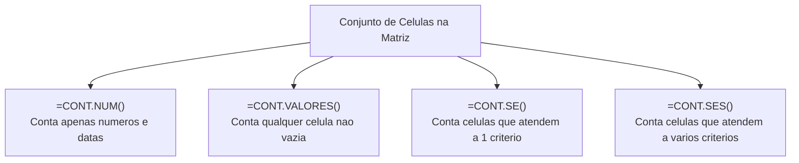
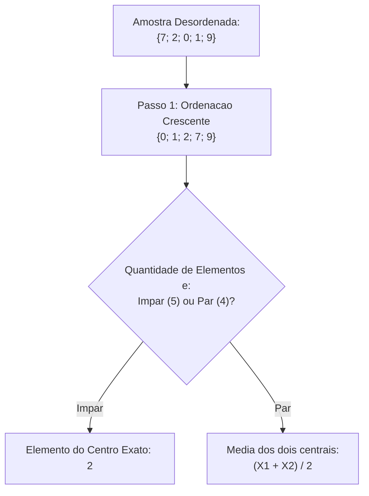
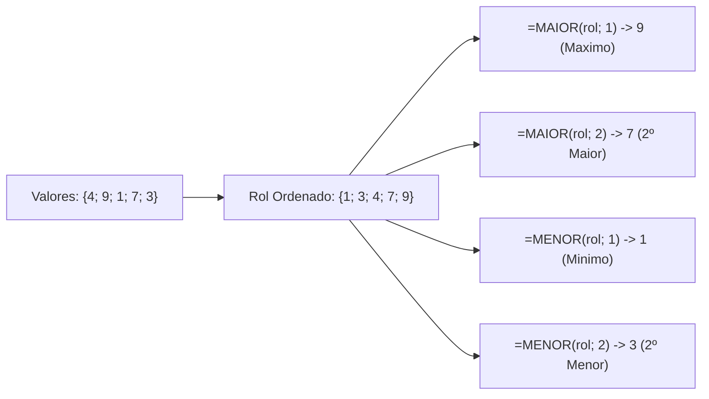
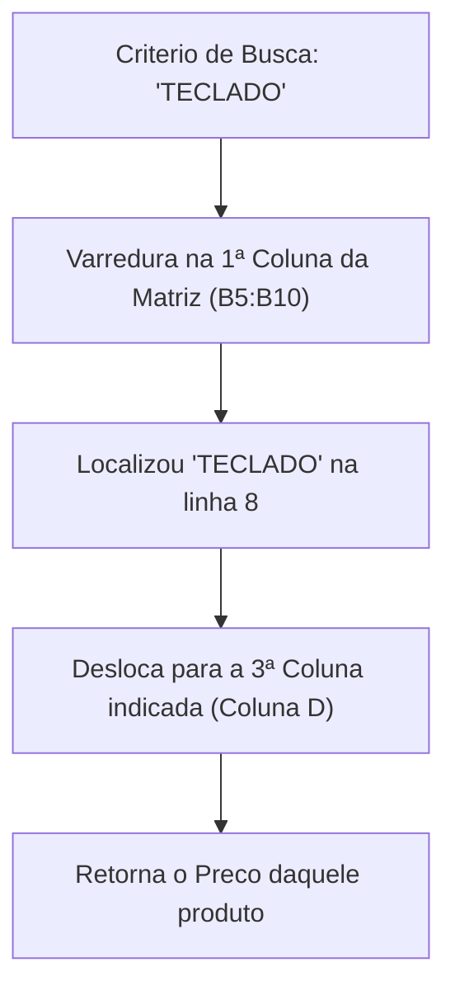
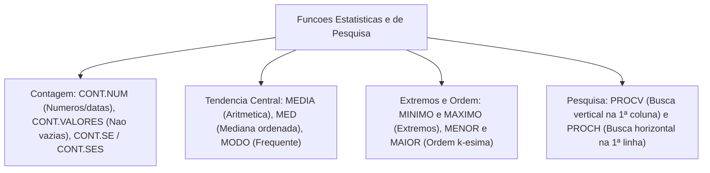

A análise de dados operacionais exige ferramentas estatísticas e de busca rápida no LibreOffice Calc. Em corporações policiais e de bombeiros, relatórios diários demandam contagens de viaturas ativas. Também exigem apuração de médias de ocorrências e a identificação de tempos de resposta extremos. Além disso, demandam consultas automatizadas a tabelas de efetivo.

Neste capítulo, estudaremos as funções estatísticas de contagem e as medidas de tendência central. Analisaremos também as funções de posição relativa k-ésima. Em seguida, examinaremos a mecânica de busca vertical e horizontal com as funções PROCV e PROCH. Esses comandos concentram alto índice de questões nos concursos.

> [!objetivos]
> - Diferenciar a abrangência de contagem das funções CONT.NÚM, CONT.VALORES, CONT.SE e CONT.SES.
> - Calcular médias aritméticas, medianas com MED e valores mais frequentes com MODO.
> - Aplicar as funções de extremos absolutos MÍNIMO e MÁXIMO e de ordem k-ésima MENOR e MAIOR.
> - Estruturar buscas verticais com PROCV em modo exato e aproximado.
> - Compreender a aplicação de buscas em tabelas horizontais com a função PROCH.

---

## Funções de Contagem: CONT.NÚM, CONT.VALORES, CONT.SE e CONT.SES

As funções de contagem apuram a quantidade de células em uma planilha. Elas diferenciam-se pelo tipo de dado avaliado e pela aplicação de critérios lógicos:

### Função CONT.NÚM
A função `=CONT.NÚM(valor1; [valor2]; ...)` conta exclusivamente as células que contêm **valores numéricos**:
- Datas e horários contam como números. Eles são armazenados internamente como números seriais.
- Células com textos alfanuméricos, valores lógicos (`VERDADEIRO` ou `FALSO`) e células vazias são desconsideradas.
- Argumentos literais digitados diretamente na chamada da função entram na apuração.

### Função CONT.VALORES
A função `=CONT.VALORES(valor1; [valor2]; ...)` conta todas as células **não vazias** em um intervalo:
- Ela contabiliza números, textos, mensagens de erro, datas e valores lógicos.
- Apenas células inteiramente em branco são ignoradas no resultado.

### Função CONT.SE
A função `=CONT.SE(intervalo; critério)` conta quantas células de uma matriz satisfazem a um determinado critério:
- Ela avalia condições numéricas (`=CONT.SE(A1:A10; 25)`), textuais (`=CONT.SE(B1:B10; "Aprovado")`) ou expressões relacionais (`=CONT.SE(C1:C10; ">=100")`).
- Ela não soma os números. A função apenas contabiliza a quantidade de vezes que o critério se repete.

### Função CONT.SES
A função `=CONT.SES(intervalo1; critério1; [intervalo2; critério2]; ...)` avalia múltiplos critérios ao mesmo tempo:
- Ela contabiliza apenas as linhas em que **todas as condições são satisfeitas em conjunto** (conjunção lógica E).
- Diferente do SOMASES, aqui não há intervalo de valores numéricos adicionais. O cálculo limita-se a contar ocorrências conjuntas.

> [!exemplo]
> **Ponto de Atenção da Página 41 (Função CONT.SE)**: considere os valores 12, 3, 40, 7 e 25 nas células `A1:A5`. A fórmula `=CONT.SE(A1:A5; ">10")` retorna 3 (pois 12, 40 e 25 são maiores que 10). Se a coluna B registrar "Apto" nas linhas 1, 3 e 5, a fórmula `=CONT.SES(A1:A5; ">10"; B1:B5; "Apto")` contará as linhas que cumprem os dois requisitos simultaneamente, retornando 3.

---

## Medidas de Tendência Central: MÉDIA, MED e MODO

O Calc disponibiliza três funções canônicas para resumir a distribuição estatística de uma amostra numérica:

### Função MÉDIA
A função `=MÉDIA(número1; [número2]; ...)` calcula a média aritmética simples dos valores informados:
- Ela soma todos os números válidos. Em seguida, divide o total pela quantidade de parcelas numéricas.
- Textos e células vazias dentro de intervalos são desconsiderados na divisão.
- Exemplo: para os valores 6, 8 e 10, a fórmula `=MÉDIA(6; 8; 10)` processa (6 + 8 + 10) / 3 = 24 / 3, devolvendo o valor 8.

### Função MED (Mediana)
A função `=MED(número1; [número2]; ...)` calcula a mediana estatística. Esse cálculo representa o elemento central do rol ordenado:
- O Calc ordena os números em ordem crescente antes de definir o ponto médio. A disposição original dos dados na planilha é irrelevante.
- **Quantidade Ímpar de Elementos**: a mediana é exatamente o número do centro. Para os valores `{7; 2; 0; 1; 9}`, o rol ordenado é `{0; 1; 2; 7; 9}`. O elemento central é o 2.
- **Quantidade Par de Elementos**: a mediana é a média aritmética dos dois valores centrais. Para os valores `{6; 2; 1; 9}`, o rol ordenado é `{1; 2; 6; 9}`. Os dois números do meio são 2 e 6. A mediana calculada é (2 + 6) / 2 = 4.

### Função MODO (Moda Estatística)
A função `=MODO(número1; [número2]; ...)` identifica a moda da amostra. Ela localiza o valor que ocorre com maior frequência:
- Se houver empate entre valores mais frequentes, a função retorna o primeiro encontrado.
- Se nenhum número se repetir no conjunto, a função retorna o código de erro `#N/D` (não disponível).

> [!pegadinha]
> **Ponto de Atenção das Páginas 42 e 43 (MED versus MODO e MOD)**:
> 1. Na função `MED`, nunca calcule a mediana sem ordenar mentalmente a lista na prova!
> 2. Não confunda a função `MODO()` com a função `MOD()`. A função `MODO()` devolve o número mais repetido de uma lista estatística. A função `MOD()` calcula o resto da divisão inteira entre dois números.

---

## Extremos Absolutos e Posições Relativas: MÍNIMO, MÁXIMO, MENOR e MAIOR

Identificar recordes e limites operacionais é rotina diária no comando das unidades militares:

### Funções MÍNIMO e MÁXIMO
As funções `=MÍNIMO(número1; ...)` e `=MÁXIMO(número1; ...)` localizam o menor e o maior valor de uma relação:
- Elas aceitam intervalos matriciais e números avulsos.
- Exemplo: para os valores `{10; 45; 3; 88}`, a chamada `=MÍNIMO(10; 45; 3; 88)` resulta em 3, enquanto `=MÁXIMO(10; 45; 3; 88)` retorna 88.

### Funções MENOR e MAIOR (Ordem k-ésima)
Muitas decisões exigem identificar não o maior valor absoluto, mas sim o segundo maior tempo ou o terceiro menor consumo. Para isso, usam-se as funções parametrizadas:
- **Função MAIOR**: `=MAIOR(intervalo; k)`. Retorna o **k-ésimo maior** elemento da lista. O argumento `k` é um número inteiro obrigatório indicando a classificação desejada.
- **Função MENOR**: `=MENOR(intervalo; k)`. Retorna o **k-ésimo menor** elemento da lista.

Equivalências fundamentais de prova:
- Quando `k = 1`, a função `=MAIOR(intervalo; 1)` produz resultado rigorosamente idêntico a `=MÁXIMO(intervalo)`.
- Quando `k = 1`, a função `=MENOR(intervalo; 1)` produz resultado rigorosamente idêntico a `=MÍNIMO(intervalo)`.

> [!bizu]
> **Ponto de Atenção das Páginas 44 e 45 (Omissão de Argumento k)**: as funções `MÁXIMO` e `MÍNIMO` recebem apenas números e faixas de células. Já as funções `MAIOR` e `MENOR` exigem obrigatoriamente dois argumentos separados por ponto e vírgula: a matriz e o índice `k`. Tentar escrever `=MAIOR(A1:A10)` sem fornecer o `k` provoca erro na fórmula.

---

## Funções de Pesquisa e Referência: PROCV e PROCH

As funções de pesquisa realizam buscas automatizadas em matrizes de dados, resgatando informações associadas de modo instantâneo:

### Função PROCV (Pesquisa Vertical)
A função `=PROCV(critério_pesquisa; matriz; índice_coluna; [ordem])` busca um elemento na primeira coluna de uma tabela. Em seguida, retorna o dado situado em uma coluna à direita:
1. `critério_pesquisa`: o valor que você deseja encontrar (código, matrícula ou texto).
2. `matriz`: a tabela retangular completa onde a busca será executada. A chave de pesquisa deve estar **obrigatoriamente na primeira coluna dessa matriz**.
3. `índice_coluna`: o número da coluna de onde será extraído o resultado. A coluna 1 é a primeira da matriz, a coluna 2 é a segunda, e assim por diante.
4. `[ordem]`: define o modo de busca:
   - `0` ou `FALSO`: busca **exata**. Se o valor não existir, a função retorna o erro `#N/D`. A primeira coluna não precisa estar ordenada.
   - `1` ou `VERDADEIRO` (padrão se omitido): busca **aproximada**. Se o valor exato não for encontrado, ela busca o maior valor menor ou igual ao critério. Para isso funcionar, a primeira coluna deve estar ordenada em ordem crescente.

> [!exemplo]
> **Ponto de Atenção da Página 46 (=PROCV("TECLADO"; B5:D10; 3; FALSO))**:
> - O Calc procura o texto "TECLADO" na primeira coluna do bloco (coluna B).
> - Ao encontrar a linha correspondente, o software desloca horizontalmente para a 3ª coluna do bloco (coluna B é 1, coluna C é 2, coluna D é 3).
> - Como o quarto argumento é `FALSO`, a busca é exata, retornando o conteúdo exato da célula na coluna D daquela mesma linha.

### Função PROCH (Pesquisa Horizontal)
A função `=PROCH(critério_pesquisa; matriz; índice_linha; [ordem])` opera de modo análogo ao PROCV, mas em sentido horizontal:
- Ela realiza a varredura na **primeira linha da matriz** da esquerda para a direita.
- Ao encontrar a coluna desejada, a função desce verticalmente até o `índice_linha` especificado para resgatar o valor correspondente.

---

## Exercícios Práticos e Questões Comentadas

### Questão 1 (Prova anterior)
Em uma planilha do LibreOffice Calc, as células A1, A2, A3 e A4 contêm, respectivamente, os valores 15, 3, 9 e 7. Ao inserir na célula B1 a fórmula `=MED(A1:A4) + MAIOR(A1:A4; 2)`, o resultado obtido será:
A) 17
B) 19
C) 16
D) 24
E) 14

**Gabarito: A**

**Comentário detalhado:**
Calculando os termos:
1. `MED(A1:A4)`: ordenando os 4 números, temos `{3; 7; 9; 15}`. Como a quantidade é par, a mediana é a média dos centrais: (7 + 9) / 2 = 16 / 2 = 8.
2. `MAIOR(A1:A4; 2)`: o segundo maior elemento da lista `{3; 7; 9; 15}` é o 9.
3. Somando as parcelas: 8 + 9 = 17.
A resposta correta é a alternativa A.

---

### Questão 2 (Prova anterior)
Assinale a alternativa que indica a função do LibreOffice Calc utilizada para contar apenas células preenchidas com números e datas em um intervalo, ignorando textos e células vazias:
A) `=CONTAR()`
B) `=CONT.VALORES()`
C) `=CONT.NÚM()`
D) `=SOMA()`
E) `=CONT.SE()`

**Gabarito: C**

**Comentário detalhado:**
A função `=CONT.NÚM()` conta apenas as células com dados numéricos e datas. A função `CONT.VALORES` conta todas as células não vazias (incluindo textos). A alternativa correta é a C.

---

### Questão 3 (Inédita)
Um bombeiro militar executa a fórmula `=PROCV("MANGUEIRA"; A1:C20; 2; FALSO)`. Sobre essa fórmula, é correto afirmar:
A) A busca será aproximada e pesquisará o termo na coluna C.
B) A função pesquisará o termo na coluna A e retornará o valor da coluna B da mesma linha.
C) O termo será pesquisado na coluna B e retornará o valor correspondente na coluna A.
D) A busca falhará se a coluna A não estiver ordenada em ordem crescente.
E) O índice 2 refere-se à quantidade de linhas que devem ser somadas.

**Gabarito: B**

**Comentário detalhado:**
No PROCV, o critério é pesquisado sempre na primeira coluna da matriz (coluna A). Ao localizar o termo com correspondência exata (FALSO), a função retorna o valor da 2ª coluna da tabela (coluna B). A opção correta é a B.

---

## Mapa do Capítulo

---

### Para fixar

- **Função CONT.NÚM**: conta exclusivamente números e datas, ignorando textos e células vazias.
- **Função CONT.VALORES**: conta todas as células preenchidas, independentemente do tipo de dado.
- **Função CONT.SE**: conta as células que atendem a um critério especificado.
- **Função MÉDIA**: calcula a média aritmética simples somando os números e dividindo pelo total.
- **Função MED**: calcula a mediana, ordenando a lista e apurando o elemento central ou a média dos dois centrais.
- **Função MODO**: localiza a moda estatística, ou seja, o valor que ocorre com maior frequência na amostra.
- **Funções MAIOR e MENOR**: retornam o k-ésimo maior ou menor elemento, exigindo o parâmetro numérico `k`.
- **Função PROCV**: pesquisa na primeira coluna da matriz e retorna o valor da coluna correspondente ao índice.
- **Argumento FALSO no PROCV**: exige correspondência exata e dispensa ordenação prévia da tabela.
